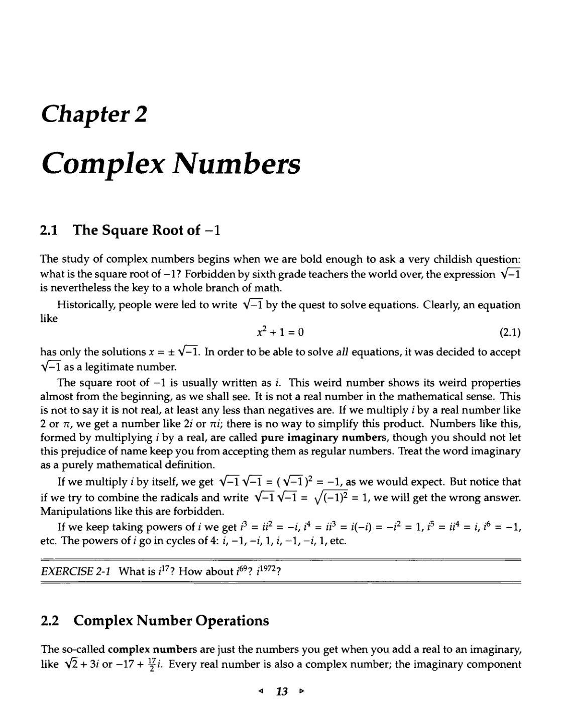
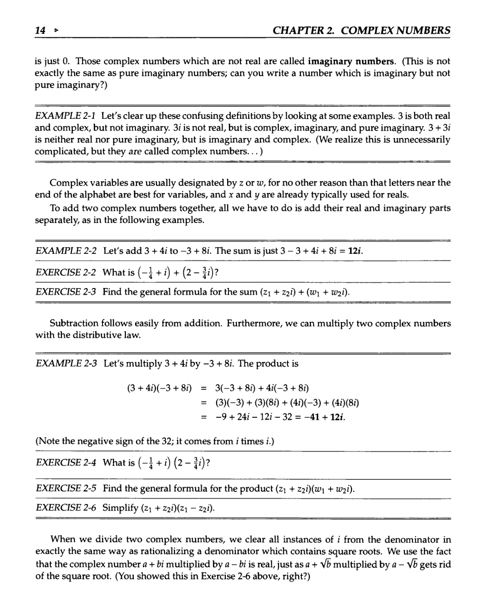
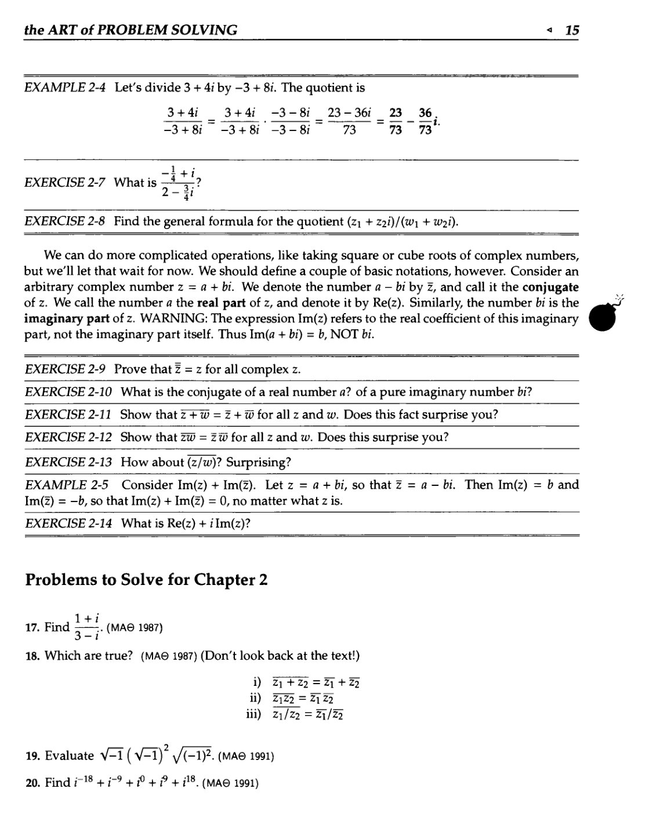
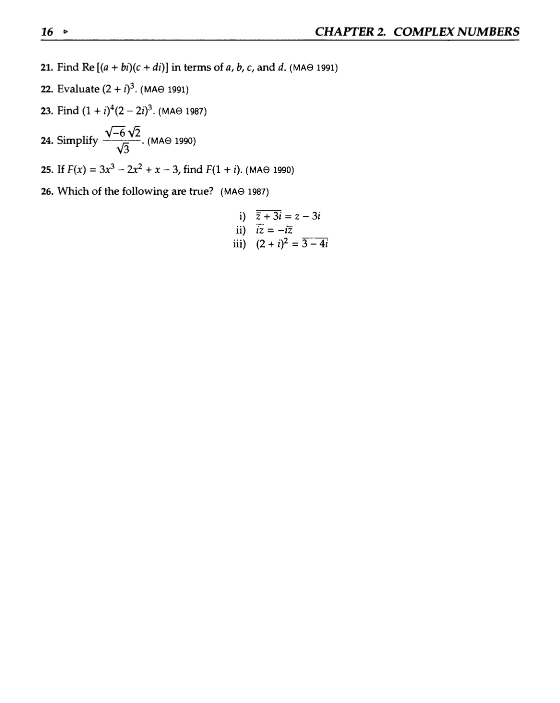

# Chapter 2: Complex Numbers

Volume 1 · Printed pages 13–16 · PDF pages 27–30

[Volume contents](../index.md)

## Printed page 13

<!-- source: volume-1, PDF page 27, printed page 13 -->

### 2.1 The Square Root of $-1$

The study of complex numbers begins when we are bold enough to ask a very childish question: what is the square root of $-1$? Forbidden by sixth grade teachers the world over, the expression $\sqrt{-1}$ is nevertheless the key to a whole branch of math.

Historically, people were led to write $\sqrt{-1}$ by the quest to solve equations. Clearly, an equation like

$$x^2 + 1 = 0$$

(2.1)

has only the solutions $x = \pm \sqrt{-1}$. In order to be able to solve all equations, it was decided to accept $\sqrt{-1}$ as a legitimate number.

The square root of $-1$ is usually written as $i$. This weird number shows its weird properties almost from the beginning, as we shall see. It is not a real number in the mathematical sense. This is not to say it is not real, at least any less than negatives are. If we multiply $i$ by a real number like 2 or $\pi$, we get a number like $2i$ or $\pi i$; there is no way to simplify this product. Numbers like this, formed by multiplying $i$ by a real, are called pure imaginary numbers, though you should not let this prejudice of name keep you from accepting them as regular numbers. Treat the word imaginary as a purely mathematical definition.

If we multiply $i$ by itself, we get $\sqrt{-1} \sqrt{-1} = (\sqrt{-1})^2 = -1$, as we would expect. But notice that if we try to combine the radicals and write $\sqrt{-1} \sqrt{-1} = \sqrt{(-1)^2} = 1$, we will get the wrong answer. Manipulations like this are forbidden.

If we keep taking powers of $i$ we get $i^3 = ii^2 = -i, i^4 = ii^3 = i(-i) = -i^2 = 1, i^5 = ii^4 = i, i^6 = -1$, etc. The powers of $i$ go in cycles of 4: $i, -1, -i, 1, i, -1, -i, 1$, etc.

**EXERCISE 2-1 What is $i^{17}$? How about $i^{69}$? $i^{1972}$?**

### 2.2 Complex Number Operations

The so-called complex numbers are just the numbers you get when you add a real to an imaginary, like $\sqrt{2} + 3i$ or $-17 + \frac{17}{2}i$. Every real number is also a complex number; the imaginary component

Original scan — PDF page 27

## Printed page 14

<!-- source: volume-1, PDF page 28, printed page 14 -->

is just 0. Those complex numbers which are not real are called imaginary numbers. (This is not exactly the same as pure imaginary numbers; can you write a number which is imaginary but not pure imaginary?)

**EXAMPLE 2-1 Let’s clear up these confusing definitions by looking at some examples. 3 is both real and complex, but not imaginary. $3i$ is not real, but is complex, imaginary, and pure imaginary. $3 + 3i$ is neither real nor pure imaginary, but is imaginary and complex. (We realize this is unnecessarily complicated, but they are called complex numbers...)**

Complex variables are usually designated by $z$ or $w$, for no other reason than that letters near the end of the alphabet are best for variables, and $x$ and $y$ are already typically used for reals.

To add two complex numbers together, all we have to do is add their real and imaginary parts separately, as in the following examples.

**EXAMPLE 2-2 Let’s add $3 + 4i$ to $-3 + 8i$. The sum is just $3 - 3 + 4i + 8i = 12i$.**

**EXERCISE 2-2 What is $(-\frac{1}{4} + i) + (2 - \frac{3}{4} i)$?**

**EXERCISE 2-3 Find the general formula for the sum $(z_1 + z_2 i) + (w_1 + w_2 i)$.**

Subtraction follows easily from addition. Furthermore, we can multiply two complex numbers with the distributive law.

**EXAMPLE 2-3 Let’s multiply $3 + 4i$ by $-3 + 8i$. The product is**

$$
(3 + 4i)(-3 + 8i) = 3(-3 + 8i) + 4i(-3 + 8i)
= (3)(-3) + (3)(8i) + (4i)(-3) + (4i)(8i)
= -9 + 24i - 12i - 32 = -41 + 12i.
$$

(Note the negative sign of the 32; it comes from $i$ times $i$.)

**EXERCISE 2-4 What is $(-\frac{1}{4} + i)(2 - \frac{3}{4} i)$?**

**EXERCISE 2-5 Find the general formula for the product $(z_1 + z_2 i)(w_1 + w_2 i)$.**

**EXERCISE 2-6 Simplify $(z_1 + z_2 i)(z_1 - z_2 i)$.**

When we divide two complex numbers, we clear all instances of $i$ from the denominator in exactly the same way as rationalizing a denominator which contains square roots. We use the fact that the complex number $a + bi$ multiplied by $a - bi$ is real, just as $a + \sqrt{b}$ multiplied by $a - \sqrt{b}$ gets rid of the square root. (You showed this in Exercise 2-6 above, right?)

Original scan — PDF page 28

## Printed page 15

<!-- source: volume-1, PDF page 29, printed page 15 -->

**EXAMPLE 2-4 Let’s divide $3 + 4i$ by $-3 + 8i$. The quotient is**

$$\frac{3 + 4i}{-3 + 8i} = \frac{3 + 4i}{-3 + 8i} \cdot \frac{-3 - 8i}{-3 - 8i} = \frac{23 - 36i}{73} = \frac{23}{73} - \frac{36}{73} i.$$

**EXERCISE 2-7 What is $\frac{-\frac{1}{4} + i}{2 - \frac{3}{4} i}$?**

**EXERCISE 2-8 Find the general formula for the quotient $(z_1 + z_2 i) / (w_1 + w_2 i)$.**

We can do more complicated operations, like taking square or cube roots of complex numbers, but we’ll let that wait for now. We should define a couple of basic notations, however. Consider an arbitrary complex number $z = a + bi$. We denote the number $a - bi$ by $\bar{z}$, and call it the conjugate of $z$. We call the number $a$ the **real part** of $z$, and denote it by $\text{Re}(z)$. Similarly, the number $bi$ is the **imaginary part** of $z$. WARNING: The expression $\text{Im}(z)$ refers to the real coefficient of this imaginary part, not the imaginary part itself. Thus $\text{Im}(a + bi) = b$, NOT $bi$.

**EXERCISE 2-9 Prove that $\bar{z} = z$ for all complex $z$.**

**EXERCISE 2-10 What is the conjugate of a real number $a$? of a pure imaginary number $bi$?**

**EXERCISE 2-11 Show that $\bar{z} + \bar{w} = \bar{z} + \bar{w}$ for all $z$ and $w$. Does this fact surprise you?**

**EXERCISE 2-12 Show that $\bar{z} \bar{w} = \bar{z} \bar{w}$ for all $z$ and $w$. Does this surprise you?**

**EXERCISE 2-13 How about $(\bar{z}/w)$? Surprising?**

**EXAMPLE 2-5 Consider $\text{Im}(z) + \text{Im}(\bar{z})$. Let $z = a + bi$, so that $\bar{z} = a - bi$. Then $\text{Im}(z) = b$ and $\text{Im}(\bar{z}) = -b$, so that $\text{Im}(z) + \text{Im}(\bar{z}) = 0$, no matter what $z$ is.**

**EXERCISE 2-14 What is $\text{Re}(z) + i \text{Im}(z)$?**

Problems to Solve for Chapter 2

17. Find $\frac{1 + i}{3 - i}$. (MAΘ 1987)

18. Which are true? (MAΘ 1987) (Don’t look back at the text!)

i) $\bar{z}_1 + \bar{z}_2 = \bar{z}_1 + \bar{z}_2$
ii) $\bar{z}_1 \bar{z}_2 = \bar{z}_1 \bar{z}_2$
iii) $\bar{z}_1/z_2 = \bar{z}_1/z_2$

19. Evaluate $\sqrt{-1} \left( \sqrt{-1} \right)^2 \sqrt{(-1)^2}$. (MAΘ 1991)

20. Find $i^{-18} + i^{-9} + i^0 + i^9 + i^{18}$. (MAΘ 1991)

Original scan — PDF page 29

## Printed page 16

<!-- source: volume-1, PDF page 30, printed page 16 -->

21. Find $\text{Re}[(a + bi)(c + di)]$ in terms of $a, b, c,$ and $d$. (MA$\Theta$ 1991)

22. Evaluate $(2 + i)^3$. (MA$\Theta$ 1991)

23. Find $(1 + i)^4(2 - 2i)^3$. (MA$\Theta$ 1987)

24. Simplify $\frac{\sqrt{-6}\sqrt{2}}{\sqrt{3}}$. (MA$\Theta$ 1990)

25. If $F(x) = 3x^3 - 2x^2 + x - 3$, find $F(1 + i)$. (MA$\Theta$ 1990)

26. Which of the following are true? (MA$\Theta$ 1987)

- i) $\overline{\bar{z} + 3i} = z - 3i$
- ii) $\overline{iz} = -i\bar{z}$
- iii) $(2 + i)^2 = \overline{3 - 4i}$

Original scan — PDF page 30

