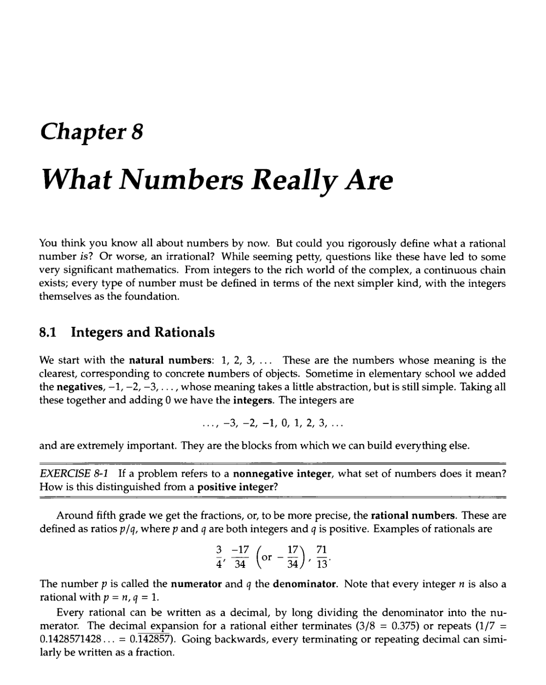
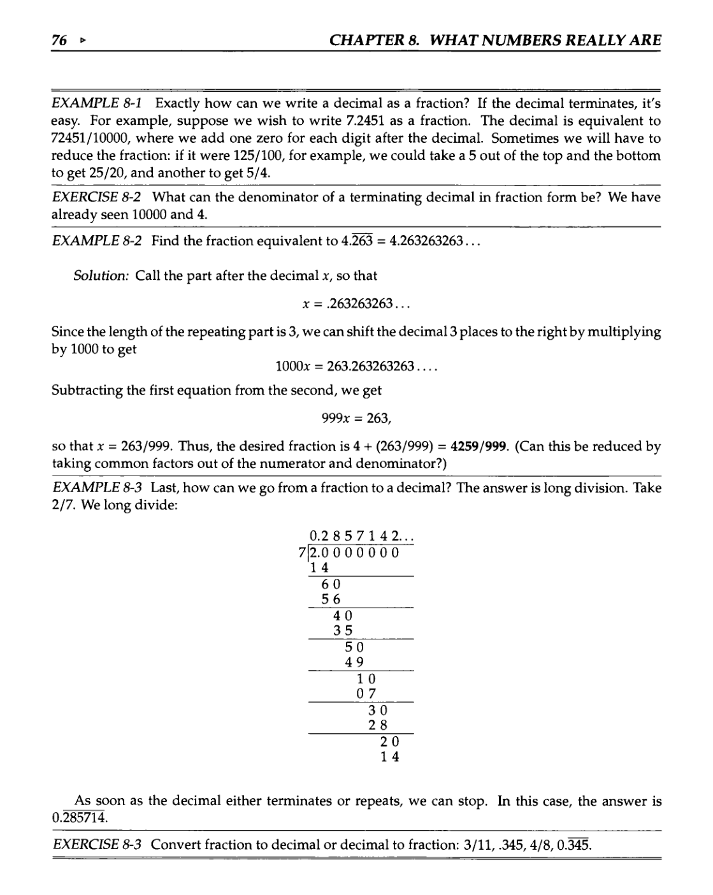
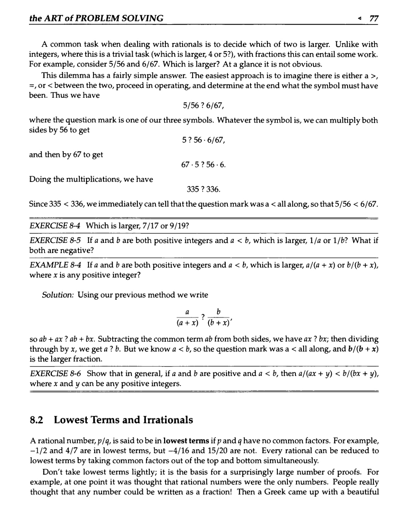
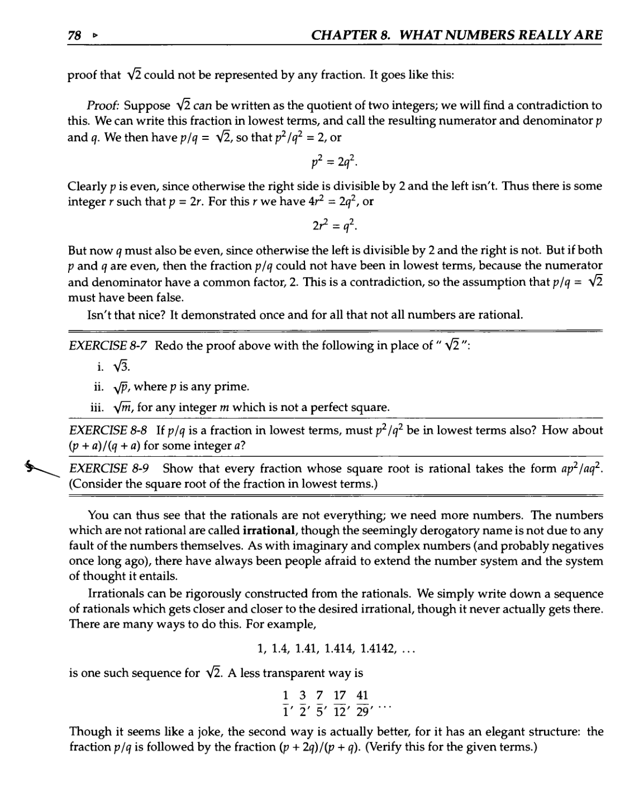
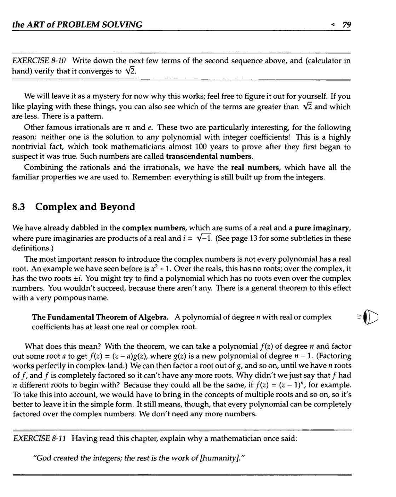
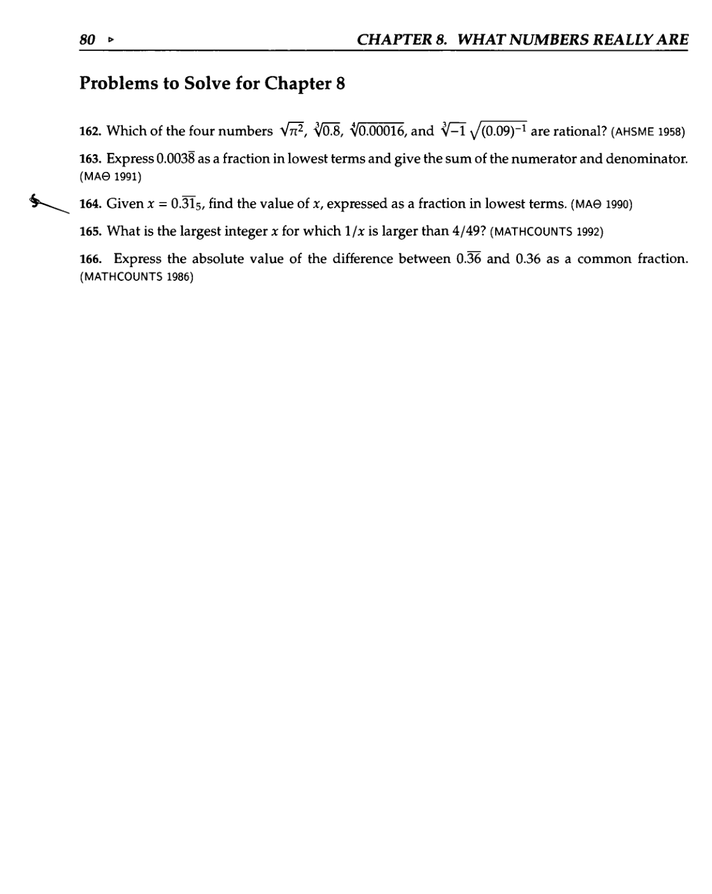

# Chapter 8: What Numbers Really Are

Volume 1 · Printed pages 75–80 · PDF pages 89–94

[Volume contents](../index.md)

## Printed page 75

<!-- source: volume-1, PDF page 89, printed page 75 -->

Chapter 8

What Numbers Really Are

You think you know all about numbers by now. But could you rigorously define what a rational number is? Or worse, an irrational? While seeming petty, questions like these have led to some very significant mathematics. From integers to the rich world of the complex, a continuous chain exists; every type of number must be defined in terms of the next simpler kind, with the integers themselves as the foundation.

### 8.1 Integers and Rationals

We start with the natural numbers: 1, 2, 3, ... These are the numbers whose meaning is the clearest, corresponding to concrete numbers of objects. Sometimes in elementary school we added the negatives, $-1, -2, -3, ...$, whose meaning takes a little abstraction, but is still simple. Taking all these together and adding 0 we have the integers. The integers are

$$\ldots, -3, -2, -1, 0, 1, 2, 3, ...$$

and are extremely important. They are the blocks from which we can build everything else.

**EXERCISE 8-1 If a problem refers to a nonnegative integer, what set of numbers does it mean? How is this distinguished from a positive integer?**

Around fifth grade we get the fractions, or, to be more precise, the rational numbers. These are defined as ratios $p/q$, where $p$ and $q$ are both integers and $q$ is positive. Examples of rationals are

$$\frac{3}{4}, \frac{-17}{34} \left( \text{or} -\frac{17}{34} \right), \frac{71}{13}.$$

The number $p$ is called the numerator and $q$ the denominator. Note that every integer $n$ is also a rational with $p = n, q = 1$.

Every rational can be written as a decimal, by long dividing the denominator into the numerator. The decimal expansion for a rational either terminates $(3/8 = 0.375)$ or repeats $(1/7 = 0.1428571428 \ldots = 0.142857)$. Going backwards, every terminating or repeating decimal can similarly be written as a fraction.

Original scan — PDF page 89

## Printed page 76

<!-- source: volume-1, PDF page 90, printed page 76 -->

**EXAMPLE 8-1 Exactly how can we write a decimal as a fraction? If the decimal terminates, it’s easy. For example, suppose we wish to write 7.2451 as a fraction. The decimal is equivalent to 72451/10000, where we add one zero for each digit after the decimal. Sometimes we will have to reduce the fraction: if it were 125/100, for example, we could take a 5 out of the top and the bottom to get 25/20, and another to get 5/4.**

**EXERCISE 8-2 What can the denominator of a terminating decimal in fraction form be? We have already seen 10000 and 4.**

**EXAMPLE 8-2 Find the fraction equivalent to $4.263 = 4.263263263 \ldots$**

Solution: Call the part after the decimal $x$, so that

$$x = .263263263 \ldots$$

Since the length of the repeating part is 3, we can shift the decimal 3 places to the right by multiplying by 1000 to get

$$1000x = 263.263263263 \ldots$$

Subtracting the first equation from the second, we get

$$999x = 263,$$

so that $x = 263/999$. Thus, the desired fraction is $4 + (263/999) = 4259/999$. (Can this be reduced by taking common factors out of the numerator and denominator?)

**EXAMPLE 8-3 Last, how can we go from a fraction to a decimal? The answer is long division. Take 2/7. We long divide:**

$$\begin{array}{c}
0.2 \ 8 \ 5 \ 7 \ 1 \ 4 \ 2 \ldots \\
7 \ 2.0 \ 0 \ 0 \ 0 \ 0 \ 0 \ 0 \\
1 \ 4 \\
\hline
6 \ 0 \\
5 \ 6 \\
\hline
4 \ 0 \\
3 \ 5 \\
\hline
5 \ 0 \\
4 \ 9 \\
\hline
1 \ 0 \\
0 \ 7 \\
\hline
3 \ 0 \\
2 \ 8 \\
\hline
2 \ 0 \\
1 \ 4 \\
\end{array}$$

As soon as the decimal either terminates or repeats, we can stop. In this case, the answer is $0.285714$.

**EXERCISE 8-3 Convert fraction to decimal or decimal to fraction: $3/11$, $.345$, $4/8$, $0.345$.**

Original scan — PDF page 90

## Printed page 77

<!-- source: volume-1, PDF page 91, printed page 77 -->

A common task when dealing with rationals is to decide which of two is larger. Unlike with integers, where this is a trivial task (which is larger, 4 or 5?), with fractions this can entail some work. For example, consider 5/56 and 6/67. Which is larger? At a glance it is not obvious.

This dilemma has a fairly simple answer. The easiest approach is to imagine there is either a $>$, $=$, or $<$ between the two, proceed in operating, and determine at the end what the symbol must have been. Thus we have

$$5/56\;?\;6/67,$$

where the question mark is one of our three symbols. Whatever the symbol is, we can multiply both sides by 56 to get

$$5\;?\;56\cdot6/67,$$

and then by 67 to get

$$67\cdot5\;?\;56\cdot6.$$

Doing the multiplications, we have

$$335\;?\;336.$$

Since $335 < 336$, we immediately can tell that the question mark was a $<$ all along, so that $5/56 < 6/67.$

**EXERCISE 8-4** Which is larger, 7/17 or 9/19?

**EXERCISE 8-5** If $a$ and $b$ are both positive integers and $a < b$, which is larger, $1/a$ or $1/b$? What if both are negative?

**EXAMPLE 8-4** If $a$ and $b$ are both positive integers and $a < b$, which is larger, $a/(a + x)$ or $b/(b + x)$, where $x$ is any positive integer?

**Solution:** Using our previous method we write

$$\frac{a}{(a + x)}\;?\;\frac{b}{(b + x)},$$

so $ab + ax\;?\;ab + bx$. Subtracting the common term $ab$ from both sides, we have $ax\;?\;bx$; then dividing through by $x$, we get $a\;?\;b$. But we know $a < b$, so the question mark was a $<$ all along, and $b/(b + x)$ is the larger fraction.

**EXERCISE 8-6** Show that in general, if $a$ and $b$ are positive and $a < b$, then $a/(ax + y) < b/(bx + y)$, where $x$ and $y$ can be any positive integers.

### 8.2 Lowest Terms and Irrationals

A rational number, $p/q$, is said to be in **lowest terms** if $p$ and $q$ have no common factors. For example, $-1/2$ and $4/7$ are in lowest terms, but $-4/16$ and $15/20$ are not. Every rational can be reduced to lowest terms by taking common factors out of the top and bottom simultaneously.

Don’t take lowest terms lightly; it is the basis for a surprisingly large number of proofs. For example, at one point it was thought that rational numbers were the only numbers. People really thought that any number could be written as a fraction! Then a Greek came up with a beautiful

Original scan — PDF page 91

## Printed page 78

<!-- source: volume-1, PDF page 92, printed page 78 -->

proof that $\sqrt{2}$ could not be represented by any fraction. It goes like this:

**Proof:** Suppose $\sqrt{2}$ can be written as the quotient of two integers; we will find a contradiction to this. We can write this fraction in lowest terms, and call the resulting numerator and denominator $p$ and $q$. We then have $p/q = \sqrt{2}$, so that $p^2/q^2 = 2$, or

$$p^2 = 2q^2.$$

Clearly $p$ is even, since otherwise the right side is divisible by 2 and the left isn't. Thus there is some integer $r$ such that $p = 2r$. For this $r$ we have $4r^2 = 2q^2$, or

$$2r^2 = q^2.$$

But now $q$ must also be even, since otherwise the left is divisible by 2 and the right is not. But if both $p$ and $q$ are even, then the fraction $p/q$ could not have been in lowest terms, because the numerator and denominator have a common factor, 2. This is a contradiction, so the assumption that $p/q = \sqrt{2}$ must have been false.

Isn't that nice? It demonstrated once and for all that not all numbers are rational.

**EXERCISE 8-7** Redo the proof above with the following in place of "$\sqrt{2}$":

i. $\sqrt{3}$.
ii. $\sqrt{p}$, where $p$ is any prime.
iii. $\sqrt{m}$, for any integer $m$ which is not a perfect square.

**EXERCISE 8-8** If $p/q$ is a fraction in lowest terms, must $p^2/q^2$ be in lowest terms also? How about $(p + a)/(q + a)$ for some integer $a$?

**EXERCISE 8-9** Show that every fraction whose square root is rational takes the form $ap^2/aq^2$. (Consider the square root of the fraction in lowest terms.)

You can thus see that the rationals are not everything; we need more numbers. The numbers which are not rational are called **irrational**, though the seemingly derogatory name is not due to any fault of the numbers themselves. As with imaginary and complex numbers (and probably negatives once long ago), there have always been people afraid to extend the number system and the system of thought it entails.

Irrationals can be rigorously constructed from the rationals. We simply write down a sequence of rationals which gets closer and closer to the desired irrational, though it never actually gets there. There are many ways to do this. For example,

$$1, 1.4, 1.41, 1.414, 1.4142, \ldots$$

is one such sequence for $\sqrt{2}$. A less transparent way is

$$\frac{1}{1}, \frac{3}{2}, \frac{7}{5}, \frac{17}{12}, \frac{41}{29}, \ldots$$

Though it seems like a joke, the second way is actually better, for it has an elegant structure: the fraction $p/q$ is followed by the fraction $(p + 2q)/(p + q)$. (Verify this for the given terms.)

Original scan — PDF page 92

## Printed page 79

<!-- source: volume-1, PDF page 93, printed page 79 -->

**EXERCISE 8-10** Write down the next few terms of the second sequence above, and (calculator in hand) verify that it converges to $\sqrt2$.

We will leave it as a mystery for now why this works; feel free to figure it out for yourself. If you like playing with these things, you can also see which of the terms are greater than $\sqrt{2}$ and which are less. There is a pattern.

Other famous irrationals are $\pi$ and $e$. These two are particularly interesting, for the following reason: neither one is the solution to any polynomial with integer coefficients! This is a highly nontrivial fact, which took mathematicians almost 100 years to prove after they first began to suspect it was true. Such numbers are called transcendental numbers.

Combining the rationals and the irrationals, we have the real numbers, which have all the familiar properties we are used to. Remember: everything is still built up from the integers.

### 8.3 Complex and Beyond

We have already dabbled in the complex numbers, which are sums of a real and a pure imaginary, where pure imaginaries are products of a real and $i = \sqrt{-1}$. (See page 13 for some subtleties in these definitions.)

The most important reason to introduce the complex numbers is not every polynomial has a real root. An example we have seen before is $x^2 + 1$. Over the reals, this has no roots; over the complex, it has the two roots $\pm i$. You might try to find a polynomial which has no roots even over the complex numbers. You wouldn’t succeed, because there aren’t any. There is a general theorem to this effect with a very pompous name.

**The Fundamental Theorem of Algebra.** A polynomial of degree $n$ with real or complex coefficients has at least one real or complex root.

What does this mean? With the theorem, we can take a polynomial $f(z)$ of degree $n$ and factor out some root $a$ to get $f(z) = (z - a)g(z)$, where $g(z)$ is a new polynomial of degree $n - 1$. (Factoring works perfectly in complex-land.) We can then factor a root out of $g$, and so on, until we have $n$ roots of $f$, and $f$ is completely factored so it can’t have any more roots. Why didn’t we just say that $f$ had $n$ different roots to begin with? Because they could all be the same, if $f(z) = (z - 1)^n$, for example. To take this into account, we would have to bring in the concepts of multiple roots and so on, so it’s better to leave it in the simple form. It still means, though, that every polynomial can be completely factored over the complex numbers. We don’t need any more numbers.

**EXERCISE 8-11** Having read this chapter, explain why a mathematician once said:

“God created the integers; the rest is the work of [humanity].”

Original scan — PDF page 93

## Printed page 80

<!-- source: volume-1, PDF page 94, printed page 80 -->

### Problems to Solve for Chapter 8

162. Which of the four numbers $\sqrt{\pi^2}$, $\sqrt[3]{0.8}$, $\sqrt[4]{0.00016}$, and $\sqrt[3]{-1}\sqrt{(0.09)^{-1}}$ are rational? (AHSME 1958)

163. Express $0.003\bar{8}$ as a fraction in lowest terms and give the sum of the numerator and denominator. (MAΘ 1991)

164. Given $x = 0.\overline{31}_5$, find the value of $x$, expressed as a fraction in lowest terms. (MAΘ 1990)

165. What is the largest integer $x$ for which $1/x$ is larger than $4/49$? (MATHCOUNTS 1992)

166. Express the absolute value of the difference between $0.\overline{36}$ and $0.36$ as a common fraction. (MATHCOUNTS 1986)

Original scan — PDF page 94

