# Chapter 11: Triangles, a.k.a. Geometry

Volume 1 · Printed pages 93–117 · PDF pages 107–131

[Volume contents](../index.md)

## Printed page 93

<!-- source: volume-1, PDF page 107, printed page 93 -->

Chapter 11

Triangles, a.k.a. Geometry

Nearly all of geometry comes down to the simple three sided figure, the triangle. Since triangles are so important, this chapter is long. Take your time; once you master the lessons of this chapter, you will have nearly mastered basic geometry. To keep your morale up (and to remember the material past the time you turn the page!), try some end-of-chapter problems after each section, rather than saving them until you feel you know the whole chapter.

### 11.1 Classifying Triangles

The points where the sides of a triangle meet are the vertices.

Triangles can be classified by their angles or by the lengths of their sides. As proven on page 86, the sum of the measures of the three angles of a triangle is always 180 degrees. Any triangle in which all three angles are acute is called an acute triangle. If one of the triangle’s angles is right, it is a right triangle, and the other two angles are complementary (because the sum of all three must be 180°). The side opposite the right angle is called the hypotenuse and the other two sides are called legs. Finally, if one of the angles is obtuse, the triangle is called an obtuse triangle.

If all three sides of a triangle are equal, the triangle is called an equilateral triangle. In an equilateral triangle, all three angles are the same, and therefore equal to 60°. (Why?) If two sides of the triangle are equal, the triangle is isosceles (eye SOS uh leez) and the two angles opposite the equal sides are also equal. The two equal sides are called the legs and the other side is the base. The angle opposite the base is the vertex angle and the equal angles are called the base angles. If no two sides of a triangle are the same, the triangle is scalene.

Original scan — PDF page 107

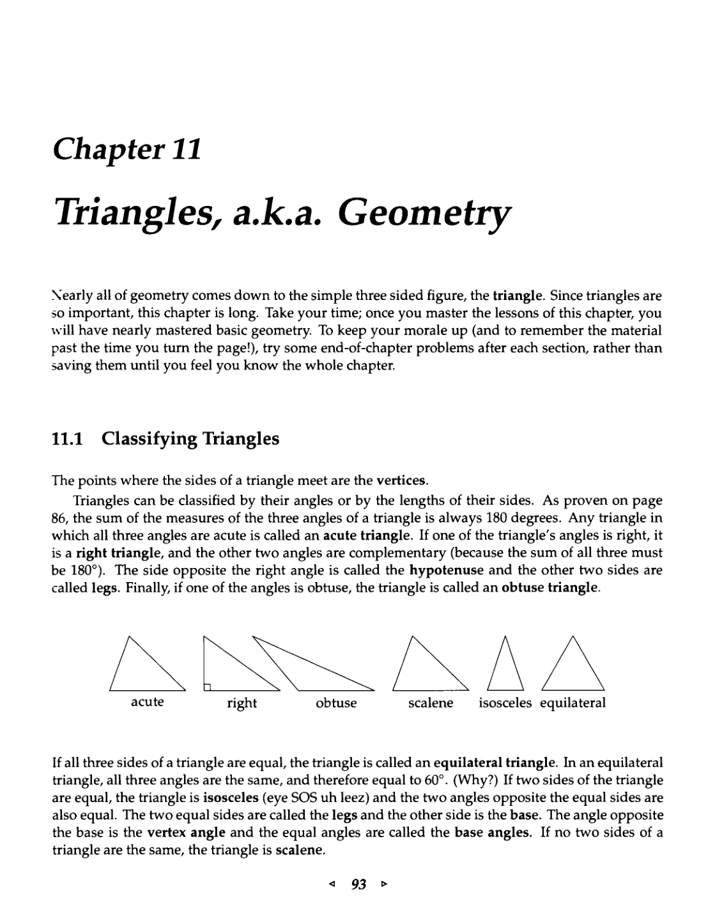

## Printed page 94

<!-- source: volume-1, PDF page 108, printed page 94 -->

### 11.2 Parts of a Triangle

The sides of $\triangle ABC$ are usually called $a, b,$ and $c,$ with $a = BC, b = AC,$ and $c = AB.$ (Do you see the pattern in this labelling?) The perimeter of any polygon is the sum of its sides, so the perimeter $p$ of a $\triangle ABC$ is $a + b + c.$ Often we find ourselves working with one-half the perimeter. This is called the semiperimeter and is usually denoted $s$.

There are many special lines and points in a triangle of which you should be aware.

Medians

A segment drawn from a vertex to the midpoint of the opposite side is a median. The three medians intersect at the centroid, which is usually denoted $G.$ That the three medians are concurrent, meaning all three lines meet at one point, is not obvious; it is proven on page 152. The centroid divides each median in a 2:1 ratio, that is:

$$\frac{AG}{GD} = \frac{BG}{GE} = \frac{CG}{GF} = \frac{2}{1}.$$

Angle Bisectors

A line which passes through the vertex of an angle and divides the angle into two equal angles is called an angle bisector. How do we determine where the angle bisector of an angle is? The measure of an angle is determined by the difference between the directions of the sides of the angle; for example, if the two sides point in nearly the same direction, the angle will be small. An angle bisector therefore must be equally 'far' from both sides of the angle and therefore consist of all the points which are equidistant from the sides of the angle. (The distance from a point to a line is the length of the perpendicular segment from the point to the line.)

Like the medians, the angle bisectors all pass through a single point. How would we prove that all three angle bisectors pass through a single point? If there is a point that is equidistant from all three sides of the triangle, then the angle bisectors all pass through that point because each angle bisector is the set of all points that are equidistant from two of the sides.

Let $I$ be the intersection of angle bisectors $AD$ and $BE.$ Since $I$ is on $AD,$ it is equidistant from $AB$ and $AC.$ Since $I$ is on $BE,$ it is also equidistant from $AB$ and $BC.$ Since it is equidistant from $AC$ and $AB,$ and from $AB$ and $BC,$ $I$ must also be equidistant from $AC$ and $BC.$ Hence, it must be on the angle bisector of $\angle ACB.$ Thus, the angle bisectors are concurrent at the point $I.$

Let's call the common distance from $I$ to the sides of the triangle $r.$ Suppose we draw a circle with center $I$ and radius $r.$ It will hit the sides of the triangle, but only at exactly one point, because the segment from $I$ to a side with length $r$ is perpendicular to the side. (Remember, $I$ is $r$ from each side.) The diagram at right shows this fact. We say that the circle is inscribed in the triangle because it is tangent to all three sides of the triangle and we call the circle the incircle. Likewise, point $I$ is the incenter and $r$ is the inradius.

Original scan — PDF page 108

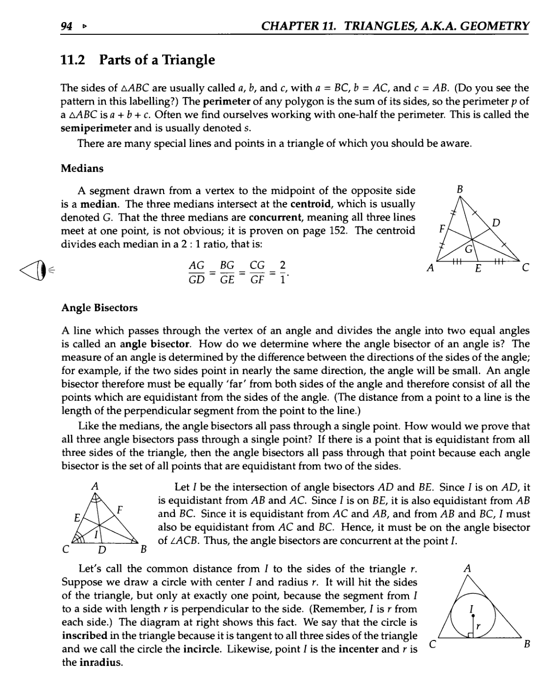

## Printed page 95

<!-- source: volume-1, PDF page 109, printed page 95 -->

Perpendicular Bisectors

A line which is perpendicular to a segment and passes through the midpoint of the segment is called the **perpendicular bisector** of the segment. Apply the argument we used for angle bisectors to show that the perpendicular bisector of a segment consists of all the points which are equidistant from the two endpoints of a segment.

The perpendicular bisectors of the sides of the triangle are concurrent at the **circumcenter**, usually called $O$. Since $O$ is the same distance, which we'll call $R$, from the three vertices, if we draw a circle with radius $R$ and center $O$, it will pass through each of the vertices. Thus we say that the triangle is inscribed in the circle, or the circle is **circumscribed** about the triangle. As you may have guessed, this circle is the **circumcircle**, a circle which passes through all three vertices of the triangle. (Can you convince yourself that such a circle must exist?) The radius of the circumcircle, or **circumradius**, is often called $R$ as above to contrast with the inradius $r$. As shown in the figure above, the circumcenter of an obtuse triangle is outside the triangle, of an acute triangle is in the triangle, and that of a right triangle is on the triangle.

You should be able to prove for yourself that the perpendicular bisectors are concurrent; the proof is exactly like that for angle bisectors: let $O$ be the intersection of the perpendicular bisectors of $AB$ and $AC$. Since $O$ is on the perpendicular bisector of $AB$, it is equidistant from $A$ and $B$. Continue from here to show that $O$ is equidistant from $A, B,$ and $C$.

Altitudes

A perpendicular segment from the vertex of a triangle to the side opposite (or the extension of that side, as in the obtuse triangle $ABC$ at right) is called an **altitude**. (Sometimes the altitude of a triangle is also called the **height.**) The length of an altitude is the distance from the vertex to the line containing the opposite side. As shown in the figure, to draw the altitudes of an obtuse triangle, we must extend some sides of the triangle, as in the dashed extension of $BC$ to $D$, then we can draw altitude $AD$ to side $BC$. Remember, any time we say the distance from a point to a line, we mean the length of the perpendicular segment drawn from the point to the line.

The altitudes are usually denoted $h_a$, $h_b$, and $h_c$, where $h_a$ is the altitude from $A$ and so on. The altitudes are concurrent at the **orthocenter**, denoted $H$. As suggested by the above figure of the altitude of an obtuse triangle, the orthocenter of an obtuse triangle is outside the triangle. (Draw it and see for yourself!) Where is the orthocenter of a right triangle?

Original scan — PDF page 109

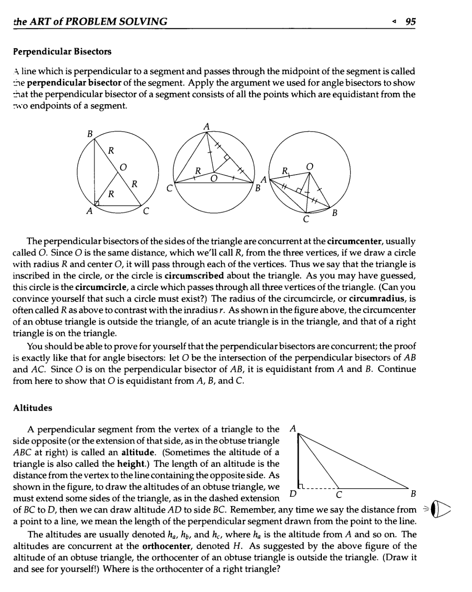

## Printed page 96

<!-- source: volume-1, PDF page 110, printed page 96 -->

**EXAMPLE 11-1 Show that the circumcenter of a right triangle is the midpoint of its hypotenuse.**

Proof: Since $\angle C$ is an inscribed right angle, we have $\widehat{AB} = 2\angle C = 180^\circ$. Thus $\widehat{AB}$ is a semi-circular arc, and $AB$ is a diameter of the circle. Hence, $O$, as the midpoint of the diameter, is the center of the circle. Thus the midpoint of the hypotenuse of a right triangle is the circumcenter of the triangle.

**EXERCISE 11-1 Show that the circumradius of a right triangle is equal to half the hypotenuse.**

**EXERCISE 11-2 Show that the median to the hypotenuse of a right triangle is equal to half the hypotenuse.**

**EXERCISE 11-3 Show that if a median of a triangle is one-half the side to which it is drawn, then the triangle must be right.**

### 11.3 The Triangle Inequality

Get a ruler and try to draw a triangle with sides 1, 8, and 11 cm. Start from a point $A$, then pick $B$ so that $AB = 8$ cm. Now we pick point $C$ so that $BC = 1$ cm. What are the possible values of $AC$? If we start from $B$ and move 1 cm, the closest we can get to $A$ to go directly towards $A$. Thus, the shortest distance possible from $A$ to $C$ is 7 cm. How about the longest possible distance? For $C$ to be as far as possible from $B$, we must move 1 cm from $B$ directly away from $A$. Now we see that $C$ can be no further than 9 cm from $A$, and hence we can’t create a triangle such that $AB = 8$, $BC = 1$, and $AC = 11$.

This discussion leads us to the Triangle Inequality. Given two sides of a triangle the third side must be less than the sum of the first two. For example, above we found that if two sides of a triangle have lengths 1 cm and 8 cm, the third side must be less than $1 + 8 = 9$ cm. If the sum of two sides of a triangle equals the third side, the triangle is degenerate, that is, it is a straight line, as discussed on page 97.

(How could we use to Triangle Inequality to support our claim above that if two sides of a triangle are 1 cm and 8 cm, then the third side is greater than 7 cm?)

**EXAMPLE 11-2 If two sides of a nondegenerate triangle are 7 and 13, what are the restrictions on the third side?**

Solution: Let $x$ be the third side. By the Triangle Inequality, we must have $x + 7 > 13$, so $x > 6$. We must also have $x + 13 > 7$, which is true for all positive $x$. Finally, we must have $7 + 13 > x$, so $x < 20$. Thus our restriction is $6 < x < 20$.

**EXERCISE 11-4 In how many ways can we form a nondegenerate triangle by choosing three distinct numbers from the set $\{1, 2, 3, 4, 5\}$ as the sides?**

Original scan — PDF page 110

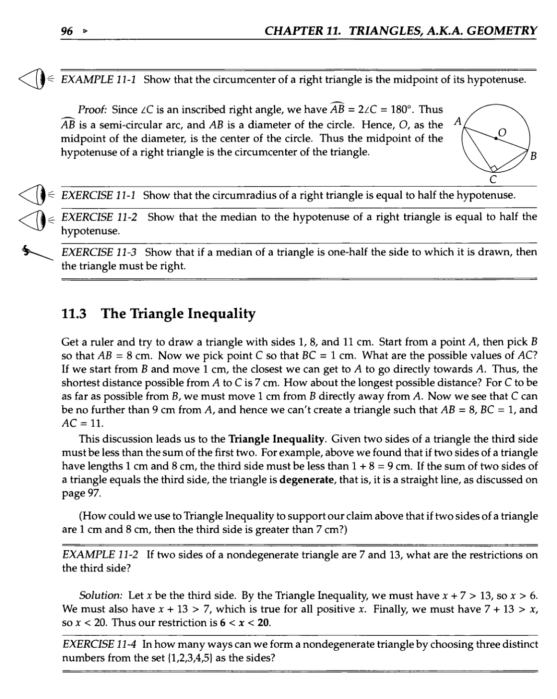

## Printed page 97

<!-- source: volume-1, PDF page 111, printed page 97 -->

### 11.4 The Pythagorean Theorem

<!-- Heading restored for navigation from independently recognised source heading. -->

By far the most famous theorem in geometry is the Pythagorean Theorem, which states that the sum of the squares of the lengths of the legs of a right triangle equals the square of the length of the hypotenuse. Thus, for $\triangle ABC$ in the figure, we have

$$(AC)^2 + (BC)^2 = (AB)^2.$$

The Pythagorean Theorem is proven on page 112.

The application of the Pythagorean Theorem is very simple: whenever we know two of the sides of a right triangle, we can use it to get the third.

**EXAMPLE 11-3** Given that the legs of a right triangle are 8 and 4, the hypotenuse is $\sqrt{8^2 + 4^2} = \sqrt{80} = 4\sqrt{5}$.

**EXAMPLE 11-4** If in $\triangle ABC$, $\angle A + \angle B = 90^\circ$, $AC = 4$, and $AB = 5$, what is $BC$?

Solution: Since $\angle A + \angle B = 90^\circ$, we know that $\angle C = 90^\circ$, so we can apply the Pythagorean Theorem: $4^2 + (BC)^2 = 5^2$, so $BC = 3$.

**EXAMPLE 11-5** Show that for points $B, X,$ and $C$, $BX + XC = BC$ if and only if $X$ is on segment $BC$.

Proof: For the "if" part, it is pretty obvious that $X$ being on segment $BC$ makes $BX + XC = BC$. The "only if" part is subtler: we must show that this equality is only true when $X$ is on $BC$, or to put it another way, that the equality is impossible when $X$ is not on $BC$. In the diagram, we draw the perpendicular from $X$, which is not on $BC$, to $BC$. We know $BY + YC = BC$. From the Pythagorean Theorem on $\triangle XYB$ we find

$$XB = \sqrt{XY^2 + BY^2} > \sqrt{BY^2}.$$

Thus we have $XB > BY$, and similarly $XC > YC$. Therefore, we know that $BC = BY + YC < XB + XC$; hence, if $X$ is not on $BC$, then $BX + XC > BC$. How does this relate to our discussion of degenerate triangles (page 96)?

**EXAMPLE 11-6** Show that if $a, b,$ and $c$ are the sides of an obtuse triangle with $a \leq b < c$, then $a^2 + b^2 < c^2$.

Proof: What we want to prove is similar to the Pythagorean Theorem, so we are led to draw an altitude to make some right triangles as shown in the diagram. First, from right triangle $ACD$ we have $x^2 + h^2 = b^2$. Then from right triangle $ADB$ we get

$$c^2 = (a + x)^2 + h^2 = a^2 + (h^2 + x^2) + 2ax = a^2 + b^2 + 2ax.$$

Since $2ax$ is positive, we know that $c^2 > a^2 + b^2$.

**EXERCISE 11-5** Find the length of the altitude to the base of an isosceles triangle whose base is 16 and legs are each 10.

Original scan — PDF page 111

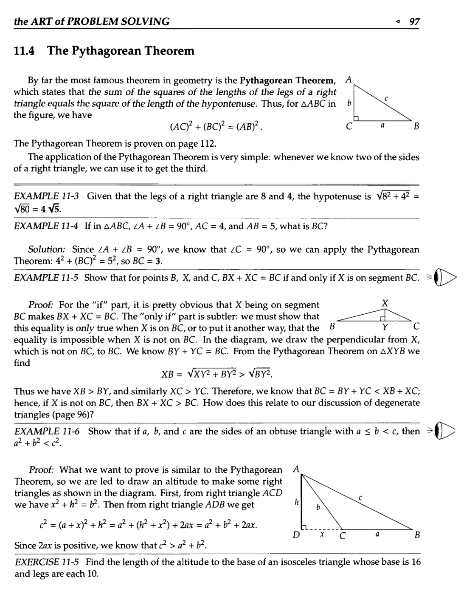

## Printed page 98

<!-- source: volume-1, PDF page 112, printed page 98 -->

**EXERCISE 11-6 How many non-congruent obtuse triangles are there with integer side lengths and perimeter 11?**

**EXERCISE 11-7 Show that if $a, b,$ and $c$ are the sides of an acute triangle, then $a^2 + b^2 > c^2$.**

**EXERCISE 11-8 A 25-foot ladder is placed against a vertical wall. The foot of the ladder is 7 feet from the base of the wall. If the top of the ladder slips 4 feet, then how far will the foot slide? (MAΘ 1992)**

Pythagorean Triples

Any set of integers $(a, b, c)$ which satisfies the Pythagorean Theorem, so that $a^2 + b^2 = c^2$, is called a Pythagorean triple. Knowing Pythagorean triples can prevent you from having to use the Pythagorean Theorem in some cases. For cases like the one above where the sides are 3, 4, and 5, going the long way will cost you little; however, what if we are told that the legs are 3636 and 4848? By using Pythagorean triples we could determine that the hypotenuse is 6060 without ever squaring the lengths of the legs. How?

First, if $(a, b, c)$ is a Pythagorean triple, then so is $(na, nb, nc)$ for all integers $n$. For example, we found above that $(3, 4, 5)$ is a Pythagorean triple, so $(6, 8, 10), (9, 12, 15),$ etc. are all Pythagorean triples. The proof of this assertion is straightforward. If $a, b, c$ are the sides of a right triangle, then $a^2 + b^2 = c^2$ and

$$(na)^2 + (nb)^2 = n^2(a^2 + b^2) = n^2(c^2) = (nc)^2.$$

By this same proof we see that even if any of $n, a, b,$ or $c$ are not integers, $(na, nb, nc)$ satisfies the Pythagorean Theorem if $(a, b, c)$ does.

Some common Pythagorean triples are $(5, 12, 13), (7, 24, 25),$ and $(8, 15, 17).$ (Verify these yourself.) Knowing the common Pythagorean triples can save you a lot of time when problem solving, as shown in some of the following problems. Whenever you are given two sides of a right triangle, write the ratio of the sides as a ratio of integers and see if the ratio fits one of the Pythagorean triples. For example, if the legs are in a ratio of 3:4, they fit the triple $(3, 4, 5).$ This allows us to conclude that the hypotenuse must fit the triple as well.

**EXAMPLE 11-7 The legs of a right triangle have lengths 3/105 and 4/105. What is the length of the hypotenuse?**

Solution: The legs are in the ratio 3:4. We know from our discussion of Pythagorean triples that if the legs are in a ratio of 3:4, then the ratio of the legs and the hypotenuse is 3:4:5. Thus, since the legs are 3(1/105) and 4(1/105), the hypotenuse is $5(1/105) = 5/105 = 1/21.$

**EXAMPLE 11-8 If the hypotenuse of a right triangle is 4.25 and one of the legs is 2, what is the length of the other leg?**

Solution: The ratio of the leg to the hypotenuse is 2:4.25, or 8:17. (Always write the ratios as integers because it makes it much easier to see Pythagorean triples.) Since $(8, 15, 17)$ is a Pythagorean triple and the hypotenuse is 17(1/4) while a leg is 8(1/4), the other leg must be 15(1/4) = 3.75.

Original scan — PDF page 112

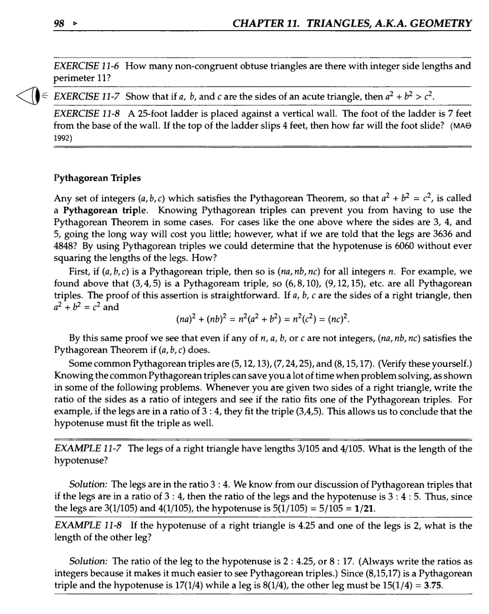

## Printed page 99

<!-- source: volume-1, PDF page 113, printed page 99 -->

**EXERCISE 11-9 Find the hypotenuse of a right triangle whose legs are $9\sqrt{2}$ and $12\sqrt{2}$.**

**EXERCISE 11-10 Find the second leg of a right triangle whose hypotenuse has length 175 and which has one leg of length 49.**

Any time you see a right triangle, the three sides can be related by the Pythagorean Theorem. If you can determine two sides of the triangle, you know the third by the Pythagorean Theorem. If it is not obvious that the Pythagorean Theorem can answer your problem, however, you probably need to find some other method to use instead of, or along with, the Pythagorean Theorem.

### 11.5 Congruent Triangles

Two figures are congruent if they are exactly alike. Thus, all that is true in one of the figures is also true of the other. A simple example of two congruent figures is two circles of the same radius. The circles are exactly alike, and therefore they are congruent.

In this section we discuss how to prove that two triangles are congruent. Triangle congruency is one of the most effective ways to show that segments or angles are equal.

Two triangles are congruent if all their corresponding sides and corresponding angles are equal. When two triangles $ABC$ and $DEF$ are congruent, as in the diagram, we write $\triangle ABC \cong \triangle DEF$. We always order the vertices the same way for each triangle, that is, $\angle A = \angle D, \angle B = \angle E,$ and $\angle C = \angle F,$ so we write $\triangle ABC \cong \triangle DEF$ rather than $\triangle ACB \cong \triangle DEF$.

Although we said that in two congruent triangles, all three sides and all three angles are equal, we don't in general need to show all six of these equalities just to prove the congruency of two triangles. Each of the seven criteria described below is sufficient to show that two triangles are congruent. The first four work for any triangles, while the last three work only for right triangles.

Congruency Theorems

1. Side-Side-Side (SSS)

If we show that the three sides of a triangle are equal to the sides of another triangle, then it follows that the corresponding angles are equal and hence the triangles are congruent. In a proof, we would write "the two triangles are congruent by SSS."

2. Side-Angle-Side (SAS)

If two sides and the angle between them of one triangle are equal to two sides and the angle between them of another triangle, then the triangles are congruent.

Original scan — PDF page 113

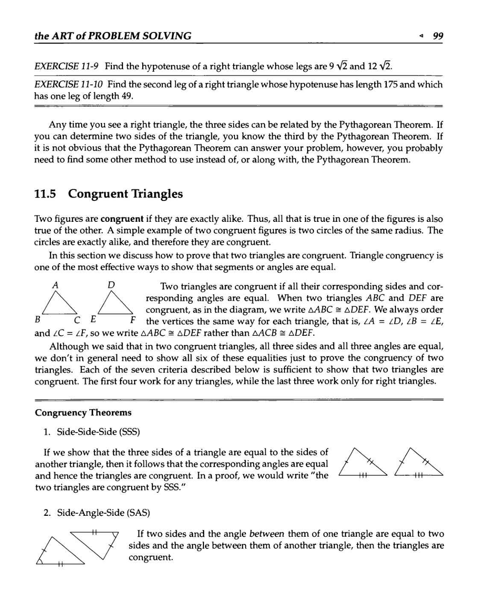

## Printed page 100

<!-- source: volume-1, PDF page 114, printed page 100 -->

WARNING: The angles which are equal in the triangles must be the ones between the sides you are using. This is very important, because as you can see at right, if the equal angles are not between the equal corresponding sides, the triangles are not necessarily congruent. There is no such thing as SSA congruency.

3. Angle-Side-Angle (ASA)

If a side in one triangle equals a side of another, and the angles formed by that side and each of the other two sides are equal to the corresponding angles in the other triangle, then the triangles are congruent.

WARNING: The corresponding angles in each triangle must be equal. At right, we have equal sides and a pair of equal angles, but the angles are not corresponding, for in one triangle they share the equal side and in the other they do not.

4. Angle-Angle-Side (AAS)

If two angles and a side other than the side between the two angles are equal to the corresponding parts of another triangle, then the triangles are congruent.

AAS is actually just the same as ASA, because if two angles of a triangle equal two angles of another triangle, then the third angles must be equal as well. (Do you see why?) Thus, all we need are two angles and a side in one triangle equal to their corresponding parts in another triangle to show that the triangles are congruent. As we showed above, however, this is not true of two sides and an angle.

5. Hypotenuse-Leg (HL)

If the hypotenuse and one leg of a right triangle equal that of another, the triangles are congruent.

6. Leg-Leg (LL)

If the legs of a right triangle equal those of another, then by LL, the right triangles are congruent. (This is just SAS applied to right triangles. Can you see why?)

7. Side-Angle (SA)

If one of the acute angles of a right triangle equals that of another right triangle, and one of its sides equals a corresponding side of the other triangle, then the right triangles are congruent. These corresponding sides may be hypotenuses or corresponding legs, as the diagram to the left suggests.

Original scan — PDF page 114

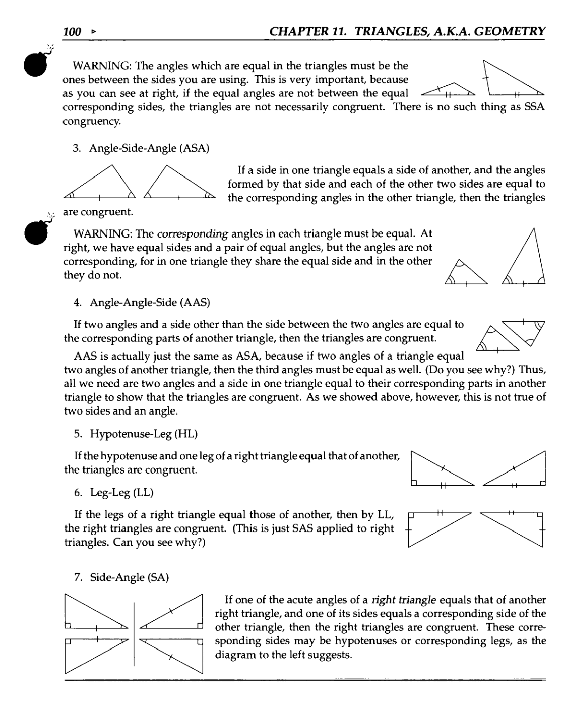

## Printed page 101

<!-- source: volume-1, PDF page 115, printed page 101 -->

The most difficult part of using congruent triangles is recognizing that two triangles are indeed congruent. As you will see in the first two problems, using triangles you know are congruent is very easy. The tough part is determining that two triangles are congruent; however, if you are diligent about finding and marking equal angles and equal segments, you will become quite proficient at finding congruent triangles.

What good is finding congruent triangles? The most useful tool is that if two figures are congruent, all parts of one figure are the same as the other. Thus, if we can prove that a side of triangle $ABC$ has length 50, then any triangle congruent to $\triangle ABC$ has a side of length 50. In the problems that follow, you will see how useful this seemingly simple principle is.

**EXAMPLE 11-9** In the figure, $\triangle ABC \cong \triangle BAD$. Find $\angle D$.

**Solution:** From the given triangle congruence we have $\angle ABC = \angle BAD = 60^\circ$. Thus we find

$$\angle D = \angle C = 180^\circ - \angle BAC - \angle ABC = 50^\circ.$$

**EXAMPLE 11-10** Prove that if two angles of a triangle are equal, then the sides opposite those angles are equal.

**Proof:** We first draw altitude $AX$ from the vertex which does not contain one of the equal angles. Thus, in right triangles $AXB$ and $AXC$ we have $AX = AX$ and $\angle B = \angle C$. By SA for right triangles we find $\triangle AXB \cong \triangle AXC$; hence, $AB = AC.$

**EXERCISE 11-11** Prove that a chord and a radius of a circle are perpendicular if and only if the chord is bisected by the radius.

**EXERCISE 11-12** Given chords $AB$ and $CD$ of a circle such that $AB = CD$, show that minor arcs $\widehat{AB}$ and $\widehat{CD}$ are equal.

**EXERCISE 11-13** Show that if arcs $\widehat{AB}$ and $\widehat{CD}$ of a circle are equal, then segments $AB$ and $CD$ are equal.

**EXERCISE 11-14** Prove that if two sides of a triangle are equal, then the angles opposite those sides are also equal.

**EXERCISE 11-15** Show that in an isosceles triangle the centroid, incenter, orthocenter, and circumcenter all lie on the same line, and that in an equilateral triangle they are all the same point.

Triangle congruency is one of the most effective ways to show that angles or segments are equal. Sometimes you may have to introduce extra segments, as in the isosceles triangle proofs above, in order to use congruent triangles. Mark the sides and angles of congruent triangles as you go, because it’s very easy to get confused as to which angles or sides in the diagram are equal.

Original scan — PDF page 115

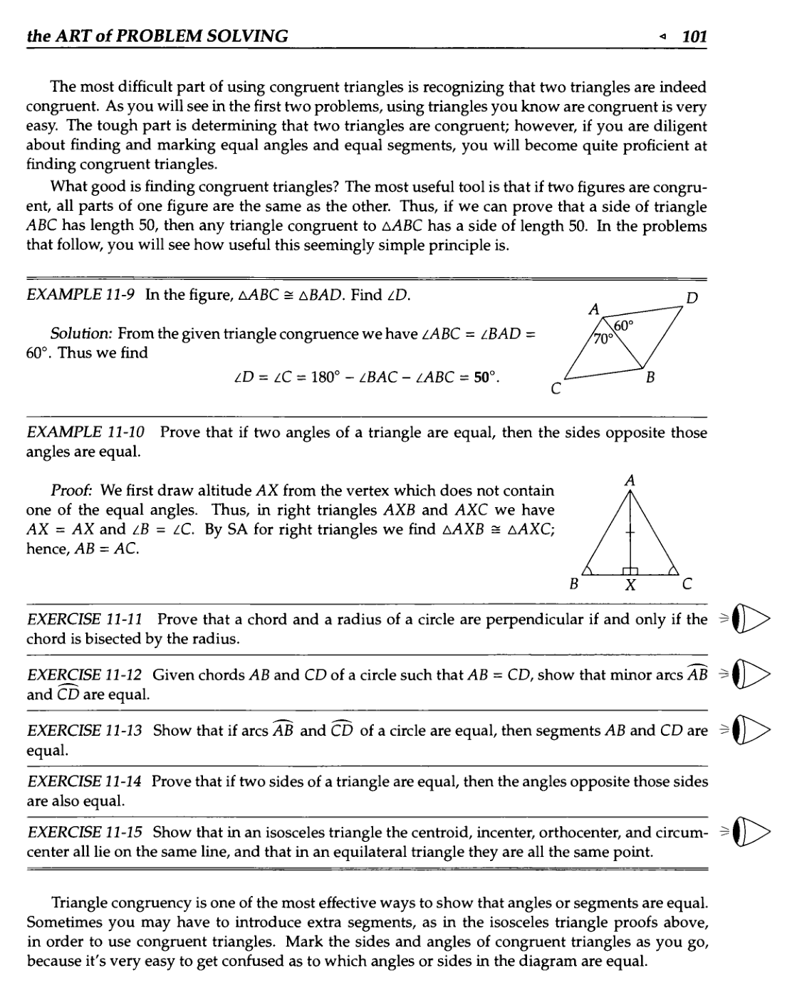

## Printed page 102

<!-- source: volume-1, PDF page 116, printed page 102 -->

### 11.6 Similar Triangles

Two triangles are similar if one is a magnified version of the other. If two triangles are similar, their corresponding sides have a constant ratio. For example, in the similar triangles at right we have

$$\frac{c}{f} = \frac{b}{e} = \frac{a}{d}.$$

In addition to the sides, all other corresponding lengths, such as medians, altitudes, etc., have the same ratio as the common ratio of the sides. Furthermore, if the ratio of the sides is $k$, the ratio of the areas is $k^2$.

To show that two triangles $ABC$ and $DEF$ are similar, we write $\triangle ABC \sim \triangle DEF$. As with congruent triangles, we always make sure to write the vertices in the same order for each triangle. (For example, we wouldn’t write $\triangle ABC \sim \triangle DFE$ for the above triangles.)

There are three general ways to prove that triangles are similar.

Similarity Theorems

1. Angle-Angle (AA)

AA is the most useful method of proving that two triangles are similar. If the three angles of one triangle are equal to those of another, the two triangles are similar. (Does this make sense? Why does AA not imply congruence?) In working a problem, it is sufficient to show that just two pairs of corresponding angles are equal, because the third will follow from the constant sum of the angles in a triangle. Conversely, if two triangles are similar, their corresponding angles are equal.

2. Side-Angle-Side (SAS)

If triangles $RST$ and $XYZ$ are such that $RS/XY = RT/XZ$ and $\angle R = \angle X$, then $\triangle RST \sim \triangle XYZ$. This similarity theorem has very limited usefulness. In fact, it is generally used only in situations like the one on the right. If we are given that $AB/AD = AC/AE$, then $\triangle ABC \sim \triangle ADE$.

3. Side-Side-Side (SSS)

As we noted above, two triangles are similar if all the ratios of corresponding sides are equal. This is the most rarely used method of showing that two triangles are similar.

Similar triangles are useful because of what they tell us about the ratios of the sides of the triangles and about the equality of angles. From these ratios and equalities, many other facts usually follow.

**EXAMPLE 11-11 On sides $AB$ and $AC$ of $\triangle ABC$, we pick points $D$ and $E$, respectively, so that $DE \parallel BC$. If $AB = 3AD$ and $DE = 6$, find $BC$.**

Original scan — PDF page 116

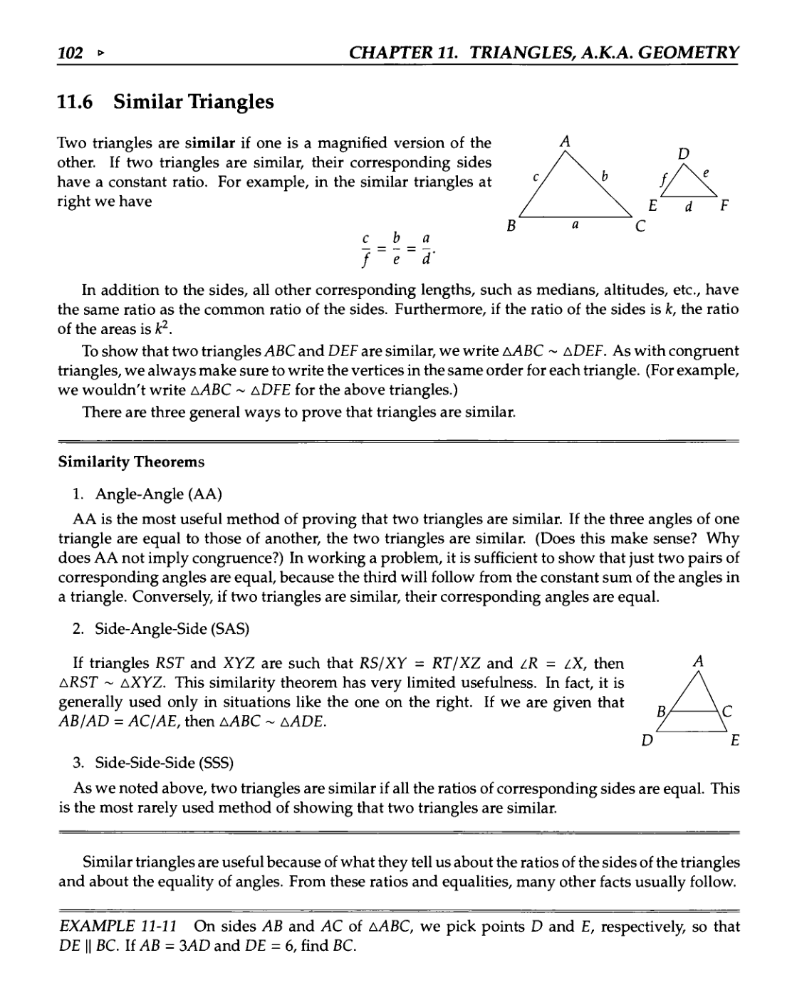

## Printed page 103

<!-- source: volume-1, PDF page 117, printed page 103 -->

Since $DE \parallel BC$, we have $\angle ADE = \angle ABC$ and $\angle AED = \angle ACB$; thus, triangles $ABC$ and $ADE$ are similar. Hence we have $AB/AD = BC/DE$. We are given that $AB/AD = 3$, so $BC = 3DE = 18$.

**EXAMPLE 11-12** Given that the altitude to the hypotenuse of a right triangle divides the hypotenuse into segments of lengths 4 and 8, find the length of the altitude.

**Solution:** First we draw the altitude $CD$. Since $\angle CDA = \angle ACB$ and $\angle DAC = \angle BAC$, we have $\Delta ACD \sim \Delta ABC$ by AA similarity. Similarly we find $\Delta CBD \sim \Delta ABC$. (The equal angles are all marked in the diagram.) Combining these, we have $\Delta ACD \sim \Delta ABC \sim \Delta CBD$. Whenever you see an altitude to the hypotenuse of a right triangle, think of these key similarity relations.

From similar triangles $ADC$ and $CDB$ we have $AD/CD = CD/BD$. Thus $CD^2 = (AD)(BD) = 4(8) = 32$, and the altitude has length $\sqrt{32} = 4\sqrt{2}$.

**EXAMPLE 11-13** Prove the Angle Bisector Theorem, which states that if $AX$ bisects $\angle A$ of $\Delta ABC$, then $AC/CX = AB/BX$.

**Proof:** Seeing the ratio of sides, we think to look for similar triangles—most facts involving ratios of lengths can be proven using similar triangles. As the figure is drawn, however, no similar triangles stand out. We thus look for extra lines to draw. Parallel lines usually make equal angles, and equal angles mean similar triangles. Thus, we extend $AX$ to $E$ as shown so that $BE \parallel AC$. Since $\angle CAE$ and $\angle AEB$ are alternate interior angles, they are equal. Since $AX$ is an angle bisector, we have $\angle CAX = \angle XAB$. Thus $\angle EAB = \angle AEB$, which implies $AB = BE$. Since $\angle CAX = \angle XEB$ and $\angle AXC = \angle BXE$, we find $\Delta BXE \sim \Delta CXA$ by AA. Thus $AC/CX = BE/BX = AB/BX$.

**EXAMPLE 11-14** If $AX$ and $BY$ are angle bisectors which intersect at $I$, show that

$$\frac{AI}{IX} = \frac{AC}{CX}$$

**Proof:** Remember that the angle bisectors of a triangle are concurrent. Hence, $CI$ bisects $\angle C$. Applying the Angle Bisector Theorem to $\angle C$ of $\Delta ACX$, we have $AC/AI = CX/XI$. Rearranging this slightly gives the desired relation.

**EXAMPLE 11-15** In the diagram at the right, we have $AD = DB = 5$, $EC = 8$, $AE = 4$, and $\angle AED$ is a right angle. Find the length of $BC$. (MAΘ 1987)

**Solution:** There are no similar triangles immediately in sight; however, we can introduce similar triangles by drawing $BH$, as shown below, such that $BH \parallel DE$.

Original scan — PDF page 117

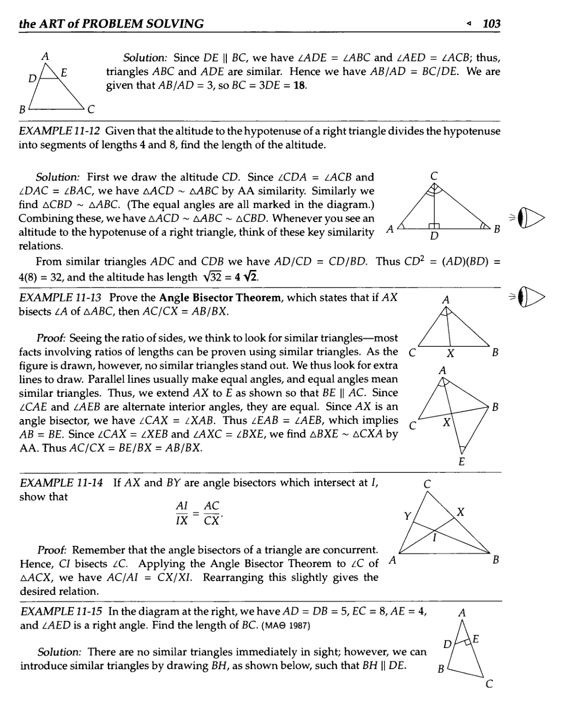

## Printed page 104

<!-- source: volume-1, PDF page 118, printed page 104 -->

From the new triangles we see that $\triangle DAE \sim \triangle BAH$ and $AE/AH = AD/AB = 5/(5 + 5) = 1/2$. Hence, we have $AH = 8$ and $EH = AH - AE = 4$, so $HC = 4$. From the Pythagorean Theorem we find $DE = 3$, and since $DE/BH = 1/2$, we have $BH = 2(3) = 6$. Finally, using the Pythagorean Theorem on $\triangle BHC$ we find $BC = \sqrt{36 + 16} = 2\sqrt{13}$.

**EXERCISE 11-16** Chord $EF$ is the perpendicular bisector of chord $BC$, intersecting it at $M$. Between $B$ and $M$ point $U$ is taken, and $EU$ extended meets the circle again at $A$. Then for any selection of $U$, which triangle is always similar to $\triangle EUM$: $\triangle EFA$, $\triangle EFC$, $\triangle ABM$, $\triangle ABU$, or $\triangle FMC$? (AHSME 1963)

**EXERCISE 11-17** In $\triangle ABC$, $M$ and $N$ are the midpoints of $AB$ and $AC$ respectively. If $AB = 5$, $BC = 6$, and $AC = 7$, find $MN$.

**EXERCISE 11-18** In the figure, $TAPZ$ has $TZ \parallel AP \parallel ER$, and $R$ and $E$ are the midpoints of $AT$ and $PZ$ respectively. If $AP = 64$, $TZ = 28$, and $AZ = 46$, find $OI$. (MAΘ 1990)

**EXERCISE 11-19** Show that if $AB \parallel CD \parallel EF$, then $1/x + 1/y = 1/z$ in the diagram. (This relation is commonly used by test writers, so don’t overlook it.)

Any time a problem involves finding the length of a segment or the ratio of two segment lengths, consider looking for similar triangles. This is especially true when the problem involves triangles and/or parallel lines. As you saw in the examples above, parallel lines often lead to similar triangles, so whenever you must determine a length in a problem involving parallel lines, look for similar triangles. Also, drawing parallel lines in a diagram often leads to similar triangles, as in our proof of the angle bisector theorem.

**WARNING:** Other polygons besides triangles can be similar; however, it is important to remember that equal corresponding angles implies similarity only for triangles. This method does not work for any other type of polygon.

### 11.7 Introduction to Trigonometry

Right triangles are of paramount importance in geometry. Thus, mathematicians have developed a shorthand for writing the ratios of the sides of right triangles. Instead of writing “the ratio of the leg adjacent to an $18^\circ$ angle to the hypotenuse of the triangle,” we write “$\cos 18^\circ$”. Because expressions of this type frequently come up in physics, engineering, and many other branches of science, you can see why such a shorthand was developed. We’ll start off with a few definitions.

Original scan — PDF page 118

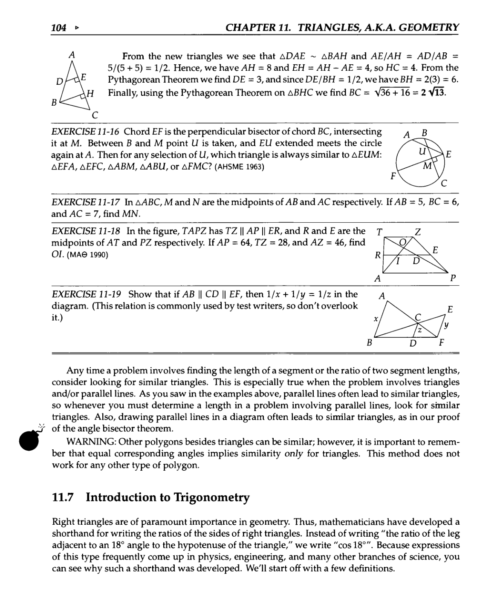

## Printed page 105

<!-- source: volume-1, PDF page 119, printed page 105 -->

With respect to $\angle A$ in right $\triangle ABC$ with $\angle C = 90^\circ$, $BC$ is considered the opposite leg and $AC$ the adjacent leg. These labels are reversed when working with $\angle B$: $AC$ is opposite and $BC$ adjacent. The six basic trigonometric relations are as defined and abbreviated below:

**sine**: $\sin A = \frac{\text{opposite}}{\text{hypotenuse}} = \frac{a}{c}$

**cosine**: $\cos A = \frac{\text{adjacent}}{\text{hypotenuse}} = \frac{b}{c}$

**tangent**: $\tan A = \frac{\sin A}{\cos A} = \frac{\text{opposite}}{\text{adjacent}} = \frac{a}{b}$

**secant**: $\sec A = \frac{1}{\cos A} = \frac{\text{hypotenuse}}{\text{adjacent}} = \frac{c}{b}$

**cosecant**: $\csc A = \frac{1}{\sin A} = \frac{\text{hypotenuse}}{\text{opposite}} = \frac{c}{a}$

**cotangent**: $\cot A = \frac{\cos A}{\sin A} = \frac{\text{adjacent}}{\text{opposite}} = \frac{b}{a}$

The most important are the first three: sine, cosine, and tangent.

Thinking about the trigonometric definitions, we can come up with a few important identities. First, because $\angle B = 90^\circ - \angle A$ and $\cos B = a/c$, we have

$$\sin A = \frac{a}{c} = \cos B = \cos (90^\circ - A).$$

The identity $\sin A = \cos(90^\circ - A)$ is true for all angles $A$. In the same way, we can show $\tan A = \cot (90^\circ - A)$ and $\sec A = \csc (90^\circ - A)$.

Second, we can show the most common and useful trigonometric identity,

$$\sin^2 A + \cos^2 A = 1. \tag{11.1}$$

This follows directly from the Pythagorean Theorem:

$$\sin^2 A + \cos^2 A = \frac{a^2}{c^2} + \frac{b^2}{c^2} = \frac{a^2 + b^2}{c^2} = \frac{c^2}{c^2} = 1.$$

Dividing (11.1) by $\cos^2 A$, we have a new relation,

$$\tan^2 A + 1 = \sec^2 A,$$

and dividing (11.1) by $\sin^2 A$ yields

$$\cot^2 A + 1 = \csc^2 A.$$

**Values of the Trigonometric Functions**

The three most important angles in geometry are the $30^\circ$, $45^\circ$, and $60^\circ$ angles. Whenever you bisect a right angle, you get a $45^\circ$ angle; the angles of an equilateral triangle are $60^\circ$; whenever you draw an angle bisector (which is also a median and an altitude) in an equilateral triangle, you form a $30^\circ$ angle. Since these angles are so common, it is of particular interest to find the values of the trigonometric functions for these angles.

To do this, we will discuss two special cases of right triangles: the $45^\circ-45^\circ-90^\circ$ triangle and the $30^\circ-60^\circ-90^\circ$ triangle.

Original scan — PDF page 119

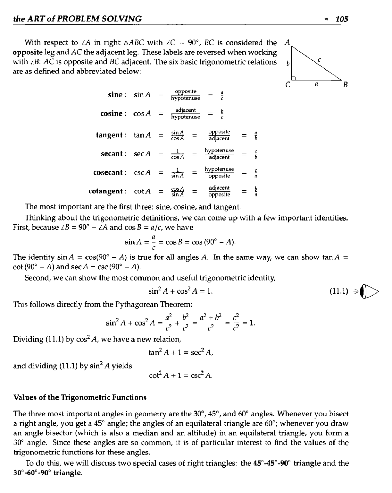

## Printed page 106

<!-- source: volume-1, PDF page 120, printed page 106 -->

At right is an isosceles right triangle. From the Pythagorean Theorem, we can see that if both legs have length $a$, the hypotenuse has length $\sqrt{a^2 + a^2} = a\sqrt{2}$. Thus we have

$$\sin 45^\circ = \cos 45^\circ = \frac{a}{a\sqrt{2}} = \frac{\sqrt{2}}{2}.$$

We similarly see that $\tan 45^\circ = 1$. Remember these values; you will see them often. Remember also that the ratio of the hypotenuse to the side lengths in $45^\circ - 45^\circ - 90^\circ$ triangles is always $\sqrt{2}$.

In the triangle at right, one of the acute angles is twice the other one. The relationship among the sides is not as obvious as in the isosceles case. Perhaps adding a few extra lines will help us with this problem.

First we draw $AX$, the angle bisector of the $60^\circ$ angle. This creates two more $30^\circ$ angles. Drawing the perpendicular from $X$ to $AB$ divides $\triangle ABX$ into two congruent triangles (by Angle-Side-Angle; make sure you see this). Furthermore, by ASA we find $\triangle ACX \cong \triangle AYX$, so we have

$$\triangle ACX \cong \triangle AYX \cong \triangle BYX.$$

From this we can see that

$$AB = AY + YB = AC + AC = 2AC.$$

Hence, in a $30^\circ - 60^\circ - 90^\circ$ triangle, the hypotenuse ($AB$) is twice the length of the leg opposite the $30^\circ$ angle ($AC$). Now, using the Pythagorean Theorem and writing $AB = 2AC$, we get

$$BC = \sqrt{AB^2 - AC^2} = \sqrt{4AC^2 - AC^2} = AC\sqrt{3}.$$

To sum this all up, in $30^\circ - 60^\circ - 90^\circ$ triangle $BAC$ we have

$$AC : BC : AB = 1 : \sqrt{3} : 2.$$

Once you know one side of a $30^\circ - 60^\circ - 90^\circ$ triangle, you can use it to determine the other two sides. Also, whenever you see a right triangle whose hypotenuse is twice the length of a side, you know you have found a $30^\circ - 60^\circ - 90^\circ$ triangle. Any time a $30^\circ$ or a $60^\circ$ angle appears in a problem, you should think of these relations; for example, when you draw an altitude of an equilateral triangle, you divide the triangle into two $30^\circ - 60^\circ - 90^\circ$ triangles. (Challenge: Let the midpoint of the hypotenuse of $30^\circ - 60^\circ - 90^\circ$ triangle $ABC$ be $M$, where $\angle C = 90^\circ$. Can you prove the relationship among the sides of the $30^\circ - 60^\circ - 90^\circ$ triangle using the diagram resulting from drawing $CM$ without adding any more lines?)

Finally, with all this newfound wisdom, we apply our trigonometric relations to $\triangle ABC$.

$$\sin 30^\circ = \cos 60^\circ = \frac{AC}{AB} = \frac{AC}{2AC} = \frac{1}{2}$$

$$\cos 30^\circ = \sin 60^\circ = \frac{BC}{AB} = \frac{AC\sqrt{3}}{2AC} = \frac{\sqrt{3}}{2}$$

$$\tan 30^\circ = \frac{\sin 30^\circ}{\cos 30^\circ} = \frac{\sqrt{3}}{3}$$

$$\tan 60^\circ = \frac{\sin 60^\circ}{\cos 60^\circ} = \sqrt{3}$$

Original scan — PDF page 120

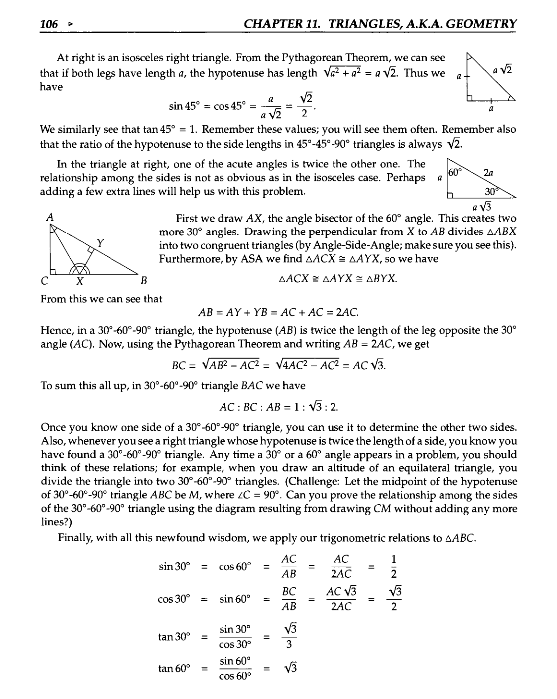

## Printed page 107

<!-- source: volume-1, PDF page 121, printed page 107 -->

Keep in mind before memorizing these tables that it is not really necessary to memorize the tangent values, because as long as you know the sine and cosine, you know the tangent.

Students often forget whether it is the sine or the cosine of a 30° angle which is 1/2. If you ever forget, draw a 30°-60°-90° triangle. The leg opposite the 30° angle is the shorter leg, so $\sin 30^\circ = 1/2$. Similarly, the leg adjacent to the 30° angle is the longer leg, so $\cos 30^\circ = \sqrt{3}/2$. You can do the same to remind yourself of the trigonometric values for 60° angles.

Two other angles which are common in trigonometry problems are 0° and 90°. If we consider right triangle $ABC$ with hypotenuse $AB$, when $\angle A = 0^\circ$, $B$ and $C$ are the same point and $BC = 0!$ (Try drawing triangles with smaller and smaller measures of $\angle A$.) Also, $AB = AC$. Thus we have the following trigonometric values:

$$\sin 0^\circ = \cos 90^\circ = \frac{BC}{AB} = 0$$

$$\cos 0^\circ = \sin 90^\circ = \frac{AC}{AB} = 1$$

$$\tan 0^\circ = \frac{BC}{AC} = 0$$

$$\tan 90^\circ = \frac{AC}{BC} = \text{undefined}$$

The value $\tan 90^\circ$ is undefined because it involves a division by zero, which we cannot do.

The following tables and pictures summarize all we have discussed about trigonometric relations in this section.

| Function | In terms of sin and cos | In a right triangle | 0° | 30° | 45° | 60° | 90° |
| :--- | :--- | :--- | :--- | :--- | :--- | :--- | :--- |
| sin | sin | opposite/hypotenuse | 0 | $\frac{1}{2}$ | $\frac{\sqrt{2}}{2}$ | $\frac{\sqrt{3}}{2}$ | 1 |
| cos | cos | adjacent/hypotenuse | 1 | $\frac{\sqrt{3}}{2}$ | $\frac{\sqrt{2}}{2}$ | $\frac{1}{2}$ | 0 |
| tan | $\frac{\sin}{\cos}$ | opposite/adjacent | 0 | $\frac{\sqrt{3}}{3}$ | 1 | $\sqrt{3}$ | undef. |
| sec | $\frac{1}{\cos}$ | hypotenuse/adjacent | 1 | $\frac{2\sqrt{3}}{3}$ | $\sqrt{2}$ | 2 | undef. |
| csc | $\frac{1}{\sin}$ | hypotenuse/opposite | undef. | 2 | $\sqrt{2}$ | $\frac{2\sqrt{3}}{3}$ | 1 |
| cot | $\frac{\cos}{\sin}$ | adjacent/opposite | undef. | $\sqrt{3}$ | 1 | $\frac{\sqrt{3}}{3}$ | 0 |

Original scan — PDF page 121

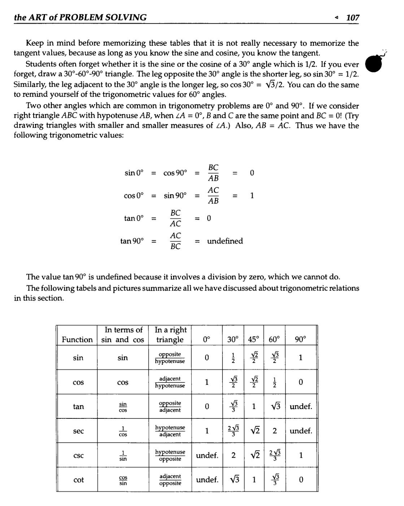

## Printed page 108

<!-- source: volume-1, PDF page 122, printed page 108 -->

$$\sin^2 \theta + \cos^2 \theta = 1$$
$$\tan^2 \theta + 1 = \sec^2 \theta$$
$$\cot^2 \theta + 1 = \csc^2 \theta$$
$$\sin(90^\circ - \phi) = \cos \phi$$
$$\csc(90^\circ - \phi) = \sec \phi$$
$$\tan(90^\circ - \phi) = \cot \phi$$

What use is trigonometry? In a word, it’s a shortcut. Using the trigonometric functions and our knowledge about special right triangles, we can quickly find various side lengths and angle measures. Examples are included among the problems below. Trigonometry also gives us yet another method to prove that two angles are equal. If we know that two acute angles have the same value for some trigonometric function (e.g. $\sin \alpha = \sin \beta$), then we know the angles are equal ($\alpha = \beta$). (Can you prove this?)

**EXAMPLE 11-16** Given that $\angle B = 90^\circ$ and $\cot C = 5/6$ in $\triangle ABC$, find side $BC$ if $AC = 5\sqrt{61}$.

**Solution:** We have $\cot C = BC/AB = 5/6$. Thus, letting $BC = x$, we know $AB = 6x/5$. Using the Pythagorean Theorem we get $AB^2 + BC^2 = 61x^2/25 = AC^2 = 25(61)$. Thus $x^2 = 25(25)(61)/61 = 25^2$, and $x = 25$.

**EXAMPLE 11-17** Find side $BC$ of $\triangle ABC$ if $AB = 8$, $AC = 8\sqrt{2}$, $\angle ABC = 45^\circ$, and $\angle ACB = 30^\circ$.

**Solution:** By drawing altitude $AD$ we form the two special right triangles discussed in this section. First, since $\angle ABD = 45^\circ$, $\triangle ABD$ is an isosceles right triangle. Thus $BD = AB/\sqrt{2} = 8/\sqrt{2} = 4\sqrt{2}$. Since $\angle ACD = 30^\circ$ and $\triangle ACD$ is a right triangle, we know that $AD = AC/2 = 4\sqrt{2}$ and $CD = AD\sqrt{3} = 4\sqrt{6}$. Thus, $BC = BD + DC = 4\sqrt{2} + 4\sqrt{6}$.

**EXERCISE 11-20** In circle $O$ with radius $6$, $\widehat{AB} = 60^\circ$ and $\widehat{CD} = 90^\circ$. Find the difference in the lengths of segments $CD$ and $AB$.

**EXERCISE 11-21** Find, in degrees, the smallest positive angle $x$ such that $\sin 3x = \cos 7x$. (Mandelbrot #3)

**EXERCISE 11-22** Find side $AC$ of $\triangle ABC$ if $\angle A = 90^\circ$, $\sec B=4$, and $AB = 6$.

Original scan — PDF page 122

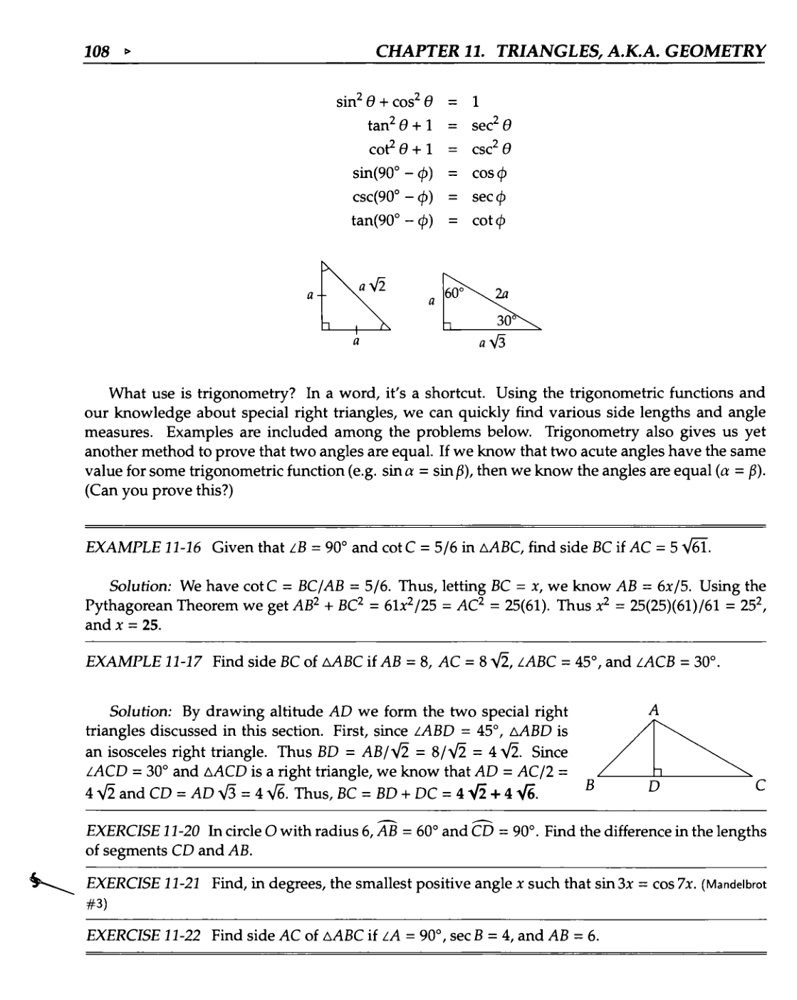

## Printed page 109

<!-- source: volume-1, PDF page 123, printed page 109 -->

### 11.8 Area of a Triangle

<!-- Heading restored for navigation from independently recognised source heading. -->

In this section we will prove three general methods to determine the area of a triangle. Namely,

$$[ABC] = \frac{ah_a}{2} = \frac{ab \sin C}{2} = rs.$$

Recall that $h_a$ is the altitude to side $a$, $s$ the semiperimeter (half the sum of the sides), and $r$ the inradius of the triangle.

The following examples display the use of these three formulas.

**EXAMPLE 11-18** Find the area of $\triangle ABC$ if $AB = AC = 50$ and $BC = 80$.

**Solution:** Since the triangle is isosceles, the altitude $AX$ to side $BC$ bisects $BC$. Thus, from the Pythagorean Theorem on right triangle $ABX$, we find $AX = 30$, so $[ABC] = (BC)(AX)/2 = (80)(30)/2 = 1200.$

**EXAMPLE 11-19** Find the radius of the circle which is inscribed in a triangle whose perimeter is 40 and area is 120.

**Solution:** Call the triangle $\triangle ABC$. Since $[ABC] = rs = 120$ and $s = 40/2 = 20$, we find that $r = 6.$

**EXAMPLE 11-20** In isosceles triangle $ABC$, we are given $AB = AC = 4$ and $\angle C = 75^\circ$. Find the area of $\triangle ABC$.

**Solution:** Since $AB = AC$, we have $\angle B = \angle C = 75^\circ$, so $\angle A = 30^\circ$ (because $\angle A + \angle B + \angle C = 180^\circ$). The area of $ABC$ is then

$$[ABC] = \frac{(AB)(AC)}{2} \sin A = 8 \sin 30^\circ = 4.$$

**EXAMPLE 11-21** Prove that if $\triangle ABC \sim \triangle DEF$ then the ratio of corresponding altitudes equals the ratio of corresponding sides and the ratio of the areas of the triangles equals the square of the ratio of the sides.

**Proof:** In the triangles shown, let $AX = h_a$ and $DY = h_d$, where $a$ and $d$ are $BC$ and $EF$, respectively. First we wish to show that $h_a/h_d = a/d$. Since this is a problem involving ratios of sides, we look for similar triangles. Indeed, $\triangle AXC \sim \triangle DYF$ because $\angle C = \angle F$ and $\angle AXC = \angle DYF$. Thus $h_a/h_d = b/e = a/d = c/f$ and the proof is complete. We can use this same method on any other significant lengths in a triangle; however, unless specifically told to prove it, you can assume that this relationship holds for all other lengths, such as in radii or medians.

Now for the ratio of areas. Since we know $[ABC] = ah_a/2$ and $[DEF] = dh_d/2$, we have

$$[ABC] / [DEF] = \frac{ah_a}{dh_d} = \left( \frac{a}{d} \right) \left( \frac{h_a}{h_d} \right) = \left( \frac{a}{d} \right) \left( \frac{a}{d} \right)^2.$$

(We have used what we just proved about the ratio of altitude lengths.)

Original scan — PDF page 123

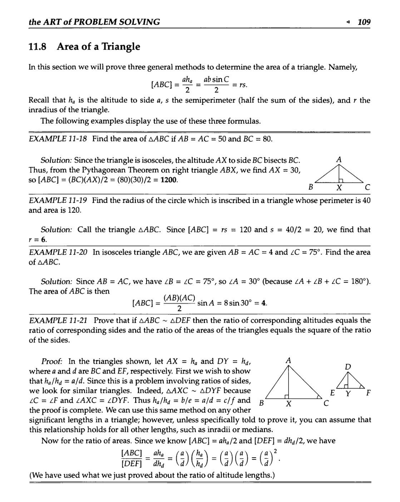

## Printed page 110

<!-- source: volume-1, PDF page 124, printed page 110 -->

The proofs of these area formulas will give the reader important tips on how to attack area problems in general.

Proofs of Triangle Area Formulas

1. $[ABC] = ah_a/2$

We'll start our proof with right triangles. Consider the figure at the right. Congruent triangles $ABC$ and $CDA$ together form a rectangle as shown. Thus the areas of the two are equal, so the area of one is half the area of the rectangle they form together. The area of the rectangle is its length times its width, so

$$[ABC] = \frac{[ABCD]}{2} = \frac{(AB)(BC)}{2}.$$

We will prove our area formula for acute triangles and leave the proof for obtuse triangles as an exercise. Because we know the area of a right triangle, we draw altitude $AX$ and form two right triangles. The area of $ABC$ is the sum of the areas of $ABX$ and $ACX$, and we know how to find the areas of these two, so

$$[ABC] = [ABX] + [ACX] = \frac{(AX)(BX)}{2} + \frac{(AX)(CX)}{2} = \frac{(AX)(BC)}{2}.$$

2. $[ABC] = \frac{ab \sin C}{2}$.

Seeing sines involved, we think of right triangles, so we draw the altitude from $A$. (We don't draw the altitude from $C$ because the expression $\sin C$ leads us to look for a right triangle in which $\angle C$ is one of the acute angles.) Now we find

$$\sin C = \frac{AX}{AC} = \frac{h_a}{b}.$$

Using this value for $\sin C$ in $\frac{1}{2}ab \sin C$ yields

$$\frac{1}{2}ab \sin C = \left(\frac{ab}{2}\right)\left(\frac{h_a}{b}\right) = \frac{ah_a}{2} = [ABC].$$

Proving this formula for an obtuse triangle is a little trickier, as we haven't yet defined trigonometric relationships for anything but acute and right angles.

For any angle $\theta$, $\sin(180^\circ - \theta) = \sin \theta$. (Take this on faith for now.) Using this we can deal with two sides and the included angle when the angle is obtuse. As before, we draw altitude $AX$. Thus, since $\sin \beta = h_a/b$, we have

$$\frac{1}{2}ab \sin \alpha = \frac{1}{2}ab \sin (180^\circ - \alpha) = \frac{1}{2}ab \sin \beta = \left(\frac{ab}{2}\right)\left(\frac{h_a}{b}\right) = \frac{ah_a}{2} = [ABC].$$

For an obtuse triangle given two sides and an included acute angle, the proof is the same as the acute triangle case.

3. $[ABC] = rs.$

Original scan — PDF page 124

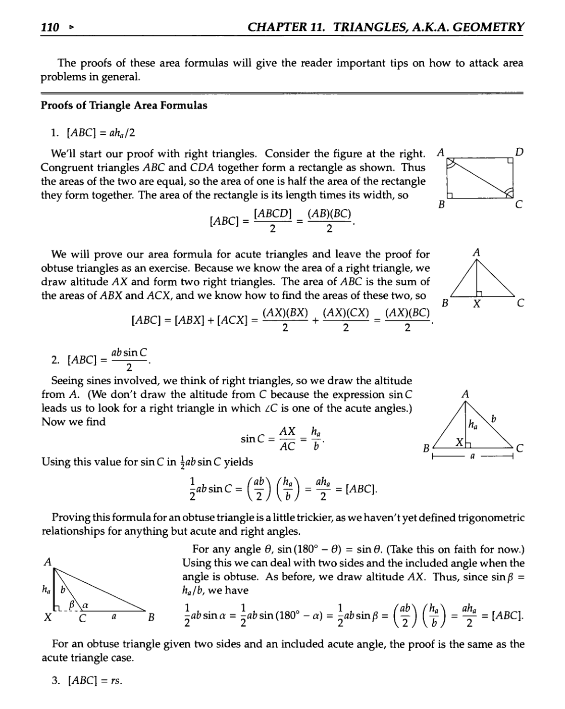

## Printed page 111

<!-- source: volume-1, PDF page 125, printed page 111 -->

In proving this formula, we learn an important method in solving area problems: chopping up a desired area into pieces and finding the sum of the areas of the pieces. Since the formula involves the inradius, let's draw some inradii. But where? The only choices that make sense are the radii to where the circle is tangent to the sides of the triangle. These are perpendicular to the sides. Connecting the incenter to the vertices of the triangle, we form the three triangles $AIB$, $BIC$, and $CIA$. For each of these triangles, an inradius forms an altitude, so

$$[ABC] = [AIB] + [BIC] + [CIA]$$
$$= \frac{(IZ)(AB)}{2} + \frac{(IX)(BC)}{2} + \frac{(IY)(AC)}{2}$$
$$= \frac{rc}{2} + \frac{ra}{2} + \frac{rb}{2}$$
$$= r(a + b + c)/2 = rs,$$

and we are done.

Knowing when to use the area formulas is generally quite straightforward. If you need to find the area of a triangle and it is not readily obvious which of these three to use, look for one of the following hints. The most common method is to draw an altitude to a side whose length you know and try to determine the altitude's length. If this fails, you have other options. Given an angle of the triangle, try to find the two sides adjacent to it. If you know two sides of the triangle, you can find the area if you find the angle between them. Finally, the relationship between the area and the inradius is generally only useful in problems involving the incircle or inradius.

The area formulas can also be used together to determine other things about a triangle. For example, if we are given that $h_a = 3$ and $b = 4$ in $\triangle ABC$, we can find $\sin C$ from our area relations. We write

$$[ABC] = \frac{ah_a}{2} = \frac{1}{2} ab \sin C,$$

and solving the second equality for $\sin C$, we have

$$\sin C = \frac{h_a}{b} = \frac{3}{4}.$$

This application of triangle areas is limited now, because you only know three ways to find triangle areas. However, as you learn more ways to find the area of a triangle, this method will become considerably more useful.

**EXAMPLE 11-22** Given an equilateral triangle with side length $s$, find the area of the triangle in terms of $s$.

**Solution:** Since each angle of an equilateral triangle is $60^\circ$, we have

$$[ABC] = \frac{ab \sin C}{2} = \frac{s^2 \sin 60^\circ}{2} = \frac{s^2 \sqrt{3}}{4}.$$

Original scan — PDF page 125

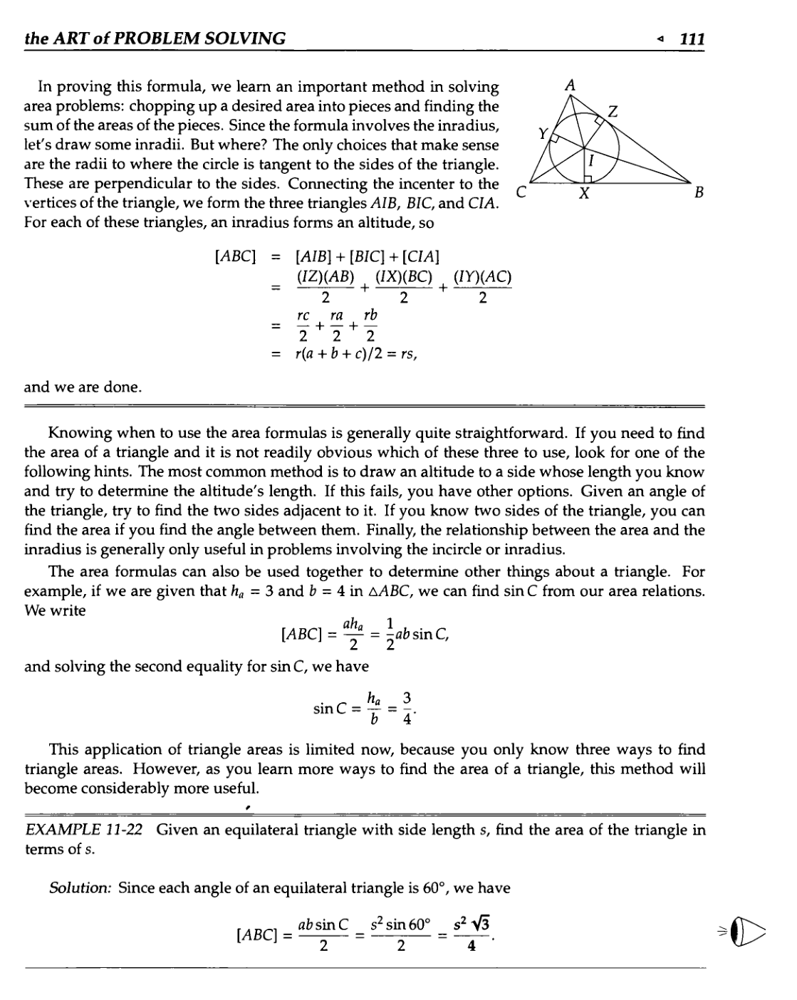

## Printed page 112

<!-- source: volume-1, PDF page 126, printed page 112 -->

**EXAMPLE 11-23 What is the radius of the circle inscribed in a triangle whose sides have lengths 8, 15, and 17?**

Solution: Since $8^2 + 15^2 = 17^2$, the triangle is right. (Always check for this when given the side lengths of a triangle in a problem.) Thus the area is $8(15)/2 = 60$. The perimeter is $8 + 15 + 17 = 40$, so the semiperimeter is 20. Solving $[ABC] = rs$ for $r$, we find $r = 60/20 = 3$.

**EXAMPLE 11-24 Use the shown diagram to prove the Pythagorean Theorem.**

Proof: We can find the area of the large square in two ways. First, as the square of the length of its sides $(c^2)$; second, as the sum of the area of the smaller square and the areas of the four triangles. Since $XY = a$ and $XZ = b$, the sides of the smaller square have length $a - b$. Thus we have

$$c^2 = (a - b)^2 + 4(ab/2) = (a^2 - 2ab + b^2) + 2ab = a^2 + b^2.$$

**EXERCISE 11-23 What is the area of an equilateral triangle which has altitude length 12?**

**EXERCISE 11-24 Prove that the area of an obtuse triangle is one-half the product of a side and the length of the altitude to that side.**

**EXERCISE 11-25 Tangents from point $C$ to circle $O$ are extended to $A$ and $B$ such that $AB$ is tangent to $O$ at $X$. If the perimeter of $\triangle ABC$ is 50 and $[ABC] = 100$, find the area of circle $O$.**

**EXERCISE 11-26 Eight points are equally spaced on the circumference of a circle of radius 1. Find the area of the region enclosed by connecting the points in order. (Hint: Draw radii of the circle to the vertices.)**

### 11.9 A Handful of Helpful Hints

Congruent triangles, similar triangles, parallel lines, perpendicular lines; these will be your closest friends when working on geometry problems. Much of this section is repeated from earlier sections in this chapter, but it is so important that it is worth repeating.

Let's first discuss parallel and perpendicular lines. Their importance must not be underestimated. In problems, these lines occur in three ways: some we are given, some we draw, and some we discover.

The first case is pretty clear. When given parallel lines, mark the angles you know are equal and proceed. For perpendicular lines, mark the right angles and keep an eye open for chances to use all the special facts we have learned about right triangles.

The second case, the lines we draw, is the most difficult to master. Often geometry problems can be solved by adding an extra parallel or perpendicular line to a diagram; there are examples of this scattered throughout the problems in this chapter. While it may seem that we pulled some of the lines we drew out of thin air, there actually are signs to look for. This takes practice, but any good geometrician is expert at adding a line or two to a diagram to make the problem easier.

Finally come those lines that we discover, which brings us to the question of how we know that two lines are parallel or perpendicular.

Original scan — PDF page 126

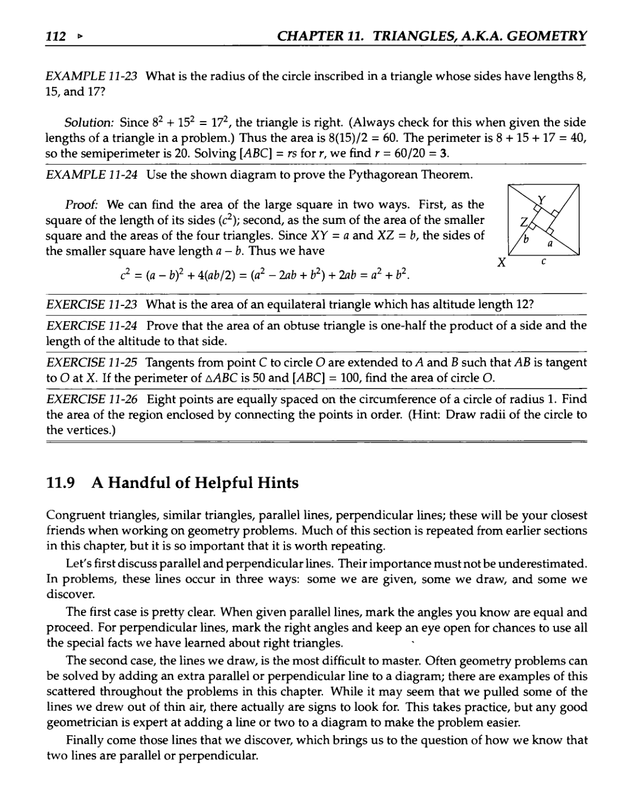

## Printed page 113

<!-- source: volume-1, PDF page 127, printed page 113 -->

Given two lines and a transversal as shown, the following are ways to determine that the two lines are parallel.

1. Show that a pair of alternate interior angles are equal:
   $$\alpha = \beta.$$

2. Show that a pair of corresponding angles are equal:
   $$\beta = \theta.$$

3. Show that a pair of same-side interior angles are supplementary:
   $$\beta + \phi = 180^\circ.$$

Each of the preceding conditions is sufficient to prove that two lines are parallel. Another very useful way is to show that two points on one of the lines are equidistant from the other line. For example, in the diagram, points $A$ and $B$ on $m$ are distances $x$ and $y$ from $l$. If $x = y$, then $l \parallel m$.

There are many, many ways to show that two lines are perpendicular. The simplest is to prove that they form a right angle. The methods of proving two lines are perpendicular can be divided in the following categories: using angle relations to show that the angle formed by the lines is $90^\circ$, proving that the angle is the largest angle of a right triangle, and showing that the lines are perpendicular without using angle measures.

**Ways to show an angle is $90^\circ$**

1. Show that the angle is inscribed in a semicircle.

2. Given two intersecting lines, show that a pair of adjacent angles are equal. Adjacent angles are angles which share a side. Intersecting lines form adjacent lines which are supplementary, and two angles which are equal and supplementary are right.

**Ways to show a triangle is a right triangle**

1. Show that two of the angles in the triangle are complementary. If two angles add to $90^\circ$, the third must be $90^\circ$.

2. Show that the sides satisfy the Pythagorean Theorem. We showed on page 97 that if the sum of the squares of two sides of an acute or obtuse triangle cannot equal the square of the third side. Thus, any triangle whose sides satisfy the Pythagorean Theorem must be right.

3. Show that the triangle is similar or congruent to some other triangle which is right.

Original scan — PDF page 127

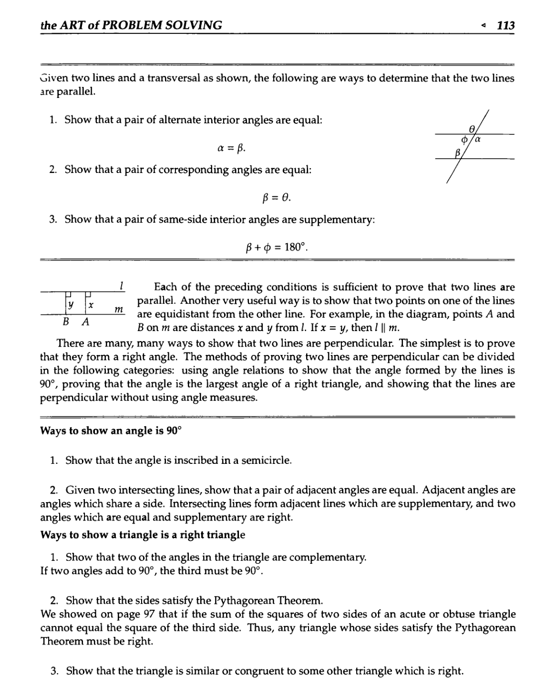

## Printed page 114

<!-- source: volume-1, PDF page 128, printed page 114 -->

4. Show that a median of the triangle is equal to half the side to which it is drawn. This is discussed on page 96.

**Ways to show two lines or segments are perpendicular without using angles**

1. Show that one line passes through the center of a circle which is tangent to the other line where the two lines intersect.

Since a diameter drawn from the point of tangency of a line is perpendicular to the line, this shows that the two lines are perpendicular.

2. If the segments are a radius (or diameter) and a chord of a circle, show that the radius bisects the chord.

This is given as an exercise on page 101. Look for this in problems involving chords of circles.

3. Show that one segment is an altitude in a triangle and the other segment is the side to which the altitude is drawn.

This occurs quite rarely, but sometimes we come across a problem in which we are given two altitudes of a triangle and their intersection. It pays to remember that this intersection is the orthocenter and that any line through this point and a vertex is perpendicular to the side opposite the vertex.

We mentioned above that there are sometimes signs as to when and how we can draw extra lines. Perpendicular lines are useful in problems involving areas, while adding parallel lines is helpful in any problem which calls for similar or congruent triangles. As discussed in the relevant sections, congruent triangles are most useful for showing that segments and angles are equal, while problems involving determining segment lengths or ratios thereof are often solved with similar triangles.

The following example shows the importance of cleverly adding parallel lines to a diagram and using congruent and similar triangles. Various problems at the end of the chapter will also give you experience using these tools.

**EXAMPLE 11-25** Point $E$ is selected on side $AB$ of $\triangle ABC$ such that we have the ratio $AE : EB = 1 : 3$, and point $D$ is selected on side $BC$ so that we have the ratio $CD : DB = 1 : 2$. The point of intersection of $AD$ and $CE$ is $F$. Find $EF / FC + AF / FD$. (AHSME 1965)

**Solution:** Seeing ratios, we look for similar triangles involving the segments. Seeing no such triangles, we endeavor to make some. Drawing $DH \parallel EA$ achieves this. Since $\angle EBC = \angle GDC$ and $\angle BEC = \angle DGC$ (corresponding angles), we have $\Delta EBC \sim \Delta GDC$. Thus $DG / EB = DC / BC = 1/3$. Since $EA / EB = 1/3$ also, we conclude that $EA = DG$. From ASA we have $\Delta EAF \cong \Delta GDF$ (the equal angles are alternate interior angles). Thus, $AF = FD$ and $AF / FD = 1$. That takes care of one of the ratios.

Returning to similar triangles $EBC$ and $GDC$, we know $GC / EC = 1/3$. Since $EF = FG$ and $EF + FG = EC - GC = 2EC / 3$, we have $EF = FG = GC = EC / 3$.

Original scan — PDF page 128

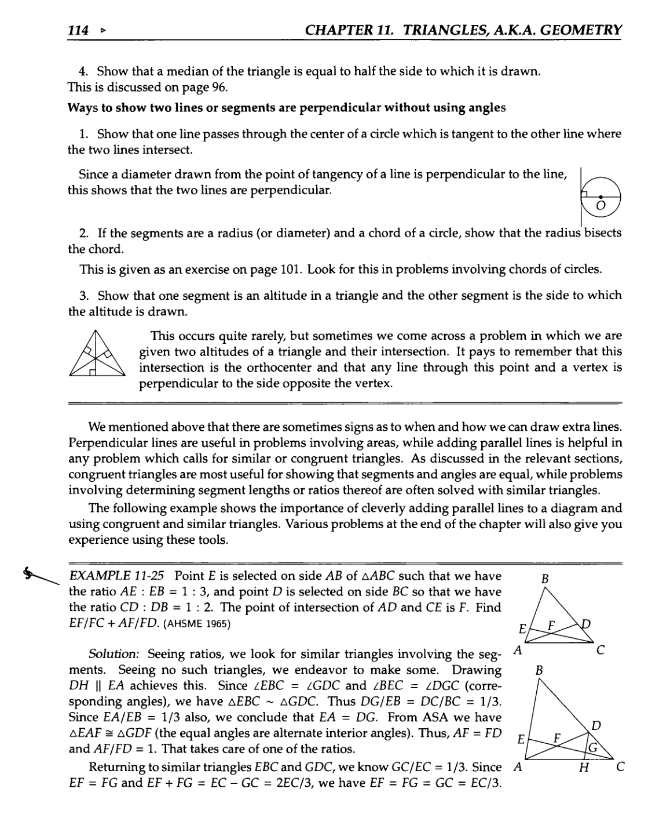

## Printed page 115

<!-- source: volume-1, PDF page 129, printed page 115 -->

Thus, $EF/FC = \frac{(EC/3)}{(2EC/3)} = 1/2$. Putting this together with $AF/FD$, we find $EF/FC + AF/FD = 3/2$.

This is a very difficult problem, but it shows the amazing amount of information that can be found from cleverly adding a single segment to a diagram.

Problems to Solve for Chapter 11

167. In $\triangle ADC$, segment $DM$ is drawn such that $\angle ADM = \angle ACD$. Prove that $AD^2 = A(M)(AC)$.

168. How many scalene triangles have all sides of integral lengths and perimeter less than 13? (AHSME 1956)

169. The sides of $\triangle BAC$ are in the ratio $2:3:4$. $BD$ is the angle bisector drawn to the shortest side $AC$, dividing it into segments $AD$ and $CD$. If the length of $AC$ is 10, then find the length of the longer segment of $AC$. (AHSME 1966)

170. What is the number of distinct lines representing the altitudes, medians, and interior angle bisectors of a triangle that is isosceles, but not equilateral? (AHSME 1957)

171. Triangle $ABD$ is right-angled at $B$. On $AD$ there is a point $C$ for which $AC = CD$ and $AB = BC$. Find $\angle DAB$. (AHSME 1963)

172. Triangle $PYT$ is a right triangle in which $PY = 66$ and $YT = 77$. If $PT$ is more than 50 and is expressed in the simplified form $x\sqrt{y}$, then find $x + y$. (MAΘ 1990)

173. If triangle $PQR$ has sides 40, 60, and 80, then the shortest altitude is $K$ times the longest altitude. Find the value of $K$. (MATHCOUNTS 1990)

174. In this figure, $\angle ACD$ is a right angle, $A, B$, and $C$ are collinear, $\angle A = 30^\circ$, and $\angle DBC = 45^\circ$. If $AB = 3 - \sqrt{3}$, find the area of $\triangle BCD$. (MAΘ 1992)

175. The perpendicular bisectors of two of the sides of triangle $ABC$ intersect the third side at the same point. Prove that the triangle is right-angled. (M&IQ 1992)

176. Show that if $h_a, h_b$, and $h_c$ are the altitudes of a triangle, then

$$\frac{1}{h_a} < \frac{1}{h_b} + \frac{1}{h_c}$$

177. In right triangle $ABC$, $\angle C = 90^\circ$ and $\sin A = 7/25$. Find $\sin B$, $\cos A$, $\cot A$, and $\csc B$.

Original scan — PDF page 129

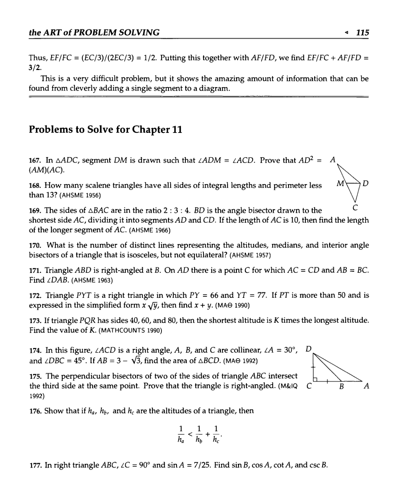

## Printed page 116

<!-- source: volume-1, PDF page 130, printed page 116 -->

178. The angle between the median $CM$ and the hypotenuse $AB$ of right triangle $ABC$ is equal to $30^\circ$. Find the area of $ABC$ if the altitude $CH$ is equal to 4. (M&IQ 1992)

179. The base of a triangle is 15 inches. Two lines are drawn parallel to the base, terminating in the other two sides and dividing the triangle into three equal areas. What is the length of the parallel closer to the base? (AHSME 1953)

180. The straight line $AB$ is divided at $C$ so that $AC = 3CB$. Circles are drawn with $AC$ and $CB$ as diameters and a common tangent to these meets $AB$ extended at $D$. Show that $BD$ equals the radius of the smaller circle. (AHSME 1954)

181. Segments $AD$ and $BE$ are medians of right triangle $ABC$, and $AB$ is its hypotenuse. If a right triangle is constructed with legs $AD$ and $BE$, what will be the length of its hypotenuse in terms of $AB$? (Mandelbrot #2)

182. Let $CM$ be the median in equilateral triangle $ABC$. Point $N$ is on $BC$ such that $MN \perp BC$. Prove that $4BN = BC$. (M&IQ 1992)

183. In right triangle $ACD$ with right angle at $D$, $B$ is a point on side $AD$ between $A$ and $D$. The length of segment $AB$ is 1. If $\angle DAC = \alpha$ and $\angle DBC = \beta$, then find the length of side $DC$ in terms of $\alpha$ and $\beta$. (MAΘ 1991)

184. Angle $B$ of $\triangle ABC$ is trisected by $BD$ and $BE$ which meet $AC$ at $D$ and $E$ respectively. Prove that

$$\frac{AD}{EC} = \frac{(AB)(BD)}{(BE)(BC)}$$

(AHSME 1952)

185. Given that $I$ is the incenter of $\triangle ABC$, $AB = AC = 5$, and $BC = 8$, find the distance $AI$. (Mandelbrot #3)

186. Let $ABC$ be an equilateral triangle and points $F, Q$, and $N$ be such that $AF = QB = NC = 2AB/3$. Prove that the angles $AFQ, NQB,$ and $FNC$ are right and that $FQN$ is an equilateral triangle. (M&IQ 1992)

187. The area of a given triangle is equal to the product of the length of an altitude and the median toward the same side. Prove that the triangle is right-angled. (M&IQ 1992)

188. In $\triangle ABC$, $\angle A = 100^\circ$, $\angle B = 50^\circ$, $\angle C = 30^\circ$, $AH$ is an altitude, and $BM$ is a median. Find $\angle MHC$. (AHSME 1989)

189. Two altitudes of scalene triangle $ABC$ have length 4 and 12. If the length of the third altitude is also an integer, what is the biggest it can be? (AHSME 1986)

190. The medians of a right triangle which are drawn from the vertices of the acute angles are 5 and $\sqrt{40}$. What is the length of the hypotenuse? (AHSME 1951)

Original scan — PDF page 130

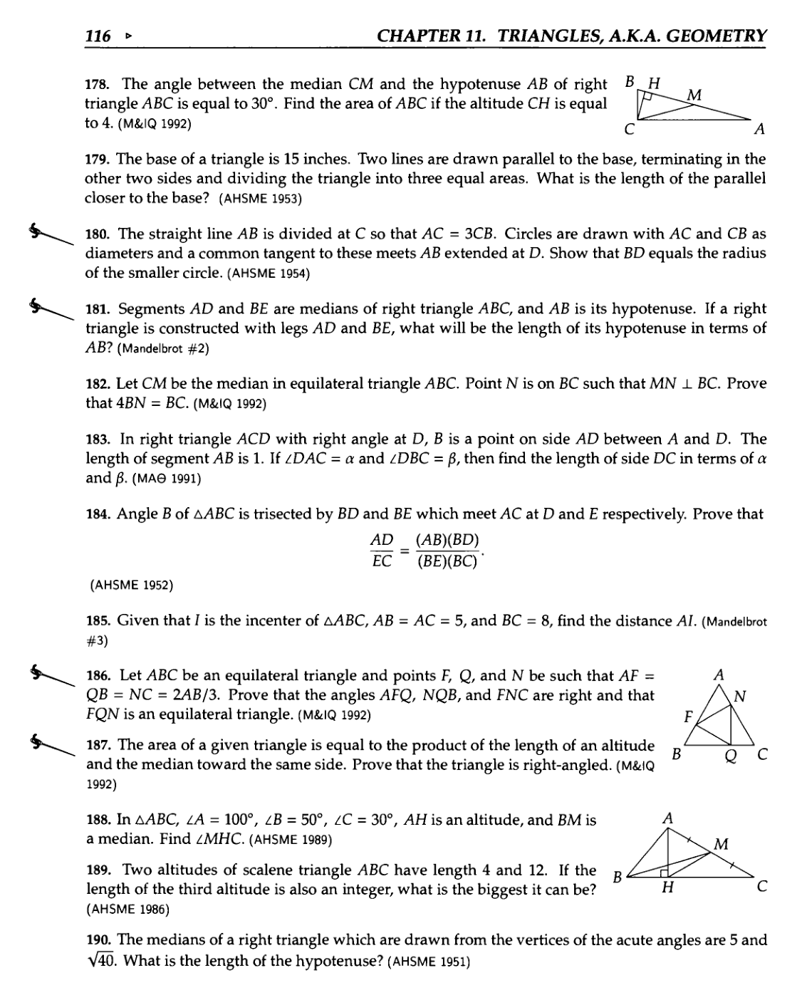

## Printed page 117

<!-- source: volume-1, PDF page 131, printed page 117 -->

191. If $\tan x = \frac{2ab}{a^2 - b^2}$, where $a > b > 0$ and $0^\circ < x < 90^\circ$, then find $\sin x$ in terms of $a$ and $b$. (AHSME 1972)

192. A right-angled triangle $ABC$ is given in which $F$ is the midpoint of the hypotenuse $AB$ and $BC = 3AC$. Let the points $D$ and $E$ divide the side $BC$ in three equal segments. Prove that the triangle $DFE$ is isosceles and right-angled. (M&IQ 1992)

193. The median to a 10 cm side of a triangle has length 9 cm and is perpendicular to a second median of the triangle. Find the exact value in centimeters of the length of the third median. (MAΘ 1990)

194. A point is selected inside an equilateral triangle. From this point perpendiculars are dropped to each side. Show that the sum of the lengths of these perpendiculars is equal to the altitude length. (AHSME 1950)

195. Let $M$ be the midpoint of side $AB$ of equilateral triangle $ABC$, and let points $N, S,$ and $K$ divide side $BC$ into four equal segments. Given that $P$ is the midpoint of $CM$, prove that $\angle MNB = \angle KPN = 90^\circ$. (M&IQ 1992)

196. Prove that in $\triangle ABC$, if $\angle A > \angle B$, then $BC > AC$.

**the BIG PICTURE**

Geometry was already in full swing when Euclid came along in around 300 B.C., but it was never the same once he was through with it. In the *Elements*, Euclid started with a set of five simple laws, or *axioms*, from which all the theorems of geometry could be derived. Loosely, they are:

1. Every two points determine exactly one straight line.
2. A segment may be extended arbitrarily far in a straight line.
3. A circle may be drawn with any center and any radius.
4. All right angles are the same.
5. Given any line and any point not on that line, there is exactly one line through the point which is parallel to the original line.

And that's it! Everything else in plane geometry results from these five. Why did Euclid use these particular five? Apparently, he considered them the most aesthetically simple set which still covered everything.

In much of the rest of the *Elements*, Euclid builds geometry up from his postulates in a fully rigorous (and fully beautiful) way. Even 2000 years later, many great mathematicians have first become fascinated with math after reading Euclid’s work.

Original scan — PDF page 131

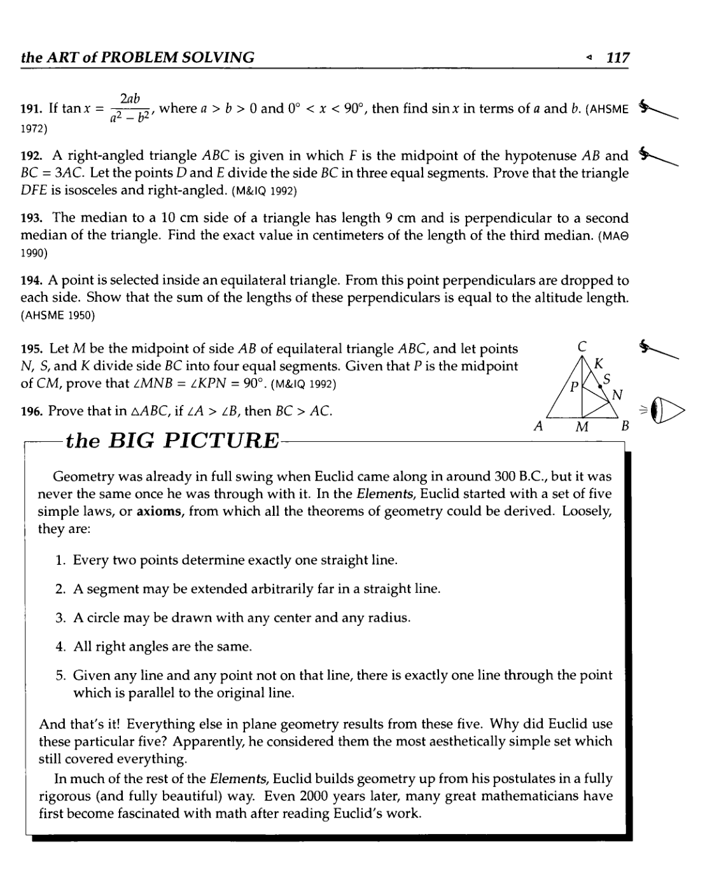

