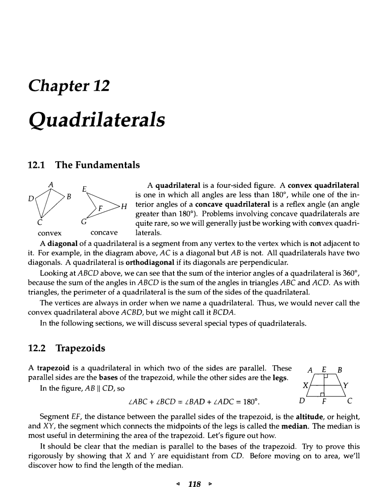
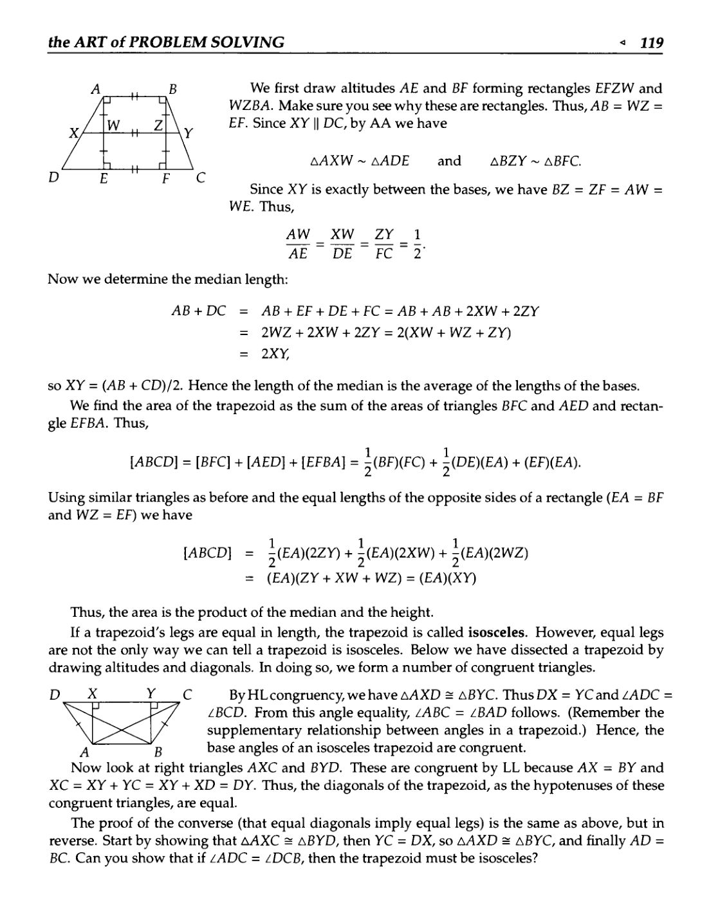
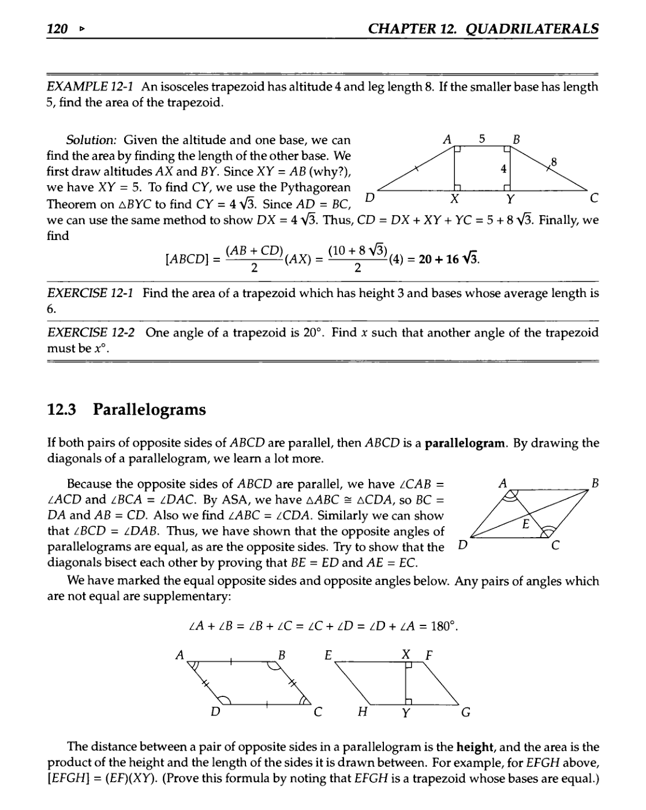
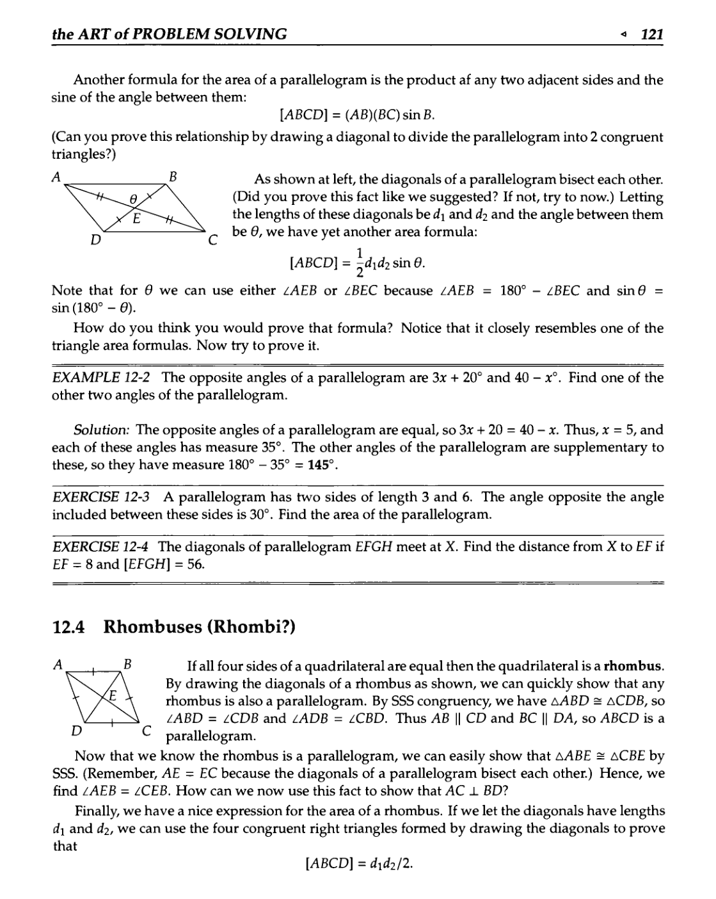
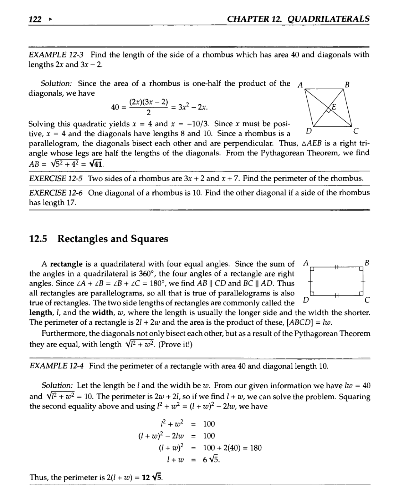
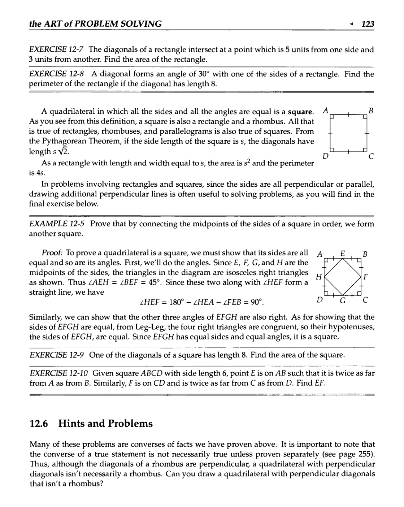
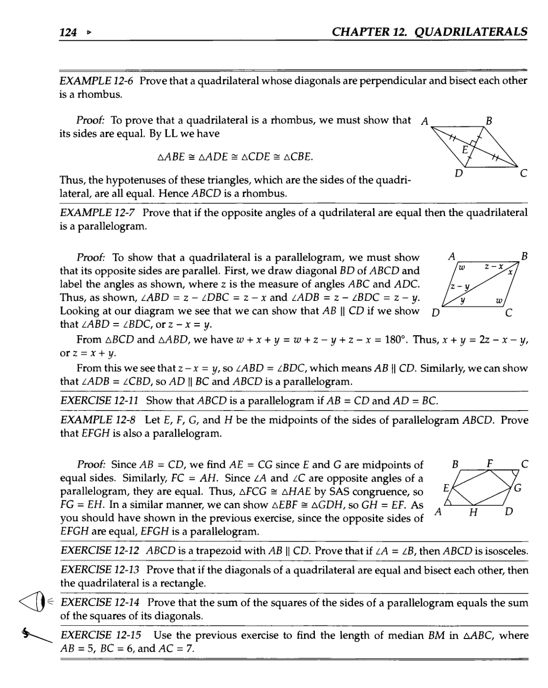
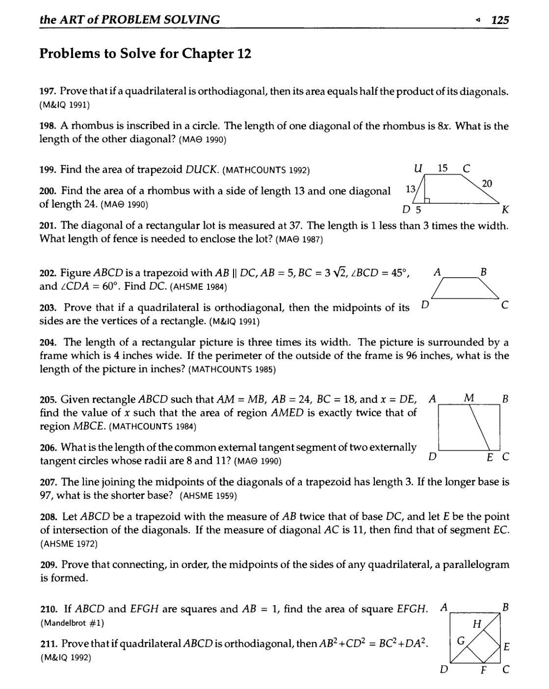
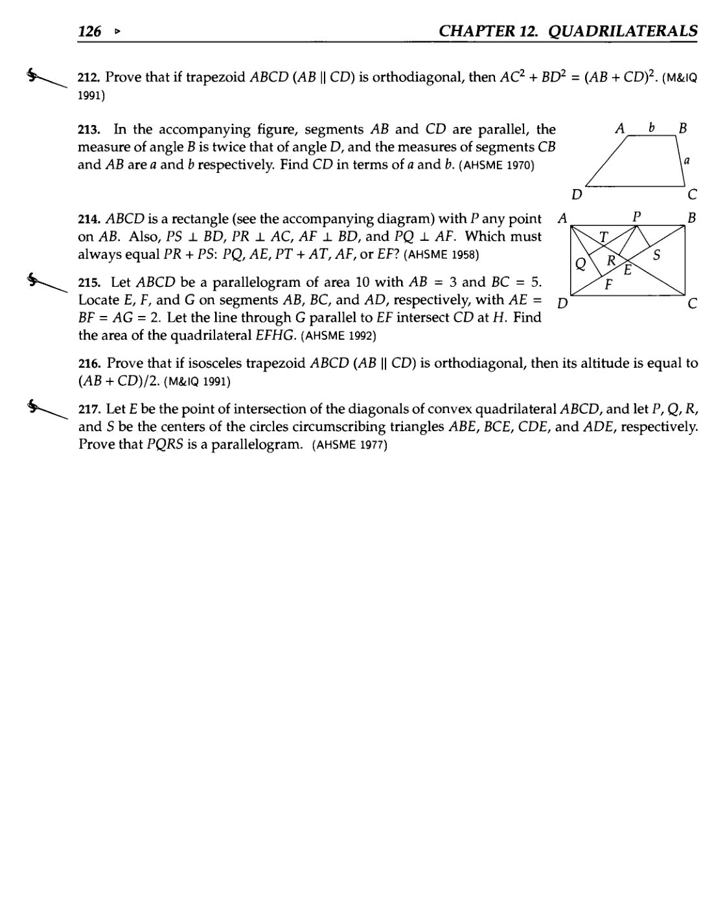

# Chapter 12: Quadrilaterals

Volume 1 · Printed pages 118–126 · PDF pages 132–140

[Volume contents](../index.md)

## Printed page 118

<!-- source: volume-1, PDF page 132, printed page 118 -->

Chapter 12

Quadrilaterals

### 12.1 The Fundamentals

A quadrilateral is a four-sided figure. A convex quadrilateral is one in which all angles are less than $180^\circ$, while one of the interior angles of a concave quadrilateral is a reflex angle (an angle greater than $180^\circ$). Problems involving concave quadrilaterals are quite rare, so we will generally just be working with convex quadrilaterals.

A diagonal of a quadrilateral is a segment from any vertex to the vertex which is not adjacent to it. For example, in the diagram above, $AC$ is a diagonal but $AB$ is not. All quadrilaterals have two diagonals. A quadrilateral is orthodiagonal if its diagonals are perpendicular.

Looking at $ABCD$ above, we can see that the sum of the interior angles of a quadrilateral is $360^\circ$, because the sum of the angles in $ABCD$ is the sum of the angles in triangles $ABC$ and $ACD$. As with triangles, the perimeter of a quadrilateral is the sum of the sides of the quadrilateral.

The vertices are always in order when we name a quadrilateral. Thus, we would never call the convex quadrilateral above $ACBD$, but we might call it $BCDA$.

In the following sections, we will discuss several special types of quadrilaterals.

### 12.2 Trapezoids

A trapezoid is a quadrilateral in which two of the sides are parallel. These parallel sides are the bases of the trapezoid, while the other sides are the legs.

In the figure, $AB \parallel CD$, so

$$\angle ABC + \angle BCD = \angle BAD + \angle ADC = 180^\circ.$$

Segment $EF$, the distance between the parallel sides of the trapezoid, is the altitude, or height, and $XY$, the segment which connects the midpoints of the legs is called the median. The median is most useful in determining the area of the trapezoid. Let’s figure out how.

It should be clear that the median is parallel to the bases of the trapezoid. Try to prove this rigorously by showing that $X$ and $Y$ are equidistant from $CD$. Before moving on to area, we’ll discover how to find the length of the median.

Original scan — PDF page 132

## Printed page 119

<!-- source: volume-1, PDF page 133, printed page 119 -->

We first draw altitudes $AE$ and $BF$ forming rectangles $EFZW$ and $WZBA$. Make sure you see why these are rectangles. Thus, $AB = WZ = EF$. Since $XY \parallel DC$, by AA we have

$$\Delta AXW \sim \Delta ADE$$ and $$\Delta BZY \sim \Delta BFC.$$

Since $XY$ is exactly between the bases, we have $BZ = ZF = AW = WE$. Thus,

$$\frac{AW}{AE} = \frac{XW}{DE} = \frac{ZY}{FC} = \frac{1}{2}.$$

Now we determine the median length:

$$AB + DC = AB + EF + DE + FC = AB + AB + 2XW + 2ZY$$

$$= 2WZ + 2XW + 2ZY = 2(XW + WZ + ZY)$$

$$= 2XY,$$

so $XY = (AB + CD)/2$. Hence the length of the median is the average of the lengths of the bases.

We find the area of the trapezoid as the sum of the areas of triangles $BFC$ and $AED$ and rectangle $EFBA$. Thus,

$$[ABCD] = [BFC] + [AED] + [EFBA] = \frac{1}{2}(BF)(FC) + \frac{1}{2}(DE)(EA) + (EF)(EA).$$

Using similar triangles as before and the equal lengths of the opposite sides of a rectangle ($EA = BF$ and $WZ = EF$) we have

$$[ABCD] = \frac{1}{2}(EA)(2ZY) + \frac{1}{2}(EA)(2XW) + \frac{1}{2}(EA)(2WZ)$$

$$= (EA)(ZY + XW + WZ) = (EA)(XY)$$

Thus, the area is the product of the median and the height.

If a trapezoid’s legs are equal in length, the trapezoid is called **isosceles**. However, equal legs are not the only way we can tell a trapezoid is isosceles. Below we have dissected a trapezoid by drawing altitudes and diagonals. In doing so, we form a number of congruent triangles.

By HL congruency, we have $\Delta AXD \cong \Delta BYC$. Thus $DX = YC$ and $\angle ADC = \angle BCD$. From this angle equality, $\angle ABC = \angle BAD$ follows. (Remember the supplementary relationship between angles in a trapezoid.) Hence, the base angles of an isosceles trapezoid are congruent.

Now look at right triangles $AXC$ and $BYD$. These are congruent by LL because $AX = BY$ and $XC = XY + YC = XY + XD = DY$. Thus, the diagonals of the trapezoid, as the hypotenuses of these congruent triangles, are equal.

The proof of the converse (that equal diagonals imply equal legs) is the same as above, but in reverse. Start by showing that $\Delta AXC \cong \Delta BYD$, then $YC = DX$, so $\Delta AXD \cong \Delta BYC$, and finally $AD = BC$. Can you show that if $\angle ADC = \angle DCB$, then the trapezoid must be isosceles?

Original scan — PDF page 133

## Printed page 120

<!-- source: volume-1, PDF page 134, printed page 120 -->

**EXAMPLE 12-1 An isosceles trapezoid has altitude 4 and leg length 8. If the smaller base has length 5, find the area of the trapezoid.**

Solution: Given the altitude and one base, we can find the area by finding the length of the other base. We first draw altitudes $AX$ and $BY$. Since $XY = AB$ (why?), we have $XY = 5$. To find $CY$, we use the Pythagorean Theorem on $\Delta BYC$ to find $CY = 4\sqrt{3}$. Since $AD = BC$, we can use the same method to show $DX = 4\sqrt{3}$. Thus, $CD = DX + XY + YC = 5 + 8\sqrt{3}$. Finally, we find

$$[ABCD] = \frac{(AB + CD)}{2}(AX) = \frac{(10 + 8\sqrt{3})}{2}(4) = 20 + 16\sqrt{3}.$$

**EXERCISE 12-1 Find the area of a trapezoid which has height 3 and bases whose average length is 6.**

**EXERCISE 12-2 One angle of a trapezoid is $20^\circ$. Find $x$ such that another angle of the trapezoid must be $x^\circ$.**

### 12.3 Parallelograms

If both pairs of opposite sides of $ABCD$ are parallel, then $ABCD$ is a parallelogram. By drawing the diagonals of a parallelogram, we learn a lot more.

Because the opposite sides of $ABCD$ are parallel, we have $\angle CAB = \angle ACD$ and $\angle BCA = \angle DAC$. By ASA, we have $\triangle ABC \cong \triangle CDA$, so $BC = DA$ and $AB = CD$. Also we find $\angle ABC = \angle CDA$. Similarly we can show that $\angle BCD = \angle DAB$. Thus, we have shown that the opposite angles of parallelograms are equal, as are the opposite sides. Try to show that the diagonals bisect each other by proving that $BE = ED$ and $AE = EC$.

We have marked the equal opposite sides and opposite angles below. Any pairs of angles which are not equal are supplementary:

$$\angle A + \angle B = \angle B + \angle C = \angle C + \angle D = \angle D + \angle A = 180^\circ.$$

The distance between a pair of opposite sides in a parallelogram is the height, and the area is the product of the height and the length of the sides it is drawn between. For example, for EFGH above, $[EFGH] = (EF)(XY)$. (Prove this formula by noting that EFGH is a trapezoid whose bases are equal.)

Original scan — PDF page 134

## Printed page 121

<!-- source: volume-1, PDF page 135, printed page 121 -->

Another formula for the area of a parallelogram is the product of any two adjacent sides and the sine of the angle between them:

$$[ABCD] = (AB)(BC) \sin B.$$

(Can you prove this relationship by drawing a diagonal to divide the parallelogram into 2 congruent triangles?)

As shown at left, the diagonals of a parallelogram bisect each other. (Did you prove this fact like we suggested? If not, try to now.) Letting the lengths of these diagonals be $d_1$ and $d_2$ and the angle between them be $\theta$, we have yet another area formula:

$$[ABCD] = \frac{1}{2} d_1 d_2 \sin \theta.$$

Note that for $\theta$ we can use either $\angle AEB$ or $\angle BEC$ because $\angle AEB = 180^\circ - \angle BEC$ and $\sin \theta = \sin (180^\circ - \theta)$.

How do you think you would prove that formula? Notice that it closely resembles one of the triangle area formulas. Now try to prove it.

**EXAMPLE 12-2** The opposite angles of a parallelogram are $3x + 20^\circ$ and $40 - x^\circ$. Find one of the other two angles of the parallelogram.

**Solution:** The opposite angles of a parallelogram are equal, so $3x + 20 = 40 - x$. Thus, $x = 5$, and each of these angles has measure $35^\circ$. The other angles of the parallelogram are supplementary to these, so they have measure $180^\circ - 35^\circ = 145^\circ.$

**EXERCISE 12-3** A parallelogram has two sides of length 3 and 6. The angle opposite the angle included between these sides is $30^\circ$. Find the area of the parallelogram.

**EXERCISE 12-4** The diagonals of parallelogram EFGH meet at $X$. Find the distance from $X$ to $EF$ if $EF = 8$ and $[EFGH] = 56.$

### 12.4 Rhombuses (Rhombi?)

If all four sides of a quadrilateral are equal then the quadrilateral is a rhombus. By drawing the diagonals of a rhombus as shown, we can quickly show that any rhombus is also a parallelogram. By SSS congruency, we have $\triangle ABD \cong \triangle CDB$, so $\angle ABD = \angle CDB$ and $\angle ADB = \angle CBD$. Thus $AB \parallel CD$ and $BC \parallel DA$, so $ABCD$ is a parallelogram.

Now that we know the rhombus is a parallelogram, we can easily show that $\triangle ABE \cong \triangle CBE$ by SSS. (Remember, $AE = EC$ because the diagonals of a parallelogram bisect each other.) Hence, we find $\angle AEB = \angle CEB$. How can we now use this fact to show that $AC \perp BD$?

Finally, we have a nice expression for the area of a rhombus. If we let the diagonals have lengths $d_1$ and $d_2$, we can use the four congruent right triangles formed by drawing the diagonals to prove that

$$[ABCD] = d_1 d_2 / 2.$$

Original scan — PDF page 135

## Printed page 122

<!-- source: volume-1, PDF page 136, printed page 122 -->

**EXAMPLE 12-3 Find the length of the side of a rhombus which has area 40 and diagonals with lengths $2x$ and $3x - 2$.**

Solution: Since the area of a rhombus is one-half the product of the diagonals, we have
$$40 = \frac{(2x)(3x - 2)}{2} = 3x^2 - 2x.$$
Solving this quadratic yields $x = 4$ and $x = -10/3$. Since $x$ must be positive, $x = 4$ and the diagonals have lengths 8 and 10. Since a rhombus is a parallelogram, the diagonals bisect each other and are perpendicular. Thus, $\triangle AEB$ is a right triangle whose legs are half the lengths of the diagonals. From the Pythagorean Theorem, we find
$$AB = \sqrt{5^2 + 4^2} = \sqrt{41}.$$

**EXERCISE 12-5 Two sides of a rhombus are $3x + 2$ and $x + 7$. Find the perimeter of the rhombus.**

**EXERCISE 12-6 One diagonal of a rhombus is 10. Find the other diagonal if a side of the rhombus has length 17.**

### 12.5 Rectangles and Squares

A rectangle is a quadrilateral with four equal angles. Since the sum of the angles in a quadrilateral is $360^\circ$, the four angles of a rectangle are right angles. Since $\angle A + \angle B = \angle B + \angle C = 180^\circ$, we find $AB \parallel CD$ and $BC \parallel AD$. Thus all rectangles are parallelograms, so all that is true of parallelograms is also true of rectangles. The two side lengths of rectangles are commonly called the length, $l$, and the width, $w$, where the length is usually the longer side and the width the shorter. The perimeter of a rectangle is $2l + 2w$ and the area is the product of these, $[ABCD] = lw$.

Furthermore, the diagonals not only bisect each other, but as a result of the Pythagorean Theorem they are equal, with length $\sqrt{l^2 + w^2}$. (Prove it!)

**EXAMPLE 12-4 Find the perimeter of a rectangle with area 40 and diagonal length 10.**

Solution: Let the length be $l$ and the width be $w$. From our given information we have $lw = 40$ and $\sqrt{l^2 + w^2} = 10$. The perimeter is $2w + 2l$, so if we find $l + w$, we can solve the problem. Squaring the second equality above and using $l^2 + w^2 = (l + w)^2 - 2lw$, we have
$$l^2 + w^2 = 100$$
$$(l + w)^2 - 2lw = 100$$
$$(l + w)^2 = 100 + 2(40) = 180$$
$$l + w = 6\sqrt{5}.$$

Thus, the perimeter is $2(l + w) = 12\sqrt{5}$.

Original scan — PDF page 136

## Printed page 123

<!-- source: volume-1, PDF page 137, printed page 123 -->

**EXERCISE 12-7 The diagonals of a rectangle intersect at a point which is 5 units from one side and 3 units from another. Find the area of the rectangle.**

**EXERCISE 12-8 A diagonal forms an angle of $30^\circ$ with one of the sides of a rectangle. Find the perimeter of the rectangle if the diagonal has length 8.**

A quadrilateral in which all the sides and all the angles are equal is a square. As you see from this definition, a square is also a rectangle and a rhombus. All that is true of rectangles, rhombuses, and parallelograms is also true of squares. From the Pythagorean Theorem, if the side length of the square is $s$, the diagonals have length $s\sqrt{2}$.

As a rectangle with length and width equal to $s$, the area is $s^2$ and the perimeter is 4$s$.

In problems involving rectangles and squares, since the sides are all perpendicular or parallel, drawing additional perpendicular lines is often useful to solving problems, as you will find in the final exercise below.

**EXAMPLE 12-5 Prove that by connecting the midpoints of the sides of a square in order, we form another square.**

Proof: To prove a quadrilateral is a square, we must show that its sides are all equal and so are its angles. First, we’ll do the angles. Since $E, F, G,$ and $H$ are the midpoints of the sides, the triangles in the diagram are isosceles right triangles as shown. Thus $\angle AEH = \angle BEF = 45^\circ$. Since these two along with $\angle HEF$ form a straight line, we have

$$\angle HEF = 180^\circ - \angle HEA - \angle FEB = 90^\circ.$$

Similarly, we can show that the other three angles of $EFGH$ are also right. As for showing that the sides of $EFGH$ are equal, from Leg-Leg, the four right triangles are congruent, so their hypotenuses, the sides of $EFGH$, are equal. Since $EFGH$ has equal sides and equal angles, it is a square.

**EXERCISE 12-9 One of the diagonals of a square has length 8. Find the area of the square.**

**EXERCISE 12-10 Given square $ABCD$ with side length 6, point $E$ is on $AB$ such that it is twice as far from $A$ as from $B$. Similarly, $F$ is on $CD$ and is twice as far from $C$ as from $D$. Find $EF$.**

### 12.6 Hints and Problems

Many of these problems are converses of facts we have proven above. It is important to note that the converse of a true statement is not necessarily true unless proven separately (see page 255). Thus, although the diagonals of a rhombus are perpendicular, a quadrilateral with perpendicular diagonals isn’t necessarily a rhombus. Can you draw a quadrilateral with perpendicular diagonals that isn’t a rhombus?

Original scan — PDF page 137

## Printed page 124

<!-- source: volume-1, PDF page 138, printed page 124 -->

**EXAMPLE 12-6 Prove that a quadrilateral whose diagonals are perpendicular and bisect each other is a rhombus.**

Proof: To prove that a quadrilateral is a rhombus, we must show that its sides are equal. By LL we have

$$\Delta ABE \cong \Delta ADE \cong \Delta CDE \cong \Delta CBE.$$

Thus, the hypotenuses of these triangles, which are the sides of the quadrilateral, are all equal. Hence $ABCD$ is a rhombus.

**EXAMPLE 12-7 Prove that if the opposite angles of a quadrilateral are equal then the quadrilateral is a parallelogram.**

Proof: To show that a quadrilateral is a parallelogram, we must show that its opposite sides are parallel. First, we draw diagonal $BD$ of $ABCD$ and label the angles as shown, where $z$ is the measure of angles $ABC$ and $ADC$. Thus, as shown, $\angle ABD = z - \angle DBC = z - x$ and $\angle ADB = z - \angle BDC = z - y$. Looking at our diagram we see that we can show that $AB \parallel CD$ if we show that $\angle ABD = \angle BDC$, or $z - x = y$.

From $\Delta BCD$ and $\Delta ABD$, we have $w + x + y = w + z - y + z - x = 180^\circ$. Thus, $x + y = 2z - x - y$, or $z = x + y$.

From this we see that $z - x = y$, so $\angle ABD = \angle BDC$, which means $AB \parallel CD$. Similarly, we can show that $\angle ADB = \angle CBD$, so $AD \parallel BC$ and $ABCD$ is a parallelogram.

**EXERCISE 12-11 Show that $ABCD$ is a parallelogram if $AB = CD$ and $AD = BC$.**

**EXAMPLE 12-8 Let $E, F, G$, and $H$ be the midpoints of the sides of parallelogram $ABCD$. Prove that $EFGH$ is also a parallelogram.**

Proof: Since $AB = CD$, we find $AE = CG$ since $E$ and $G$ are midpoints of equal sides. Similarly, $FC = AH$. Since $\angle A$ and $\angle C$ are opposite angles of a parallelogram, they are equal. Thus, $\Delta FCG \cong \Delta HAE$ by SAS congruence, so $FG = EH$. In a similar manner, we can show $\Delta EBF \cong \Delta GDH$, so $GH = EF$. As you should have shown in the previous exercise, since the opposite sides of $EFGH$ are equal, $EFGH$ is a parallelogram.

**EXERCISE 12-12 $ABCD$ is a trapezoid with $AB \parallel CD$. Prove that if $\angle A = \angle B$, then $ABCD$ is isosceles.**

**EXERCISE 12-13 Prove that if the diagonals of a quadrilateral are equal and bisect each other, then the quadrilateral is a rectangle.**

**EXERCISE 12-14 Prove that the sum of the squares of the sides of a parallelogram equals the sum of the squares of its diagonals.**

**EXERCISE 12-15 Use the previous exercise to find the length of median $BM$ in $\Delta ABC$, where $AB = 5$, $BC = 6$, and $AC = 7$.**

Original scan — PDF page 138

## Printed page 125

<!-- source: volume-1, PDF page 139, printed page 125 -->

197. Prove that if a quadrilateral is orthodiagonal, then its area equals half the product of its diagonals. (M&IQ 1991)

198. A rhombus is inscribed in a circle. The length of one diagonal of the rhombus is $8x$. What is the length of the other diagonal? (MAΘ 1990)

199. Find the area of trapezoid $DUCK$. (MATHCOUNTS 1992)

200. Find the area of a rhombus with a side of length 13 and one diagonal of length 24. (MAΘ 1990)

201. The diagonal of a rectangular lot is measured at 37. The length is 1 less than 3 times the width. What length of fence is needed to enclose the lot? (MAΘ 1987)

202. Figure $ABCD$ is a trapezoid with $AB \parallel DC$, $AB = 5$, $BC = 3\sqrt{2}$, $\angle BCD = 45^\circ$, and $\angle CDA = 60^\circ$. Find $DC$. (AHSME 1984)

203. Prove that if a quadrilateral is orthodiagonal, then the midpoints of its sides are the vertices of a rectangle. (M&IQ 1991)

204. The length of a rectangular picture is three times its width. The picture is surrounded by a frame which is 4 inches wide. If the perimeter of the outside of the frame is 96 inches, what is the length of the picture in inches? (MATHCOUNTS 1985)

205. Given rectangle $ABCD$ such that $AM = MB$, $AB = 24$, $BC = 18$, and $x = DE$, find the value of $x$ such that the area of region $AMED$ is exactly twice that of region $MBCE$. (MATHCOUNTS 1984)

206. What is the length of the common external tangent segment of two externally tangent circles whose radii are 8 and 11? (MAΘ 1990)

207. The line joining the midpoints of the diagonals of a trapezoid has length 3. If the longer base is 97, what is the shorter base? (AHSME 1959)

208. Let $ABCD$ be a trapezoid with the measure of $AB$ twice that of base $DC$, and let $E$ be the point of intersection of the diagonals. If the measure of diagonal $AC$ is 11, then find that of segment $EC$. (AHSME 1972)

209. Prove that connecting, in order, the midpoints of the sides of any quadrilateral, a parallelogram is formed.

210. If $ABCD$ and $EFGH$ are squares and $AB = 1$, find the area of square $EFGH$. (Mandelbrot #1)

211. Prove that if quadrilateral $ABCD$ is orthodiagonal, then $AB^2 + CD^2 = BC^2 + DA^2$. (M&IQ 1992)

Original scan — PDF page 139

## Printed page 126

<!-- source: volume-1, PDF page 140, printed page 126 -->

212. Prove that if trapezoid $ABCD$ ($AB \parallel CD$) is orthodiagonal, then $AC^2 + BD^2 = (AB + CD)^2$. (M&IQ 1991)

213. In the accompanying figure, segments $AB$ and $CD$ are parallel, the measure of angle $B$ is twice that of angle $D$, and the measures of segments $CB$ and $AB$ are $a$ and $b$ respectively. Find $CD$ in terms of $a$ and $b$. (AHSME 1970)

214. $ABCD$ is a rectangle (see the accompanying diagram) with $P$ any point on $AB$. Also, $PS \perp BD$, $PR \perp AC$, $AF \perp BD$, and $PQ \perp AF$. Which must always equal $PR + PS$: $PQ, AE, PT + AT, AF$, or $EF$? (AHSME 1958)

215. Let $ABCD$ be a parallelogram of area 10 with $AB = 3$ and $BC = 5$. Locate $E, F$, and $G$ on segments $AB, BC$, and $AD$, respectively, with $AE = BF = AG = 2$. Let the line through $G$ parallel to $EF$ intersect $CD$ at $H$. Find the area of the quadrilateral $EFHG$. (AHSME 1992)

216. Prove that if isosceles trapezoid $ABCD$ ($AB \parallel CD$) is orthodiagonal, then its altitude is equal to $(AB + CD)/2$. (M&IQ 1991)

217. Let $E$ be the point of intersection of the diagonals of convex quadrilateral $ABCD$, and let $P, Q, R$, and $S$ be the centers of the circles circumscribing triangles $ABE, BCE, CDE$, and $ADE$, respectively. Prove that $PQRS$ is a parallelogram. (AHSME 1977)

Original scan — PDF page 140

