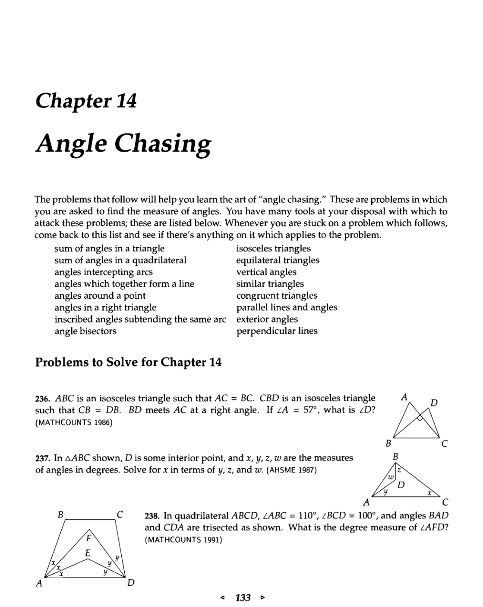
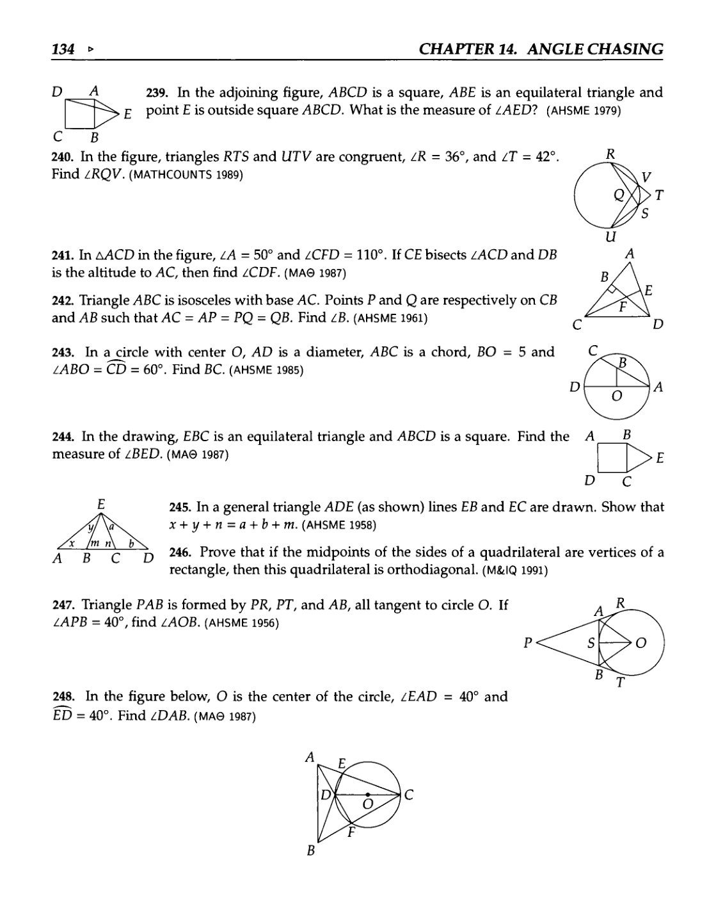
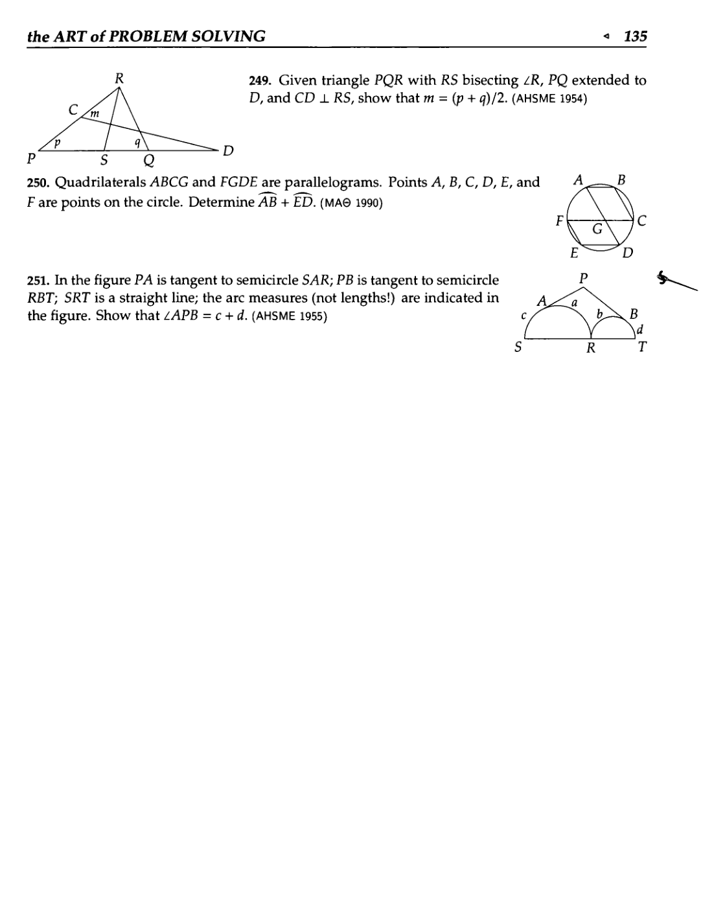

# Chapter 14: Angle Chasing

Volume 1 · Printed pages 133–135 · PDF pages 147–149

[Volume contents](../index.md)

## Printed page 133

<!-- source: volume-1, PDF page 147, printed page 133 -->

The problems that follow will help you learn the art of "angle chasing." These are problems in which you are asked to find the measure of angles. You have many tools at your disposal with which to attack these problems; these are listed below. Whenever you are stuck on a problem which follows, come back to this list and see if there's anything on it which applies to the problem.

sum of angles in a triangle isosceles triangles
sum of angles in a quadrilateral equilateral triangles
angles intercepting arcs vertical angles
angles which together form a line similar triangles
angles around a point congruent triangles
angles in a right triangle parallel lines and angles
inscribed angles subtending the same arc exterior angles
angle bisectors perpendicular lines

Problems to Solve for Chapter 14

236. ABC is an isosceles triangle such that AC = BC. CBD is an isosceles triangle such that CB = DB. BD meets AC at a right angle. If $\angle A = 57^\circ$, what is $\angle D$? (MATHCOUNTS 1986)

237. In $\triangle ABC$ shown, D is some interior point, and x, y, z, w are the measures of angles in degrees. Solve for x in terms of y, z, and w. (AHSME 1987)

238. In quadrilateral ABCD, $\angle ABC = 110^\circ$, $\angle BCD = 100^\circ$, and angles BAD and CDA are trisected as shown. What is the degree measure of $\angle AFD$? (MATHCOUNTS 1991)

Original scan — PDF page 147

## Printed page 134

<!-- source: volume-1, PDF page 148, printed page 134 -->

239. In the adjoining figure, $ABCD$ is a square, $ABE$ is an equilateral triangle and point $E$ is outside square $ABCD$. What is the measure of $\angle AED$? (AHSME 1979)

240. In the figure, triangles $RTS$ and $UTV$ are congruent, $\angle R = 36^\circ$, and $\angle T = 42^\circ$. Find $\angle RQV$. (MATHCOUNTS 1989)

241. In $\triangle ACD$ in the figure, $\angle A = 50^\circ$ and $\angle CFD = 110^\circ$. If $CE$ bisects $\angle ACD$ and $DB$ is the altitude to $AC$, then find $\angle CDF$. (MAΘ 1987)

242. Triangle $ABC$ is isosceles with base $AC$. Points $P$ and $Q$ are respectively on $CB$ and $AB$ such that $AC = AP = PQ = QB$. Find $\angle B$. (AHSME 1961)

243. In a circle with center $O$, $AD$ is a diameter, $ABC$ is a chord, $BO = 5$ and $\angle ABO = \widehat{CD} = 60^\circ$. Find $BC$. (AHSME 1985)

244. In the drawing, $EBC$ is an equilateral triangle and $ABCD$ is a square. Find the measure of $\angle BED$. (MAΘ 1987)

245. In a general triangle $ADE$ (as shown) lines $EB$ and $EC$ are drawn. Show that $x + y + n = a + b + m$. (AHSME 1958)

246. Prove that if the midpoints of the sides of a quadrilateral are vertices of a rectangle, then this quadrilateral is orthodiagonal. (M&IQ 1991)

247. Triangle $PAB$ is formed by $PR$, $PT$, and $AB$, all tangent to circle $O$. If $\angle APB = 40^\circ$, find $\angle AOB$. (AHSME 1956)

248. In the figure below, $O$ is the center of the circle, $\angle EAD = 40^\circ$ and $\widehat{ED} = 40^\circ$. Find $\angle DAB$. (MAΘ 1987)

Original scan — PDF page 148

## Printed page 135

<!-- source: volume-1, PDF page 149, printed page 135 -->

249. Given triangle $PQR$ with $RS$ bisecting $\angle R$, $PQ$ extended to $D$, and $CD \perp RS$, show that $m = (p + q)/2$. (AHSME 1954)

250. Quadrilaterals $ABCG$ and $FGDE$ are parallelograms. Points $A, B, C, D, E,$ and $F$ are points on the circle. Determine $\widehat{AB} + \widehat{ED}$. (MAΘ 1990)

251. In the figure $PA$ is tangent to semicircle $SAR$; $PB$ is tangent to semicircle $RBT$; $SRT$ is a straight line; the arc measures (not lengths!) are indicated in the figure. Show that $\angle APB = c + d$. (AHSME 1955)

Original scan — PDF page 149

