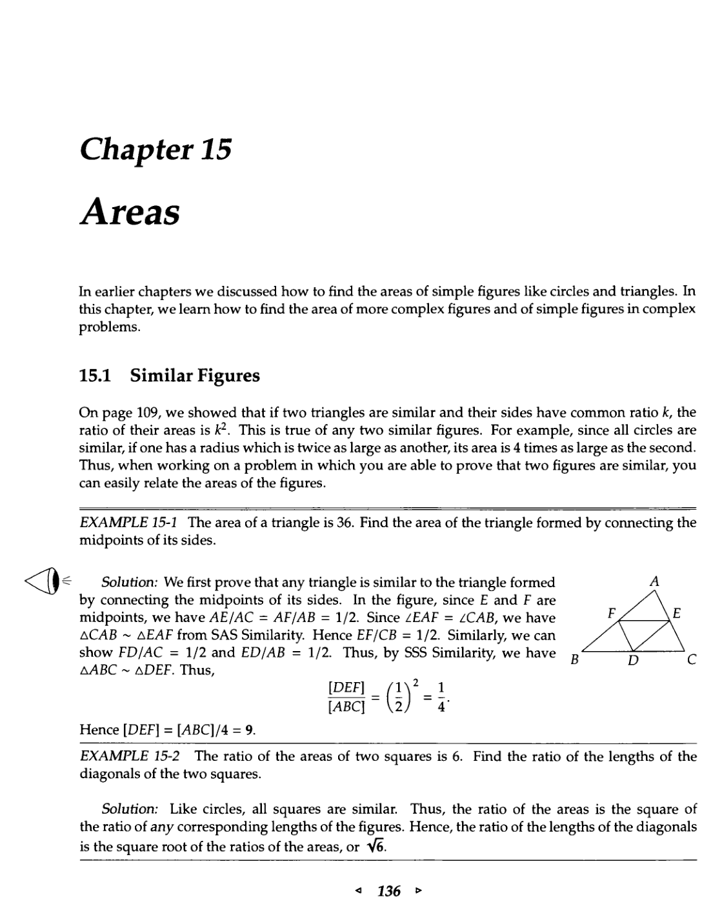
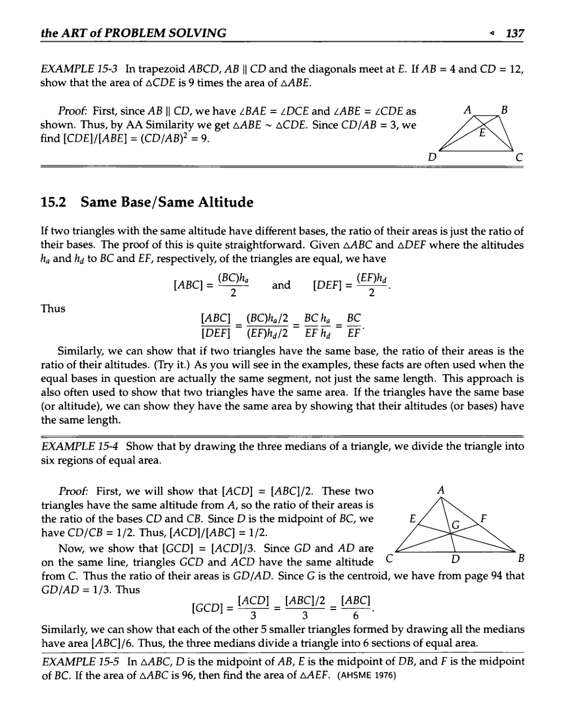
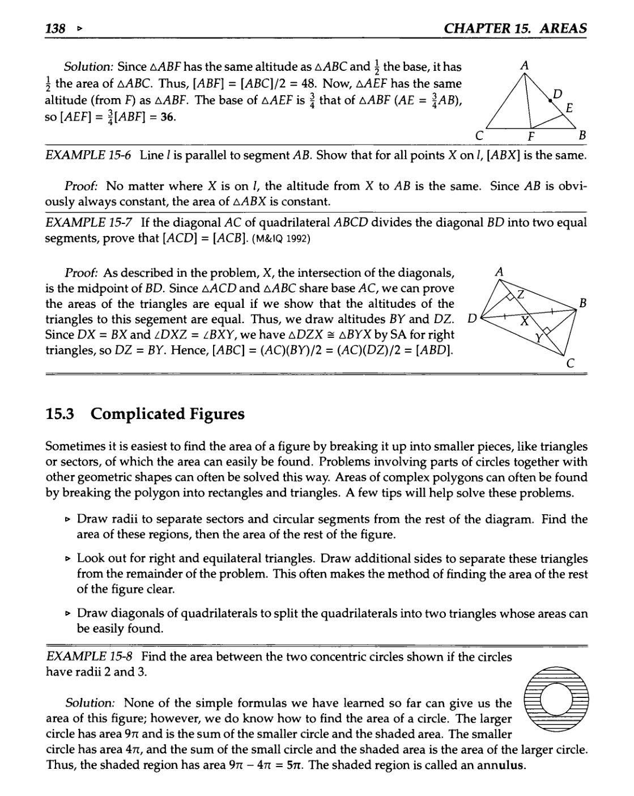
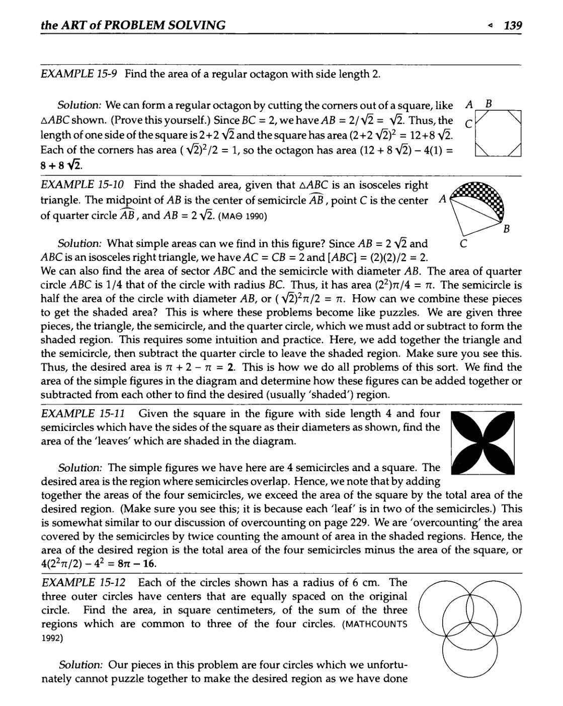
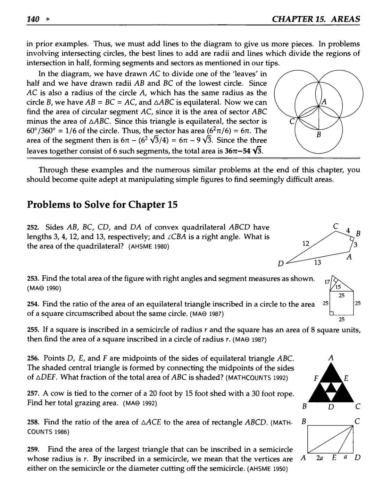
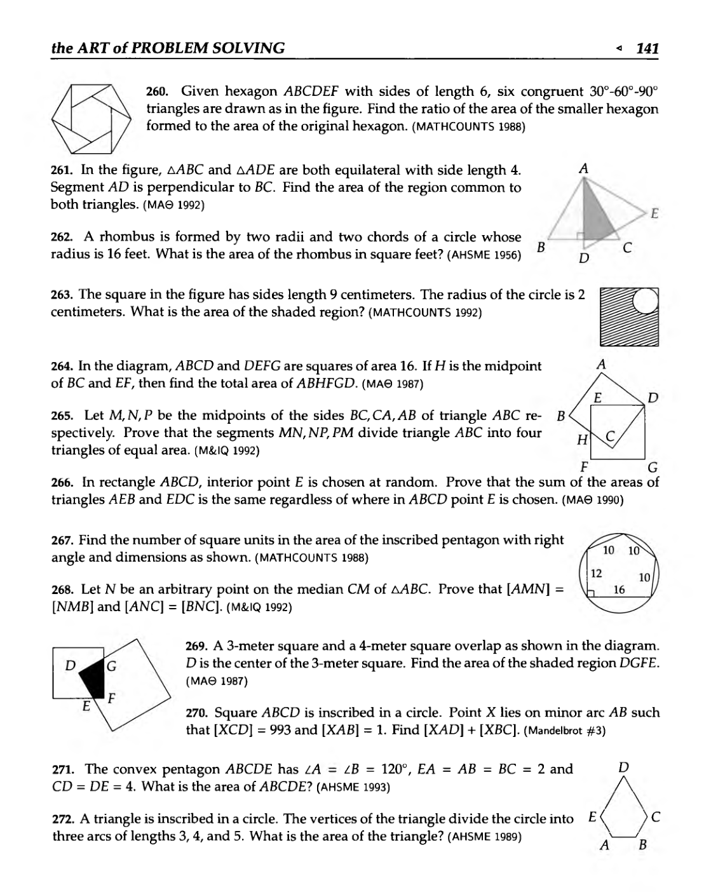
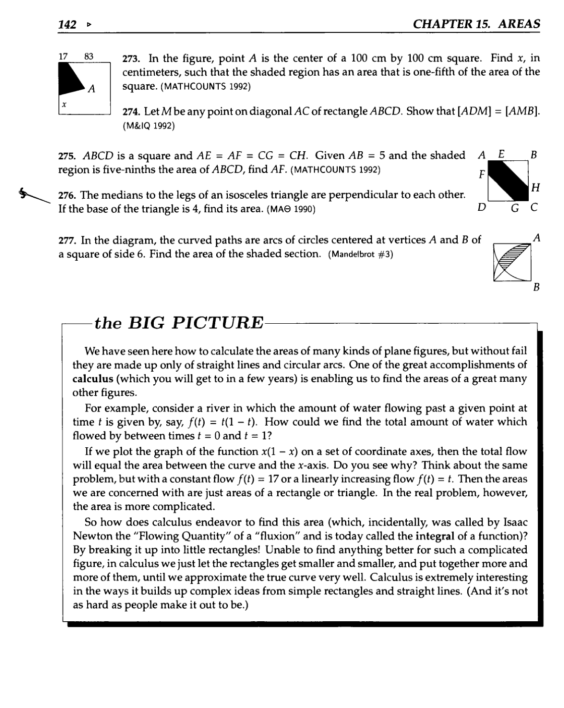

# Chapter 15: Areas

Volume 1 · Printed pages 136–142 · PDF pages 150–156

[Volume contents](../index.md)

## Printed page 136

<!-- source: volume-1, PDF page 150, printed page 136 -->

Chapter 15

Areas

In earlier chapters we discussed how to find the areas of simple figures like circles and triangles. In this chapter, we learn how to find the area of more complex figures and of simple figures in complex problems.

### 15.1 Similar Figures

On page 109, we showed that if two triangles are similar and their sides have common ratio $k$, the ratio of their areas is $k^2$. This is true of any two similar figures. For example, since all circles are similar, if one has a radius which is twice as large as another, its area is 4 times as large as the second. Thus, when working on a problem in which you are able to prove that two figures are similar, you can easily relate the areas of the figures.

**EXAMPLE 15-1 The area of a triangle is 36. Find the area of the triangle formed by connecting the midpoints of its sides.**

Solution: We first prove that any triangle is similar to the triangle formed by connecting the midpoints of its sides. In the figure, since $E$ and $F$ are midpoints, we have $AE/AC = AF/AB = 1/2$. Since $\angle EAF = \angle CAB$, we have $\Delta CAB \sim \Delta EAF$ from SAS Similarity. Hence $EF/CB = 1/2$. Similarly, we can show $FD/AC = 1/2$ and $ED/AB = 1/2$. Thus, by SSS Similarity, we have $\Delta ABC \sim \Delta DEF$. Thus,

$$\frac{[DEF]}{[ABC]} = \left( \frac{1}{2} \right)^2 = \frac{1}{4}.$$

Hence $[DEF] = [ABC]/4 = 9.$

**EXAMPLE 15-2 The ratio of the areas of two squares is 6. Find the ratio of the lengths of the diagonals of the two squares.**

Solution: Like circles, all squares are similar. Thus, the ratio of the areas is the square of the ratio of any corresponding lengths of the figures. Hence, the ratio of the lengths of the diagonals is the square root of the ratios of the areas, or $\sqrt{6}$.

Original scan — PDF page 150

## Printed page 137

<!-- source: volume-1, PDF page 151, printed page 137 -->

**EXAMPLE 15-3 In trapezoid $ABCD$, $AB \parallel CD$ and the diagonals meet at $E$. If $AB = 4$ and $CD = 12$, show that the area of $\Delta CDE$ is 9 times the area of $\Delta ABE$.**

Proof: First, since $AB \parallel CD$, we have $\angle BAE = \angle DCE$ and $\angle ABE = \angle CDE$ as shown. Thus, by AA Similarity we get $\Delta ABE \sim \Delta CDE$. Since $CD/AB = 3$, we find $[CDE] / [ABE] = (CD/AB)^2 = 9$.

### 15.2 Same Base/Same Altitude

If two triangles with the same altitude have different bases, the ratio of their areas is just the ratio of their bases. The proof of this is quite straightforward. Given $\Delta ABC$ and $\Delta DEF$ where the altitudes $h_a$ and $h_d$ to $BC$ and $EF$, respectively, of the triangles are equal, we have

$$[ABC] = \frac{(BC)h_a}{2} \quad \text{and} \quad [DEF] = \frac{(EF)h_d}{2}.$$

Thus

$$\frac{[ABC]}{[DEF]} = \frac{(BC)h_a/2}{(EF)h_d/2} = \frac{BC}{EF} \frac{h_a}{h_d} = \frac{BC}{EF}.$$

Similarly, we can show that if two triangles have the same base, the ratio of their areas is the ratio of their altitudes. (Try it.) As you will see in the examples, these facts are often used when the equal bases in question are actually the same segment, not just the same length. This approach is also often used to show that two triangles have the same area. If the triangles have the same base (or altitude), we can show they have the same area by showing that their altitudes (or bases) have the same length.

**EXAMPLE 15-4 Show that by drawing the three medians of a triangle, we divide the triangle into six regions of equal area.**

Proof: First, we will show that $[ACD] = [ABC]/2$. These two triangles have the same altitude from $A$, so the ratio of their areas is the ratio of the bases $CD$ and $CB$. Since $D$ is the midpoint of $BC$, we have $CD/CB = 1/2$. Thus, $[ACD] / [ABC] = 1/2$.

Now, we show that $[GCD] = [ACD]/3$. Since $GD$ and $AD$ are on the same line, triangles $GCD$ and $ACD$ have the same altitude from $C$. Thus the ratio of their areas is $GD/AD$. Since $G$ is the centroid, we have from page 94 that $GD/AD = 1/3$. Thus

$$[GCD] = \frac{[ACD]}{3} = \frac{[ABC]/2}{3} = \frac{[ABC]}{6}.$$

Similarly, we can show that each of the other 5 smaller triangles formed by drawing all the medians have area $[ABC]/6$. Thus, the three medians divide a triangle into 6 sections of equal area.

**EXAMPLE 15-5 In $\Delta ABC$, $D$ is the midpoint of $AB$, $E$ is the midpoint of $DB$, and $F$ is the midpoint of $BC$. If the area of $\Delta ABC$ is 96, then find the area of $\Delta AEF$. (AHSME 1976)**

Original scan — PDF page 151

## Printed page 138

<!-- source: volume-1, PDF page 152, printed page 138 -->

Since $\triangle ABF$ has the same altitude as $\triangle ABC$ and $\frac{1}{2}$ the base, it has $\frac{1}{2}$ the area of $\triangle ABC$. Thus, $[ABF] = [ABC] / 2 = 48$. Now, $\triangle AEF$ has the same altitude (from $F$) as $\triangle ABF$. The base of $\triangle AEF$ is $\frac{3}{4}$ that of $\triangle ABF$ ($AE = \frac{3}{4} AB$), so $[AEF] = \frac{3}{4} [ABF] = 36$.

**EXAMPLE 15-6 Line $l$ is parallel to segment $AB$. Show that for all points $X$ on $l$, $[ABX]$ is the same.**

Proof: No matter where $X$ is on $l$, the altitude from $X$ to $AB$ is the same. Since $AB$ is obviously always constant, the area of $\triangle ABX$ is constant.

**EXAMPLE 15-7 If the diagonal $AC$ of quadrilateral $ABCD$ divides the diagonal $BD$ into two equal segments, prove that $[ACD] = [ACB]$. (M&IQ 1992)**

Proof: As described in the problem, $X$, the intersection of the diagonals, is the midpoint of $BD$. Since $\triangle ACD$ and $\triangle ABC$ share base $AC$, we can prove the areas of the triangles are equal if we show that the altitudes of the triangles to this segment are equal. Thus, we draw altitudes $BY$ and $DZ$. Since $DX = BX$ and $\angle DXZ = \angle BXY$, we have $\triangle DZX \cong \triangle BYX$ by SA for right triangles, so $DZ = BY$. Hence, $[ABC] = (AC)(BY) / 2 = (AC)(DZ) / 2 = [ABD]$.

### 15.3 Complicated Figures

Sometimes it is easiest to find the area of a figure by breaking it up into smaller pieces, like triangles or sectors, of which the area can easily be found. Problems involving parts of circles together with other geometric shapes can often be solved this way. Areas of complex polygons can often be found by breaking the polygon into rectangles and triangles. A few tips will help solve these problems.

- Draw radii to separate sectors and circular segments from the rest of the diagram. Find the area of these regions, then the area of the rest of the figure.
- Look out for right and equilateral triangles. Draw additional sides to separate these triangles from the remainder of the problem. This often makes the method of finding the area of the rest of the figure clear.
- Draw diagonals of quadrilaterals to split the quadrilaterals into two triangles whose areas can be easily found.

**EXAMPLE 15-8 Find the area between the two concentric circles shown if the circles have radii 2 and 3.**

Solution: None of the simple formulas we have learned so far can give us the area of this figure; however, we do know how to find the area of a circle. The larger circle has area $9\pi$ and is the sum of the smaller circle and the shaded area. The smaller circle has area $4\pi$, and the sum of the small circle and the shaded area is the area of the larger circle. Thus, the shaded region has area $9\pi - 4\pi = 5\pi$. The shaded region is called an annulus.

Original scan — PDF page 152

## Printed page 139

<!-- source: volume-1, PDF page 153, printed page 139 -->

**EXAMPLE 15-9** Find the area of a regular octagon with side length 2.

Solution: We can form a regular octagon by cutting the corners out of a square, like $\Delta ABC$ shown. (Prove this yourself.) Since $BC = 2$, we have $AB = 2/\sqrt{2} = \sqrt{2}$. Thus, the length of one side of the square is $2 + 2\sqrt{2}$ and the square has area $(2 + 2\sqrt{2})^2 = 12 + 8\sqrt{2}$. Each of the corners has area $(\sqrt{2})^2/2 = 1$, so the octagon has area $(12 + 8\sqrt{2}) - 4(1) = 8 + 8\sqrt{2}$.

**EXAMPLE 15-10** Find the shaded area, given that $\Delta ABC$ is an isosceles right triangle. The midpoint of $AB$ is the center of semicircle $\widehat{AB}$, point $C$ is the center of quarter circle $\widehat{AB}$, and $AB = 2\sqrt{2}$. (MAΘ 1990)

Solution: What simple areas can we find in this figure? Since $AB = 2\sqrt{2}$ and $ABC$ is an isosceles right triangle, we have $AC = CB = 2$ and $[ABC] = (2)(2)/2 = 2$. We can also find the area of sector $ABC$ and the semicircle with diameter $AB$. The area of quarter circle $ABC$ is $1/4$ that of the circle with radius $BC$. Thus, it has area $(2^2)\pi/4 = \pi$. The semicircle is half the area of the circle with diameter $AB$, or $(\sqrt{2})^2\pi/2 = \pi$. How can we combine these pieces to get the shaded area? This is where these problems become like puzzles. We are given three pieces, the triangle, the semicircle, and the quarter circle, which we must add or subtract to form the shaded region. This requires some intuition and practice. Here, we add together the triangle and the semicircle, then subtract the quarter circle to leave the shaded region. Make sure you see this. Thus, the desired area is $\pi + 2 - \pi = 2$. This is how we do all problems of this sort. We find the area of the simple figures in the diagram and determine how these figures can be added together or subtracted from each other to find the desired (usually 'shaded') region.

**EXAMPLE 15-11** Given the square in the figure with side length 4 and four semicircles which have the sides of the square as their diameters as shown, find the area of the 'leaves' which are shaded in the diagram.

Solution: The simple figures we have here are 4 semicircles and a square. The desired area is the region where semicircles overlap. Hence, we note that by adding together the areas of the four semicircles, we exceed the area of the square by the total area of the desired region. (Make sure you see this; it is because each 'leaf' is in two of the semicircles.) This is somewhat similar to our discussion of overcounting on page 229. We are 'overcounting' the area covered by the semicircles by twice counting the amount of area in the shaded regions. Hence, the area of the desired region is the total area of the four semicircles minus the area of the square, or $4(2^2\pi/2) - 4^2 = 8\pi - 16$.

**EXAMPLE 15-12** Each of the circles shown has a radius of 6 cm. The three outer circles have centers that are equally spaced on the original circle. Find the area, in square centimeters, of the sum of the three regions which are common to three of the four circles. (MATHCOUNTS 1992)

Solution: Our pieces in this problem are four circles which we unfortunately cannot puzzle together to make the desired region as we have done

Original scan — PDF page 153

## Printed page 140

<!-- source: volume-1, PDF page 154, printed page 140 -->

in prior examples. Thus, we must add lines to the diagram to give us more pieces. In problems involving intersecting circles, the best lines to add are radii and lines which divide the regions of intersection in half, forming segments and sectors as mentioned in our tips.

In the diagram, we have drawn AC to divide one of the 'leaves' in half and we have drawn radii AB and BC of the lowest circle. Since AC is also a radius of the circle A, which has the same radius as the circle B, we have AB = BC = AC, and $\Delta ABC$ is equilateral. Now we can find the area of circular segment AC, since it is the area of sector ABC minus the area of $\Delta ABC$. Since this triangle is equilateral, the sector is $60^\circ/360^\circ = 1/6$ of the circle. Thus, the sector has area $(6^2\pi/6) = 6\pi$. The area of the segment then is $6\pi - (6^2\sqrt{3}/4) = 6\pi - 9\sqrt{3}$. Since the three leaves together consist of 6 such segments, the total area is $36\pi - 54\sqrt{3}$.

Through these examples and the numerous similar problems at the end of this chapter, you should become quite adept at manipulating simple figures to find seemingly difficult areas.

Problems to Solve for Chapter 15

252. Sides AB, BC, CD, and DA of convex quadrilateral ABCD have lengths 3, 4, 12, and 13, respectively; and $\angle CBA$ is a right angle. What is the area of the quadrilateral? (AHSME 1980)

253. Find the total area of the figure with right angles and segment measures as shown. (MAΘ 1990)

254. Find the ratio of the area of an equilateral triangle inscribed in a circle to the area of a square circumscribed about the same circle. (MAΘ 1987)

255. If a square is inscribed in a semicircle of radius $r$ and the square has an area of 8 square units, then find the area of a square inscribed in a circle of radius $r$. (MAΘ 1987)

256. Points D, E, and F are midpoints of the sides of equilateral triangle ABC. The shaded central triangle is formed by connecting the midpoints of the sides of $\Delta DEF$. What fraction of the total area of ABC is shaded? (MATHCOUNTS 1992)

257. A cow is tied to the corner of a 20 foot by 15 foot shed with a 30 foot rope. Find her total grazing area. (MAΘ 1992)

258. Find the ratio of the area of $\Delta ACE$ to the area of rectangle ABCD. (MATHCOUNTS 1986)

259. Find the area of the largest triangle that can be inscribed in a semicircle whose radius is $r$. By inscribed in a semicircle, we mean that the vertices are either on the semicircle or the diameter cutting off the semicircle. (AHSME 1950)

Original scan — PDF page 154

## Printed page 141

<!-- source: volume-1, PDF page 155, printed page 141 -->

260. Given hexagon $ABCDEF$ with sides of length 6, six congruent $30^\circ-60^\circ-90^\circ$ triangles are drawn as in the figure. Find the ratio of the area of the smaller hexagon formed to the area of the original hexagon. (MATHCOUNTS 1988)

261. In the figure, $\triangle ABC$ and $\triangle ADE$ are both equilateral with side length 4. Segment $AD$ is perpendicular to $BC$. Find the area of the region common to both triangles. (MAΘ 1992)

262. A rhombus is formed by two radii and two chords of a circle whose radius is 16 feet. What is the area of the rhombus in square feet? (AHSME 1956)

263. The square in the figure has sides length 9 centimeters. The radius of the circle is 2 centimeters. What is the area of the shaded region? (MATHCOUNTS 1992)

264. In the diagram, $ABCD$ and $DEFG$ are squares of area 16. If $H$ is the midpoint of $BC$ and $EF$, then find the total area of $ABHFGD$. (MAΘ 1987)

265. Let $M, N, P$ be the midpoints of the sides $BC, CA, AB$ of triangle $ABC$ respectively. Prove that the segments $MN, NP, PM$ divide triangle $ABC$ into four triangles of equal area. (M&IQ 1992)

266. In rectangle $ABCD$, interior point $E$ is chosen at random. Prove that the sum of the areas of triangles $AEB$ and $EDC$ is the same regardless of where in $ABCD$ point $E$ is chosen. (MAΘ 1990)

267. Find the number of square units in the area of the inscribed pentagon with right angle and dimensions as shown. (MATHCOUNTS 1988)

268. Let $N$ be an arbitrary point on the median $CM$ of $\triangle ABC$. Prove that $[AMN] = [NMB]$ and $[ANC] = [BNC].$ (M&IQ 1992)

269. A 3-meter square and a 4-meter square overlap as shown in the diagram. $D$ is the center of the 3-meter square. Find the area of the shaded region $DGFE$. (MAΘ 1987)

270. Square $ABCD$ is inscribed in a circle. Point $X$ lies on minor arc $AB$ such that $[XCD] = 993$ and $[XAB] = 1$. Find $[XAD] + [XBC].$ (Mandelbrot #3)

271. The convex pentagon $ABCDE$ has $\angle A = \angle B = 120^\circ$, $EA = AB = BC = 2$ and $CD = DE = 4$. What is the area of $ABCDE$? (AHSME 1993)

272. A triangle is inscribed in a circle. The vertices of the triangle divide the circle into three arcs of lengths 3, 4, and 5. What is the area of the triangle? (AHSME 1989)

Original scan — PDF page 155

## Printed page 142

<!-- source: volume-1, PDF page 156, printed page 142 -->

273. In the figure, point $A$ is the center of a 100 cm by 100 cm square. Find $x$, in centimeters, such that the shaded region has an area that is one-fifth of the area of the square. (MATHCOUNTS 1992)

274. Let $M$ be any point on diagonal $AC$ of rectangle $ABCD$. Show that $[ADM] = [AMB]$. (M&IQ 1992)

275. $ABCD$ is a square and $AE = AF = CG = CH$. Given $AB = 5$ and the shaded region is five-ninths the area of $ABCD$, find $AF$. (MATHCOUNTS 1992)

276. The medians to the legs of an isosceles triangle are perpendicular to each other. If the base of the triangle is 4, find its area. (MAΘ 1990)

277. In the diagram, the curved paths are arcs of circles centered at vertices $A$ and $B$ of a square of side 6. Find the area of the shaded section. (Mandelbrot #3)

the BIG PICTURE

We have seen here how to calculate the areas of many kinds of plane figures, but without fail they are made up only of straight lines and circular arcs. One of the great accomplishments of calculus (which you will get to in a few years) is enabling us to find the areas of a great many other figures.

For example, consider a river in which the amount of water flowing past a given point at time $t$ is given by, say, $f(t) = t(1 - t)$. How could we find the total amount of water which flowed by between times $t = 0$ and $t = 1$?

If we plot the graph of the function $x(1 - x)$ on a set of coordinate axes, then the total flow will equal the area between the curve and the $x$-axis. Do you see why? Think about the same problem, but with a constant flow $f(t) = 17$ or a linearly increasing flow $f(t) = t$. Then the areas we are concerned with are just areas of a rectangle or triangle. In the real problem, however, the area is more complicated.

So how does calculus endeavor to find this area (which, incidentally, was called by Isaac Newton the “Flowing Quantity” of a “fluxion” and is today called the integral of a function)? By breaking it up into little rectangles! Unable to find anything better for such a complicated figure, in calculus we just let the rectangles get smaller and smaller, and put together more and more of them, until we approximate the true curve very well. Calculus is extremely interesting in the ways it builds up complex ideas from simple rectangles and straight lines. (And it’s not as hard as people make it out to be.)

Original scan — PDF page 156

