# Chapter 16: The Power of Coordinates

Volume 1 · Printed pages 143–154 · PDF pages 157–168

[Volume contents](../index.md)

## Printed page 143

<!-- source: volume-1, PDF page 157, printed page 143 -->

Chapter 16

The Power of Coordinates

### 16.1 Labelling the Plane

Already in this book we have discussed extensively the methods of solving geometrical problems using nothing more than the relationships in the figures themselves. However, there exists a whole different approach to geometry which, though less creative, is incredibly powerful. The idea is that of coordinates; it allows many complex geometric relationships to be rephrased as simple formulas. The idea was first rigorously used in the 1600’s by Descartes (day-CART), though it is so simple that it’s hard to believe that it wasn’t used earlier by others.

The easiest way to explain coordinates is to recall the number line, as we were taught in elementary school. Each point on a line is labelled by a number, the distance from a fixed origin. The resulting picture is above. (Of course, the line extends forever in both directions; for this reason, many people put an arrow on both ends.) This is an interesting way to look at the real numbers, but is certainly not very useful for geometry, since there isn’t much geometry in one dimension.

However, with a little modification we can extend the same idea to cover the entire plane: we add another axis, perpendicular to the first and crossing it at the point 0. Then we can label each point in the plane by its distance to each axis. (It makes sense to label points with two numbers each because the plane is two dimensional.) The new picture is at right.

To be precise, each point is labelled by an ordered pair like $(3, -2)$ or $(17, 17)$. The first number is the distance right (negative for left) and the second is the distance up (negative for down). The horizontal axis is called the $x$-axis, and the corresponding number the $x$-coordinate (or sometimes abscissa); the vertical axis is called the $y$-axis, and the corresponding number the $y$-coordinate (or sometimes ordinate). The coordinates $(x, y)$ of a point are called its Cartesian (car TEA zhun) coordinates, after Descartes.

Keep in mind that the Cartesian way of labelling the points of the plane is an entirely arbitrary choice. For example, we could just as well have one axis be slanted with respect to the other, and form the coordinates by the distances in the new grid. This particular choice would in virtually

Original scan — PDF page 157

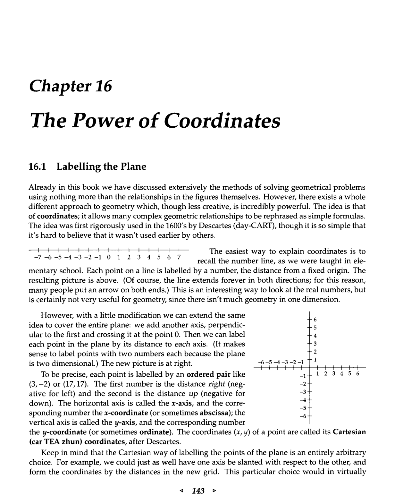

## Printed page 144

<!-- source: volume-1, PDF page 158, printed page 144 -->

all cases be more complicated than straight Cartesian coordinates. However, there are choices of coordinates which may have a simplifying effect (which is the sole purpose of coordinates to begin with).

By far the most important such coordinate system is that of polar coordinates. In this setup, a point is labelled by the ordered pair $(r, \theta)$, where $r$ is the distance from the origin and $\theta$ is the angle with respect to a chosen axis, usually taken to be the positive Cartesian $x$-axis. The "grid" of polar coordinates is shown in the figure. The circles represent increasing $r$, the lines increasing $\theta$. Do you see why each set of coordinates $(r, \theta)$ identifies one and only one point?

There exist other ways to put coordinates on the plane, but polar and Cartesian are plenty for most purposes. Because Cartesian coordinates are the most generally useful, any coordinates in which the coordinate system is not specified may be assumed to be Cartesian.

**EXERCISE 16-1 Plot the Cartesian points $(4.5, 3), (1, -7/2),$ and $(-6, -4)$ and the polar points $(2, 3\pi/4), (3/2, 270^\circ),$ and $(1, 0^\circ)$.**

In both polar and Cartesian systems, the plane is sometimes thought of as being composed of four quadrants. The upper right (positive $x$, positive $y$) is called the first quadrant (labelled with a roman numeral I), and they go counterclockwise from there.

**EXERCISE 16-2 In which quadrant is $x$ positive and $y$ negative?**

### 16.2 What's it Good For?

The beauty of a coordinate approach to geometry is that we can often convert geometrical pictures into easily understood equations. The simplest examples in Cartesian coordinates are equations like $x = 1$ or $y = -5$. What do these equations mean? Take $x = 1$, for instance. This is understood to mean the set of all points in the plane whose coordinates $(x, y)$ satisfy the equation $x = 1$. Thus $y$ can be anything, but $x$ must stay equal to 1. The result is a vertical line, as shown above. Similarly, an equation like $y = -5$ represents a horizontal line, as $x$ can have any value while $y$ must equal $-5$.

The simplest equations in polar coordinates produce different results. First, consider an equation like $r = 3$. As with the Cartesian case, this means that $\theta$ can be anything, while $r$, the distance to the origin, is restricted to 3. The result is a circle of radius 3 centered at the origin. (Draw it and see.)

**EXERCISE 16-3 What curve does the equation $\theta = 47^\circ$ represent?**

Original scan — PDF page 158

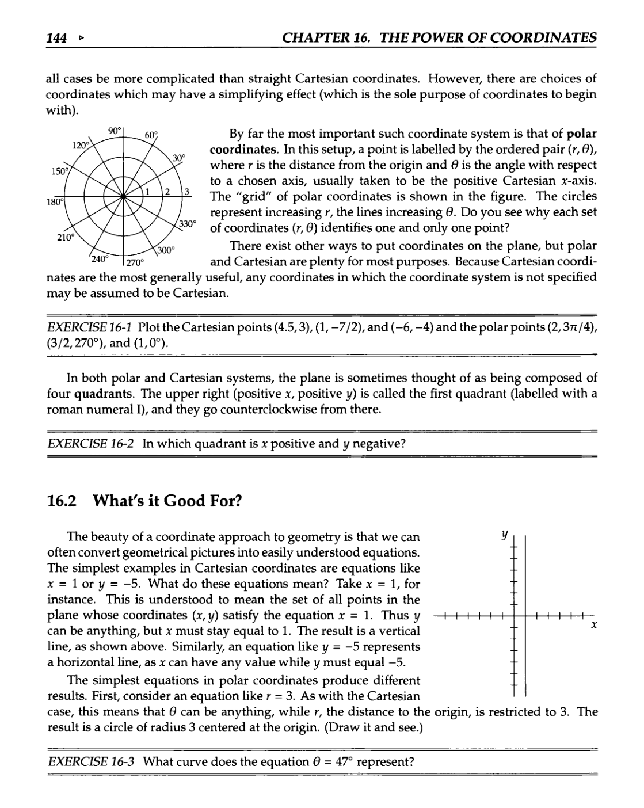

## Printed page 145

<!-- source: volume-1, PDF page 159, printed page 145 -->

The dramatic difference between the simplest curves in Cartesian and polar coordinates is a clue as to what the different coordinate systems are good for. Cartesian coordinates are much better than polar for describing straight lines and line segments, while polar coordinates are often better for circles (and, to a lesser extent, lines through the origin). Other curves may go either way, or be equally well described by both.

Perhaps more important than the basic curves, however, is how the two coordinate systems handle transformations (more on these in Chapter 19). Let’s consider a point in the plane with polar coordinates $(r, \theta)$ and Cartesian coordinates $(x, y)$. Three basic transformations are translations, rotations, and reflections. Under a translation (page 173), it is the Cartesian coordinates that change in a simple way: $(x, y)$ becomes $(x + a, y + b)$ for some constants $a$ and $b$ which describe the direction and amount of translation. The picture is shown on the left side below. On the other hand, describing the change under translation with polar coordinates is considerably more complicated.

Under rotations (page 174), however, the situation is different. Assuming that we set up our polar coordinates with the origin at the center of rotation, the transformation just adds some fixed angle $\alpha$ to the angle of the point: $(r, \theta)$ becomes $(r, \theta + \alpha)$, as in the right side above. Here, Cartesian coordinates is the weaker system.

**EXERCISE 16-4 What happens to the coordinates $(x, y)$ and $(r, \theta)$ under a reflection across the $x$-axis? The $y$-axis?**

### 16.3 Straight and Narrow

Now that we have a fairly good handle on coordinates, let’s begin to apply them to what they were invented for: describing curves. The straight line is the simplest curve that there is, so it is a good starting point. For most lines, Cartesian coordinates provide the simplest description.

What do we need to plot a line? Geometry tells us that two points are enough. However, in a coordinate approach it is usually simpler to specify one point and the “steepness” of the line.

Any line which is not vertical must intersect the $y$-axis at some point. Does this make sense? The point will have coordinates $(0, b)$ for some $b$, and is called the $y$-intercept. (In the same way, the place where a line intersects the $x$-axis is called the $x$-intercept.)

Original scan — PDF page 159

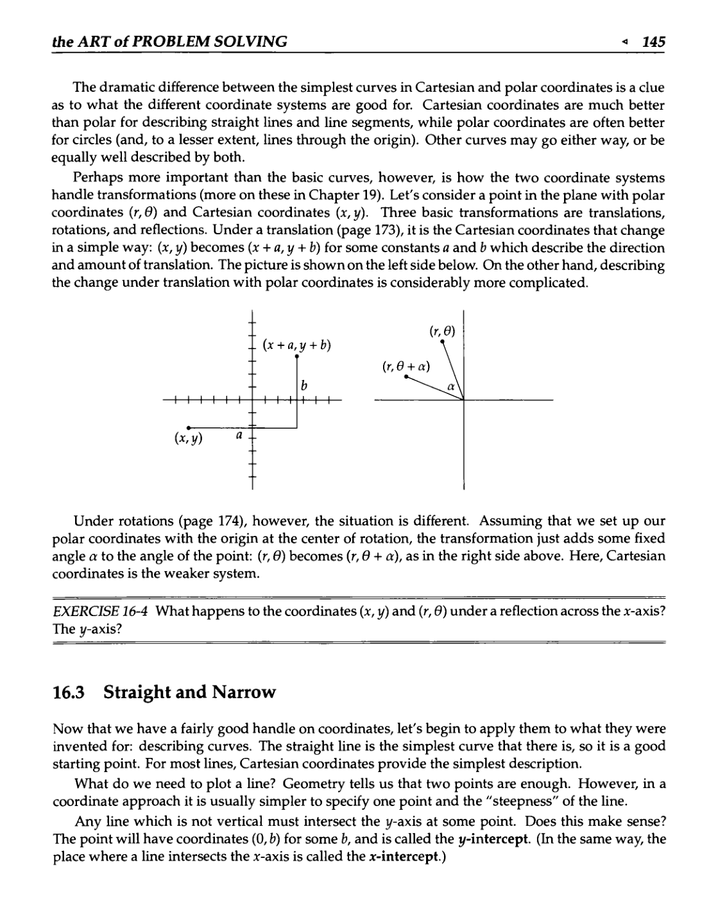

## Printed page 146

<!-- source: volume-1, PDF page 160, printed page 146 -->

**EXAMPLE 16-1 Find the $x$- and $y$-intercepts of the line $2x + 7y = 14$.**

Solution: The $x$-intercept is the point where we cross the $x$-axis; that is, where $y = 0$. Setting $y = 0$ in the equation and solving for $x$ yields the $x = 7$, so the $x$-intercept is $(7, 0)$. Similarly, we find the $y$-intercept by setting $x = 0$ and solving for $y$. This yields $y = 2$, and the $y$-intercept is $(0, 2)$.

**EXERCISE 16-5 Find the area of the region enclosed between the line $3x + 4y = 12$ and the two coordinate axes. (Hint: you don’t need to draw a picture.)**

In developing an equation for a line, we will start with the $y$-intercept $(0, b)$. Since $(x, y) = (0, b)$ is on the line, the equation must be of the form

$$y = mx + b$$

for some $m$.

What does $m$ signify? Consider starting at the $y$-intercept $(0, b)$ and moving over by 4. Moving over by 4 increases $x$ from 0 to 4, so (16.1) becomes

$$y = 4m + b.$$

As $x$ increases by 4, $y$ increases by 4$m$ from $b$ to 4$m + b!$. In general, if we move to the right by some amount, we must move up by $m$ times that amount to stay on the line. As you can see in the diagram, this $m$ determines the “steepness” of the line. The larger $m$ is, the higher the we have to climb. The form (16.1) is called the slope-intercept form of a line, because it specifies the line once we have the slope and the $y$-intercept.

**EXERCISE 16-6 Think about it.**

**EXERCISE 16-7 What should the steepness of a horizontal line be? What is $m$ for a horizontal line? What should the steepness of a vertical line be? What is $m$ for a vertical line? Does $m$ properly account for negative “steepness”?**

Since $m$ corresponds to a steepness, we call it the slope of the line. Some people like to remember the slope as “rise over run,” where “run” is the horizontal travel and “rise” the vertical, as shown below. These quantities can be computed between any two points on the line; the same slope will emerge. Both rise and run can be negative; if the ratio is negative, the line is sloped downward.

Original scan — PDF page 160

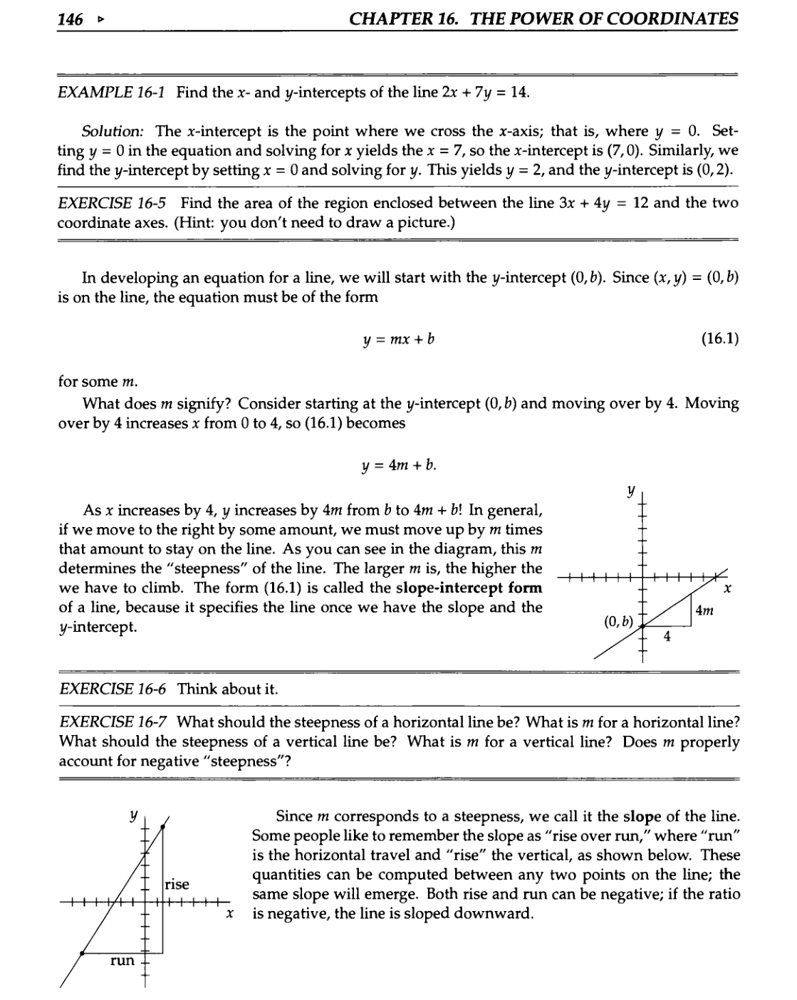

## Printed page 147

<!-- source: volume-1, PDF page 161, printed page 147 -->

**EXAMPLE 16-2 Let’s find the slope of a line which contains the points $(15, 16)$ and $(-2, -18)$. From the first point to the second, the line must go over by $(-2) - 15 = -17$ and up by $(-18) - 16 = -34$. The slope is the amount up divided by the amount over, which is $(-34)/(-17) = 2$.**

**EXAMPLE 16-3 Find the slope of the line which contains $(x_1, y_1)$ and $(x_2, y_2)$.**

Solution: From the first point to the second, the line goes over $(x_2 - x_1)$ and goes up $(y_2 - y_1)$; therefore, the slope is $m = (y_2 - y_1)/(x_2 - x_1)$.

**EXAMPLE 16-4 Find the equation of a line which passes through the points $(-1, -1)$ and $(3, 7)$.**

Solution: We can easily find the slope of the line: between the two points we go over 4 and up 8, so the slope is $8/4 = 2$. Substituting this into the slope-intercept form yields $y = 2x + b$. Putting the point $(-1, -1)$ in this equation will give us $b$; we have $-1 = -2 + b$, so $b = 1$. Thus the line equation is $y = 2x + 1$; every point $(x, y)$ on the line should satisfy this equation.

**EXERCISE 16-8 Find the equation of a line if its $x$-intercept is at $(-4, 0)$ and its $y$-intercept at $(0, 3)$.**

**EXERCISE 16-9 Find the equation of a line whose $x$- and $y$-intercepts are $(2, 0)$ and $(0, -6)$ respectively.**

The slope-intercept form is a universal method for finding the equation of a line. Just use the given information with the equation $y = mx + b$ to find both $m$ and $b$.

**EXAMPLE 16-5 Suppose we are given two points on the line; what is the equation which describes the line? Let the points be $(p_1, q_1)$ and $(p_2, q_2)$. We can plug these points into the slope-intercept form and solve the resulting equations,**

$$q_1 = mp_1 + b$$
and $$q_2 = mp_2 + b,$$

for $m$ and $b$. The results will be

$$m = \frac{q_1 - q_2}{p_1 - p_2}$$ and $$b = \frac{-q_1 p_2 + q_2 p_1}{p_1 - p_2}.$$

(Verify these results.) The final equation will thus be

$$y = \frac{q_1 - q_2}{p_1 - p_2} x + \frac{-q_1 p_2 + q_2 p_1}{p_1 - p_2},$$

or the more symmetric-looking

$$(q_1 - q_2)x - (p_1 - p_2)y = p_2 q_1 - p_1 q_2.$$

**EXERCISE 16-10 Verify that the original points $(p_1, q_1)$ and $(p_2, q_2)$ satisfy the equation above.**

**EXERCISE 16-11 Find the equation for a line with slope $m$ containing the point $(p, q)$.**

Original scan — PDF page 161

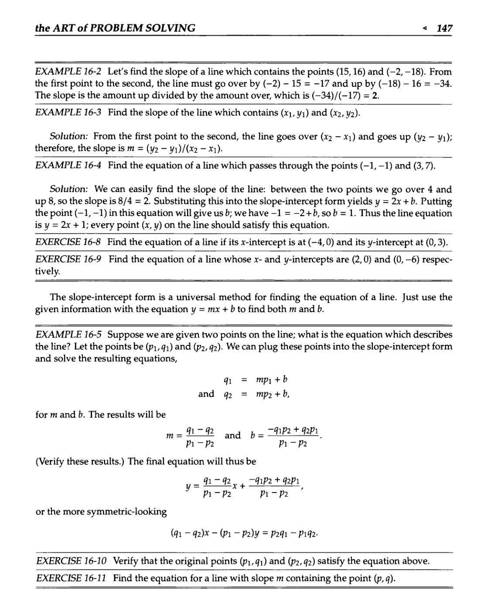

## Printed page 148

<!-- source: volume-1, PDF page 162, printed page 148 -->

If you can do generalized examples like those above, you should have no problem with numerical problems.

The slope-intercept form is the most practical way to write a line equation. For presentation purposes, however, a more general form is often preferred. This is the so-called standard form, $Ax + By = C$ (or sometimes $Ax + By + C = 0$). Here $A$, $B$, and $C$ are simplified (integers if possible) and $A$ is nonnegative.

**EXAMPLE 16-6** What are the slope, $x$-intercept, and $y$-intercept of $2x + 3y = 6$?

**Solution:** The intercepts are pretty simple to determine. Since the $x$-intercept is the point where the line crosses the $x$-axis, we let $y = 0$ and solve $2x = 6$. Thus the $x$-intercept is $(3, 0)$. Similarly, we let $x = 0$ and find that the $y$-intercept is $(0, 2)$.

To find the slope, we put the line in slope-intercept form by solving for $y$, or $y = -2x/3 + 2$. The slope is the coefficient of $x$, or $-2/3$. (In general, the slope of a line in the form $Ax + By + C = 0$ is $-A/B$. Make sure you see why this is true.)

It is often important to determine whether two lines are parallel or perpendicular. You should be able to convince yourself rather easily that two lines are parallel if and only if they have the same slope. So how do we know if they are perpendicular? If one slope is the negative of the other?

**EXERCISE 16-12** Find an example showing that two lines whose slopes are negatives of one another are in general not perpendicular.

Figuring out if two lines are perpendicular is a little tougher, but the idea is that if one line goes over $a$ while it goes up $b$, a perpendicular one will go $up - a$ while it goes $over b$, as in the figure. Make sure you see why perpendicular lines have this property. After your study of rotations (page 174), come back to this and try to apply the principles of rotation.

The slopes of the lines shown are $a/b$ and $-b/a$, which multiply to $-1$; thus, two lines are perpendicular if and only if their slopes multiply to $-1!$ (Note that this can't be used for horizontal or vertical lines.)

**EXERCISE 16-13** Draw the lines $y = \frac{x}{2} + 1$ and $y = -2x + 3$, whose slopes do multiply to $-1$, to confirm.

### 16.4 Plotting a Line

An old adage says that a picture is worth a thousand words. Surprisingly, this is often true in working with equations. Effectively graphing an equation often helps in understanding it.

We have shown how to construct the equation of a line given certain information, like the slope and a point, or two points. Once we have that equation, how can we see what the line actually looks

Original scan — PDF page 162

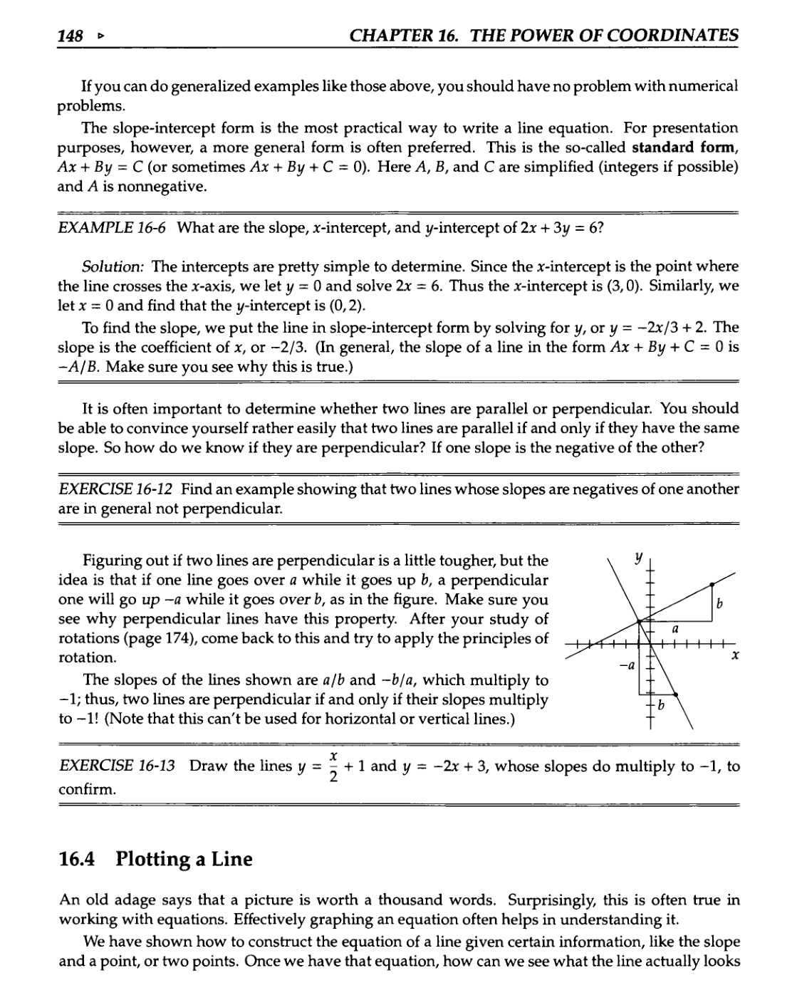

## Printed page 149

<!-- source: volume-1, PDF page 163, printed page 149 -->

like? Plotting a curve given an equation is often harder than it seems, but the line is not one of those cases. Just plug in various values for $x$ and solve the equation to get the corresponding $y$'s. Once you've got two or three points on the line, it is easy to draw the line itself, which just connects the points.

This method is useful for all sorts of plotting: plug in $x$ values, find the $y$ values, draw the points, and connect them. If you know certain things about the shape of the graph, you may only need one or two points; if you have little or no information, and can't figure it out, you may need to draw many points. Often such plotting is the best way to figure out, given some strange equation, what sort of thing you're dealing with, and hence how to approach the equation.

Of course, with lines, you don't always have to follow such a step-by-step procedure. If the equation is in slope-intercept form, with slope $m$ and $y$-intercept $b$, for example, you can just start at the $y$-intercept $(0, b)$ and begin following the slope, using the "rise over run" idea. That is, say $m = -5/2$: just go right 2, down 5, right 2, down 5, and so on, then left 2, up 5, etc., as shown at left.

All you need is two points to draw a line. If you get stuck or confused, you can always revert to the plug-in method.

**EXAMPLE 16-7** Plot the line $3x + 4y = 5$.

**Solution:** We just plug in some $x$ values, find the corresponding $y$'s, plot the points, and connect the dots. Plugging in $x = -1, 0, 1,$ and $2,$ we get the corresponding $y$'s: $2, \frac{5}{4}, \frac{1}{2},$ and $-\frac{1}{4}$. Plotting these four points gives a line as shown. Note that while only two points are really required to plot a line, sometimes more may help plot the line more accurately, especially if, as here, fractional coordinates are involved.

**EXERCISE 16-14** Plot the lines $y = -12x + 2$ and $(x - 2) = 3(y + 4)$.

### 16.5 The Distance Formula and Circles

Given the coordinates $(x_1, y_1)$ and $(x_2, y_2)$ of two points in the plane, how far apart are they? The answer is a simple application of the Pythagorean Theorem. To get from the first to the second, we go right a distance $(x_2 - x_1)$ and up a distance $(y_2 - y_1)$. These two distances form the legs of a right triangle as shown.

The hypotenuse of that triangle is the distance we want, which we'll call $d$. Thus, by the Pythagorean Theorem, we have

$$d^2 = (x_2 - x_1)^2 + (y_2 - y_1)^2,$$

so that

$$d = \sqrt{(x_2 - x_1)^2 + (y_2 - y_1)^2}.$$

This formula is called the distance formula.

Original scan — PDF page 163

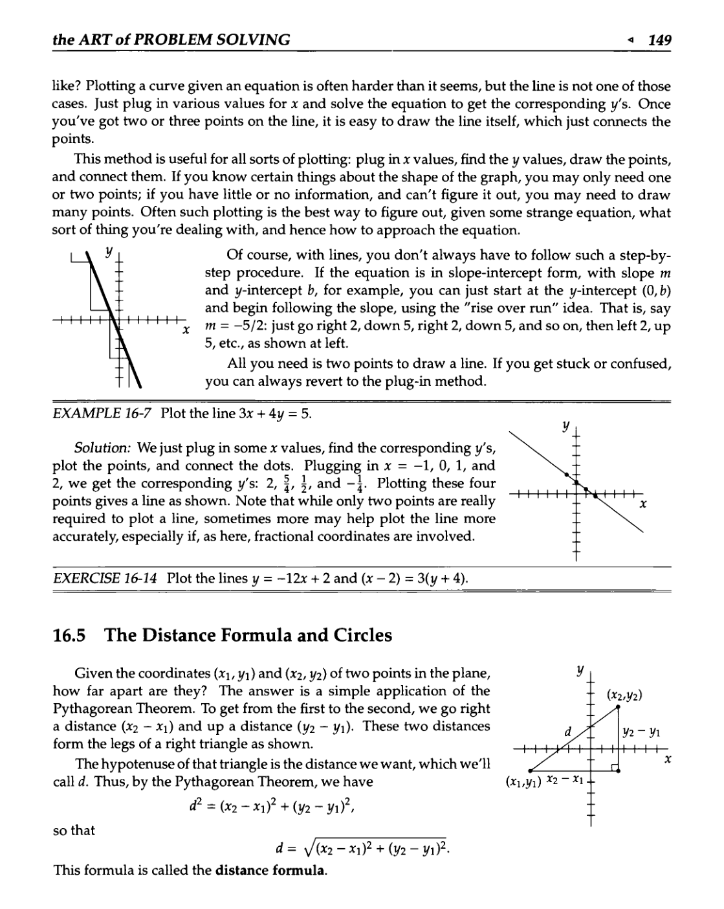

## Printed page 150

<!-- source: volume-1, PDF page 164, printed page 150 -->

**EXAMPLE 16-8 Find all $x$ such that the point $(x, 3)$ is 5 units away from $(-1, 7)$.**

Solution: From the distance formula, we have $5 = \sqrt{(-1 - x)^2 + 16}$. Squaring and rearranging the equation yields $x^2 + 2x - 8 = 0$, which has solutions $x = 2$ and $x = -4$.

The distance formula provides an easy way to figure out the equation for a circle in any coordinates. If the center of a circle is called $O$ and the radius $R$, the circle is just all points whose distance to $O$ is equal to $R$. Let the coordinates of $O$ be $(p, q)$. Then all points $(x, y)$ on the circle are $R$ away from $(p, q)$, so the distance formula yields

$$\sqrt{(x - p)^2 + (y - q)^2} = R,$$

or the more preferred

$$(x - p)^2 + (y - q)^2 = R^2. \tag{16.2}$$

**EXAMPLE 16-9 Circles are easy to plot. Take the circle**

$$(x + 1)^2 + (y - 2)^2 = 9.$$

By comparison with equation (16.2), we see that the center of the circle is $(-1, 2)$ and the radius 3. (Make sure you see this.) To find the first four points on the circle we go 3 in the four main directions (left, right, up, down) from the center, to the points $(2, 2), (-4, 2), (-1, -1)$, and $(-1, 5)$. From there we can draw the circle, as in the figure.

A more general form of the circle equation is

$$x^2 + y^2 + Ax + By + C = 0. \tag{16.3}$$

This is not a form we would willingly put a circle in, because the relevant information (center, radius) is hard to see. However, sometimes we will be given this form and asked to find the center or radius or even to plot the circle. How can we go back to the nice form of (16.2)?

The answer: completing the square. As in Chapter 6, we can convert a general quadratic to a square plus some constant. Here we need to do it twice, once on $x$ and once on $y$.

**EXAMPLE 16-10 Find the center and radius of the circle described by**

$$2x^2 + 2y^2 + 8x - 12y + 3 = 0.$$

The first thing to do is to divide by 2, to make the coefficients of $x^2$ and $y^2$ both 1. We then collect $x$ and $y$ terms to obtain

$$(x^2 + 4x) + (y^2 - 6y) + \frac{3}{2} = 0.$$

Original scan — PDF page 164

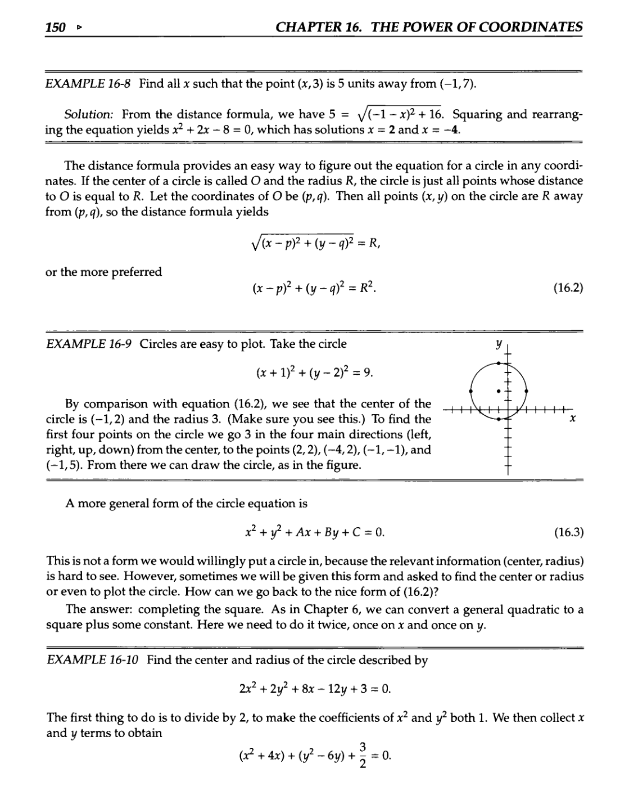

## Printed page 151

<!-- source: volume-1, PDF page 165, printed page 151 -->

Completing both squares by adding $(4/2)^2 = 4$ to $(x^2 + 4x)$ and $(-6/2)^2 = 9$ to $(y^2 - 6y)$, this equation becomes

$$\left(x^2 + 4x + 4\right) - 4 + \left(y^2 - 6y + 9\right) - 9 + \frac{3}{2} = 0,$$

or

$$\left(x + 2\right)^2 + \left(y - 3\right)^2 = \frac{23}{2}.$$

Thus the center is $(-2, 3)$ and the radius is $\sqrt{23/2} = \sqrt{46}/2.$

**EXERCISE 16-15** What if the number we had gotten on the right side in the last equation above had been 0? Negative?

Note that we only get a circle if the coefficients of $x^2$ and $y^2$ in Equation (16.3) are the same. Do you have a guess about what happens if they aren't?

### 16.6 Went Down to the Crossroads...

One thing coordinate geometry is very good at is finding the intersection points of figures. All that's necessary is to find the equations of the two figures, then solve those equations simultaneously. If solving is too hard, you can find approximate intersections by plotting both figures accurately, and then locating the intersection points on the graph.

**EXERCISE 16-16** Find the intersection of the lines

$$x + y = -3$$

$$-2x + 3y = 2$$

by solving the equations simultaneously, then plot the lines and find the intersection graphically.

**EXAMPLE 16-11** Find the intersections of the line $x + y = -2$ and the circle $(x + 3)^2 + (y - 8)^2 = 25.$

**Solution:** First we can use the line equation to write $y = -2 - x$. Plugging this into the circle equation, we have

$$\left(x + 3\right)^2 + \left(-10 - x\right)^2 = 25.$$

This equation can be solved easily: just square out the squares, collect terms, and solve the resulting quadratic in $x$. Then plug these $x$ values back into the linear equation to get the corresponding $y$'s. You should find the solutions $(-6, 4)$ and $(-7, 5).$

**EXERCISE 16-17** In what numbers of points can two distinct lines intersect? Two circles? A line and a circle? Justify your answers based on the equations of the figures in question.

Original scan — PDF page 165

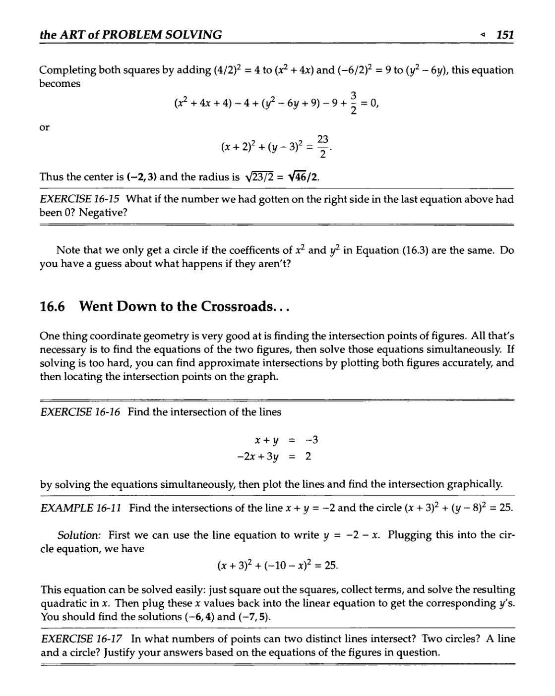

## Printed page 152

<!-- source: volume-1, PDF page 166, printed page 152 -->

### 16.7 ... Fell Down on My Knees

<!-- Heading restored for navigation from independently recognised source heading. -->

Geometry that is done in a coordinate system is called analytic geometry. ("Analytic" means using equations rather than pictures.) Most geometry can best be done with basic geometric principles rather than resorting to describing the figures by equations. When in doubt about whether or not to use an analytic approach to a problem, always try a geometric approach first. What types of problems can be solved with analytic geometry? One easy example is finding the midpoint of a segment.

**EXAMPLE 16-12 Prove that the midpoint of the segment whose endpoints are $(x_1, y_1)$ and $(x_2, y_2)$ is given by $\left(\frac{x_1 + x_2}{2}, \frac{y_1 + y_2}{2}\right)$.**

Solution: Consider the figure at right. Since the two dotted right triangles have equal hypotenuses (since $M$ is the midpoint) and equal angles (from the parallel dotted lines), they are congruent by SA for right triangles. Thus each pair of corresponding legs is equal. Since the distance covered by the two horizontal legs is $x_2 - x_1$, each must thus be of length $(x_2 - x_1)/2$. The $x$-coordinate of the midpoint is obtained by adding this to the $x$-coordinate $x_1$ of the starting point, to get $(x_1 + x_2)/2$, as desired. The $y$-coordinate is found in exactly the same way.

Another important example is the most crucial figure in geometry: the triangle. Since we can choose our coordinates any way we please, we should think about how to place the coordinate axes to make analysis simple. The best choice is to place two of the vertices, $A$ and $B$, on the $x$-axis, and the other, $C$, on the $y$-axis. Then the coordinates of the triangle are $(a, 0), (b, 0),$ and $(0, c)$ for some $a, b,$ and $c$. We can thus reduce the six variables to only three without making any limiting assumptions. (Convince yourself that every triangle can be represented in this way.)

**EXAMPLE 16-13 Using this system, we can prove that the centroid of a triangle exists. Recall that the centroid is supposed to be the intersection of all three medians of the triangle. However, there is no real guarantee that the medians come together at a single point. Let’s show that they do.**

The midpoints opposite $A = (a, 0), B = (b, 0),$ and $C = (0, c)$ are given by $(b/2, c/2), (a/2, c/2),$ and $((a + b)/2, 0)$, respectively. Using the formulas we developed in Section 16.3, the equations of the lines connecting these midpoints to the vertices are

$$cx + (2a - b)y = ac$$

$$cx + (2b - a)y = bc$$

$$2cx + (a + b)y = c(a + b).$$

Verify all these equations. Solving the first two simultaneously, we find that the intersection is given by $\left(\frac{a + b}{3}, \frac{c}{3}\right)$. Trying this in the third equation, we find that it is indeed on this line. (Again, verify this.) Thus the single point given by

$$\left(\frac{a + b}{3}, \frac{c}{3}\right)$$

Original scan — PDF page 166

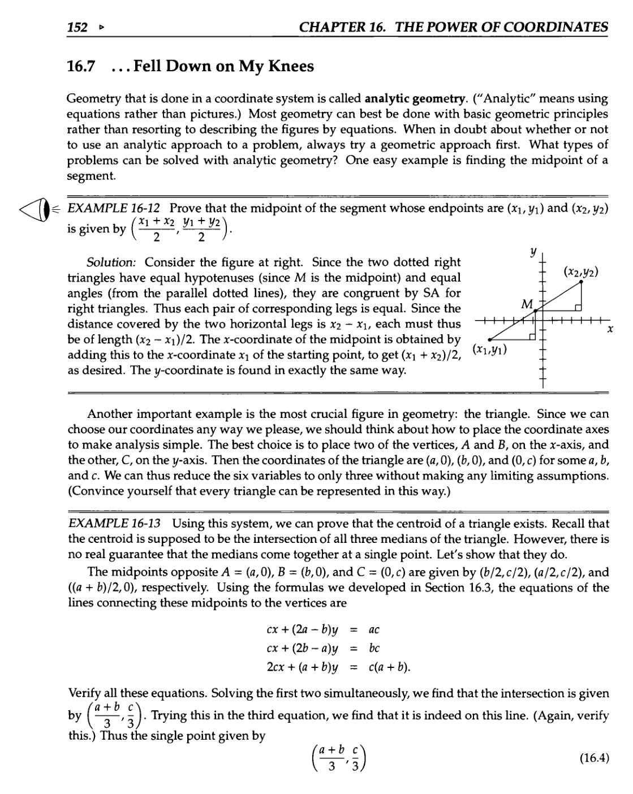

## Printed page 153

<!-- source: volume-1, PDF page 167, printed page 153 -->

is the centroid of the triangle, as it is on all three medians.

You might argue that we have only proven that the centroid exists for one choice of the coordinate system. However, we can choose the coordinate system in any way we want! We choose the simplest system and prove the general result there. As long as only geometric relationships are involved in the result we want to prove, as in this example and Exercise 16-18, this is entirely permissible. However, if we are asked to prove something about specific coordinates themselves, as in Exercise 16-19 below, we are not free to choose our coordinates.

**EXERCISE 16-18 Prove that if $G$ is the centroid of $\triangle ABC$ and $AM$ is a median, then $AG = 2GM$.**

**EXERCISE 16-19 The point (16.4) is the average of the three coordinates of the triangle! Show that this is true regardless of how the triangle is oriented in the coordinate plane. (For example, if the triangle doesn’t have one vertex on the $y$-axis and the others on the $x$-axis.)**

One thing to remember about analytic geometry: as Example 16-13 shows, even simple problems can get heavily algebraic. Don’t get into the habit of trying analytic techniques on every geometry problem you see, for you will get caught in a mass of equations and miss the simple geometric solution. It is for this reason that analytic geometry can never be a complete substitute for the techniques of pure Euclidean geometry. That’s a good thing, because Euclidean geometry is one of the most beautiful subjects there is. Experience will teach which types of problems work nicely in analytic geometry, and in which problems analytic techniques are an uncreative dead end.

Problems to Solve for Chapter 16

278. Find the distance between the points $(2, 12)$ and $(-4, 10)$.

279. A right triangle is drawn with legs of lengths 3 on the $x$-axis and 4 on the $y$-axis lying along the positive coordinate axes. Find the coordinates of the midpoint of the hypotenuse.

280. How many points with integer coordinates are exactly 5 units away from $(0, 0)$?

281. Find the equation of a line which passes through $(5, 7)$ and cuts the area of the circle $(x + 12)^2 + (y + 3)^2 = 4$ in half.

282. Find the centroid of a triangle with vertices $(10, 66), (19, 72),$ and $(17, 56)$.

283. Find the distance from the point $(5, 7)$ to the center of the circle $4x^2 + 8x + 4y^2 - 16y - 16 = 0$.

284. If $a, b > 0$ and the triangle in the first quadrant bounded by the coordinate axes and the graph of $ax + by = 6$ has area 6, then find $ab$. (AHSME 1989)

285. Parallelogram $ABCD$ has vertices $A(0, 0), B(2, 4),$ and $D(5, 1)$. If the remaining vertex, $C$, is in the first quadrant, what are its coordinates? (MATHCOUNTS 1992)

286. The graphs of the equations $x + 3y = 6$ and $kx + 2y = 12$ are perpendicular. What is the value of $k$? (MATHCOUNTS 1989)

287. What are the coordinates of the point that is two-thirds of the way from $(2, 4)$ to $(-1, 1)$? (MATHCOUNTS 1990)

Original scan — PDF page 167

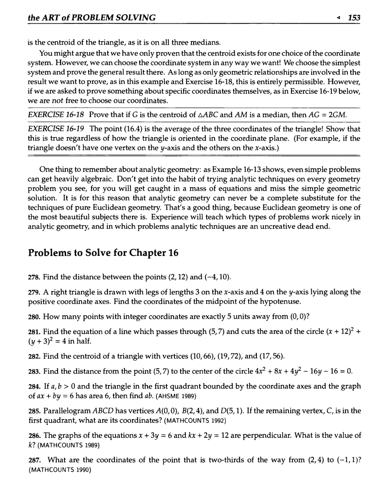

## Printed page 154

<!-- source: volume-1, PDF page 168, printed page 154 -->

288. We are given the line $3x + 5y = 15$ and a point on this line equidistant from the coordinate axes. In which quadrants can such a point exist? (AHSME 1960)

289. Prove analytically that the diagonals of a rectangle bisect each other.

290. Find $y$ if $(3, y)$ lies on the line joining $(0, 3/2)$ and $(9/4, 0)$. (MAΘ 1987)

291. Describe analytically all the lines which bisect the area of the square with vertices $(0, 0), (s, 0), (s, s)$, and $(0, s)$.

292. Find the vertices of a square which is centered at $(-17, 23)$, has side length 4, and whose diagonals are parallel to the coordinate axes.

293. A circle is drawn with center at the origin and radius 3. Find the coordinates of all intersections of the circle with an origin-centered square of side length 4 whose sides are parallel to the coordinate axes.

Original scan — PDF page 168

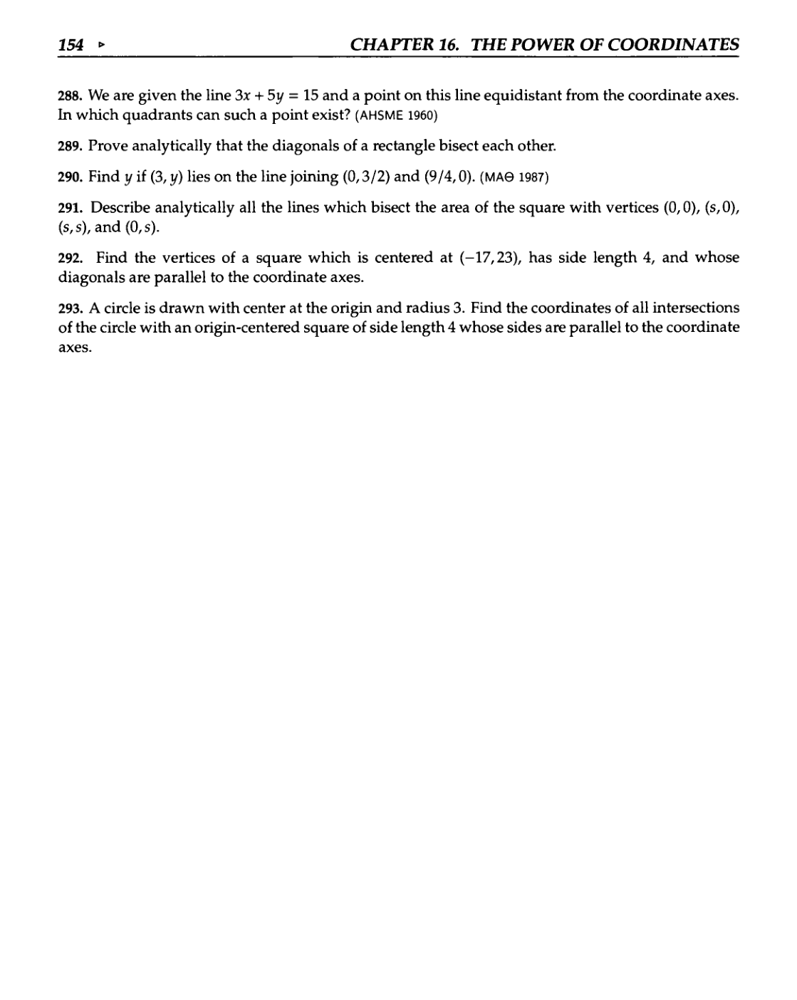

