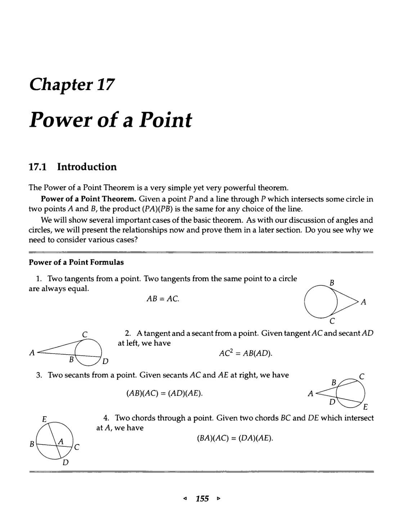
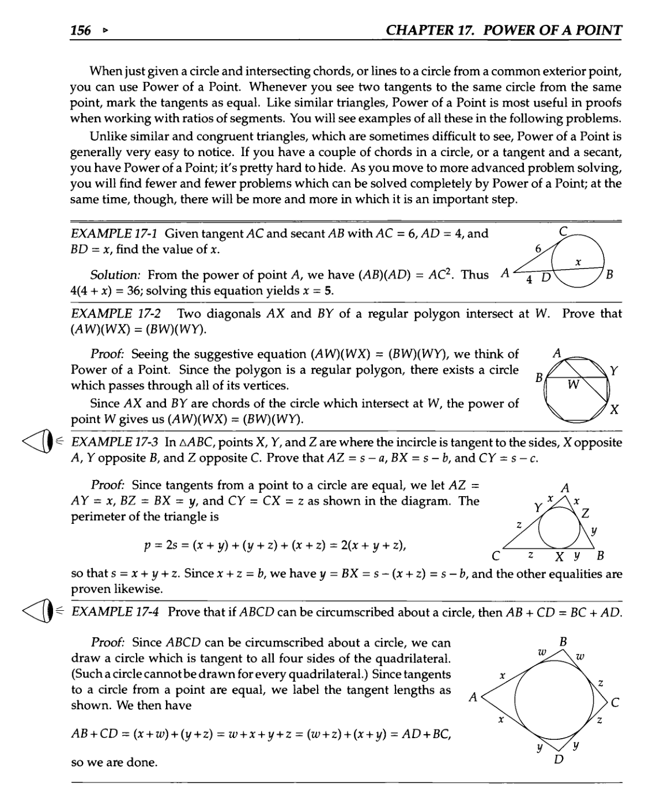
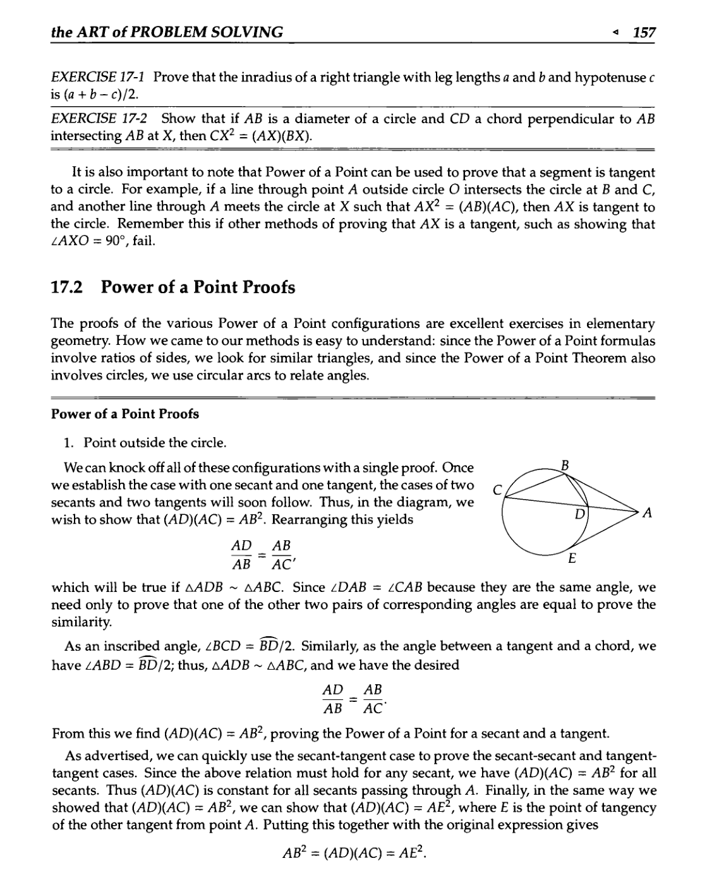
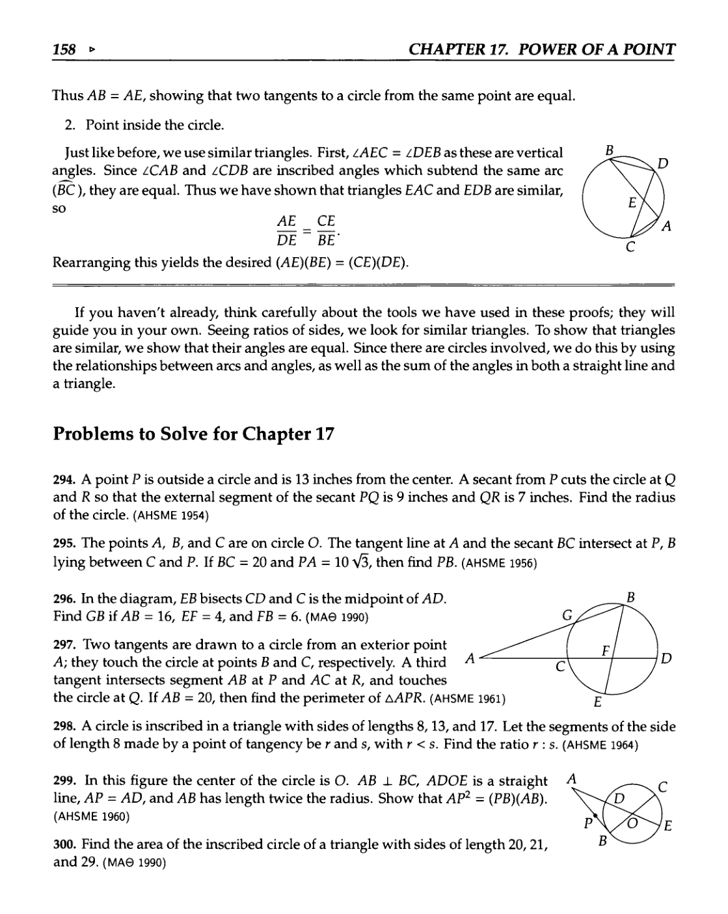
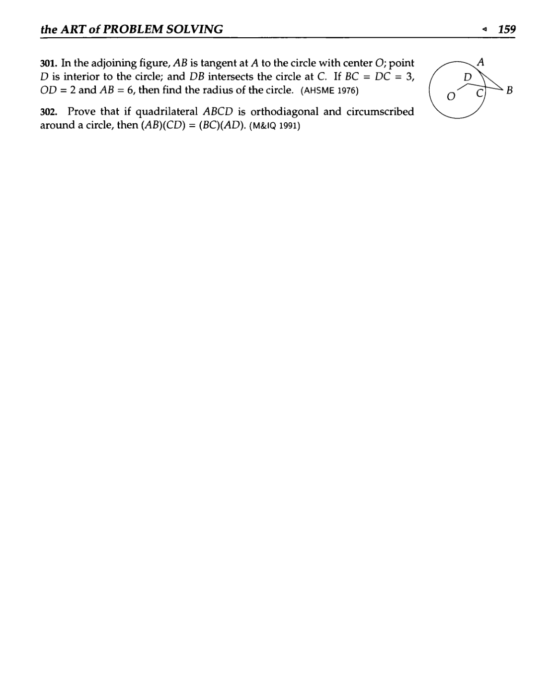

# Chapter 17: Power of a Point

Volume 1 · Printed pages 155–159 · PDF pages 169–173

[Volume contents](../index.md)

## Printed page 155

<!-- source: volume-1, PDF page 169, printed page 155 -->

### 17.1 Introduction

The Power of a Point Theorem is a very simple yet very powerful theorem.

Power of a Point Theorem. Given a point $P$ and a line through $P$ which intersects some circle in two points $A$ and $B$, the product $(PA)(PB)$ is the same for any choice of the line.

We will show several important cases of the basic theorem. As with our discussion of angles and circles, we will present the relationships now and prove them in a later section. Do you see why we need to consider various cases?

Power of a Point Formulas

1. Two tangents from a point. Two tangents from the same point to a circle are always equal.

$$AB = AC.$$

2. A tangent and a secant from a point. Given tangent $AC$ and secant $AD$ at left, we have

$$AC^2 = AB(AD).$$

3. Two secants from a point. Given secants $AC$ and $AE$ at right, we have

$$(AB)(AC) = (AD)(AE).$$

4. Two chords through a point. Given two chords $BC$ and $DE$ which intersect at $A$, we have

$$(BA)(AC) = (DA)(AE).$$

Original scan — PDF page 169

## Printed page 156

<!-- source: volume-1, PDF page 170, printed page 156 -->

When just given a circle and intersecting chords, or lines to a circle from a common exterior point, you can use Power of a Point. Whenever you see two tangents to the same circle from the same point, mark the tangents as equal. Like similar triangles, Power of a Point is most useful in proofs when working with ratios of segments. You will see examples of all these in the following problems.

Unlike similar and congruent triangles, which are sometimes difficult to see, Power of a Point is generally very easy to notice. If you have a couple of chords in a circle, or a tangent and a secant, you have Power of a Point; it’s pretty hard to hide. As you move to more advanced problem solving, you will find fewer and fewer problems which can be solved completely by Power of a Point; at the same time, though, there will be more and more in which it is an important step.

**EXAMPLE 17-1** Given tangent $AC$ and secant $AB$ with $AC = 6, AD = 4$, and $BD = x$, find the value of $x$.

**Solution:** From the power of point $A$, we have $(AB)(AD) = AC^2$. Thus $4(4 + x) = 36$; solving this equation yields $x = 5$.

**EXAMPLE 17-2** Two diagonals $AX$ and $BY$ of a regular polygon intersect at $W$. Prove that $(AW)(WX) = (BW)(WY)$.

**Proof:** Seeing the suggestive equation $(AW)(WX) = (BW)(WY)$, we think of Power of a Point. Since the polygon is a regular polygon, there exists a circle which passes through all of its vertices.

Since $AX$ and $BY$ are chords of the circle which intersect at $W$, the power of point $W$ gives us $(AW)(WX) = (BW)(WY)$.

**EXAMPLE 17-3** In $\triangle ABC$, points $X, Y$, and $Z$ are where the incircle is tangent to the sides, $X$ opposite $A$, $Y$ opposite $B$, and $Z$ opposite $C$. Prove that $AZ = s - a$, $BX = s - b$, and $CY = s - c$.

**Proof:** Since tangents from a point to a circle are equal, we let $AZ = AY = x$, $BZ = BX = y$, and $CY = CX = z$ as shown in the diagram. The perimeter of the triangle is

$$p = 2s = (x + y) + (y + z) + (x + z) = 2(x + y + z),$$

so that $s = x + y + z$. Since $x + z = b$, we have $y = BX = s - (x + z) = s - b$, and the other equalities are proven likewise.

**EXAMPLE 17-4** Prove that if $ABCD$ can be circumscribed about a circle, then $AB + CD = BC + AD$.

**Proof:** Since $ABCD$ can be circumscribed about a circle, we can draw a circle which is tangent to all four sides of the quadrilateral. (Such a circle cannot be drawn for every quadrilateral.) Since tangents to a circle from a point are equal, we label the tangent lengths as shown. We then have

$$AB + CD = (x + w) + (y + z) = w + x + y + z = (w + z) + (x + y) = AD + BC,$$

so we are done.

Original scan — PDF page 170

## Printed page 157

<!-- source: volume-1, PDF page 171, printed page 157 -->

**EXERCISE 17-1 Prove that the inradius of a right triangle with leg lengths $a$ and $b$ and hypotenuse $c$ is $(a + b - c)/2$.**

**EXERCISE 17-2 Show that if $AB$ is a diameter of a circle and $CD$ a chord perpendicular to $AB$ intersecting $AB$ at $X$, then $CX^2 = (AX)(BX)$.**

It is also important to note that Power of a Point can be used to prove that a segment is tangent to a circle. For example, if a line through point $A$ outside circle $O$ intersects the circle at $B$ and $C$, and another line through $A$ meets the circle at $X$ such that $AX^2 = (AB)(AC)$, then $AX$ is tangent to the circle. Remember this if other methods of proving that $AX$ is a tangent, such as showing that $\angle AXO = 90^\circ$, fail.

### 17.2 Power of a Point Proofs

The proofs of the various Power of a Point configurations are excellent exercises in elementary geometry. How we came to our methods is easy to understand: since the Power of a Point formulas involve ratios of sides, we look for similar triangles, and since the Power of a Point Theorem also involves circles, we use circular arcs to relate angles.

Power of a Point Proofs

1. Point outside the circle.

We can knock off all of these configurations with a single proof. Once we establish the case with one secant and one tangent, the cases of two secants and two tangents will soon follow. Thus, in the diagram, we wish to show that $(AD)(AC) = AB^2$. Rearranging this yields

$$\frac{AD}{AB} = \frac{AB}{AC},$$

which will be true if $\triangle ADB \sim \triangle ABC$. Since $\angle DAB = \angle CAB$ because they are the same angle, we need only to prove that one of the other two pairs of corresponding angles are equal to prove the similarity.

As an inscribed angle, $\angle BCD = \widehat{BD}/2$. Similarly, as the angle between a tangent and a chord, we have $\angle ABD = \widehat{BD}/2$; thus, $\triangle ADB \sim \triangle ABC$, and we have the desired

$$\frac{AD}{AB} = \frac{AB}{AC}.$$

From this we find $(AD)(AC) = AB^2$, proving the Power of a Point for a secant and a tangent.

As advertised, we can quickly use the secant-tangent case to prove the secant-secant and tangent-tangent cases. Since the above relation must hold for any secant, we have $(AD)(AC) = AB^2$ for all secants. Thus $(AD)(AC)$ is constant for all secants passing through $A$. Finally, in the same way we showed that $(AD)(AC) = AB^2$, we can show that $(AD)(AC) = AE^2$, where $E$ is the point of tangency of the other tangent from point $A$. Putting this together with the original expression gives

$$AB^2 = (AD)(AC) = AE^2.$$

Original scan — PDF page 171

## Printed page 158

<!-- source: volume-1, PDF page 172, printed page 158 -->

Thus $AB = AE$, showing that two tangents to a circle from the same point are equal.

2. Point inside the circle.

Just like before, we use similar triangles. First, $\angle AEC = \angle DEB$ as these are vertical angles. Since $\angle CAB$ and $\angle CDB$ are inscribed angles which subtend the same arc $(BC)$, they are equal. Thus we have shown that triangles $EAC$ and $EDB$ are similar, so

$$\frac{AE}{DE} = \frac{CE}{BE}.$$

Rearranging this yields the desired $(AE)(BE) = (CE)(DE).$

If you haven’t already, think carefully about the tools we have used in these proofs; they will guide you in your own. Seeing ratios of sides, we look for similar triangles. To show that triangles are similar, we show that their angles are equal. Since there are circles involved, we do this by using the relationships between arcs and angles, as well as the sum of the angles in both a straight line and a triangle.

Problems to Solve for Chapter 17

294. A point $P$ is outside a circle and is 13 inches from the center. A secant from $P$ cuts the circle at $Q$ and $R$ so that the external segment of the secant $PQ$ is 9 inches and $QR$ is 7 inches. Find the radius of the circle. (AHSME 1954)

295. The points $A, B,$ and $C$ are on circle $O$. The tangent line at $A$ and the secant $BC$ intersect at $P, B$ lying between $C$ and $P$. If $BC = 20$ and $PA = 10\sqrt{3}$, then find $PB$. (AHSME 1956)

296. In the diagram, $EB$ bisects $CD$ and $C$ is the midpoint of $AD$. Find $GB$ if $AB = 16$, $EF = 4$, and $FB = 6$. (MAΘ 1990)

297. Two tangents are drawn to a circle from an exterior point $A$; they touch the circle at points $B$ and $C$, respectively. A third tangent intersects segment $AB$ at $P$ and $AC$ at $R$, and touches the circle at $Q$. If $AB = 20$, then find the perimeter of $\Delta APR$. (AHSME 1961)

298. A circle is inscribed in a triangle with sides of lengths 8, 13, and 17. Let the segments of the side of length 8 made by a point of tangency be $r$ and $s$, with $r < s$. Find the ratio $r: s$. (AHSME 1964)

299. In this figure the center of the circle is $O$. $AB \perp BC$, $ADOE$ is a straight line, $AP = AD$, and $AB$ has length twice the radius. Show that $AP^2 = (PB)(AB)$. (AHSME 1960)

300. Find the area of the inscribed circle of a triangle with sides of length 20, 21, and 29. (MAΘ 1990)

Original scan — PDF page 172

## Printed page 159

<!-- source: volume-1, PDF page 173, printed page 159 -->

301. In the adjoining figure, $AB$ is tangent at $A$ to the circle with center $O$; point $D$ is interior to the circle; and $DB$ intersects the circle at $C$. If $BC = DC = 3$, $OD = 2$ and $AB = 6$, then find the radius of the circle. (AHSME 1976)

302. Prove that if quadrilateral $ABCD$ is orthodiagonal and circumscribed around a circle, then $(AB)(CD) = (BC)(AD)$. (M&IQ 1991)

Original scan — PDF page 173

