# Chapter 18: Three Dimensional Geometry

Volume 1 · Printed pages 160–172 · PDF pages 174–186

[Volume contents](../index.md)

## Printed page 160

<!-- source: volume-1, PDF page 174, printed page 160 -->

Chapter 18

Three Dimensional Geometry

### 18.1 Planes, Surface Area, and Volume

Consider two lines in space. If these two lines have exactly the same orientation, they are parallel. If they don't have the same orientation, but still never intersect, they are called skew lines. To understand skew lines, hold two pens so that they are not touching. If they aren't pointing the same direction, chances are they are skew.

Consider a flat sheet of paper which continues forever in every direction. This is a plane. Just as a line is a one-dimensional figure, a plane is a two-dimensional figure. In three dimensions, an area which extends forever in every direction is called a space. Given a plane, any line is either in the plane, intersects the plane at one point, or never intersects the plane. The three possibilities are displayed at right. If the line does not intersect the plane, it is parallel to the plane. A line $l$ is perpendicular to a plane if every line in the plane through the intersection point of $l$ and the plane is perpendicular to $l$. As you may have guessed, the distance from a point to a plane is the length of the perpendicular segment from the point to the plane.

How many points must we have to determine a plane? Given any three noncollinear points, we can form a triangle. A triangle is a planar figure, so our three points have determined a plane. We cannot always form a plane through four given points. To see this, draw a triangle and then lift your pen from the paper. Try to form a plane that goes through the vertices of the triangle and the point of your pen. If your pen is above the paper, you'll find that this is impossible. If you do have a set of four or more points which lie in a single plane, the points are coplanar.

Suppose we have a three dimensional figure, like a box or a ball, made of cloth which encloses a region. The area of the cloth needed to make the figure is called the total surface area of the figure. For example, if the figure is a box, the total surface area is the sum of the areas of the sides of the box.

Some shapes have a well-defined top and bottom. In this case, we may be interested in only the surface area which is not on the top or bottom. This area is often called the lateral surface area of the figure. Whenever a problem asks for just the surface area of a figure, the total surface area is implied.

Finally, the amount of space enclosed within a figure is the volume of the figure. To add

Original scan — PDF page 174

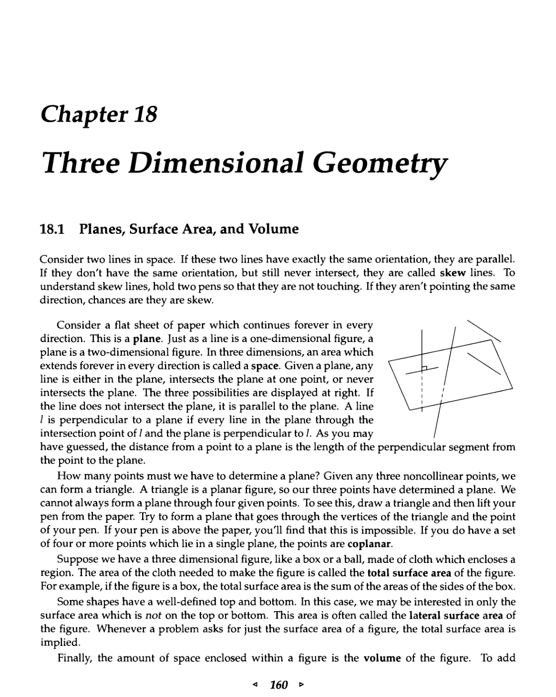

## Printed page 161

<!-- source: volume-1, PDF page 175, printed page 161 -->

something concrete to all these general definitions, let's look at the most common three-dimensional figures.

### 18.2 Spheres

A sphere is just a ball. Just as a circle is the set of all points in a plane which are a fixed distance from a given point, a sphere is the set of all points in space which are a fixed distance from a given point. As with the circle, the fixed point is the center, and the distance is the radius of the sphere.

The surface area of a sphere with radius $r$ is $4\pi r^2$ and the volume is $4\pi r^3/3$.

If a plane intersects a sphere, the intersection is either a point (if the plane is tangent to the sphere) or a circle. The intersection of a sphere and a plane passing through its center is called a great circle of the sphere.

**EXAMPLE 18-1 A plane intersects a sphere, forming a circle. Find the radius of the circle if the radius of the sphere is 8 and the center of the sphere is 5 units from the plane.**

Solution: Draw diameter $AC$ of the circle, where $B$ is its center. Drawing segment $OB$ and radii $OA$ and $OC$, we form two triangles $OBC$ and $OBA$. Since $AB = BC$ (as radii of the circle), $OB = OB$, and $OC = OA$ (radii of the sphere), we have $\triangle OBC \cong \triangle OBA$ by SSS. Thus $\angle OBC = \angle OBA$. Since these two angles are equal and together form a line, they are right angles. Thus $OB$ is the distance from the center to the plane, so $OB = 5$. From the Pythagorean Theorem we find $AB = \sqrt{8^2 - 5^2} = \sqrt{39}$. Remember this method of relating the radius of the sphere to the radii of circles of the sphere.

**EXAMPLE 18-2 Find the diameter of a sphere whose volume is $288\pi$.**

Solution: First we find the radius, then the diameter. Solving

$$\frac{4\pi r^3}{3} = 288\pi,$$

we find $r^3 = 216$ and $r = 6$. Thus the diameter has length $2r = 12$.

**EXERCISE 18-1 A ball was floating in a lake when the lake froze. The ball was removed (without breaking the ice), leaving a hole 24 cm across at the top and 8 cm deep. What was the radius of the ball in centimeters? (AHSME 1987)**

**EXERCISE 18-2 Find the volume of a sphere which has surface area 100.**

Original scan — PDF page 175

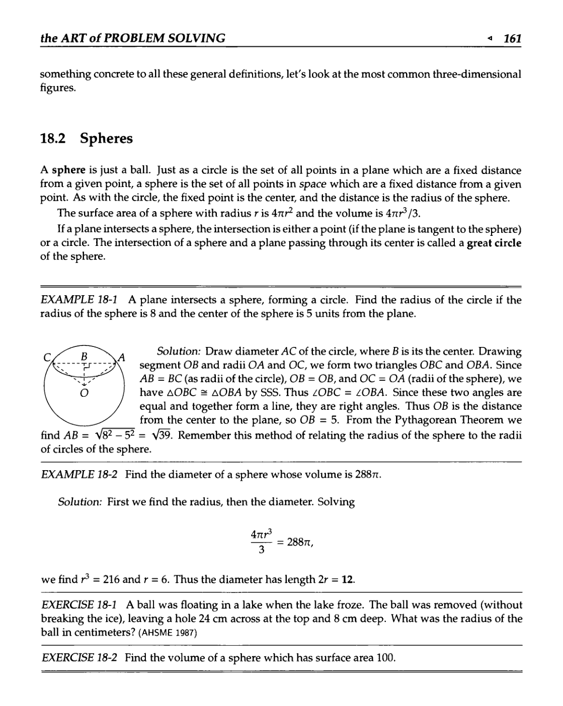

## Printed page 162

<!-- source: volume-1, PDF page 176, printed page 162 -->

### 18.3 Cubes and Boxes

<!-- Heading restored for navigation from independently recognised source heading. -->

A simple six-sided die is a cube. All the sides, or faces, are squares and each face is perpendicular to the faces which are adjacent to it. The segments which form the faces are called edges, and the edges meet at the vertices. Since all the faces are congruent squares, all the edges have the same length; let this length be $s$. Since the faces are squares, each face has area $s^2$, and since there are six such faces, the surface area of the cube is $6s^2$. To find the volume of the cube, we multiply the area of a face by the altitude to the face. This altitude is the same length as an edge of the cube, so the volume is $s^3$.

A diagonal of a cube is a segment drawn from a vertex of the cube to the vertex opposite it, as $EC$ at left. To find the length of $EC$, first draw diagonal $AC$ of face $ABCD$. Since $ABCD$ is a square, we know that $AC = s\sqrt{2}$. Moreover, since $AE$ is perpendicular to the plane $ABCD$, we have $AE \perp AC$. Thus, using the Pythagorean Theorem on right triangle $CAE$, we find $EC = \sqrt{s^2 + 2s^2} = s\sqrt{3}$, so the diagonal of a cube is $\sqrt{3}$ times the length of a side.

**EXAMPLE 18-3** In cube $ABCDEFGH, ABCD$ is a face and $M$ is the midpoint of edge $DE$. Find $BM$ if $AB = 4$.

**Solution:** The first step is draw the picture as accurately as possible. Nearly all three dimensional problems which do not involve volume are solved by chopping the problem into a series of two-dimensional problems, as we did in determining the length of a diagonal. Here, by drawing face diagonal $BD$, we form right triangle $BDM$. (There are lots of right triangles in cube problems.) Since $BD$ is a face diagonal, it has length $4\sqrt{2}$. Segment $DM$ is half an edge, so it has length 2. From the Pythagorean Theorem we have $BM = \sqrt{4 + 32} = 6$.

**EXAMPLE 18-4** A cube with edge length 6 units is made from blocks which are unit cubes (cubes with edge length 1), and then all faces are painted. How many of the blocks have no faces painted? One face painted? Two faces painted? Three faces painted?

**Solution:** Counting those cubes with three faces painted is easy. Those are just the corners, so there are 8 of them.

For two faces to be painted, the block must be on an edge but not a corner. Since each of the 12 edges contains 4 such cubes, there are $12(4) = 48$ cubes with two faces painted.

For a cube to have only one face painted, it must be in the interior of a face, not on an edge or a corner. Taking away the outside blocks of a 6 by 6 square leaves a 4 by 4 square (try it), so there are $4(4) = 16$ blocks with one face painted on each of the six faces of the cube. Hence, there are $6(16) = 96$ blocks with only one face painted.

Now we have counted all the cubes that have some face painted. We could get the number of cubes with no faces painted by subtracting from the total number of blocks $(6^3 = 216)$, but there is a slicker way. Just as we removed the edge blocks to count blocks with one face painted, we

Original scan — PDF page 176

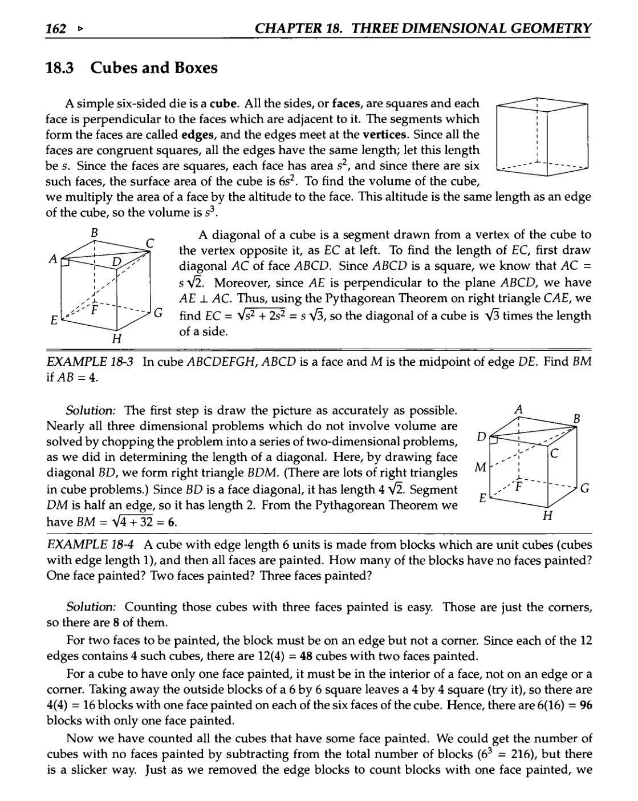

## Printed page 163

<!-- source: volume-1, PDF page 177, printed page 163 -->

can remove the outside blocks from the cube to count to number of blocks with no faces painted. Removing the outer layer of blocks from a 6 by 6 by 6 cube leaves a 4 by 4 by 4 cube, which contains $4^3 = 64$ blocks. There are 64 blocks with no faces painted.

**EXAMPLE 18-5** Find the area of $\triangle BDE$, where $ABCDEFGH$ is a cube as shown and $AB = 6$.

**Solution:** Drawing the sides of the triangle as shown, we see that they are face diagonals and hence have length $6\sqrt{2}$. Since these sides are all equal, $\triangle BDE$ is equilateral. Hence, we find

$$BDE = \frac{(BD)(BE)\sin 60^\circ}{2} = \frac{(6\sqrt{2})^2\sqrt{3}}{4} = 18\sqrt{3}.$$

**EXERCISE 18-3** Find the volume of a cube which has diagonal length 6.

**EXERCISE 18-4** Given that $AB$, $AD$, and $AE$ are all edges of a cube, find $\angle LMN$ if $L$, $M$, and $N$ are the midpoints of these three edges.

In mathematical terms, the figure at right is a right parallelepiped, which in English reads 'box.' A parallelepiped is a six sided solid in which the opposite faces are congruent parallelograms. A box is a special case of a parallelepiped in which all the faces are rectangles. Opposite faces are congruent and perpendicular to each other as shown at vertex $A$. Since the faces are rectangles, we have

$$AE = DH = CG = BF, \quad EF = HG = DC = AB, \quad AD = BC = FG = EH.$$

These three lengths are called the height, length, and width, respectively, and are commonly labelled $h$, $l$, and $w$. We only need these three dimensions to completely describe any box.

Since the faces are rectangles, we can easily find the surface area as the sum of the face areas:

$$\text{Surface Area} = 2(lw + hl + hw).$$

The volume of the box is the area of one face times the altitude to the other, or

$$\text{Volume} = lwh.$$

As with a cube, a diagonal of a box is a segment from a vertex of the box to the opposite vertex. Segment $EC$ is a diagonal of the box. We find the length of this diagonal just as we found the length of a diagonal of a cube. By drawing face diagonal $AC$, we form right triangles $ABC$ and $EAC$. The Pythagorean Theorem then yields

$$AC = \sqrt{BC^2 + AB^2} = \sqrt{l^2 + w^2}$$

and

$$EC = \sqrt{AC^2 + AE^2} = \sqrt{l^2 + w^2 + h^2}.$$

Original scan — PDF page 177

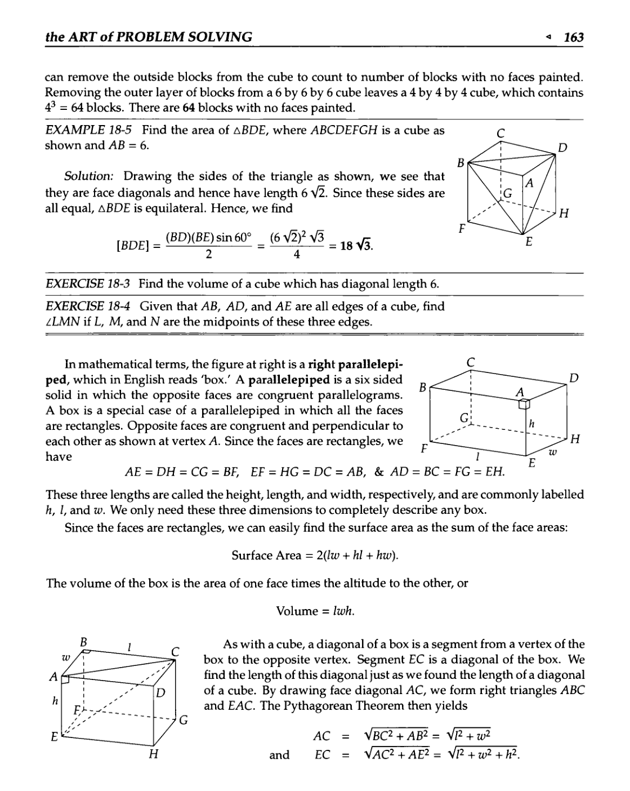

## Printed page 164

<!-- source: volume-1, PDF page 178, printed page 164 -->

**EXAMPLE 18-6 Find the volume of a box which has diagonal length $\sqrt{35}$ and two dimensions 1 and 5.**

Solution: Since the length of a diagonal is given by $\sqrt{l^2 + w^2 + h^2}$, we have $35 = 1 + 25 + h^2$. Solving for $h$, we find $h = 3$, so the volume is $lwh = 15$. There are two things to note in this example. First, we neglect $h = -3$ as a solution of the equation, as negative lengths are impossible. Second, we tacitly assumed the given dimensions were the length and width. They could in fact have been any two of the dimensions. The names length, width, and height really have no meaning, and are only used to differentiate the three dimensions, so we can use the letters $l$, $w$ and $h$ to name the dimensions in any order.

**EXAMPLE 18-7 Given that the areas of three faces of a rectangular solid (another name sometimes used for a box) are 24, 32, and 48, find the volume of the solid.**

Solution: Let the dimensions be $x$, $y$, and $z$. Since the faces are rectangles, the areas are the products of pairs of these lengths. We thus have the equations

$$xy = 24, \quad xz = 32, \quad yz = 48.$$

We could use trial and error to solve these and find $(x, y, z) = (4, 6, 8)$, but there is a better method to find the volume. Since the volume is $xyz$, we need only find this product. Consider the product of the three area equations.

$$(xy)(xz)(yz) = (24)(32)(48)$$
$$x^2 y^2 z^2 = 2^{12} \cdot 3^2$$
$$(xyz)^2 = 2^{12} \cdot 3^2$$

Taking the square root of this equation, we find $xyz = 2^6 \cdot 3 = 192$. Thus the volume is 192, and we never had to find the side lengths.

Why is this method better for finding the volume? What if the areas of the faces had been $9\sqrt{6}$, $36\sqrt{3}$, and $54\sqrt{2}$? Using trial and error to find the dimensions of that solid could take a long time. Our method will still solve this problem quickly.

**EXERCISE 18-5 Find the number of 2 inch cubes required to fill a 4 inch by 8 inch by 10 inch box.**

**EXERCISE 18-6 In the rectangular parallelepiped $ABCDEFGH$ below, $AB = 4$, $BC = 3$, $CG = 9$, $BY = 3$, and $DX = 5$. Find $XY$.**

Original scan — PDF page 178

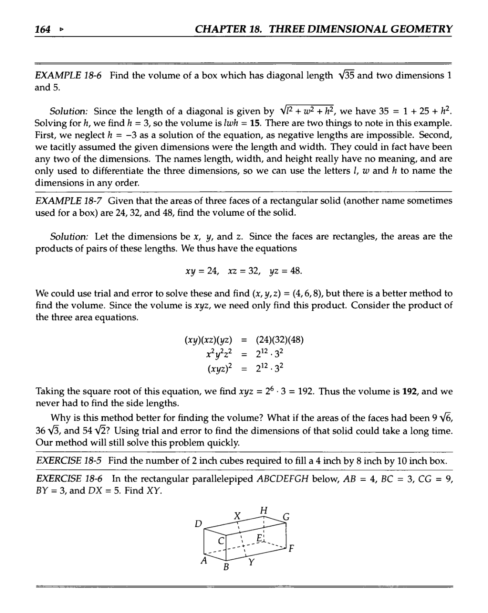

## Printed page 165

<!-- source: volume-1, PDF page 179, printed page 165 -->

### 18.4 Prisms and Cylinders

A prism is a figure in which the bases are two parallel and congruent faces, and the lateral faces are parallelograms formed by connecting corresponding vertices of the bases. As shown at the right, the bases can be any geometric figure. A regular prism is one in which the bases are regular polygons. For example, a regular hexagonal prism is one in which the bases are regular hexagons. The height is the distance between the bases, where the distance is the length of a perpendicular segment from one base to the other. The total surface area is found by summing the areas of the faces, while the lateral surface area is the sum of the areas of the lateral faces. As with boxes and cubes, the volume of a prism is the product of the area of a base and the height of the prism.

A right prism is a prism in which the lateral edges are perpendicular to the bases. Cubes and boxes are right prisms.

A cylinder is a prism whose bases are curved surfaces rather than polygons. A circular cylinder has bases which are circles, and a right circular cylinder is a right prism whose bases are circles. A typical can is a right circular cylinder. The line joining the centers of the bases is called the axis of the cylinder. Generally, in problems which refer to a cylinder, a right circular cylinder is implied.

Given a cylinder with height $h$ and radius $r$, the base area is $\pi r^2$, so

$$\text{Volume} = \pi r^2 h.$$

To find the surface area we add the area of the bases to the area of the curved surface. As circles of radius $r$, the bases each have area $\pi r^2$. To find the area of the curved surface, consider cutting the curved surface along the vertical line $AB$ shown and 'unrolling' the surface. We form a rectangle as shown in the diagram below.

One side of the rectangle is the altitude, $h$, of the cylinder, and the other is the circumference, $2\pi r$, of the bases. If you don't follow this, get a can and wrap a piece of paper around it. This should make it clear that the curved surface of a cylinder is actually a rectangle. Thus, the lateral surface area of a cylinder is $2\pi hr$, and as the sum of the area of the curved surface and the two circular ends, we get

$$\text{Total Surface Area} = 2\pi hr + 2\pi r^2.$$

**EXAMPLE 18-8 Show that the lateral surface area of a right prism is given by the product of the perimeter of one of the bases and the altitude of the prism.**

Original scan — PDF page 179

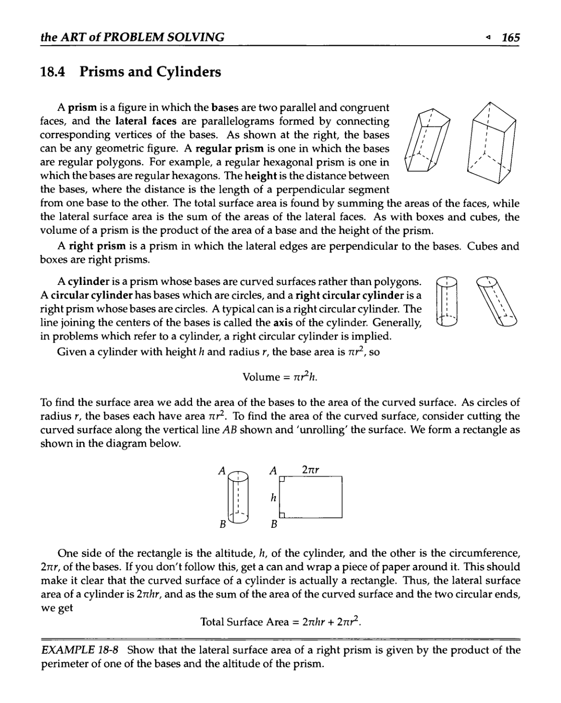

## Printed page 166

<!-- source: volume-1, PDF page 180, printed page 166 -->

Proof: Each face of a right prism is a rectangle. Two sides of each rectangle are lateral edges and are equal to the altitude, $h$, of the prism. The other two sides are corresponding sides of the bases. The area of each face is the product of these lengths. If we let the lengths of the sides of the base be $x_1, x_2, \ldots, x_i$, then the sum of the areas is

$$x_1h + x_2h + \cdots + x_ih = (x_1 + x_2 + \cdots + x_i)h = ph,$$

where $p$ is the perimeter of the base.

**EXERCISE 18-7 Find the total surface area of a cylinder whose height is 5 and volume is $45\pi$.**

**EXAMPLE 18-9 An ant is on the edge of the top of a cylinder. The ant wishes to crawl to a point diagonally across from his current position at the base of the cylinder. If the cylinder is 8 inches high with a diameter of 4 inches, what is the shortest distance the ant may crawl to get to the desired point? (MAΘ 1992)**

Solution: The ant must crawl along the outside surface of the cylinder from $A$ to $B$, so we are not just looking for the length $AB$ inside the cylinder. Instead we must 'unroll' the surface of the cylinder and find $AB$ on this rectangle. Since $B$ is directly opposite $A$, it is the midpoint of one side of the unrolled rectangle. (The distance from $C$ to $B$ along the circle is half the circumference of the circle.) Thus, $CB = CY/2 = 2\pi r/2 = \pi r = 2\pi$. Since $AC$ equals the height of the cylinder, we know $AC = 8$. The Pythagorean Theorem then gives

$$AB = \sqrt{AC^2 + BC^2} = \sqrt{64 + 4\pi^2} = 2\sqrt{16 + \pi^2}.$$

Note how we have turned a three dimensional problem into a two dimensional one by unrolling the cylinder's surface.

**EXERCISE 18-8 What is the greatest possible distance in space between two points on a right circular cylindrical can with radius 4 and height 6?**

### 18.5 Pyramids and Cones

A solid figure with one polygonal face and all other faces triangles with a common vertex is called a pyramid. The common vertex is the vertex of the pyramid, the polygonal face (which may also be a triangle) is the base, the triangles with the common vertex are the lateral faces, and the altitude, $h$, of a pyramid is the perpendicular distance from the vertex of the pyramid to the base. If $A$ is the area of the base, the volume of any pyramid is given by $Ah/3$. As you may have guessed, the lateral surface area is the sum of the areas of the faces.

Original scan — PDF page 180

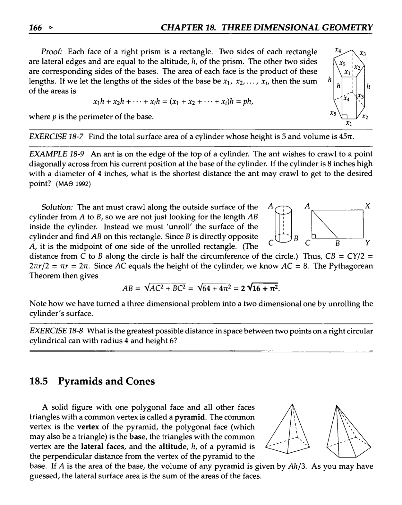

## Printed page 167

<!-- source: volume-1, PDF page 181, printed page 167 -->

A **regular pyramid** is a pyramid which has a regular polygon as its base and vertex such that all lateral faces make the same angle with the base. The foot of the altitude is the center of the base, so the vertex is directly above the base’s center. Thus the lateral faces are all congruent triangles. We sometimes call the common altitude of the faces from the vertex of the pyramid the **slant height**. The lateral surface area of a regular pyramid is $pl/2$, where $l$ is the slant height and $p$ is the perimeter of the base.

**EXAMPLE 18-10** Show that the lateral surface area of a regular pyramid with base perimeter $p$ and slant height $l$ is $pl/2$.

**Proof:** The slant height is the altitude to the sides of the lateral faces which are also sides of the base. Letting the side length of the base be $s$ and the number of sides of the base be $n$, the area of each lateral face is then $sl/2$ and the total lateral surface area is $nsl/2$. Since $ns$ represents the perimeter of the base, the lateral surface area is $pl/2$.

As with prisms, there is a special name for a pyramid with a curve as a base. Such a pyramid is called a **cone**. A **circular cone** has a circle as a base, and a **right circular cone** is a regular pyramid with a circular base. Thus the foot of the altitude of a right circular cone is the center of the circular base. If we let $r$ be the radius and $h$ the altitude, the volume is $\pi r^2 h/3$. The lateral surface area is the area of the curved surface. We define the slant height, $l$, of a right circular cone as the distance from the vertex, which is sometimes called the **apex**, to the boundary of the circular base. We see in the diagram that the height, radius, and slant height of a cone are related by the Pythagorean Theorem, $h^2 + r^2 = l^2$. (Problems which just read ‘cone’ usually refer to a right circular cone.)

As we did with the right circular cylinder, we can ‘unroll’ the curved surface of the cone. We do this by cutting along a slant height, like $AB$. Since the distance from $A$ to any point on the boundary of the circular base is constant (equal to the slant height, $l$), the curve $BB'$ is an arc of the circle centered at $A$ with radius $l$. The length of this arc is the circumference of the base of the cone, or $2\pi r$. Make sure you understand this. If you don’t, go to an ice cream store, get an ice cream cone, and instead of ripping off the paper around the cone, cut it along a slant height and unroll it.

Using this “unrolling” approach, we can prove that the lateral surface area of a cone is $\pi rl$.

**EXAMPLE 18-11** Find the total surface area of a right circular cone with radius 5 and altitude 12.

**Solution:** The area of the base is $5^2\pi = 25\pi$. To get the area of the curved surface, we must find the slant height of the cone. Drawing an altitude and radius of a cone, we form a right triangle whose hypotenuse is the slant height. Thus the slant height has length $\sqrt{5^2 + 12^2} = 13$, and the total surface area is $25\pi + \pi(5)(13) = 90\pi$.

**EXERCISE 18-9** Prove that the lateral surface area of a cone with radius $r$ and slant height $l$ is $\pi rl$. (Hint: ‘Unroll’ the curved surface and find the area of the resulting sector.)

Original scan — PDF page 181

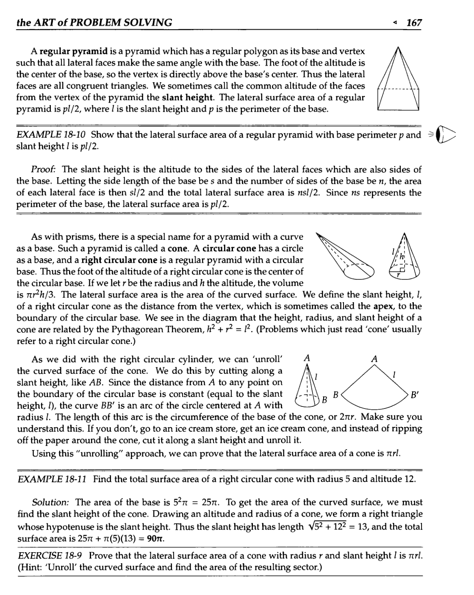

## Printed page 168

<!-- source: volume-1, PDF page 182, printed page 168 -->

**EXERCISE 18-10 Find the volume of a cone whose vertex is the center of a sphere of radius 5 and whose base is the intersection of this sphere with a plane 3 units away from the sphere’s center.**

### 18.6 Polyhedra

A polyhedron is a solid figure whose faces are planar polygons. There are no curved surfaces in a polyhedron. Cubes, parallelepipeds, prisms, and pyramids are all examples of polyhedrons. A regular polyhedron is a polyhedron whose faces are all congruent regular polygons. The table provides information about the only five regular polyhedra. We will prove in Volume 2 that these are the only regular polyhedra.

| Name | Shape of Faces | Number of Faces | Number of Vertices | Number of Edges |
| :--- | :--- | :--- | :--- | :--- |
| Tetrahedron | triangles | 4 | 4 | 6 |
| Hexahedron | squares | 6 | 8 | 12 |
| Octahedron | triangles | 8 | 6 | 12 |
| Dodecahedron | pentagons | 12 | 20 | 30 |
| Icosahedron | triangles | 20 | 12 | 30 |

Looking over these numbers of faces, vertices, and edges, we note that for each of these special polyhedra, the number of edges is 2 less than the sum of the number of faces and the number of vertices. This is no accident. In fact, for any polyhedron, regular or not, it is true that

$$\text{(\# vertices)} + \text{(\# faces)} - \text{(\# edges)} = 2.$$

Although the five polyhedra shown above are the only regular polyhedra, they are certainly not the only polyhedra whose faces are regular polygons. Look at a soccer ball; the hexagons and pentagons which make up the surface are all regular polygons.

**EXAMPLE 18-12 Find the volume of a regular tetrahedron with side length 1.**

Solution: Note that a tetrahedron is just a special regular pyramid with a triangular base. Thus, to find the volume of the tetrahedron, we must find the area of its base and find its altitude. Its base is an equilateral triangle with side length 1, so it has area $1^2 \sqrt{3}/4 = \sqrt{3}/4$. We know that the foot of the altitude is the center of the base (why?), and by connecting this point to a vertex of the base, we form a right triangle as in $\Delta ABO$. Since $\Delta ACD$ is equilateral, $AM$ is a median and an altitude, and $O$, the center of the triangle, is the centroid; thus $AO = \frac{2}{3} AM$. Since

Original scan — PDF page 182

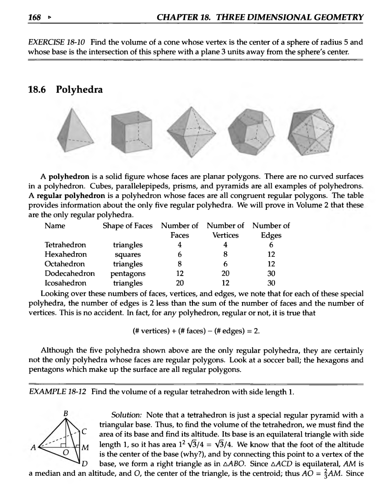

## Printed page 169

<!-- source: volume-1, PDF page 183, printed page 169 -->

$\triangle AMD$ is a $30^\circ-60^\circ-90^\circ$ triangle, we have $AM = \frac{\sqrt{3}}{2} AD = \sqrt{3}/2$, and

$$AO = \frac{2}{3} AM = \frac{\sqrt{3}}{3}.$$

From the Pythagorean Theorem, we can then find $BO$:

$$BO = \sqrt{AB^2 - AO^2} = \sqrt{1 - \frac{1}{3}} = \sqrt{\frac{2}{3}} = \frac{\sqrt{6}}{3}.$$

Thus the volume of a regular tetrahedron with side length 1 is

$$V = \frac{([ACD])(BO)}{3} = \frac{1}{3} \left( \frac{\sqrt{3}}{4} \right) \left( \frac{\sqrt{6}}{3} \right) = \frac{\sqrt{2}}{12}.$$

**EXAMPLE 18-13** Find the volume of a regular octahedron with side length 1.

**Solution:** We can split an octahedron into two pyramids with base $ABCD$ as shown. We then find the volume of one of the pyramids and multiply by 2 to get the desired volume. The base of the pyramid is square $ABCD$, which has area 1. To find the height, we once again form a right triangle, namely $\triangle EOA$. The segment $OA$ is one-half a diagonal of $ABCD$ and hence has length $\sqrt{2}/2$. From the Pythagorean Theorem we find that

$$EO = \sqrt{1^2 - \left( \frac{\sqrt{2}}{2} \right)^2} = \sqrt{\frac{1}{2}} = \frac{\sqrt{2}}{2}.$$

Note that $EO$ has the same length as half the diagonal of the base. This suggests that there may be an easier way to find $EO$. Indeed, $EO$ is half the diagonal of square $EAFC$, and as such, has length $\sqrt{2}/2$. As we've said before, solving three dimensional problems is best done by splitting the problem into two dimensional problems. Cleverly choosing the two dimensional figure to use (like square $EAFC$ rather than triangle $EAO$) can save you a lot of work.

Finally, the volume of the octahedron is twice the volume of the pyramid, or

$$V = 2 \left( \frac{([ACD])(EO)}{3} \right) = \frac{2}{3}(1) \left( \frac{\sqrt{2}}{2} \right) = \frac{\sqrt{2}}{3}.$$

**Challenge:** $EAFC$ is clearly a rhombus, but how would you prove it is a square?

### 18.7 How to Solve 3D Problems

Problems involving the volume and surface area of simple figures are quickly solved by the methods discussed in the previous section. To find the volume or surface area of more complicated figures, try to dissect the figure into pieces whose area or volume you can find. This is how we found the volume

Original scan — PDF page 183

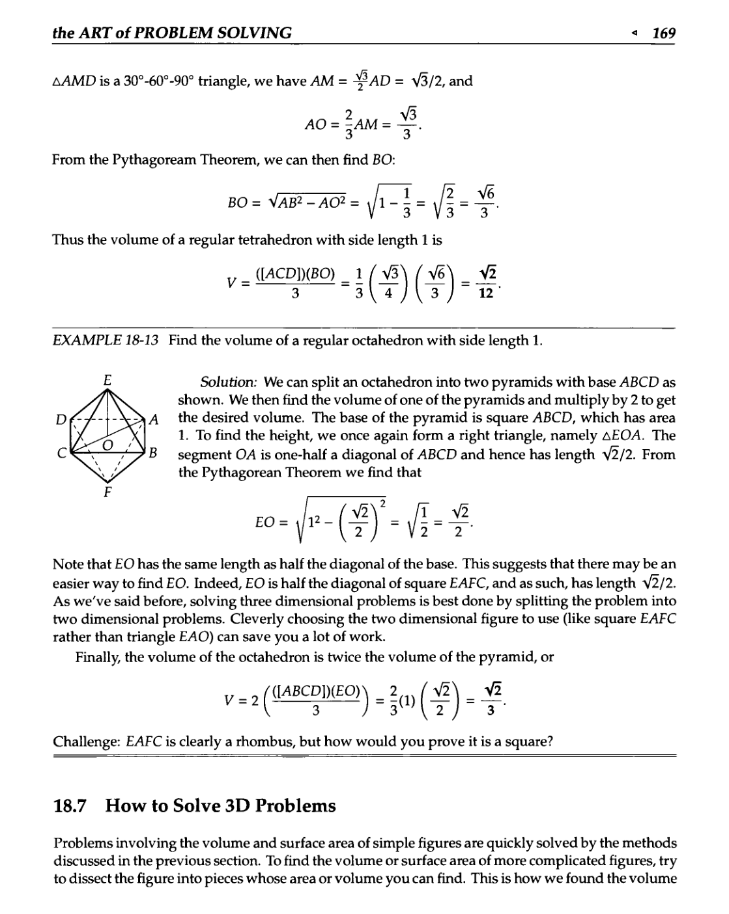

## Printed page 170

<!-- source: volume-1, PDF page 184, printed page 170 -->

of an octahedron, and how we in general solve all surface area problems. In very extreme cases, we can find the volume of an object by finding a larger object of which it is a part and subtracting those parts of the larger object which are not parts of the desired object. These problems are usually fairly obvious, and we are almost always given the 'larger object' as part of the problem.

To solve other problems in three dimensions, such as finding specific lengths, areas, or angles, we will repeat what we have said many, many times. Three dimensional problems of this nature are disguised two-dimensional problems. If looking for a length, consider a particular plane (or triangle) containing that length. The same goes for angles and areas. Since three dimensional problems are very much like two dimensional ones, the same rules apply to adding extra lines. Perpendicular lines are very useful, because right triangles are at the heart of many solutions.

By working on the problems at the end of this chapter, you will come to master the technique of applying the principles of two dimensional geometry to three dimensional problems.

Problems to Solve for Chapter 18

303. The sum of the lengths of all the edges of a cube is 144 inches. What is the number of inches in the length of a diagonal of the cube? (MATHCOUNTS 1989)

304. A 5 inch by 8 inch rectangular sheet of paper can be rolled up to form either of two right circular cylinders, a cylinder with a height of 8 inches or a cylinder with a height of 5 inches. What is the ratio of the volume of the 8 inch tall cylinder to the volume of the 5 inch tall cylinder? (MATHCOUNTS 1989)

305. How many triangular faces does a pyramid with 10 edges have? (MATHCOUNTS 1992)

306. Regular hexagon $JKLMNO$ intersects the edges of a cube at the midpoints of the cube's edges. What is the ratio of the area of the hexagon to the total surface area of the cube? (MAΘ 1990)

307. The surface area of a cube is numerically equal to twice its volume. Find the length of a diagonal of the cube. (MATHCOUNTS 1988)

308. Find the radius of a right circular cone if its volume is 1.5 times its lateral surface area and its radius is half its slant height. (MAΘ 1990)

309. A cube is inscribed in a sphere. Find the ratio of the surface area of the sphere to the surface area of the cube. (MAΘ 1992)

310. If $h$ is the height of a rectangular solid room and the areas of two adjacent walls are $a$ and $b$, what is the area of the floor in terms of $a$, $b$, and $h$? (MATHCOUNTS 1990)

311. Liquid $X$ does not mix with water. Unless obstructed, it spreads out on the surface of water to form a circular film 0.1 cm thick. A rectangular box measuring 6 cm by 3 cm by 12 cm is filled with

Original scan — PDF page 184

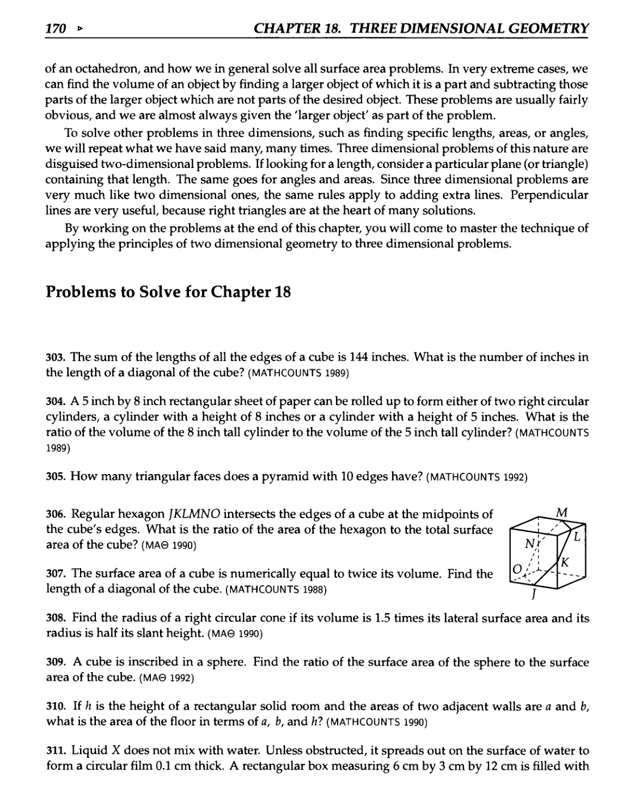

## Printed page 171

<!-- source: volume-1, PDF page 185, printed page 171 -->

liquid X. Its contents are poured onto a large body of water. What will be the radius, in centimeters, of the resulting circular film? (AHSME 1991)

312. The radius of a cylindrical box is 8 inches and the height is 3 inches. Find the number of inches that may be added to either the radius or the height to give the same non-zero increase in volume. (AHSME 1951)

313. A paper cone, when cut along its slant height and opened out forms a semicircle of radius 10. What is the altitude of the original cone? (MAΘ 1987)

314. Four of the eight vertices of a cube are vertices of a regular tetrahedron. Find the ratio of the surface area of the cube to the surface area of the tetrahedron. (AHSME 1980)

315. Consider the unit cube (a cube with unit side length) ABCDEFGH. Let $X$ be the center of the face ABCD. Find FX. (MAΘ 1992)

316. A wooden cube with edge length $n$ units (where $n$ is an integer $> 2$) is painted black all over. By slices parallel to its faces, the cube is cut into $n^3$ smaller cubes each of unit edge length. If the number of smaller cubes with just one face painted black is equal to the number of smaller cubes completely free of paint, what is $n$? (AHSME 1985)

317. In the adjoining figure, a wooden cube has edges of length 3 meters. Square holes of side one meter, centered in each face, are cut through to the opposite face. The edges of the holes are parallel to the edges of the cube. Find the entire surface area, including the inside. (AHSME 1982)

318. A cube of side 3 inches has a cube of side 1 inch cut from each corner. A cube of side 2 inches is then inserted in each corner. What is the number of square inches in the surface area of the resulting solid? (MATHCOUNTS 1991)

319. In the adjoining figure of a rectangular solid, $\angle DHG = 45^\circ$ and $\angle FHB = 60^\circ$. Find the cosine of $\angle BHD$. (AHSME 1982)

320. A truncated octahedron is a geometric solid with 14 faces (6 congruent squares and 8 congruent hexagons). In this particular solid, 2 hexagons and 1 square meet to form each corner. How many corners does the solid have? (MATHCOUNTS 1984)

321. What is the volume of a regular octahedron whose vertices are the centers of the faces of a cube whose edge has length 6? (MATHCOUNTS 1985)

322. A ball of radius $R$ is tangent to the floor and one wall of the room. Find, in terms of $R$, the radius of the largest sphere that can be rolled through the space between the ball, the wall, and the floor. (MAΘ 1992)

Original scan — PDF page 185

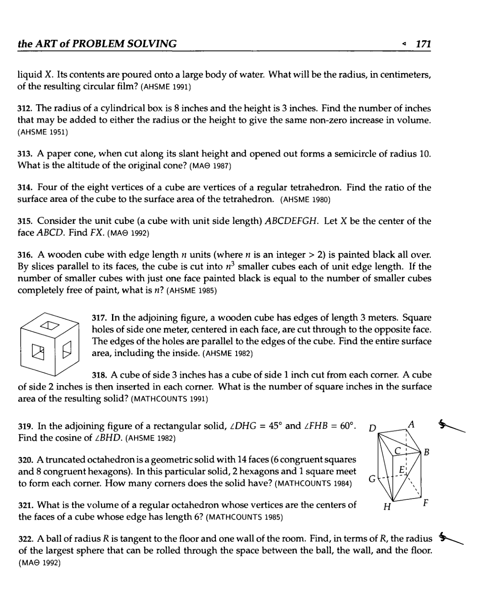

## Printed page 172

<!-- source: volume-1, PDF page 186, printed page 172 -->

323. The water tank in the diagram is in the shape of an inverted right circular cone. The radius of its base is 16 feet, and its height is 96 feet. What is the height, in feet, of the water in the tank if the amount of water is 25% of the tank’s capacity? (MATHCOUNTS 1992)

324. A truncated icosahedron is a polyhedron which has 32 faces, 60 vertices, and 90 edges. Some of the faces are pentagons and the others are hexagons. Exactly two hexagons and a pentagon meet to form each vertex of the polyhedron. How many of the faces of this solid are hexagons? (MATHCOUNTS 1988)

325. Find the distance from vertex $B$ to face $ACD$ if $ABCD$ is a regular tetrahedron with side length 6.

326. Nine congruent spheres are packed inside a unit cube in such a way that one of them has its center at the center of the cube and each of the others is tangent to the center sphere and to three faces of the cube. What is the radius of each sphere? (AHSME 1990)

327. A right circular cone with radius 6 and height 6 is cut by a plane parallel to base and 2 units away from the base. What is the volume of the cone contained between the plane and the base?

328. Three cubes are stacked as shown. If the cubes have edge lengths 1, 2, and 3, what is the length of the portion of segment $AB$ that is contained in the center cube? (MATHCOUNTS 1991)

Original scan — PDF page 186

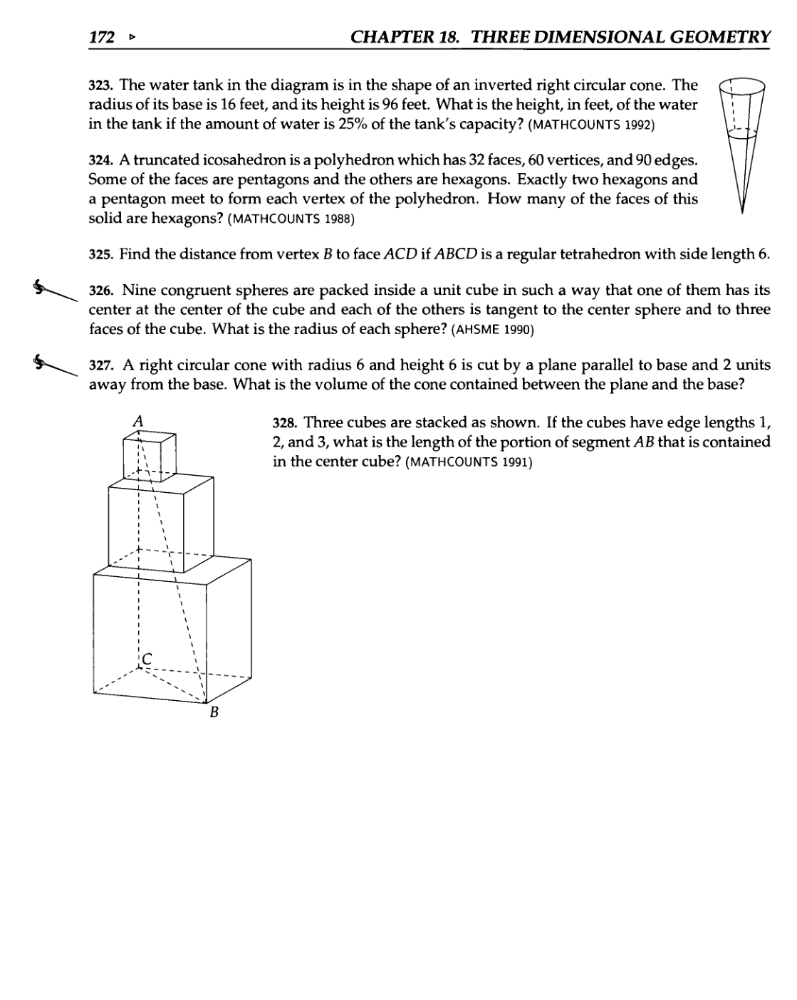

