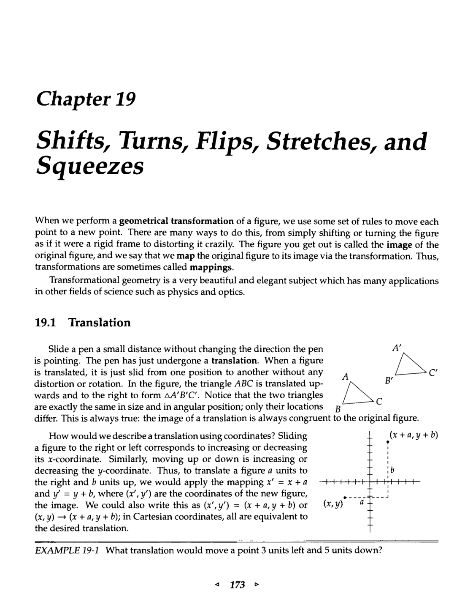
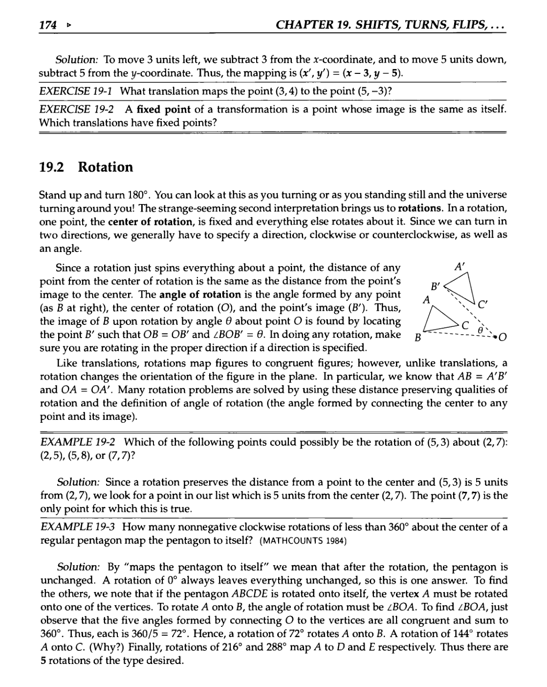
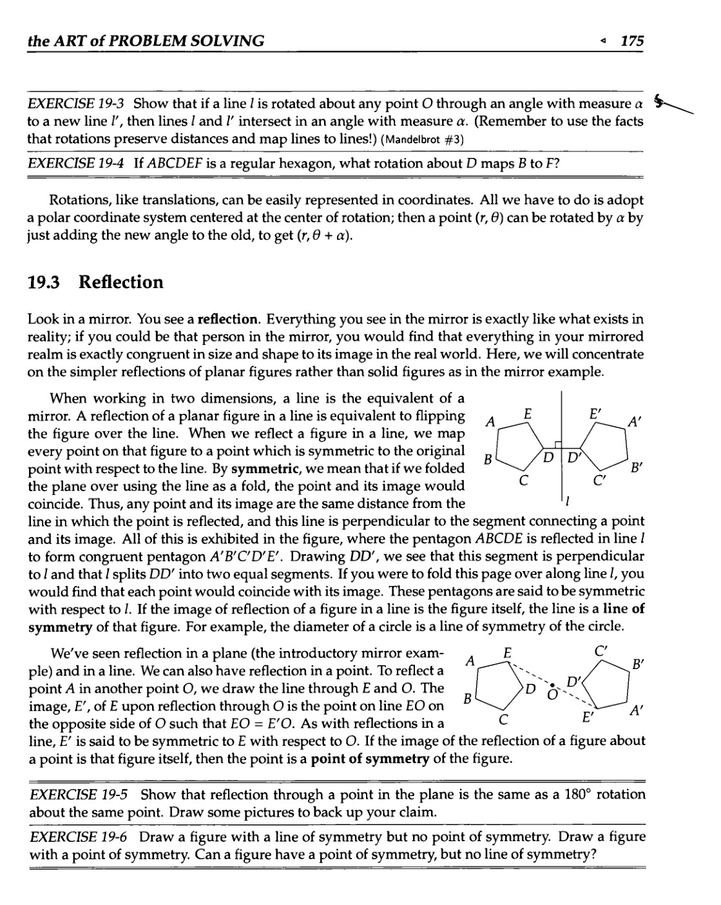
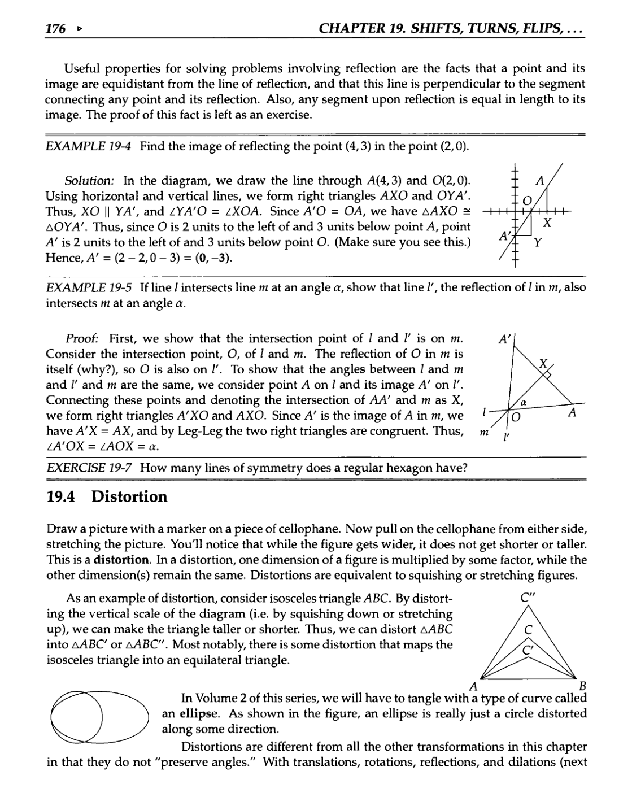
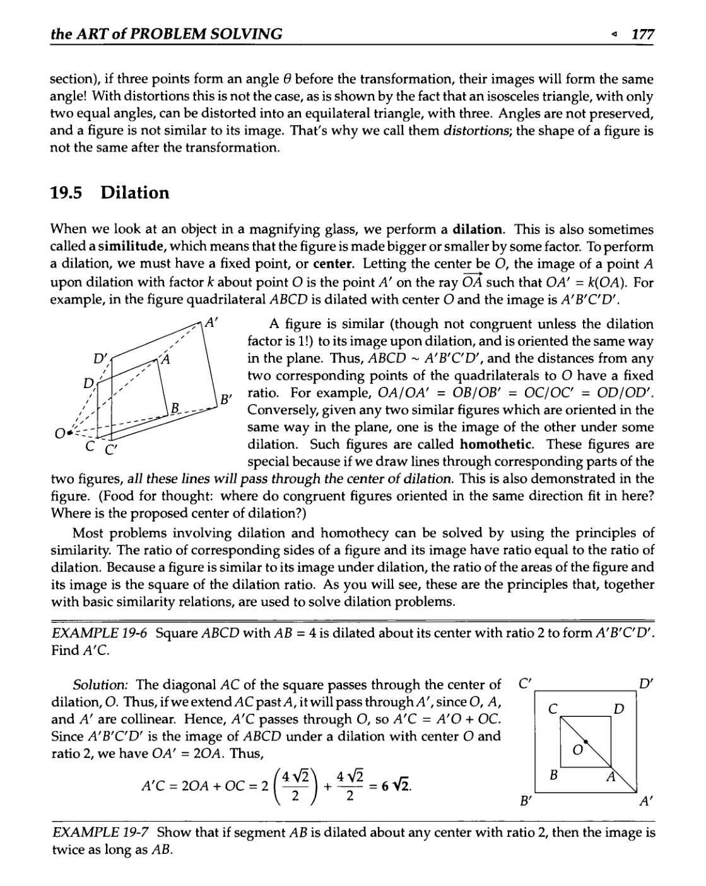
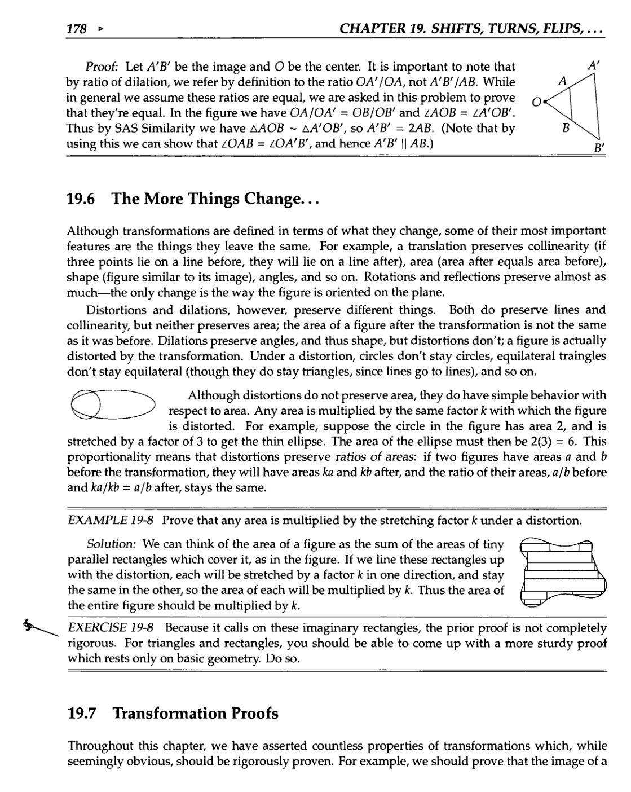
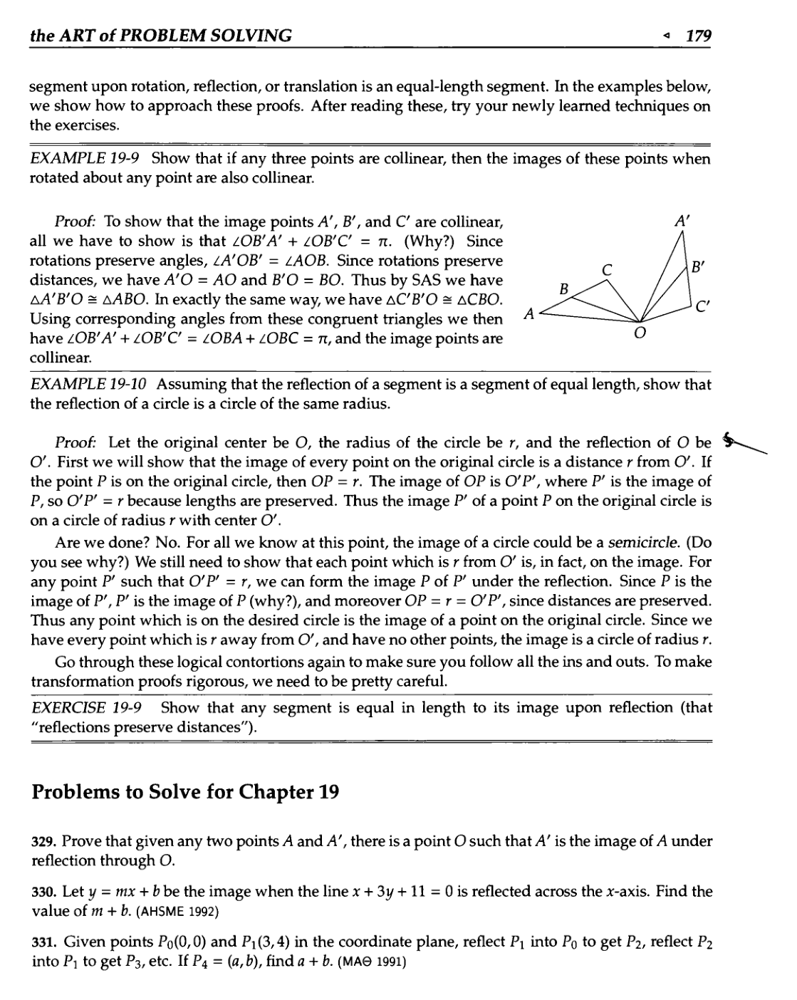
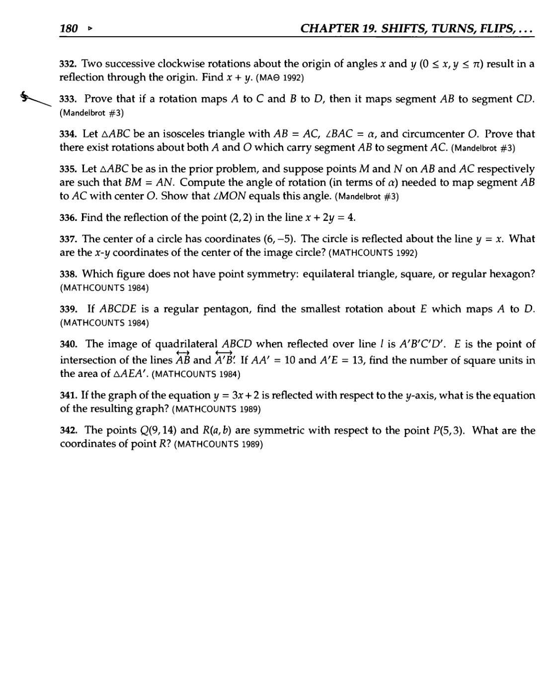

# Chapter 19: Shifts, Turns, Flips, Stretches, and Squeezes

Volume 1 · Printed pages 173–180 · PDF pages 187–194

[Volume contents](../index.md)

## Printed page 173

<!-- source: volume-1, PDF page 187, printed page 173 -->

Shifts, Turns, Flips, Stretches, and Squeezes

When we perform a geometrical transformation of a figure, we use some set of rules to move each point to a new point. There are many ways to do this, from simply shifting or turning the figure as if it were a rigid frame to distorting it crazily. The figure you get out is called the image of the original figure, and we say that we map the original figure to its image via the transformation. Thus, transformations are sometimes called mappings.

Transformational geometry is a very beautiful and elegant subject which has many applications in other fields of science such as physics and optics.

### 19.1 Translation

Slide a pen a small distance without changing the direction the pen is pointing. The pen has just undergone a translation. When a figure is translated, it is just slid from one position to another without any distortion or rotation. In the figure, the triangle ABC is translated upwards and to the right to form $\Delta A'B'C'$. Notice that the two triangles are exactly the same in size and in angular position; only their locations differ. This is always true: the image of a translation is always congruent to the original figure.

How would we describe a translation using coordinates? Sliding a figure to the right or left corresponds to increasing or decreasing its $x$-coordinate. Similarly, moving up or down is increasing or decreasing the $y$-coordinate. Thus, to translate a figure $a$ units to the right and $b$ units up, we would apply the mapping $x' = x + a$ and $y' = y + b$, where $(x', y')$ are the coordinates of the new figure, the image. We could also write this as $(x', y') = (x + a, y + b)$ or $(x, y) \rightarrow (x + a, y + b)$; in Cartesian coordinates, all are equivalent to the desired translation.

**EXAMPLE 19-1 What translation would move a point 3 units left and 5 units down?**

Original scan — PDF page 187

## Printed page 174

<!-- source: volume-1, PDF page 188, printed page 174 -->

Solution: To move 3 units left, we subtract 3 from the $x$-coordinate, and to move 5 units down, subtract 5 from the $y$-coordinate. Thus, the mapping is $(x', y') = (x - 3, y - 5)$.

**EXERCISE 19-1 What translation maps the point $(3, 4)$ to the point $(5, -3)$?**

**EXERCISE 19-2 A fixed point of a transformation is a point whose image is the same as itself. Which translations have fixed points?**

### 19.2 Rotation

Stand up and turn $180^\circ$. You can look at this as you turning or as you standing still and the universe turning around you! The strange-seeming second interpretation brings us to rotations. In a rotation, one point, the center of rotation, is fixed and everything else rotates about it. Since we can turn in two directions, we generally have to specify a direction, clockwise or counterclockwise, as well as an angle.

Since a rotation just spins everything about a point, the distance of any point from the center of rotation is the same as the distance from the point’s image to the center. The angle of rotation is the angle formed by any point (as $B$ at right), the center of rotation $(O)$, and the point’s image $(B')$. Thus, the image of $B$ upon rotation by angle $\theta$ about point $O$ is found by locating the point $B'$ such that $OB = OB'$ and $\angle BOB' = \theta$. In doing any rotation, make sure you are rotating in the proper direction if a direction is specified.

Like translations, rotations map figures to congruent figures; however, unlike translations, a rotation changes the orientation of the figure in the plane. In particular, we know that $AB = A'B'$ and $OA = OA'$. Many rotation problems are solved by using these distance preserving qualities of rotation and the definition of angle of rotation (the angle formed by connecting the center to any point and its image).

**EXAMPLE 19-2 Which of the following points could possibly be the rotation of $(5, 3)$ about $(2, 7)$: $(2, 5), (5, 8),$ or $(7, 7)$?**

Solution: Since a rotation preserves the distance from a point to the center and $(5, 3)$ is 5 units from $(2, 7)$, we look for a point in our list which is 5 units from the center $(2, 7)$. The point $(7, 7)$ is the only point for which this is true.

**EXAMPLE 19-3 How many nonnegative clockwise rotations of less than $360^\circ$ about the center of a regular pentagon map the pentagon to itself? (MATHCOUNTS 1984)**

Solution: By “maps the pentagon to itself” we mean that after the rotation, the pentagon is unchanged. A rotation of $0^\circ$ always leaves everything unchanged, so this is one answer. To find the others, we note that if the pentagon $ABCDE$ is rotated onto itself, the vertex $A$ must be rotated onto one of the vertices. To rotate $A$ onto $B$, the angle of rotation must be $\angle BOA$. To find $\angle BOA$, just observe that the five angles formed by connecting $O$ to the vertices are all congruent and sum to $360^\circ$. Thus, each is $360/5 = 72^\circ$. Hence, a rotation of $72^\circ$ rotates $A$ onto $B$. A rotation of $144^\circ$ rotates $A$ onto $C$. (Why?) Finally, rotations of $216^\circ$ and $288^\circ$ map $A$ to $D$ and $E$ respectively. Thus there are 5 rotations of the type desired.

Original scan — PDF page 188

## Printed page 175

<!-- source: volume-1, PDF page 189, printed page 175 -->

**EXERCISE 19-3 Show that if a line $l$ is rotated about any point $O$ through an angle with measure $\alpha$ to a new line $l'$, then lines $l$ and $l'$ intersect in an angle with measure $\alpha$. (Remember to use the facts that rotations preserve distances and map lines to lines!) (Mandelbrot #3)**

**EXERCISE 19-4 If ABCDEF is a regular hexagon, what rotation about $D$ maps $B$ to $F$?**

Rotations, like translations, can be easily represented in coordinates. All we have to do is adopt a polar coordinate system centered at the center of rotation; then a point $(r, \theta)$ can be rotated by $\alpha$ by just adding the new angle to the old, to get $(r, \theta + \alpha)$.

### 19.3 Reflection

Look in a mirror. You see a reflection. Everything you see in the mirror is exactly like what exists in reality; if you could be that person in the mirror, you would find that everything in your mirrored realm is exactly congruent in size and shape to its image in the real world. Here, we will concentrate on the simpler reflections of planar figures rather than solid figures as in the mirror example.

When working in two dimensions, a line is the equivalent of a mirror. A reflection of a planar figure in a line is equivalent to flipping the figure over the line. When we reflect a figure in a line, we map every point on that figure to a point which is symmetric to the original point with respect to the line. By symmetric, we mean that if we folded the plane over using the line as a fold, the point and its image would coincide. Thus, any point and its image are the same distance from the line in which the point is reflected, and this line is perpendicular to the segment connecting a point and its image. All of this is exhibited in the figure, where the pentagon ABCDE is reflected in line $l$ to form congruent pentagon $A'B'C'D'E'$. Drawing $DD'$, we see that this segment is perpendicular to $l$ and that $l$ splits $DD'$ into two equal segments. If you were to fold this page over along line $l$, you would find that each point would coincide with its image. These pentagons are said to be symmetric with respect to $l$. If the image of reflection of a figure in a line is the figure itself, the line is a line of symmetry of that figure. For example, the diameter of a circle is a line of symmetry of the circle.

We've seen reflection in a plane (the introductory mirror example) and in a line. We can also have reflection in a point. To reflect a point $A$ in another point $O$, we draw the line through $E$ and $O$. The image, $E'$, of $E$ upon reflection through $O$ is the point on line $EO$ on the opposite side of $O$ such that $EO = E'O$. As with reflections in a line, $E'$ is said to be symmetric to $E$ with respect to $O$. If the image of the reflection of a figure about a point is that figure itself, then the point is a point of symmetry of the figure.

**EXERCISE 19-5 Show that reflection through a point in the plane is the same as a $180^\circ$ rotation about the same point. Draw some pictures to back up your claim.**

**EXERCISE 19-6 Draw a figure with a line of symmetry but no point of symmetry. Draw a figure with a point of symmetry. Can a figure have a point of symmetry, but no line of symmetry?**

Original scan — PDF page 189

## Printed page 176

<!-- source: volume-1, PDF page 190, printed page 176 -->

Useful properties for solving problems involving reflection are the facts that a point and its image are equidistant from the line of reflection, and that this line is perpendicular to the segment connecting any point and its reflection. Also, any segment upon reflection is equal in length to its image. The proof of this fact is left as an exercise.

**EXAMPLE 19-4 Find the image of reflecting the point $(4, 3)$ in the point $(2, 0)$.**

Solution: In the diagram, we draw the line through $A(4, 3)$ and $O(2, 0)$. Using horizontal and vertical lines, we form right triangles $AXO$ and $OYA'$. Thus, $XO \parallel YA'$, and $\angle YA'O = \angle XOA$. Since $A'O = OA$, we have $\triangle AXO \cong \triangle OYA'$. Thus, since $O$ is 2 units to the left of and 3 units below point $A$, point $A'$ is 2 units to the left of and 3 units below point $O$. (Make sure you see this.) Hence, $A' = (2 - 2, 0 - 3) = (0, -3)$.

**EXAMPLE 19-5 If line $l$ intersects line $m$ at an angle $\alpha$, show that line $l'$, the reflection of $l$ in $m$, also intersects $m$ at an angle $\alpha$.**

Proof: First, we show that the intersection point of $l$ and $l'$ is on $m$. Consider the intersection point, $O$, of $l$ and $m$. The reflection of $O$ in $m$ is itself (why?), so $O$ is also on $l'$. To show that the angles between $l$ and $m$ and $l'$ and $m$ are the same, we consider point $A$ on $l$ and its image $A'$ on $l'$. Connecting these points and denoting the intersection of $AA'$ and $m$ as $X$, we form right triangles $A'XO$ and $AXO$. Since $A'$ is the image of $A$ in $m$, we have $A'X = AX$, and by Leg-Leg the two right triangles are congruent. Thus, $\angle A'OX = \angle AOX = \alpha$.

**EXERCISE 19-7 How many lines of symmetry does a regular hexagon have?**

### 19.4 Distortion

Draw a picture with a marker on a piece of cellophane. Now pull on the cellophane from either side, stretching the picture. You’ll notice that while the figure gets wider, it does not get shorter or taller. This is a distortion. In a distortion, one dimension of a figure is multiplied by some factor, while the other dimension(s) remain the same. Distortions are equivalent to squishing or stretching figures.

As an example of distortion, consider isosceles triangle $ABC$. By distorting the vertical scale of the diagram (i.e. by squishing down or stretching up), we can make the triangle taller or shorter. Thus, we can distort $\triangle ABC$ into $\triangle ABC'$ or $\triangle ABC''$. Most notably, there is some distortion that maps the isosceles triangle into an equilateral triangle.

In Volume 2 of this series, we will have to tangle with a type of curve called an ellipse. As shown in the figure, an ellipse is really just a circle distorted along some direction.

Distortions are different from all the other transformations in this chapter in that they do not “preserve angles.” With translations, rotations, reflections, and dilations (next

Original scan — PDF page 190

## Printed page 177

<!-- source: volume-1, PDF page 191, printed page 177 -->

section), if three points form an angle $\theta$ before the transformation, their images will form the same angle! With distortions this is not the case, as is shown by the fact that an isosceles triangle, with only two equal angles, can be distorted into an equilateral triangle, with three. Angles are not preserved, and a figure is not similar to its image. That's why we call them distortions; the shape of a figure is not the same after the transformation.

### 19.5 Dilation

When we look at an object in a magnifying glass, we perform a dilation. This is also sometimes called a similitude, which means that the figure is made bigger or smaller by some factor. To perform a dilation, we must have a fixed point, or center. Letting the center be $O$, the image of a point $A$ upon dilation with factor $k$ about point $O$ is the point $A'$ on the ray $\overrightarrow{OA}$ such that $OA' = k(OA)$. For example, in the figure quadrilateral $ABCD$ is dilated with center $O$ and the image is $A'B'C'D'$.

A figure is similar (though not congruent unless the dilation factor is 1!) to its image upon dilation, and is oriented the same way in the plane. Thus, $ABCD \sim A'B'C'D'$, and the distances from any two corresponding points of the quadrilaterals to $O$ have a fixed ratio. For example, $OA/OA' = OB/OB' = OC/OC' = OD/OD'$. Conversely, given any two similar figures which are oriented in the same way in the plane, one is the image of the other under some dilation. Such figures are called homothetic. These figures are special because if we draw lines through corresponding parts of the two figures, all these lines will pass through the center of dilation. This is also demonstrated in the figure. (Food for thought: where do congruent figures oriented in the same direction fit in here? Where is the proposed center of dilation?)

Most problems involving dilation and homothecy can be solved by using the principles of similarity. The ratio of corresponding sides of a figure and its image have ratio equal to the ratio of dilation. Because a figure is similar to its image under dilation, the ratio of the areas of the figure and its image is the square of the dilation ratio. As you will see, these are the principles that, together with basic similarity relations, are used to solve dilation problems.

**EXAMPLE 19-6 Square $ABCD$ with $AB = 4$ is dilated about its center with ratio 2 to form $A'B'C'D'$. Find $A'C$.**

Solution: The diagonal $AC$ of the square passes through the center of dilation, $O$. Thus, if we extend $AC$ past $A$, it will pass through $A'$, since $O, A$, and $A'$ are collinear. Hence, $A'C$ passes through $O$, so $A'C = A'O + OC$. Since $A'B'C'D'$ is the image of $ABCD$ under a dilation with center $O$ and ratio 2, we have $OA' = 2OA$. Thus,

$$A'C = 2OA + OC = 2\left(\frac{4\sqrt{2}}{2}\right) + \frac{4\sqrt{2}}{2} = 6\sqrt{2}.$$

**EXAMPLE 19-7 Show that if segment $AB$ is dilated about any center with ratio 2, then the image is twice as long as $AB$.**

Original scan — PDF page 191

## Printed page 178

<!-- source: volume-1, PDF page 192, printed page 178 -->

Proof: Let $A'B'$ be the image and $O$ be the center. It is important to note that by ratio of dilation, we refer by definition to the ratio $OA'/OA$, not $A'B'/AB$. While in general we assume these ratios are equal, we are asked in this problem to prove that they’re equal. In the figure we have $OA/OA' = OB/OB'$ and $\angle AOB = \angle A'OB'$. Thus by SAS Similarity we have $\triangle AOB \sim \triangle A'OB'$, so $A'B' = 2AB$. (Note that by using this we can show that $\angle OAB = \angle OA'B'$, and hence $A'B' \parallel AB$.

### 19.6 The More Things Change...

Although transformations are defined in terms of what they change, some of their most important features are the things they leave the same. For example, a translation preserves collinearity (if three points lie on a line before, they will lie on a line after), area (area after equals area before), shape (figure similar to its image), angles, and so on. Rotations and reflections preserve almost as much—the only change is the way the figure is oriented on the plane.

Distortions and dilations, however, preserve different things. Both do preserve lines and collinearity, but neither preserves area; the area of a figure after the transformation is not the same as it was before. Dilations preserve angles, and thus shape, but distortions don’t; a figure is actually distorted by the transformation. Under a distortion, circles don’t stay circles, equilateral traingles don’t stay equilateral (though they do stay triangles, since lines go to lines), and so on.

Although distortions do not preserve area, they do have simple behavior with respect to area. Any area is multiplied by the same factor $k$ with which the figure is distorted. For example, suppose the circle in the figure has area 2, and is stretched by a factor of 3 to get the thin ellipse. The area of the ellipse must then be $2(3) = 6$. This proportionality means that distortions preserve ratios of areas: if two figures have areas $a$ and $b$ before the transformation, they will have areas $ka$ and $kb$ after, and the ratio of their areas, $a/b$ before and $ka/kb = a/b$ after, stays the same.

**EXAMPLE 19-8 Prove that any area is multiplied by the stretching factor $k$ under a distortion.**

Solution: We can think of the area of a figure as the sum of the areas of tiny parallel rectangles which cover it, as in the figure. If we line these rectangles up with the distortion, each will be stretched by a factor $k$ in one direction, and stay the same in the other, so the area of each will be multiplied by $k$. Thus the area of the entire figure should be multiplied by $k$.

**EXERCISE 19-8 Because it calls on these imaginary rectangles, the prior proof is not completely rigorous. For triangles and rectangles, you should be able to come up with a more sturdy proof which rests only on basic geometry. Do so.**

### 19.7 Transformation Proofs

Throughout this chapter, we have asserted countless properties of transformations which, while seemingly obvious, should be rigorously proven. For example, we should prove that the image of a

Original scan — PDF page 192

## Printed page 179

<!-- source: volume-1, PDF page 193, printed page 179 -->

segment upon rotation, reflection, or translation is an equal-length segment. In the examples below, we show how to approach these proofs. After reading these, try your newly learned techniques on the exercises.

**EXAMPLE 19-9 Show that if any three points are collinear, then the images of these points when rotated about any point are also collinear.**

Proof: To show that the image points $A', B'$, and $C'$ are collinear, all we have to show is that $\angle OB' A' + \angle OB' C' = \pi$. (Why?) Since rotations preserve angles, $\angle A' OB' = \angle AOB$. Since rotations preserve distances, we have $A' O = AO$ and $B' O = BO$. Thus by SAS we have $\Delta A' B' O \cong \Delta ABO$. In exactly the same way, we have $\Delta C' B' O \cong \Delta CBO$. Using corresponding angles from these congruent triangles we then have $\angle OB' A' + \angle OB' C' = \angle OBA + \angle OBC = \pi$, and the image points are collinear.

**EXAMPLE 19-10 Assuming that the reflection of a segment is a segment of equal length, show that the reflection of a circle is a circle of the same radius.**

Proof: Let the original center be $O$, the radius of the circle be $r$, and the reflection of $O$ be $O'$. First we will show that the image of every point on the original circle is a distance $r$ from $O'$. If the point $P$ is on the original circle, then $OP = r$. The image of $OP$ is $O' P'$, where $P'$ is the image of $P$, so $O' P' = r$ because lengths are preserved. Thus the image $P'$ of a point $P$ on the original circle is on a circle of radius $r$ with center $O'$.

Are we done? No. For all we know at this point, the image of a circle could be a semicircle. (Do you see why?) We still need to show that each point which is $r$ from $O'$ is, in fact, on the image. For any point $P'$ such that $O' P' = r$, we can form the image $P$ of $P'$ under the reflection. Since $P$ is the image of $P'$, $P'$ is the image of $P$ (why?), and moreover $OP = r = O' P'$, since distances are preserved. Thus any point which is on the desired circle is the image of a point on the original circle. Since we have every point which is $r$ away from $O'$, and have no other points, the image is a circle of radius $r$.

Go through these logical contortions again to make sure you follow all the ins and outs. To make transformation proofs rigorous, we need to be pretty careful.

**EXERCISE 19-9 Show that any segment is equal in length to its image upon reflection (that "reflections preserve distances").**

Problems to Solve for Chapter 19

329. Prove that given any two points $A$ and $A'$, there is a point $O$ such that $A'$ is the image of $A$ under reflection through $O$.

330. Let $y = mx + b$ be the image when the line $x + 3y + 11 = 0$ is reflected across the $x$-axis. Find the value of $m + b$. (AHSME 1992)

331. Given points $P_0(0, 0)$ and $P_1(3, 4)$ in the coordinate plane, reflect $P_1$ into $P_0$ to get $P_2$, reflect $P_2$ into $P_1$ to get $P_3$, etc. If $P_4 = (a, b)$, find $a + b$. (MAΘ 1991)

Original scan — PDF page 193

## Printed page 180

<!-- source: volume-1, PDF page 194, printed page 180 -->

332. Two successive clockwise rotations about the origin of angles $x$ and $y$ ($0 \leq x, y \leq \pi$) result in a reflection through the origin. Find $x + y$. (MAΘ 1992)

333. Prove that if a rotation maps $A$ to $C$ and $B$ to $D$, then it maps segment $AB$ to segment $CD$. (Mandelbrot #3)

334. Let $\Delta ABC$ be an isosceles triangle with $AB = AC$, $\angle BAC = \alpha$, and circumcenter $O$. Prove that there exist rotations about both $A$ and $O$ which carry segment $AB$ to segment $AC$. (Mandelbrot #3)

335. Let $\Delta ABC$ be as in the prior problem, and suppose points $M$ and $N$ on $AB$ and $AC$ respectively are such that $BM = AN$. Compute the angle of rotation (in terms of $\alpha$) needed to map segment $AB$ to $AC$ with center $O$. Show that $\angle MON$ equals this angle. (Mandelbrot #3)

336. Find the reflection of the point $(2, 2)$ in the line $x + 2y = 4$.

337. The center of a circle has coordinates $(6, -5)$. The circle is reflected about the line $y = x$. What are the $x-y$ coordinates of the center of the image circle? (MATHCOUNTS 1992)

338. Which figure does not have point symmetry: equilateral triangle, square, or regular hexagon? (MATHCOUNTS 1984)

339. If $ABCDE$ is a regular pentagon, find the smallest rotation about $E$ which maps $A$ to $D$. (MATHCOUNTS 1984)

340. The image of quadrilateral $ABCD$ when reflected over line $l$ is $A'B'C'D'$. $E$ is the point of intersection of the lines $\overleftrightarrow{AB}$ and $\overleftrightarrow{A'B'}$. If $AA' = 10$ and $A'E = 13$, find the number of square units in the area of $\Delta AEA'$. (MATHCOUNTS 1984)

341. If the graph of the equation $y = 3x + 2$ is reflected with respect to the $y$-axis, what is the equation of the resulting graph? (MATHCOUNTS 1989)

342. The points $Q(9, 14)$ and $R(a, b)$ are symmetric with respect to the point $P(5, 3)$. What are the coordinates of point $R$? (MATHCOUNTS 1989)

Original scan — PDF page 194

