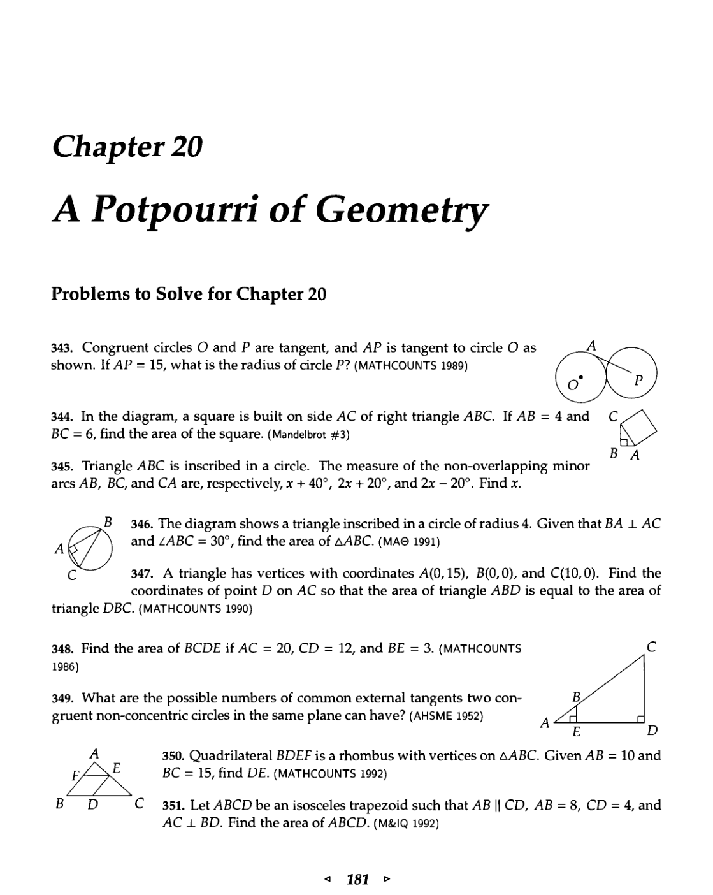
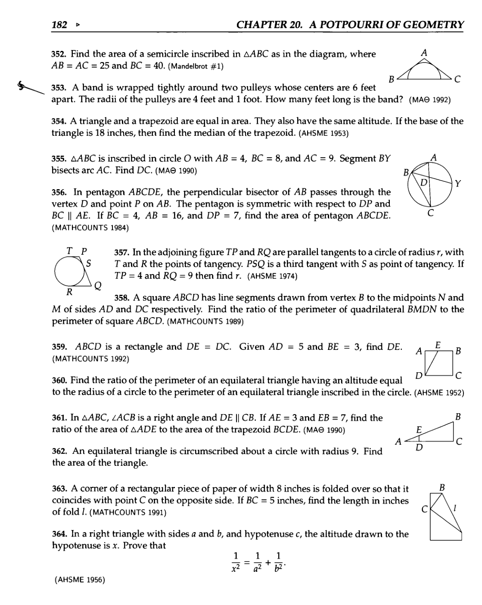
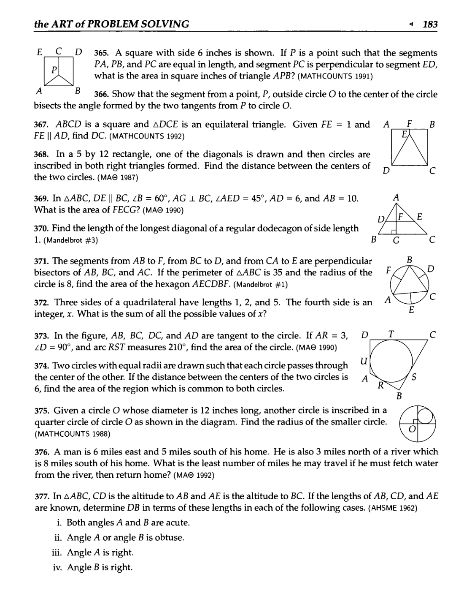
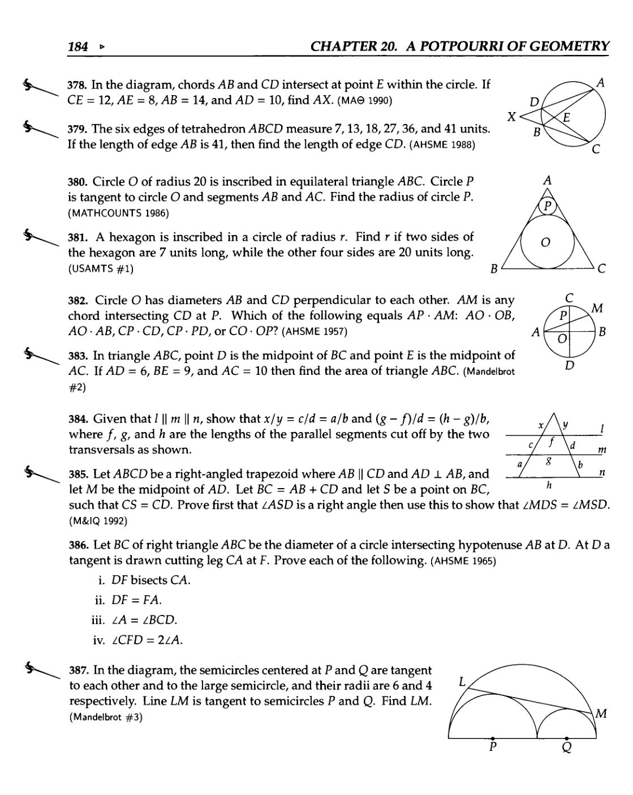
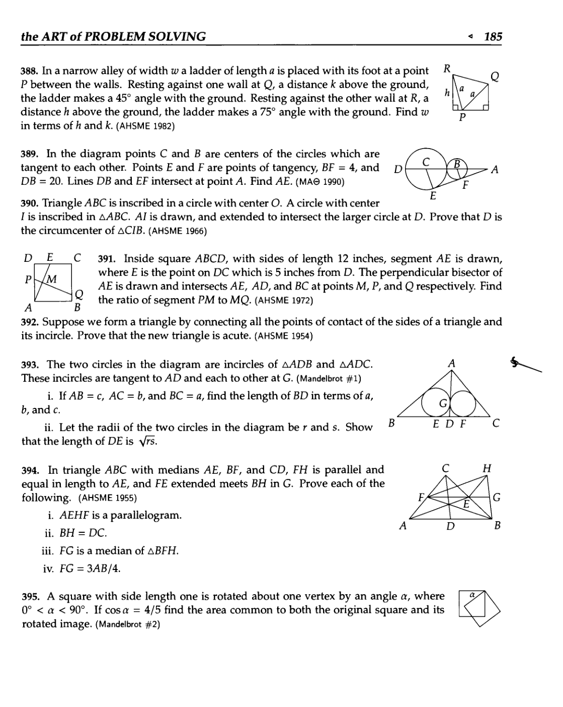
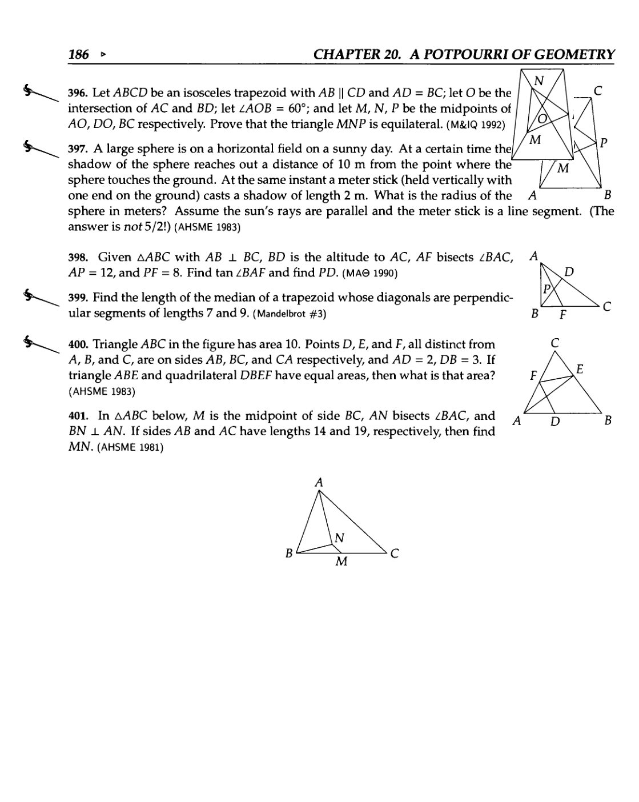

# Chapter 20: A Potpourri of Geometry

Volume 1 · Printed pages 181–186 · PDF pages 195–200

[Volume contents](../index.md)

## Printed page 181

<!-- source: volume-1, PDF page 195, printed page 181 -->

A Potpourri of Geometry

Problems to Solve for Chapter 20

343. Congruent circles $O$ and $P$ are tangent, and $AP$ is tangent to circle $O$ as shown. If $AP = 15$, what is the radius of circle $P$? (MATHCOUNTS 1989)

344. In the diagram, a square is built on side $AC$ of right triangle $ABC$. If $AB = 4$ and $BC = 6$, find the area of the square. (Mandelbrot #3)

345. Triangle $ABC$ is inscribed in a circle. The measure of the non-overlapping minor arcs $AB, BC,$ and $CA$ are, respectively, $x + 40^\circ$, $2x + 20^\circ,$ and $2x - 20^\circ$. Find $x$.

346. The diagram shows a triangle inscribed in a circle of radius 4. Given that $BA \perp AC$ and $\angle ABC = 30^\circ$, find the area of $\triangle ABC$. (MAΘ 1991)

347. A triangle has vertices with coordinates $A(0, 15), B(0, 0),$ and $C(10, 0)$. Find the coordinates of point $D$ on $AC$ so that the area of triangle $ABD$ is equal to the area of triangle $DBC$. (MATHCOUNTS 1990)

348. Find the area of $BCDE$ if $AC = 20, CD = 12,$ and $BE = 3$. (MATHCOUNTS 1986)

349. What are the possible numbers of common external tangents two congruent non-concentric circles in the same plane can have? (AHSME 1952)

350. Quadrilateral $BDEF$ is a rhombus with vertices on $\triangle ABC$. Given $AB = 10$ and $BC = 15$, find $DE$. (MATHCOUNTS 1992)

351. Let $ABCD$ be an isosceles trapezoid such that $AB \parallel CD, AB = 8, CD = 4,$ and $AC \perp BD$. Find the area of $ABCD$. (M&IQ 1992)

Original scan — PDF page 195

## Printed page 182

<!-- source: volume-1, PDF page 196, printed page 182 -->

352. Find the area of a semicircle inscribed in $\triangle ABC$ as in the diagram, where $AB = AC = 25$ and $BC = 40$. (Mandelbrot #1)

353. A band is wrapped tightly around two pulleys whose centers are 6 feet apart. The radii of the pulleys are 4 feet and 1 foot. How many feet long is the band? (MAΘ 1992)

354. A triangle and a trapezoid are equal in area. They also have the same altitude. If the base of the triangle is 18 inches, then find the median of the trapezoid. (AHSME 1953)

355. $\triangle ABC$ is inscribed in circle $O$ with $AB = 4, BC = 8,$ and $AC = 9$. Segment $BY$ bisects arc $AC$. Find $DC$. (MAΘ 1990)

356. In pentagon $ABCDE$, the perpendicular bisector of $AB$ passes through the vertex $D$ and point $P$ on $AB$. The pentagon is symmetric with respect to $DP$ and $BC \parallel AE$. If $BC = 4, AB = 16,$ and $DP = 7,$ find the area of pentagon $ABCDE$. (MATHCOUNTS 1984)

357. In the adjoining figure $TP$ and $RQ$ are parallel tangents to a circle of radius $r,$ with $T$ and $R$ the points of tangency. $PSQ$ is a third tangent with $S$ as point of tangency. If $TP = 4$ and $RQ = 9$ then find $r$. (AHSME 1974)

358. A square $ABCD$ has line segments drawn from vertex $B$ to the midpoints $N$ and $M$ of sides $AD$ and $DC$ respectively. Find the ratio of the perimeter of quadrilateral $BMDN$ to the perimeter of square $ABCD$. (MATHCOUNTS 1989)

359. $ABCD$ is a rectangle and $DE = DC$. Given $AD = 5$ and $BE = 3,$ find $DE$. (MATHCOUNTS 1992)

360. Find the ratio of the perimeter of an equilateral triangle having an altitude equal to the radius of a circle to the perimeter of an equilateral triangle inscribed in the circle. (AHSME 1952)

361. In $\triangle ABC, \angle ACB$ is a right angle and $DE \parallel CB.$ If $AE = 3$ and $EB = 7,$ find the ratio of the area of $\triangle ADE$ to the area of the trapezoid $BCDE$. (MAΘ 1990)

362. An equilateral triangle is circumscribed about a circle with radius 9. Find the area of the triangle.

363. A corner of a rectangular piece of paper of width 8 inches is folded over so that it coincides with point $C$ on the opposite side. If $BC = 5$ inches, find the length in inches of fold $l.$ (MATHCOUNTS 1991)

364. In a right triangle with sides $a$ and $b,$ and hypotenuse $c,$ the altitude drawn to the hypotenuse is $x.$ Prove that

$$\frac{1}{x^2} = \frac{1}{a^2} + \frac{1}{b^2}.$$

Original scan — PDF page 196

## Printed page 183

<!-- source: volume-1, PDF page 197, printed page 183 -->

365. A square with side 6 inches is shown. If $P$ is a point such that the segments $PA, PB,$ and $PC$ are equal in length, and segment $PC$ is perpendicular to segment $ED$, what is the area in square inches of triangle $APB$? (MATHCOUNTS 1991)

366. Show that the segment from a point, $P$, outside circle $O$ to the center of the circle bisects the angle formed by the two tangents from $P$ to circle $O$.

367. $ABCD$ is a square and $\Delta DCE$ is an equilateral triangle. Given $FE = 1$ and $FE \parallel AD,$ find $DC$. (MATHCOUNTS 1992)

368. In a 5 by 12 rectangle, one of the diagonals is drawn and then circles are inscribed in both right triangles formed. Find the distance between the centers of the two circles. (MAΘ 1987)

369. In $\Delta ABC,$ $DE \parallel BC,$ $\angle B = 60^\circ,$ $AG \perp BC,$ $\angle AED = 45^\circ,$ $AD = 6,$ and $AB = 10.$ What is the area of $FECG$? (MAΘ 1990)

370. Find the length of the longest diagonal of a regular dodecagon of side length 1. (Mandelbrot #3)

371. The segments from $AB$ to $F,$ from $BC$ to $D,$ and from $CA$ to $E$ are perpendicular bisectors of $AB,$ $BC,$ and $AC.$ If the perimeter of $\Delta ABC$ is 35 and the radius of the circle is 8, find the area of the hexagon $AECDBF.$ (Mandelbrot #1)

372. Three sides of a quadrilateral have lengths 1, 2, and 5. The fourth side is an integer, $x.$ What is the sum of all the possible values of $x$?

373. In the figure, $AB,$ $BC,$ $DC,$ and $AD$ are tangent to the circle. If $AR = 3,$ $\angle D = 90^\circ,$ and arc $RST$ measures 210°, find the area of the circle. (MAΘ 1990)

374. Two circles with equal radii are drawn such that each circle passes through the center of the other. If the distance between the centers of the two circles is 6, find the area of the region which is common to both circles.

375. Given a circle $O$ whose diameter is 12 inches long, another circle is inscribed in a quarter circle of circle $O$ as shown in the diagram. Find the radius of the smaller circle. (MATHCOUNTS 1988)

376. A man is 6 miles east and 5 miles south of his home. He is also 3 miles north of a river which is 8 miles south of his home. What is the least number of miles he may travel if he must fetch water from the river, then return home? (MAΘ 1992)

377. In $\Delta ABC,$ $CD$ is the altitude to $AB$ and $AE$ is the altitude to $BC.$ If the lengths of $AB,$ $CD,$ and $AE$ are known, determine $DB$ in terms of these lengths in each of the following cases. (AHSME 1962)

i. Both angles $A$ and $B$ are acute.

ii. Angle $A$ or angle $B$ is obtuse.

iii. Angle $A$ is right.

iv. Angle $B$ is right.

Original scan — PDF page 197

## Printed page 184

<!-- source: volume-1, PDF page 198, printed page 184 -->

378. In the diagram, chords $AB$ and $CD$ intersect at point $E$ within the circle. If $CE = 12$, $AE = 8$, $AB = 14$, and $AD = 10$, find $AX$. (MAΘ 1990)

379. The six edges of tetrahedron $ABCD$ measure 7, 13, 18, 27, 36, and 41 units. If the length of edge $AB$ is 41, then find the length of edge $CD$. (AHSME 1988)

380. Circle $O$ of radius 20 is inscribed in equilateral triangle $ABC$. Circle $P$ is tangent to circle $O$ and segments $AB$ and $AC$. Find the radius of circle $P$. (MATHCOUNTS 1986)

381. A hexagon is inscribed in a circle of radius $r$. Find $r$ if two sides of the hexagon are 7 units long, while the other four sides are 20 units long. (USAMTS #1)

382. Circle $O$ has diameters $AB$ and $CD$ perpendicular to each other. $AM$ is any chord intersecting $CD$ at $P$. Which of the following equals $AP \cdot AM$: $AO \cdot OB$, $AO \cdot AB$, $CP \cdot CD$, $CP \cdot PD$, or $CO \cdot OP$? (AHSME 1957)

383. In triangle $ABC$, point $D$ is the midpoint of $BC$ and point $E$ is the midpoint of $AC$. If $AD = 6$, $BE = 9$, and $AC = 10$ then find the area of triangle $ABC$. (Mandelbrot #2)

384. Given that $l \parallel m \parallel n$, show that $x/y = c/d = a/b$ and $(g - f)/d = (h - g)/b$, where $f, g,$ and $h$ are the lengths of the parallel segments cut off by the two transversals as shown.

385. Let $ABCD$ be a right-angled trapezoid where $AB \parallel CD$ and $AD \perp AB$, and let $M$ be the midpoint of $AD$. Let $BC = AB + CD$ and let $S$ be a point on $BC$, such that $CS = CD$. Prove first that $\angle ASD$ is a right angle then use this to show that $\angle MDS = \angle MSD$. (M&IQ 1992)

386. Let $BC$ of right triangle $ABC$ be the diameter of a circle intersecting hypotenuse $AB$ at $D$. At $D$ a tangent is drawn cutting leg $CA$ at $F$. Prove each of the following.

i. $DF$ bisects $CA$.

ii. $DF = FA$.

iii. $\angle A = \angle BCD$.

iv. $\angle CFD = 2\angle A$.

387. In the diagram, the semicircles centered at $P$ and $Q$ are tangent to each other and to the large semicircle, and their radii are 6 and 4 respectively. Line $LM$ is tangent to semicircles $P$ and $Q$. Find $LM$. (Mandelbrot #3)

Original scan — PDF page 198

## Printed page 185

<!-- source: volume-1, PDF page 199, printed page 185 -->

388. In a narrow alley of width $w$ a ladder of length $a$ is placed with its foot at a point $P$ between the walls. Resting against one wall at $Q$, a distance $k$ above the ground, the ladder makes a $45^\circ$ angle with the ground. Resting against the other wall at $R$, a distance $h$ above the ground, the ladder makes a $75^\circ$ angle with the ground. Find $w$ in terms of $h$ and $k$. (AHSME 1982)

389. In the diagram points $C$ and $B$ are centers of the circles which are tangent to each other. Points $E$ and $F$ are points of tangency, $BF = 4$, and $DB = 20$. Lines $DB$ and $EF$ intersect at point $A$. Find $AE$. (MAΘ 1990)

390. Triangle $ABC$ is inscribed in a circle with center $O$. A circle with center $I$ is inscribed in $\triangle ABC$. $AI$ is drawn, and extended to intersect the larger circle at $D$. Prove that $D$ is the circumcenter of $\triangle CIB$. (AHSME 1966)

391. Inside square $ABCD$, with sides of length 12 inches, segment $AE$ is drawn, where $E$ is the point on $DC$ which is 5 inches from $D$. The perpendicular bisector of $AE$ is drawn and intersects $AE$, $AD$, and $BC$ at points $M, P$, and $Q$ respectively. Find the ratio of segment $PM$ to $MQ$. (AHSME 1972)

392. Suppose we form a triangle by connecting all the points of contact of the sides of a triangle and its incircle. Prove that the new triangle is acute. (AHSME 1954)

393. The two circles in the diagram are incircles of $\triangle ADB$ and $\triangle ADC$. These incircles are tangent to $AD$ and each to other at $G$. (Mandelbrot #1)

i. If $AB = c$, $AC = b$, and $BC = a$, find the length of $BD$ in terms of $a$, $b$, and $c$.

ii. Let the radii of the two circles in the diagram be $r$ and $s$. Show that the length of $DE$ is $\sqrt{rs}$.

394. In triangle $ABC$ with medians $AE, BF,$ and $CD, FH$ is parallel and equal in length to $AE,$ and $FE$ extended meets $BH$ in $G$. Prove each of the following. (AHSME 1955)

i. $AEHF$ is a parallelogram.

ii. $BH = DC$.

iii. $FG$ is a median of $\triangle BFH$.

iv. $FG = 3AB/4$.

395. A square with side length one is rotated about one vertex by an angle $\alpha$, where $0^\circ < \alpha < 90^\circ$. If $\cos \alpha = 4/5$ find the area common to both the original square and its rotated image. (Mandelbrot #2)

Original scan — PDF page 199

## Printed page 186

<!-- source: volume-1, PDF page 200, printed page 186 -->

396. Let $ABCD$ be an isosceles trapezoid with $AB \parallel CD$ and $AD = BC$; let $O$ be the intersection of $AC$ and $BD$; let $\angle AOB = 60^\circ$; and let $M, N, P$ be the midpoints of $AO, DO, BC$ respectively. Prove that the triangle $MNP$ is equilateral. (M&IQ 1992)

397. A large sphere is on a horizontal field on a sunny day. At a certain time the shadow of the sphere reaches out a distance of 10 m from the point where the sphere touches the ground. At the same instant a meter stick (held vertically with one end on the ground) casts a shadow of length 2 m. What is the radius of the sphere in meters? Assume the sun’s rays are parallel and the meter stick is a line segment. (The answer is not 5/2!) (AHSME 1983)

398. Given $\triangle ABC$ with $AB \perp BC, BD$ is the altitude to $AC, AF$ bisects $\angle BAC, AP = 12$, and $PF = 8$. Find tan $\angle BAF$ and find $PD$. (MAΘ 1990)

399. Find the length of the median of a trapezoid whose diagonals are perpendicular segments of lengths 7 and 9. (Mandelbrot #3)

400. Triangle $ABC$ in the figure has area 10. Points $D, E,$ and $F,$ all distinct from $A, B,$ and $C,$ are on sides $AB, BC,$ and $CA$ respectively, and $AD = 2, DB = 3$. If triangle $ABE$ and quadrilateral $DBEF$ have equal areas, then what is that area? (AHSME 1983)

401. In $\triangle ABC$ below, $M$ is the midpoint of side $BC, AN$ bisects $\angle BAC,$ and $BN \perp AN$. If sides $AB$ and $AC$ have lengths 14 and 19, respectively, then find $MN$. (AHSME 1981)

Original scan — PDF page 200

