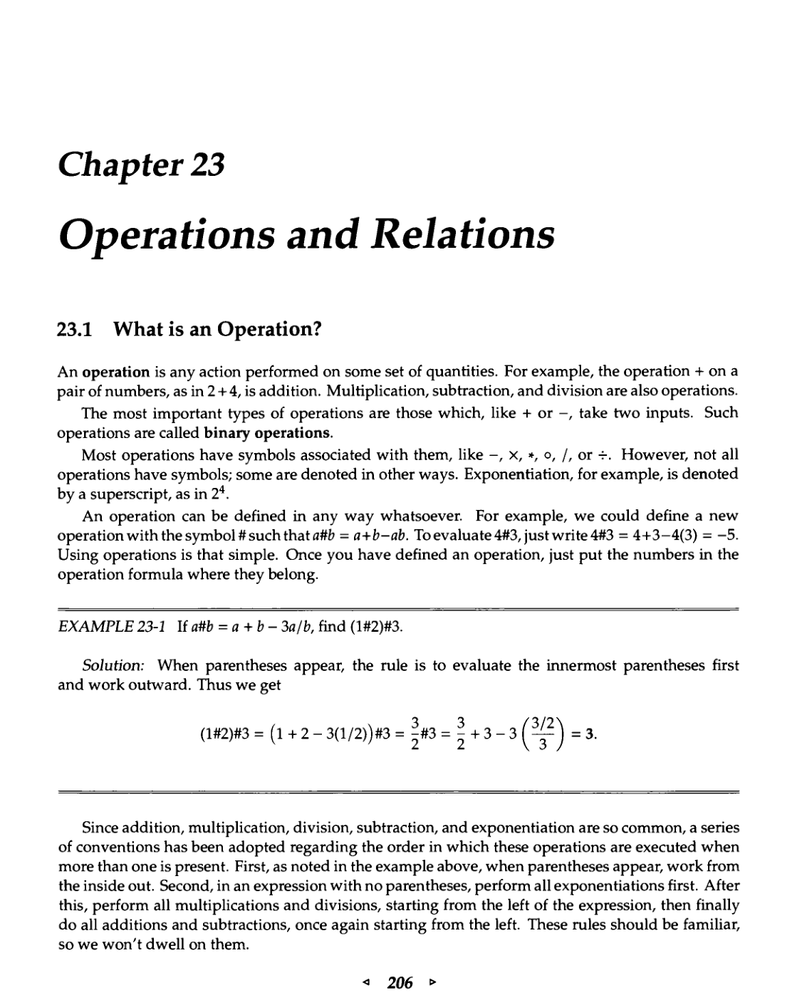
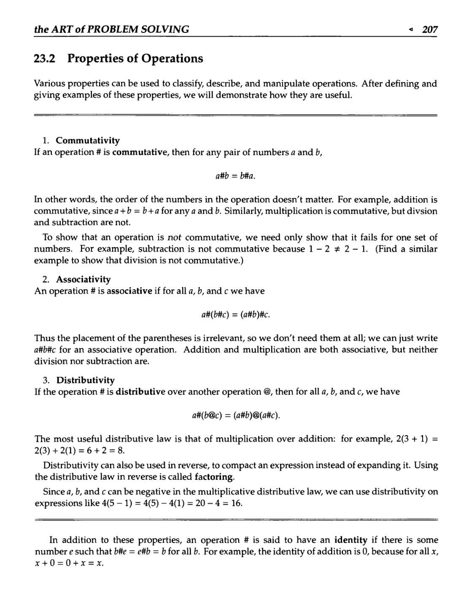
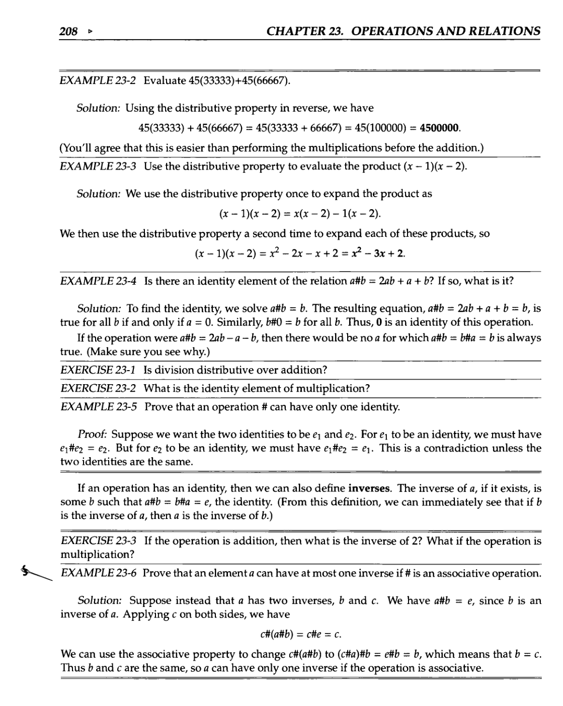
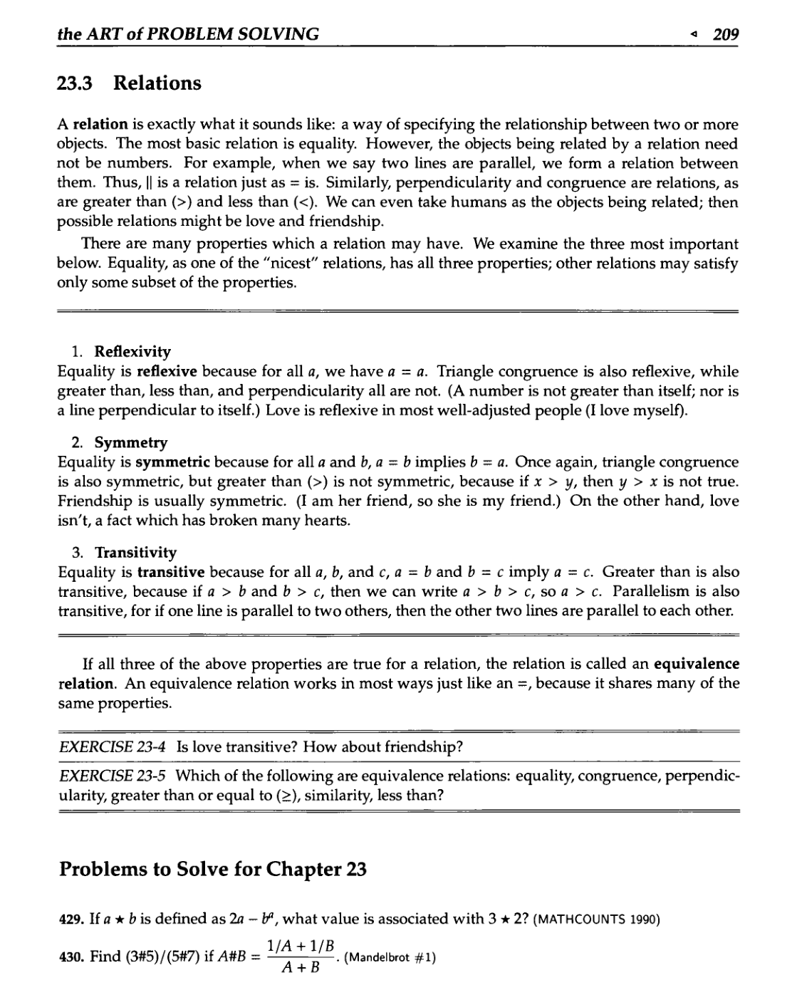
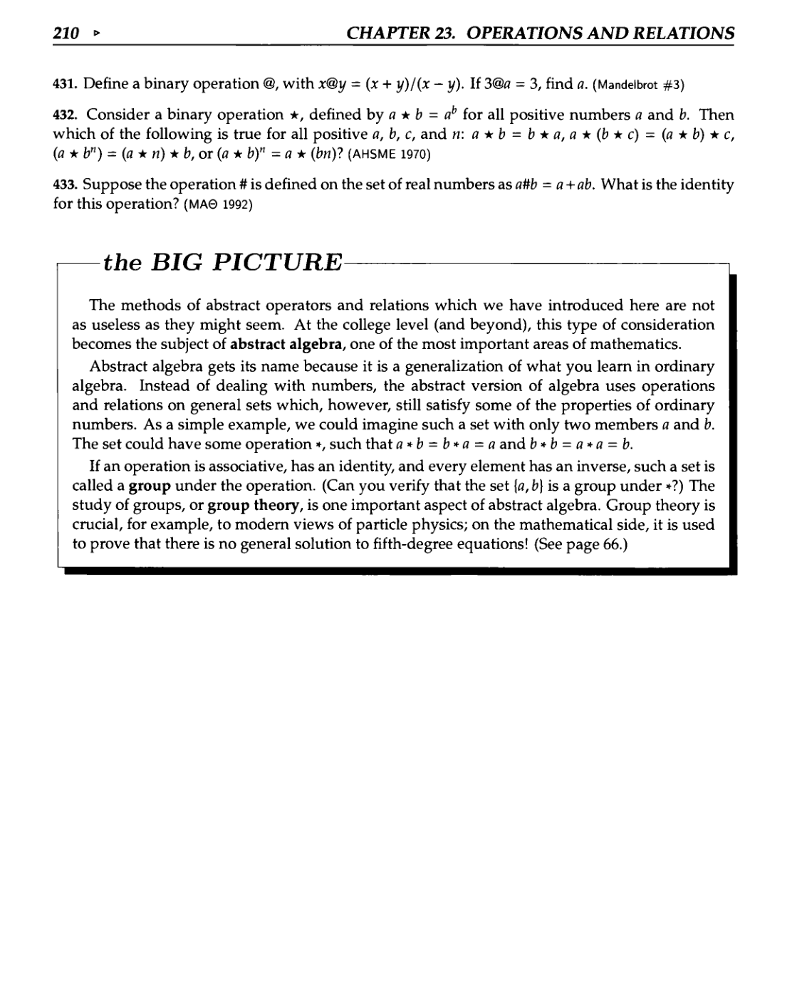

# Chapter 23: Operations and Relations

Volume 1 · Printed pages 206–210 · PDF pages 220–224

[Volume contents](../index.md)

## Printed page 206

<!-- source: volume-1, PDF page 220, printed page 206 -->

### 23.1 What is an Operation?

An operation is any action performed on some set of quantities. For example, the operation $+$ on a pair of numbers, as in $2+4$, is addition. Multiplication, subtraction, and division are also operations.

The most important types of operations are those which, like $+$ or $-$, take two inputs. Such operations are called binary operations.

Most operations have symbols associated with them, like $-$, $\times$, $\circ$, $/$, or $\div$. However, not all operations have symbols; some are denoted in other ways. Exponentiation, for example, is denoted by a superscript, as in $2^4$.

An operation can be defined in any way whatsoever. For example, we could define a new operation with the symbol $\#$ such that $a\#b = a+b-ab$. To evaluate $4\#3$, just write $4\#3 = 4+3-4(3) = -5$. Using operations is that simple. Once you have defined an operation, just put the numbers in the operation formula where they belong.

**EXAMPLE 23-1 If $a\#b = a+b-3a/b$, find $(1\#2)\#3$.**

Solution: When parentheses appear, the rule is to evaluate the innermost parentheses first and work outward. Thus we get

$$(1\#2)\#3 = \left(1+2-3(1/2)\right)\#3 = \frac{3}{2}\#3 = \frac{3}{2} + 3 - 3 \left(\frac{3}{2}\right) = 3.$$

Since addition, multiplication, division, subtraction, and exponentiation are so common, a series of conventions has been adopted regarding the order in which these operations are executed when more than one is present. First, as noted in the example above, when parentheses appear, work from the inside out. Second, in an expression with no parentheses, perform all exponentiations first. After this, perform all multiplications and divisions, starting from the left of the expression, then finally do all additions and subtractions, once again starting from the left. These rules should be familiar, so we won't dwell on them.

Original scan — PDF page 220

## Printed page 207

<!-- source: volume-1, PDF page 221, printed page 207 -->

### 23.2 Properties of Operations

Various properties can be used to classify, describe, and manipulate operations. After defining and giving examples of these properties, we will demonstrate how they are useful.

1. Commutativity
If an operation # is commutative, then for any pair of numbers $a$ and $b$,

$$a \# b = b \# a.$$

In other words, the order of the numbers in the operation doesn’t matter. For example, addition is commutative, since $a + b = b + a$ for any $a$ and $b$. Similarly, multiplication is commutative, but division and subtraction are not.

To show that an operation is not commutative, we need only show that it fails for one set of numbers. For example, subtraction is not commutative because $1 - 2 \neq 2 - 1$. (Find a similar example to show that division is not commutative.)

2. Associativity
An operation # is associative if for all $a, b$, and $c$ we have

$$a \# (b \# c) = (a \# b) \# c.$$

Thus the placement of the parentheses is irrelevant, so we don’t need them at all; we can just write $a \# b \# c$ for an associative operation. Addition and multiplication are both associative, but neither division nor subtraction are.

3. Distributivity
If the operation # is distributive over another operation @, then for all $a, b$, and $c$, we have

$$a \# (b @ c) = (a \# b) @ (a \# c).$$

The most useful distributive law is that of multiplication over addition: for example, $2(3 + 1) = 2(3) + 2(1) = 6 + 2 = 8.$

Distributivity can also be used in reverse, to compact an expression instead of expanding it. Using the distributive law in reverse is called factoring.

Since $a, b$, and $c$ can be negative in the multiplicative distributive law, we can use distributivity on expressions like $4(5 - 1) = 4(5) - 4(1) = 20 - 4 = 16.$

In addition to these properties, an operation # is said to have an identity if there is some number $e$ such that $b \# e = e \# b = b$ for all $b$. For example, the identity of addition is 0, because for all $x$, $x + 0 = 0 + x = x.$

Original scan — PDF page 221

## Printed page 208

<!-- source: volume-1, PDF page 222, printed page 208 -->

**EXAMPLE 23-2 Evaluate $45(33333)+45(66667)$.**

Solution: Using the distributive property in reverse, we have
$$45(33333) + 45(66667) = 45(33333 + 66667) = 45(100000) = 4500000.$$
(You’ll agree that this is easier than performing the multiplications before the addition.)

**EXAMPLE 23-3 Use the distributive property to evaluate the product $(x - 1)(x - 2)$.**

Solution: We use the distributive property once to expand the product as
$$(x - 1)(x - 2) = x(x - 2) - 1(x - 2).$$
We then use the distributive property a second time to expand each of these products, so
$$(x - 1)(x - 2) = x^2 - 2x - x + 2 = x^2 - 3x + 2.$$

**EXAMPLE 23-4 Is there an identity element of the relation $a\#b = 2ab + a + b$? If so, what is it?**

Solution: To find the identity, we solve $a\#b = b$. The resulting equation, $a\#b = 2ab + a + b = b$, is true for all $b$ if and only if $a = 0$. Similarly, $b\#0 = b$ for all $b$. Thus, $0$ is an identity of this operation.

If the operation were $a\#b = 2ab - a - b$, then there would be no $a$ for which $a\#b = b\#a = b$ is always true. (Make sure you see why.)

**EXERCISE 23-1 Is division distributive over addition?**

**EXERCISE 23-2 What is the identity element of multiplication?**

**EXAMPLE 23-5 Prove that an operation \# can have only one identity.**

Proof: Suppose we want the two identities to be $e_1$ and $e_2$. For $e_1$ to be an identity, we must have $e_1\#e_2 = e_2$. But for $e_2$ to be an identity, we must have $e_1\#e_2 = e_1$. This is a contradiction unless the two identities are the same.

If an operation has an identity, then we can also define inverses. The inverse of $a$, if it exists, is some $b$ such that $a\#b = b\#a = e$, the identity. (From this definition, we can immediately see that if $b$ is the inverse of $a$, then $a$ is the inverse of $b$.)

**EXERCISE 23-3 If the operation is addition, then what is the inverse of 2? What if the operation is multiplication?**

**EXAMPLE 23-6 Prove that an element $a$ can have at most one inverse if \# is an associative operation.**

Solution: Suppose instead that $a$ has two inverses, $b$ and $c$. We have $a\#b = e$, since $b$ is an inverse of $a$. Applying $c$ on both sides, we have
$$c\#(a\#b) = c\#e = c.$$
We can use the associative property to change $c\#(a\#b)$ to $(c\#a)\#b = e\#b = b$, which means that $b = c$. Thus $b$ and $c$ are the same, so $a$ can have only one inverse if the operation is associative.

Original scan — PDF page 222

## Printed page 209

<!-- source: volume-1, PDF page 223, printed page 209 -->

### 23.3 Relations

A relation is exactly what it sounds like: a way of specifying the relationship between two or more objects. The most basic relation is equality. However, the objects being related by a relation need not be numbers. For example, when we say two lines are parallel, we form a relation between them. Thus, $\parallel$ is a relation just as $=$ is. Similarly, perpendicularity and congruence are relations, as are greater than ($>$) and less than ($<$). We can even take humans as the objects being related; then possible relations might be love and friendship.

There are many properties which a relation may have. We examine the three most important below. Equality, as one of the "nicest" relations, has all three properties; other relations may satisfy only some subset of the properties.

1. Reflexivity
Equality is reflexive because for all $a$, we have $a = a$. Triangle congruence is also reflexive, while greater than, less than, and perpendicularity all are not. (A number is not greater than itself; nor is a line perpendicular to itself.) Love is reflexive in most well-adjusted people (I love myself).

2. Symmetry
Equality is symmetric because for all $a$ and $b$, $a = b$ implies $b = a$. Once again, triangle congruence is also symmetric, but greater than ($>$) is not symmetric, because if $x > y$, then $y > x$ is not true. Friendship is usually symmetric. (I am her friend, so she is my friend.) On the other hand, love isn't, a fact which has broken many hearts.

3. Transitivity
Equality is transitive because for all $a, b,$ and $c$, $a = b$ and $b = c$ imply $a = c$. Greater than is also transitive, because if $a > b$ and $b > c$, then we can write $a > b > c$, so $a > c$. Parallelism is also transitive, for if one line is parallel to two others, then the other two lines are parallel to each other.

If all three of the above properties are true for a relation, the relation is called an equivalence relation. An equivalence relation works in most ways just like an $=$, because it shares many of the same properties.

**EXERCISE 23-4 Is love transitive? How about friendship?**

**EXERCISE 23-5 Which of the following are equivalence relations: equality, congruence, perpendicularity, greater than or equal to ($\ge$), similarity, less than?**

Problems to Solve for Chapter 23

429. If $a \star b$ is defined as $2a - b^2$, what value is associated with $3 \star 2$? (MATHCOUNTS 1990)

430. Find $(3\#5)/(5\#7)$ if $A\#B = \frac{1/A + 1/B}{A + B}$. (Mandelbrot #1)

Original scan — PDF page 223

## Printed page 210

<!-- source: volume-1, PDF page 224, printed page 210 -->

431. Define a binary operation $@$, with $x@y = (x + y)/(x - y)$. If $3@a = 3$, find $a$. (Mandelbrot #3)

432. Consider a binary operation $\star$, defined by $a \star b = a^b$ for all positive numbers $a$ and $b$. Then which of the following is true for all positive $a, b, c$, and $n$: $a \star b = b \star a$, $a \star (b \star c) = (a \star b) \star c$, $(a \star b^n) = (a \star n) \star b$, or $(a \star b)^n = a \star (bn)$? (AHSME 1970)

433. Suppose the operation $\#$ is defined on the set of real numbers as $a\#b = a + ab$. What is the identity for this operation? (MAΘ 1992)

the BIG PICTURE

The methods of abstract operators and relations which we have introduced here are not as useless as they might seem. At the college level (and beyond), this type of consideration becomes the subject of abstract algebra, one of the most important areas of mathematics.

Abstract algebra gets its name because it is a generalization of what you learn in ordinary algebra. Instead of dealing with numbers, the abstract version of algebra uses operations and relations on general sets which, however, still satisfy some of the properties of ordinary numbers. As a simple example, we could imagine such a set with only two members $a$ and $b$. The set could have some operation $\star$, such that $a \star b = b \star a = a$ and $b \star b = a \star a = b$.

If an operation is associative, has an identity, and every element has an inverse, such a set is called a group under the operation. (Can you verify that the set $\{a, b\}$ is a group under $\star$?) The study of groups, or group theory, is one important aspect of abstract algebra. Group theory is crucial, for example, to modern views of particle physics; on the mathematical side, it is used to prove that there is no general solution to fifth-degree equations! (See page 66.)

Original scan — PDF page 224

