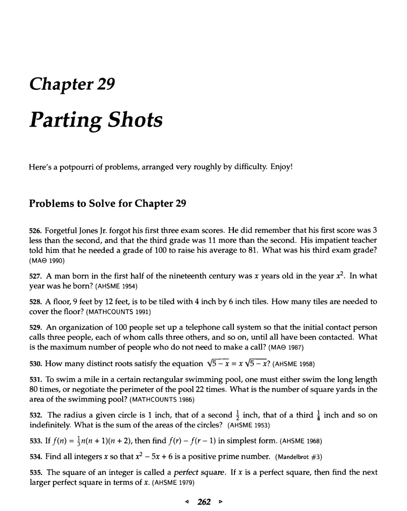
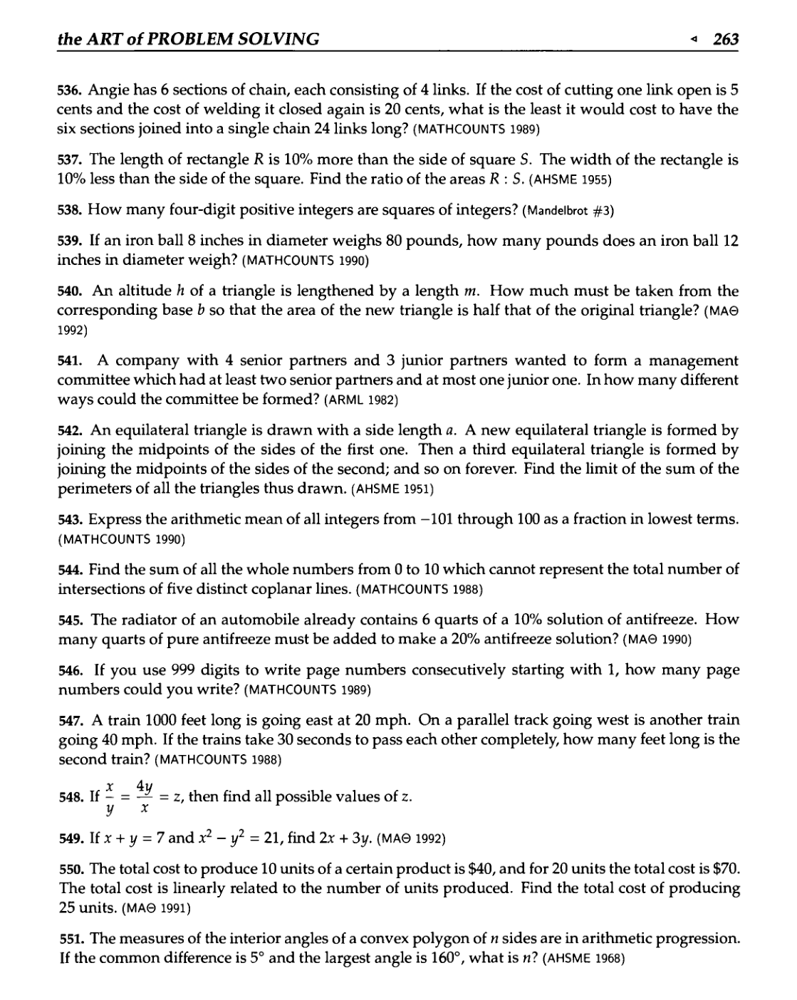
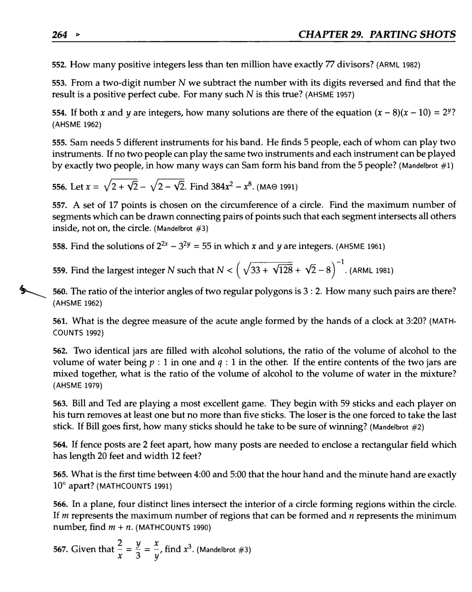
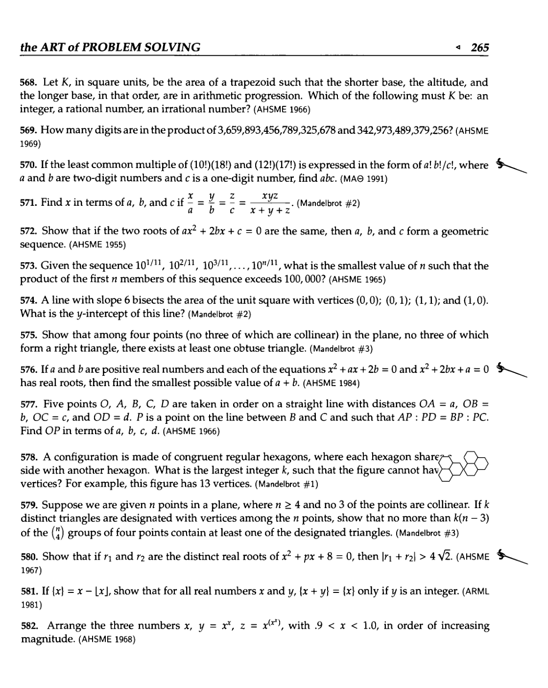
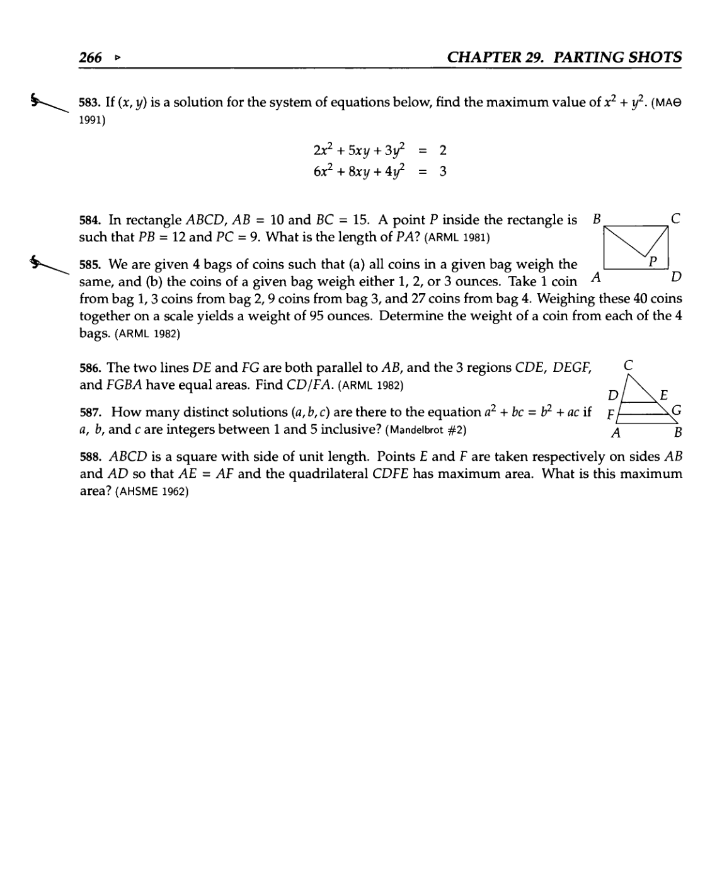

# Chapter 29: Parting Shots

Volume 1 · Printed pages 262–266 · PDF pages 276–280

[Volume contents](../index.md)

## Printed page 262

<!-- source: volume-1, PDF page 276, printed page 262 -->

Chapter 29

Parting Shots

Here’s a potpourri of problems, arranged very roughly by difficulty. Enjoy!

Problems to Solve for Chapter 29

526. Forgetful Jones Jr. forgot his first three exam scores. He did remember that his first score was 3 less than the second, and that the third grade was 11 more than the second. His impatient teacher told him that he needed a grade of 100 to raise his average to 81. What was his third exam grade? (MAΘ 1990)

527. A man born in the first half of the nineteenth century was $x$ years old in the year $x^2$. In what year was he born? (AHSME 1954)

528. A floor, 9 feet by 12 feet, is to be tiled with 4 inch by 6 inch tiles. How many tiles are needed to cover the floor? (MATHCOUNTS 1991)

529. An organization of 100 people set up a telephone call system so that the initial contact person calls three people, each of whom calls three others, and so on, until all have been contacted. What is the maximum number of people who do not need to make a call? (MAΘ 1987)

530. How many distinct roots satisfy the equation $\sqrt{5-x} = x\sqrt{5-x}$? (AHSME 1958)

531. To swim a mile in a certain rectangular swimming pool, one must either swim the long length 80 times, or negotiate the perimeter of the pool 22 times. What is the number of square yards in the area of the swimming pool? (MATHCOUNTS 1986)

532. The radius a given circle is 1 inch, that of a second $\frac{1}{2}$ inch, that of a third $\frac{1}{4}$ inch and so on indefinitely. What is the sum of the areas of the circles? (AHSME 1953)

533. If $f(n) = \frac{1}{3}n(n+1)(n+2)$, then find $f(r) - f(r-1)$ in simplest form. (AHSME 1968)

534. Find all integers $x$ so that $x^2 - 5x + 6$ is a positive prime number. (Mandelbrot #3)

535. The square of an integer is called a perfect square. If $x$ is a perfect square, then find the next larger perfect square in terms of $x$. (AHSME 1979)

Original scan — PDF page 276

## Printed page 263

<!-- source: volume-1, PDF page 277, printed page 263 -->

536. Angie has 6 sections of chain, each consisting of 4 links. If the cost of cutting one link open is 5 cents and the cost of welding it closed again is 20 cents, what is the least it would cost to have the six sections joined into a single chain 24 links long? (MATHCOUNTS 1989)

537. The length of rectangle $R$ is 10% more than the side of square $S$. The width of the rectangle is 10% less than the side of the square. Find the ratio of the areas $R : S$. (AHSME 1955)

538. How many four-digit positive integers are squares of integers? (Mandelbrot #3)

539. If an iron ball 8 inches in diameter weighs 80 pounds, how many pounds does an iron ball 12 inches in diameter weigh? (MATHCOUNTS 1990)

540. An altitude $h$ of a triangle is lengthened by a length $m$. How much must be taken from the corresponding base $b$ so that the area of the new triangle is half that of the original triangle? (MAΘ 1992)

541. A company with 4 senior partners and 3 junior partners wanted to form a management committee which had at least two senior partners and at most one junior one. In how many different ways could the committee be formed? (ARML 1982)

542. An equilateral triangle is drawn with a side length $a$. A new equilateral triangle is formed by joining the midpoints of the sides of the first one. Then a third equilateral triangle is formed by joining the midpoints of the sides of the second; and so on forever. Find the limit of the sum of the perimeters of all the triangles thus drawn. (AHSME 1951)

543. Express the arithmetic mean of all integers from $-101$ through 100 as a fraction in lowest terms. (MATHCOUNTS 1990)

544. Find the sum of all the whole numbers from 0 to 10 which cannot represent the total number of intersections of five distinct coplanar lines. (MATHCOUNTS 1988)

545. The radiator of an automobile already contains 6 quarts of a 10% solution of antifreeze. How many quarts of pure antifreeze must be added to make a 20% antifreeze solution? (MAΘ 1990)

546. If you use 999 digits to write page numbers consecutively starting with 1, how many page numbers could you write? (MATHCOUNTS 1989)

547. A train 1000 feet long is going east at 20 mph. On a parallel track going west is another train going 40 mph. If the trains take 30 seconds to pass each other completely, how many feet long is the second train? (MATHCOUNTS 1988)

548. If $\frac{x}{y} = \frac{4y}{x} = z$, then find all possible values of $z$.

549. If $x + y = 7$ and $x^2 - y^2 = 21$, find $2x + 3y$. (MAΘ 1992)

550. The total cost to produce 10 units of a certain product is $40$, and for 20 units the total cost is $70$. The total cost is linearly related to the number of units produced. Find the total cost of producing 25 units. (MAΘ 1991)

551. The measures of the interior angles of a convex polygon of $n$ sides are in arithmetic progression. If the common difference is $5^\circ$ and the largest angle is $160^\circ$, what is $n$? (AHSME 1968)

Original scan — PDF page 277

## Printed page 264

<!-- source: volume-1, PDF page 278, printed page 264 -->

552. How many positive integers less than ten million have exactly 77 divisors? (ARML 1982)

553. From a two-digit number $N$ we subtract the number with its digits reversed and find that the result is a positive perfect cube. For many such $N$ is this true? (AHSME 1957)

554. If both $x$ and $y$ are integers, how many solutions are there of the equation $(x - 8)(x - 10) = 2^y$? (AHSME 1962)

555. Sam needs 5 different instruments for his band. He finds 5 people, each of whom can play two instruments. If no two people can play the same two instruments and each instrument can be played by exactly two people, in how many ways can Sam form his band from the 5 people? (Mandelbrot #1)

556. Let $x = \sqrt{2 + \sqrt{2}} - \sqrt{2 - \sqrt{2}}$. Find $384x^2 - x^8$. (MAΘ 1991)

557. A set of 17 points is chosen on the circumference of a circle. Find the maximum number of segments which can be drawn connecting pairs of points such that each segment intersects all others inside, not on, the circle. (Mandelbrot #3)

558. Find the solutions of $2^{2x} - 3^{2y} = 55$ in which $x$ and $y$ are integers. (AHSME 1961)

559. Find the largest integer $N$ such that $N < \left( \sqrt{33 + \sqrt{128}} + \sqrt{2} - 8 \right)^{-1}$. (ARML 1981)

560. The ratio of the interior angles of two regular polygons is 3:2. How many such pairs are there? (AHSME 1962)

561. What is the degree measure of the acute angle formed by the hands of a clock at 3:20? (MATH-COUNTS 1992)

562. Two identical jars are filled with alcohol solutions, the ratio of the volume of alcohol to the volume of water being $p : 1$ in one and $q : 1$ in the other. If the entire contents of the two jars are mixed together, what is the ratio of the volume of alcohol to the volume of water in the mixture? (AHSME 1979)

563. Bill and Ted are playing a most excellent game. They begin with 59 sticks and each player on his turn removes at least one but no more than five sticks. The loser is the one forced to take the last stick. If Bill goes first, how many sticks should he take to be sure of winning? (Mandelbrot #2)

564. If fence posts are 2 feet apart, how many posts are needed to enclose a rectangular field which has length 20 feet and width 12 feet?

565. What is the first time between 4:00 and 5:00 that the hour hand and the minute hand are exactly $10^\circ$ apart? (MATHCOUNTS 1991)

566. In a plane, four distinct lines intersect the interior of a circle forming regions within the circle. If $m$ represents the maximum number of regions that can be formed and $n$ represents the minimum number, find $m + n$. (MATHCOUNTS 1990)

567. Given that $\frac{2}{x} = \frac{y}{3} = \frac{x}{y}$, find $x^3$. (Mandelbrot #3)

Original scan — PDF page 278

## Printed page 265

<!-- source: volume-1, PDF page 279, printed page 265 -->

568. Let $K$, in square units, be the area of a trapezoid such that the shorter base, the altitude, and the longer base, in that order, are in arithmetic progression. Which of the following must $K$ be: an integer, a rational number, an irrational number? (AHSME 1966)

569. How many digits are in the product of 3,659,893,456,789,325,678 and 342,973,489,379,256? (AHSME 1969)

570. If the least common multiple of (10!)(18!) and (12!)(17!) is expressed in the form of $a!b!/c!$, where $a$ and $b$ are two-digit numbers and $c$ is a one-digit number, find $abc$. (MAΘ 1991)

571. Find $x$ in terms of $a, b$, and $c$ if $\frac{x}{a} = \frac{y}{b} = \frac{z}{c} = \frac{xyz}{x + y + z}$. (Mandelbrot #2)

572. Show that if the two roots of $ax^2 + 2bx + c = 0$ are the same, then $a, b$, and $c$ form a geometric sequence. (AHSME 1955)

573. Given the sequence $10^{1/11}, 10^{2/11}, 10^{3/11}, \ldots, 10^{n/11}$, what is the smallest value of $n$ such that the product of the first $n$ members of this sequence exceeds 100,000? (AHSME 1965)

574. A line with slope 6 bisects the area of the unit square with vertices $(0, 0); (0, 1); (1, 1);$ and $(1, 0)$. What is the $y$-intercept of this line? (Mandelbrot #2)

575. Show that among four points (no three of which are collinear) in the plane, no three of which form a right triangle, there exists at least one obtuse triangle. (Mandelbrot #3)

576. If $a$ and $b$ are positive real numbers and each of the equations $x^2 + ax + 2b = 0$ and $x^2 + 2bx + a = 0$ has real roots, then find the smallest possible value of $a + b$. (AHSME 1984)

577. Five points $O, A, B, C, D$ are taken in order on a straight line with distances $OA = a, OB = b, OC = c$, and $OD = d$. $P$ is a point on the line between $B$ and $C$ and such that $AP : PD = BP : PC$. Find $OP$ in terms of $a, b, c, d$. (AHSME 1966)

578. A configuration is made of congruent regular hexagons, where each hexagon shares side with another hexagon. What is the largest integer $k$, such that the figure cannot have vertices? For example, this figure has 13 vertices. (Mandelbrot #1)

579. Suppose we are given $n$ points in a plane, where $n \geq 4$ and no 3 of the points are collinear. If $k$ distinct triangles are designated with vertices among the $n$ points, show that no more than $k(n - 3)$ of the $\binom{n}{4}$ groups of four points contain at least one of the designated triangles. (Mandelbrot #3)

580. Show that if $r_1$ and $r_2$ are the distinct real roots of $x^2 + px + 8 = 0$, then $|r_1 + r_2| > 4\sqrt{2}$. (AHSME 1967)

581. If $\{x\} = x - \lfloor x \rfloor$, show that for all real numbers $x$ and $y$, $\{x + y\} = \{x\}$ only if $y$ is an integer. (ARML 1981)

582. Arrange the three numbers $x, y = x^x, z = x^{(x^x)}$, with $9 < x < 1.0$, in order of increasing magnitude. (AHSME 1968)

Original scan — PDF page 279

## Printed page 266

<!-- source: volume-1, PDF page 280, printed page 266 -->

583. If $(x, y)$ is a solution for the system of equations below, find the maximum value of $x^2 + y^2$. (MAΘ 1991)

$$2x^2 + 5xy + 3y^2 = 2$$
$$6x^2 + 8xy + 4y^2 = 3$$

584. In rectangle $ABCD$, $AB = 10$ and $BC = 15$. A point $P$ inside the rectangle is such that $PB = 12$ and $PC = 9$. What is the length of $PA$? (ARML 1981)

585. We are given 4 bags of coins such that (a) all coins in a given bag weigh the same, and (b) the coins of a given bag weigh either 1, 2, or 3 ounces. Take 1 coin from bag 1, 3 coins from bag 2, 9 coins from bag 3, and 27 coins from bag 4. Weighing these 40 coins together on a scale yields a weight of 95 ounces. Determine the weight of a coin from each of the 4 bags. (ARML 1982)

586. The two lines $DE$ and $FG$ are both parallel to $AB$, and the 3 regions $CDE$, $DEGF$, and $FGBA$ have equal areas. Find $CD/FA$. (ARML 1982)

587. How many distinct solutions $(a, b, c)$ are there to the equation $a^2 + bc = b^2 + ac$ if $a, b,$ and $c$ are integers between 1 and 5 inclusive? (Mandelbrot #2)

588. $ABCD$ is a square with side of unit length. Points $E$ and $F$ are taken respectively on sides $AB$ and $AD$ so that $AE = AF$ and the quadrilateral $CDFE$ has maximum area. What is this maximum area? (AHSME 1962)

Original scan — PDF page 280

