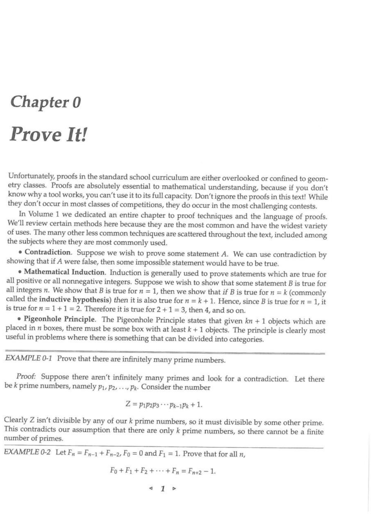
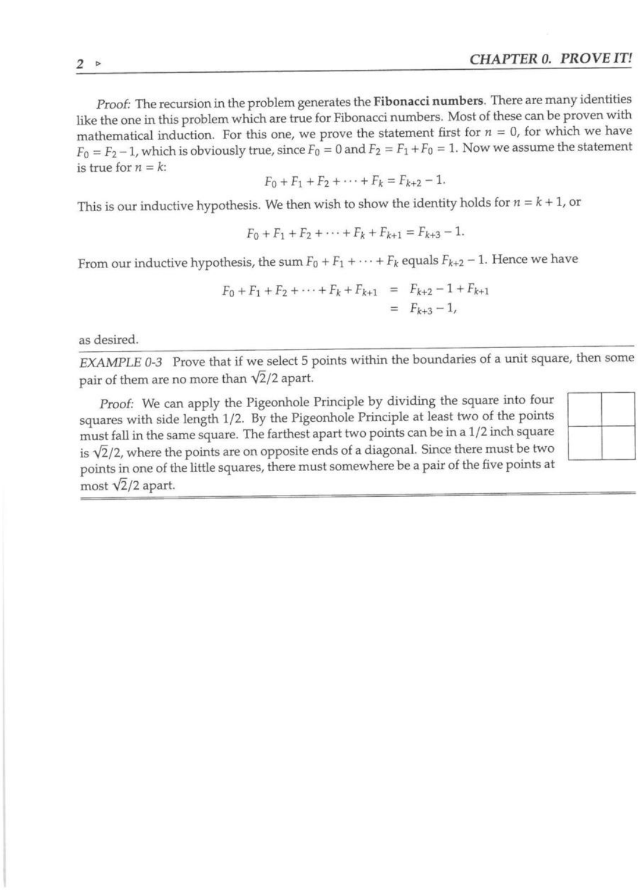

# Chapter 0: Prove It!

Volume 2 · Printed pages 1–2 · PDF pages 23–24

[Volume contents](../index.md)

## Printed page 1

<!-- source: volume-2, PDF page 23, printed page 1 -->

Chapter 0
Prove It!

Unfortunately, proofs in the standard school curriculum are either overlooked or confined to geometry classes. Proofs are absolutely essential to mathematical understanding, because if you don't know why a tool works, you can't use it to its full capacity. Don't ignore the proofs in this text! While they don't occur in most classes or competitions, they do occur in the most challenging contests.

In Volume 1 we dedicated an entire chapter to proof techniques and the language of proofs. We'll review certain methods here because they are the most common and have the widest variety of uses. The many other less common techniques are scattered throughout the text, included among the subjects where they are most commonly used.

• Contradiction. Suppose we wish to prove some statement $A$. We can use contradiction by showing that if $A$ were false, then some impossible statement would have to be true.

• Mathematical Induction. Induction is generally used to prove statements which are true for all positive or all nonnegative integers. Suppose we wish to show that some statement $B$ is true for all integers $n$. We show that $B$ is true for $n = 1$, then we show that if $B$ is true for $n = k$ (commonly called the inductive hypothesis) then it is also true for $n = k + 1$. Hence, since $B$ is true for $n = 1$, it is true for $n = 1 + 1 = 2$. Therefore it is true for $2 + 1 = 3$, then 4, and so on.

• Pigeonhole Principle. The Pigeonhole Principle states that given $kn + 1$ objects which are placed in $n$ boxes, there must be some box with at least $k + 1$ objects. The principle is clearly most useful in problems where there is something that can be divided into categories.

**EXAMPLE 0-1 Prove that there are infinitely many prime numbers.**

Proof: Suppose there aren't infinitely many primes and look for a contradiction. Let there be $k$ prime numbers, namely $p_1, p_2, \ldots, p_k$. Consider the number

$$Z = p_1p_2p_3 \cdots p_{k-1}p_k + 1.$$

Clearly $Z$ isn't divisible by any of our $k$ prime numbers, so it must divisible by some other prime. This contradicts our assumption that there are only $k$ prime numbers, so there cannot be a finite number of primes.

**EXAMPLE 0-2 Let $F_n = F_{n-1} + F_{n-2}, F_0 = 0$ and $F_1 = 1$. Prove that for all $n$,**

$$F_0 + F_1 + F_2 + \cdots + F_n = F_{n+2} - 1.$$

Original scan — PDF page 23

## Printed page 2

<!-- source: volume-2, PDF page 24, printed page 2 -->

Proof: The recursion in the problem generates the Fibonacci numbers. There are many identities like the one in this problem which are true for Fibonacci numbers. Most of these can be proven with mathematical induction. For this one, we prove the statement first for $n = 0$, for which we have $F_0 = F_2 - 1$, which is obviously true, since $F_0 = 0$ and $F_2 = F_1 + F_0 = 1$. Now we assume the statement is true for $n = k$:

$$F_0 + F_1 + F_2 + \cdots + F_k = F_{k+2} - 1.$$

This is our inductive hypothesis. We then wish to show the identity holds for $n = k + 1$, or

$$F_0 + F_1 + F_2 + \cdots + F_k + F_{k+1} = F_{k+3} - 1.$$

From our inductive hypothesis, the sum $F_0 + F_1 + \cdots + F_k$ equals $F_{k+2} - 1$. Hence we have

$$F_0 + F_1 + F_2 + \cdots + F_k + F_{k+1} = F_{k+2} - 1 + F_{k+1}$$

$$= F_{k+3} - 1,$$

as desired.

**EXAMPLE 0-3 Prove that if we select 5 points within the boundaries of a unit square, then some pair of them are no more than $\sqrt{2}/2$ apart.**

Proof: We can apply the Pigeonhole Principle by dividing the square into four squares with side length $1/2$. By the Pigeonhole Principle at least two of the points must fall in the same square. The farthest apart two points can be in a $1/2$ inch square is $\sqrt{2}/2$, where the points are on opposite ends of a diagonal. Since there must be two points in one of the little squares, there must somewhere be a pair of the five points at most $\sqrt{2}/2$ apart.

Original scan — PDF page 24

