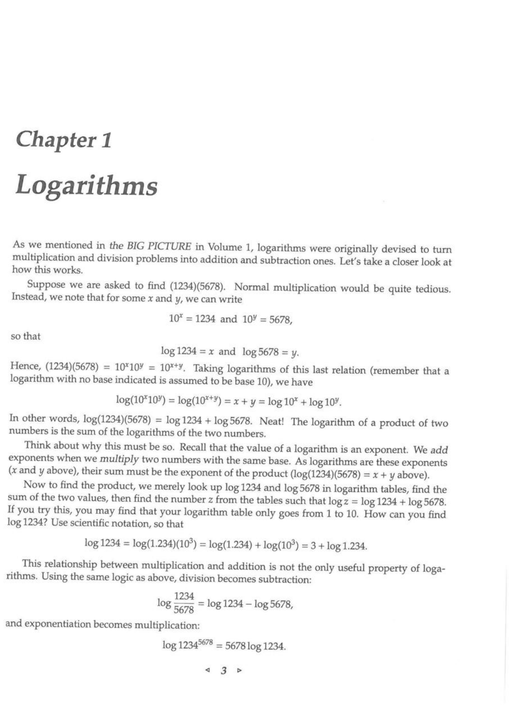
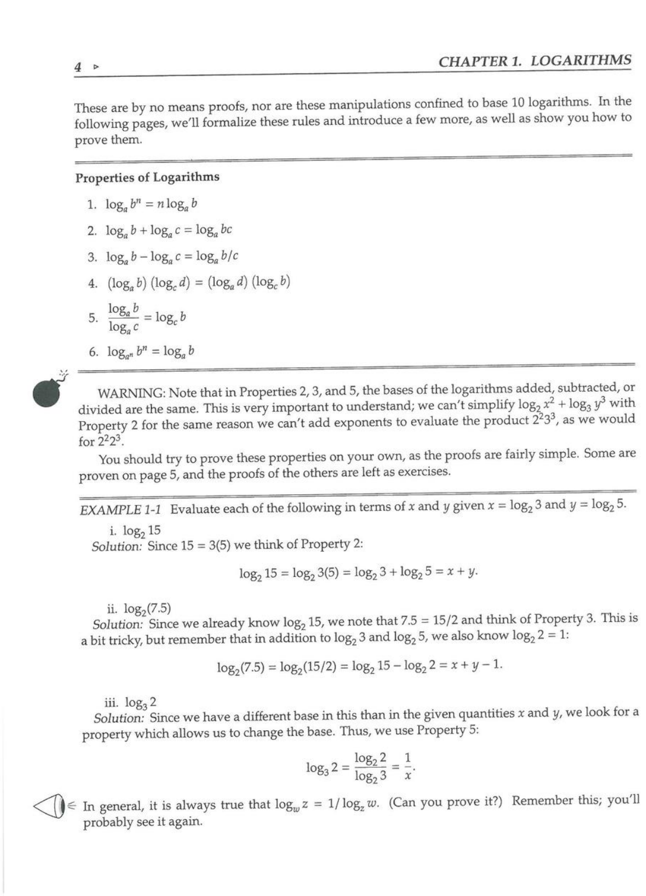
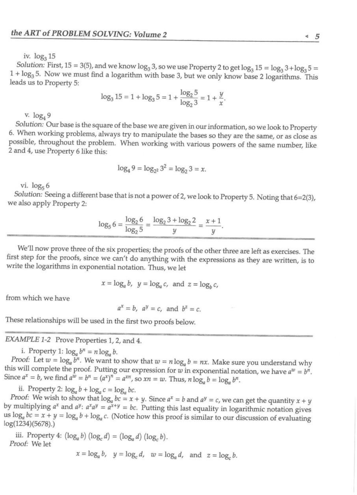
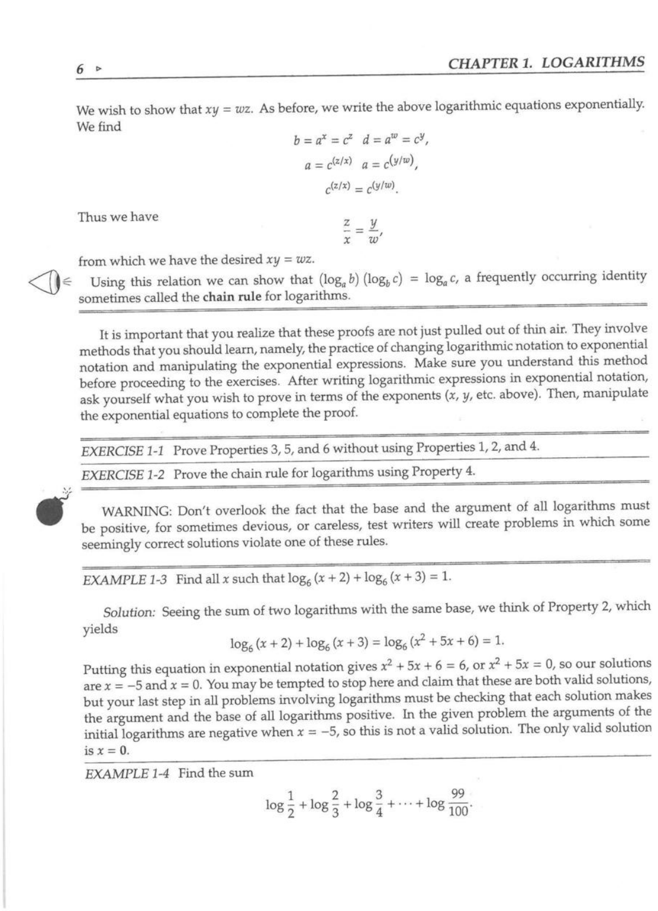
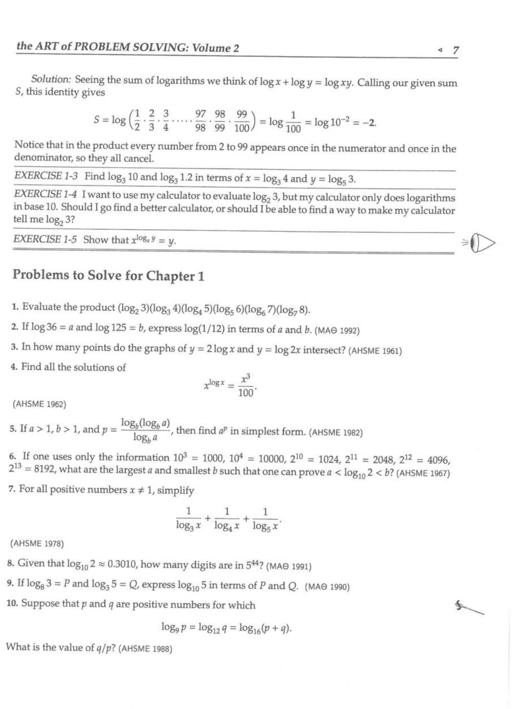
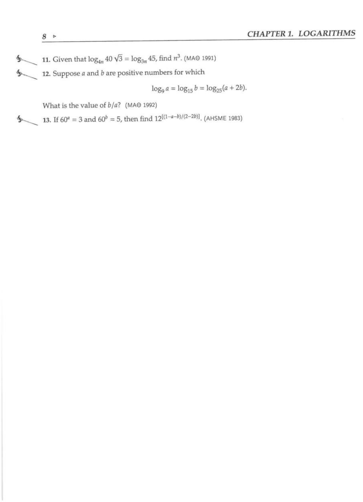
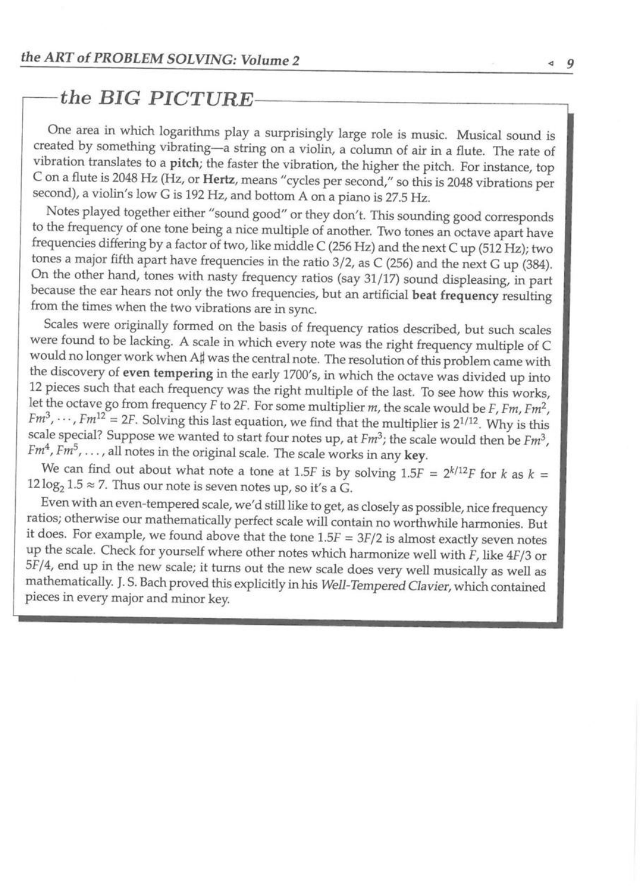

# Chapter 1: Logarithms

Volume 2 · Printed pages 3–9 · PDF pages 25–31

[Volume contents](../index.md)

## Printed page 3

<!-- source: volume-2, PDF page 25, printed page 3 -->

As we mentioned in the BIG PICTURE in Volume 1, logarithms were originally devised to turn multiplication and division problems into addition and subtraction ones. Let’s take a closer look at how this works.

Suppose we are asked to find $(1234)(5678)$. Normal multiplication would be quite tedious. Instead, we note that for some $x$ and $y$, we can write

$$10^x = 1234 \text{ and } 10^y = 5678,$$

so that

$$\log 1234 = x \text{ and } \log 5678 = y.$$

Hence, $(1234)(5678) = 10^x 10^y = 10^{x+y}$. Taking logarithms of this last relation (remember that a logarithm with no base indicated is assumed to be base 10), we have

$$\log(10^x 10^y) = \log(10^{x+y}) = x + y = \log 10^x + \log 10^y.$$

In other words, $\log(1234)(5678) = \log 1234 + \log 5678$. Neat! The logarithm of a product of two numbers is the sum of the logarithms of the two numbers.

Think about why this must be so. Recall that the value of a logarithm is an exponent. We add exponents when we multiply two numbers with the same base. As logarithms are these exponents ($x$ and $y$ above), their sum must be the exponent of the product ($\log(1234)(5678)=x+y$ above).

Now to find the product, we merely look up $\log 1234$ and $\log 5678$ in logarithm tables, find the sum of the two values, then find the number $z$ from the tables such that $\log z = \log 1234 + \log 5678$. If you try this, you may find that your logarithm table only goes from 1 to 10. How can you find $\log 1234$? Use scientific notation, so that

$$\log 1234 = \log(1.234)(10^3) = \log(1.234) + \log(10^3) = 3 + \log 1.234.$$

This relationship between multiplication and addition is not the only useful property of logarithms. Using the same logic as above, division becomes subtraction:

$$\log \frac{1234}{5678} = \log 1234 - \log 5678,$$

and exponentiation becomes multiplication:

$$\log 1234^{5678} = 5678 \log 1234.$$

Original scan — PDF page 25

## Printed page 4

<!-- source: volume-2, PDF page 26, printed page 4 -->

These are by no means proofs, nor are these manipulations confined to base 10 logarithms. In the following pages, we’ll formalize these rules and introduce a few more, as well as show you how to prove them.

Properties of Logarithms

1. $\log_a b^n = n \log_a b$
2. $\log_a b + \log_a c = \log_a bc$
3. $\log_a b - \log_a c = \log_a b/c$
4. $(\log_a b) (\log_c d) = (\log_a d) (\log_c b)$
5. $\frac{\log_a b}{\log_a c} = \log_c b$
6. $\log_{a^n} b^n = \log_a b$

WARNING: Note that in Properties 2, 3, and 5, the bases of the logarithms added, subtracted, or divided are the same. This is very important to understand; we can’t simplify $\log_2 x^2 + \log_3 y^3$ with Property 2 for the same reason we can’t add exponents to evaluate the product $2^2 3^3$, as we would for $2^2 2^3$.

You should try to prove these properties on your own, as the proofs are fairly simple. Some are proven on page 5, and the proofs of the others are left as exercises.

**EXAMPLE 1-1 Evaluate each of the following in terms of $x$ and $y$ given $x = \log_2 3$ and $y = \log_2 5$.**

i. $\log_2 15$
Solution: Since 15 = 3(5) we think of Property 2:

$$\log_2 15 = \log_2 3(5) = \log_2 3 + \log_2 5 = x + y.$$

ii. $\log_2(7.5)$
Solution: Since we already know $\log_2 15$, we note that 7.5 = 15/2 and think of Property 3. This is a bit tricky, but remember that in addition to $\log_2 3$ and $\log_2 5$, we also know $\log_2 2 = 1$:

$$\log_2(7.5) = \log_2(15/2) = \log_2 15 - \log_2 2 = x + y - 1.$$

iii. $\log_3 2$
Solution: Since we have a different base in this than in the given quantities $x$ and $y$, we look for a property which allows us to change the base. Thus, we use Property 5:

$$\log_3 2 = \frac{\log_2 2}{\log_2 3} = \frac{1}{x}.$$

In general, it is always true that $\log_w z = 1/\log_z w$. (Can you prove it?) Remember this; you’ll probably see it again.

Original scan — PDF page 26

## Printed page 5

<!-- source: volume-2, PDF page 27, printed page 5 -->

iv. $\log_3 15$
Solution: First, $15 = 3(5)$, and we know $\log_3 3$, so we use Property 2 to get $\log_3 15 = \log_3 3 + \log_3 5 = 1 + \log_3 5$. Now we must find a logarithm with base 3, but we only know base 2 logarithms. This leads us to Property 5:

$$\log_3 15 = 1 + \log_3 5 = 1 + \frac{\log_2 5}{\log_2 3} = 1 + \frac{y}{x}.$$

v. $\log_4 9$
Solution: Our base is the square of the base we are given in our information, so we look to Property 6. When working problems, always try to manipulate the bases so they are the same, or as close as possible, throughout the problem. When working with various powers of the same number, like 2 and 4, use Property 6 like this:

$$\log_4 9 = \log_{2^2} 3^2 = \log_2 3 = x.$$

vi. $\log_5 6$
Solution: Seeing a different base that is not a power of 2, we look to Property 5. Noting that $6=2(3)$, we also apply Property 2:

$$\log_5 6 = \frac{\log_2 6}{\log_2 5} = \frac{\log_2 3 + \log_2 2}{y} = \frac{x+1}{y}.$$

We'll now prove three of the six properties; the proofs of the other three are left as exercises. The first step for the proofs, since we can't do anything with the expressions as they are written, is to write the logarithms in exponential notation. Thus, we let

$$x = \log_a b, y = \log_a c, \text{ and } z = \log_b c,$$

from which we have

$$a^x = b, a^y = c, \text{ and } b^z = c.$$

These relationships will be used in the first two proofs below.

**EXAMPLE 1-2 Prove Properties 1, 2, and 4.**

i. Property 1: $\log_a b^n = n \log_a b.$
Proof: Let $w = \log_a b^n$. We want to show that $w = n \log_a b = nx$. Make sure you understand why this will complete the proof. Putting our expression for $w$ in exponential notation, we have $a^w = b^n$. Since $a^x = b$, we find $a^w = b^n = (a^x)^n = a^{xn}$, so $xn = w$. Thus, $n \log_a b = \log_a b^n.$

ii. Property 2: $\log_a b + \log_a c = \log_a bc.$
Proof: We wish to show that $\log_a bc = x + y$. Since $a^x = b$ and $a^y = c$, we can get the quantity $x + y$ by multiplying $a^x$ and $a^y$: $a^x a^y = a^{x+y} = bc$. Putting this last equality in logarithmic notation gives us $\log_a bc = x + y = \log_a b + \log_a c$. (Notice how this proof is similar to our discussion of evaluating $\log(1234)(5678).$)

iii. Property 4: $(\log_a b) (\log_c d) = (\log_a d) (\log_c b).$
Proof: We let

$$x = \log_a b, y = \log_c d, w = \log_a d, \text{ and } z = \log_c b.$$

Original scan — PDF page 27

## Printed page 6

<!-- source: volume-2, PDF page 28, printed page 6 -->

We wish to show that $xy = wz$. As before, we write the above logarithmic equations exponentially.

We find

$$b = a^x = c^z \quad d = a^w = c^y,$$

$$a = c^{(z/x)} \quad a = c^{(y/w)},$$

$$c^{(z/x)} = c^{(y/w)}$$.

Thus we have

$$\frac{z}{x} = \frac{y}{w},$$

from which we have the desired $xy = wz$.

Using this relation we can show that $(\log_a b)(\log_b c) = \log_a c$, a frequently occurring identity sometimes called the chain rule for logarithms.

It is important that you realize that these proofs are not just pulled out of thin air. They involve methods that you should learn, namely, the practice of changing logarithmic notation to exponential notation and manipulating the exponential expressions. Make sure you understand this method before proceeding to the exercises. After writing logarithmic expressions in exponential notation, ask yourself what you wish to prove in terms of the exponents $(x, y, \text{etc. above})$. Then, manipulate the exponential equations to complete the proof.

**EXERCISE 1-1** Prove Properties 3, 5, and 6 without using Properties 1, 2, and 4.

**EXERCISE 1-2** Prove the chain rule for logarithms using Property 4.

WARNING: Don’t overlook the fact that the base and the argument of all logarithms must be positive, for sometimes devious, or careless, test writers will create problems in which some seemingly correct solutions violate one of these rules.

**EXAMPLE 1-3** Find all $x$ such that $\log_6 (x + 2) + \log_6 (x + 3) = 1$.

**Solution:** Seeing the sum of two logarithms with the same base, we think of Property 2, which yields

$$\log_6 (x + 2) + \log_6 (x + 3) = \log_6 (x^2 + 5x + 6) = 1.$$

Putting this equation in exponential notation gives $x^2 + 5x + 6 = 6$, or $x^2 + 5x = 0$, so our solutions are $x = -5$ and $x = 0$. You may be tempted to stop here and claim that these are both valid solutions, but your last step in all problems involving logarithms must be checking that each solution makes the argument and the base of all logarithms positive. In the given problem the arguments of the initial logarithms are negative when $x = -5$, so this is not a valid solution. The only valid solution is $x = 0$.

**EXAMPLE 1-4** Find the sum

$$\log \frac{1}{2} + \log \frac{2}{3} + \log \frac{3}{4} + \cdots + \log \frac{99}{100}.$$

Original scan — PDF page 28

## Printed page 7

<!-- source: volume-2, PDF page 29, printed page 7 -->

Solution: Seeing the sum of logarithms we think of $\log x + \log y = \log xy$. Calling our given sum $S$, this identity gives

$$S = \log \left( \frac{1}{2} \cdot \frac{2}{3} \cdot \frac{3}{4} \cdot \cdots \cdot \frac{97}{98} \cdot \frac{98}{99} \cdot \frac{99}{100} \right) = \log \frac{1}{100} = \log 10^{-2} = -2.$$

Notice that in the product every number from 2 to 99 appears once in the numerator and once in the denominator, so they all cancel.

**EXERCISE 1-3 Find $\log_3 10$ and $\log_3 1.2$ in terms of $x = \log_3 4$ and $y = \log_5 3.$**

**EXERCISE 1-4 I want to use my calculator to evaluate $\log_2 3$, but my calculator only does logarithms in base 10. Should I go find a better calculator, or should I be able to find a way to make my calculator tell me $\log_2 3?$**

**EXERCISE 1-5 Show that $x^{\log_2 y} = y.$**

Problems to Solve for Chapter 1

1. Evaluate the product $(\log_2 3)(\log_3 4)(\log_4 5)(\log_5 6)(\log_7 8).$

2. If $\log 36 = a$ and $\log 125 = b$, express $\log(1/12)$ in terms of $a$ and $b$. (MAΘ 1992)

3. In how many points do the graphs of $y = 2 \log x$ and $y = \log 2x$ intersect? (AHSME 1961)

4. Find all the solutions of

$$x^{\log_2 y} = \frac{x^3}{100}.$$

(AHSME 1962)

5. If $a > 1, b > 1$, and $p = \frac{\log_b(\log_b a)}{\log_b a}$, then find $a^p$ in simplest form. (AHSME 1982)

6. If one uses only the information $10^3 = 1000, 10^4 = 10000, 2^{10} = 1024, 2^{11} = 2048, 2^{12} = 4096, 2^{13} = 8192$, what are the largest $a$ and smallest $b$ such that one can prove $a < \log_{10} 2 < b?$ (AHSME 1967)

7. For all positive numbers $x \neq 1$, simplify

$$\frac{1}{\log_3 x} + \frac{1}{\log_4 x} + \frac{1}{\log_5 x}.$$

(AHSME 1978)

8. Given that $\log_{10} 2 \approx 0.3010$, how many digits are in $5^{44}$? (MAΘ 1991)

9. If $\log_8 3 = P$ and $\log_3 5 = Q$, express $\log_{10} 5$ in terms of $P$ and $Q$. (MAΘ 1990)

10. Suppose that $p$ and $q$ are positive numbers for which

$$\log_9 p = \log_{12} q = \log_{16}(p + q).$$

What is the value of $q/p$? (AHSME 1988)

Original scan — PDF page 29

## Printed page 8

<!-- source: volume-2, PDF page 30, printed page 8 -->

11. Given that $\log_{4n} 40 \sqrt{3} = \log_{3n} 45$, find $n^3$. (MAΘ 1991)

12. Suppose $a$ and $b$ are positive numbers for which

$$\log_9 a = \log_{15} b = \log_{25}(a + 2b).$$

What is the value of $b/a$? (MAΘ 1992)

13. If $60^a = 3$ and $60^b = 5$, then find $12^{[(1-a-b)/(2-2b)]}$. (AHSME 1983)

Original scan — PDF page 30

## Printed page 9

<!-- source: volume-2, PDF page 31, printed page 9 -->

One area in which logarithms play a surprisingly large role is music. Musical sound is created by something vibrating—a string on a violin, a column of air in a flute. The rate of vibration translates to a pitch; the faster the vibration, the higher the pitch. For instance, top C on a flute is 2048 Hz (Hz, or Hertz), means "cycles per second," so this is 2048 vibrations per second), a violin's low G is 192 Hz, and bottom A on a piano is 27.5 Hz.

Notes played together either "sound good" or they don't. This sounding good corresponds to the frequency of one tone being a nice multiple of another. Two tones an octave apart have frequencies differing by a factor of two, like middle C (256 Hz) and the next C up (512 Hz); two tones a major fifth apart have frequencies in the ratio 3/2, as C (256) and the next G up (384). On the other hand, tones with nasty frequency ratios (say 31/17) sound displeasing, in part because the ear hears not only the two frequencies, but an artificial beat frequency resulting from the times when the two vibrations are in sync.

Scales were originally formed on the basis of frequency ratios described, but such scales were found to be lacking. A scale in which every note was the right frequency multiple of C would no longer work when A# was the central note. The resolution of this problem came with the discovery of even tempering in the early 1700's, in which the octave was divided up into 12 pieces such that each frequency was the right multiple of the last. To see how this works, let the octave go from frequency $F$ to $2F$. For some multiplier $m$, the scale would be $F, Fm, Fm^2, Fm^3, \cdots, Fm^{12} = 2F$. Solving this last equation, we find that the multiplier is $2^{1/12}$. Why is this scale special? Suppose we wanted to start four notes up, at $Fm^3$; the scale would then be $Fm^3, Fm^4, Fm^5, \cdots$, all notes in the original scale. The scale works in any key.

We can find out about what note a tone at 1.5F is by solving $1.5F = 2^{k/12}F$ for $k$ as $k = 12\log_2 1.5 \approx 7$. Thus our note is seven notes up, so it's a G.

Even with an even-tempered scale, we'd still like to get, as closely as possible, nice frequency ratios; otherwise our mathematically perfect scale will contain no worthwhile harmonies. But it does. For example, we found above that the tone $1.5F = 3F/2$ is almost exactly seven notes up the scale. Check for yourself where other notes which harmonize well with $F$, like 4F/3 or 5F/4, end up in the new scale; it turns out the new scale does very well musically as well as mathematically. J. S. Bach proved this explicitly in his Well-Tempered Clavier, which contained pieces in every major and minor key.

Original scan — PDF page 31

