# Chapter 2: Not Just For Right Triangles

Volume 2 · Printed pages 10–23 · PDF pages 32–45

[Volume contents](../index.md)

## Printed page 10

<!-- source: volume-2, PDF page 32, printed page 10 -->

### 2.1 Trigonometric Functions

In Volume 1 we introduced sine, cosine, and other trigonometric quantities as ratios of sides of a right triangle. In fact, these quantities are used for much more than just right triangle geometry. To be able to use them as widely as possible we must first understand what the values of sine and cosine are for non-acute angles.

Consider the unit circle; that is, the circle with radius 1 centered at the origin. Any point on the circle can be described by the polar coordinates $(r, \theta) = (1, \theta)$. For example, the point $(0, 1)$ in rectangular coordinates can be described by $(1, 90^\circ)$ in polar coordinates. It could also, however, be described by $(1, 450^\circ)$, since we could go around the circle once before continuing $90^\circ$ more to our final point, for a total of $360^\circ + 90^\circ = 450^\circ$. Conversely, given the coordinates $(1, 450^\circ)$, we could convert to the more manageable $(1, 90^\circ)$. By adding multiples of $360^\circ$ (or $2\pi$), we can find an equivalent angle between $0^\circ$ and $360^\circ$ for any angle, even negative angles (which mean going around the circle clockwise rather than counterclockwise).

**EXAMPLE 2-1 Find angles between $0^\circ$ and $360^\circ$ which are the same as $-\pi/2, 1180^\circ$, and $9\pi/4$.**

Solution: The first is negative, so we add $2\pi$: $-\pi/2 + 2\pi = 3\pi/2$. The last are both over $360^\circ$, so we subtract, sometimes repeatedly:

$$1180^\circ = 1180^\circ - 360^\circ = 820^\circ = 460^\circ = 100^\circ$$

$$9\pi/4 = 9\pi/4 - 2\pi = \pi/4.$$

Why are we fussing with the unit circle when we are supposed to be discussing sines and cosines? First consider an acute angle $\theta$ as shown in the diagram. The point described by $(1, \theta)$ is in the first quadrant. If we draw an altitude from $A$ to $B$ on the $x$ axis and see that $\angle AOB = \theta$, we can find the $(x, y)$ coordinates of point $A$ from trigonometric relations applied to $\triangle AOB$. For example, since $\cos \theta = OB/AO = OB$ (since $OA = 1$), we have $x = OB = \cos \theta$. Similarly, $y = AB = \sin \theta$. Thus the rectangular coordinates of the polar point $A = (1, \theta)$ are $(\cos \theta, \sin \theta).$

Original scan — PDF page 32

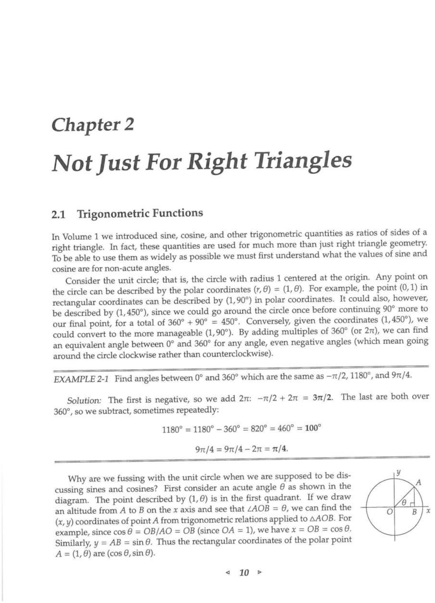

## Printed page 11

<!-- source: volume-2, PDF page 33, printed page 11 -->

Impressed by this success, we could naively try to apply it to $(1, \theta)$ for an obtuse angle $\theta$. But we don't know what $\cos \theta$ and $\sin \theta$ are for obtuse $\theta!$ To solve this problem, we simply define $\cos \theta$ and $\sin \theta$ to be the Cartesian coordinates of the polar point $(1, \theta)$.

Now matters are a little trickier. We'll consider $\theta = 150^\circ$. Once again, we draw an altitude from $A$ to point $B$ on the $x$ axis. Since $\angle AOC = 150^\circ$, we have $\angle AOB = 30^\circ$. Thus we find $x = -OB = -\cos 30^\circ$, where we have a negative sign since $B$ is clearly on the negative $x$ axis. Hence, $\cos 150^\circ = -\cos 30^\circ = -\sqrt{3}/2$. Similarly, we see that $\sin 150^\circ = AB = \sin 30^\circ = 1/2$, where we have a positive result since $A$ is above the $x$ axis.

This gives a general method to find the sine and cosine of any angle, whether acute, obtuse, or worse. First we determine which quadrant the angle is in, then we draw the picture and make a right triangle by drawing an altitude to the $x$ axis. We use basic trigonometry to get the rectangular coordinates $(x, y)$ of the point $(1, \theta)$, remembering that points to the left of the $y$ axis have a negative $x$ and those below the $x$ axis have a negative $y$. We then set $\cos \theta = x$ and $\sin \theta = y$.

**EXAMPLE 2-2 Find $\tan 7\pi/4$.**

Solution: First we determine the quadrant of $7\pi/4$. Since $7\pi/4$ is greater than $3\pi/2$ and less than $2\pi$, the angle is in the fourth quadrant, as shown. We draw our altitude and find $\angle BOA$. Let $C$ be the point $(1, 0)$. Since the arc from $C$ to $A$ counterclockwise has measure $7\pi/4$ radians and an entire circle has $2\pi$ radians, the remaining arc $\overrightarrow{AC}$ has $2\pi - 7\pi/4 = \pi/4$ radians. Thus $OB = \cos 7\pi/4 = \sqrt{2}/2$ and $AB = \sin 7\pi/4 = \sqrt{2}/2$. Since $A$ is in the fourth quadrant, $x$ is positive and $y$ is negative, so $\cos 7\pi/4 = OB = \sqrt{2}/2$ and $\sin 7\pi/4 = -AB = -\sqrt{2}/2$. Hence we have

$$\tan 7\pi/4 = \frac{\sin 7\pi/4}{\cos 7\pi/4} = -1.$$

(Notice that we found the sine and cosine of the angle and then used these to determine the tangent; this is how we will almost always determine trigonometric functions.)

Do not be too intimidated by this example; finding sines and cosines is very easy once you've had practice. Eventually you'll be able to do all this reasoning in your head quite quickly.

**EXERCISE 2-1 In what quadrants are $30^\circ, 700^\circ, 5\pi/3,$ and $-3\pi/5$?**

**EXERCISE 2-2 How would we find $\sin \theta$ and $\cos \theta$ if the point $(1, \theta)$ is on the $x$ axis? the $y$ axis? For what angles $\theta$ does this occur?**

**EXERCISE 2-3 Evaluate $\sin 300^\circ, \cos 225^\circ, \csc 150^\circ, \cot 5\pi/3, \tan \pi,$ and sec $5\pi/6$.**

**EXERCISE 2-4 Evaluate more trig (shorthand for trigonometric or trigonometry) functions using angles which are multiples of $30^\circ$ or $45^\circ$. Then use a calculator to check your work.**

**EXERCISE 2-5 Always make sure your sign (positive or negative) is correct when evaluating trig functions. How can we tell what the signs of $\cos \theta$ and $\sin \theta$ are given an angle $\theta$?**

It's awfully easy to mix up the cosine and sine values for multiples of $30^\circ$. If you're ever confused, draw the angle on the unit circle; using the resulting geometry you should be able to reason which is which.

Original scan — PDF page 33

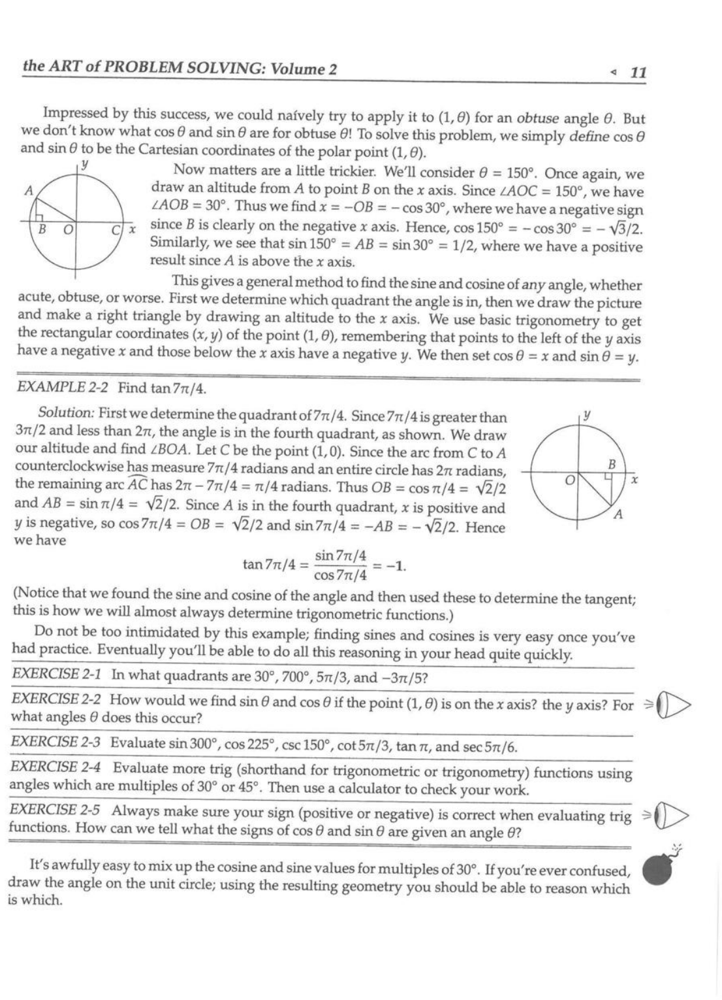

## Printed page 12

<!-- source: volume-2, PDF page 34, printed page 12 -->

**EXAMPLE 2-3 Use our geometric approach to show that for any obtuse angle $\theta$, $\sin \theta = \sin(\pi - \theta)$.**

Solution: In our figure we have $AB = \sin \angle AOB$ from right triangle $AOB$ (with $AO = 1$). Since $A$ is in the second quadrant, we have $AB = \sin \angle AOC = \sin \theta$. Equating these expressions for $AB$, we find

$$\sin \theta = \sin \angle AOB = \sin(\pi - \theta)$$

as desired.

**EXERCISE 2-6 Use the same reasoning as above to show that $\cos \theta = -\cos(\pi - \theta)$.**

### 2.2 Graphing Trigonometric Functions

Knowing what a function looks like is often quite useful in understanding problems involving the function. In this section we’ll discuss the graphs of the basic trigonometric functions $\sin x$, $\cos x$, and $\tan x$.

For cosine, we know that $\cos 0 = 1$, $\cos \pi/2 = \cos 3\pi/2 = 0$, and $\cos \pi = -1$. We also know that outside the range $0 \leq x < 2\pi$, the values of cosine repeat those inside the range (since the angles outside the range $[0, 2\pi)$ are equivalent to those inside). Thus, we sketch $\cos x$ for the range $0 \leq x < 2\pi$ and continue this pattern indefinitely in both directions as above. This graphical form is called a sinusoid.

Using the same analysis as for cosine we can generate the graph of $\sin x$, shown at left. Make sure you see how this graph describes sine. Look for particular points you know, like $\sin \pi/2 = 1$, and look for where you know sine is positive. Graphing $\tan x$ is a little trickier, and we do so by noting that $\tan x = \sin x/\cos x$. Since $\sin 0 = 0$ and $\cos 0 = 1$, the graph of $\tan x$ must pass through the origin. Since sine and cosine are both positive in the first quadrant, $\tan x$ is positive for $0 < x < \pi/2$. Finally, since $\cos x$ gets closer and closer to zero as we approach $x = \pi/2$, $\tan x$ gets larger and larger. Try dividing 1 by 0.1, 0.01, and 0.001 to see what happens to $\tan x$ as we approach $x = \pi/2$.

On the other side of the origin, where the angle is in quadrant IV for $-\pi/2 < x < 0$ (make sure you see why), sine is negative and cosine is positive, so $\tan x$ is negative. As before, as we approach $x = -\pi/2$, cosine approaches 0, so the magnitude of $\tan x$ grows and grows, producing the graph on the right. (It continues past $y = 4$ upward and $y = -4$ downward.) Unlike the graphs of $\sin x$ and $\cos x$, the graph of $\tan x$ repeats after every interval of length $\pi$ rather than $2\pi$. (Why?) Use your knowledge of sec $x$, csc $x$, and cot $x$ to graph these functions.

Original scan — PDF page 34

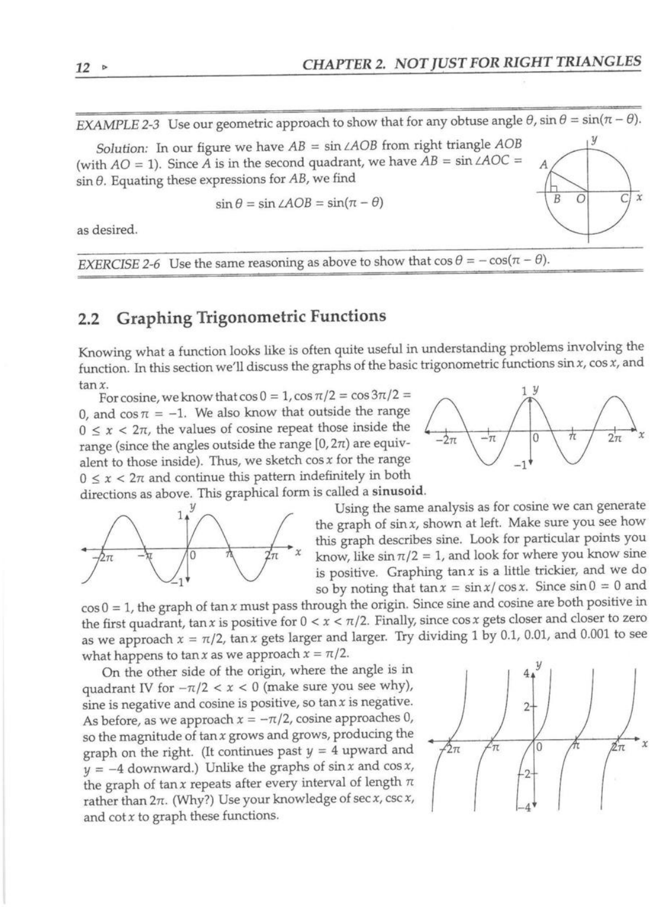

## Printed page 13

<!-- source: volume-2, PDF page 35, printed page 13 -->

**EXERCISE 2-7** Before proceeding, make sure you are satisfied that the above graphs do indeed represent sine, cosine and tangent.

Now that we understand the trigonometric functions, let's try applying the functional transformations we discussed in Volume 1 to trig functions.

We'll start by letting $f(x) = \sin x$. The values of this function range from $-1$ to $1$. It follows that the function $2f(x)$ (a vertical stretch of $f(x)$) varies from $-2$ to $2$. This length of this range can be used to help describe trigonometric functions. The amplitude of a graph is half the difference between its largest and smallest values. Thus, for $f(x) = \sin x$, the amplitude is 1 and that of $2f(x) = 2\sin x$ is 2. A simple extension of this reveals that for any trigonometric function, the amplitude is dictated by the coefficient of the function. (Remember, amplitude measures a distance so it is never negative.)

Let's look at $f(2x) = \sin 2x$. At right are the graphs of $f(x)$ (solid line) and $f(2x)$ (dashed line). The transformation $f(2x)$ is a horizontal shrink by a factor of 2. Thus, while $f(x)$ goes from 0 to 1 as $x$ goes from 0 to $\pi/2$, $f(2x)$ goes from 0 to 1 in half this interval.

We now are ready to define the period as the amount of the graph (in terms of $x$) we can draw before we must start repeating. For example, to graph $f(2x)$ we draw the graph from $x = 0$ to $x = \pi$ then repeat this range indefinitely. Thus, the period of $f(2x) = \sin 2x$ is $\pi$. Similarly, the period of $\sin x$ is $2\pi$. Clearly, the coefficient of $x$ in our trig functions determines the period, since this coefficient is responsible for the horizontal shrinking or stretching of the graph. From this analysis of period, we see that the period of $f(kx) = \sin kx$ is $2\pi/k$ for all $k$ since $f(x)$ is shrunk by a factor of $k$ by the transformation $f(kx)$.

Related to the period of a function is the frequency, or how often the graph of the function repeats. For example, the graph of $\sin x$ repeats every $2\pi$, so the frequency is one per $2\pi$, or $1/(2\pi)$. Since a graph of a function repeats every period of the graph, the frequency is always $1/(period)$.

Having looked at a horizontal shrink, we move on to the horizontal slide $f(x - \pi/2) = \sin(x - \pi/2)$. The graphs of $f(x)$ (solid line) and $f(x - \pi/2)$ (dashed line) are shown at left. As discussed in Volume 1, the transformation $f(x - \pi/2)$ results in a $\pi/2$ slide to the right of $f(x)$. We define the phase shift of a function $f(x - k)$ as the amount the graph is shifted from the 'parent' function $f(x)$. If a direction is not given for the phase shift, a positive phase shift is to the right and a negative to the left.

WARNING: What about the phase shift of $\sin(2x - \pi/2)$? Referring to our above discussion of phase shift, the 'parent' function is $g(x) = \sin 2x$, since $\sin(2x - \pi/2)$ is a shift of $\sin 2x$, not a shift of $\sin x$. (Graph them and see!) The desired function $\sin(2x - \pi/2)$ is $g(x - \pi/4)$ (make sure you see this), so the phase shift is $\pi/4$ to the right, not $\pi/2$.

**EXAMPLE 2-4 Determine the period, amplitude, phase shift, and frequency of $f(x) = 3\sin(4x + \pi) + 7$.**

Solution: Since the period of $\sin x$ is $2\pi$, the period of $f(x)$ is $2\pi/4 = \pi/2$. Since $3\sin(4x + \pi)$ ranges from 3 to $-3$, $f(x)$ ranges from $3 + 7 = 10$ to $-3 + 7 = 4$, so the amplitude is $(10 - 4)/2 = 3$. Notice that the amplitude is still the coefficient of the trigonometric function despite the '+7'.

Original scan — PDF page 35

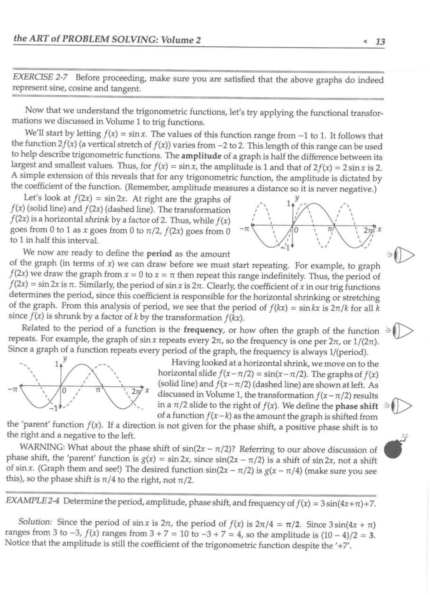

## Printed page 14

<!-- source: volume-2, PDF page 36, printed page 14 -->

For the phase shift, we see that the parent function is $g(x) = \sin 4x + 7$ and $f(x) = g(x + \pi/4)$. Hence the phase shift is $x = -\pi/4$ (or $\pi/4$ to the left). Finally, the frequency is just the reciprocal of the period, or $2/\pi$.

**EXERCISE 2-8** Prove that the phase shift of $f(x) = \sin(ax + b)$ is $-b/a$.

**EXAMPLE 2-5** Find the frequency, period, and amplitude of the function at right.

**Solution:** The important thing here is that trigonometric functions are not the only periodic functions; there are many, many functions which repeat over and over. Draw some yourself! Since the given graph repeats every 3 units, its period is 3 and its frequency is $1/3$. Since it varies from $-2$ to 5, its amplitude is $[5 - (-2)]/2 = 3.5$.

**EXERCISE 2-9** What is the period of $\tan 2x$? (Not $\pi$!)

### 2.3 Going Backwards

Suppose we are 1000 feet away from a 500 foot tall tower and we wish to aim a laser at a mirror mounted on top of the tower. At what angle $\theta$ should we aim the laser? Although we don't have the angle immediately, we do have enough information to figure it out. The tangent of the desired angle is $500/1000 = 1/2$. Looking back at our graph of $\tan x$, we see there is only one acute angle $\theta$ for which $\tan \theta = 1/2$. This is our desired angle, and we write it as $\theta = \tan^{-1}(1/2)$. This is also often written as $\theta = \arctan(1/2)$. WARNING: The expression $\tan^{-1}y$ does not mean $1/(tan y)$, and the same is true of the other trigonometric functions. To write the reciprocal of $\sin x$, we must write $(\sin x)^{-1}$. (Unlike $\sin^2x$, which does mean $(\sin x)^2$. Sorry for this discrepancy, but we didn't make the rules!)

Even a casual glance at the graph of $\tan x$ will show that there are actually many values of $x$ at which $\tan x = 1/2$. How do we know which one is intended by the expression $\tan^{-1}(1/2)$? We don't. There are infinitely many values of $\tan^{-1}(1/2)$. To show that we want the acute angle as in the diagram above (rather than one of the other values), we write $\theta = \tan^{-1}1/2$, where the capital T shows that we are interested only in the principal value, or the value that lies in the first period of $\tan x$. Since this period ranges from $-\pi/2$ to $\pi/2$, we will always have $-\pi/2 < \tan^{-1}x < \pi/2$. Similarly, $\arctan x$ implies the principal value as well.

If we apply this concept to $\sin^{-1}1/2$, we will note that there are still two values of $x$ in the first period of $\sin x$ for which $\sin x = 1/2$. Thus we need to restrict ourselves to the first half-period in which $\sin x$ ranges from $-1$ to 1. So, we have $-\pi/2 \leq \sin^{-1}y \leq \pi/2$. (Note that $\sin^{-1}y$ can equal $\pi/2$ or $-\pi/2$, while $\tan^{-1}y$ cannot.)

After seeing that the principal values of inverse sine and inverse tangent are both between $-\pi/2$ and $\pi/2$, we may suspect that the principal values of inverse cosine are also in that range. So what is $\cos^{-1}(-1/2)$? For all $x$ in the range from $-\pi/2$ to $\pi/2$, $\cos x$ is positive. This is clearly not the right range. We should use $0 \leq \arccos x \leq \pi$ instead. Convince yourself by looking at the graph of $\cos x$ that this is a sufficient range.

Original scan — PDF page 36

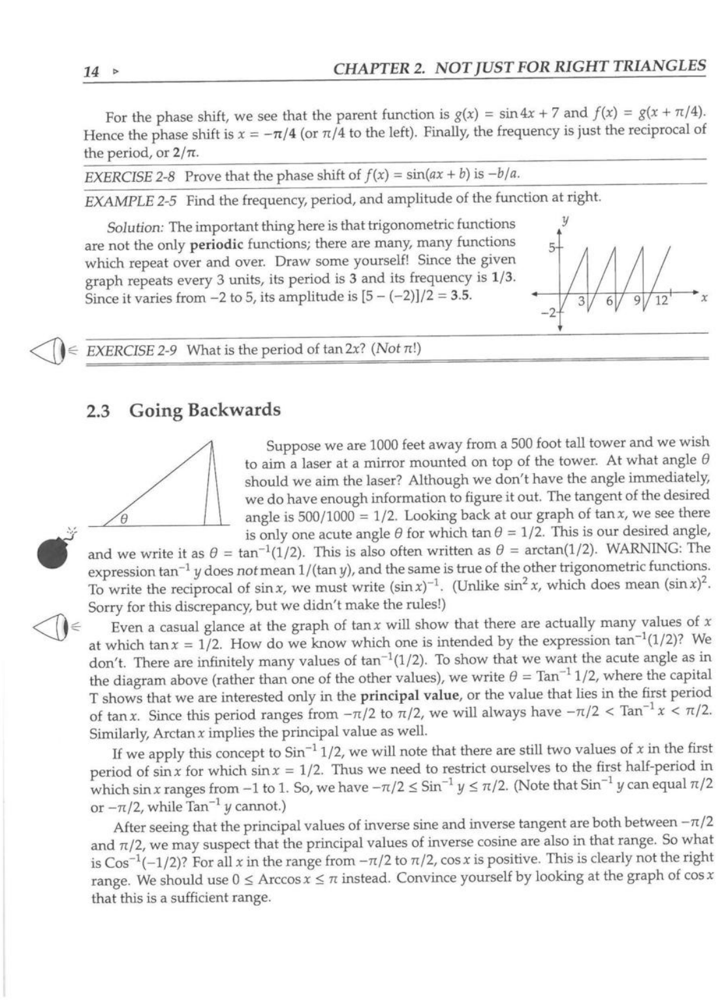

## Printed page 15

<!-- source: volume-2, PDF page 37, printed page 15 -->

**EXAMPLE 2-6 Find $\sin^{-1} 0$ and $\operatorname{Arcsec} 2$.**

Solution: Since $\sin x = 0$ at all $x$ which are integral multiples of $\pi$, we can write $\sin^{-1} 0 = n\pi$, for $n = \ldots, -2, -1, 0, 1, 2, \ldots$.

Since $\sec x = 1/\cos x$, for $\operatorname{Arcsec} 2$ we seek the angle in the range $[0, \pi)$ such that $\cos x = 1/2$. Thus, $x = \pi/3$. Is it clear why the principal values of inverse secant are in the same range as those of inverse cosine?

**EXERCISE 2-10 What is wrong with the statement $\sin^{-1} 1 - \operatorname{Sin}^{-1} 1 = 0$?**

**EXERCISE 2-11 Evaluate $\operatorname{arccsc} -1, \operatorname{Cos}^{-1} \sqrt{2}/2$, and $\operatorname{Arctan}(-\sqrt{3}/3)$.**

### 2.4 Tying It All Together

Since the graphs of $\sin x$ and $\cos x$ are very similar, you may suspect that they can be easily related. You’re right. First, since $\sin x$ is the same as $\cos x$ shifted to the right by $\pi/2$, we can say $\sin x = \cos(x - \pi/2)$. (Look at the graphs and see!)

In the graph at right, we have plotted $\sin x$ and $\sin(x - \pi)$ on the same graph. We see that $\sin(x - \pi)$ is the reflection of $\sin x$ in the $x$ axis! Thus, $\sin(x - \pi)$ is everywhere the negative of $\sin x$, or $\sin(x - \pi) = -\sin x$. Try finding the relationship between $\cos x$ and $\cos(x - \pi)$.

Now consider reflections in the $y$ axis. Just as $-f(x)$ is the reflection of $f(x)$ in the $x$ axis, $f(-x)$ is the reflection of $f(x)$ in the $y$ axis. Choose a few functions $f(x)$ and plot the functions and the respective $f(-x)$ to see their relationships to each other. Applying this principle to $\cos x$, we see that the reflection of $\cos x$ in the $y$ axis gives the same graph back. Thus, $\cos(-x) = \cos x$, so we find that $\cos x$ is an even function.

The reflection of $\sin x$ in the $y$ axis is another matter. As with $\sin(x - \pi), \sin(-x)$ is everywhere the negative of $\sin x$, so $\sin x = -\sin(-x)$ and $\sin x$ is an odd function.

When working with expressions involving negatives and multiples of $90^\circ$ as we have above, it is often useful to look at the graphs of the resulting functions to determine their connections to $\sin x, \cos x$, or $\tan x$. While we will later examine faster methods to do this, it is very important to learn how the trigonometric functions are related and to understand their graphical representations.

**EXAMPLE 2-7 Use graphical analysis as above to show $\sin x = \cos(90^\circ - x)$, which we showed in Volume 1 using the geometry of right triangles.**

Original scan — PDF page 37

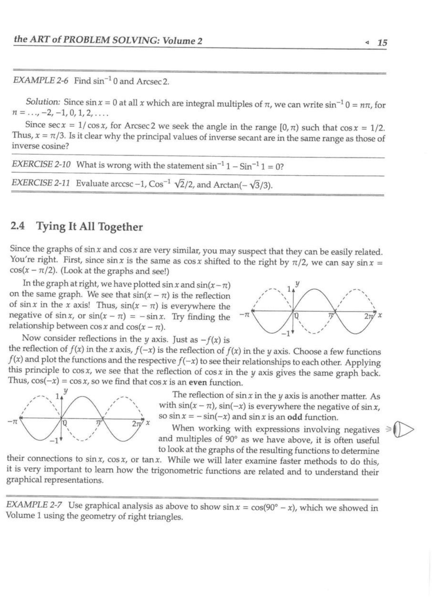

## Printed page 16

<!-- source: volume-2, PDF page 38, printed page 16 -->

Solution: We'll draw $\cos(\pi/2 - x)$ in steps. First we draw $\cos(-x)$ by reflecting $\cos x$ in the $y$ axis (the dashed lines in the graph). Then we draw $\cos(\pi/2 - x) = \cos(-x + \pi/2)$ by shifting the graph of $\cos(-x)$ to the right by $\pi/2$ (the solid lines). Make sure you see that why this is a shift to the right, not the left. The resulting graph of $\cos(-x + \pi/2)$ is the same as $\sin x$, as you can verify.

**EXERCISE 2-12 Which of the following functions are odd and which are even: $\sin x$, $\cos x$, $\tan x$, $\csc x$, $\sec x$, and $\cot x$?**

**EXERCISE 2-13 Find each of the following as trigonometric functions of $x$: $\sec(270^\circ + x)$, $\cos(\pi + x)$, $\tan(450^\circ + x)$, and $\sin(3\pi - x)$.**

We've figured out how to handle trigonometric functions of sums and differences of angles where one of the angles is a multiple of $90^\circ$. How about other angles? To answer this, we will use a method proposed by Masakazu Nihei of Japan in Mathematics & Informatics Quarterly (Vol. 3, No. 2).

Consider the triangle $ABC$ at left. We'll find the area of this triangle in two ways, both as $\frac{1}{2}(AB)(AC)(\sin \angle BAC)$ and also as $[ABH] + [ACH]$. We let $AH = 1$ and express the sides of right triangles $ACH$ and $ABH$ in terms of $\alpha$ and $\beta$. (For example, $\cos \alpha = AH/AB = 1/AB$ so $AB = 1/\cos \alpha$.) Hence, we have

$$[ABC] = [ABH] + [ACH]$$

$$\frac{1}{2}(AC)(AB)(\sin \angle BAC) = \frac{1}{2}(AH)(BH) + \frac{1}{2}(AH)(CH)$$

$$\frac{1}{2}(1/\cos \beta)(1/\cos \alpha)(\sin \angle BAC) = \frac{1}{2}(1)(\tan \alpha) + \frac{1}{2}(1)(\tan \beta)$$

$$\frac{\sin(\alpha + \beta)}{\cos \alpha \cos \beta} = \frac{\sin \alpha}{\cos \alpha} + \frac{\sin \beta}{\cos \beta}$$

$$\sin(\alpha + \beta) = \sin \alpha \cos \beta + \sin \beta \cos \alpha$$

where we get the last equation by multiplying both sides by $\cos \alpha \cos \beta$. This equation and the similar equations which are introduced below can be used to find trigonometric functions of sums and differences of angles.

Note that you will find no eyeballs staring at the problems below. This is because they are all, every single one, very important, and it would be silly to have eight or nine eyeballs.

**EXAMPLE 2-8 Find $\sin 105^\circ$.**

Solution: Let’s write $105^\circ$ as the sum of angles whose sine and cosine we can easily evaluate. Since multiples of $30^\circ$ and $45^\circ$ are manageable, we have

$$\sin 105^\circ = \sin(60^\circ + 45^\circ)$$

$$= \sin 60^\circ \cos 45^\circ + \sin 45^\circ \cos 60^\circ$$

$$= (\sqrt{6} + \sqrt{2})/4.$$

This gives us a slick method to handle angles which are multiples of $15^\circ$ but not multiples of $30^\circ$.

Original scan — PDF page 38

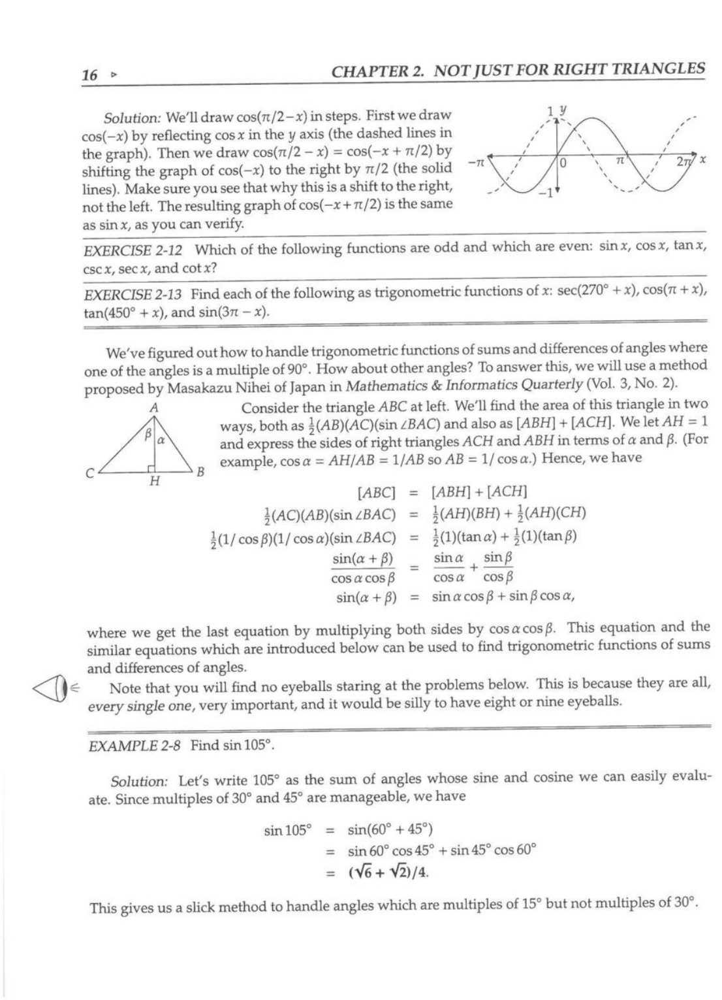

## Printed page 17

<!-- source: volume-2, PDF page 39, printed page 17 -->

**EXERCISE 2-14 Use the figure at right to show that**
$$\sin(\alpha - \beta) = \sin \alpha \cos \beta - \sin \beta \cos \alpha.$$

**EXERCISE 2-15 How could we use our expression for $\sin(\alpha + \beta)$ to derive an expression for $\sin(\alpha - \beta)$ without using geometry?**

**EXAMPLE 2-9 Use $\sin(90^\circ - \alpha) = \cos \alpha$ to find an expression for $\cos(\alpha + \beta)$ similar to those above.**

Solution: Since $\cos(\alpha + \beta) = \sin(90^\circ - \alpha - \beta)$, we have
$$\cos(\alpha + \beta) = \sin([90^\circ - \alpha] - \beta)$$
$$= \sin(90^\circ - \alpha) \cos \beta - \sin \beta \cos(90^\circ - \alpha)$$
$$= \cos \alpha \cos \beta - \sin \alpha \sin \beta.$$

**EXERCISE 2-16 Find an expression for $\cos(\alpha - \beta)$.**

**EXAMPLE 2-10 Find $\tan(\alpha + \beta)$ in terms of $\tan \alpha$ and $\tan \beta$.**

Solution: First we'll write the tangent in terms of sine and cosine:
$$\tan(\alpha + \beta) = \frac{\sin(\alpha + \beta)}{\cos(\alpha + \beta)}$$
$$= \frac{\sin \alpha \cos \beta + \sin \beta \cos \alpha}{\cos \alpha \cos \beta - \sin \alpha \sin \beta}.$$

We can divide the top and bottom of this fraction by $\cos \alpha \cos \beta$, yielding
$$\tan(\alpha + \beta) = \frac{\tan \alpha + \tan \beta}{1 - \tan \alpha \tan \beta}.$$

**EXERCISE 2-17 Find $\cot(\alpha - \beta)$ in terms of $\cot \alpha$ and $\cot \beta$.**

**EXERCISE 2-18 (Finally some numbers!) Evaluate $\sin 15^\circ$, $\sec 5\pi/12$, and $\cos(-345^\circ)$.**

Once again, it is not necessary to memorize all of these formulas; once you have used them a couple times though, it is hard not to. It is perhaps best to know just $\sin(\alpha + \beta)$ by heart; it’s easy to derive the rest quickly from that one, as we have seen.

An important application of the sum and difference formulas is in handling expressions like $\sin 2x$. Writing $\sin 2x = \sin(x + x)$ and using the sum formula, we generate one of the double angle formulas,

$$\sin 2x = 2 \sin x \cos x.$$

Similarly, we find that
$$\cos 2x = \cos^2 x - \sin^2 x$$

and
$$\tan 2x = \frac{2 \tan x}{1 - \tan^2 x}.$$

Original scan — PDF page 39

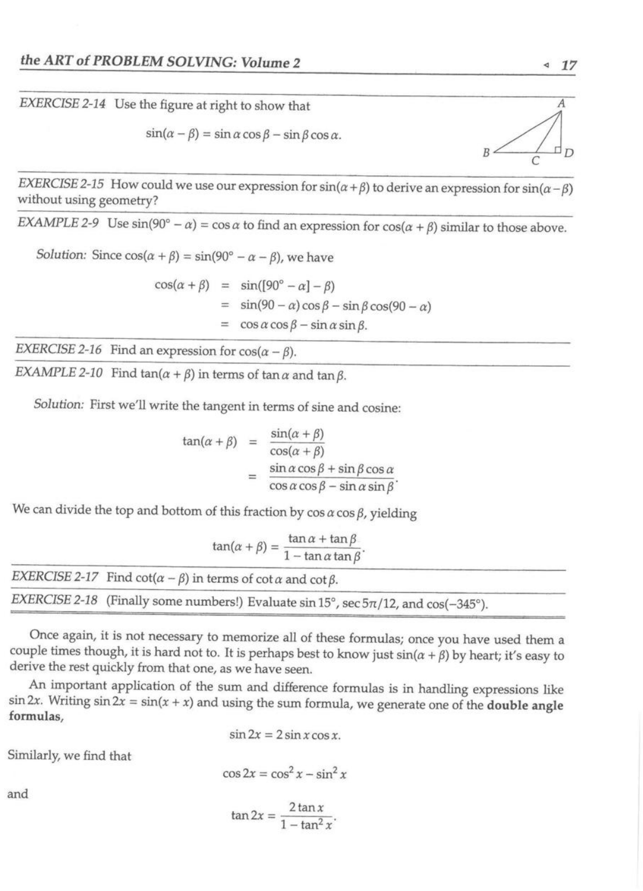

## Printed page 18

<!-- source: volume-2, PDF page 40, printed page 18 -->

Use the sum formulas for cosine and tangent to prove these. Using $\sin^2 x + \cos^2 x = 1$, which we proved in the first volume, we can write $\cos 2x$ in a couple other, equally useful, ways:

$$\cos 2x = 2\cos^2 x - 1$$
$$= 1 - 2\sin^2 x.$$

These two are often used to evaluate integrals involving cosines and sines, so when you learn integral calculus, you'll be seeing them again.

Related to $\sin^2 x + \cos^2 x = 1$ are the identities $1 + \tan^2 x = \sec^2 x$ and $1 + \cot^2 x = \csc^2 x$, which were also discussed in the first volume. (And which you should be able to prove quickly.) These three identities are clearly most useful when working with squares of trigonometric functions.

**EXAMPLE 2-11 Use the above formula for $\cos 2x$ to create formulas for $\sin x/2$ and $\cos x/2$.**

Solution: Applying our double angle formulas to $\cos x$, we have

$$\cos x = \cos^2 \frac{x}{2} - \sin^2 \frac{x}{2} = 2\cos^2 \frac{x}{2} - 1 = 1 - 2\sin^2 \frac{x}{2}.$$

The first of the three expressions for $\cos x$ isn't terribly useful, but the second and third are, as we can solve for the desired expressions in terms of $\cos x$:

$$\cos \frac{x}{2} = \pm \sqrt{\frac{1 + \cos x}{2}}$$
$$\sin \frac{x}{2} = \pm \sqrt{\frac{1 - \cos x}{2}}.$$

The $\pm$ signs are a result of taking square roots. How do we know which to use? We use our knowledge of the signs of sine and cosine. If $x/2$ is in the first quadrant, we use $+$ for both, and so on.

**EXERCISE 2-19 Use the above formula for $\sin x/2$ to determine $\sin 15^\circ$.**

**EXERCISE 2-20 When I use $\sin(60^\circ - 45^\circ)$ to evaluate $\sin 15^\circ$, I get $(\sqrt{6} - \sqrt{2})/4$, but when I use $\sin(30^\circ/2)$, I get $(\sqrt{2} - \sqrt{3})/2$. Have I done something wrong? Which method is easier?**

**EXERCISE 2-21 Find two expressions which contain no square roots for $\tan x/2$ in terms of $\sin x$ and $\cos x$.**

**EXAMPLE 2-12 Find the amplitude of $f(x) = 3\sin x + \cos x$.**

Solution: We might be tempted to say the answer is $(3 + 1) = 4$, but this is not right. (Can you find an $x$ for which this function equals 4?) If we can express this sum as a single sine or cosine, we can find the amplitude easily.

Recall our formula for $\sin(x + y)$,

$$\sin(x + y) = \sin x \cos y + \sin y \cos x.$$

Comparing this to $f(x)$, we can write the function as a single sine if we find an angle $y$ for which $\cos y = 3$ and $\sin y = 1$. However, $\cos y = 3$ is ridiculous for real numbers $y$. A little better is

Original scan — PDF page 40

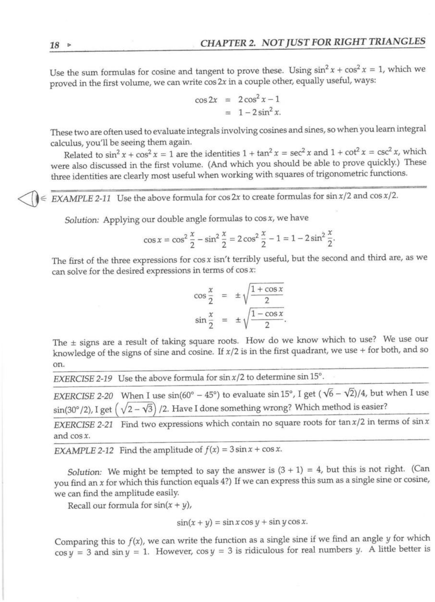

## Printed page 19

<!-- source: volume-2, PDF page 41, printed page 19 -->

$f(x)/4 = \frac{3}{4} \sin x + \frac{1}{4} \cos x$. Now we need an angle for which $\cos y = \frac{3}{4}$ and $\sin y = \frac{1}{4}$. Still no such angle exists, because these values violate $\sin^2 y + \cos^2 y = 1$. We're not lost yet, though. Let's try a generic scaling $A$, so we can write

$$Af(x) = 3A \sin x + A \cos x,$$

where $\cos y = 3A$ and $\sin y = A$. We thus have $\sin^2 y + \cos^2 y = 10A^2 = 1$, or $A = 1/\sqrt{10}$. We then have

$$\frac{f(x)}{\sqrt{10}} = \cos y \sin x + \cos x \sin y = \sin(x + y).$$

Thus $f(x) = \sqrt{10} \sin(x + y)$. Remembering that $y$ is a constant angle, the amplitude of $f(x)$ is $\sqrt{10}$.

**EXERCISE 2-22** Notice that the answer to the previous problem is $\sqrt{3^2 + 1^2}$, where the 3 and the 1 are the coefficients of sine and cosine. Is this true in general, i.e. is the amplitude of $a \sin x + b \cos x$ always $\sqrt{a^2 + b^2}$?

**EXAMPLE 2-13** Find the period of $f(x) = \sin 2x + \cos 3x$.

**Solution:** The period of $\sin 2x$ (light dashed line) is $\pi$ and that of $\cos 3x$ (light dotted line) is $2\pi/3$. In one full period of length $T$ of $f(x)$, both $\sin 2x$ and $\cos 3x$ must go through an integral number of periods. (Why?) Hence, for some positive integers $m$ and $n$, we have $T = m\pi = 2n\pi/3$. Writing this as $n = 3m/2$, the smallest possible solutions are $(m, n) = (2, 3)$. (Why do we want the smallest solutions?) The period of $f(x)$ is then $T = 2\pi$.

**EXERCISE 2-23** Extend the above argument to find the period of $\sin(ax/b) + \cos(cx/d)$, where $a, b, c,$ and $d$ are integers and $a/b$ and $c/d$ are in lowest terms.

To derive a final set of trig identities, notice what happens when we add $\cos(x + y)$ and $\cos(x - y)$. The products of sines cancel and we are left with $2 \cos x \cos y!$ Thus

$$\cos(x + y) + \cos(x - y) = 2 \cos x \cos y.$$

Letting $\alpha = x + y$ and $\beta = x - y$, we can write this as

$$\cos \alpha + \cos \beta = 2 \cos \left( \frac{\alpha + \beta}{2} \right) \cos \left( \frac{\alpha - \beta}{2} \right).$$

Original scan — PDF page 41

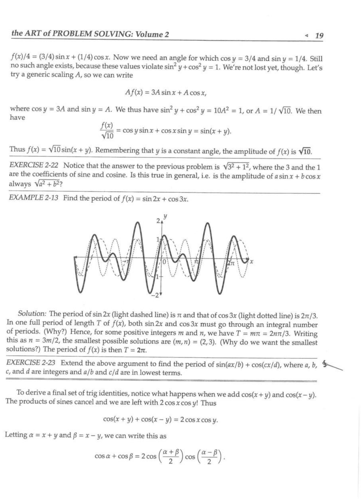

## Printed page 20

<!-- source: volume-2, PDF page 42, printed page 20 -->

Similarly, we can find the following expressions:

$$\cos \alpha - \cos \beta = -2 \sin \left( \frac{\alpha + \beta}{2} \right) \sin \left( \frac{\alpha - \beta}{2} \right)$$

$$\sin \alpha + \sin \beta = 2 \sin \left( \frac{\alpha + \beta}{2} \right) \cos \left( \frac{\alpha - \beta}{2} \right)$$

$$\sin \alpha - \sin \beta = 2 \cos \left( \frac{\alpha + \beta}{2} \right) \sin \left( \frac{\alpha - \beta}{2} \right).$$

### 2.5 Solving Problems Using Trigonometric Identities

Look closely at each of the following examples; each one exhibits a common technique in attacking problems using the trig identities of the previous sections. Some methods of solving these trig identity problems are discussed below, but the best tool is experience, so take the time to work through all the problems yourself.

- Look for angles whose sum or difference is a multiple of $90^\circ$. If these exist, we can often use our relations like $\sin(180^\circ - x) = \sin x$ and $\sin(90^\circ - x) = \cos x$.
- When you see squares of trigonometric relations, try using $\sin^2 x + \cos^2 x = 1$ or the related identities.
- Look for pairs of angles whose ratio is a power of 2. For example,

$$\frac{\sin 20^\circ}{\cos 10^\circ} = \frac{2 \sin 10^\circ \cos 10^\circ}{\cos 10^\circ} = 2 \sin 10^\circ.$$

Using the double angle formulas as above will often simplify such expressions.

- When working with the trigonometric functions besides sine and cosine, it is often helpful to write the problem in terms of just sine and cosine.
- Don’t work with inverse trig functions. Apply trigonometric functions to equations involving inverse trig functions to get rid of them.

### EXAMPLE 2-14 Evaluate

$$\tan 10^\circ \tan 20^\circ \tan 30^\circ \cdots \tan 80^\circ.$$

**Solution:** Writing this in terms of sines and cosines, we have

$$\frac{\sin 10^\circ \sin 20^\circ \sin 30^\circ \cdots \sin 80^\circ}{\cos 10^\circ \cos 20^\circ \cos 30^\circ \cdots \cos 80^\circ}.$$

Applying $\sin x = \cos(90^\circ - x)$ to each term in the numerator, we get

$$\frac{\cos 80^\circ \cos 70^\circ \cos 60^\circ \cdots \cos 10^\circ}{\cos 10^\circ \cos 20^\circ \cos 30^\circ \cdots \cos 80^\circ} = 1.$$

### EXAMPLE 2-15 Write

$$(\sin 13^\circ + \sin 167^\circ + \cos 13^\circ + \cos 167^\circ) (\sin 13^\circ - \sin 167^\circ + \cos 13^\circ - \cos 167^\circ)$$

in the form $a \sin x^\circ$.

Original scan — PDF page 42

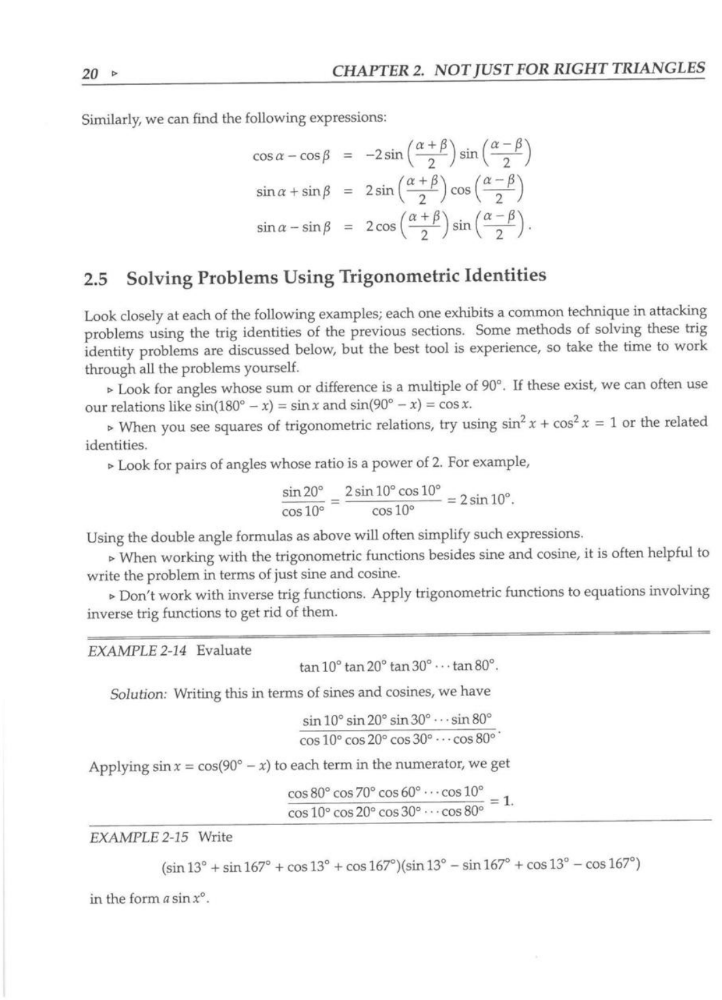

## Printed page 21

<!-- source: volume-2, PDF page 43, printed page 21 -->

Solution: Instead of multiplying out the product, we note that $13^\circ + 167^\circ = 180^\circ$ and use the relations $\sin x = \sin(180^\circ - x)$ and $\cos x = -\cos(180^\circ - x)$. Thus $\sin 13^\circ = \sin 167^\circ$ and $\cos 13^\circ = -\cos 167^\circ$, and our product is

$$\left(2 \sin 13^\circ\right)\left(2 \cos 13^\circ\right) = 4 \sin 13^\circ \cos 13^\circ = 2 \sin 26^\circ.$$

**EXAMPLE 2-16 Find $x$ if $\tan^{-1} x = \tan^{-1} 4 + \tan^{-1} 6$.**

Solution: Working with inverse functions is pretty difficult, so how do we get rid of them? Simply use $\tan(\tan^{-1} y) = y$. Taking tangents of both sides of the given equation, we have

$$x = \tan(\tan^{-1} 4 + \tan^{-1} 6)$$

$$= \frac{\tan(\tan^{-1} 4) + \tan(\tan^{-1} 6)}{1 - \tan(\tan^{-1} 4) \tan(\tan^{-1} 6)}$$

$$= (4 + 6)/(1 - 4 \cdot 6) = -10/23.$$

**EXAMPLE 2-17 Find $\sec x$ in terms of $y$ if $x = \tan^{-1} y$.**

Solution: Taking tangents of the given equation, we have $\tan x = y$. Using $1 + \tan^2 x = \sec^2 x$, we get $\sec^2 x = 1 + y^2$, or $\sec x = \pm \sqrt{1 + y^2}$.

**EXERCISE 2-24 Simplify $\sqrt{\frac{2 \sin x - \cos x \sin 2x}{\sin 2x \sec x}}$ for $x$ such that $0^\circ < x < 90^\circ$. (MAΘ 1992)**

You will have many more opportunities to try your hand at using trigonometric identities in the problems below. You will also be asked to solve equations given in terms of trigonometric functions. Two important guidelines for solving these are:

▶ Write the equation as $f(x) = 0$ and use all the identities you know to factor $f(x)$ as much as possible. (Double angle formulas and $\cos^2 x + \sin^2 x = 1$ are very useful here.) Setting each factor equal to 0 should then give you all the answers. It is often useful to write the equation in terms of a single trigonometric function.

▶ Given a value for $\sin x + \cos x$ or $\sin x - \cos x$, we can find $\sin 2x$, and hence $x$, by squaring the given relation. Try it and see!

Problems to Solve for Chapter 2

14. Find the value of $\sin^2 10^\circ + \sin^2 20^\circ + \sin^2 30^\circ + \cdots + \sin^2 90^\circ$. (MAΘ 1992)

15. Evaluate $\csc \left( \arcsin \frac{1}{2} - \arccos \frac{1}{2} \right)$. (MAΘ 1991)

16. Given that $\arcsin x = y$, find $\tan y$ in terms of $x$.

17. Given a positive integer $n$ and a number $c$, $-1 < c < 1$, for how many values of $q$ in $[0, 2\pi)$ is $\sin nq = c$? (MAΘ 1992)

18. Given the triangle $ABC$ with side $a$ opposite $\angle A$, side $b$ opposite $\angle B$, and side $c$ opposite $\angle C$, find $\sin A + \sin 2B + \sin 3C$ if $a = 3, b = 4$, and $c = 5$. (MAΘ 1991)

Original scan — PDF page 43

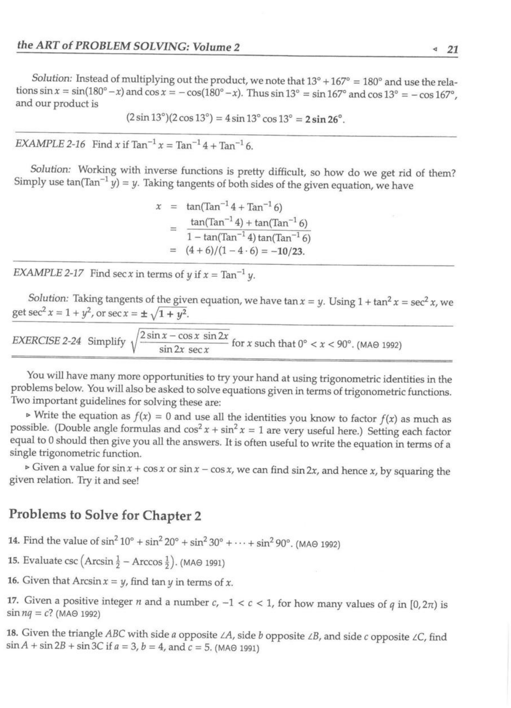

## Printed page 22

<!-- source: volume-2, PDF page 44, printed page 22 -->

19. Solve for $x$: $\operatorname{Arctan}\frac{x}{2}+\operatorname{Arctan}\frac{2x}{3} = \frac{\pi}{4}$. (MAΘ 1991)

20. Find the period of $2 \sin(4\pi x + \pi/2) + 3 \cos(5\pi x)$. (MAΘ 1992)

21. Write $\sin^4 x$ in terms of $\cos 2x$ and $\cos 4x$. (MAΘ 1991)

22. Which of the following equals $\cot 10 + \tan 5$: $\csc 5, \csc 10, \sec 5, \sec 10$, or $\sin 15$? (AHSME 1989)

23. If $\sin x = \cos 2x$ and $0 \leq x \leq \pi/2$, then find $x$. (MAΘ 1992)

24. Prove the following equalities. (M&IQ 1992)
   i. $\sin 10^\circ \sin 20^\circ \sin 30^\circ = \sin 10^\circ \sin 10^\circ \sin 100^\circ$;
   ii. $\sin 20^\circ \sin 20^\circ \sin 30^\circ = \sin 10^\circ \sin 20^\circ \sin 80^\circ$;
   iii. $\sin 20^\circ \sin 30^\circ \sin 30^\circ = \sin 10^\circ \sin 40^\circ \sin 50^\circ$.

25. Compute the number of degrees in the smallest positive angle $x$ such that
   $8 \sin x \cos^5 x - 8 \sin^5 x \cos x = 1$.

(ARML 1988)

26. If $\sin x + \cos x = -1/5$ and $3\pi/4 \leq x \leq \pi$, find the value of $\cos 2x$. (MAΘ 1992)

27. If $0^\circ < x < 180^\circ$ and $\cos x + \sin x = 1/2$, then find $(p, q)$ such that $\tan x = -\frac{p+\sqrt{q}}{3}$. (ARML 1988)

28. Quadrilateral $ABCD$ is inscribed in a circle with diameter $AD = 4$. If sides $AB$ and $BC$ each have length 1, then find $CD$. (AHSME 1971)

29. Find $\tan x$ if
   $$\frac{\sin^2 x}{3} + \frac{\cos^2 x}{7} = \frac{-\sin(2x) + 1}{10}.$$

(MAΘ 1991)

30. If $A = 20^\circ$ and $B = 25^\circ$, then find the value of $(1 + \tan A)(1 + \tan B)$. (AHSME 1985)

31. If $\theta$ is acute and $\sin \frac{1}{2}\theta = \sqrt{\frac{x-1}{2x}}$, then find $\tan \theta$ in terms of $x$. (AHSME 1973)

32. If $ABCD$ is a trapezoid with $DC$ parallel to $AB$, $\angle DCB$ is a right angle, $DC = 6$, $BC = 4$, $AB = y$, and $\angle ADB = x$, find $y$ in terms of $x$. (MAΘ 1990)

33. Evaluate $\cos 36^\circ - \cos 72^\circ$. (AHSME 1975)

34. Using the area of a regular pentagon, prove that $4 \sin \frac{2\pi}{5} + \tan \frac{2\pi}{5} = 5 \cot \frac{\pi}{5}$. (M&IQ 1993)

35. Use a $36^\circ-72^\circ-72^\circ$ triangle to prove that $\sin 18^\circ = (\sqrt{5} - 1)/4$ and $\cos 36^\circ = (\sqrt{5} + 1)/4$.

Original scan — PDF page 44

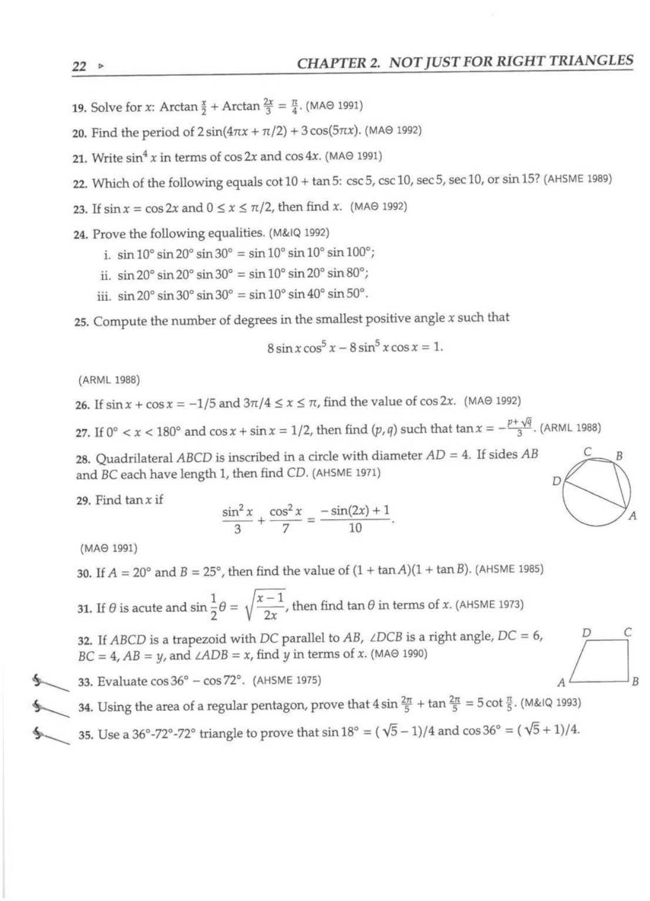

## Printed page 23

<!-- source: volume-2, PDF page 45, printed page 23 -->

In the 1700's, Daniel Bernoulli, one of a large family of brilliant mathematicians and physicists, was studying the vibration of guitar strings. Supposing the string is of length 1, the fundamental vibration of the string can be represented as $\sin \pi x$. With this function, the two ends are fixed at zero, while the middle vibrates freely. (Plot the function for $0 \leq x \leq 1$ and see.)

Bernoulli knew that when a string is plucked, you hear more than just the fundamental vibration, however; you hear a series of overtones with vibrational speed two times higher, three times higher, and so on. Extending the argument used to justify $\sin \pi x$, Bernoulli argued that the overtones could be represented as $\sin 2\pi x$, $\sin 3\pi x$, and so on. (In fact, if you vibrate the ends of, say, a phone cord, you can see these vibrational modes yourself.) Bernoulli asserted that the general vibration would be some combination of the fundamental tones and overtones,

$$a_1 \sin(\pi x) + a_2 \sin(2\pi x) + a_3 \sin(3\pi x) + \cdots$$

Other mathematicians of the time also used such series, including Leonhard Euler, who came up with a method to find the coefficients $a_i$.

In 1822 the French engineer Joseph Fourier published a treatise on heat transfer, looking at situations like, what would be the temperature anywhere on a rectangular plate if one side was held at a temperature of 100 degrees and the other three sides at $0^\circ$. Fourier used infinite series of sines and cosines in his solutions, and tried to prove the controversial assertion that any periodic function $f(x)$ could be written as a sum

$$f(x) = \sum_{n=0}^{\infty} [a_n \cos(2n\pi x/T) + b_n \sin(2n\pi x/T)]$$

where $T$ is the period. (Do you see why the sum of all these sines and cosines have period $T$?)

This surprising fact was proven in 1829 by Dirichlet, but such series continued to be called Fourier series. Fourier series are now crucially important in most branches of mathematics and physics, as they break complicated functions down into manageable sines and cosines.

Original scan — PDF page 45

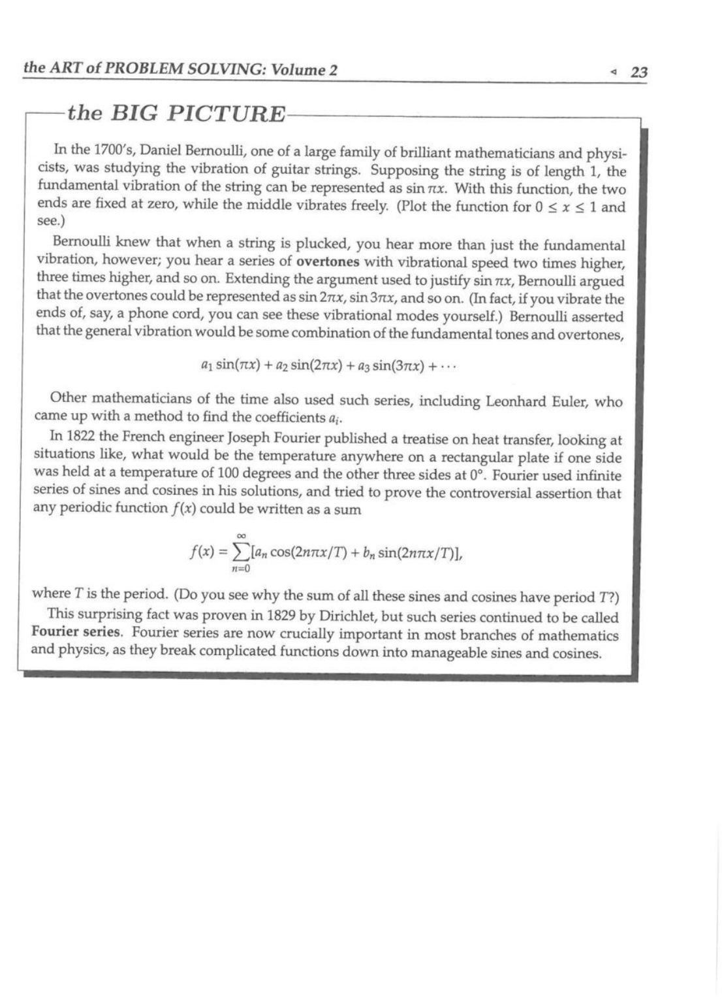

