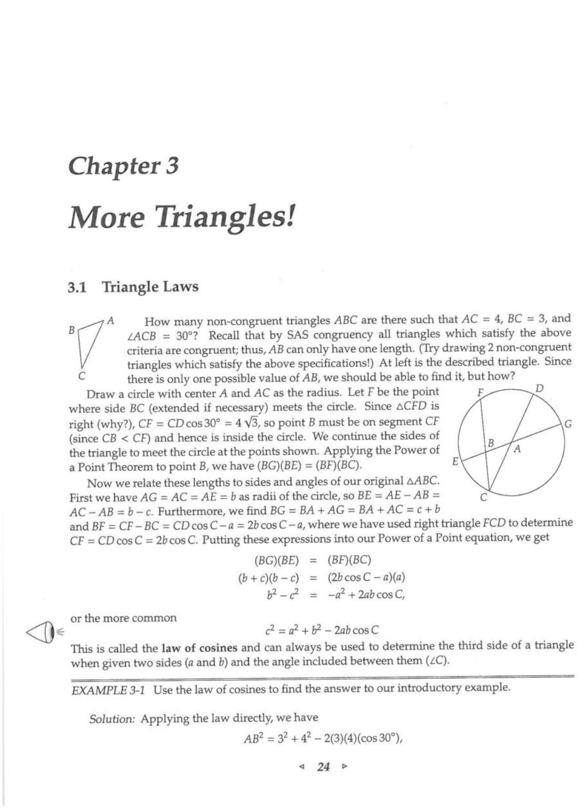
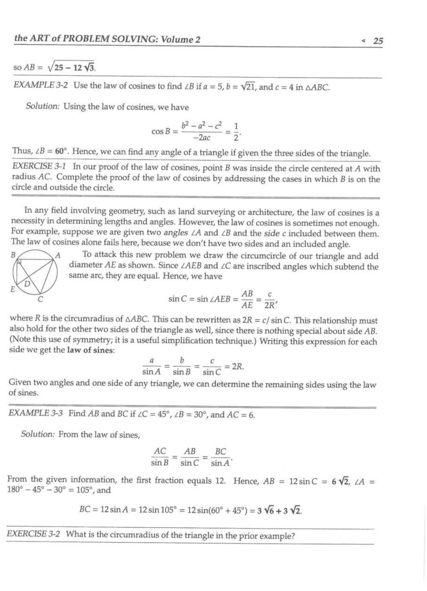
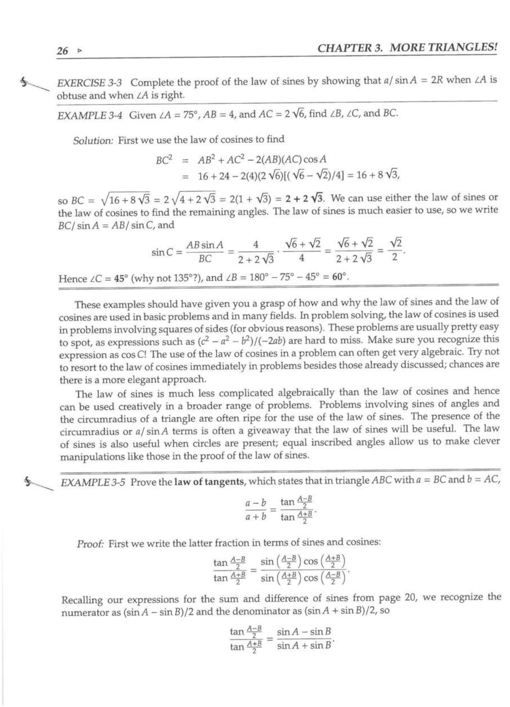
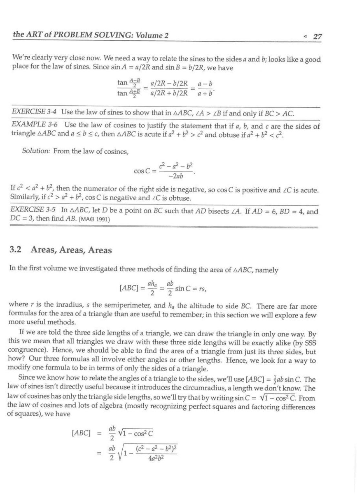
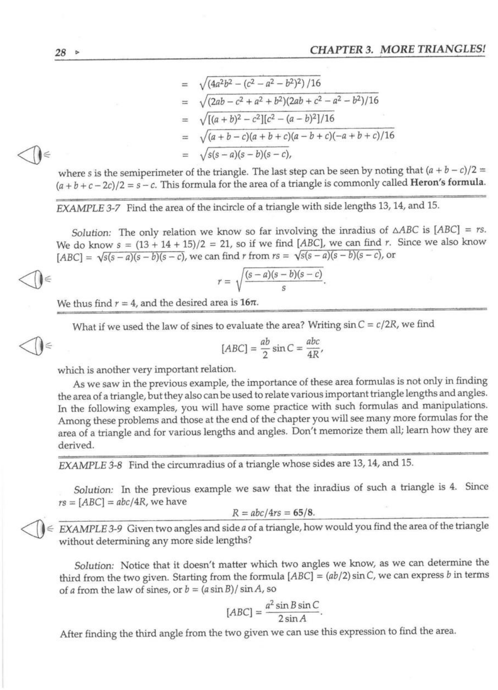
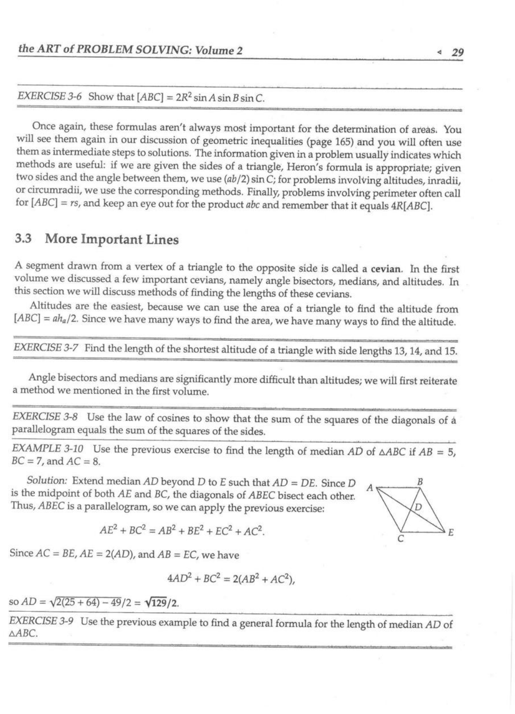
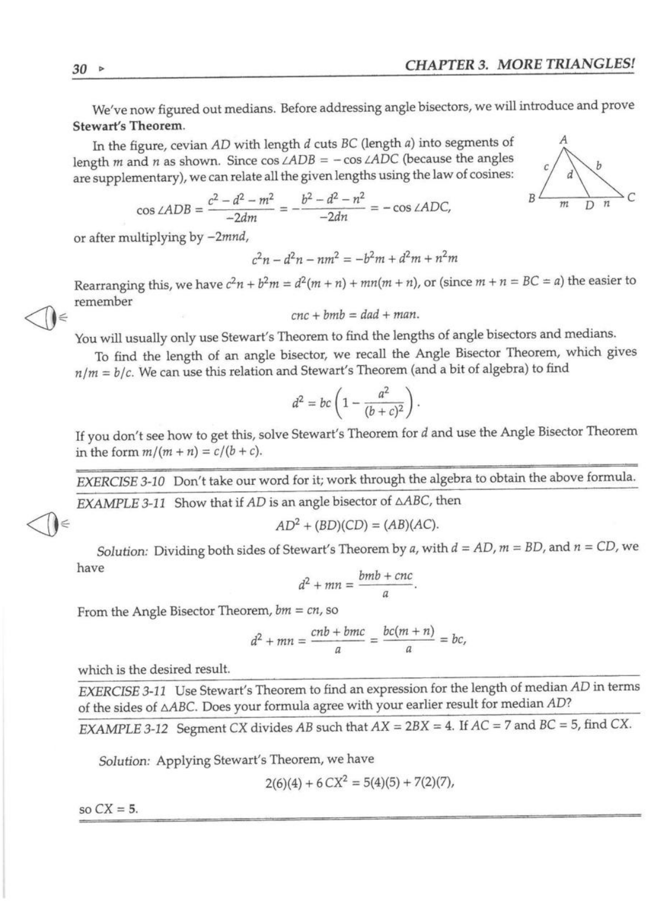
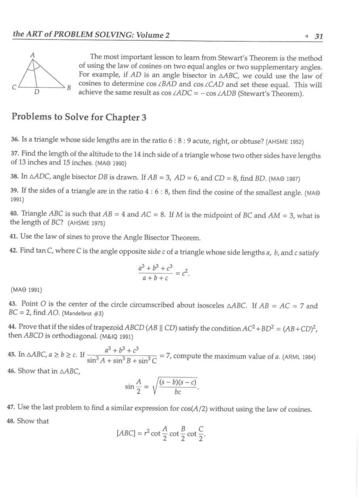
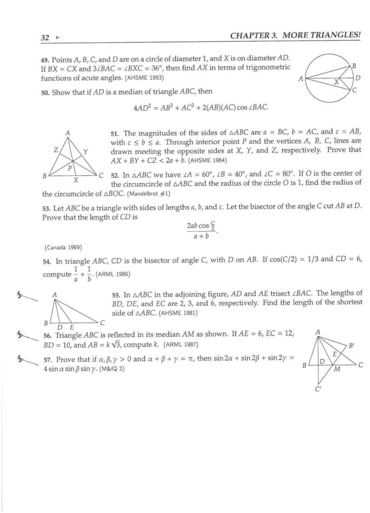

# Chapter 3: More Triangles!

Volume 2 · Printed pages 24–32 · PDF pages 46–54

[Volume contents](../index.md)

## Printed page 24

<!-- source: volume-2, PDF page 46, printed page 24 -->

More Triangles!

### 3.1 Triangle Laws

How many non-congruent triangles $ABC$ are there such that $AC = 4$, $BC = 3$, and $\angle ACB = 30^\circ$? Recall that by SAS congruency all triangles which satisfy the above criteria are congruent; thus, $AB$ can only have one length. (Try drawing 2 non-congruent triangles which satisfy the above specifications!) At left is the described triangle. Since there is only one possible value of $AB$, we should be able to find it, but how?

Draw a circle with center $A$ and $AC$ as the radius. Let $F$ be the point where side $BC$ (extended if necessary) meets the circle. Since $\Delta CFD$ is right (why?), $CF = CD \cos 30^\circ = 4\sqrt{3}$, so point $B$ must be on segment $CF$ (since $CB < CF$) and hence is inside the circle. We continue the sides of the triangle to meet the circle at the points shown. Applying the Power of a Point Theorem to point $B$, we have $(BG)(BE) = (BF)(BC)$.

Now we relate these lengths to sides and angles of our original $\Delta ABC$. First we have $AG = AC = AE = b$ as radii of the circle, so $BE = AE - AB = AC - AB = b - c$. Furthermore, we find $BG = BA + AG = BA + AC = c + b$ and $BF = CF - BC = CD \cos C - a = 2b \cos C - a$, where we have used right triangle $FCD$ to determine $CF = CD \cos C = 2b \cos C$. Putting these expressions into our Power of a Point equation, we get

$(BG)(BE) = (BF)(BC)$
$(b + c)(b - c) = (2b \cos C - a)(a)$
$b^2 - c^2 = -a^2 + 2ab \cos C$

or the more common

$c^2 = a^2 + b^2 - 2ab \cos C$

This is called the law of cosines and can always be used to determine the third side of a triangle when given two sides ($a$ and $b$) and the angle included between them $(\angle C)$.

**EXAMPLE 3-1 Use the law of cosines to find the answer to our introductory example.**

Solution: Applying the law directly, we have

$AB^2 = 3^2 + 4^2 - 2(3)(4)(\cos 30^\circ),$

Original scan — PDF page 46

## Printed page 25

<!-- source: volume-2, PDF page 47, printed page 25 -->

**EXAMPLE 3-2 Use the law of cosines to find $\angle B$ if $a = 5, b = \sqrt{21}$, and $c = 4$ in $\triangle ABC$.**

Solution: Using the law of cosines, we have

$$\cos B = \frac{b^2 - a^2 - c^2}{-2ac} = \frac{1}{2}.$$

Thus, $\angle B = 60^\circ$. Hence, we can find any angle of a triangle if given the three sides of the triangle.

**EXERCISE 3-1 In our proof of the law of cosines, point $B$ was inside the circle centered at $A$ with radius $AC$. Complete the proof of the law of cosines by addressing the cases in which $B$ is on the circle and outside the circle.**

In any field involving geometry, such as land surveying or architecture, the law of cosines is a necessity in determining lengths and angles. However, the law of cosines is sometimes not enough. For example, suppose we are given two angles $\angle A$ and $\angle B$ and the side $c$ included between them. The law of cosines alone fails here, because we don't have two sides and an included angle.

To attack this new problem we draw the circumcircle of our triangle and add diameter $AE$ as shown. Since $\angle AEB$ and $\angle C$ are inscribed angles which subtend the same arc, they are equal. Hence, we have

$$\sin C = \sin \angle AEB = \frac{AB}{AE} = \frac{c}{2R},$$

where $R$ is the circumradius of $\triangle ABC$. This can be rewritten as $2R = c/\sin C$. This relationship must also hold for the other two sides of the triangle as well, since there is nothing special about side $AB$. (Note this use of symmetry; it is a useful simplification technique.) Writing this expression for each side we get the law of sines:

$$\frac{a}{\sin A} = \frac{b}{\sin B} = \frac{c}{\sin C} = 2R.$$

Given two angles and one side of any triangle, we can determine the remaining sides using the law of sines.

**EXAMPLE 3-3 Find $AB$ and $BC$ if $\angle C = 45^\circ, \angle B = 30^\circ$, and $AC = 6.$**

Solution: From the law of sines,

$$\frac{AC}{\sin B} = \frac{AB}{\sin C} = \frac{BC}{\sin A}.$$

From the given information, the first fraction equals 12. Hence, $AB = 12\sin C = 6\sqrt{2}, \angle A = 180^\circ - 45^\circ - 30^\circ = 105^\circ,$ and

$$BC = 12\sin A = 12\sin 105^\circ = 12\sin(60^\circ + 45^\circ) = 3\sqrt{6} + 3\sqrt{2}.$$

**EXERCISE 3-2 What is the circumradius of the triangle in the prior example?**

Original scan — PDF page 47

## Printed page 26

<!-- source: volume-2, PDF page 48, printed page 26 -->

**EXERCISE 3-3 Complete the proof of the law of sines by showing that $a/\sin A = 2R$ when $\angle A$ is obtuse and when $\angle A$ is right.**

**EXAMPLE 3-4 Given $\angle A = 75^\circ$, $AB = 4$, and $AC = 2\sqrt{6}$, find $\angle B$, $\angle C$, and $BC$.**

Solution: First we use the law of cosines to find

$$BC^2 = AB^2 + AC^2 - 2(AB)(AC)\cos A$$

$$= 16 + 24 - 2(4)(2\sqrt{6})[(\sqrt{6} - \sqrt{2})/4] = 16 + 8\sqrt{3},$$

so $BC = \sqrt{16 + 8\sqrt{3}} = 2\sqrt{4 + 2\sqrt{3}} = 2(1 + \sqrt{3}) = 2 + 2\sqrt{3}$. We can use either the law of sines or the law of cosines to find the remaining angles. The law of sines is much easier to use, so we write $BC/\sin A = AB/\sin C$, and

$$\sin C = \frac{AB\sin A}{BC} = \frac{4}{2 + 2\sqrt{3}} \cdot \frac{\sqrt{6} + \sqrt{2}}{4} = \frac{\sqrt{6} + \sqrt{2}}{2 + 2\sqrt{3}} = \frac{\sqrt{2}}{2}.$$

Hence $\angle C = 45^\circ$ (why not $135^\circ$?), and $\angle B = 180^\circ - 75^\circ - 45^\circ = 60^\circ$.

These examples should have given you a grasp of how and why the law of sines and the law of cosines are used in basic problems and in many fields. In problem solving, the law of cosines is used in problems involving squares of sides (for obvious reasons). These problems are usually pretty easy to spot, as expressions such as $(c^2 - a^2 - b^2)/(-2ab)$ are hard to miss. Make sure you recognize this expression as $\cos C!$. The use of the law of cosines in a problem can often get very algebraic. Try not to resort to the law of cosines immediately in problems besides those already discussed; chances are there is a more elegant approach.

The law of sines is much less complicated algebraically than the law of cosines and hence can be used creatively in a broader range of problems. Problems involving sines of angles and the circumradius of a triangle are often ripe for the use of the law of sines. The presence of the circumradius or $a/\sin A$ terms is often a giveaway that the law of sines will be useful. The law of sines is also useful when circles are present; equal inscribed angles allow us to make clever manipulations like those in the proof of the law of sines.

**EXAMPLE 3-5 Prove the law of tangents, which states that in triangle $ABC$ with $a = BC$ and $b = AC$,**

$$\frac{a-b}{a+b} = \frac{\tan \frac{A-B}{2}}{\tan \frac{A+B}{2}}.$$

Proof: First we write the latter fraction in terms of sines and cosines:

$$\frac{\tan \frac{A-B}{2}}{\tan \frac{A+B}{2}} = \frac{\sin \left(\frac{A-B}{2}\right)\cos \left(\frac{A+B}{2}\right)}{\sin \left(\frac{A+B}{2}\right)\cos \left(\frac{A-B}{2}\right)}.$$

Recalling our expressions for the sum and difference of sines from page 20, we recognize the numerator as $(\sin A - \sin B)/2$ and the denominator as $(\sin A + \sin B)/2$, so

$$\frac{\tan \frac{A-B}{2}}{\tan \frac{A+B}{2}} = \frac{\sin A - \sin B}{\sin A + \sin B}.$$

Original scan — PDF page 48

## Printed page 27

<!-- source: volume-2, PDF page 49, printed page 27 -->

We're clearly very close now. We need a way to relate the sines to the sides $a$ and $b$; looks like a good place for the law of sines. Since $\sin A = a/2R$ and $\sin B = b/2R$, we have

$$\frac{\tan \frac{A-B}{2}}{\tan \frac{A+B}{2}} = \frac{a/2R - b/2R}{a/2R + b/2R} = \frac{a-b}{a+b}.$$

**EXERCISE 3-4** Use the law of sines to show that in $\triangle ABC$, $\angle A > \angle B$ if and only if $BC > AC$.

**EXAMPLE 3-6** Use the law of cosines to justify the statement that if $a, b$, and $c$ are the sides of triangle $\triangle ABC$ and $a \leq b \leq c$, then $\triangle ABC$ is acute if $a^2 + b^2 > c^2$ and obtuse if $a^2 + b^2 < c^2$.

**Solution:** From the law of cosines,

$$\cos C = \frac{c^2 - a^2 - b^2}{-2ab}.$$

If $c^2 < a^2 + b^2$, then the numerator of the right side is negative, so $\cos C$ is positive and $\angle C$ is acute. Similarly, if $c^2 > a^2 + b^2$, $\cos C$ is negative and $\angle C$ is obtuse.

**EXERCISE 3-5** In $\triangle ABC$, let $D$ be a point on $BC$ such that $AD$ bisects $\angle A$. If $AD = 6$, $BD = 4$, and $DC = 3$, then find $AB$. (MAΘ 1991)

### 3.2 Areas, Areas, Areas

In the first volume we investigated three methods of finding the area of $\triangle ABC$, namely

$$[ABC] = \frac{ah_a}{2} = \frac{ab}{2} \sin C = rs,$$

where $r$ is the inradius, $s$ the semiperimeter, and $h_a$ the altitude to side $BC$. There are far more formulas for the area of a triangle than are useful to remember; in this section we will explore a few more useful methods.

If we are told the three side lengths of a triangle, we can draw the triangle in only one way. By this we mean that all triangles we draw with these three side lengths will be exactly alike (by SSS congruence). Hence, we should be able to find the area of a triangle from just its three sides, but how? Our three formulas all involve either angles or other lengths. Hence, we look for a way to modify one formula to be in terms of only the sides of a triangle.

Since we know how to relate the angles of a triangle to the sides, we'll use $[ABC] = \frac{1}{2}ab \sin C$. The law of sines isn't directly useful because it introduces the circumradius, a length we don't know. The law of cosines has only the triangle side lengths, so we'll try that by writing $\sin C = \sqrt{1 - \cos^2 C}$. From the law of cosines and lots of algebra (mostly recognizing perfect squares and factoring differences of squares), we have

$$[ABC] = \frac{ab}{2} \sqrt{1 - \cos^2 C}$$

$$= \frac{ab}{2} \sqrt{1 - \frac{(c^2 - a^2 - b^2)^2}{4a^2b^2}}$$

Original scan — PDF page 49

## Printed page 28

<!-- source: volume-2, PDF page 50, printed page 28 -->

$$= \sqrt{(4a^2b^2 - (c^2 - a^2 - b^2)^2) / 16}$$
$$= \sqrt{(2ab - c^2 + a^2 + b^2)(2ab + c^2 - a^2 - b^2) / 16}$$
$$= \sqrt{[(a + b)^2 - c^2][c^2 - (a - b)^2] / 16}$$
$$= \sqrt{(a + b - c)(a + b + c)(a - b + c)(-a + b + c) / 16}$$
$$= \sqrt{s(s - a)(s - b)(s - c)},$$

where $s$ is the semiperimeter of the triangle. The last step can be seen by noting that $(a + b - c) / 2 = (a + b + c - 2c) / 2 = s - c$. This formula for the area of a triangle is commonly called Heron's formula.

**EXAMPLE 3-7 Find the area of the incircle of a triangle with side lengths 13, 14, and 15.**

Solution: The only relation we know so far involving the inradius of $\Delta ABC$ is $[ABC] = rs$. We do know $s = (13 + 14 + 15) / 2 = 21$, so if we find $[ABC]$, we can find $r$. Since we also know $[ABC] = \sqrt{s(s - a)(s - b)(s - c)}$, we can find $r$ from $rs = \sqrt{s(s - a)(s - b)(s - c)}$, or

$$r = \sqrt{\frac{(s - a)(s - b)(s - c)}{s}}.$$

We thus find $r = 4$, and the desired area is $16\pi$.

What if we used the law of sines to evaluate the area? Writing $\sin C = c / 2R$, we find

$$[ABC] = \frac{ab}{2} \sin C = \frac{abc}{4R},$$

which is another very important relation.

As we saw in the previous example, the importance of these area formulas is not only in finding the area of a triangle, but they also can be used to relate various important triangle lengths and angles. In the following examples, you will have some practice with such formulas and manipulations. Among these problems and those at the end of the chapter you will see many more formulas for the area of a triangle and for various lengths and angles. Don’t memorize them all; learn how they are derived.

**EXAMPLE 3-8 Find the circumradius of a triangle whose sides are 13, 14, and 15.**

Solution: In the previous example we saw that the inradius of such a triangle is 4. Since $rs = [ABC] = abc / 4R$, we have

$$R = abc / 4rs = 65 / 8.$$

**EXAMPLE 3-9 Given two angles and side $a$ of a triangle, how would you find the area of the triangle without determining any more side lengths?**

Solution: Notice that it doesn’t matter which two angles we know, as we can determine the third from the two given. Starting from the formula $[ABC] = (ab / 2) \sin C$, we can express $b$ in terms of $a$ from the law of sines, or $b = (a \sin B) / \sin A$, so

$$[ABC] = \frac{a^2 \sin B \sin C}{2 \sin A}.$$

After finding the third angle from the two given we can use this expression to find the area.

Original scan — PDF page 50

## Printed page 29

<!-- source: volume-2, PDF page 51, printed page 29 -->

**EXERCISE 3-6 Show that $[ABC] = 2R^2 \sin A \sin B \sin C$.**

Once again, these formulas aren't always most important for the determination of areas. You will see them again in our discussion of geometric inequalities (page 165) and you will often use them as intermediate steps to solutions. The information given in a problem usually indicates which methods are useful: if we are given the sides of a triangle, Heron's formula is appropriate; given two sides and the angle between them, we use $(ab/2) \sin C$; for problems involving altitudes, inradii, or circumradii, we use the corresponding methods. Finally, problems involving perimeter often call for $[ABC] = rs$, and keep an eye out for the product $abc$ and remember that it equals $4R[ABC]$.

### 3.3 More Important Lines

A segment drawn from a vertex of a triangle to the opposite side is called a cevian. In the first volume we discussed a few important cevians, namely angle bisectors, medians, and altitudes. In this section we will discuss methods of finding the lengths of these cevians.

Altitudes are the easiest, because we can use the area of a triangle to find the altitude from $[ABC] = ah_a/2$. Since we have many ways to find the area, we have many ways to find the altitude.

**EXERCISE 3-7 Find the length of the shortest altitude of a triangle with side lengths 13, 14, and 15.**

Angle bisectors and medians are significantly more difficult than altitudes; we will first reiterate a method we mentioned in the first volume.

**EXERCISE 3-8 Use the law of cosines to show that the sum of the squares of the diagonals of a parallelogram equals the sum of the squares of the sides.**

**EXAMPLE 3-10 Use the previous exercise to find the length of median $AD$ of $\Delta ABC$ if $AB = 5$, $BC = 7$, and $AC = 8$.**

Solution: Extend median $AD$ beyond $D$ to $E$ such that $AD = DE$. Since $D$ is the midpoint of both $AE$ and $BC$, the diagonals of $ABEC$ bisect each other. Thus, $ABEC$ is a parallelogram, so we can apply the previous exercise:

$$AE^2 + BC^2 = AB^2 + BE^2 + EC^2 + AC^2.$$

Since $AC = BE$, $AE = 2(AD)$, and $AB = EC$, we have

$$4AD^2 + BC^2 = 2(AB^2 + AC^2),$$

so $AD = \sqrt{2(25 + 64) - 49}/2 = \sqrt{129}/2.$

**EXERCISE 3-9 Use the previous example to find a general formula for the length of median $AD$ of $\Delta ABC$.**

Original scan — PDF page 51

## Printed page 30

<!-- source: volume-2, PDF page 52, printed page 30 -->

We've now figured out medians. Before addressing angle bisectors, we will introduce and prove Stewart's Theorem.

In the figure, cevian AD with length $d$ cuts BC (length $a$) into segments of length $m$ and $n$ as shown. Since $\cos \angle ADB = -\cos \angle ADC$ (because the angles are supplementary), we can relate all the given lengths using the law of cosines:

$$\cos \angle ADB = \frac{c^2 - d^2 - m^2}{-2dm} = -\frac{b^2 - d^2 - n^2}{-2dn} = -\cos \angle ADC,$$

or after multiplying by $-2mnd$,

$$c^2n - d^2n - nm^2 = -b^2m + d^2m + n^2m$$

Rearranging this, we have $c^2n + b^2m = d^2(m + n) + mn(m + n)$, or (since $m + n = BC = a$) the easier to remember

$$cnc + bmb = dad + man.$$

You will usually only use Stewart's Theorem to find the lengths of angle bisectors and medians.

To find the length of an angle bisector, we recall the Angle Bisector Theorem, which gives $n/m = b/c$. We can use this relation and Stewart's Theorem (and a bit of algebra) to find

$$d^2 = bc \left( 1 - \frac{a^2}{(b + c)^2} \right).$$

If you don't see how to get this, solve Stewart's Theorem for $d$ and use the Angle Bisector Theorem in the form $m/(m + n) = c/(b + c).$

**EXERCISE 3-10 Don’t take our word for it; work through the algebra to obtain the above formula.**

**EXAMPLE 3-11 Show that if AD is an angle bisector of $\Delta ABC$, then**

$$AD^2 + (BD)(CD) = (AB)(AC).$$

Solution: Dividing both sides of Stewart's Theorem by $a$, with $d = AD, m = BD,$ and $n = CD,$ we have

$$d^2 + mn = \frac{bmb + cnc}{a}.$$

From the Angle Bisector Theorem, $bm = cn,$ so

$$d^2 + mn = \frac{cnb + bmc}{a} = \frac{bc(m + n)}{a} = bc,$$

which is the desired result.

**EXERCISE 3-11 Use Stewart's Theorem to find an expression for the length of median AD in terms of the sides of $\Delta ABC$. Does your formula agree with your earlier result for median AD?**

**EXAMPLE 3-12 Segment CX divides AB such that $AX = 2BX = 4$. If $AC = 7$ and $BC = 5,$ find CX.**

Solution: Applying Stewart's Theorem, we have

$$2(6)(4) + 6CX^2 = 5(4)(5) + 7(2)(7),$$

so $CX = 5$.

Original scan — PDF page 52

## Printed page 31

<!-- source: volume-2, PDF page 53, printed page 31 -->

The most important lesson to learn from Stewart’s Theorem is the method of using the law of cosines on two equal angles or two supplementary angles. For example, if $AD$ is an angle bisector in $\Delta ABC$, we could use the law of cosines to determine $\cos \angle BAD$ and $\cos \angle CAD$ and set these equal. This will achieve the same result as $\cos \angle ADC = -\cos \angle ADB$ (Stewart’s Theorem).

**Problems to Solve for Chapter 3**

36. Is a triangle whose side lengths are in the ratio $6:8:9$ acute, right, or obtuse? (AHSME 1952)

37. Find the length of the altitude to the 14 inch side of a triangle whose two other sides have lengths of 13 inches and 15 inches. (MAΘ 1990)

38. In $\Delta ADC$, angle bisector $DB$ is drawn. If $AB = 3$, $AD = 6$, and $CD = 8$, find $BD$. (MAΘ 1987)

39. If the sides of a triangle are in the ratio $4:6:8$, then find the cosine of the smallest angle. (MAΘ 1991)

40. Triangle $ABC$ is such that $AB = 4$ and $AC = 8$. If $M$ is the midpoint of $BC$ and $AM = 3$, what is the length of $BC$? (AHSME 1975)

41. Use the law of sines to prove the Angle Bisector Theorem.

42. Find $\tan C$, where $C$ is the angle opposite side $c$ of a triangle whose side lengths $a, b,$ and $c$ satisfy

$$\frac{a^3 + b^3 + c^3}{a + b + c} = c^2.$$

(MAΘ 1991)

43. Point $O$ is the center of the circle circumscribed about isosceles $\Delta ABC$. If $AB = AC = 7$ and $BC = 2$, find $AO$. (Mandelbrot #3)

44. Prove that if the sides of trapezoid $ABCD$ ($AB \parallel CD$) satisfy the condition $AC^2 + BD^2 = (AB + CD)^2$, then $ABCD$ is orthodiagonal. (M&IQ 1991)

45. In $\Delta ABC$, $a \geq b \geq c$. If $\frac{a^3 + b^3 + c^3}{\sin^3 A + \sin^3 B + \sin^3 C} = 7$, compute the maximum value of $a$. (ARML 1984)

46. Show that in $\Delta ABC$,

$$\sin \frac{A}{2} = \sqrt{\frac{(s - b)(s - c)}{bc}}.$$

47. Use the last problem to find a similar expression for $\cos(A/2)$ without using the law of cosines.

48. Show that

$$[ABC] = r^2 \cot \frac{A}{2} \cot \frac{B}{2} \cot \frac{C}{2}.$$

Original scan — PDF page 53

## Printed page 32

<!-- source: volume-2, PDF page 54, printed page 32 -->

49. Points $A, B, C,$ and $D$ are on a circle of diameter 1, and $X$ is on diameter $AD$. If $BX = CX$ and $3\angle BAC = \angle BXC = 36^\circ$, then find $AX$ in terms of trigonometric functions of acute angles. (AHSME 1993)

50. Show that if $AD$ is a median of triangle $ABC$, then

$$4AD^2 = AB^2 + AC^2 + 2(AB)(AC)\cos \angle BAC.$$

51. The magnitudes of the sides of $\triangle ABC$ are $a = BC, b = AC,$ and $c = AB,$ with $c \leq b \leq a$. Through interior point $P$ and the vertices $A, B, C,$ lines are drawn meeting the opposite sides at $X, Y,$ and $Z,$ respectively. Prove that $AX + BY + CZ < 2a + b.$ (AHSME 1964)

52. In $\triangle ABC$ we have $\angle A = 60^\circ, \angle B = 40^\circ,$ and $\angle C = 80^\circ.$ If $O$ is the center of the circumcircle of $\triangle ABC$ and the radius of the circle $O$ is 1, find the radius of the circumcircle of $\triangle BOC.$ (Mandelbrot #1)

53. Let $ABC$ be a triangle with sides of lengths $a, b,$ and $c.$ Let the bisector of the angle $C$ cut $AB$ at $D.$ Prove that the length of $CD$ is

$$\frac{2ab \cos \frac{C}{2}}{a + b}.$$ (Canada 1969)

54. In triangle $ABC, CD$ is the bisector of angle $C,$ with $D$ on $AB.$ If $\cos(C/2) = 1/3$ and $CD = 6,$ compute $\frac{1}{a} + \frac{1}{b}.$ (ARML 1986)

55. In $\triangle ABC$ in the adjoining figure, $AD$ and $AE$ trisect $\angle BAC.$ The lengths of $BD, DE,$ and $EC$ are 2, 3, and 6, respectively. Find the length of the shortest side of $\triangle ABC.$ (AHSME 1981)

56. Triangle $ABC$ is reflected in its median $AM$ as shown. If $AE = 6, EC = 12,$ $BD = 10,$ and $AB = k\sqrt{3},$ compute $k.$ (ARML 1987)

57. Prove that if $\alpha, \beta, \gamma > 0$ and $\alpha + \beta + \gamma = \pi,$ then $\sin 2\alpha + \sin 2\beta + \sin 2\gamma = 4\sin \alpha \sin \beta \sin \gamma.$ (M&IQ 2)

Original scan — PDF page 54

