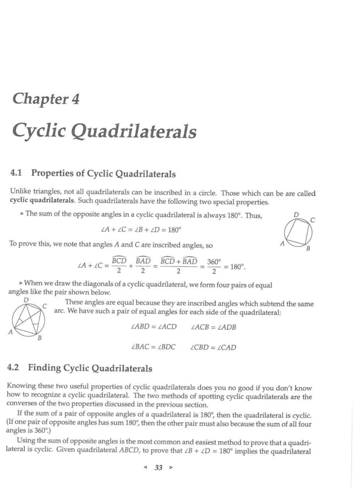
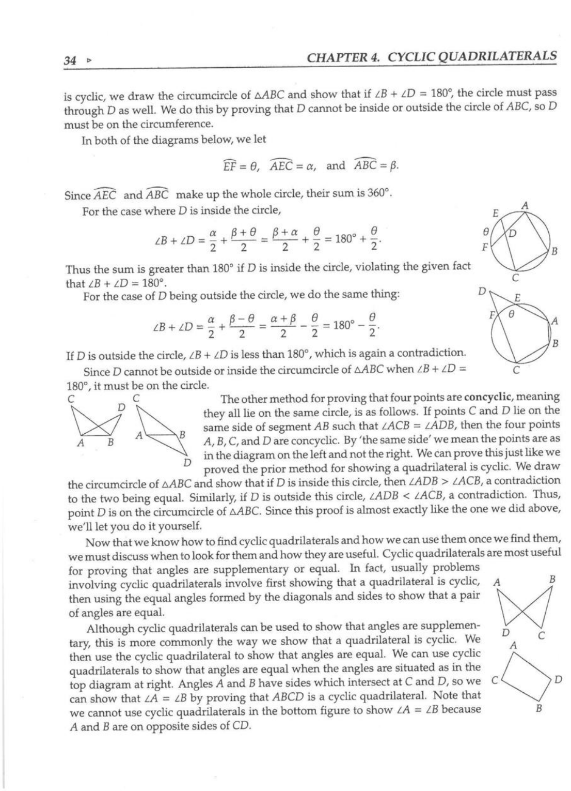
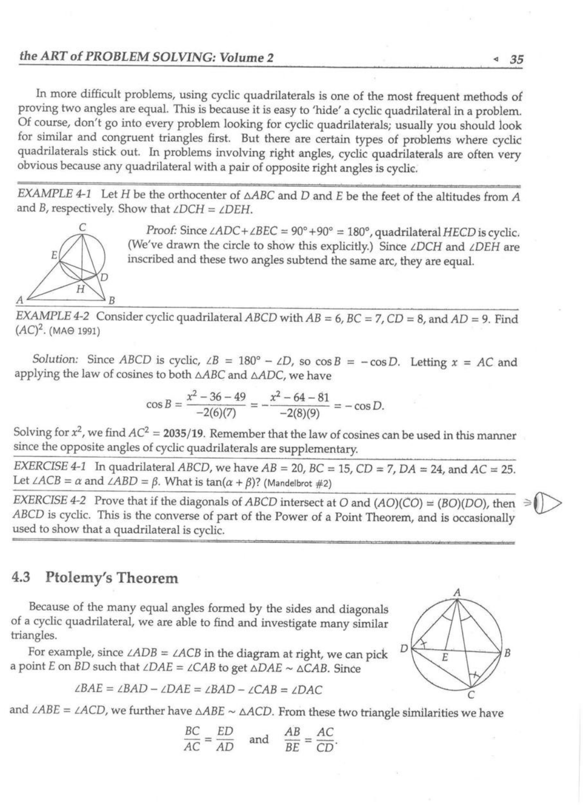
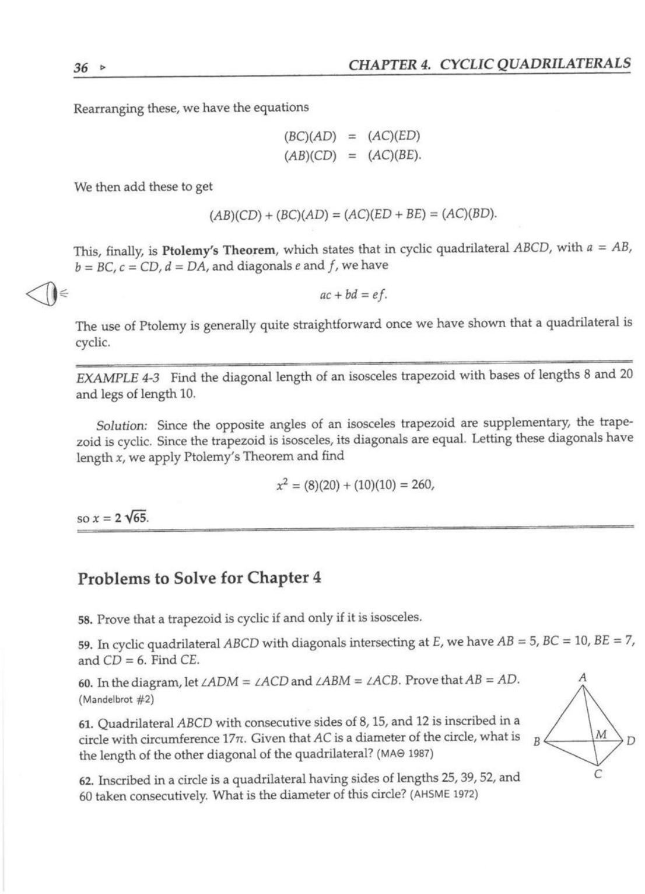
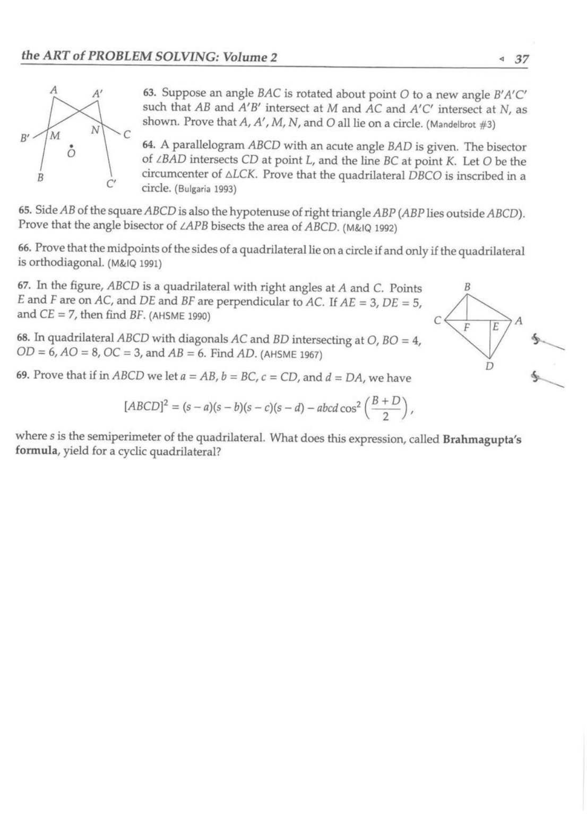

# Chapter 4: Cyclic Quadrilaterals

Volume 2 · Printed pages 33–37 · PDF pages 55–59

[Volume contents](../index.md)

## Printed page 33

<!-- source: volume-2, PDF page 55, printed page 33 -->

### 4.1 Properties of Cyclic Quadrilaterals

Unlike triangles, not all quadrilaterals can be inscribed in a circle. Those which can be are called cyclic quadrilaterals. Such quadrilaterals have the following two special properties.

The sum of the opposite angles in a cyclic quadrilateral is always $180^\circ$. Thus,

$$\angle A + \angle C = \angle B + \angle D = 180^\circ$$

To prove this, we note that angles $A$ and $C$ are inscribed angles, so

$$\angle A + \angle C = \frac{\widehat{BCD}}{2} + \frac{\widehat{BAD}}{2} = \frac{\widehat{BCD} + \widehat{BAD}}{2} = \frac{360^\circ}{2} = 180^\circ.$$

When we draw the diagonals of a cyclic quadrilateral, we form four pairs of equal angles like the pair shown below.

These angles are equal because they are inscribed angles which subtend the same arc. We have such a pair of equal angles for each side of the quadrilateral:

$$\angle ABD = \angle ACD \quad \angle ACB = \angle ADB$$

$$\angle BAC = \angle BDC \quad \angle CBD = \angle CAD$$

### 4.2 Finding Cyclic Quadrilaterals

Knowing these two useful properties of cyclic quadrilaterals does you no good if you don’t know how to recognize a cyclic quadrilateral. The two methods of spotting cyclic quadrilaterals are the converses of the two properties discussed in the previous section.

If the sum of a pair of opposite angles of a quadrilateral is $180^\circ$, then the quadrilateral is cyclic. (If one pair of opposite angles has sum $180^\circ$, then the other pair must also because the sum of all four angles is $360^\circ$.)

Using the sum of opposite angles is the most common and easiest method to prove that a quadrilateral is cyclic. Given quadrilateral $ABCD$, to prove that $\angle B + \angle D = 180^\circ$ implies the quadrilateral

Original scan — PDF page 55

## Printed page 34

<!-- source: volume-2, PDF page 56, printed page 34 -->

is cyclic, we draw the circumcircle of $\Delta ABC$ and show that if $\angle B + \angle D = 180^\circ$, the circle must pass through $D$ as well. We do this by proving that $D$ cannot be inside or outside the circle of $ABC$, so $D$ must be on the circumference.

In both of the diagrams below, we let

$$\widehat{EF} = \theta, \quad \widehat{AEC} = \alpha, \quad \widehat{ABC} = \beta.$$

Since $\widehat{AEC}$ and $\widehat{ABC}$ make up the whole circle, their sum is $360^\circ$.

For the case where $D$ is inside the circle,

$$\angle B + \angle D = \frac{\alpha}{2} + \frac{\beta + \theta}{2} = \frac{\beta + \alpha}{2} + \frac{\theta}{2} = 180^\circ + \frac{\theta}{2}.$$

Thus the sum is greater than $180^\circ$ if $D$ is inside the circle, violating the given fact that $\angle B + \angle D = 180^\circ$.

For the case of $D$ being outside the circle, we do the same thing:

$$\angle B + \angle D = \frac{\alpha}{2} + \frac{\beta - \theta}{2} = \frac{\alpha + \beta}{2} - \frac{\theta}{2} = 180^\circ - \frac{\theta}{2}.$$

If $D$ is outside the circle, $\angle B + \angle D$ is less than $180^\circ$, which is again a contradiction.

Since $D$ cannot be outside or inside the circumcircle of $\Delta ABC$ when $\angle B + \angle D = 180^\circ$, it must be on the circle.

The other method for proving that four points are concyclic, meaning they all lie on the same circle, is as follows. If points $C$ and $D$ lie on the same side of segment $AB$ such that $\angle ACB = \angle ADB$, then the four points $A, B, C,$ and $D$ are concyclic. By 'the same side' we mean the points are as in the diagram on the left and not the right. We can prove this just like we proved the prior method for showing a quadrilateral is cyclic. We draw the circumcircle of $\Delta ABC$ and show that if $D$ is inside this circle, then $\angle ADB > \angle ACB$, a contradiction to the two being equal. Similarly, if $D$ is outside this circle, $\angle ADB < \angle ACB$, a contradiction. Thus, point $D$ is on the circumcircle of $\Delta ABC$. Since this proof is almost exactly like the one we did above, we'll let you do it yourself.

Now that we know how to find cyclic quadrilaterals and how we can use them once we find them, we must discuss when to look for them and how they are useful. Cyclic quadrilaterals are most useful for proving that angles are supplementary or equal. In fact, usually problems involving cyclic quadrilaterals involve first showing that a quadrilateral is cyclic, then using the equal angles formed by the diagonals and sides to show that a pair of angles are equal.

Although cyclic quadrilaterals can be used to show that angles are supplementary, this is more commonly the way we show that a quadrilateral is cyclic. We then use the cyclic quadrilateral to show that angles are equal. We can use cyclic quadrilaterals to show that angles are equal when the angles are situated as in the top diagram at right. Angles $A$ and $B$ have sides which intersect at $C$ and $D$, so we can show that $\angle A = \angle B$ by proving that $ABCD$ is a cyclic quadrilateral. Note that we cannot use cyclic quadrilaterals in the bottom figure to show $\angle A = \angle B$ because $A$ and $B$ are on opposite sides of $CD$.

Original scan — PDF page 56

## Printed page 35

<!-- source: volume-2, PDF page 57, printed page 35 -->

In more difficult problems, using cyclic quadrilaterals is one of the most frequent methods of proving two angles are equal. This is because it is easy to 'hide' a cyclic quadrilateral in a problem. Of course, don't go into every problem looking for cyclic quadrilaterals; usually you should look for similar and congruent triangles first. But there are certain types of problems where cyclic quadrilaterals stick out. In problems involving right angles, cyclic quadrilaterals are often very obvious because any quadrilateral with a pair of opposite right angles is cyclic.

**EXAMPLE 4-1** Let $H$ be the orthocenter of $\triangle ABC$ and $D$ and $E$ be the feet of the altitudes from $A$ and $B$, respectively. Show that $\angle DCH = \angle DEH$.

**Proof:** Since $\angle ADC + \angle BEC = 90^\circ + 90^\circ = 180^\circ$, quadrilateral $HECD$ is cyclic. (We've drawn the circle to show this explicitly.) Since $\angle DCH$ and $\angle DEH$ are inscribed and these two angles subtend the same arc, they are equal.

**EXAMPLE 4-2** Consider cyclic quadrilateral $ABCD$ with $AB = 6, BC = 7, CD = 8,$ and $AD = 9$. Find $(AC)^2$. (MAΘ 1991)

**Solution:** Since $ABCD$ is cyclic, $\angle B = 180^\circ - \angle D,$ so $\cos B = -\cos D$. Letting $x = AC$ and applying the law of cosines to both $\triangle ABC$ and $\triangle ADC,$ we have

$$\cos B = \frac{x^2 - 36 - 49}{-2(6)(7)} = -\frac{x^2 - 64 - 81}{-2(8)(9)} = -\cos D.$$

Solving for $x^2,$ we find $AC^2 = 2035/19.$ Remember that the law of cosines can be used in this manner since the opposite angles of cyclic quadrilaterals are supplementary.

**EXERCISE 4-1** In quadrilateral $ABCD,$ we have $AB = 20, BC = 15, CD = 7, DA = 24,$ and $AC = 25.$ Let $\angle ACB = \alpha$ and $\angle ABD = \beta.$ What is $\tan(\alpha + \beta)?$ (Mandelbrot #2)

**EXERCISE 4-2** Prove that if the diagonals of $ABCD$ intersect at $O$ and $(AO)(CO) = (BO)(DO),$ then $ABCD$ is cyclic. This is the converse of part of the Power of a Point Theorem, and is occasionally used to show that a quadrilateral is cyclic.

### 4.3 Ptolemy's Theorem

Because of the many equal angles formed by the sides and diagonals of a cyclic quadrilateral, we are able to find and investigate many similar triangles.

For example, since $\angle ADB = \angle ACB$ in the diagram at right, we can pick a point $E$ on $BD$ such that $\angle DAE = \angle CAB$ to get $\Delta DAE \sim \Delta CAB.$ Since

$$\angle BAE = \angle BAD - \angle DAE = \angle BAD - \angle CAB = \angle DAC$$

and $\angle ABE = \angle ACD,$ we further have $\Delta ABE \sim \Delta ACD.$ From these two triangle similarities we have

$$\frac{BC}{AC} = \frac{ED}{AD}$$

and $$\frac{AB}{BE} = \frac{AC}{CD}.$$

Original scan — PDF page 57

## Printed page 36

<!-- source: volume-2, PDF page 58, printed page 36 -->

Rearranging these, we have the equations

$$\begin{align*}
(BC)(AD) &= (AC)(ED) \\
(AB)(CD) &= (AC)(BE).
\end{align*}$$

We then add these to get

$$\begin{align*}
(AB)(CD) + (BC)(AD) &= (AC)(ED + BE) = (AC)(BD).
\end{align*}$$

This, finally, is **Ptolemy’s Theorem**, which states that in cyclic quadrilateral $ABCD$, with $a = AB$, $b = BC$, $c = CD$, $d = DA$, and diagonals $e$ and $f$, we have

$$ac + bd = ef.$$

The use of Ptolemy is generally quite straightforward once we have shown that a quadrilateral is cyclic.

**EXAMPLE 4-3** Find the diagonal length of an isosceles trapezoid with bases of lengths 8 and 20 and legs of length 10.

**Solution:** Since the opposite angles of an isosceles trapezoid are supplementary, the trapezoid is cyclic. Since the trapezoid is isosceles, its diagonals are equal. Letting these diagonals have length $x$, we apply Ptolemy’s Theorem and find

$$x^2 = (8)(20) + (10)(10) = 260,$$

so $x = 2\sqrt{65}$.

**Problems to Solve for Chapter 4**

58. Prove that a trapezoid is cyclic if and only if it is isosceles.

59. In cyclic quadrilateral $ABCD$ with diagonals intersecting at $E$, we have $AB = 5$, $BC = 10$, $BE = 7$, and $CD = 6$. Find $CE$.

60. In the diagram, let $\angle ADM = \angle ACD$ and $\angle ABM = \angle ACB$. Prove that $AB = AD$.

(Mandelbrot #2)

61. Quadrilateral $ABCD$ with consecutive sides of 8, 15, and 12 is inscribed in a circle with circumference $17\pi$. Given that $AC$ is a diameter of the circle, what is the length of the other diagonal of the quadrilateral? (MAΘ 1987)

62. Inscribed in a circle is a quadrilateral having sides of lengths 25, 39, 52, and 60 taken consecutively. What is the diameter of this circle? (AHSME 1972)

Original scan — PDF page 58

## Printed page 37

<!-- source: volume-2, PDF page 59, printed page 37 -->

63. Suppose an angle $BAC$ is rotated about point $O$ to a new angle $B'A'C'$ such that $AB$ and $A'B'$ intersect at $M$ and $AC$ and $A'C'$ intersect at $N$, as shown. Prove that $A, A', M, N,$ and $O$ all lie on a circle. (Mandelbrot #3)

64. A parallelogram $ABCD$ with an acute angle $BAD$ is given. The bisector of $\angle BAD$ intersects $CD$ at point $L$, and the line $BC$ at point $K$. Let $O$ be the circumcenter of $\Delta LCK$. Prove that the quadrilateral $DBCO$ is inscribed in a circle. (Bulgaria 1993)

65. Side $AB$ of the square $ABCD$ is also the hypotenuse of right triangle $ABP$ (ABP lies outside $ABCD$). Prove that the angle bisector of $\angle APB$ bisects the area of $ABCD$. (M&IQ 1992)

66. Prove that the midpoints of the sides of a quadrilateral lie on a circle if and only if the quadrilateral is orthodiagonal. (M&IQ 1991)

67. In the figure, $ABCD$ is a quadrilateral with right angles at $A$ and $C$. Points $E$ and $F$ are on $AC$, and $DE$ and $BF$ are perpendicular to $AC$. If $AE = 3, DE = 5,$ and $CE = 7,$ then find $BF$. (AHSME 1990)

68. In quadrilateral $ABCD$ with diagonals $AC$ and $BD$ intersecting at $O, BO = 4,$ $OD = 6,$ $AO = 8,$ $OC = 3,$ and $AB = 6.$ Find $AD$. (AHSME 1967)

69. Prove that if in $ABCD$ we let $a = AB, b = BC, c = CD,$ and $d = DA,$ we have

$$[ABCD]^2 = (s - a)(s - b)(s - c)(s - d) - abcd \cos^2 \left( \frac{B + D}{2} \right),$$

where $s$ is the semiperimeter of the quadrilateral. What does this expression, called Brahmagupta's formula, yield for a cyclic quadrilateral?

Original scan — PDF page 59

