# Chapter 5: Conics and Polar Coordinates

Volume 2 · Printed pages 38–51 · PDF pages 60–73

[Volume contents](../index.md)

## Printed page 38

<!-- source: volume-2, PDF page 60, printed page 38 -->

Chapter 5
Conics and Polar Coordinates

In Volume 1 we examined methods of graphing lines and circles. In this chapter we develop methods of describing and graphing other curves as well as using polar coordinates to describe curves. Be forewarned that while there are seemingly many formulas to be memorized in this chapter, if you take the time to understand the forms of the conics and the derivations thereof, you will need no memorization, only logic, to determine the formulas. Take the time to understand the proofs and the lessons and intuition they offer.

### 5.1 Parabolas

We already know how to solve quadratic expressions like $x^2 + 2x + 4 = 0$, but how do we graph the quadratic $y = x^2 + 2x + 4$? The answer to this question is the parabola. Given a line $l$ and a point $P$ in a plane, a parabola is the set of points $S$ in the plane such that the length $SP$ equals the distance from $S$ to $l$. The point $P$ is called the focus and the line $l$ is called the directrix.

Using this definition of a parabola, we can make the rough sketch shown, where $l$ is a horizontal line. The minimum point on the curve is called the vertex, and we label it $X = (h, k)$. If we let the distance from $X$ to $P$ be $a$, we have $P = (h, k + a)$. Similarly, $l$ is a below $X$ (since $X$ is equidistant from $P$ and $l$) and thus can be described by $y = k - a$. (Remember, $l$ is a horizontal line.) If we choose any point $S = (x, y)$ on the parabola, we have $SP = \sqrt{(x - h)^2 + (y - k - a)^2}$ and the distance from $S$ to $l$ is merely $y - (k - a) = y - k + a$. Hence, from our definition of a parabola we have

$$\sqrt{(x - h)^2 + (y - k - a)^2} = y - k + a.$$

Squaring both sides and rearranging, we have

$$(x - h)^2 + (y - k - a)^2 = (y - k + a)^2$$

$$(x - h)^2 = (y - k + a)^2 - (y - k - a)^2$$

$$(x - h)^2 = [y - k + a - y + k + a][y - k + a + y - k - a]$$

$$(x - h)^2 = [2a][2(y - k)].$$

Dividing by $4a$ we have the general form of a parabola with a horizontal directrix:

$$y - k = \frac{1}{4a}(x - h)^2.$$

Original scan — PDF page 60

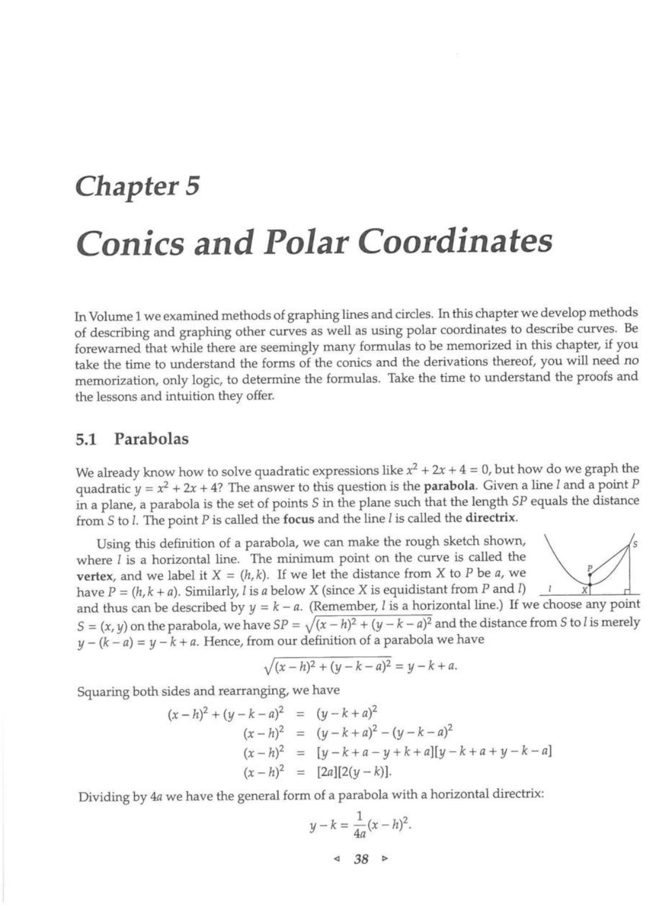

## Printed page 39

<!-- source: volume-2, PDF page 61, printed page 39 -->

Such parabolas always open either upward or downward (the one in this example opens upward). Similarly, if the directrix is vertical, the equation

$$x - h = \frac{1}{4a}(y - k)^2$$

describes the parabola (which then points either to the right or the left). In this case, the vertex is still $(h, k)$, but now the focus is $+a$ to the right of the vertex, or $(h + a, k)$, and the directrix is a vertical line $-a$ from the vertex, or $x = h - a$.

**EXERCISE 5-1** In the two general equations for the parabola above, what effect does the $1/4a$ term have on the graph of the parabola? What does negative $a$ mean? Large $a$?

**EXERCISE 5-2** The **axis of symmetry** is the line through the focus and the vertex of a parabola. The axis thus divides the parabola precisely in half. Find the equation of the axis of a parabola which opens upward and that of a parabola which opens to the right.

**EXAMPLE 5-1** Graph and find the vertex, focus, and directrix of the parabola

$$x = -2y^2 + 12y - 15.$$

**Solution:** First we complete the square to get the parabola in one of our general forms:

$$x = -2(y^2 - 6y) - 15$$

$$x + (-2)(9) = -2(y^2 - 6y + 9) - 15.$$

Hence our parabola is described by $x - 3 = -2(y - 3)^2$. Our vertex then is $(h, k) = (3, 3)$. To determine the focus and directrix, we find $a$ by noting $1/4a = -2$, so $a = -1/8$. Hence, the directrix is $x = 3 - (-1/8) = 25/8$ (remember, the $y$ term is squared, so the directrix is vertical) and the focus is $(3 - 1/8, 3) = (23/8, 3)$. To plot the parabola, we first plot the vertex, then find a few more points on the parabola by selecting values for $y$ and finding the corresponding $x$ values. We then plot the parabola as shown.

**EXERCISE 5-3** Draw a line through the focus parallel to the directrix. Suppose this line intersects the parabola at $A$ and $B$. The **latus rectum** is the segment $AB$. Prove for our above described parabolas that $AB = |4a|$. How can this fact be used to sketch parabolas easily?

**EXERCISE 5-4** Why do you think the line $l$ in our definition of a parabola is called the directrix?

**EXERCISE 5-5** Find the focus, the vertex, the directrix, and the length of the latus rectum of the parabola

$$y = x^2/2 + 3x + 4.$$

Now that we can find all the significant points and lines of a parabola, we should be able to find the equation of a parabola given some of these points or lines. We do so by first determining the direction of the parabola (right, left, up, or down), then using the given information to determine $h$, $k$, and $a$.

Original scan — PDF page 61

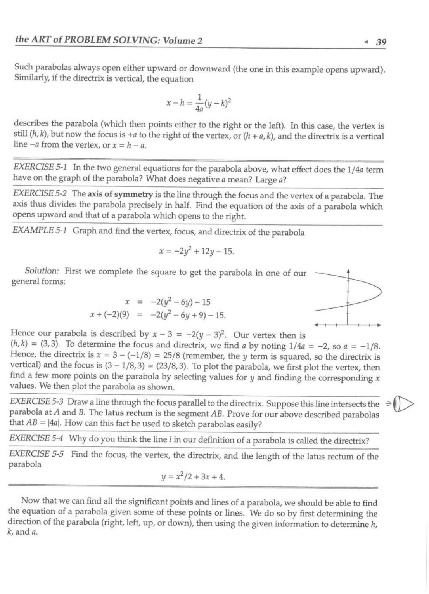

## Printed page 40

<!-- source: volume-2, PDF page 62, printed page 40 -->

**EXAMPLE 5-2 Find the equation of a parabola with focus $(3, 2)$ and vertex $(3, 4)$.**

Solution: Since the vertex and focus lie on a vertical line $(x = 3)$ and the vertex is above the focus, the parabola points downward. Hence, we are dealing with the form $y - k = (1/4a)(x - h)^2$. From the vertex we know that $h = 3$ and $k = 4$ and we expect $a$ to be negative (since the parabola opens downward). We know the focus is always $a$ away from the vertex. In this case, the focus is 2 units below the vertex, so $a = -2$. Hence, our parabola is $y - 4 = -(1/8)(x - 3)^2$.

**EXERCISE 5-6 Find the equation of a parabola with directrix $x = 3/2$ and focus $(5/2, 4)$.**

**EXAMPLE 5-3 A box with two dimensions of 10 feet and 4 feet is to be slid through a parabolic arch which is 5 feet tall at the center and 6 feet wide at the base. If the side facing the ground is 4 feet by 10 feet, what is the largest the other dimension can be and still slide through the arch?**

Solution: Draw the segment $AB$ from the top of the arch to the midpoint of the base as shown. If we let $B$ be the origin, we can determine $A = (0, 5)$, $C = (3, 0)$, and $D = (-3, 0)$, since the arch is 5 feet high and 6 feet wide. Hence, the vertex of our parabola is $(0, 5)$ and it passes through $(3, 0)$. Since the parabola points downward, we have $y - 5 = (1/4a)x^2$ as its equation. Using the point $(3, 0)$, we have $-5 = 9/4a$, or $1/4a = -5/9$. Hence, the equation of the parabola is

$$y - 5 = -\frac{5}{9}x^2.$$

Now we draw the box $WXYZ$ in the arch as shown. Since $WZ = 4$, point $Z$ has coordinates $(2, 0)$. Point $Y$ then has coordinates $(2, z)$, where $z$ is the desired third dimension. Since $Y$ is on the parabola, we have $z - 5 = (-5/9)(2^2)$. Hence $z = 25/9$ and our largest possible third dimension is $25/9$ feet. Make sure you understand this problem. Variations of it using elliptical and hyperbolic arches (figures which are discussed in the next few sections) are very common. Don’t let them trip you up!

### 5.2 Ellipses

The general equation for a circle is

$$(x - h)^2 + (y - k)^2 = R^2.$$

Dividing by $R^2$, we can write this as

$$\frac{(x - h)^2}{R^2} + \frac{(y - k)^2}{R^2} = 1.$$

In our discussion of distortion in Volume 1, we noted that we can stretch a circle to form an ellipse. Namely, we could stretch the radius in the $x$ direction so that it differs from that in the $y$ direction. The resulting curve is at right. We could then associate two radii, $a$ and $b$, with our curve and write it as

$$\frac{(x - h)^2}{a^2} + \frac{(y - k)^2}{b^2} = 1.$$

Original scan — PDF page 62

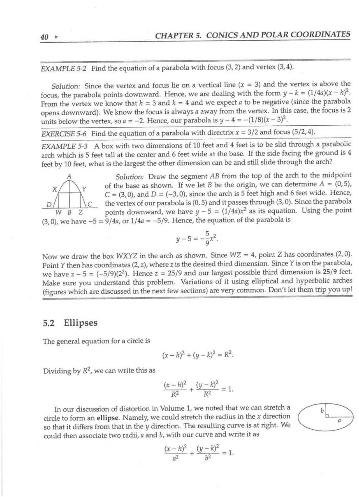

## Printed page 41

<!-- source: volume-2, PDF page 63, printed page 41 -->

From our diagram, we see that we have two different 'diameters' in the $x$ and $y$ direction. These have length $2a$ and $2b$, respectively. These are called the major axis and the minor axis of the ellipse, where the major axis is the longer of the two.

**EXERCISE 5-7** What if $a = b$ above? Do you see why circles are ellipses?

Taking two points $F_1$ and $F_2$, we can define an ellipse as the set of points $Z$ such that $ZF_1 + ZF_2$ has some constant value. We call $F_1$ and $F_2$ the foci of the ellipse. To see that this new definition of an ellipse satisfies our equation form, we apply the distance formula. First we draw the axes of the ellipse and note that $CD = 2b$ and $AB = 2a$. Now we can find the constant sum $ZF_1 + ZF_2$. Letting $Z$ be $A$ we have

$$ZF_1 + ZF_2 = AF_1 + AF_2 = BF_2 + AF_2 = AB = 2a,$$

where we note that $AF_1 = BF_2$. (Why?) Hence our constant sum is $2a$, or the length of the major axis. Since $F_1C = CF_2$ and $F_1C + CF_2 = 2a$, from right triangle $CEF_1$ we have

$$2a = 2CF_1 = 2\sqrt{CE^2 + EF^2} = 2\sqrt{b^2 + EF^2}.$$

If we let $c = EF_1$ be the distance from each focus to the center, we square $a = \sqrt{b^2 + EF^2}$ to find $c^2 = a^2 - b^2$. (Why are the foci equidistant from the center?) Now we are ready to apply our constant sum principle to find the equation of an ellipse. We let the center of the ellipse be the origin, so that $F_1 = (-c, 0)$ and $F_2 = (c, 0)$. Taking a general point $Z = (x, y)$ on the ellipse, we have

$$2a = ZF_1 + ZF_2 = \sqrt{(x + c)^2 + y^2} + \sqrt{(x - c)^2 + y^2}.$$

We move one radical to the other side of the equation and square, so

$$\left(2a - \sqrt{(x + c)^2 + y^2}\right)^2 = \left(\sqrt{(x - c)^2 + y^2}\right)^2$$

$$4a^2 - 4a\sqrt{(x + c)^2 + y^2} + (x + c)^2 + y^2 = (x - c)^2 + y^2$$

$$4a^2 - 4a\sqrt{(x + c)^2 + y^2} + x^2 + 2xc + c^2 + y^2 = x^2 - 2xc + c^2 + y^2.$$

Again we rearrange the equation to isolate the square root. Then we divide by 4 and square both sides of the resulting equation, yielding

$$\left(-a\sqrt{(x + c)^2 + y^2}\right)^2 = (-a^2 - xc)^2$$

$$a^2[(x + c)^2 + y^2] = a^4 + 2a^2xc + x^2c^2$$

$$a^2x^2 + 2a^2xc + a^2c^2 + a^2y^2 = a^4 + 2a^2xc + x^2c^2.$$

Simplifying where possible and applying the relation $c^2 = a^2 - b^2$, we have

$$a^2x^2 + a^2c^2 + a^2y^2 = a^4 + x^2c^2$$

$$a^2x^2 + a^2(a^2 - b^2) + a^2y^2 = a^4 + x^2(a^2 - b^2).$$

Original scan — PDF page 63

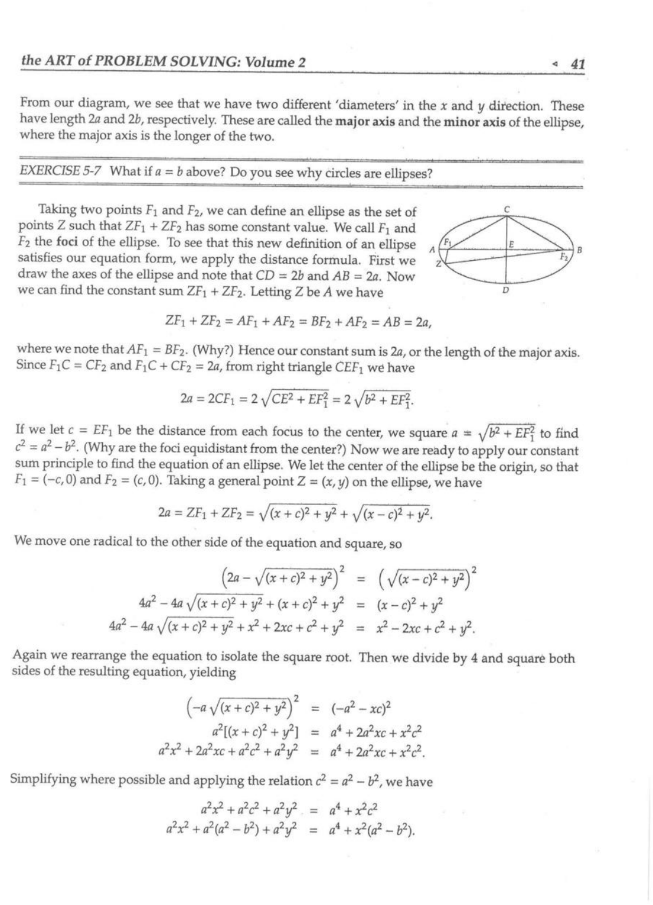

## Printed page 42

<!-- source: volume-2, PDF page 64, printed page 42 -->

Putting all terms involving $x$ and $y$ on the left and the constants on the right we find

$$b^2 x^2 + a^2 y^2 = a^2 b^2$$

or

$$\frac{x^2}{a^2} + \frac{y^2}{b^2} = 1.$$

The simple translation from $(x, y)$ to $(x - h, y - k)$ gives us the equation for an ellipse with center $(h, k)$ rather than $(0, 0)$, or

$$\frac{(x - h)^2}{a^2} + \frac{(y - k)^2}{b^2} = 1.$$

For this ellipse, the foci are $(h \pm c, k)$ since they are $c$ to the right and $c$ to the left of the center.

We measure the amount an ellipse is stretched away from a circle by its eccentricity, which is $c/a$. Finally, the area enclosed in an ellipse is $ab\pi$, which is proven on page 242.

**EXAMPLE 5-4** What happens to our ellipse equation if the major axis is parallel to the $y$ axis rather than the $x$ axis as above?

**Solution:** Again we let the major axis have length $2a$ and the minor axis length $2b$, so that through the same discussion as above, the equation of the ellipse is

$$\frac{(x - h)^2}{b^2} + \frac{(y - k)^2}{a^2} = 1.$$

The foci are now $c$ above and $c$ below the center (at $(h, k \pm c)$) and $c$ still equals $\sqrt{a^2 - b^2}$.

**EXERCISE 5-8** Why is the quantity $c/a$ called the eccentricity?

Now we have a way to describe all important points and lengths of an ellipse whose axes are parallel to the coordinate axes. WARNING: In describing an ellipse, we associate the letter $a$ with the larger of the 'radii' in the $x$ and $y$ directions. Always make sure your value of $a$ is greater than that of $b$; otherwise, your value of $c = \sqrt{a^2 - b^2}$ will be nonsense. Furthermore, make sure you know which direction the major axis points. This will help you determine where the foci are.

**EXAMPLE 5-5** Graph and find the center, foci, area, and lengths of the axes of the ellipse given by $9x^2 - 36x + 4y^2 - 24y + 36 = 0.$

**Solution:** We attack this just as we did parabolas that weren't written in the nice general form; we complete the square:

$$9(x^2 - 4x) + 4(y^2 - 6y) = -36.$$

To make perfect squares, we add $(-4/2)^2 = 4$ inside the $x$ parentheses and $(-6/2)^2 = 9$ inside the $y$ parentheses. Hence, we have

$$9(x^2 - 4x + 4) + 4(y^2 - 6y + 9) = -36 + 9(4) + 4(9)$$

$$9(x - 2)^2 + 4(y - 3)^2 = 36.$$

Original scan — PDF page 64

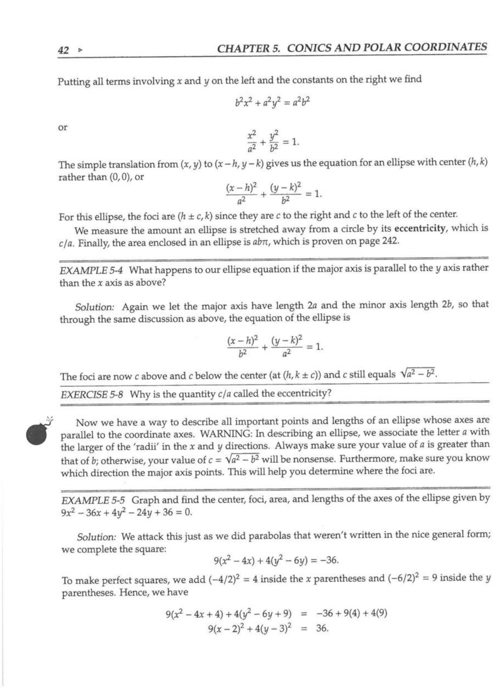

## Printed page 43

<!-- source: volume-2, PDF page 65, printed page 43 -->

Dividing by 36, we get our form for the ellipse,

$$\frac{(x-2)^2}{4} + \frac{(y-3)^2}{9} = 1.$$

Hence the center is $(2, 3)$. Since the number under the $y$ is greater than that under the $x$, the major axis is parallel to the $y$ axis. From our equation we have $a = \sqrt{9} = 3$ and $b = \sqrt{4} = 2$. Thus, the major and minor axes have lengths 6 and 4, respectively.

From $a$ and $b$ we find that the area is $6\pi$ and $c = \sqrt{9-4} = \sqrt{5}$. Since the major axis is parallel to the $y$ axis, the foci are then found by adding and subtracting $c$ from the $y$ coordinate of the center, or $(2, 3 \pm \sqrt{5})$. To graph the ellipse, we locate the endpoints of the axes. The major axis endpoints are 3 above and below the center (since the major axis has length 6) and thus are $(2, 6)$ and $(2, 0)$. Similarly the endpoints of the minor axis are $(0, 3)$ and $(4, 3)$. Plotting these points, we can draw the ellipse as shown.

**EXAMPLE 5-6** What are $a$ and $b$ for the ellipse

$$\frac{4(x-1)^2}{9} + \frac{(y-2)^2}{8} = 1?$$

**Solution:** Neither $a$ nor $b$ is $\sqrt{9} = 3!$. Notice the 4 before the $(x-1)^2$. We put this in the denominator as

$$\frac{(x-1)^2}{9/4} + \frac{(y-2)^2}{8} = 1.$$

Our $a$ and $b$ values are then $\sqrt{8} = 2\sqrt{2}$ and $\sqrt{9/4} = 3/2$, respectively.

**EXERCISE 5-9** Find the center, foci, and length of the axes of the ellipse

$$3x^2 + 4y^2 - 6x + 8y + 3 = 0.$$

**EXERCISE 5-10** What if I complete the square for a problem like the previous exercise and find

$$\frac{(x-2)^2}{4} + \frac{(y+1)^2}{3} = 0$$

as my equation of the ellipse? (Notice there is a 0 on the right, not a 1.) How many solutions $(x, y)$ are there to this equation? What if I get a negative number on the right? These are cases of degenerate ellipses, or ellipse equations with either no solution or only one solution.

**EXERCISE 5-11** As with the parabola, we can define the latus recti of an ellipse as the segments through the foci parallel to the minor axis with endpoints on the ellipse. Find the length of each of these segments in terms of $a$ and $b$.

Just as with parabolas, we are often asked to find the equation of an ellipse given certain information about the ellipse. Again the first step is to determine which direction the ellipse points (i.e. the direction of the major axis). We then use the given information to determine the center as well as $a$ and $b$.

Original scan — PDF page 65

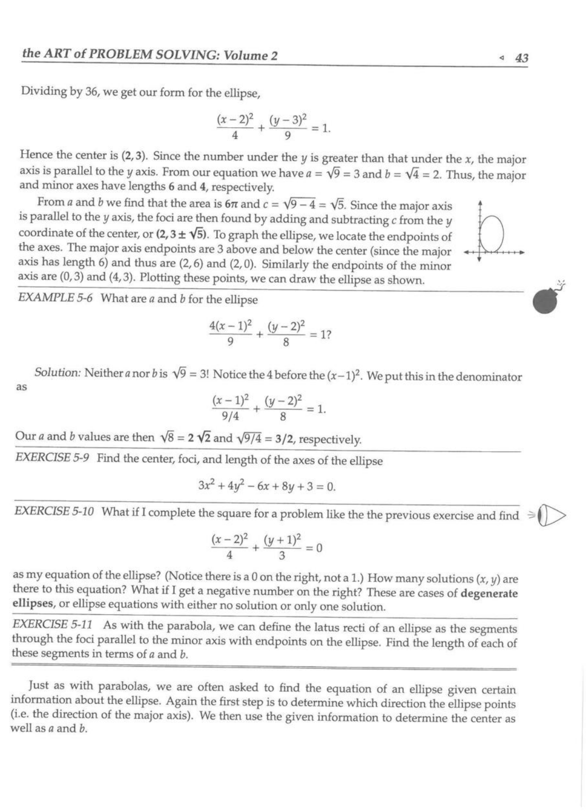

## Printed page 44

<!-- source: volume-2, PDF page 66, printed page 44 -->

**EXAMPLE 5-7 Find the ellipse with major axis length 8, center $(2, 1)$, and one focus at $(2, 3)$.**

Solution: Since the given focus is directly above the center, the major axis is parallel to the $y$ axis. From the information we can also deduce $h = 2, k = 1$, and $a = 8/2 = 4$. Since the given focus is 2 away from the center, we have $c = 2$. Thus, from $c^2 = a^2 - b^2$, we find $b^2 = a^2 - c^2 = 12$ and our ellipse is

$$\frac{(x - h)^2}{b^2} + \frac{(y - k)^2}{a^2} = \frac{(x - 2)^2}{12} + \frac{(y - 1)^2}{16} = 1.$$

Make sure you see why the 12 is under $(x - 2)^2$ rather than $(y - 1)^2$.

**EXERCISE 5-12 Find the equation of the ellipse with foci at $(3, 1)$ and $(-5, 1)$ and minor axis with length 4.**

With the ability to find the equation of an ellipse given some information about it, we move on to less obvious applications of ellipses.

**EXAMPLE 5-8 To give my dog some space to run, I drive two stakes in my lawn 10 feet apart. I tie the ends of a 30 foot rope to the stakes (one end to each stake) and loop my dog’s collar loosely around the rope, so she is free to move along the rope. Over how many square feet is my dog free to roam?**

Solution: If my dog walks until the rope pulls taut, she will get to the boundary of her roaming area. This boundary is an ellipse since the sum of the distances from any point on the boundary to the stakes is the length of the rope, 30 feet. The stakes correspond to the foci and the rope to the constant sum of distances. Hence, the major axis has length 30. If we let the stakes lie on the $x$ axis and the midpoint of the line connecting the stakes be the origin, the equation of the ellipse is (since $a = 30/2 = 15$):

$$\frac{x^2}{225} + \frac{y^2}{b^2} = 1.$$

We then find $b$ by noting that the distance from a focus to the center is $c = 5$ since the stakes are 10 feet apart, so $b = \sqrt{a^2 - c^2} = 10\sqrt{2}$. The area of the roaming region is the area of the ellipse, or $ab\pi = 150\pi\sqrt{2}$ square feet.

Keep an eye out for these slick applications of the constant sum of distances property of an ellipse to problems.

### 5.3 Hyperbolas

Suppose we change the $+$ in the general ellipse equation to a $-$, resulting in

$$\frac{(x - h)^2}{a^2} - \frac{(y - k)^2}{b^2} = 1.$$

The graph of this equation is called a hyperbola. As you may have guessed, with each hyperbola we can associate a pair of foci $F_1$ and $F_2$ so that the hyperbola is the set of all points $S$ where $|F_1S - F_2S|$

Original scan — PDF page 66

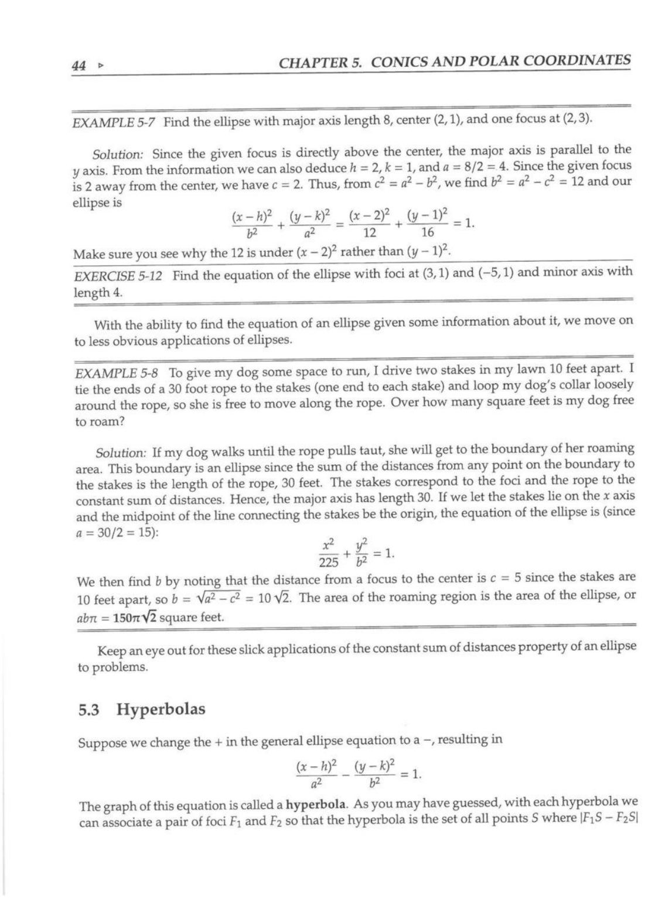

## Printed page 45

<!-- source: volume-2, PDF page 67, printed page 45 -->

has some constant value. We can slug through the same exact algebra as we did with the ellipse to show the equivalence of the constant difference condition to the above equation. If you don't trust us, try it yourself. Find this common difference of distances and use the fact that $c^2 = a^2 + b^2$ (where $c$ is the distance from the focus to the center).

If you find a bunch of points on the hyperbola, you will eventually find a curve like the bold curve shown below. The center $O$ has coordinates $(h, k)$, just like the ellipse. Points $I$ and $J$ are the foci and have coordinates $(h \pm c, k)$ since they are $c$ to the right and left of the center. The points $C$ and $G$ are the vertices. They have the same $y$ coordinate as the center, so letting $y = k$ in the equation for a hyperbola, we have $(x - h)^2 / a^2 = 1$, so $x = h \pm a$ and the vertices are $(h \pm a, k)$.

The segment $CG$ is called the transverse axis, and like the major axis of an ellipse it has length $2a$. Similar to the minor axis we define the conjugate axis as the segment with endpoints $(h, k \pm b)$.

Suppose we sketch the rectangle, as we have in dashed lines, with center $O$ and sides equal in length to our two axes. The lines $l$ and $m$ which are the extensions of the diagonals of this rectangle are called the asymptotes of the hyperbola. These are lines which the curve approaches but never actually meets. We can find the equation of line $l$ by noting that it passes through the center $O = (h, k)$ and has slope $HG / OG = b / a$. Hence, the equation of line $l$ is $y - k = (b / a)(x - h)$. Similarly, the equation for line $m$ is $y - k = (-b / a)(x - h)$. As the following example will show you, using the asymptotes helps graph the hyperbola.

Please do not memorize all of these formulas; understand them instead.

**EXERCISE 5-13** Why are the lines $y - k = \pm \frac{b}{a}(x - h)$ asymptotes of the above hyperbola? What happens in our hyperbola equation if we let $y - k = \pm \frac{b}{a}(x - h)$?

**EXAMPLE 5-9** Find the asymptotes, vertices, center, foci, and lengths of the axes of $9x^2 - 4y^2 + 18x + 16y - 43 = 0$ and graph the hyperbola.

**Solution:** Grouping our $x$ and $y$ terms we have $9(x^2 + 2x) - 4(y^2 - 4y) = 43$. Completing the square then dividing by 36 we get

$$\frac{(x + 1)^2}{4} - \frac{(y - 2)^2}{9} = 1.$$

(Always make sure you have positive 1 on the right.) The center is $(-1, 2)$, and we have $a = 2$ and $b = 3$. Hence, the transverse axis has length $2(2) = 4$, the conjugate axis has length 6, and the vertices are $(-3, 2)$ and $(1, 2)$. Since $c = \sqrt{a^2 + b^2} = \sqrt{13}$, the foci of the hyperbola are $(-1 \pm \sqrt{13}, 2)$. Finally, the asymptotes are $y - 2 = \pm \frac{3}{2}(x + 1).$

Original scan — PDF page 67

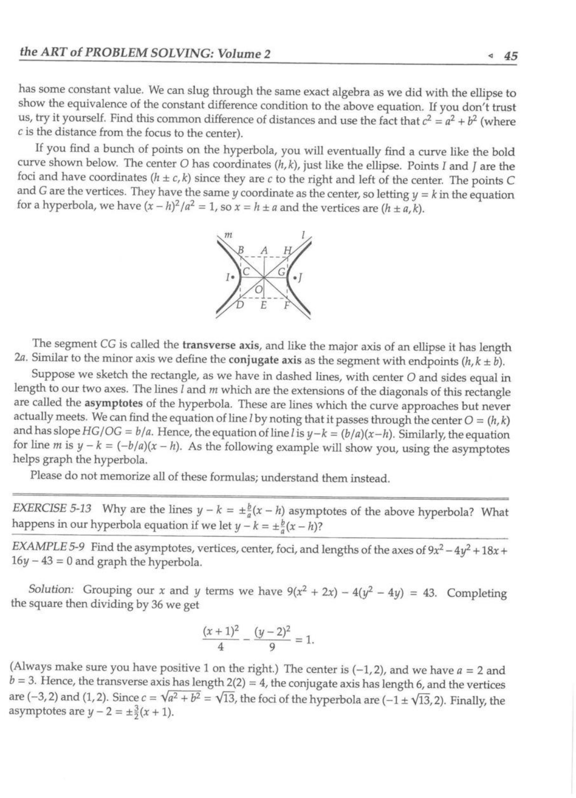

## Printed page 46

<!-- source: volume-2, PDF page 68, printed page 46 -->

To graph the hyperbola, we plot its center and vertices. We then draw our asymptotes, which we can do most easily by sketching the rectangle with center $(-1, 2)$ and sides of length $2a$ and $2b$ as in our introduction. The lines through the opposite corners of the rectangle are the shown asymptotes. Now we can draw the curve through the vertices approaching the lines asymptotically as shown.

**EXERCISE 5-14 Find the center, vertices, foci, asymptotes, and the lengths of the axes of the hyperbola**

$$\frac{(y - k)^2}{a^2} - \frac{(x - h)^2}{b^2} = 1.$$

Note that with a hyperbola we always associate $a$ with the positive term rather than the one with the larger denominator.

**EXERCISE 5-15 We can define the latus recti of a hyperbola as the segments through the foci parallel to the conjugate axis with endpoints on the hyperbola. We can also define the eccentricity as we did for the ellipse, $c/a$. Find the length of the latus recti of a hyperbola.**

**EXAMPLE 5-10 What if completing the square for the hyperbola results in $(x - 1)^2/4 - (y + 2)^2/9 = 0$, rather than equalling 1 like usual?**

Solution: This is a degenerate hyperbola. We can write the equation as $(x - 1)^2/4 = (y + 2)^2/9$. Taking the square root of both sides, we find

$$(x - 1)/2 = \pm (y + 2)/3,$$

so the degenerate hyperbola is just a pair of lines.

Consider the graph of the curve $xy = 6$. Graphing several of the points on the graph we find the curve shown. This looks very much like a hyperbola, and it is! The coordinate axes are the asymptotes and the origin is the center. We can find the vertices of the hyperbola by noting that $x = y$ at the vertex. (Why?) Hence the vertices are $(\sqrt{6}, \sqrt{6})$ and $(- \sqrt{6}, - \sqrt{6})$. Similar to this example, any curve of the form $xy = c$ is a hyperbola.

**EXERCISE 5-16 Why are the coordinate axes asymptotes of the hyperbola $xy = 6$?**

Once again, we can determine the equation of a hyperbola given various information about the hyperbola.

**EXERCISE 5-17 Find the equation of a hyperbola with vertices $(-2, -1 \pm 2\sqrt{2})$ and conjugate axis of length 4.**

Original scan — PDF page 68

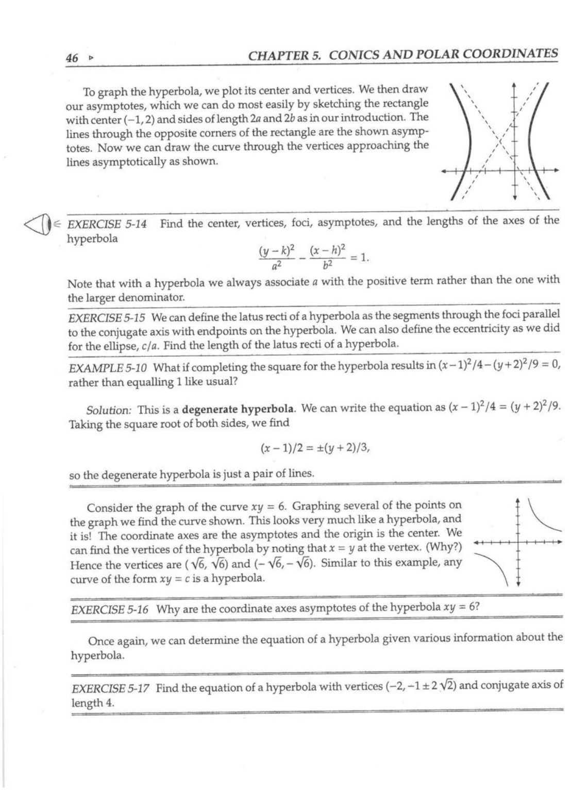

## Printed page 47

<!-- source: volume-2, PDF page 69, printed page 47 -->

Now that we've finished introducing parabolas, ellipses, and hyperbolas, we can discuss why we call them conic sections. Take a pair of congruent cones and hold them tip to tip so they have the same vertex and same axis but open in opposite directions. Consider the various cross-sections that occur when you cut the resulting solid with a plane. Cutting completely through one cone forms an ellipse. Cutting with a plane parallel to the axis will form a hyperbola, and a plane intersecting one cone but not the other (but not passing all the way through the first cone) forms a parabola.

### 5.4 Polar Coordinates Revisited

As we saw in the first volume, we can identify any point $P$ in the plane by its distance from the origin $(OP)$ and the angle $\theta$ which $OP$ forms with the positive $x$ axis. Calling the distance from the point to the origin $r$, we relate the polar point $P = (r, \theta)$ to the rectangular coordinate point $(x, y)$ by $x = r \cos \theta$ and $y = r \sin \theta$. Hence, we have

$$x^2 + y^2 = r^2 \cos^2 \theta + r^2 \sin^2 \theta = r^2,$$

and we relate the angle $\theta$ to $x$ and $y$ by

$$\frac{y}{x} = \frac{\sin \theta}{\cos \theta},$$

or $\theta = \tan^{-1} \frac{y}{x}$. WARNING: Make sure when determining $\theta$ that it properly corresponds to the quadrant in which $(x, y)$ lies.

**EXAMPLE 5-11 Convert the rectangular point $(3, -3)$ to polar coordinates and the polar point $(6, 30^\circ)$ to rectangular coordinates.**

Solution: For the point $(3, -3)$, we have $r = \sqrt{x^2 + y^2} = \sqrt{18} = 3\sqrt{2}$. We find the angle as $\theta = \tan^{-1} (-1)$. Since $(3, -3)$ is in the fourth quadrant, $\theta = 315^\circ$. The point $(3, -3)$ in polar coordinates is then $(3\sqrt{2}, 315^\circ)$. Notice that we could use $315^\circ + n(360^\circ)$ for any $n$ as the angle to determine the point in polar coordinates as well.

For the polar point $(6, 30^\circ)$, we have $x = 6 \cos 30^\circ = 3\sqrt{3}$ and $y = 6 \sin 30^\circ = 3$. Our point thus is $(3\sqrt{3}, 3)$.

**EXERCISE 5-18 Express $(6, -6\sqrt{3})$ in polar coordinates and $(-2, 405^\circ)$ in rectangular coordinates.**

Polar coordinates are often useful in describing curves. For example, the equation $r = 3$ represents a circle with center $(0, 0)$ and radius 3. Using the expressions $x = r \cos \theta$ and $y = r \sin \theta$, we can easily turn any curve in rectangular coordinates into a polar equation.

**EXAMPLE 5-12 Express the equation $x^2 - y^2 = 9$ in polar coordinates.**

Solution: Using $x = r \cos \theta$ and $y = r \sin \theta$, we have $x^2 - y^2 = r^2(\cos^2 \theta - \sin^2 \theta) = r^2 \cos 2\theta$. Hence, our polar form is $r^2 \cos 2\theta = 9$.

**EXERCISE 5-19 Express $6xy = 8$ in polar coordinates.**

Original scan — PDF page 69

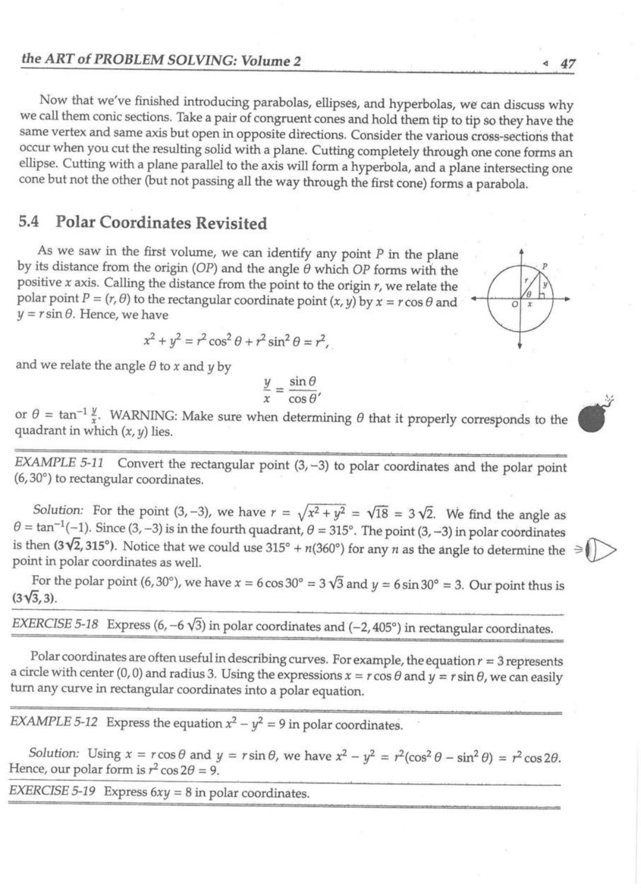

## Printed page 48

<!-- source: volume-2, PDF page 70, printed page 48 -->

Going from polar coordinates to rectangular is generally a little bit tougher. To do so, we replace any $r^2$ with $x^2 + y^2$, $r \cos \theta$ with $x$, and $r \sin \theta$ with $y$. Sometimes we have to manipulate the equation a bit first, as you will see.

**EXAMPLE 5-13** Write $r = \frac{5}{3 - \cos \theta}$ in rectangular coordinates.

**Solution:** First we multiply by $3 - \cos \theta$, yielding

$$3r - r \cos \theta = 5.$$

Since $r \cos \theta = x$, we have $3r - x = 5$. Isolating the $r$ we find $3r = 5 + x$. Squaring this (to get $r^2$ on the left) yields $9r^2 = 25 + 10x + x^2$. Since $r^2 = x^2 + y^2$, we have $9(x^2 + y^2) = 25 + 10x + x^2$, or

$$8x^2 + 9y^2 - 10x = 25.$$

You should now be able to recognize this as an ellipse.

**EXAMPLE 5-14** Identify the curve $r = 3 \cos \theta$.

**Solution:** To identify a curve in polar coordinates, it is often best to convert the equation to rectangular coordinates and name the resulting curve. For this equation, we multiply by $r$ to force an $r^2$ on one side and $r \cos \theta$ on the other, namely $r^2 = 3r \cos \theta$. Hence, $x^2 + y^2 = 3x$ and our curve is a circle.

**EXERCISE 5-20** Express $r = 4 \sec \theta$ and $r = 3 \sin \theta$ in rectangular coordinates.

**EXERCISE 5-21** How would you express vertical or horizontal lines in polar coordinates? How about a line through the origin?

**EXERCISE 5-22** Describe as specifically as possible the class of curves described by $r = a \sin \theta + b \cos \theta$.

Finally, for you trivia buffs, there are a few more families of curves which have simple polar forms.

A **limaçon** has the one of the forms:

$$r = a + b \sin \theta \quad r = a + b \cos \theta$$

$$r = a - b \sin \theta \quad r = a - b \cos \theta.$$

Try choosing some pairs $(a, b)$ (where $a, b > 0$) and sketching the resulting graphs by choosing different values for $\theta$, then computing $r$.

If a limaçon has $a/b < 1$, it will have a loop. If $a/b = 1$, the curve, which is shown at left, is called a **cardioid**. If $1 < a/b < 2$, the limaçon is 'dimpled,' and otherwise, it is 'convex.'

Curves of the form $r^2 = \pm a^2 \cos 2\theta$ or $r^2 = \pm a^2 \sin 2\theta$ are called **lemniscates**, which look like infinity symbols.

The curve $r = a\theta$, where the radius increases with the angle, is called the **spiral of Archimedes**. Graph it and see why.

Original scan — PDF page 70

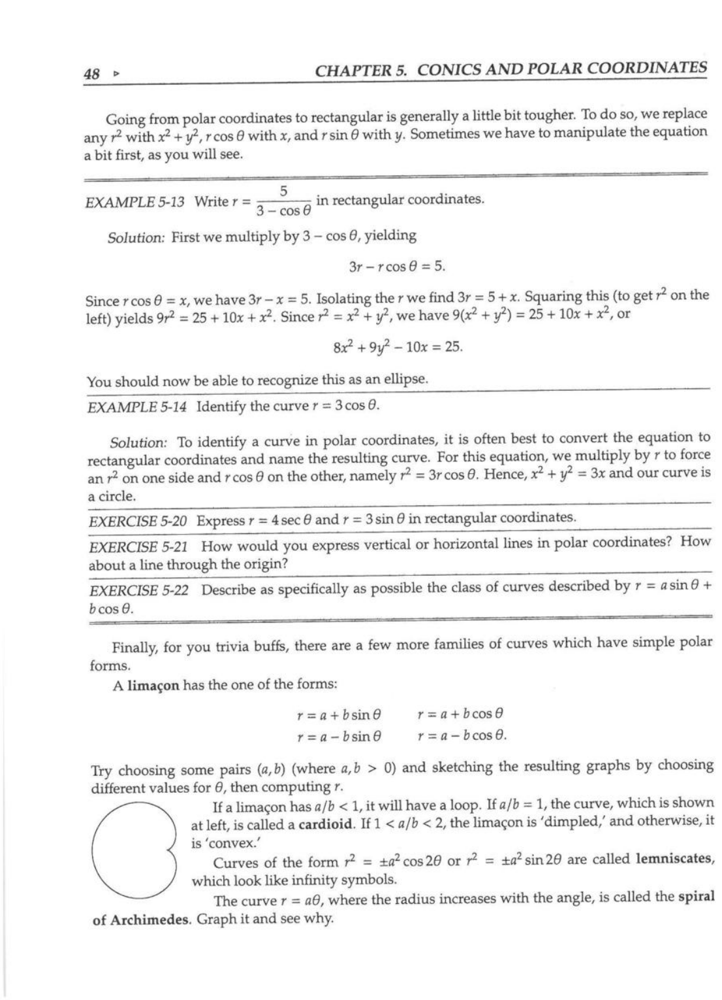

## Printed page 49

<!-- source: volume-2, PDF page 71, printed page 49 -->

Finally, $r = a \sin n\theta$ and $r = a \cos n\theta$ represent roses. Shown is a graph with $n = 5$, which has 5 'petals.' Try choosing other values of $n$ and plotting the results. Can you develop a rule for the number of petals in a rose?

As we initially stated, these curves aren't terribly useful for problem solving outside of trivial pursuits, however through using computer graphics you may be able to generate quite artistic results based on these simple polar forms.

### 5.5 That Pesky $xy$ Term

A general conic has the form $Ax^2 + Bxy + Cy^2 + Dx + Ey + F = 0$. In previous sections, the only time we have seen an $xy$ term is when we discussed hyperbolas of the form $xy = c$ for some constant $c$. Otherwise, we have avoided $xy$ as much as possible because conics without $xy$ terms are easy to analyze. Those with an $xy$ term have axes which are no longer parallel to the coordinate axes and these are much more difficult to resolve. We call these conics oblique.

Now that we've mastered polar coordinates we can analyze oblique conics by rotating them so that their axes are parallel to the coordinate axes. But how do we perform the rotation?

Rather than rotate the conic, we rotate the coordinate axes to be parallel to the axes of the conic. In the diagram is the rotation of the coordinate axes through an angle $\alpha$ counterclockwise about the origin. Point $P$, which originally has coordinates $(x, y)$ before rotation is at $(x', y')$ with respect to our new axes $x'$ and $y'$. Letting the angle $OP$ forms with the positive $x'$ axis be $\beta$, we can relate the two pairs of rectangular coordinates of $P$ to $\alpha$ and $\beta$ through polar coordinates (where $r = OP$) as

$$x = r \cos(\alpha + \beta) \quad \text{and} \quad y = r \sin(\alpha + \beta),$$

and

$$x' = r \cos \beta \quad \text{and} \quad y' = r \sin \beta.$$

(Make sure you understand these.) Expanding our expressions for $x$ and $y$ and using the ones for $x'$ and $y'$ we find

$$x = r \cos \alpha \cos \beta - r \sin \alpha \sin \beta = x' \cos \alpha - y' \sin \alpha$$

$$y = r \sin \alpha \cos \beta + r \cos \alpha \sin \beta = x' \sin \alpha + y' \cos \alpha,$$

where we have used our expressions for $x'$ and $y'$ to express $(x, y)$ in terms of $(x', y')$ and the angle of rotation.

**EXERCISE 5-23 In our above rotation, find $x'$ and $y'$ in terms of $x, y,$ and $\alpha$.**

Now we return to our conic $Ax^2 + Bxy + Cy^2 + Dx + Ey + F = 0$, where $B \neq 0$. Our problem now is to rotate the axes through some angle $\alpha$ such that the resulting conic has no $x'y'$ term in $(x', y')$ coordinates. Using the above equations for $x$ and $y$ in terms of $x', y'$, and $\alpha$, we have

$$A(x' \cos \alpha - y' \sin \alpha)^2 + B(x' \cos \alpha - y' \sin \alpha)(x' \sin \alpha + y' \cos \alpha) + C(x' \sin \alpha + y' \cos \alpha)^2$$

$$+ D(x' \cos \alpha - y' \sin \alpha) + E(x' \sin \alpha + y' \cos \alpha) + F = 0.$$

Original scan — PDF page 71

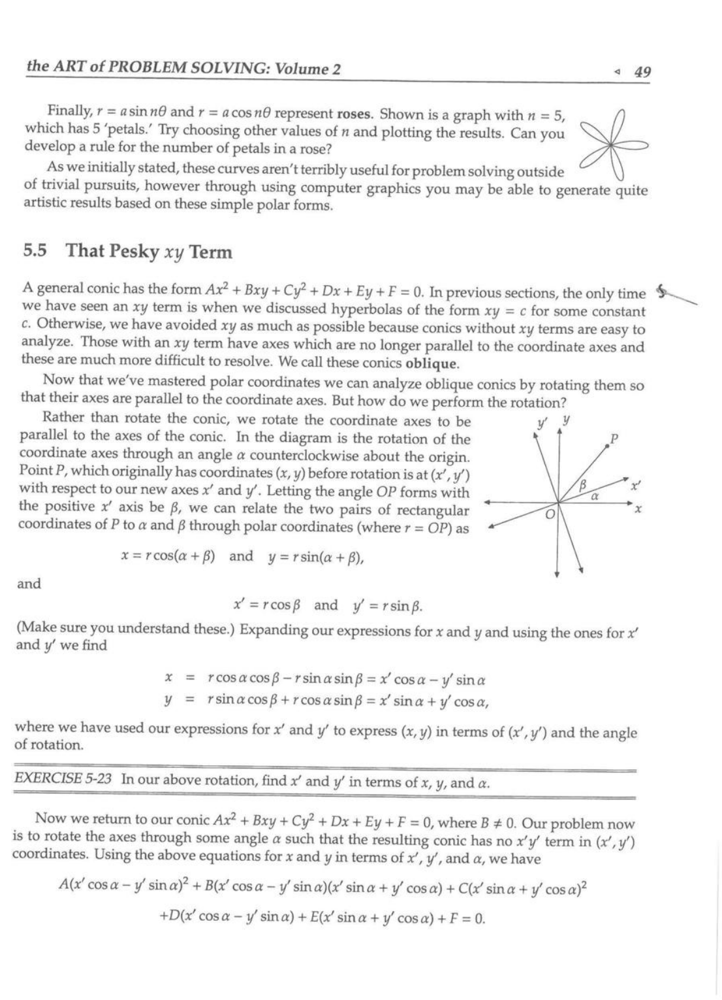

## Printed page 50

<!-- source: volume-2, PDF page 72, printed page 50 -->

Since we want to get rid of the $x' y'$ term, we only consider those terms which produce $x' y'$ terms. Combining these terms and setting their sum equal to 0, we have

$$-2Ax' y' \cos \alpha \sin \alpha + Bx' y' (\cos^2 \alpha - \sin^2 \alpha) + 2Cx' y' \cos \alpha \sin \alpha = 0$$

$$x' y' (C - A) (2 \cos \alpha \sin \alpha) + Bx' y' (\cos^2 \alpha - \sin^2 \alpha) = 0$$

$$x' y' (C - A) (\sin 2 \alpha) + Bx' y' (\cos 2 \alpha) = 0.$$

Dividing by $x' y'$ and rearranging a bit, we find $B \cos 2 \alpha = (A - C) \sin 2 \alpha$, so $\cot 2 \alpha = (A - C)/B$. Hence, $\alpha$ as given by $\cot 2 \alpha = (A - C)/B$ is the angle through which we must rotate the axes to eliminate the $xy$ term of $Ax^2 + Bxy + Cy^2 + Dx + Ey + F = 0.$

**EXAMPLE 5-15** Through what acute angle(s) can the conic $3x^2 + 4xy - 4y^2 - 6 = 0$ be rotated in order to remove the $xy$ term?

**Solution:** From the above discussion, we have $\cot 2 \alpha = 7/4$ for the angle $\alpha$ through which we must rotate the axes counterclockwise; hence, we must rotate the conic clockwise $\alpha$ to get rid of the $xy$ term. Thus, one such angle is $\alpha = (1/2) \cot^{-1}(7/4)$ clockwise. We can also rotate the conic through an angle $90^\circ - \alpha$ counterclockwise to get rid of the $xy$ term. The axis which becomes parallel to the $x$ axis under a rotation of $\alpha$ clockwise will be parallel to the $y$ axis upon a rotation of $90^\circ - \alpha$ counterclockwise. Make sure you see why!

How can we tell if the general conic $Ax^2 + Bxy + Cy^2 + Dx + Ey + F = 0$ is an ellipse, parabola, or a hyperbola? We already know how if $B = 0$. The conic is a parabola if $A$ or $C$ is 0; it's an ellipse if $AC$ is positive, and it's a hyperbola if $AC$ is negative. (Why?) If $B \neq 0$, we rotate the conic so that there is no $xy$ term, just as above. For those of you with a yen for algebra, use our rotation method above to prove that if we rotate

$$Ax^2 + Bxy + Cy^2 + Dx + Ey + F = 0$$

to

$$A'x'^2 + B'x' y' + C' y'^2 + D'x' + E' y' + F' = 0,$$

then $B'^2 - 4A'C' = B^2 - 4AC$, no matter what the angle of rotation is. This value, $B^2 - 4AC$, is called the **discriminant** of the conic. Suppose the rotated conic is such that $B' = 0$. Hence, $B^2 - 4AC = B'^2 - 4A'C' = -4A'C'$. Since our new conic has no $xy$ term, it is an ellipse if $A'C' > 0$, a parabola if $A'C' = 0$, or a hyperbola if $A'C' < 0$. Thus, if $B^2 - 4AC = -4A'C' = 0$, the original conic is a parabola, if the discriminant is negative (so that $A'C' > 0$), the conic is an ellipse, and if the discriminant is positive, the conic is a hyperbola.

**EXERCISE 5-24** Can every circle be described without an $xy$ term?

Original scan — PDF page 72

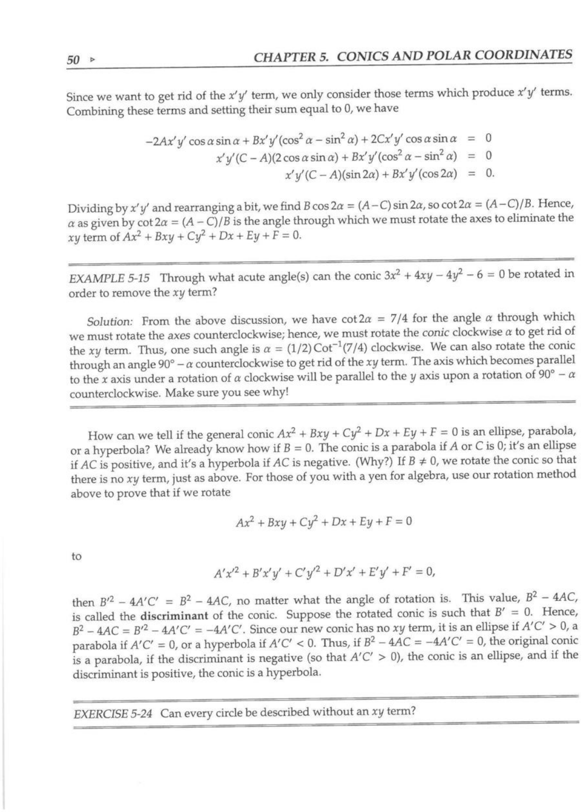

## Printed page 51

<!-- source: volume-2, PDF page 73, printed page 51 -->

70. Find the equation of a hyperbola with asymptotes $y - 1 = \pm \frac{3}{2}(x - 4)$ and one vertex at $(6, 1)$.

71. A parabola $y = ax^2 + bx + c$ has vertex $(4, 2)$. If $(2, 0)$ is on the parabola, then find $abc$. (AHSME 1986)

72. Find the radius of the smallest circle whose interior and boundary completely contain the two circles with centers $(0, 0)$ and $(24, 7)$ and radii 3, 4, respectively. (Mandelbrot #2)

73. A tiny bug starts at a point $(x, y)$ on the graph of $x^2/9 + y^2/4 = 1$. It walks in a straight line to the point $(- \sqrt{5}, 0)$, then in a straight line to $(\sqrt{5}, 0)$, and then in a straight line to its initial point. How far has the bug walked? (MAΘ 1990)

74. If each of two intersecting lines intersects a hyperbola and neither line is tangent to the hyperbola, then what are the possible numbers of places where the lines can intersect the hyperbola? (AHSME 1956)

75. Points $A$ and $B$ are selected on the graph of $y = -x^2/2$ so that triangle $ABO$ is equilateral, where $O$ is the origin. Find the length of one of the sides of $\Delta ABO$. (MATHCOUNTS 1991)

76. A parabolic arch has a span of 24 feet. Its height is 18 feet at a point 8 feet from the center of the span. What is the height, in feet, of the arch? (MAΘ 1992)

77. If the line $y = mx + 1$ intersects the ellipse $x^2 + 4y^2 = 1$ exactly once, then find $m^2$. (AHSME 1971)

78. Find the equation in rectangular coordinates of the curve whose polar equation is $r = 2\sec \theta + \cos \theta$. (MAΘ 1987)

79. A circle has the same center as an ellipse and passes through the foci $F_1$ and $F_2$ of the ellipse. The two curves intersect in four points. Let $P$ be any point of intersection. If the major axis of the ellipse has length 15 and the area of triangle $PF_1F_2$ is 26, compute the distance between the foci. (ARML 1984)

80. A point $P$ lies in the same plane as a given square of side 1. Let the vertices of the square, taken counterclockwise, be $A, B, C,$ and $D$. Also, let the distances from $P$ to $A, B,$ and $C,$ respectively, be $u, v,$ and $w$. What is the greatest distance that $P$ can be from $D$ if $u^2 + v^2 = w^2$? (AHSME 1983)

81. An ellipse is drawn with major and minor axes of lengths 10 and 8 respectively. Using one focus as the center, a circle is drawn that is tangent to the ellipse, with no part of the circle being outside the ellipse. Compute the radius of the circle. (ARML 1986)

82. The points of intersection of $xy = 12$ and $x^2 + y^2 = 25$ are joined in succession. What is the resulting figure? (AHSME 1956)

83. A circle rests in the interior of the parabola with equation $y = x^2$ so that it is tangent to the parabola at two points. How much higher is the center of the circle than the points of tangency? (Mandelbrot #2)

Original scan — PDF page 73

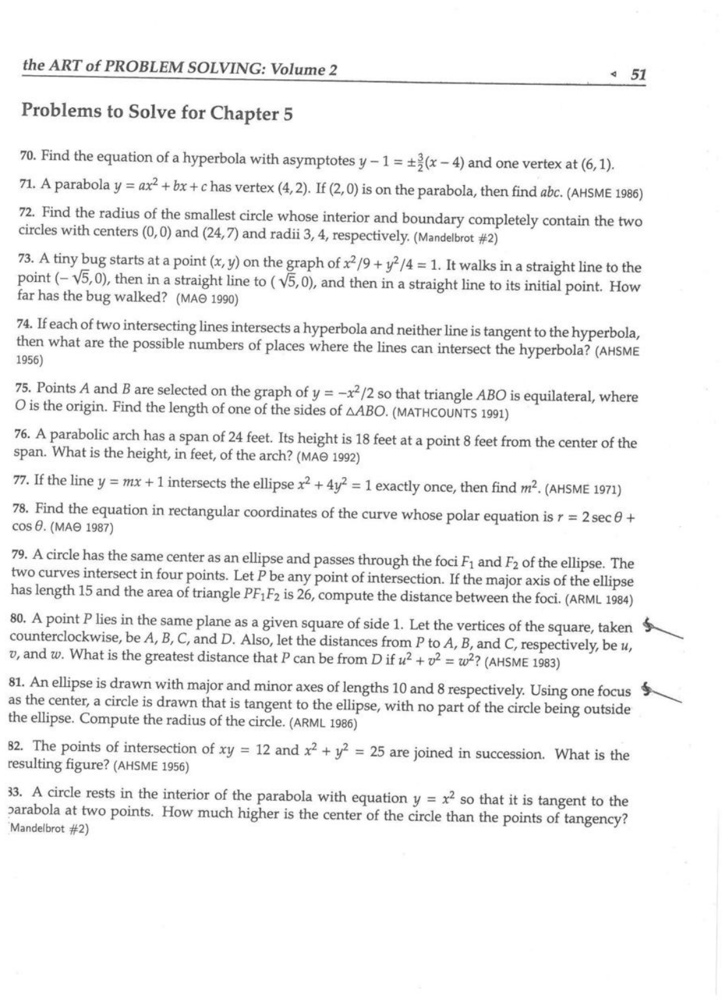

