# Chapter 6: Polynomials

Volume 2 · Printed pages 52–68 · PDF pages 74–90

[Volume contents](../index.md)

## Printed page 52

<!-- source: volume-2, PDF page 74, printed page 52 -->

### 6.1 What is a Polynomial?

In Volume 1, the equations of one variable we saw were usually no more complicated than quadratic equations. What happens when we introduce terms with higher powers than 2? This brings us to the general subject of polynomials. A polynomial is a function of the form

$$f(x) = a_n x^n + a_{n-1} x^{n-1} + \cdots + a_0,$$

where the $a_i$ are called coefficients (any of these except $a_n$ can be 0) and $n$, the highest power of $x$ in the polynomial, is the degree, written deg $f$. As the form suggests, $n$ is always a nonnegative integer. Examples of polynomials in $x$ are:

$$x^3 + 2x + 5 \quad x^4 - 2x^3 + 5.6x^2 - \sqrt{2}x + 4 \quad x^2 - 5.$$

The expressions below are not polynomials in $x$:

$$\frac{x - 1}{x^2 + 4} \quad \sqrt{x} - 7 \quad 4x - \frac{1}{x} \quad \log_2 x + \sin x.$$

Throughout this chapter, unless we specifically state otherwise, we are considering only polynomials with all rational coefficients.

### 6.2 Multiplying and Dividing Polynomials

In working with polynomials we sometimes encounter expressions like

$$(x^2 + 3x + 1)(x^2 - 3x + 4)$$ and $$\frac{x^3 + 3x^2 + 4x + 4}{x^2 + 2x + 1}.$$

We can expand this first expression, the product of polynomials, using the distributive property. Usually it is easiest to set up the multiplication just like when we multiply large numbers. An example of this is shown below.

Original scan — PDF page 74

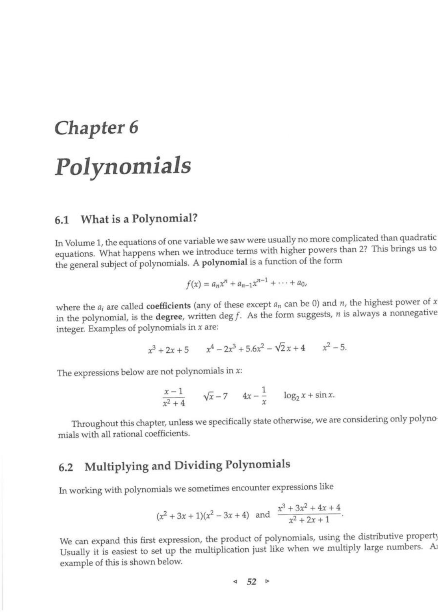

## Printed page 53

<!-- source: volume-2, PDF page 75, printed page 53 -->

$$x^2 + 3x + 1$$
$$x^2 - 3x + 4$$
$$4x^2 + 12x + 4$$
$$- 3x^3 - 9x^2 - 3x$$
$$x^4 + 3x^3 + x^2$$
$$x^4 + 0x^3 - 4x^2 + 9x + 4$$

Here we have multiplied $x^2 + 3x + 1$ and $x^2 - 3x + 4$ by multiplying $(x^2 + 3x + 1)$ first by 4 (line (1)), then by $-3x$ (line (2)), then finally by $x^2$ (line (3)). Last, we add the results as shown; grouping the common terms in columns makes this easy. Multiplying the two given quadratics yields $x^4 - 4x^2 + 9x + 4$. (There is no need to keep the $0x^3$ term).

One pretty obvious result of polynomial multiplication is that for all polynomials $f$ and $g$,

$$\deg(fg) = \deg f + \deg g.$$

The proof of this is straightforward. If the degree of $f$ is $n$ and that of $g$ is $m$, then the product will contain only one $x^{m+n}$ term and no terms of higher degree. Can you show that if $\deg f \geq \deg g$, then $\deg(f + g) \leq \deg f$?

Just like multiplication of polynomials, division of polynomials can be done very much like long division. The best way to describe this is by example.

$$x^2 + 2x + 1$$
$$x + 1$$
$$x^3 + 3x^2 + 4x + 4$$
$$- x^3 - 2x^2 - x$$
$$x^2 + 3x + 4$$
$$- x^2 - 2x - 1$$
$$x + 3$$

Let $g(x) = x^2 + 2x + 1$ and $f(x) = x^3 + 3x^2 + 4x + 4$. We divide the first term, $x^2$, of $g(x)$ into the first term of $f(x)$, $x^3$, yielding the $x$ on line (1). We then multiply $g(x)$ by $x$ and subtract this product from $f(x)$ as shown on line (2). Again we divide the first term of $g(x)$ into the first term of the result of the subtraction, yielding 1. Finally, we multiply this quotient, 1, by $g(x)$ and subtract the result as in line (3). The result is line (4). Since we can't evenly divide the leading term of $g(x)$ into that of line (4), we are done. The quotient is $x + 1$ and the remainder, line (4), is $x + 3$. Compare this process to long division of large numbers—it's exactly the same. Don't memorize the steps; understand the process of division.

If we let the remainder be $r(x)$ and the quotient be $q(x)$, we can write the above division as

$$\frac{f(x)}{g(x)} = q(x) + \frac{r(x)}{g(x)},$$

or $f(x) = q(x)g(x) + r(x).$

It is very important to note that the quotient and the remainder above are unique. That is, given $g(x)$ and $f(x)$, there is only one pair of polynomials $(q(x), r(x))$ such that $\deg r < \deg g$ and

$$f(x) = q(x)g(x) + r(x).$$

Original scan — PDF page 75

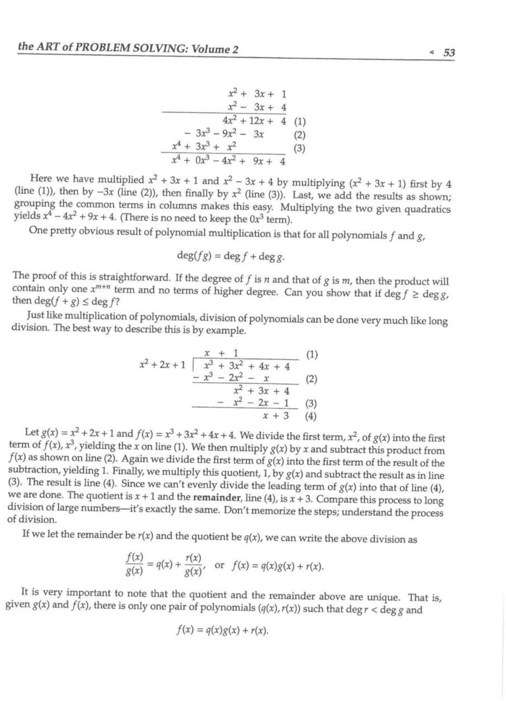

## Printed page 54

<!-- source: volume-2, PDF page 76, printed page 54 -->

**EXERCISE 6-1** Prove that the quotient and remainder ($q(x)$ and $r(x)$) are unique for each pair ($f(x),g(x)$).

There is a special shorthand method called **synthetic division** for dividing polynomials by expressions of the form $(x-a)$. To introduce synthetic division, we'll take you step by step through a problem which will be solved with both long division and synthetic division. Pay close attention not only to how to perform synthetic division, but also why it works.

The long division of $x^3+2x^2-x+3$ by $x-1$ is shown below; line numbers match the source diagram.

$$
\begin{array}{rlr}
 & x^2+3x+2 &(1)\\
x-1\;\big) & x^3+2x^2-x+3 &(2)\\
 & -x^3+x^2 &(3)\\ \hline
 & 3x^2-x+3 &(4)\\
 & -3x^2+3x &(5)\\ \hline
 & 2x+3 &(6)\\
 & -2x+2 &(7)\\ \hline
 & 5 &(8)
\end{array}
$$

Above we did the long division of $x-1$ into $f(x)=x^3+2x^2-x+3$. For synthetic division (shown below), we don't write any $x$'s. The 1 from the constant term of $x-1$ goes to the left of the vertical line on line (9). The coefficients of $f(x)$ are then copied into the remainder of that line. Line (11) represents the coefficients of the quotient. Clearly the first such coefficient is the first coefficient of $f(x)$ (since the leading coefficient in $(x-1)$ is 1). Hence, we copy the first coefficient of $f(x)$ in line (9) into line (11). Now we have to figure out how to get the rest of line (11).

$$
\begin{array}{r|rrrr|l}
1&1&2&-1&3&(9)\\
 &&1&3&2&(10)\\ \hline
 &1&3&2&5&(11)
\end{array}
$$

Line (10) represents the subtractions at lines (3), (5), and (7) in the long division. In the long division, we get these by subtracting the product of the quotient and $x-1$. Since the first term in the long divisions on these three lines always cancel, we are only interested in the second terms (the boldface coefficients). These results are from multiplying $-(-1)$ by the quotient (line (1)). (The first negative comes from the fact that we are subtracting the products of the quotient and $x-1$ on lines (3), (5), and (7)). The coefficients of the quotient are on line (11), so we get line (10) from multiplying line (11) and the 1 at the left of our vertical line.

Finally, how do we determine line (11), the quotient? Since the leading coefficient of $(x-1)$ is one, the coefficients of the quotient are the coefficients of the leading terms resulting from the combinations of lines (2) and (3), lines (4) and (5), and lines (6) and (7). Note that these are just the sums of the boldface numbers and the coefficients of the original $f(x)$! Hence, we get line (11) from just adding lines (9) and (10).

Here's how synthetic division works in action. We will divide $x-2$ into $x^3-3x^2+7x+4$. First we copy the 2 from the constant term of $x-2$ and the coefficients of $x^3-3x^2+7x+4$ into our table. Then we copy the first coefficient into line (3):

$$
\begin{array}{r|rrrr|l}
2&1&-3&7&4&(1)\\
 &&&&&(2)\\ \hline
 &1&&&&(3)
\end{array}
$$

Original scan — PDF page 76

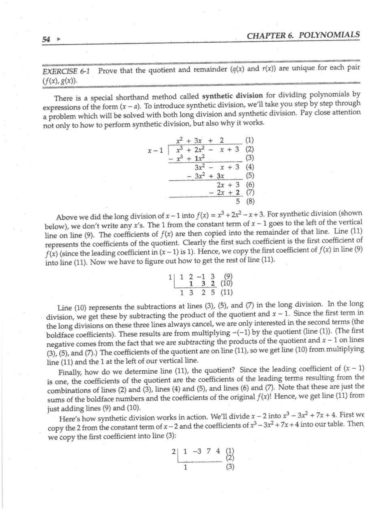

## Printed page 55

<!-- source: volume-2, PDF page 77, printed page 55 -->

We now get the first number in line (2) by multiplying the 2 to the left of the vertical line and the 1 in line (3). After this, we add the number in line (2) to the number above it to get the next coefficient of the quotient in line (3):

$$\begin{bmatrix}
1 & -3 & 7 & 4 \\
2 & 2 \\
1 & -1
\end{bmatrix}$$

We continue by multiplying our 2 and the next term in line (3), $-1$, to get the next term in line (2):

$$\begin{bmatrix}
1 & -3 & 7 & 4 \\
2 & -2 \\
1 & -1
\end{bmatrix}$$

Now we can finish off the problem by getting our last terms in lines (2) and (3):

$$\begin{bmatrix}
1 & -3 & 7 & 4 \\
2 & -2 & 10 \\
1 & -1 & 5 & 14
\end{bmatrix}$$

So what’s the answer? The last line gives us the coefficients of $x^2 - x + 5$, but what’s the 14 for? Compare synthetic division to long division and you’ll find that 14 is the remainder, so the above synthetic division tells us that

$$\frac{x^3 - 3x^2 + 7x + 4}{x - 2} = x^2 - x + 5 + \frac{14}{x - 2}$$

There are a couple of important points to remember when doing synthetic division. First, it only works when we are dividing by a linear polynomial $(x - a)$. Second, the leading coefficient of this linear term must be 1. (Look at our development of synthetic division to see why we can’t use synthetic division with a linear coefficient other than 1.) Finally, in synthetic division the term to the left of the vertical line is the negative of the constant term of the linear divisor. For example, in the above problem where we divided $x - 2$ into $x^3 - 3x^2 + 7x + 4$, we put 2, not $-2$, at the left of the vertical line.

**EXAMPLE 6-1** Use synthetic division to determine $(8x^4 - 12x^3 + 2x + 1)/(2x + 1)$.

**Solution:** First, we must make the coefficient of $x$ in the divisor 1. Hence, we divide the numerator and denominator by 2 to get

$$\frac{4x^4 - 6x^3 + x + 1/2}{x + 1/2}$$

Now we do our synthetic division:

$$-1/2 \begin{bmatrix}
4 & -6 & 0 & 1 & 1/2 \\
-2 & 4 & -2 & 1/2 \\
4 & -8 & 4 & -1 & 1
\end{bmatrix}$$

Original scan — PDF page 77

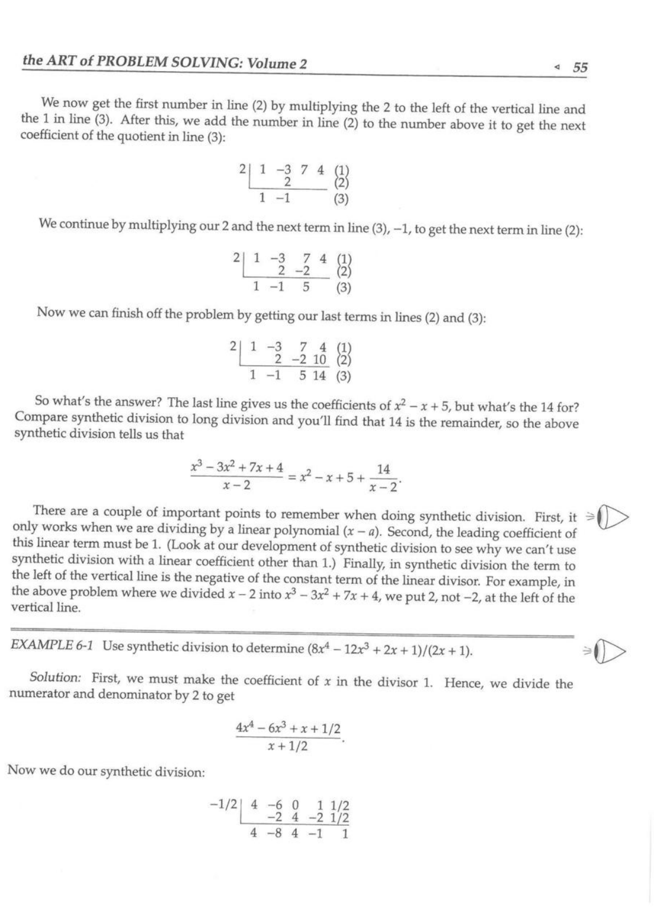

## Printed page 56

<!-- source: volume-2, PDF page 78, printed page 56 -->

(Why is there a 0 in the first line above?) Thus, we find

$$\frac{4x^4 - 6x^3 + x + 1/2}{x + 1/2} = 4x^3 - 8x^2 + 4x - 1 + \frac{1}{x + 1/2},$$

so

$$\frac{8x^4 - 12x^3 + 2x + 1}{2x + 1} = 4x^3 - 8x^2 + 4x - 1 + \frac{2}{2x + 1}.$$

**EXERCISE 6-2 Use synthetic division to divide $x + 3$ into $x^5 + 3x^4 + 2x^3 - x^2 + x - 7$.**

### 6.3 Finding Roots of Polynomials

Suppose we are given the polynomial $f(x)$ and asked to find the solutions to $f(x) = 0$. We call these solutions roots of the polynomial. Unfortunately, no quick and easy method like the quadratic formula exists to solve general polynomials. Instead we must go searching for the roots. Does this mean that we just have to keep guessing values for $x$ until we find one for which $f(x) = 0$? And how will we know if we’ve found all such $x$? Fortunately, we are not completely consigned to guessing. We do have some helpful hints to guide our way.

First, if $a$ is a root, then $(x - a)$ divides $f(x)$ evenly; that is, there is no remainder when we perform the division. To see this we write

$$f(x) = (x - a)q(x) + r(x).$$

Since $\deg r(x) < \deg(x - a) = 1$, $\deg r(x) = 0$, and $r(x)$ is some constant $c$. Letting $x = a$ gives

$$f(a) = (a - a)h(a) + c = c.$$

If $f(a) = 0$, we have $c = 0$, and thus there is no remainder when we divide $f(x)$ by $(x - a)$.

**EXAMPLE 6-2 Prove that the remainder upon dividing $f(x)$ by $x - a$ is $f(a)$.**

Solution: As above, we write

$$f(x) = (x - a)h(x) + r(x).$$

Since $\deg r(x) < \deg(x - a)$, $r(x)$ is a constant $r$. Letting $x = a$ gives $f(a) = r$, so the remainder upon dividing $f(x)$ by $x - a$ is $f(a)$. Therefore, we can use synthetic division to determine $f(a)$ by finding the remainder when $f(x)$ is divided by $(x - a)$.

**EXAMPLE 6-3 $P(x)$ is a polynomial with real coefficients. When $P(x)$ is divided by $x - 1$, the remainder is 3. When $P(x)$ is divided by $x - 2$, the remainder is 5. Find the remainder when $P(x)$ is divided by $x^2 - 3x + 2$. (MAΘ 1990)**

Solution: We write

$$P(x) = (x^2 - 3x + 2)q(x) + r(x),$$

Original scan — PDF page 78

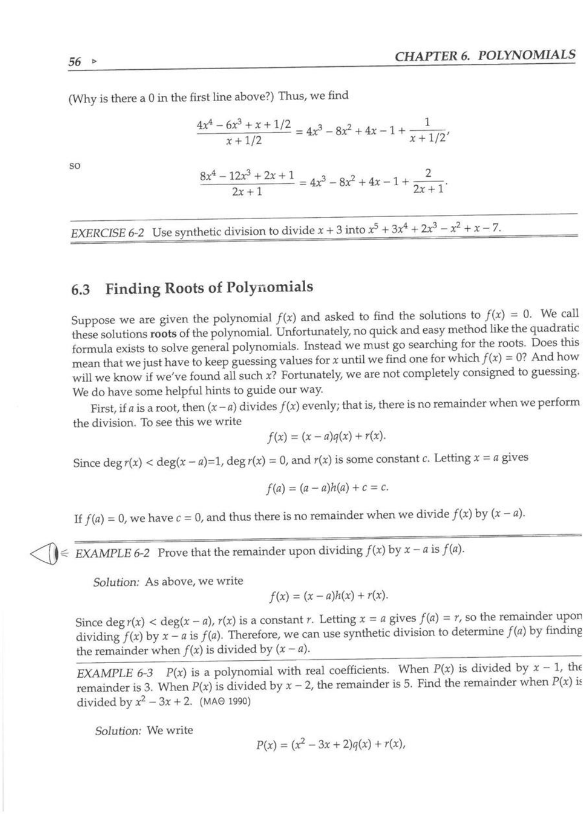

## Printed page 57

<!-- source: volume-2, PDF page 79, printed page 57 -->

where $r(x)$ is the desired remainder. Since $\deg r(x) < \deg(x^2 - 3x + 2)$, we can write $r(x) = ax + b$ for some constants $a$ and $b$. From the given information, we know $P(1) = 3$ and $P(2) = 5$. Since $x^2 - 3x + 2 = 0$ for $x = 2$ and $x = 1$, we put these values in our equation for $P(x)$, yielding

$$(0)q(1) + r(1) = a + b = P(1) = 3$$

$$(0)q(2) + r(2) = 2a + b = P(2) = 5.$$

Solving this system, we find $(a, b) = (2, 1)$, so the remainder is $2x + 1$. Remember this method of cleverly choosing values for $x$ in polynomial equations; it can be very useful!

The Fundamental Theorem of Algebra states that every nonconstant polynomial has at least one root. Thus, there is at least one value $a$ such that $f(a) = 0$. This $a$ may be real, imaginary, rational, or irrational, but the Fundamental Theorem of Algebra assures us that at least one such root exists. Unfortunately the proof is a bit too complex for this text, but we shall put the theorem to good use by showing that any degree $n$ polynomial has exactly $n$ roots. This means we can write any polynomial $f(x)$ as

$$f(x) = a_n x^n + a_{n-1} x^{n-1} + \cdots + a_1 x + a_0 = a_n (x - r_1) (x - r_2) \cdots (x - r_n).$$

The $r_i$ are the roots of the polynomial and they are not necessarily real or rational. It should be clear why $f(r_i) = 0$.

To show that all polynomials can be written in such a fashion we invoke the Fundamental Theorem of Algebra. By this theorem, we know that for some number $r_1$ we can write

$$f(x) = (x - r_1) q_1(x).$$

Since $\deg f = n = \deg[(x - r_1) q_1(x)] = \deg(x - r_1) + \deg q_1$, we find $\deg q_1 = n - 1$. Now we apply the Fundamental Theorem to $q_1(x)$ to get

$$f(x) = (x - r_1) (x - r_2) q_2(x),$$

where $\deg q_2 = n - 2$. Thus, we can continue applying the Fundamental Theorem until finally we have the desired factorization

$$f(x) = a_n (x - r_1) (x - r_2) \cdots (x - r_n).$$

Showing the roots exist is one thing; finding them is another thing altogether. Rather than provide a recipe-like formula, the best we can do is give a batch of methods to guide us to the roots.

For the rational roots of a polynomial, there is a method we can use to narrow the search. Although there are infinitely many rational numbers we could guess as roots of $f(x)$, the only ones which have a chance of being roots are given by the Rational Root Theorem. For any polynomial

$$f(x) = a_n x^n + a_{n-1} x^{n-1} + \cdots + a_0$$

with integer coefficients, all rational roots are of the form $p/q$, where $|p|$ and $|q|$ are relatively prime integers, $p$ divides $a_0$ evenly, and $q$ divides $a_n$ evenly. The Rational Root Theorem will be proven as in example on page 58.

Original scan — PDF page 79

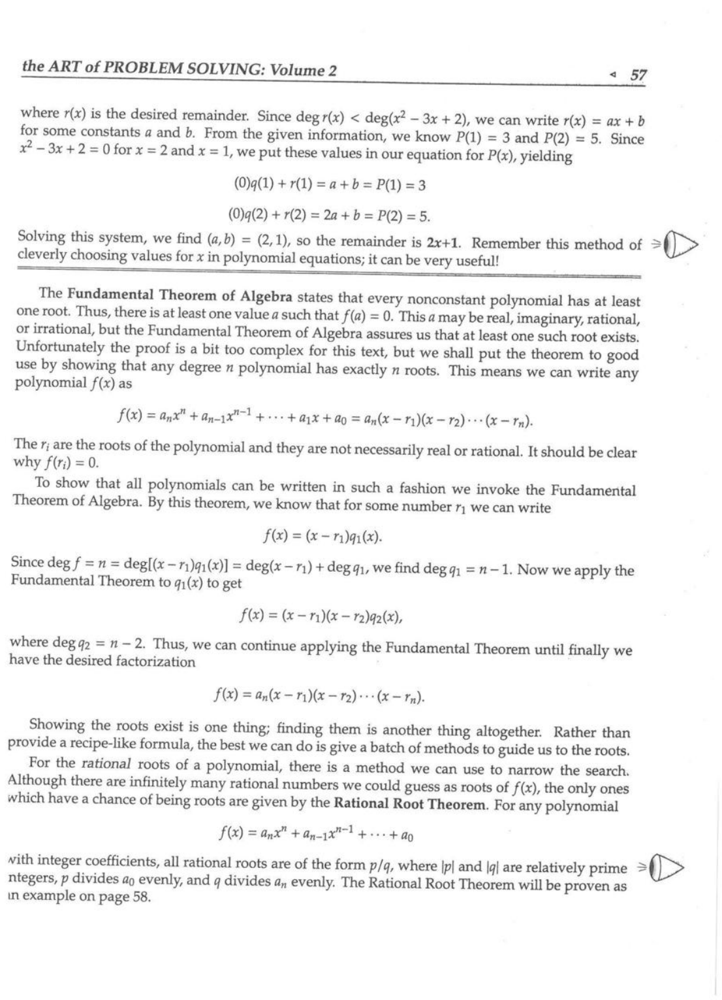

## Printed page 58

<!-- source: volume-2, PDF page 80, printed page 58 -->

**EXAMPLE 6-4 Find all the roots of $x^3 - 6x^2 + 11x - 6$.**

Solution: From the Rational Root Theorem, we know that all possible roots are of the form $p/q$, where $p$ divides $-6$ and $q$ divides $1$. Thus the possible roots are $\{\pm 1, \pm 2, \pm 3, \pm 6\}$. If we substitute these in the polynomial, we find that $\{1, 2, 3\}$ all satisfy $f(x) = 0$, so these are the three roots of the polynomial. (How do we know there aren't any more?)

**EXAMPLE 6-5 Find all the roots of $2x^3 - 5x^2 + 4x - 1$.**

Solution: Once again we apply the Rational Root Theorem and determine that the possible roots are $\{\pm 1/2, \pm 1\}$. Trying these, we find that both 1 and 1/2 are roots of the polynomial. We know that there must be one more (why?), but we also know that no other rationals could possibly be roots. We might think that the third root is irrational or perhaps imaginary, but as we will see, no polynomial with rational coefficients can have just one irrational or one imaginary root. Thus, we come to the conclusion that this polynomial must have a double root, just like quadratic expressions which are perfect squares, such as $x^2 + 2x + 1$. Indeed, in this problem, we can use synthetic division to find $(2x^3 - 5x^2 + 4x - 1)/(x - 1) = 2x^2 - 3x + 1$. Factoring this quadratic, we find

$$2x^3 - 5x^2 + 4x - 1 = (x - 1)^2(2x - 1),$$

so that the root $x = 1$ is a double root, meaning the factor $(x - 1)$ occurs twice.

We have already come across two shortcomings of using the Rational Root Theorem alone. One is that we will miss multiple roots. Another is that it could still end up taking a very long time, as there are many numbers for polynomials like $12x^4 - x - 60$ which satisfy the Rational Root Theorem criteria.

To avoid missing multiple roots and to shorten our search for the roots, when we find a root $r_1$ of the polynomial, we divide $(x - r_1)$ into $f(x)$, as

$$f(x) = (x - r_1)q(x).$$

Then, we continue our search for roots with $q(x)$, because all roots of $q(x)$ are also roots of $f(x)$. As we saw in the previous section, synthetic division provides a swift method for performing the division

**EXAMPLE 6-6 Prove the Rational Root Theorem.**

Proof: Let $p/q$ be a rational root of the polynomial $f(x)$, where $p$ and $q$ are relatively prime positive integers. The case where the root is $-p/q$ is virtually the same. Since $p/q$ is a root, we have

$$f(p/q) = a_n \left(\frac{p}{q}\right)^n + a_{n-1} \left(\frac{p}{q}\right)^{n-1} + \cdots + a_0 = 0.$$

Multiplying by $q^n$ gives

$$a_n p^n + a_{n-1} p^{n-1} q + \cdots + a_1 pq^{n-1} + a_0 q^n = 0.$$

Now look at this equation modulo $p$. The first $n$ terms on the left will become 0 since they are multiples of $p$, so we have

$$a_n p^n + a_{n-1} p^{n-1} q + \cdots + a_1 pq^{n-1} + a_0 q^n \equiv 0 \pmod{p}$$

Original scan — PDF page 80

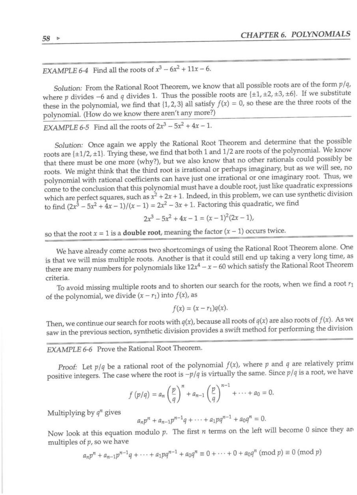

## Printed page 59

<!-- source: volume-2, PDF page 81, printed page 59 -->

Thus, $a_0 q^n \equiv 0$ (mod $p$), so $p \mid a_0 q^n$. Since $p$ and $q$ are relatively prime, it follows that $p \mid a_0$.

By the same argument, we can evaluate the sum mod $q$ to show that $q \mid a_n p^n$. Thus $q \mid a_n$ and the proof is complete.

There are a few more guides to tell us where to look for roots. The first is Descartes' Rule of Signs, which gives us a method to count how many positive and how many negative roots there are. We do this by counting sign changes. The number of sign changes in the coefficients of $f(x)$ (meaning we list the coefficients from first to last and count how many times they change from positive to negative) tells us the maximum number of positive roots the polynomial has, and the number of sign changes in the coefficients of $f(-x)$ gives us the maximum number of negative roots the polynomial has. Hence, for

$$f(x) = 3x^5 + 2x^4 - 3x^2 + 2x - 1,$$

there are at most 3 positive roots and at most 2 negative roots (since $f(-x) = -3x^5 + 2x^4 - 3x^2 - 2x - 1$). Furthermore, the actual number of positive or negative roots will always differ by an even number from the aforementioned maximum, so our above $f(x)$ has 1 or 3 positive roots and 0 or 2 negative roots.

Another root location method is finding upper and lower bounds. Suppose we use synthetic division to find $f(x)/(x-c)$ where $f(x)$ has a positive leading coefficient and $c \geq 0$ as below:

$$\begin{array}{r|rrrr}
3&1&-1&2&6\\
&&3&6&24\\\hline
&1&2&8&30
\end{array}$$

If all the resulting coefficients in the quotient are positive (including the remainder), as in the example above, then no roots are greater than $c$. (Why?) This $c$ is called an upper bound on the solutions since no roots can be higher. Similarly, if $c < 0$ and the coefficients of the quotient and remainder alternate in sign, then there is no root smaller than $c$ (which we then call a lower bound for the roots). Locating upper and lower bounds will often help you shorten your search for roots.

Lastly, recall from our discussion of quadratic equations in Volume 1 that complex roots and roots of the form $a + b \sqrt{c}$ come in pairs if the coefficients of the quadratic are rational. This is also true of any polynomial with rational coefficients. For example, if the complex number $z = a + bi$ is a root of $f(x)$, we have

$$f(z) = a_n z^n + a_{n-1} z^{n-1} + \cdots + a_1 z + a_0 = 0.$$

Now we use some of our useful properties of complex numbers, such as $\overline{w+z}=\overline{w}+\overline{z},\ \overline{z^k}=(\overline{z})^k$, and $w = z$ implies $\overline{w} = \overline{z}$. Applying these principles to $f(z)$, we have

$$\begin{aligned}
\overline{a_nz^n+a_{n-1}z^{n-1}+\cdots+a_1z+a_0}&=\overline{0}\\
\overline{a_nz^n}+\overline{a_{n-1}z^{n-1}}+\cdots+\overline{a_1z}+\overline{a_0}&=0\\
a_n\overline{z}^{\,n}+a_{n-1}\overline{z}^{\,n-1}+\cdots+a_1\overline{z}+a_0&=0.
\end{aligned}$$

Hence, if $f(z) = 0$, then $f(\overline{z}) = 0$, so $\overline{z}$ is also a root. This proof, with slight modifications, can be used to show that if $z = a + b \sqrt{c}$ is a root, then $z = a - b \sqrt{c}$ is also a root.

Original scan — PDF page 81

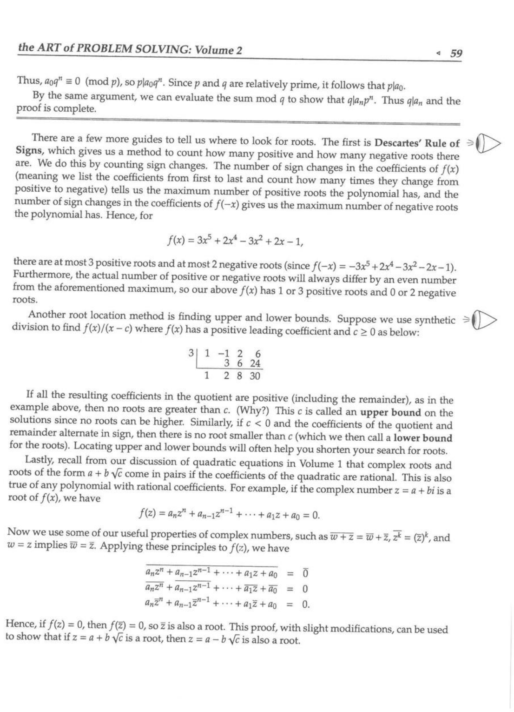

## Printed page 60

<!-- source: volume-2, PDF page 82, printed page 60 -->

**EXAMPLE 6-7 Find all of the solutions to the equation**

$$x^4 - 10x^3 + 35x^2 - 50x + 24 = 0.$$

Solution: Since the signs of the coefficients of $f(-x)$ are all positive, none of the roots are negative. This cuts our search in half. Now we use the Rational Root Theorem to deduce that the roots are all factors of 24. (Why?) We'll start with 1 (usually the best place to start). Synthetic division yields

$$\begin{array}{r|rrrrr}
1&1&-10&35&-50&24\\
&&1&-9&26&-24\\\hline
&1&-9&26&-24&0
\end{array}$$

Since there is no remainder, $x - 1$ is a factor. Now we continue our search, not with $x^4 - 10x^3 + 35x^2 - 50x + 24$, but with the quotient above, since

$$x^4 - 10x^3 + 35x^2 - 50x + 24 = (x - 1)(x^3 - 9x^2 + 26x - 24).$$

Continuing in this manner we find that $x = 2$ is also a root and we have

$$x^4 - 10x^3 + 35x^2 - 50x + 24 = (x - 1)(x - 2)(x^2 - 7x + 12).$$

Factoring the quadratic yields $(x - 1)(x - 2)(x - 3)(x - 4) = 0$ and our solutions are 1, 2, 3, and 4.

**EXAMPLE 6-8 I'm trying to find the roots of $f(x) = 2x^4 - 15x^3 + 15x^2 + 20x - 12$. I start with $x = 1$. After finding $f(1) = 10$, what should I try next?**

Solution: Since $f(0) = -12$ and $f(1) = 10$, there must be some number $c$ between 0 and 1 such that $f(c) = 0$, because $f(0)$ and $f(1)$ have opposite signs. (Graph $y = f(x)$, noting that the points $(0, -12)$ and $(1, 10)$ are on the graph, to see why there's a root between $x = 0$ and $x = 1$.) From the Rational Root Theorem, the only possible rational root between 0 and 1 is $1/2$. Using synthetic division we find that this indeed works.

Using this 'location principle' we can zero in on roots. Namely, if $f(a)$ and $f(b)$ have opposite signs, then there is a root between $a$ and $b$.

**EXERCISE 6-3 Find the roots of $x^4 + x^3 + 2x^2 + 17x - 21.$**

**EXERCISE 6-4 Given a quartic polynomial with rational coefficients and roots $3 - i$ and $4 + \sqrt{2}$, find the other two roots.**

### 6.4 Coefficients and Roots

Suppose we are asked to find the sum of the roots of a polynomial. We could just find the roots and add them all, but that may not be easy to do and could take a long time. Of course, there is a better way. For example, remember from Volume 1 that the coefficients of a quadratic are directly related to the sum and product of the roots.

Original scan — PDF page 82

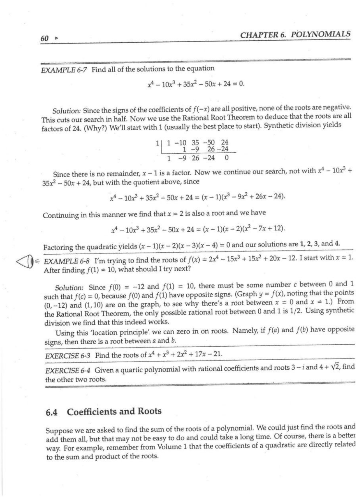

## Printed page 61

<!-- source: volume-2, PDF page 83, printed page 61 -->

The coefficients of a polynomial tell us much more than just the sum of the roots. To see this, let the roots of $f(x) = x^3 + a_2x^2 + a_1x + a_0$ be $r_1, r_2,$ and $r_3,$ so we can factor $f(x)$ as

$$f(x) = (x - r_1)(x - r_2)(x - r_3).$$

If we multiply this out we get (check and see)

$$f(x) = x^3 - (r_1 + r_2 + r_3)x^2 + (r_1r_2 + r_2r_3 + r_1r_3)x - r_1r_2r_3.$$

By comparing this with $f(x) = x^3 + a_2x^2 + a_1x + a_0,$ we see that the coefficients not only give us the sum of the roots $(-a_2),$ but the product of the roots $(-a_0)$ and the sum of the products of the roots taken two at a time $(a_1 = r_1r_2 + r_2r_3 + r_1r_3).$

Now, what if the leading coefficient of the cubic is something besides 1? Like we did with quadratics, we change the problem to one involving a monic polynomial, i.e. a polynomial with leading coefficient 1. The roots of

$$f(x) = a_3x^3 + a_2x^2 + a_1x + a_0 = 0$$

are the same as those of

$$g(x) = \frac{f(x)}{a_3} = x^3 + \frac{a_2}{a_3}x^2 + \frac{a_1}{a_3}x + \frac{a_0}{a_3} = 0,$$

since if $f(x) = 0,$ then $g(x) = f(x)/a_3 = 0.$ Thus, the sum of the roots of $g(x),$ and therefore $f(x),$ is $-a_2/a_3,$ the product of the roots is $-a_0/a_3,$ and so on.

Now a quick definition and we will be ready to use these results on any polynomial, not just cubics. Suppose our polynomial has $n$ roots. We define the sum of all products of the roots taken $k$ at a time, or the $k$th symmetric sum, as the sum of all products formed by multiplying $k$ of the $n$ roots. Thus, if we have 4 roots which are 1, 1, 2, and 3, the second symmetric sum is

$$1 \cdot 1 + 1 \cdot 2 + 1 \cdot 3 + 1 \cdot 2 + 1 \cdot 3 + 2 \cdot 3 = 17.$$

For the general polynomial $f(x) = a_nx^n + \cdots + a_0,$ the $k$th symmetric sum of the roots is $(-1)^k a_{n-k}/a_n.$ We can prove this through algebra much like our $n = 3$ case above. The proof is made rigorous through induction.

**EXERCISE 6-5 Use induction to prove the assertion that the $k$th symmetric sum is $(-1)^k a_{n-k}/a_n.$**

**EXAMPLE 6-9 Find the constant term of a monic quartic polynomial with rational coefficients that has two roots equal to $2 - i$ and $2 + \sqrt{3}.$**

Solution: The other two roots are $2+i$ and $2-\sqrt{3}$, so the product of the roots is $(2+i)(2-i)(2+\sqrt{3})(2-\sqrt{3})=(5)(1)=5$. The constant term of a quartic is equal to $(-1)^4 = 1$ times the product of the roots, so the constant term is 5.

**EXAMPLE 6-10 If three roots of $x^4 + Ax^2 + Bx + C = 0$ are $-1, 2,$ and 3, then what is the value of $2C - AB?$ (MAΘ 1992)**

Original scan — PDF page 83

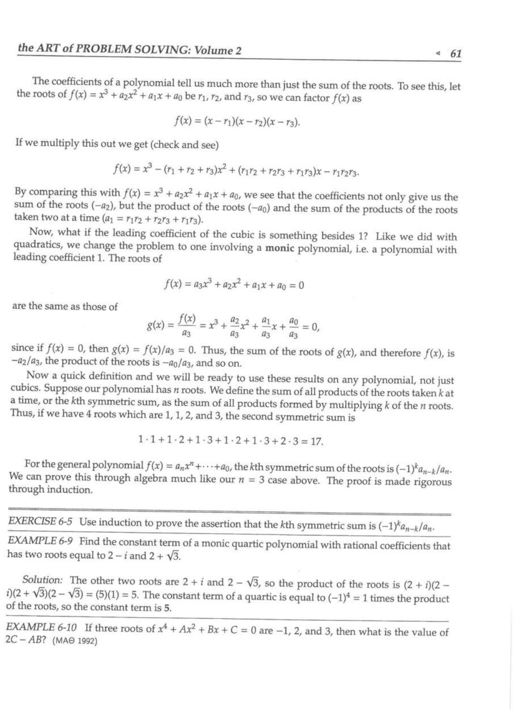

## Printed page 62

<!-- source: volume-2, PDF page 84, printed page 62 -->

Since the coefficient of $x^3$ is 0, the sum of the roots is 0. Thus the fourth root is $-4$. Hence

$$A = (-1)(2) + (-1)(3) + (-1)(-4) + (2)(3) + (2)(-4) + (3)(-4) = -15$$
$$B = -[(-1)(2)(3) + (-1)(2)(-4) + (-1)(3)(-4) + (2)(3)(-4)] = 10$$
$$C = (-1)(2)(3)(-4) = 24$$

so $2C - AB = 198$.

**EXERCISE 6-6 Find the largest solution of $x^3 - 27x^2 + 242x - 720 = 0$ given that one root equals the average of the other two roots. (MAΘ 1990)**

### 6.5 Transforming Polynomials

Through the following examples, we will examine how to transform polynomials in various ways.

**EXAMPLE 6-11 Find the polynomial whose roots are the reciprocals of the roots of $x^4 - 3x^2 + x - 9$.**

Solution: Once again, let the given polynomial be $f(x)$ and the roots be $r_1, r_2, r_3,$ and $r_4$. One equation whose solutions are the reciprocals of these is just $f(1/x) = 0$ because

$$f\left(\frac{1}{1/r_i}\right) = f(r_i) = 0.$$

Thus, the solutions of $f(1/x) = 0$ are the reciprocals of the roots of $f(x),$ as claimed. Unfortunately, $f(1/x)$ is not a polynomial. On the other hand, the function given by $g(x) = x^4 f(1/x),$ which also has roots $1/r_i,$ is a polynomial:

$$g(x) = x^4 \left(\frac{1}{x^4} - \frac{3}{x^2} + \frac{1}{x} - 9\right) = -9x^4 + x^3 - 3x^2 + 1.$$

This $g(x)$ is our desired polynomial. Now compare $g(x)$ to $f(x).$ Look closely and you'll see that the coefficients of $g(x)$ are the same as those of $f(x)$ in reverse order! We can prove that this is true in general in the same way. Let the general polynomial $f(x)$ be $f(x) = a_n x^n + a_{n-1} x^{n-1} + \cdots + a_0$ with roots $r_1, \ldots, r_n.$ The solutions to $f(1/x) = 0$ are $x = 1/r_1, 1/r_2, \ldots, 1/r_n,$ because again we have

$$f\left(\frac{1}{1/r_i}\right) = f(r_i) = 0.$$

Thus, the solutions of $f(1/x) = 0$ are the reciprocals of the roots of $f(x).$ The desired polynomial is then

$$g(x) = x^n f(1/x) = x^n \left(\frac{a_n}{x^n} + \frac{a_{n-1}}{x^{n-1}} + \cdots + \frac{a_1}{x} + a_0\right) = a_0 x^n + a_1 x^{n-1} + \cdots + a_n,$$

or the original polynomial with the coefficients reversed.

Original scan — PDF page 84

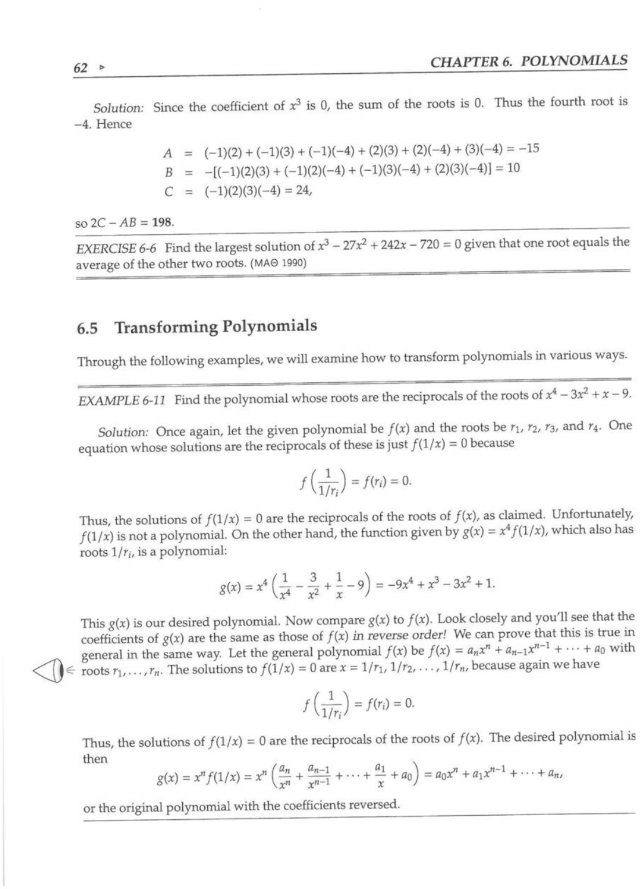

## Printed page 63

<!-- source: volume-2, PDF page 85, printed page 63 -->

**EXAMPLE 6-12 Find a polynomial whose roots are twice those of $f(x) = x^4 - 3x^2 + x - 9$.**

Solution: If we are given a polynomial $f(x) = a_n x^n + a_{n-1} x^{n-1} + \cdots + a_0$, a polynomial with roots which are $k$ times the roots of $f(x)$ is $f(x/k)$. (Let the roots of $f(x)$ be $r_1, r_2, \ldots, r_n$; then for $x = kr_1, kr_2, \ldots, kr_n$, we have $f(x/k) = f(r_i) = 0$. Hence, the desired polynomial is

$$f(x/k) = \frac{a_n x^n}{k^n} + \frac{a_{n-1} x^{n-1}}{k^{n-1}} + \cdots + \frac{a_1}{k} + a_0.$$

Multiplying both sides by $k^n$ to simplify the expression (i.e. to get rid of the fractions), we have

$$g(x) = k^n f(x/k) = a_n x^n + k a_{n-1} x^{n-1} + \cdots + k^{n-1} a_1 x + k^n a_0$$

as a polynomial with roots $kr_i$. We form $g(x)$ by multiplying the coefficients of $f(x)$ in turn by $1, k, k^2, \ldots, k^n$. Hence, one answer to our problem is

$$g(x) = x^4 - (2^2)(3)x^2 + (2^3)x - (2^4)(9) = x^4 - 12x^2 + 8x - 144.$$

**EXAMPLE 6-13 Find the polynomial whose roots are half the reciprocals of the roots of $5x^4 + 12x^3 + 8x^2 - 6x - 1$.**

Solution: Let the roots of this polynomial be $a, b, c,$ and $d$. We seek the polynomial whose roots are $1/2a, 1/2b, 1/2c,$ and $1/2d$.

The polynomial whose roots are $2a, 2b, 2c,$ and $2d$ is

$$g(x) = 5x^4 + 12(2)x^3 + 8(2^2)x^2 - 6(2^3)x - 1(2^4) = 5x^4 + 24x^3 + 32x^2 - 48x - 16.$$

The polynomial we desire is the one whose roots are reciprocals of the roots of $g(x)$, or

$$h(x) = -16x^4 - 48x^3 + 32x^2 + 24x + 5.$$

**EXAMPLE 6-14 Find an equation whose roots are 3 greater than those of $x^4 - 3x^3 - 3x^2 + 4x - 6$.**

Solution: Let the given polynomial be $f(x)$ and the roots be $r_1, r_2, r_3,$ and $r_4$. In the spirit of the examples involving reciprocals and multiples of roots, consider the polynomial $g(x) = f(x - 3)$. We have

$$g(r_i + 3) = f(r_i + 3 - 3) = f(r_i) = 0,$$

so the roots of $g(x)$ are 3 greater than those of $f(x)$. Hence, $g(x)$ is the desired polynomial and our answer is

$$g(x) = f(x - 3) = (x - 3)^4 - 3(x - 3)^3 - 3(x - 3)^2 + 4(x - 3) - 6.$$

Similarly, we can show that the polynomial whose roots are $k$ greater than those of a general polynomial $h(x)$ is $h(x - k)$. However, the above expression for $g(x)$ will take quite a bit of time to evaluate, so it is useful to find a swifter method if possible.

We will determine $f(x - 3)$ term by term. First we find the constant term, which is just the polynomial evaluated at $x = 0$, or $f(-3)$. (Why?) Now we must find the coefficient of $x$. This is

Original scan — PDF page 85

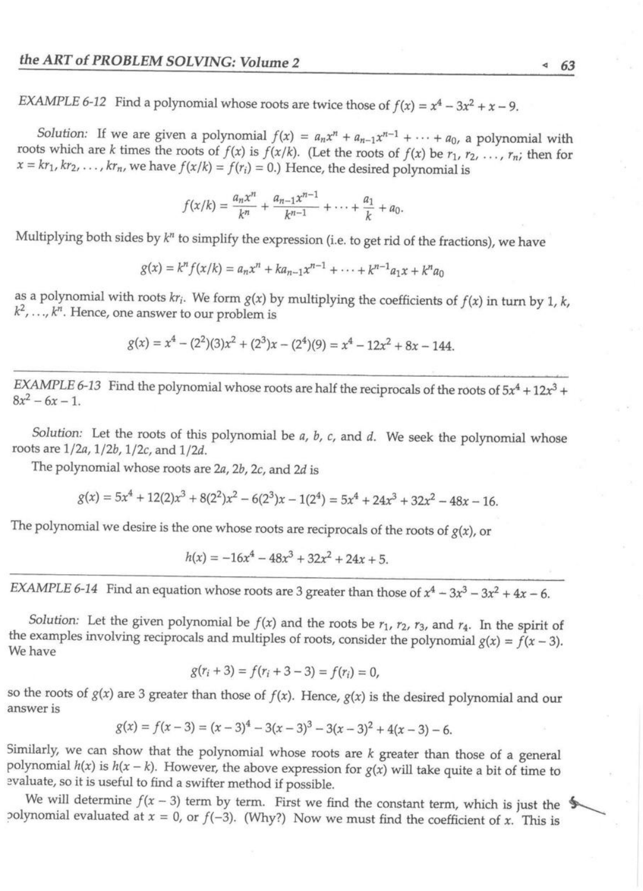

## Printed page 64

<!-- source: volume-2, PDF page 86, printed page 64 -->

If we subtract the constant term from a polynomial and divide the result by $x$, the constant term of the new polynomial is the coefficient of $x$ in the original. This is shown for $f(x)$ below:

$$\frac{f(x) - f(0)}{x} = \frac{x^4 - 3x^3 - 3x^2 + 4x - 6 - (-6)}{x} = x^3 - 3x^2 - 3x + 4.$$

Now we need a swift way to find $(f(x-3)-f(-3))/x$ in order to get the coefficient of $x$ in $f(x-3)$. Remember that we can write $f(x)$ as

$$f(x) = (x + 3)q_1(x) + f(-3)$$

for some polynomial $q_1(x)$. This leads us to our short cut:

$$f(x - 3) = (x - 3 + 3)q_1(x - 3) + f(-3) = xq_1(x - 3) + f(-3),$$

or

$$\frac{f(x - 3) - f(-3)}{x} = q_1(x - 3).$$

Since we want the constant term of $q_1(x - 3)$, we want $q_1(-3)$ (since setting $x = 0$ eliminates all terms except the constant term). Now our problem is determining $q_1(x)$. Synthetic division of $f(x)$ by $(x + 3)$ gives us this polynomial, and synthetic division of $q_1(x)$ by $(x + 3)$ gives us the desired remainder $q_1(-3)$. By the same argument as above, to find the coefficient of $x^2$ we divide $q_1(x - 3) - q_1(-3)$ by $x$ and find the constant term of the resulting polynomial. Once again, synthetic division of $q_1(x)$ by $x + 3$ can be used to find this polynomial and constant term. Since after each synthetic division, the resulting quotient is used for the next synthetic division, we can just 'stack' our divisions as below:

$$\begin{array}{r|rrrrr}
-3&1&-3&-3&4&-6\\
&&-3&18&-45&123\\\hline
-3&1&-6&15&-41&\mathbf{117}\\
&&-3&27&-126&\\\hline
-3&1&-9&42&\mathbf{-167}&\\
&&-3&36&&\\\hline
-3&1&-12&\mathbf{78}&&\\
&&-3&&&\\\hline
-3&1&\mathbf{-15}&&&\\\hline
&\mathbf{1}&&&&
\end{array}$$

Our desired coefficients, then, are the boldface remainders above, so the polynomial $f(x - 3)$ is

$$x^4 - 15x^3 + 78x^2 - 167x + 117.$$

What we have done here to describe this method is not a complete proof, but we hope it gives you a clear idea why this 'trick' works. While this method is somewhat quicker and more reliable for higher degree polynomials, it is also easy to forget. It is most important to remember that the polynomial whose roots are $k$ more than those of polynomial $f(x)$ is always given by $f(x - k)$.

**EXERCISE 6-7 The roots of $f(x) = 3x^3 - 14x^2 + x + 62 = 0$ are $a, b,$ and $c$. Find the value of**

$$\frac{1}{a + 3} + \frac{1}{b + 3} + \frac{1}{c + 3}.$$
(MAΘ 1991)

Original scan — PDF page 86

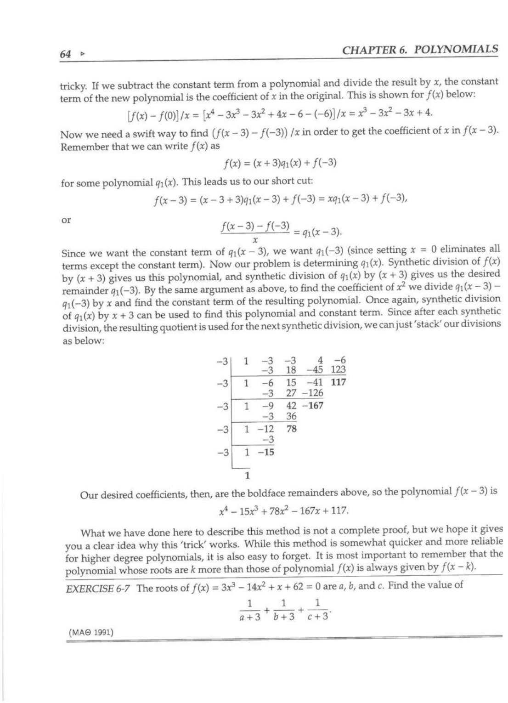

## Printed page 65

<!-- source: volume-2, PDF page 87, printed page 65 -->

While you could just memorize the three methods to solve the three general types of problems described above, it is much more important to understand why these methods work, because when you forget the 'trick' you'll be able to arrive at the solution without it. Don't waste too much time memorizing; once you've done a few problems with these methods, you'll have committed them to memory anyway.

### 6.6 Newton's Sums

Given $x+y$ and $xy$, how would we find $x^2+y^2$? As we saw in Volume 1, we write $x^2+y^2 = (x+y)^2-2xy$. Let's try a tougher one. Write $x^3+y^3$ in terms of $x^2+y^2$, $x+y$, and $xy$ without squaring or cubing any of these expressions. We can only get $x^3+y^3$ from the product $(x+y)(x^2+y^2) = x^3+y^3+xy^2+x^2y$. Hence, we have

$$x^3+y^3 = (x+y)(x^2+y^2) - xy^2 - x^2y = (x+y)(x^2+y^2) - xy(x+y).$$

Now let $x$ and $y$ be the roots of the quadratic $a_2z^2+a_1z+a_0=0$ and $s_k=x^k+y^k$. Our above expression can then be written as

$$s_3 = -\frac{a_1}{a_2}s_2 - \frac{a_0}{a_2}s_1$$

since $x+y = -a_1/a_2$ and $xy = a_0/a_2$. Rearranging this, we can write

$$a_2s_3 + a_1s_2 + a_0s_1 = 0.$$

This nice form suggests that other similar relationships may be true as well.

**EXAMPLE 6-15 Show that if $s_k$ is the sum of the $k$th powers of the roots of $a_3x^3+a_2x^2+a_1x+a_0$, then $a_3s_2+a_2s_1+2a_1=0.$**

Proof: Let $S = a_3(s_2+a_2s_1/a_3+2a_1/a_3)$. We wish to show that $S=0$. Using our relationships between the roots of the polynomial, which we call $r, s,$ and $t,$ and its coefficients, we have

$$S = a_3 \left( (r^2+s^2+t^2) + (-(r+s+t)(r+s+t)) + 2(rs+rt+st) \right)$$

$$= a_3 \left( (r^2+s^2+t^2) - (r^2+s^2+t^2+2rs+2rt+2st) + (2rs+2rt+2st) \right)$$

$$= 0.$$

Perhaps you see where we're going with this. The family of equations which relates the sum of the $m$th powers of the roots of a polynomial to the coefficients of the polynomial as we've done above is called Newton's sums. If we let $s_m$ be the sum of the $m$th powers of the roots of $f(x) = a_nx^n+\cdots+a_0$, then the Newton's sums can be written as

$$a_ns_1+a_n-1=0$$

$$a_ns_2+a_n-1s_1+2a_n-2=0$$

$$a_ns_3+a_n-1s_2+a_n-2s_1+3a_n-3=0$$

$$a_ns_4+a_n-1s_3+a_n-2s_2+a_n-3s_1+4a_n-4=0$$

and so on.

Original scan — PDF page 87

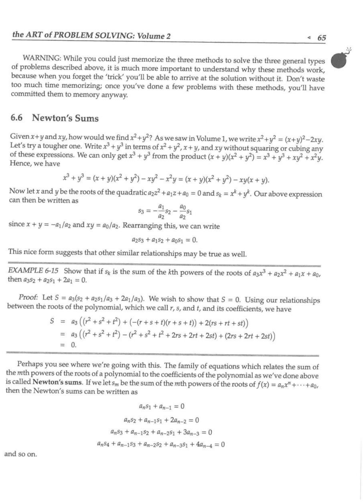

## Printed page 66

<!-- source: volume-2, PDF page 88, printed page 66 -->

**EXERCISE 6-8 What happens to the Newton's sum $a_n s_k + a_{n-1} s_{k-1} + \cdots + k a_{n-k} = 0$ when $n < k$?**

**EXAMPLE 6-16 Find the sum of the cubes of the solutions of $x^2 - 3x + 3 = 0$.**

Solution: We use Newton's sums:

$$s_1 + (-3) = 0, \text{ so } s_1 = 3;$$

$$s_2 + (-3) s_1 + 2(3) = 0, \text{ so } s_2 = 3.$$

Now, in the next Newton sum, we have a term $3 a_{-1}$, but there is no $a_{-1}$, so this term is just 0. We find

$$s_3 + (-3) s_2 + 3 s_1 = 0, \text{ so } s_3 = 0.$$

This is much easier than cubing the solutions to the quadratic.

**EXERCISE 6-9 Find the sum of the cubes of the roots of $2x^4 + 3x^3 + x^2 - 4x - 4.$**

As we've seen, Newton's sums are just a result of algebraically manipulating expressions involving the roots of polynomials. The Newton's sums equations can be proven in general using the same algebraic techniques as above. Those of you very comfortable with summation notation and manipulation should try to do so. The leading term in every Newton's sum is $a_n s_k$. We present here a less algebraic proof for all Newton's sum equations in which $k \geq n$ because it involves a very important problem solving technique.

Let the roots of the polynomial $f(x)$ be $r_1, r_2, \ldots, r_n$. Since these are solutions of the equation $f(x) = 0$, for each $r_i$ we have

$$f(r_i) = a_n r_i^n + a_{n-1} r_i^{n-1} + \cdots + a_0 = 0.$$

Multiplying each of these equations by $r_i^{k-n}$ yields

$$a_n r_1^k + a_{n-1} r_1^{(k-1)} + \cdots + a_0 r_1^{k-n} = 0$$

$$a_n r_2^k + a_{n-1} r_2^{(k-1)} + \cdots + a_0 r_2^{k-n} = 0$$

$$\vdots$$

$$a_n r_n^k + a_{n-1} r_n^{(k-1)} + \cdots + a_0 r_n^{k-n} = 0.$$

We can add all of these equations, which gives us

$$a_n \left(r_1^k + \cdots + r_n^k\right) + a_{n-1} \left(r_1^{k-1} + \cdots + r_n^{k-1}\right) + \cdots + a_0 \left(r_1^{k-n} + \cdots + r_n^{k-n}\right) = 0.$$

Thus, we find

$$a_n s_k + a_{n-1} s_{k-1} + \cdots + a_0 s_{k-n} = 0.$$

In the special case where $k = n$, we have

$$s_{k-n} = s_0 = r_1^0 + r_2^0 + \cdots + r_n^0 = 1 + 1 + \cdots + 1 = n,$$

so the Newton sum is

$$a_n s_n + a_{n-1} s_{n-1} + \cdots + n a_0 = 0.$$

Original scan — PDF page 88

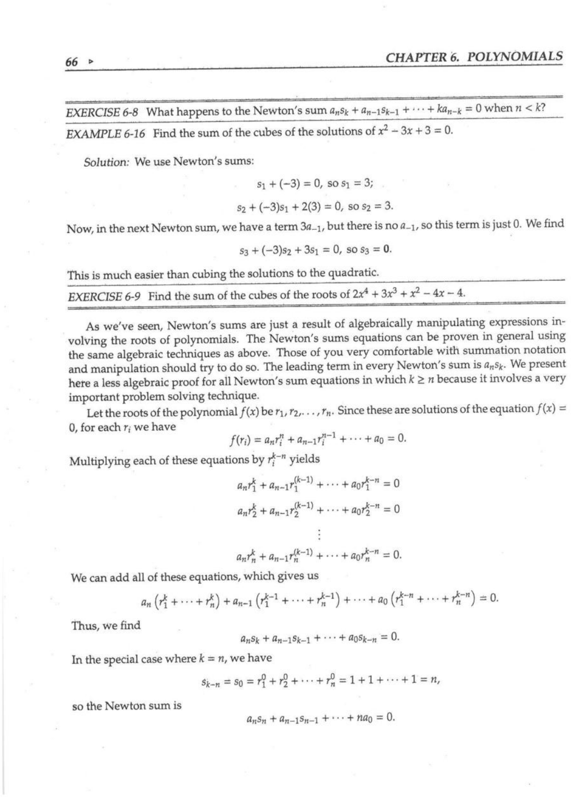

## Printed page 67

<!-- source: volume-2, PDF page 89, printed page 67 -->

**EXAMPLE 6-17 If $r_1, r_2, \ldots, r_{1000}$ are the roots of $x^{1000} - 10x + 10 = 0$, find $r_1^{1000} + r_2^{1000} + \cdots + r_{1000}^{1000}$.**

Solution: Since only $a_{1000}, a_1$, and $a_0$ are nonzero, we can write the 1000th Newton sum as

$$s_{1000} - 10s_1 + 1000(10) = 0.$$

Since the coefficient of $x^{999}$ is 0, $s_1 = 0$ and $s_{1000} = -10000$.

Problems to Solve for Chapter 6

84. Find the remainder when $x^{13} + 1$ is divided by $x - 1$. (AHSME 1950)

85. Find all the roots of $2y^4 - 9y^3 + 14y^2 + 6y - 63 = 0.$

86. Find all values of $m$ which will make $x + 2$ a factor of $x^3 + 3m^2x^2 + mx + 4$. (MAΘ 1991)

87. Find the product of the $n$th roots of 1. (MAΘ 1991)

88. The equation $x^4 - 16x^3 + 94x^2 + px + q = 0$ has two double roots. Find $p + q$. (MAΘ 1991)

89. Let $f(x) = ax^7 + bx^3 + cx - 5$, where $a, b$, and $c$ are constants. If $f(-7) = 7$, then find $f(7)$. (AHSME 1982)

90. For nonzero constants $c$ and $d$, the equation $4x^3 - 12x^2 + cx + d = 0$ has two real roots which add to give 0. Find $d/c$. (MAΘ 1991)

91. An equation with roots $3 + \sqrt{2}, 3 - \sqrt{2}, -3 + i\sqrt{2}$, and $-3 - i\sqrt{2}$ is in the form $x^4 + Ax^3 + Bx^2 + Cx + D = 0$. Find $A + B + C + D$. (MAΘ 1991)

92. Polynomial $P(x)$ contains only terms of odd degree. When $P(x)$ is divided by $x - 3$, the remainder is 6. What is the remainder when $P(x)$ is divided by $x^2 - 9$? (MAΘ 1991)

93. Let

$$p(x) = a_nx^n + a_{n-1}x^{n-1} + \cdots + a_1x + a_0,$$

where the coefficients $a_i$ are integers. If $p(0)$ and $p(1)$ are both odd, show that $p(x)$ has no integral roots. (Canada 1971)

94. If $x^4 + 4x^3 + 6px^2 + 4qx + r$ is exactly divisible by $x^3 + 3x^2 + 9x + 3$, then find $(p + q)r$. (AHSME 1965)

95. Let $r, s$, and $t$ be the roots of $x^3 - 6x^2 + 5x - 7 = 0$. Find

$$\frac{1}{r^2} + \frac{1}{s^2} + \frac{1}{t^2}.$$

(MAΘ 1991)

96. Suppose $x = a + bi$ is a solution of the polynomial equation

$$c_4z^4 + ic_3z^3 + c_2z^2 + ic_1z + c_0 = 0,$$

Original scan — PDF page 89

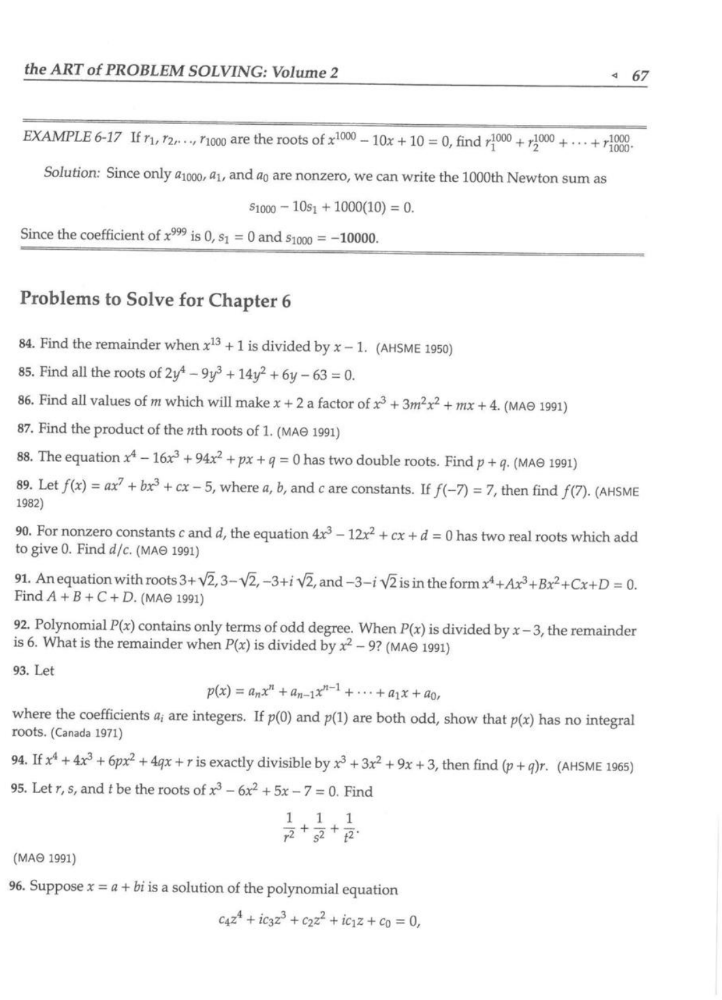

## Printed page 68

<!-- source: volume-2, PDF page 90, printed page 68 -->

where $c_0, c_1, c_2, c_3, c_4, a,$ and $b$ are real constants and $i^2 = -1$. Show that $-a + bi$ is also a solution.

97. If $q_1(x)$ and $r_1$ are the quotient and remainder, respectively, when the polynomial $x^8$ is divided by $x + \frac{1}{2}$, and if $q_2(x)$ and $r_2$ are the quotient and remainder, respectively, when $q_1(x)$ is divided by $x + \frac{1}{2}$, then find $r_2$. (AHSME 1979)

98. Solve the equation $(x + 1)(x + 2)(x + 3)(x + 4) = -1$. (M&IQ 3)

99. Let $(1 + x + x^2)^n = a_0 + a_1x + a_2x^2 + \cdots + a_{2n}x^{2n}$ be an identity in $x$. Find $a_0 + a_2 + a_4 + \cdots + a_{2n}$ in terms of $n$. (AHSME 1966)

100. Give the remainder when $x^{203} - 1$ is divided by $x^4 - 1$. (MAΘ 1991)

101. Given the equation
$$\left(x^2 - 3x - 2\right)^2 - 3\left(x^2 - 3x - 2\right) - 2 - x = 0,$$
prove that the roots of the equation $x^2 - 4x - 2 = 0$ are roots of the initial equation and find all real roots of the given equation. (Bulgaria 1993)

102. Let $k$ be a positive integer. Find all polynomials with real coefficients which satisfy the equation
$$P(P(x)) = [P(x)]^k.$$

(Canada 1975)

103. If $a, b, c, d$ are the solutions of the equation $x^4 - mx - 3 = 0$, then find the polynomial with leading coefficient 3 whose roots are
$$\frac{a + b + c}{d^2}, \frac{a + b + d}{c^2}, \frac{a + c + d}{b^2},$$
and $\frac{b + c + d}{a^2}$.

(AHSME 1981)

104. For $n > 1$ let $a_1, a_2, \ldots, a_n$ be $n$ distinct integers. Prove that the polynomial
$$f(x) = (x - a_1)(x - a_2) \cdots (x - a_n) - 1$$
cannot be written as $g(x)h(x)$ where $g$ and $h$ are nonconstant polynomials with integer coefficients. (MOP)

Original scan — PDF page 90

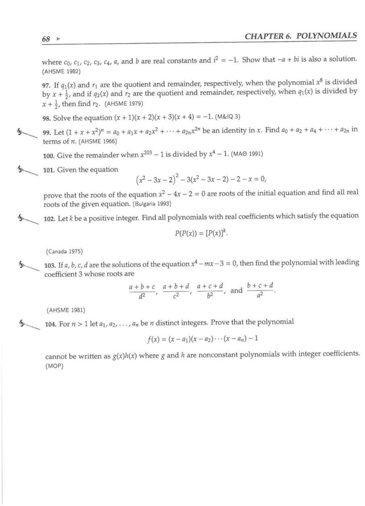

