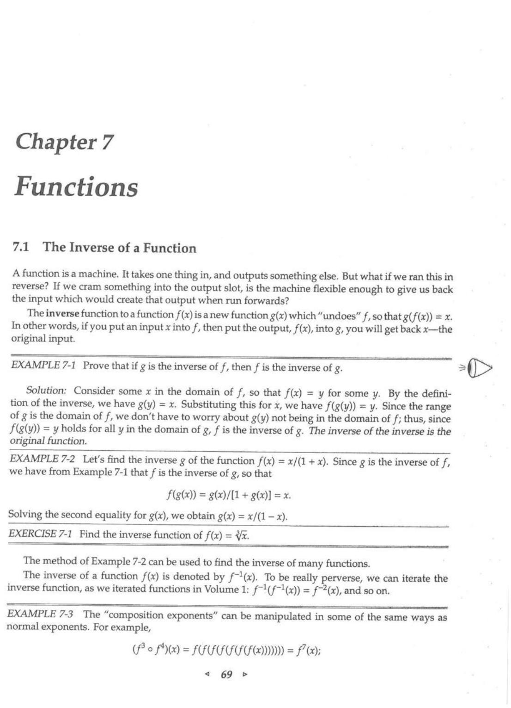
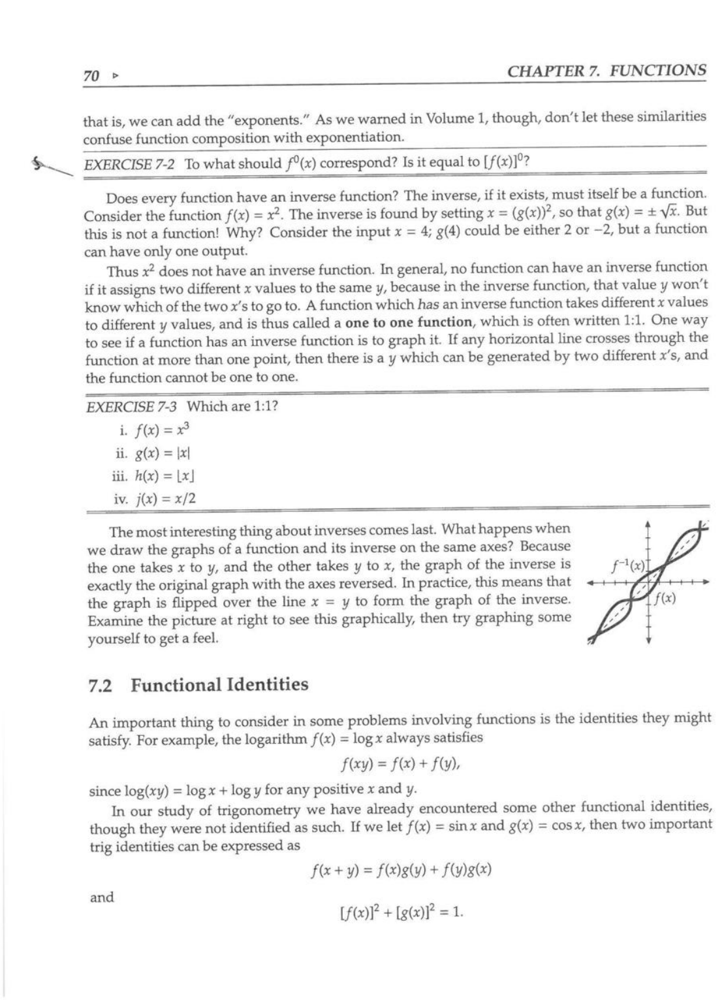
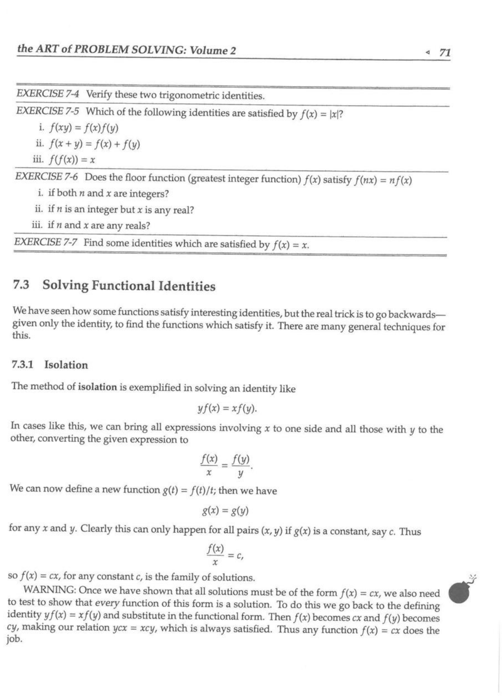
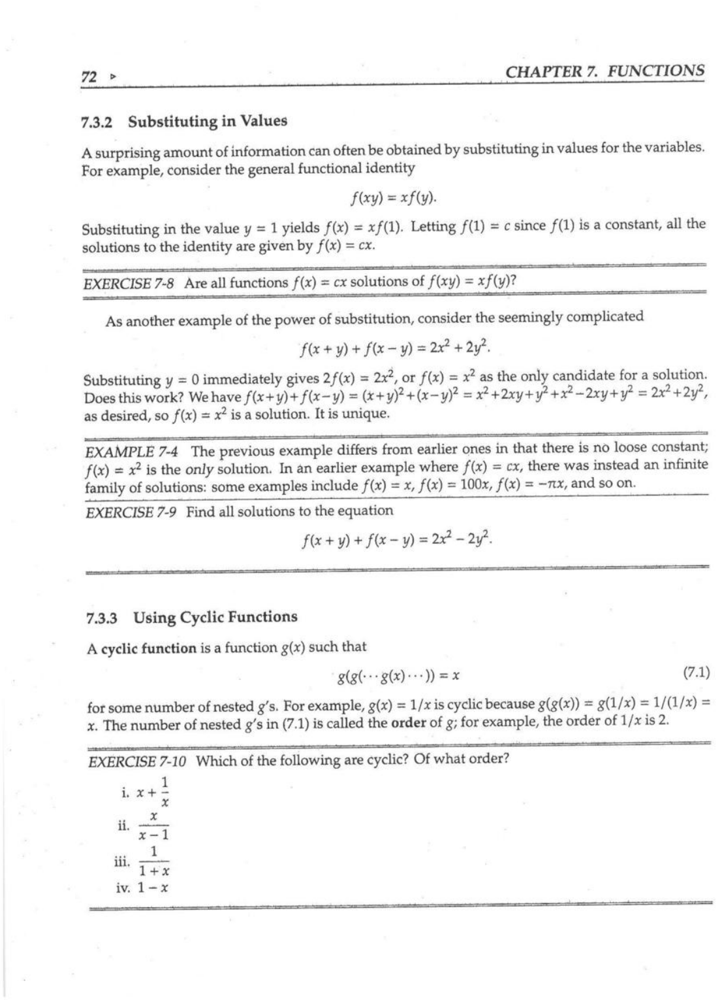
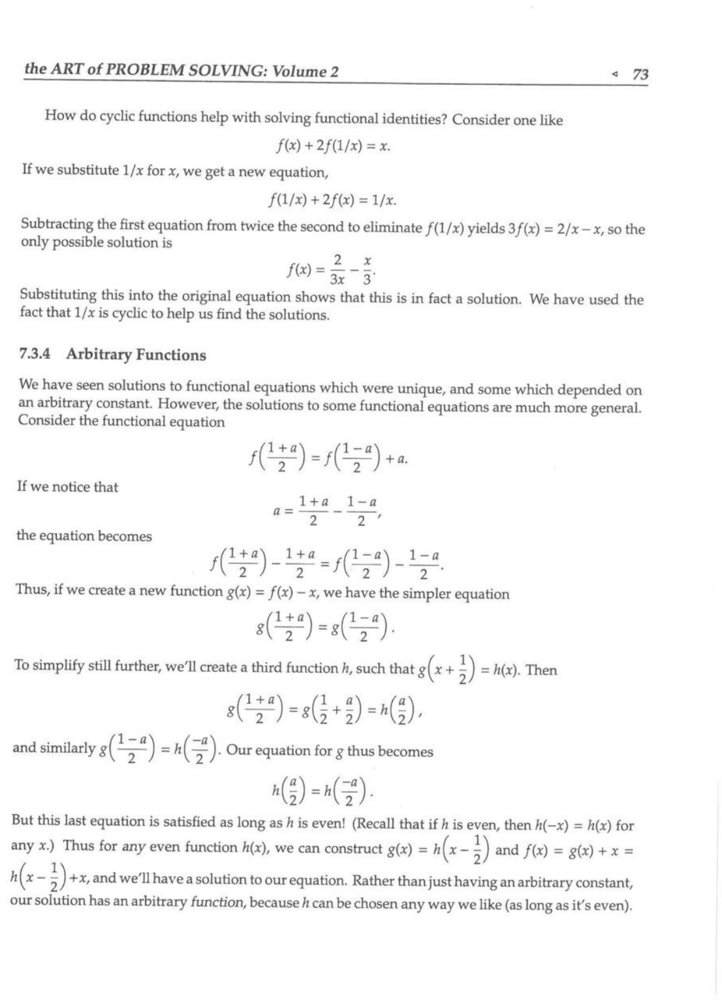
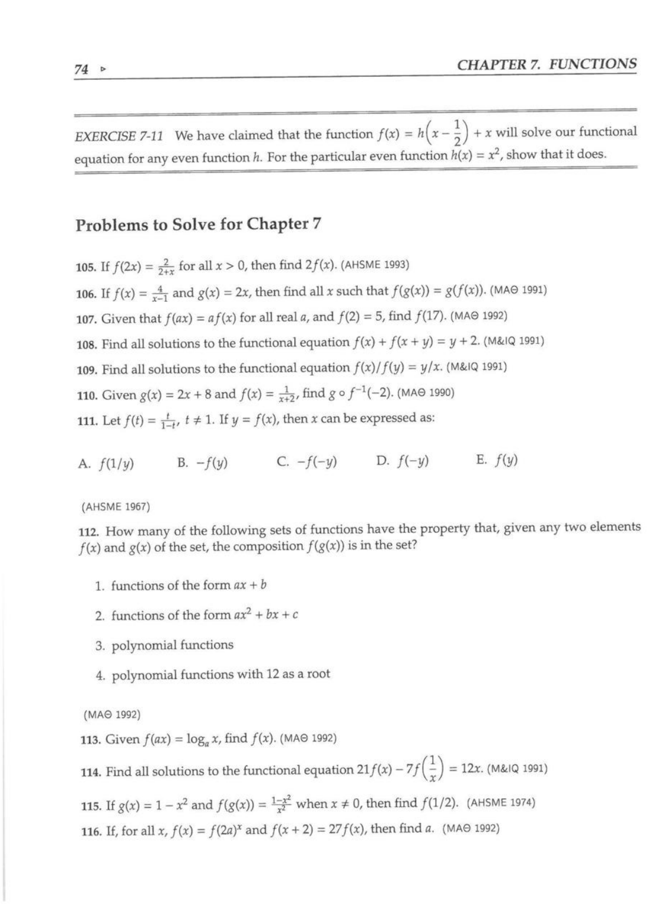
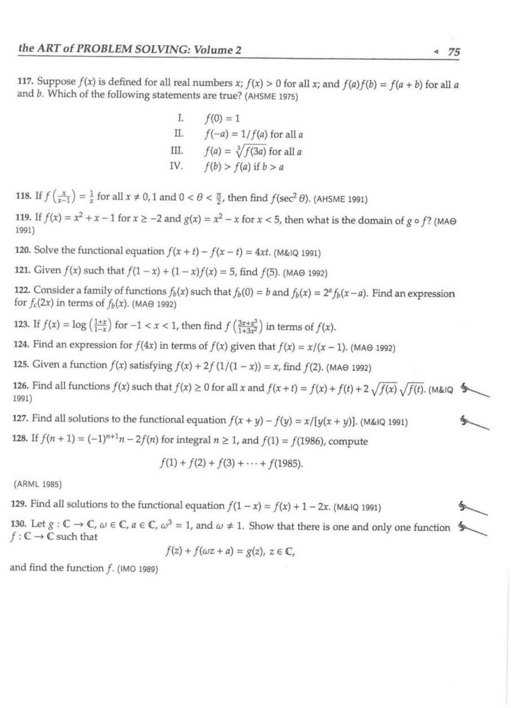

# Chapter 7: Functions

Volume 2 · Printed pages 69–75 · PDF pages 91–97

[Volume contents](../index.md)

## Printed page 69

<!-- source: volume-2, PDF page 91, printed page 69 -->

### 7.1 The Inverse of a Function

A function is a machine. It takes one thing in, and outputs something else. But what if we ran this in reverse? If we cram something into the output slot, is the machine flexible enough to give us back the input which would create that output when run forwards?

The inverse function to a function $f(x)$ is a new function $g(x)$ which "undoes" $f$, so that $g(f(x)) = x$. In other words, if you put an input $x$ into $f$, then put the output, $f(x)$, into $g$, you will get back $x$—the original input.

**EXAMPLE 7-1 Prove that if $g$ is the inverse of $f$, then $f$ is the inverse of $g$.**

Solution: Consider some $x$ in the domain of $f$, so that $f(x) = y$ for some $y$. By the definition of the inverse, we have $g(y) = x$. Substituting this for $x$, we have $f(g(y)) = y$. Since the range of $g$ is the domain of $f$, we don't have to worry about $g(y)$ not being in the domain of $f$; thus, since $f(g(y)) = y$ holds for all $y$ in the domain of $g$, $f$ is the inverse of $g$. The inverse of the inverse is the original function.

**EXAMPLE 7-2 Let's find the inverse $g$ of the function $f(x) = x/(1 + x)$. Since $g$ is the inverse of $f$, we have from Example 7-1 that $f$ is the inverse of $g$, so that**

$$f(g(x)) = g(x)/[1 + g(x)] = x.$$

Solving the second equality for $g(x)$, we obtain $g(x) = x/(1 - x).$

**EXERCISE 7-1 Find the inverse function of $f(x) = \sqrt[3]{x}$.**

The method of Example 7-2 can be used to find the inverse of many functions.

The inverse of a function $f(x)$ is denoted by $f^{-1}(x)$. To be really perverse, we can iterate the inverse function, as we iterated functions in Volume 1: $f^{-1}(f^{-1}(x)) = f^{-2}(x)$, and so on.

**EXAMPLE 7-3 The "composition exponents" can be manipulated in some of the same ways as normal exponents. For example,**

$$f^3 \circ f^4(x) = f(f(f(f(f(f(x)))))) = f^7(x);$$

Original scan — PDF page 91

## Printed page 70

<!-- source: volume-2, PDF page 92, printed page 70 -->

that is, we can add the "exponents." As we warned in Volume 1, though, don't let these similarities confuse function composition with exponentiation.

**EXERCISE 7-2** To what should $f^0(x)$ correspond? Is it equal to $[f(x)]^0$?

Does every function have an inverse function? The inverse, if it exists, must itself be a function. Consider the function $f(x) = x^2$. The inverse is found by setting $x = (g(x))^2$, so that $g(x) = \pm \sqrt{x}$. But this is not a function! Why? Consider the input $x = 4; g(4)$ could be either 2 or $-2$, but a function can have only one output.

Thus $x^2$ does not have an inverse function. In general, no function can have an inverse function if it assigns two different $x$ values to the same $y$, because in the inverse function, that value $y$ won't know which of the two $x$'s to go to. A function which has an inverse function takes different $x$ values to different $y$ values, and is thus called a **one to one function**, which is often written 1:1. One way to see if a function has an inverse function is to graph it. If any horizontal line crosses through the function at more than one point, then there is a $y$ which can be generated by two different $x$'s, and the function cannot be one to one.

**EXERCISE 7-3** Which are 1:1?

i. $f(x) = x^3$
ii. $g(x) = |x|$
iii. $h(x) = \lfloor x \rfloor$
iv. $j(x) = x/2$

The most interesting thing about inverses comes last. What happens when we draw the graphs of a function and its inverse on the same axes? Because the one takes $x$ to $y$, and the other takes $y$ to $x$, the graph of the inverse is exactly the original graph with the axes reversed. In practice, this means that the graph is flipped over the line $x = y$ to form the graph of the inverse. Examine the picture at right to see this graphically, then try graphing some yourself to get a feel.

### 7.2 Functional Identities

An important thing to consider in some problems involving functions is the identities they might satisfy. For example, the logarithm $f(x) = \log x$ always satisfies

$$f(xy) = f(x) + f(y),$$

since $\log(xy) = \log x + \log y$ for any positive $x$ and $y$.

In our study of trigonometry we have already encountered some other functional identities, though they were not identified as such. If we let $f(x) = \sin x$ and $g(x) = \cos x$, then two important trig identities can be expressed as

$$f(x + y) = f(x)g(y) + f(y)g(x)$$

and

$$[f(x)]^2 + [g(x)]^2 = 1.$$

Original scan — PDF page 92

## Printed page 71

<!-- source: volume-2, PDF page 93, printed page 71 -->

**EXERCISE 7-4 Verify these two trigonometric identities.**

**EXERCISE 7-5 Which of the following identities are satisfied by $f(x) = |x|$?**

i. $f(xy) = f(x)f(y)$
ii. $f(x + y) = f(x) + f(y)$
iii. $f(f(x)) = x$

**EXERCISE 7-6 Does the floor function (greatest integer function) $f(x)$ satisfy $f(nx) = nf(x)$**

i. if both $n$ and $x$ are integers?
ii. if $n$ is an integer but $x$ is any real?
iii. if $n$ and $x$ are any reals?

**EXERCISE 7-7 Find some identities which are satisfied by $f(x) = x$.**

### 7.3 Solving Functional Identities

We have seen how some functions satisfy interesting identities, but the real trick is to go backwards—given only the identity, to find the functions which satisfy it. There are many general techniques for this.

### 7.3.1 Isolation

The method of isolation is exemplified in solving an identity like

$$yf(x) = xf(y).$$

In cases like this, we can bring all expressions involving $x$ to one side and all those with $y$ to the other, converting the given expression to

$$\frac{f(x)}{x} = \frac{f(y)}{y}.$$

We can now define a new function $g(t) = f(t)/t$; then we have

$$g(x) = g(y)$$

for any $x$ and $y$. Clearly this can only happen for all pairs $(x, y)$ if $g(x)$ is a constant, say $c$. Thus

$$\frac{f(x)}{x} = c,$$

so $f(x) = cx$, for any constant $c$, is the family of solutions.

WARNING: Once we have shown that all solutions must be of the form $f(x) = cx$, we also need to test to show that every function of this form is a solution. To do this we go back to the defining identity $yf(x) = xf(y)$ and substitute in the functional form. Then $f(x)$ becomes $cx$ and $f(y)$ becomes $cy$, making our relation $ycx = xcy$, which is always satisfied. Thus any function $f(x) = cx$ does the job.

Original scan — PDF page 93

## Printed page 72

<!-- source: volume-2, PDF page 94, printed page 72 -->

### 7.3.2 Substituting in Values

A surprising amount of information can often be obtained by substituting in values for the variables. For example, consider the general functional identity

$$f(xy) = xf(y).$$

Substituting in the value $y = 1$ yields $f(x) = xf(1)$. Letting $f(1) = c$ since $f(1)$ is a constant, all the solutions to the identity are given by $f(x) = cx$.

**EXERCISE 7-8** Are all functions $f(x) = cx$ solutions of $f(xy) = xf(y)$?

As another example of the power of substitution, consider the seemingly complicated

$$f(x + y) + f(x - y) = 2x^2 + 2y^2.$$

Substituting $y = 0$ immediately gives $2f(x) = 2x^2$, or $f(x) = x^2$ as the only candidate for a solution. Does this work? We have $f(x + y) + f(x - y) = (x + y)^2 + (x - y)^2 = x^2 + 2xy + y^2 + x^2 - 2xy + y^2 = 2x^2 + 2y^2$, as desired, so $f(x) = x^2$ is a solution. It is unique.

**EXAMPLE 7-4** The previous example differs from earlier ones in that there is no loose constant; $f(x) = x^2$ is the only solution. In an earlier example where $f(x) = cx$, there was instead an infinite family of solutions: some examples include $f(x) = x$, $f(x) = 100x$, $f(x) = -\pi x$, and so on.

**EXERCISE 7-9** Find all solutions to the equation

$$f(x + y) + f(x - y) = 2x^2 - 2y^2.$$

### 7.3.3 Using Cyclic Functions

A cyclic function is a function $g(x)$ such that

$$g(g(\cdots g(x)\cdots)) = x$$

(7.1)

for some number of nested $g$'s. For example, $g(x) = 1/x$ is cyclic because $g(g(x)) = g(1/x) = 1/(1/x) = x$. The number of nested $g$'s in (7.1) is called the order of $g$; for example, the order of $1/x$ is 2.

**EXERCISE 7-10** Which of the following are cyclic? Of what order?

i. $x + \frac{1}{x}$
ii. $\frac{x}{x - 1}$
iii. $\frac{1}{1 + x}$
iv. $1 - x$

Original scan — PDF page 94

## Printed page 73

<!-- source: volume-2, PDF page 95, printed page 73 -->

How do cyclic functions help with solving functional identities? Consider one like

$$f(x) + 2f(1/x) = x.$$

If we substitute $1/x$ for $x$, we get a new equation,

$$f(1/x) + 2f(x) = 1/x.$$

Subtracting the first equation from twice the second to eliminate $f(1/x)$ yields $3f(x) = 2/x - x$, so the only possible solution is

$$f(x) = \frac{2}{3x} - \frac{x}{3}.$$

Substituting this into the original equation shows that this is in fact a solution. We have used the fact that $1/x$ is cyclic to help us find the solutions.

### 7.3.4 Arbitrary Functions

We have seen solutions to functional equations which were unique, and some which depended on an arbitrary constant. However, the solutions to some functional equations are much more general. Consider the functional equation

$$f\left(\frac{1+a}{2}\right) = f\left(\frac{1-a}{2}\right) + a.$$

If we notice that

$$a = \frac{1+a}{2} - \frac{1-a}{2},$$

the equation becomes

$$f\left(\frac{1+a}{2}\right) - \frac{1+a}{2} = f\left(\frac{1-a}{2}\right) - \frac{1-a}{2}.$$

Thus, if we create a new function $g(x) = f(x) - x$, we have the simpler equation

$$g\left(\frac{1+a}{2}\right) = g\left(\frac{1-a}{2}\right).$$

To simplify still further, we’ll create a third function $h$, such that $g\left(x + \frac{1}{2}\right) = h(x)$. Then

$$g\left(\frac{1+a}{2}\right) = g\left(\frac{1}{2} + \frac{a}{2}\right) = h\left(\frac{a}{2}\right),$$

and similarly $g\left(\frac{1-a}{2}\right) = h\left(\frac{-a}{2}\right).$ Our equation for $g$ thus becomes

$$h\left(\frac{a}{2}\right) = h\left(\frac{-a}{2}\right).$$

But this last equation is satisfied as long as $h$ is even! (Recall that if $h$ is even, then $h(-x) = h(x)$ for any $x$.) Thus for any even function $h(x)$, we can construct $g(x) = h\left(x - \frac{1}{2}\right)$ and $f(x) = g(x) + x = h\left(x - \frac{1}{2}\right) + x$, and we’ll have a solution to our equation. Rather than just having an arbitrary constant, our solution has an arbitrary function, because $h$ can be chosen any way we like (as long as it’s even).

Original scan — PDF page 95

## Printed page 74

<!-- source: volume-2, PDF page 96, printed page 74 -->

**EXERCISE 7-11 We have claimed that the function $f(x) = h\left(x - \frac{1}{2}\right) + x$ will solve our functional equation for any even function $h$. For the particular even function $h(x) = x^2$, show that it does.**

Problems to Solve for Chapter 7

105. If $f(2x) = \frac{2}{2+x}$ for all $x > 0$, then find $2f(x)$. (AHSME 1993)

106. If $f(x) = \frac{4}{x-1}$ and $g(x) = 2x$, then find all $x$ such that $f(g(x)) = g(f(x))$. (MAΘ 1991)

107. Given that $f(ax) = af(x)$ for all real $a$, and $f(2) = 5$, find $f(17)$. (MAΘ 1992)

108. Find all solutions to the functional equation $f(x) + f(x+y) = y+2$. (M&IQ 1991)

109. Find all solutions to the functional equation $f(x)/f(y) = y/x$. (M&IQ 1991)

110. Given $g(x) = 2x+8$ and $f(x) = \frac{1}{x+2}$, find $g \circ f^{-1}(-2)$. (MAΘ 1990)

111. Let $f(t) = \frac{t}{1-t}$, $t \neq 1$. If $y = f(x)$, then $x$ can be expressed as:

A. $f(1/y)$
B. $-f(y)$
C. $-f(-y)$
D. $f(-y)$
E. $f(y)$

(AHSME 1967)

112. How many of the following sets of functions have the property that, given any two elements $f(x)$ and $g(x)$ of the set, the composition $f(g(x))$ is in the set?

1. functions of the form $ax + b$
2. functions of the form $ax^2 + bx + c$
3. polynomial functions
4. polynomial functions with 12 as a root

(MAΘ 1992)

113. Given $f(ax) = \log_a x$, find $f(x)$. (MAΘ 1992)

114. Find all solutions to the functional equation $21f(x) - 7f\left(\frac{1}{x}\right) = 12x$. (M&IQ 1991)

115. If $g(x) = 1 - x^2$ and $f(g(x)) = \frac{1-x^2}{x^2}$ when $x \neq 0$, then find $f(1/2)$. (AHSME 1974)

116. If, for all $x$, $f(x) = f(2a)^x$ and $f(x+2) = 27f(x)$, then find $a$. (MAΘ 1992)

Original scan — PDF page 96

## Printed page 75

<!-- source: volume-2, PDF page 97, printed page 75 -->

117. Suppose $f(x)$ is defined for all real numbers $x; f(x) > 0$ for all $x$; and $f(a)f(b) = f(a + b)$ for all $a$ and $b$. Which of the following statements are true? (AHSME 1975)

I. $f(0) = 1$
II. $f(-a) = 1/f(a)$ for all $a$
III. $f(a) = \sqrt[3]{f(3a)}$ for all $a$
IV. $f(b) > f(a)$ if $b > a$

118. If $f\left(\frac{x}{x-1}\right) = \frac{1}{x}$ for all $x \neq 0, 1$ and $0 < \theta < \frac{\pi}{2}$, then find $f(\sec^2 \theta)$. (AHSME 1991)

119. If $f(x) = x^2 + x - 1$ for $x \geq -2$ and $g(x) = x^2 - x$ for $x < 5$, then what is the domain of $g \circ f$? (MAΘ 1991)

120. Solve the functional equation $f(x + t) - f(x - t) = 4xt$. (M&IQ 1991)

121. Given $f(x)$ such that $f(1 - x) + (1 - x)f(x) = 5$, find $f(5)$. (MAΘ 1992)

122. Consider a family of functions $f_b(x)$ such that $f_b(0) = b$ and $f_b(x) = 2^a f_b(x - a)$. Find an expression for $f_c(2x)$ in terms of $f_b(x)$. (MAΘ 1992)

123. If $f(x) = \log \left(\frac{1+x}{1-x}\right)$ for $-1 < x < 1$, then find $f\left(\frac{3x+x^3}{1+3x^2}\right)$ in terms of $f(x)$.

124. Find an expression for $f(4x)$ in terms of $f(x)$ given that $f(x) = x/(x - 1)$. (MAΘ 1992)

125. Given a function $f(x)$ satisfying $f(x) + 2f(1/(1-x)) = x$, find $f(2)$. (MAΘ 1992)

126. Find all functions $f(x)$ such that $f(x) \geq 0$ for all $x$ and $f(x + t) = f(x) + f(t) + 2\sqrt{f(x)} \sqrt{f(t)}$. (M&IQ 1991)

127. Find all solutions to the functional equation $f(x + y) - f(y) = x/[y(x + y)]$. (M&IQ 1991)

128. If $f(n + 1) = (-1)^{n+1}n - 2f(n)$ for integral $n \geq 1$, and $f(1) = f(1986)$, compute

$$f(1) + f(2) + f(3) + \cdots + f(1985).$$

(ARML 1985)

129. Find all solutions to the functional equation $f(1 - x) = f(x) + 1 - 2x$. (M&IQ 1991)

130. Let $g: \mathbb{C} \rightarrow \mathbb{C}, \omega \in \mathbb{C}, a \in \mathbb{C}, \omega^3 = 1$, and $\omega \neq 1$. Show that there is one and only one function $f: \mathbb{C} \rightarrow \mathbb{C}$ such that

$$f(z) + f(\omega z + a) = g(z), z \in \mathbb{C},$$

and find the function $f$. (IMO 1989)

Original scan — PDF page 97

