# Chapter 8: Taking it to the Limit

Volume 2 · Printed pages 76–87 · PDF pages 98–109

[Volume contents](../index.md)

## Printed page 76

<!-- source: volume-2, PDF page 98, printed page 76 -->

Taking it to the Limit

### 8.1 What is a Limit?

Consider the sequence

$$\left\{\frac{n}{n+1}\right\} = \frac{1}{2}, \frac{2}{3}, \frac{3}{4}, \ldots$$

A particularly interesting question that one can ask about such a sequence is to what value does it tend? The value of the sequence for $n = 17$ is obviously 17/18, but as $n$ goes to $\infty$, what is the limiting value?

To be rigorous about this concept is fairly difficult, so we will try to examine the limit in a commonsense way. In this case, as $n$ gets larger and larger, the fraction gets closer and closer to 1.

**EXERCISE 8-1 Does the last sentence make sense to you? If not, you should talk to someone before you go on. If you understand that one sentence, the rest of this chapter should be a breeze. Really.**

To express the concept that the sequence $\frac{n}{n+1}$ approaches 1 as $n$ gets larger, we say that the sequence tends to 1, or that the limit of the sequence as $n$ tends to $\infty$ is 1. To express this concept in symbols, we write

$$\lim_{n \to \infty} \frac{n}{n+1} = 1.$$

**EXAMPLE 8-1 One important example of a limit is**

$$\lim_{n \to \infty} \frac{1}{n}.$$

As $n$ increases, the sequence decreases:

$$\frac{1}{1}, \frac{1}{2}, \frac{1}{3}, \ldots$$

It is clear that the sequence tends to 0.

**EXERCISE 8-2 What is $\lim_{n \to \infty} \frac{1}{n^2}$? $\lim_{n \to \infty} \frac{1}{n^3}$? Generalize.**

Original scan — PDF page 98

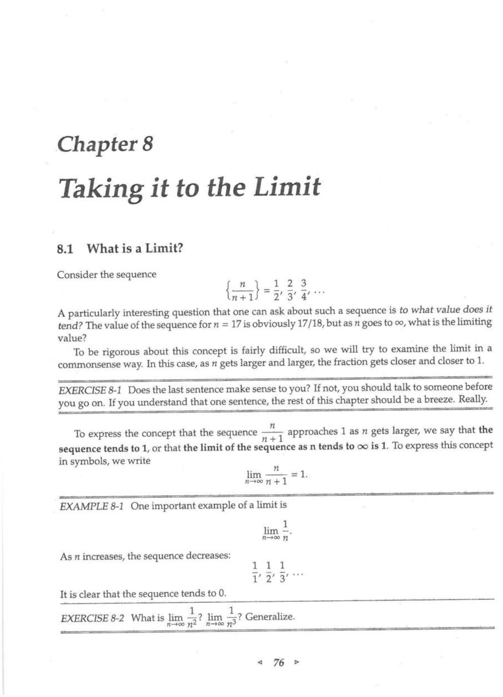

## Printed page 77

<!-- source: volume-2, PDF page 99, printed page 77 -->

The previous examples can be used to evaluate a great many limits. For example, they immediately solve the entire category of rational functions, functions like

$$\frac{3x^3 + 9x + 2}{5x^3 - 12x^2 + x + 1}$$

(8.1)

which are the ratio of one polynomial to another. What happens as $x$ tends smoothly to $\infty$?

To analyze a rational function like (8.1), we divide the top and bottom by the highest power of $x$ present. In this case, the power is $x^3$, so the result is

$$\frac{3 + \frac{9}{x^2} + \frac{2}{x^3}}{5 - \frac{12}{x} + \frac{1}{x^2} + \frac{1}{x^3}}.$$

When we take the limit $x \to \infty$, everything with $x$ in the denominator goes to 0 and we are left with 3/5, the final limit.

**EXERCISE 8-3 Evaluate**

i. $\lim_{x \to \infty} \frac{2x^4 - 7x^2 + 1}{4x^4 - 4x^3 + 4x^2 - 6x + 17}$

ii. $\lim_{x \to \infty} \frac{2x^3 - 7x^2 + 1}{4x^4 - 4x^3 + 4x^2 - 6x + 17}$

iii. $\lim_{x \to \infty} \frac{2x^5 - 7x^2 + 1}{4x^4 - 4x^3 + 4x^2 - 6x + 17}$

### 8.2 Tricky

Though the limits we dealt with in the previous section were quite simple, limits can actually be a very tricky business. For many sequences, the limit may not even exist! The simple example of a function for which this is a sequence like 1, 2, 3, ..., for which there is simply no limiting value. A similar case was the third part of Exercise 8-3; there, as $x$ increased, the function increased without bound. A sequence or function for which there is no upper limit on the values is called unbounded; we write $\lim_{x \to \infty} f(x) = \infty$. (WARNING: This “$\infty$” is just a symbolic shorthand for saying that the limit diverges in the positive direction. DO NOT treat it as a regular number.)

**EXAMPLE 8-2 Let’s construct a rigorous definition of our terms. A sequence $\{a_n\}$ or function $f(x)$ is unbounded if and only if it gets as big as we want at some point; that is, if**

for every number $N$, there is some choice of $n$ or $x$ such that $|a_n| > N$ or $|f(x)| > N$.

Note that by using the absolute value we have allowed for functions to be unbounded toward the negative as well, like $-1, -2, -3, \ldots$. We’ve also taken care of others that might try to evade the definition, like 1, $-2, 3, -4, \ldots$ or similar miscreants.

**EXERCISE 8-4 Rigorously define what it means for a sequence or function to be bounded, the opposite of unbounded.**

**EXERCISE 8-5 Is every sequence either bounded or unbounded?**

Original scan — PDF page 99

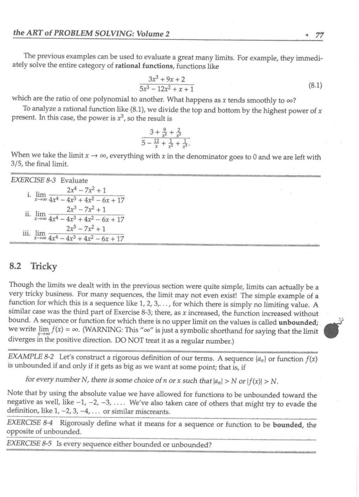

## Printed page 78

<!-- source: volume-2, PDF page 100, printed page 78 -->

This boundless increase (or decrease or alternation) is only the simplest way in which a sequence or function can fail to have a limit. We can come up with many other devious ways as well. For example, consider the sequence

$$0, 1, 0, 1, 0, 1, \ldots,$$

or alternatively the function $\sin x$. Although the sequence and the function are both bounded, there is again no limiting value. (Why?) So being bounded is not enough for a function to have a limit.

A function which has no limit, regardless of the particular way in which it fails, is called divergent.

**EXERCISE 8-6 Think about how you might rigorously define a convergent sequence or function. Before you get too confident about this task, think about this: your definition should distinguish between a sequence like $0, 1, 0, 1, 0, 1, 0, 1, \ldots$, which has no limit, and one like $0, 1, 0, 1, 0, 1, 0, 0, 0, 0, 0, 0, \ldots$, which has limit 0. Only the long term behavior should matter.**

**EXERCISE 8-7 Which rational functions are convergent? Which are convergent to nonzero values?**

### 8.3 Working with Limits

In Section 8.1, we analyzed the limits of rational functions. But we implicitly assumed several things. For example, we assumed that the limit of a ratio is equal to the ratio of the individual limits; that is, that

$$\lim_{x \to \infty} \frac{f(x)}{g(x)} = \frac{\lim_{x \to \infty} f(x)}{\lim_{x \to \infty} g(x)}$$

Without this being true, we would have been unable to make the crucial last step, where we said that since the limit of the numerator of

$$\frac{3 + \frac{9}{x^2} + \frac{2}{x^3}}{5 - \frac{12}{x} + \frac{1}{x^2} + \frac{1}{x^3}}$$

was 3 and that of the denominator 5, the final limit must be 3/5.

We made another assumption as well, that the limit of a sum equals the sum of the individual limits. This assumption is what allows us to say that the limit of the top,

$$\lim_{x \to \infty} \left( 3 + \frac{9}{x^2} + \frac{2}{x^3} \right)$$

must equal

$$\lim_{x \to \infty} 3 + \lim_{x \to \infty} \frac{9}{x^2} + \lim_{x \to \infty} \frac{2}{x^3} = 3 + 0 + 0 = 3.$$

In fact, these two assumptions are generally true (and similar results hold for multiplication and exponentiation), as long as all the limits exist and no divisions by zero occur. A proof of this is a little too complicated to deal with here.

WARNING: When divisions by zero occur, interesting—and dangerous—things occur. Suppose we have two functions $f(x)$ and $g(x)$ and we wish to evaluate

$$\lim_{x \to \infty} \frac{f(x)}{g(x)}$$

Original scan — PDF page 100

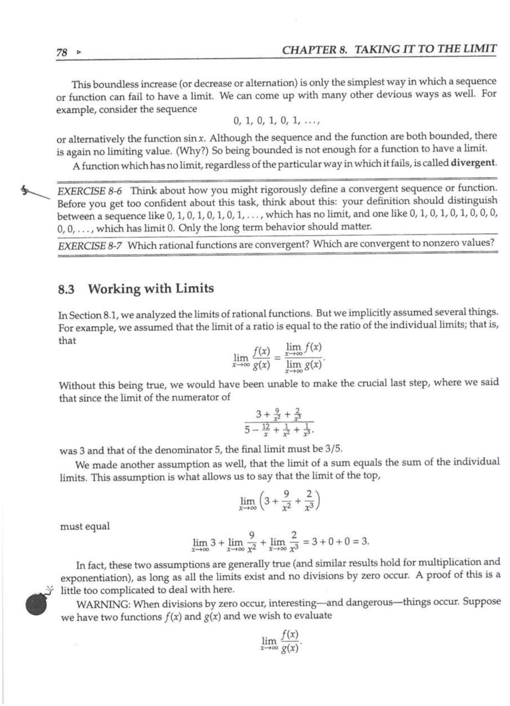

## Printed page 79

<!-- source: volume-2, PDF page 101, printed page 79 -->

If $\lim_{x \to \infty} g(x) \neq 0$, then everything is fine; we just write

$$\lim_{x \to \infty} \frac{f(x)}{g(x)} = \frac{\lim_{x \to \infty} f(x)}{\lim_{x \to \infty} g(x)}$$

Even if $\lim_{x \to \infty} g(x) = 0$, we can make an immediate conclusion if $\lim_{x \to \infty} f(x) \neq 0$. We then have

$$\lim_{x \to \infty} \frac{f(x)}{g(x)} = \frac{\text{something other than } 0}{0} = \infty \text{ or } -\infty.$$

(Why?) But if both $\lim_{x \to \infty} g(x) = 0$ and $\lim_{x \to \infty} f(x) = 0$, interesting things can happen. The top could go to zero much faster than the bottom, resulting in a limit of 0 (for example, try $f(x) = \frac{1}{x^2}$, $g(x) = \frac{1}{x}$). The top could go to zero much slower than the bottom, resulting in a limit of $\infty$. (Can you find an example of this situation?) Or, in the most interesting case, the two can go to zero at comparable speeds, resulting in some finite, nonzero limit. A simple example of this last case is $f(x) = \frac{3}{x}$, $g(x) = \frac{5}{x}$, in which $\lim_{x \to \infty} f(x)/g(x) = 3/5$. A more complicated example is $f(x) = \sin\left(\frac{1}{x}\right)$, $g(x) = \frac{1}{x}$.

**EXERCISE 8-8** On a calculator, evaluate $\sin(1/1000)/(1/1000)$. (Make sure you are using radians for the angle measure!) Do you have a guess as to what $\lim_{x \to \infty} \sin(1/x)/(1/x)$ is?

Be very careful that you don’t see a limit in which the top and bottom both go to 0 and automatically assume that the limit is 1. As we have shown, a 0/0 limit can have any value whatsoever.

**EXAMPLE 8-3** Certain simple transformations are possible when working with limits. For example, suppose we know that $\lim_{x \to \infty} f(x) = L$ and we want to know $\lim_{x \to \infty} f(5x)$. As $x$ goes off to infinity, so does 5x, so we can write

$$\lim_{x \to \infty} f(5x) = \lim_{5x \to \infty} f(5x) = \lim_{y \to \infty} f(y) = L$$

where we have made the substitution $y = 5x$.

**EXAMPLE 8-4** A more useful transformation can be used to convert a limit as $x$ tends to infinity into a limit as $x$ tends to 0, or vice versa. We simply define $y = 1/x$ and note that as $x$ goes to infinity $y$ goes to 0, and as $x$ goes to 0, $y$ goes to infinity. Thus

$$\lim_{x \to \infty} f(x) = \lim_{y \to 0} f(1/y)$$ and $$\lim_{x \to \infty} f(x) = \lim_{y \to \infty} f(1/y).$$

**EXAMPLE 8-5** Find

$$\lim_{x \to 3} \frac{\sqrt{2x+10} - \sqrt{x+13}}{x-3}$$

Solution: For $x = 3$, we find that our limit is 0/0. A general technique in dealing with limits involving square roots is multiplying top and bottom by a conjugate expression, or $\sqrt{2x+10} + \sqrt{x+13}$ in this case:

$$\lim_{x \to 3} \frac{\sqrt{2x+10} - \sqrt{x+13}}{x-3} = \lim_{x \to 3} \frac{(\sqrt{2x+10} - \sqrt{x+13})(\sqrt{2x+10} + \sqrt{x+13})}{(x-3)(\sqrt{2x+10} + \sqrt{x+13})}$$

$$= \lim_{x \to 3} \frac{x-3}{(x-3)(\sqrt{2x+10} + \sqrt{x+13})}$$

$$= \lim_{x \to 3} \frac{1}{\sqrt{2x+10} + \sqrt{x+13}} = \frac{1}{8}.$$

Original scan — PDF page 101

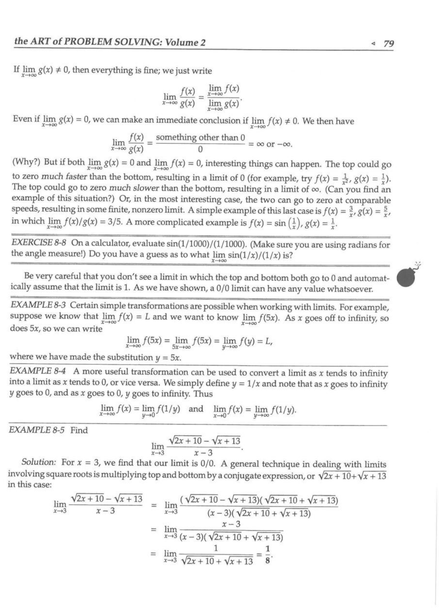

## Printed page 80

<!-- source: volume-2, PDF page 102, printed page 80 -->

Remember this use of multiplication by the conjugate of a radical expression, it is often the key to simplifying limits.

### 8.4 Continuity

We have so far only considered the limit of a function as $x \to \infty$. This is because other limits usually aren't all that interesting! For example, $\lim_{x \to 2} x^2 + 2$ is just $2^2 + 2 = 6$.

In general, saying that the limit of a function $f(x)$ as $x$ goes to some finite $a$ is equal to $f(a)$ is the same as saying the function is continuous at the point $a$. In Volume 1, we defined a continuous function as being one which could be drawn without picking up the pen. However, we didn't make the distinction that a function is often continuous in most places with isolated discontinuities.

For example, consider a function $g(x)$, defined as

$$g(x) = \begin{cases} x, & \text{for } x \neq -2; \\ 3, & \text{for } x = -2. \end{cases}$$

We have plotted $g(x)$ at right. Clearly $g(x)$ is continuous everywhere except at $x = -2$. But consider the behavior near that point. The limit $\lim_{x \to -2} g(x)$ is the value that is being approached as we get closer and closer to $-2$, not the value at $-2$. Thus $\lim_{x \to -2} g(x) = -2$, while of course, $g(-2) = 3$. The limit is not equal to the value! This means that the function is not continuous at $x = -2$. Everywhere else, the limit equals the value, so the function is continuous everywhere else.

WARNING: Always remember that the limit is the value which the function approaches as we get closer and closer to a point, not the value of the function at the point. The two are equal only for continuous functions.

**EXAMPLE 8-6 The discontinuity we just saw can be completely removed by changing the behavior of the function at a single point: set $g(-2) = -2$ and it is completely removed. This "nice" type of discontinuity is called a removable discontinuity. Such discontinuities often appear when dealing with rational functions. For example, take the function**

$$f(x) = \frac{x^2 - 4x + 3}{x^2 - 3x + 2}$$

Since the top factors into $(x - 1)(x - 3)$ and the bottom into $(x - 1)(x - 2)$, the function is always equal to $(x - 3)/(x - 2)$... EXCEPT when $x - 1$ equals zero. Then the function is not defined. Thus there is a "hole" in the function at $x = 1$, where it is not defined at all.

Why do we say this discontinuity is removable? Because we can set the value of the original function at $x = 1$ to its limit,

$$\lim_{x \to 1} \frac{x^2 - 4x + 3}{x^2 - 3x + 2} = \lim_{x \to 1} \frac{x - 3}{x - 2} = \frac{1 - 3}{1 - 2} = 2$$

which will immediately remove the discontinuity.

Original scan — PDF page 102

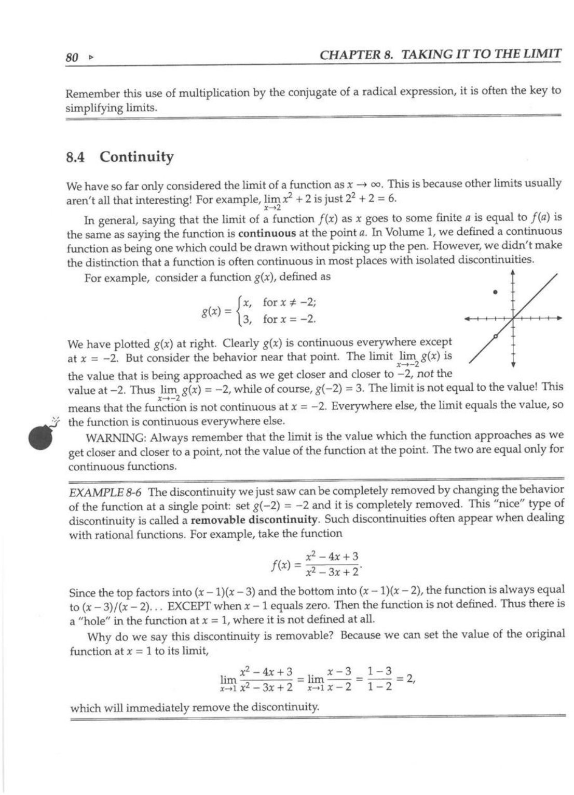

## Printed page 81

<!-- source: volume-2, PDF page 103, printed page 81 -->

Other types of discontinuities aren't so easy to remove. Consider the step function

$$f(x) = \begin{cases} 0, & \text{for } x \leq 0 \\ 1, & \text{for } x > 0. \end{cases}$$

Here there is no way to remove the discontinuity at $x = 0$, since the limit of the function does not exist at $x = 0$. We can define separate limits from the left- and right-hand sides to see why this is so; the left-hand limit (limit approaching 0 from the negative side)

$$\lim_{x \to 0^-} f(x)$$

is 0, while the right-hand limit

$$\lim_{x \to 0^+} f(x)$$

is 1. Clearly, the limit of a function at a point only exists if the left and right limits are equal to one another at that point. Since there is no limit for the step function at 0, we certainly can't "fix" the discontinuity just by changing the value at one point. Thus this is an essential discontinuity.

**EXERCISE 8-9** Evaluate

$$\lim_{x \to 0^-} \frac{x}{|x|} \quad \text{and} \quad \lim_{x \to 0^+} \frac{x}{|x|}$$

Does

$$\lim_{x \to 0} \frac{x}{|x|}$$

exist?

### 8.5 Asymptotes

Limits are especially useful for functions, because the limits give vital information as to a function's structure. For example, let's try to plot

$$f(x) = \frac{3x^2 - 6x + 3}{5x^2 - 25x + 20}$$

Plotting point-by-point would be very tedious for such a function, and important structural details might be missed altogether. In seeking a different way to plot the function, we note that

$$\lim_{x \to \infty} f(x) = \lim_{x \to -\infty} f(x) = \frac{3}{5}$$

This immediately tells us something that we wouldn't find using the plug-in method of plotting: for very large and very small $x$, the function must get closer and closer to the horizontal line $y = 3/5$. This line, shown at right, is called an asymptote, and will be a useful guide; try to identify it now in the final graph of the function, shown below. (Can you see how to find the horizontal asymptotes of any rational function?)

Original scan — PDF page 103

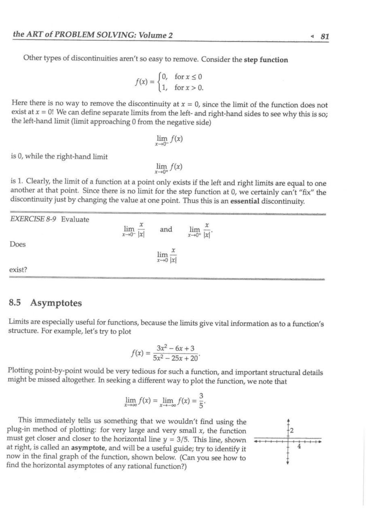

## Printed page 82

<!-- source: volume-2, PDF page 104, printed page 82 -->

Factoring the top and bottom of the equation yields $f(x) = \frac{3(x-1)^2}{5(x-4)(x-1)}$, which presents more guidelines. The function is not defined for $x = 4$ and $x = 1$, since the bottom of the fraction becomes 0 at those points. But the two points don't behave the same. The limit of $f(x)$ as $x$ approaches 4 is undefined, since the top does not go to 0 and the bottom does. As $x$ approaches 4 from the right, $f(x)$ will diverge to positive $\infty$; as $x$ approaches 4 from the left, $f(x)$ will diverge to $-\infty$. (To see what the signs should be, imagine, but don't actually calculate, what would happen for $x = 4.1$ and $x = 3.9$.) As $x$ gets closer and closer to 4, the graph gets closer and closer to the line $x = 4$, so this line is a vertical asymptote. Identify the line in the graph below, and figure out why it is also called an asymptote. (How can we find vertical asymptotes of a general rational function?)

On the other hand, the limit of the function as $x$ approaches 1 can easily be evaluated:

$$\lim_{x \to 1} \frac{3(x-1)^2}{5(x-4)(x-1)} = \lim_{x \to 1} \frac{3(x-1)}{5(x-4)} = \lim_{x \to 1} \frac{0}{-15} = 0.$$

Unlike the unruly behavior near $x = 4$, the behavior near $x = 1$ is nice: the curve is smooth except for the removable discontinuity exactly at $x = 1$.

As a final clue to the shape of the graph, let's see where the function crosses the $x$ axis. The numerator of the fraction must be 0, so $x = 1$ is the only point, but this point is the removable discontinuity shown with the open circle. Combining this with our knowledge of the function as it nears both the vertical and the horizontal asymptotes generates the graph at right.

**EXAMPLE 8-7** Plot the function $\frac{2x^3 - 3x^2 + x - 6}{x^2 - 3x + 2}$.

**Solution:** Factoring the bottom yields $(x-2)(x-1)$, so we see if either $x-2$ or $x-1$ also divides the top. The first does, and the top factors into $(x-2)(2x^2 + x + 3)$. Since the top and bottom share a factor $x-2$, there is a removable discontinuity at $x = 2$, with value

$$\lim_{x \to 2} \frac{(x-2)(2x^2 + x + 3)}{(x-2)(x-1)} = \lim_{x \to 2} \frac{(2x^2 + x + 3)}{(x-1)} = 13.$$

On the other hand, $x-1$ does not divide the top, so there is a vertical asymptote at $x = 1$. As $x$ approaches 1 from the positive side the function soars to $\infty$, and as $x$ comes in from the negative side the function dives to $-\infty$.

There is no horizontal asymptote since the numerator has greater degree than the denominator; thus you might think we have gleaned all the clues we can. On the contrary, getting rid of the $(x-2)$ which is common to the numerator and denominator, we are left with $(2x^2 + x + 3)/(x-1)$, which upon polynomial division becomes

$$2x + 3 + \frac{6}{x-1}.$$

For $x \to \infty$ or $x \to -\infty$, the fraction tends to zero, so the function approaches the line $2x + 3$! This **slant asymptote** is an important graphing tool, as you can see. We now sketch the graph noticing its behavior at $x = 1$, and that it approaches the line $2x + 3$ as $x$ gets large and as $x$ gets small. The open circle on the curve represents the removable discontinuity.

Original scan — PDF page 104

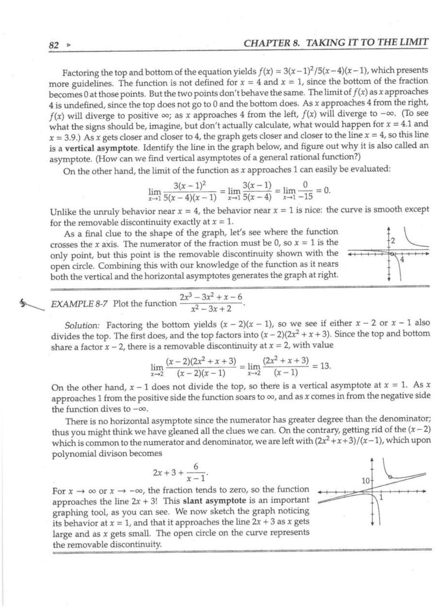

## Printed page 83

<!-- source: volume-2, PDF page 105, printed page 83 -->

### 8.6 Trig Limits

Many, if not most, limits require the machinery of calculus to be done with any efficiency. However, certain basic trigonometric limits can be done with simple geometry, and are nevertheless very important.

The simplest trigonometric limits one can think of might be things like $\lim_{x \to \infty} \sin x$ or $\lim_{x \to 0} \cos x$. These aren't too interesting—the first diverges, with $\sin x$ oscillating between 1 and $-1$; the second is equal to $\cos 0 = 1$ since cosine is continuous.

A more challenging limit is $\lim_{x \to 0} \sin x/x$. Here the limits of the top and bottom are both 0, so the usual methods don't apply.

Consider the diagram at right to get an intuitive feeling for the limit in question. If the radius of the circle is 1 and $\angle POB = x$, where $x$ is in radians, then elementary trig shows that $PA = \sin x$, where $\angle PAO$ is a right angle. Moreover, the arc $PB$ is equal to $x$, since by geometry the length of a cutoff arc is $r\theta$. Thus the ratio $\sin x/x$ is the ratio between the length of the vertical line and the arc. It seems likely that as the angle $x$ gets smaller and smaller, the arc will differ less and less from the line, so the limit of their ratio appears to be 1.

We can get a quantitative look at the ratio by using a calculator. For a very small value of $x$, say $x = 0.01$, we find that $\sin x/x = 0.99998 \approx 1$. This confirms our geometric insight that the limit as $x \to 0$ seems to be 1.

**EXERCISE 8-10 How does the calculation we just did compare to the calculation done in Exercise 8-8?**

Assuming you're convinced that the limit is going to be 1, the only question is how to prove it. We will resort to the squeeze principle, which states that if the function $f(x)$ is always between the functions $f_1(x)$ and $f_2(x)$, so that $f_1(x) \leq f(x) \leq f_2(x)$, then

$$\lim_{x \to 0} f_1(x) \leq \lim_{x \to 0} f(x) \leq \lim_{x \to 0} f_2(x).$$

This is intuitively clear: if all the values of one function are between those of two others, its limits should be between the limits of the other functions.

We put the squeeze on the diagram above by drawing an additional circle, with center $O$ and radius $OA$. Let $C$ the point where the new circle intersects segment $PO$. We can then say that

Area sector $OAC < Area \Delta OAP < Area sector OBP.$

The length of $OA$ is $\cos x$, by elementary trigonometry, so the area of sector $OAC$ is $x\cos^2 x/2$ using the formula for the area of a sector in Volume 1. Similarly, the area of sector $OBP$ is $x/2$. We also know that the area of $\Delta OAP$ is $\cos x\sin x/2$, since it is a right triangle with legs $OA = \cos x$ and $AP = \sin x$. Substituting this into the equation above, we have

$$\frac{x\cos^2 x}{2} < \frac{\cos x\sin x}{2} < \frac{x}{2},$$

Original scan — PDF page 105

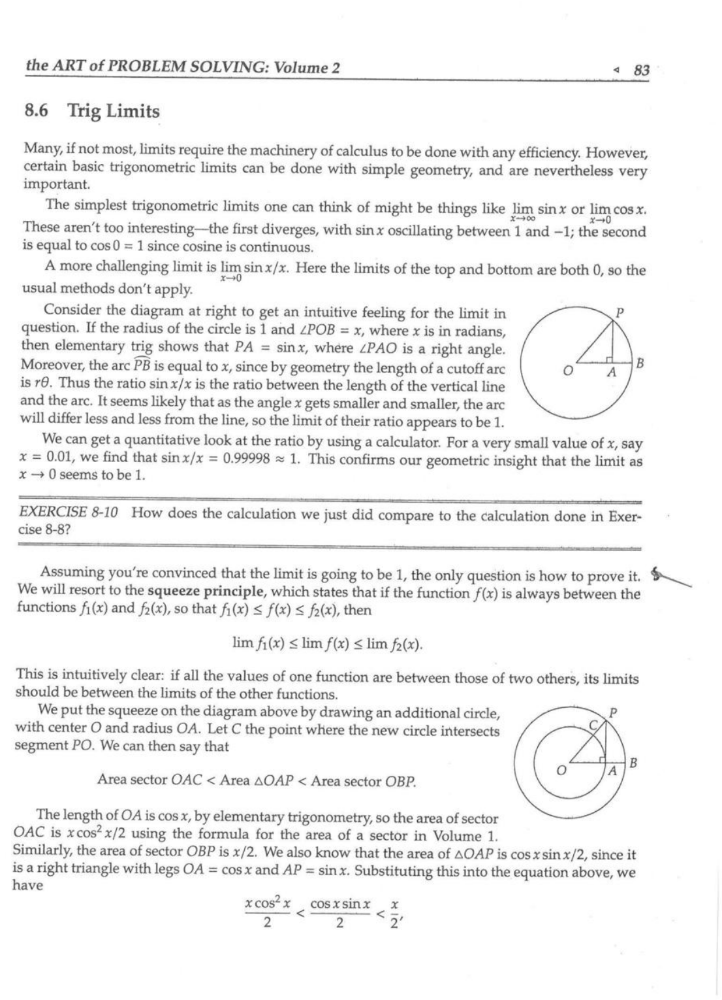

## Printed page 84

<!-- source: volume-2, PDF page 106, printed page 84 -->

or
$$\cos x < \frac{\sin x}{x} < \frac{1}{\cos x}.$$

Now $\lim_{x \to 0} \cos x = 1$, so $\lim_{x \to 0} (1/\cos x) = 1$. Taking limits, we thus have
$$1 \leq \lim_{x \to 0} \frac{\sin x}{x} \leq 1,$$
so that
$$\lim_{x \to 0} \frac{\sin x}{x} = 1,$$
as we had guessed.
A similar trigonometric limit is
$$\lim_{x \to 0} \frac{1 - \cos x}{x}.$$
(8.2)

Like $\lim_{x \to 0} \frac{\sin x}{x}$, this limit is of the form 0/0. But unlike that limit, (8.2) is 0, as can be shown with a similar squeezing argument.

**EXAMPLE 8-8 Evaluate $\lim_{x \to 0} \tan 3x/4x$.**

Solution: We have
$$\lim_{x \to 0} \frac{\tan 3x}{4x} = \lim_{x \to 0} \frac{3}{4} \left( \frac{\tan 3x}{3x} \right)$$
$$= \frac{3}{4} \lim_{3x \to 0} \left( \frac{\sin 3x}{3x} \right) \left( \frac{1}{\cos 3x} \right)$$
$$= \frac{3}{4} \lim_{y \to 0} \left( \frac{\sin y}{y} \right) \lim_{y \to 0} \left( \frac{1}{\cos y} \right)$$
$$= \frac{3}{4} \cdot 1 \cdot 1$$
$$= \frac{3}{4}.$$

We have used the fact that a limit as $x \to 0$ is the same as a limit as $3x \to 0$ and then substituted $y = 3x$.

### 8.7 $e$

If I put a dollar in the bank at 100% interest per year, after one year I will have $2$. Suppose, however, that the interest is compounded once during the year. This means that after six months I receive the interest so far, 1/2 dollar, and for the second six months I receive interest on all the money I have, 1 + 1/2 dollars. Hence my total at the end of the year is $(1 + 1/2) + 1/2(1 + 1/2) = (1 + 1/2)^2$. (Figure out how much this is.) I have more with the compound interest, because I am paid interest on the first six months' interest during the second six months.

Original scan — PDF page 106

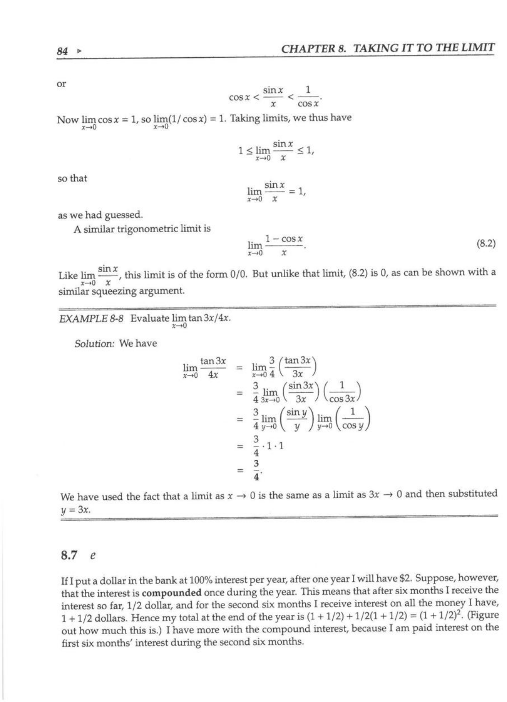

## Printed page 85

<!-- source: volume-2, PDF page 107, printed page 85 -->

My interest can be compounded more than once. If my interest is compounded twice, at the end of 1/3 year I have $1 + 1/3$, at the end of 2/3 year I have $(1 + 1/3) + 1/3(1 + 1/3) = (1 + 1/3)^2$, and at the end of the year I have $(1 + 1/3)^2 + 1/3(1 + 1/3)^2 = (1 + 1/3)^3$. Similarly, if my interest is compounded $n$ times during the year, at the end of the year I have $(1 + 1/n)^n$ dollars.

**EXERCISE 8-11** Evaluate the expression $(1 + 1/n)^n$ on your calculator for $n = 10$ and $n = 100$. As my interest is compounded more and more often, does my yield diverge or approach a fixed limit?

As you should have seen in Exercise 8-11, compounding interest more and more often does not lead to an infinite amount of money. Rather, it approaches the fixed limit 2.71... We define this limit to be the constant $e$:

$$\lim_{n \to \infty} \left(1 + \frac{1}{n}\right)^n = e.$$

The importance of the constant $e$ really comes out in calculus, but it also has some importance in our discussion. For example, the so-called natural logarithm $\ln x$ denotes the logarithm base $e$, $\log_e x$. Moreover, the exponential function $e^x$ appears in many contexts.

**EXAMPLE 8-9** Evaluate $\lim_{x \to \infty} \left(1 + \frac{2}{x}\right)^{3x}$.

**Solution:** We first use the substitution $x = 2u$ to write the given limit as $\lim_{u \to \infty} \left(1 + \frac{1}{u}\right)^{6u}$. We then use the fact that $\lim y^k = (\lim y)^k$ to write

$$\lim_{u \to \infty} \left(1 + \frac{1}{u}\right)^{6u} = \left(\lim_{u \to \infty} \left(1 + \frac{1}{u}\right)^u\right)^6 = e^6.$$

**Problems to Solve for Chapter 8**

131. For what value of $k$ is the following function continuous at $x = 2$? (MAΘ 1991)

$$f(x) = \begin{cases} \frac{\sqrt{2x+5} - \sqrt{x+7}}{x-2} & \text{for } x \neq 2 \\ k & \text{for } x = 2 \end{cases}$$

132. Evaluate the following limits.

i. $\lim_{x \to \infty} \frac{\sin 3x}{6x}$

ii. $\lim_{x \to -2} \frac{x^3 + 8}{x + 2}$

iii. $\lim_{x \to 16} \frac{\sqrt{x} - 4}{x - 16}$

133. The graph of $f(x) = (x^2 - x - 2)/(x + 2)$ has an oblique (slant) asymptote. (MAΘ 1990)

Original scan — PDF page 107

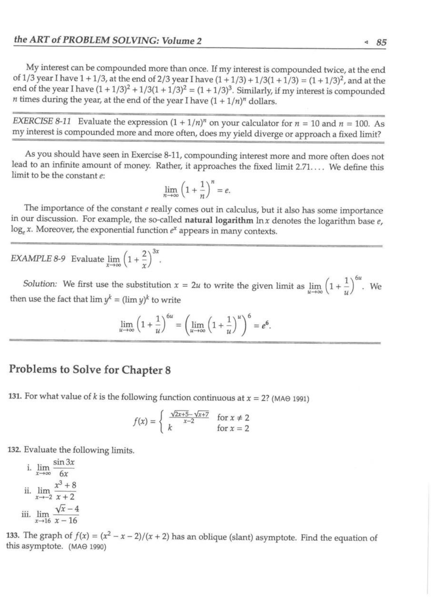

## Printed page 86

<!-- source: volume-2, PDF page 108, printed page 86 -->

134. Evaluate $\lim_{x \to \infty} (\sqrt{4x^2 + 5x} - \sqrt{4x^2 + x})$.

135. Evaluate $\lim_{x \to 0} \sin^2 x/x$.

136. Evaluate $\lim_{\theta \to 0} \theta \cot \theta$.

137. Use the identity $\frac{1 - \cos x}{x} = \frac{\sin^2 x}{x(1 + \cos x)}$ to prove that $\lim_{x \to 0} (1 - \cos x)/x = 0$.

138. Find all asymptotes of the function $x^3/(x^2 - 1)$.

139. Evaluate $\lim_{x \to \infty} 6x/\sqrt{9x^2 + 17x}$.

140. Evaluate $\lim_{x \to \infty} \frac{\sqrt{3x^2 + 17x}}{x}$.

Original scan — PDF page 108

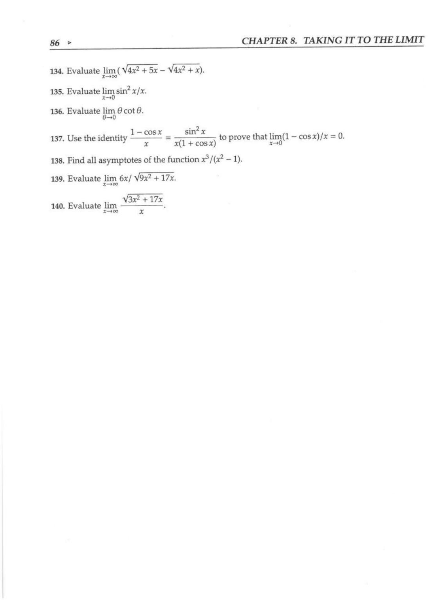

## Printed page 87

<!-- source: volume-2, PDF page 109, printed page 87 -->

Centrally important in the field of computer science is the study of algorithms, repetitive procedures used to accomplish tasks on a computer. For example, suppose I was given a list $(a_1 a_2 a_3 \cdots a_n)$ of numbers and asked to find the largest element $L$. A simple algorithm would be as follows: first take $L = a_1$. Then go down the list, comparing each $a_i$ to the current value of $L$; if $a_i > L$, then set $L$ to be $a_i$. Thus if the list were $(2 1 3 4 2)$, after each step, the current largest element would be 2, 2, 3, 4, 4.

An algorithm is only useful if it can be run in a reasonable length of time. For this reason, computer scientists have a way to classify algorithms based on their running time; this notation depends on several concepts of limits. An algorithm’s running time is some function $f(N)$ of the size of the problem given. Our example above would take 3 steps if the list of numbers had length 3, 17 steps if the list were length 17, and so on, so in this case $f(N) = N$. This is simple, but a complex algorithm might have a very complicated function $f(N)$, like $18N^2 \log N - 12N(\log N)^2 + 7$.

In practice, though, the complicated details of the function $f$ aren’t all that interesting. What really determines the running time is the term of $f$ which is largest as $N \to \infty$. To classify an algorithm, then, computer scientists use only this first term. The algorithm with the complicated function above would thus be called “an $N^2 \log N$ algorithm.” To denote this type of approximation, we use a capital $O$, as in $O(N^2 \log N)$.

The most important types of algorithms are, from fastest to slowest, $O(1)$, $O(\log N)$, $O(N)$, $O(N^2)$, and $O(2^N)$. The last is of particular importance, because an $O(2^N)$ algorithm is very slow for large $N$. This can be seen in the fact that if the problem size goes from $N$ to $N+1$, the running time goes from $2^N$ to $2^{N+1}$—it doubles! For even moderately-sized problems, an $O(2^N)$ algorithm is impractical. On the other end of the spectrum, the running time of an $O(\log N)$ algorithm grows very slowly with the problem size $N$, and the running time of an $O(1)$ algorithm is a constant regardless of problem size. (For example, the problem of finding the 12th element of a list is an $O(1)$ algorithm.)

Original scan — PDF page 109

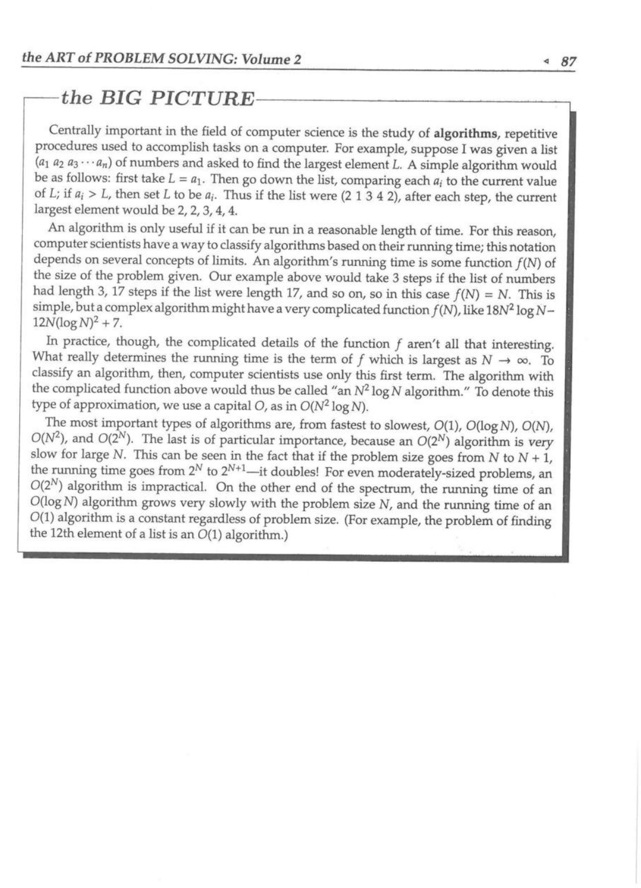

