# Chapter 9: Complex Numbers

Volume 2 · Printed pages 88–99 · PDF pages 110–121

[Volume contents](../index.md)

## Printed page 88

<!-- source: volume-2, PDF page 110, printed page 88 -->

### 9.1 Drawing the Complex Numbers

The standard picture of the real numbers is a line:

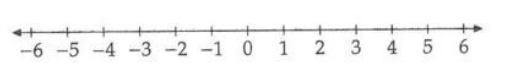

Each real number is associated with a point on the line, and each point with a real number.

Can we devise a similar representation for all complex numbers? Suppose we place the pure imaginaries on a line perpendicular to the reals. If we then put the two lines together, so that they overlap at their zero points (since $0i = 0$), then we can associate every point in the plane with a complex number, where the $x$-coordinate is the real part and the $y$-coordinate is the complex part. To see how this works, examine the figure at right. It should be fairly clear that we can represent any complex number by a point in this plane, and that every point in the plane represents a different complex number.

**EXERCISE 9-1 Draw a complex plane with the points $\frac{1}{2} + \frac{3}{2}i$ and $-\frac{7}{3} + \sqrt{2}i$.**

**EXERCISE 9-2 Draw the set of points $z$ in the complex plane such that:**

i. $\text{Re}(z) = 1$.

ii. $\text{Im}(z) + \text{Re}(z) = 1$.

iii. $\text{Im}(z) < 1$.

Original scan — PDF page 110

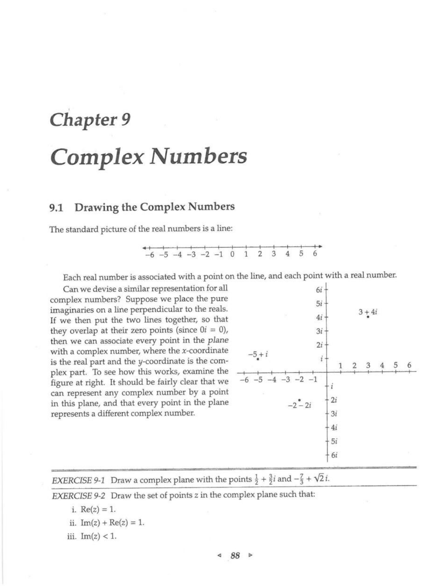

## Printed page 89

<!-- source: volume-2, PDF page 111, printed page 89 -->

**EXERCISE 9-3 For $z = 3 + 2i$, draw $z, \bar{z}, z^2$, and $z - 1$.**

Once we understand the complex plane, we can use it to expand our understanding of complex numbers. For example, we have used rectangular coordinates to locate points in the complex plane. But these are not the only coordinates we could use. Let's apply polar coordinates instead. In our discussion of polar coordinates (page 47) we saw that the polar coordinates $(r, \theta)$ of a point $(x, y)$ are such that

$$\begin{cases} x = r \cos \theta \\ y = r \sin \theta \end{cases}$$ and $$\begin{cases} r = \sqrt{x^2 + y^2} \\ \theta = \arctan(y/x) \end{cases}$$

For a complex number $z$, we have chosen the rectangular coordinates to be $(\text{Re}(z), \text{Im}(z))$. Thus the associated polar coordinates $(r, \theta)$ of $z$ will be such that

$$\text{Re}(z) = r \cos \theta$$

$$\text{Im}(z) = r \sin \theta.$$

(9.1)

But since $z = \text{Re}(z) + i \text{Im}(z)$, we then have

$$z = r \cos \theta + i r \sin \theta.$$

(9.2)

This is called the trigonometric representation of a complex number, and is sometimes written simply $z = r \cos \theta$. Of course, just giving the polar coordinates $(r, \theta)$ is enough to determine $z$ completely; this is called the polar representation.

**EXAMPLE 9-1 Find the polar representation for $i$.**

Solution: We use equations (9.1) to get $r \cos \theta = 0$ and $r \sin \theta = 1$. Clearly $\theta$ must be $\pi/2$ and $r$ must be 1, so the polar representation is $(1, \pi/2)$.

**EXERCISE 9-4 Draw the points $r = 2, \theta = \pi/3$ and $r = 3, \theta = \pi$.**

**EXERCISE 9-5 Draw the curves $r = 1$ and $\theta = \pi/3$ in the complex plane.**

As with regular polar coordinates, the numbers $r$ and $\theta$ are the distance from the origin to $z$ and the angle between $z$ and the positive real axis, respectively. It is important to remember the ambiguity in the value of $\theta$ as well; for a given $\theta$ we could just as well use $\theta + 2\pi, \theta + 4\pi$, etc. See page 47 for a discussion of this ambiguity.

### 9.2 The Complex Absolute Value

The value of $r$ is particularly important. Like the absolute value for real numbers, it is simply the distance to the origin of coordinates. We therefore call $r$ the absolute value, or sometimes the magnitude or the modulus, of a complex number $z$ and denote it by $|z|$. For a generic complex number $x + iy$, we have $|x + iy| = r = \sqrt{x^2 + y^2}$.

The complex absolute value has some interesting properties. Perhaps the most important is that

Original scan — PDF page 111

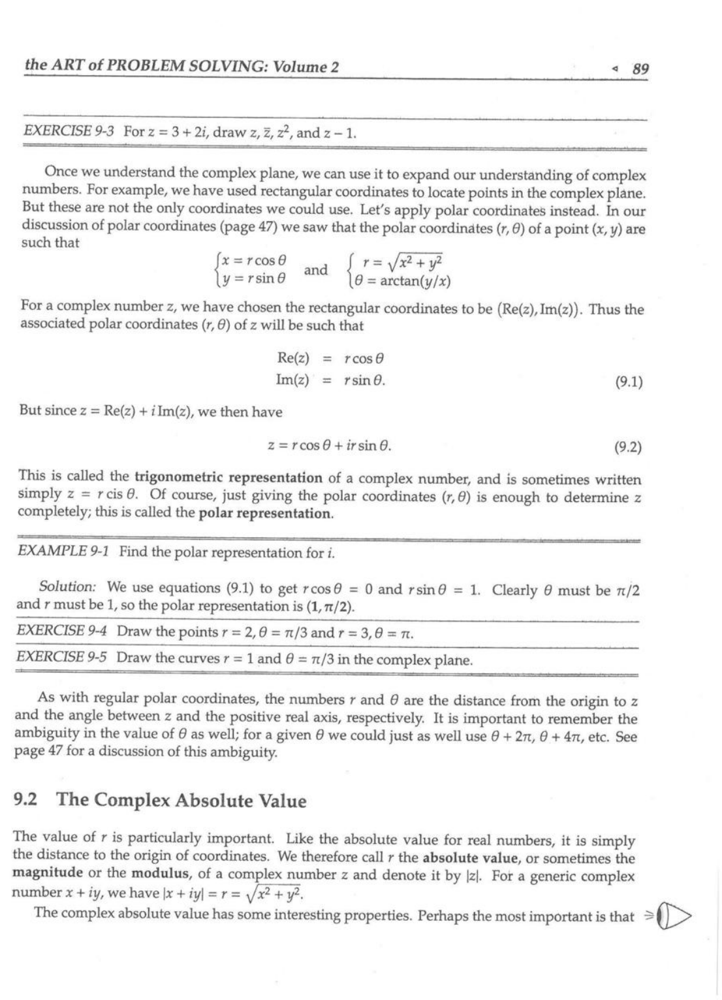

## Printed page 90

<!-- source: volume-2, PDF page 112, printed page 90 -->

$|zw| = |z||w|$ for any $z$ and $w$. To see this, we just write

$$|zw| = |(z_1 + z_2 i)(w_1 + w_2 i)|$$
$$= |(z_1 w_1 - z_2 w_2) + (z_1 w_2 + z_2 w_1) i|$$
$$= \sqrt{(z_1 w_1 - z_2 w_2)^2 + (z_1 w_2 + z_2 w_1)^2}$$

(cancelling terms) $$= \sqrt{z_1^2 w_1^2 + z_2^2 w_2^2 + z_1^2 w_2^2 + z_2^2 w_1^2}$$
$$= \sqrt{(z_1^2 + z_2^2)(w_1^2 + w_2^2)}$$
$$= \sqrt{z_1^2 + z_2^2} \sqrt{w_1^2 + w_2^2}$$
$$= |z||w|$$

and we’re done. Similarly we can show that $|z/w| = |z|/|w|$.

**EXERCISE 9-6** Find the absolute value of the complex number $(12 + 5i)(7 - 24i)$.

**EXERCISE 9-7** Find a counterexample to the false claim $|w + z| = |w| + |z|$.

Let’s examine the relationship between $|w + z|$ and $|w| + |z|$. Above you should have found that these two quantities are not always equal, but you should also have seen, or at least suspected, that $|w + z|$ is never larger than the sum $|w| + |z|$. To prove our suspicion, we write $|w| + |z| \geq |w + z|$ in terms of $w = w_1 + w_2 i$ and $z = z_1 + z_2 i$:

$$\sqrt{z_1^2 + z_2^2} + \sqrt{w_1^2 + w_2^2} \geq \sqrt{(z_1 + w_1)^2 + (z_2 + w_2)^2}$$

Squaring both sides and cancelling common terms leaves

$$2 \sqrt{z_1^2 + z_2^2} \sqrt{w_1^2 + w_2^2} \geq 2z_1 w_1 + 2z_2 w_2.$$

Cancelling the 2’s and squaring again, we get

$$z_1^2 w_1^2 + z_1^2 w_2^2 + z_2^2 w_1^2 + z_2^2 w_2^2 \geq z_1^2 w_1^2 + 2z_1 z_2 w_1 w_2 + z_2^2 w_2^2$$

or

$$z_1^2 w_2^2 - 2z_1 z_2 w_1 w_2 + z_2^2 w_1^2 \geq 0.$$

Recognizing the left as a perfect square, we write

$$(z_1 w_2 - z_2 w_1)^2 \geq 0,$$

which is clearly always true. Our steps are reversible, so our original inequality must hold. We can find when $|w| + |z| = |w + z|$ by noting that these can only be equal when $(z_1 w_2 - z_2 w_1)^2 = 0$. (Why?)

This occurs when $z_1 w_2 = z_2 w_1$, or $z_1/w_1 = z_2/w_2$. Letting this common ratio be $c$, our equality condition is $z_1 = cw_1$ and $z_2 = cw_2$, so $z = cw$ and one number is just a real multiple of the other!

The inequality $|w| + |z| \geq |w + z|$ is called the **Triangle Inequality** for complex numbers. Given the name, you might think the inequality has something to do with geometry. You’re right; using a geometric representation of complex numbers and complex addition, we can prove the Triangle Inequality quite easily. (This is done on page 103.)

Original scan — PDF page 112

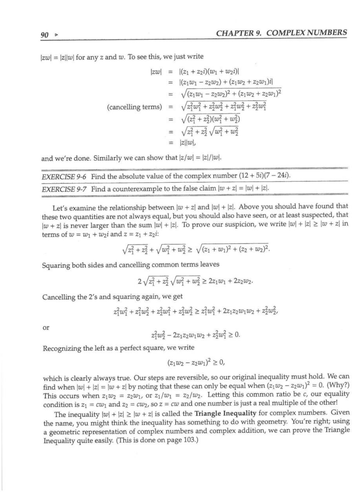

## Printed page 91

<!-- source: volume-2, PDF page 113, printed page 91 -->

**EXERCISE 9-8 What is the equality condition of the Triangle Inequality when $w$ and $z$ are written in polar form?**

**EXERCISE 9-9 Prove that $|z| + |w| \geq |z - w|$.**

### 9.3 Complex Multiplication and Coordinates

We now ask the question: what is the effect of complex multiplication in our new coordinate perspective? We can answer this immediately. Consider two complex numbers $z_1 = r_1(\cos \theta_1 + i \sin \theta_1)$ and $z_2 = r_2(\cos \theta_2 + i \sin \theta_2)$. Their product is

$$z_1 z_2 = r_1 r_2(\cos \theta_1 \cos \theta_2 + i \cos \theta_1 \sin \theta_2 + i \sin \theta_1 \cos \theta_2 - \sin \theta_1 \sin \theta_2)$$

$$= r_1 r_2((\cos \theta_1 \cos \theta_2 - \sin \theta_1 \sin \theta_2) + i(\cos \theta_1 \sin \theta_2 + \sin \theta_1 \cos \theta_2))$$

$$= r_1 r_2(\cos(\theta_1 + \theta_2) + i \sin(\theta_1 + \theta_2))$$

The coordinates of the product of $(r_1, \theta_1)$ and $(r_2, \theta_2)$ are thus $(r_1 r_2, \theta_1 + \theta_2)$. When we multiply two complex numbers, the magnitudes multiply and the angles add.

**EXAMPLE 9-2 Take the complex number $\frac{1}{2} + i \frac{\sqrt{3}}{2} = (\cos \frac{\pi}{3} + i \sin \frac{\pi}{3})$. When it is multiplied by any complex number $r(\cos \theta + i \sin \theta)$, the product is $r(\cos(\theta + \frac{\pi}{3}) + i \sin(\theta + \frac{\pi}{3}))$. Thus multiplication by $\frac{1}{2} + i \frac{\sqrt{3}}{2}$ is a rotation by the angle $\frac{\pi}{3}$.**

**EXERCISE 9-10 To what geometrical motion does multiplication by $i$ correspond, in the sense of Example 9-2?**

**EXERCISE 9-11 On a complex plane, draw the points $2 + 3i, 1 + 2i$, and $(2 + 3i)(1 + 2i)$ to convince yourself that the magnitudes multiply and the angles add to form the product.**

While the polar method is a more satisfying way to look at complex multiplication, for routine calculation it is usually easier to fall back on the distributive law as used in Volume 1. However, for more complicated calculations and clever applications, the polar approach is often much more fruitful.

### 9.4 Complex Powers and Geometry

Once we have a representation for multiplication, we can tackle powers. Consider the generic complex number $z = r(\cos \theta + i \sin \theta)$. The power $z^n$ (where $n$ is a positive integer) is just a product $zzz \cdots z$ with $n$ $z$'s multiplied together. Thus the magnitude is the product of the individual magnitudes, or $r^n$, and the angle is the sum of the individual angles, or $n\theta$. For positive integers $n$, we immediately have

$$\left[ r(\cos \theta + i \sin \theta) \right]^n = r^n \left( \cos(n\theta) + i \sin(n\theta) \right),$$

which can be written in the more memorable form

$$(r, \theta)^n = (r^n, n\theta).\tag{9.3}$$

Original scan — PDF page 113

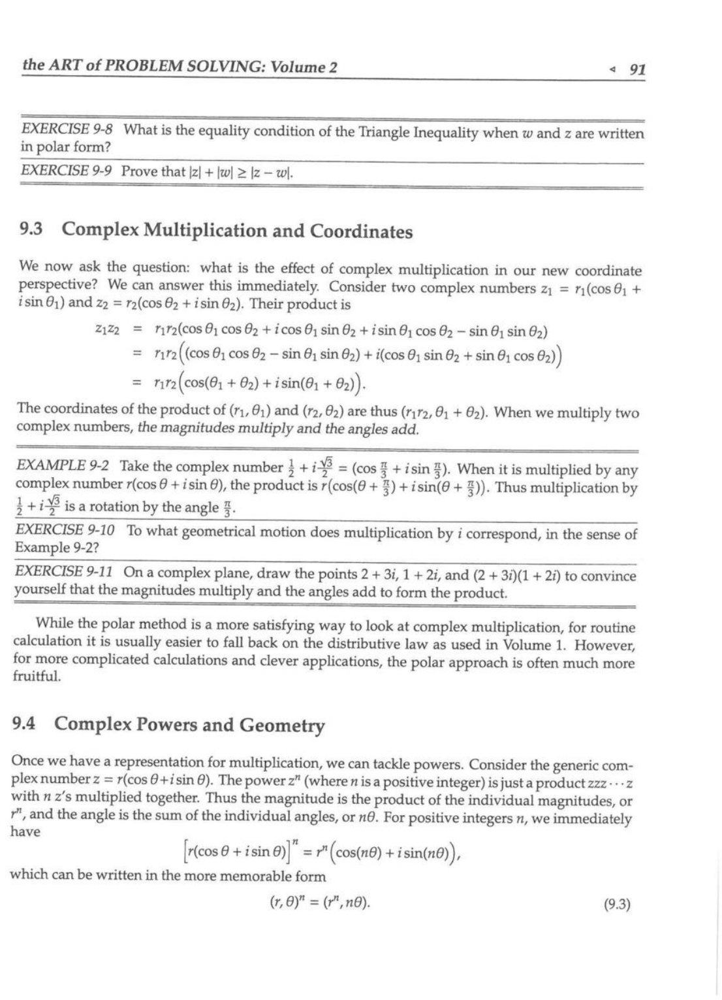

## Printed page 92

<!-- source: volume-2, PDF page 114, printed page 92 -->

**EXERCISE 9-12 How could we express the powers of $i$ in polar form?**

**EXAMPLE 9-3 To see what exponentiation looks like, let’s consider the powers of $\sqrt{2} + i \sqrt{2} = 2(\cos \frac{\pi}{4} + i \sin \frac{\pi}{4})$. The second power is $4(\cos \frac{\pi}{2} + i \sin \frac{\pi}{2}) = 4i$, the third power $8(\cos \frac{3\pi}{4} + i \sin \frac{3\pi}{4}) = -4\sqrt{2} + 4\sqrt{2} i$, the fourth power $16(\cos \pi + i \sin \pi) = -16$, etc. The first three powers are at points $A, B$, and $C$ at right, where one tick mark equals 2 units. To go from one power to the next, we rotate $45^\circ$ counterclockwise and double the distance from the origin.**

**EXAMPLE 9-4 We can easily extend the result of equation (9.3) to negative integers as well. Take $(r, \theta)^{-n}$, where $n$ is a positive integer. We can set $(r, \theta)^{-n} = (s, \phi)$ and write $1 = (r, \theta)^{-n}(r, \theta)^n = (s, \phi)(r^n, n\theta)$, where the last equality comes from equation (9.3). Using the fact that magnitudes multiply and angles add, we then have $(sr^n, \phi + n\theta) = (1, 0)$, so $s = r^{-n}$ and $\phi = -n\theta$. Thus $(r, \theta)^{-n} = (r^{-n}, -n\theta)$, as desired.**

**EXERCISE 9-13 What is the geometrical relationship of $z = (1, \theta)$ and its reciprocal for any angle $\theta$?**

**EXAMPLE 9-5 Let’s extend Example 9-3 to some negative powers of $\sqrt{2} + i \sqrt{2} = 2(\cos \frac{\pi}{4} + i \sin \frac{\pi}{4})$. The $-1$st power is $\frac{1}{2}(\cos(-\frac{\pi}{4}) + i \sin(-\frac{\pi}{4}))$, the $-2$nd power $\frac{1}{4}(\cos(-\frac{\pi}{2}) + i \sin(-\frac{\pi}{2}))$, the $-3$rd power $\frac{1}{8}(\cos(-\frac{3\pi}{4}) + i \sin(-\frac{3\pi}{4}))$, etc. The $0$th power is $1(\cos 0 + i \sin 0) = 1$, as we expect. The first three negative powers are at $A, B$, and $C$, where we get from each one to the next by rotating by $45^\circ$ clockwise and halving the distance to the origin.**

**EXERCISE 9-14 Duplicate Example 9-3 and Example 9-5 for the numbers $\frac{\sqrt{2}}{2} + \frac{\sqrt{2}}{2} i$ and $\frac{1}{2} + \frac{1}{2} i$.**

### 9.5 DeMoivre’s Theorem

In equation (9.3) we found a very nice property of integral powers of a complex number. However, we can just as easily look at fractional powers. Consider a complex number which we have written in the polar form $(r, \theta)$. How can we find $(r, \theta)^{p/q}$, where $p$ and $q$ are integers?

To begin with, we get rid of the $p$. By equation (9.3), we immediately have

$$(r, \theta)^{p/q} = (r^p, p\theta)^{1/q}.$$

Thus our problem boils down to finding the $q$th roots of $(r^p, p\theta)$. This isn’t so hard. We can by guesswork write down one $q$th root: $(r^{p/q}, p\theta/q)$. This is a $q$th root because its $q$th power is

$$(r^{p/q}, p\theta/q)^{q} = ((r^{p/q})^q, q(p\theta/q)) = (r^p, p\theta),$$

Original scan — PDF page 114

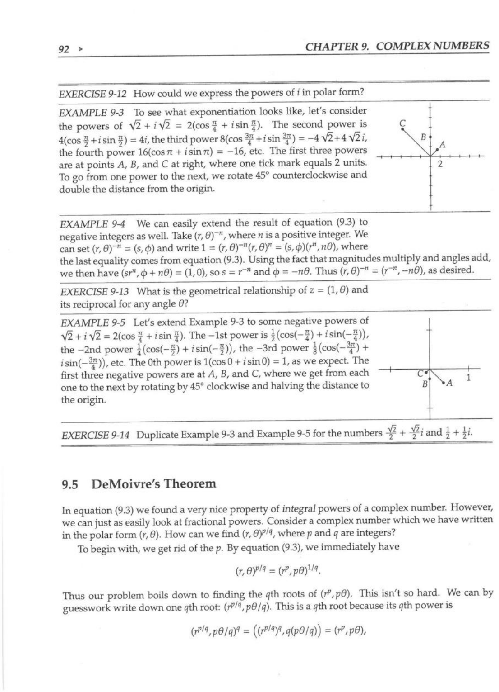

## Printed page 93

<!-- source: volume-2, PDF page 115, printed page 93 -->

using equation (9.3). So we have one $q$th root immediately. How do we find others? Remember that the complex number $(r^p, p\theta)$ is equal to $(r^p, p\theta + 2\pi k)$ for any integer $k$; adding a full circle to the angle doesn't change our location. From these equivalent numbers we can easily write down the $q$th roots

$$\left( r^{p/q}, \frac{p\theta}{q} + \frac{2\pi k}{q} \right).$$

(9.4)

In fact, the numbers generated by equation (9.4), as $k$ ranges over the integers, are all the $p/q$ powers of $(r, \theta)$. This assertion, the simple proof of which is below, is called DeMoivre's Theorem (de MAUVE's theorem).

**EXAMPLE 9-6 Find all cube roots of $4 + 4\sqrt{3}i$.**

Solution: We can readily convert this number into the trigonometric form $8(\cos 60^\circ + i \sin 60^\circ)$, which gives the polar form $(8, 60^\circ)$. Then by DeMoivre, the cube roots ($1/3$ powers) are given by $(8^{1/3}, 20^\circ + 360^\circ k/3) = (2, 20^\circ + 120^\circ k)$. For $k = 0$, we have $(2, 20^\circ)$. For $k = 1$, we have $(2, 20^\circ + 120^\circ) = (2, 140^\circ)$. For $k = 2$, we have $(2, 260^\circ)$. For $k = 3$, we have $(2, 380^\circ)$, which is equal to $(2, 20^\circ)$ again. Similarly, as $k$ takes on other integral values, we will just get our three basic values over and over again. Thus our roots are $(2, 20^\circ), (2, 140^\circ),$ and $(2, 260^\circ)$.

**EXERCISE 9-15 Find all values of $(-4\sqrt{2} + 4\sqrt{2} i)^{3/4}$.**

Let's now prove DeMoivre's Theorem. Clearly every number of the form (9.4) with $k$ an integer is a $p/q$ power of $(r, \theta)$. We verify this by taking the expression to the $q$th power and observing that the result is a $p$th power of $(r, \theta)$ in agreement with equation (9.3). Since the expression (9.4) is a $q$th root of a $p$th power of $(r, \theta)$, it is a $p/q$ power.

We now need only to prove that every $p/q$ power of $(r, \theta)$ can be written in the form (9.4). Consider some general complex number $(s, \phi)$ such that $(r, \theta)^{p/q} = (s, \phi)$. We can write $(r,\theta)^p=(s,\phi)^q$, so (9.3) gives $(r^p, p\theta) = (s^q, q\phi)$. The only way these two sets of polar coordinates can be equal is if

$$r^p = s^q \quad \text{and} \quad p\theta + 2\pi k = q\phi,$$

which clearly forces $(s, \phi)$ to be of the form (9.4), so we're done.

**EXAMPLE 9-7 In Example 9-6 above, we found that there are three cube roots of $4 + 4\sqrt{3}i$. This is no accident. In fact, DeMoivre guarantees that there will be exactly $q$ $q$th roots of any nonzero complex number. Why? Because the allowed angles of $(r,\theta)^{1/q}$ are**

$$\frac{\theta}{q} + \frac{2\pi k}{q} = \frac{\theta}{q}, \frac{\theta}{q} + \frac{2\pi}{q}, \frac{\theta}{q} + \frac{4\pi}{q}, \ldots$$

All of these values will be different until we get to $k = q$, when we will have $\theta/q + 2\pi q/q = \theta/q + 2\pi$. This is the same as just $\theta/q$, so we are back where we started: adding $2\pi/q$ just gives $\theta/q + 2\pi/q$ again, and so on. Similarly, negative values of $k$ give the same roots as well.

Original scan — PDF page 115

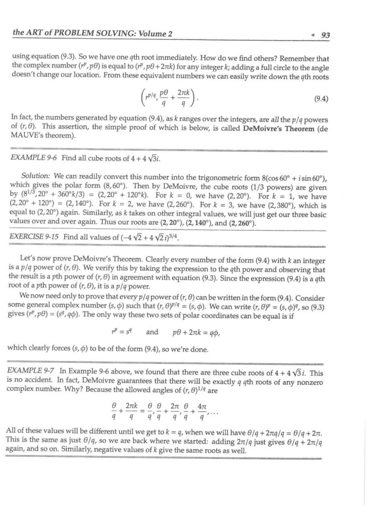

## Printed page 94

<!-- source: volume-2, PDF page 116, printed page 94 -->

### 9.6 Exponential Form

We have in De Moivre’s Theorem a very powerful tool for examining the powers of a complex number. We can make this tool still sharper, however. Consider the powers of the complex number $\cos \theta + i \sin \theta$. De Moivre’s Theorem tells us that

$$\left( \cos \theta + i \sin \theta \right)^n = \cos(n \theta) + i \sin(n \theta).$$

This is a very special property of the function $f(\theta) = \cos \theta + i \sin \theta$, namely that

$$[f(\theta)]^n = f(n \theta).$$

Which known functions behave like this? Only the exponentials, as in $(a^x)^n = a^{nx}$. This possible connection was closed by Euler, who showed that the usual exponential $e^x$, $x$ real, could be extended to the imaginaries by taking, for any real number $y$,

$$e^{iy} = \cos y + i \sin y. \tag{9.5}$$

We should emphasize that this is neither pure coincidence nor arbitrary choosing. In fact, students familiar with calculus should be able to prove the necessity of this extension using Taylor series.

**EXAMPLE 9-8 Evaluate the complex number $e^{3/2 + i\pi/4}$.**

Solution: We split the given expression into the product $e^{3/2}e^{i\pi/4}$. The first part cannot be simplified, but the second part becomes $\frac{\sqrt{2}}{2} + \frac{\sqrt{2}}{2} i$ using (9.5). Thus our number is $e^{3/2}\left(\frac{\sqrt{2}}{2} + \frac{\sqrt{2}}{2} i\right).$

The relation (9.5) is very useful for the understanding of complex numbers. We define the exponential form of a complex number to be $re^{i\theta}$, where $r$ and $\theta$ are the same as for polar form. In fact, the exponential form turns out to be just a more powerful way to express polar form. For one thing, De Moivre’s Theorem is obvious in exponential form, saying that

$$\left( re^{i\theta} \right)^n = r^n e^{ni\theta}.$$

Just by writing exponential form, we get De Moivre’s Theorem for free! However, always remember that if the exponent is not an integer, we must write

$$\left( re^{i(\theta + 2\pi k)} \right)^8 = r^8 e^{gi\theta + 2\pi ikg}$$

where all the $g$th powers are achieved by ranging $k$ over the integers.

To write the exponential form of an arbitrary complex number we just find $r$ and $\theta$ as for polar form.

Original scan — PDF page 116

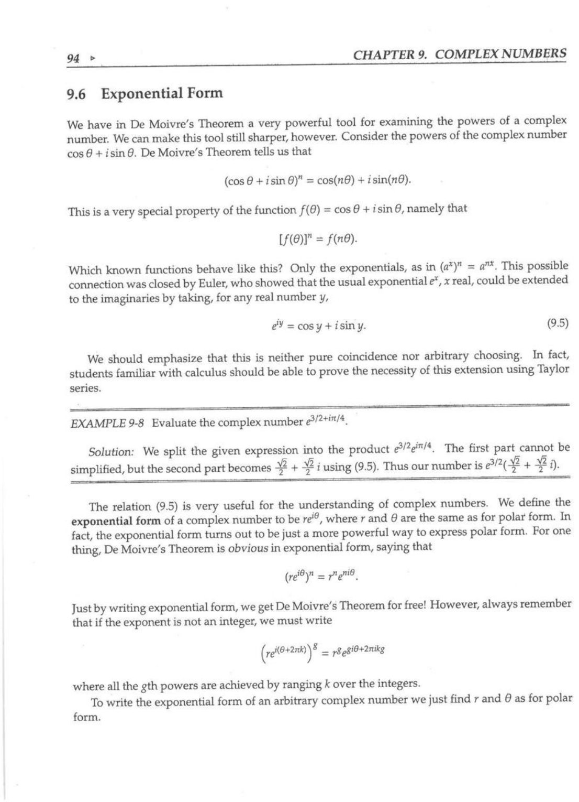

## Printed page 95

<!-- source: volume-2, PDF page 117, printed page 95 -->

**EXAMPLE 9-9 Find $i^i$.**

Solution: It's easy with exponential form. We just write $i = e^{i(\pi/2 + 2\pi k)}$, so $i^i = (e^{i(\pi/2 + 2\pi k)})^i = e^{-(\pi/2 + 2\pi k)}$. There are thus infinitely many such powers (!), all of which are real:

$$\ldots, e^{-\frac{5\pi}{2}}, e^{-\frac{\pi}{2}}, e^{\frac{3\pi}{2}}, e^{\frac{7\pi}{2}}, \ldots$$

This should not be too disturbing, given that even fractional powers give many answers. The reason this is so weird is that we are using the notion of "powers" very abstractly; we can no longer expect intuitive results.

We can use this method to take complex powers of any complex number which we can put into exponential form.

Note that in Example 9-9, we used De Moivre's Theorem for the complex power $i$, though the theorem was proven only for real powers. Fortunately, the theorem still holds for complex powers. (Can you prove it?)

**EXAMPLE 9-10 Equation (9.5) tells us that $e^{ix} = \cos x + i \sin x$; substituting $-x$ for $x$, we similarly get $e^{-ix} = \cos(-x) + i \sin(-x) = \cos x - i \sin x$. Adding these two equations and dividing by 2, we get**

$$\cos x = \frac{e^{ix} + e^{-ix}}{2},$$

while subtracting them and dividing by $2i$ yields

$$\sin x = \frac{e^{ix} - e^{-ix}}{2i}.$$

This is not some kind of trick; these expressions are perfectly valid ways to express sine and cosine, and are useful in many ways.

**EXERCISE 9-16 Use the expressions of Example 9-10 to prove that $\sin^2 x + \cos^2 x = 1$ and $\sin 2x = 2 \sin x \cos x$.**

**EXAMPLE 9-11 Using the expressions of the previous example as a basis, we can define two new functions, the hyperbolic sine and cosine $\sinh x$ and $\cosh x$. The functions are defined as**

$$\sinh x = \frac{e^x - e^{-x}}{2} \quad \text{and} \quad \cosh x = \frac{e^x + e^{-x}}{2}.$$

The similarity to the expressions given for sine and cosine in Example 9-10 is obvious.

The tie between hyperbolic and ordinary sine and cosine is made still clearer by the fact that the hyperbolics satisfy similar identities; for example, $\cosh^2 x - \sinh^2 x = 1.$

**EXERCISE 9-17 Prove the validity of $\cosh^2 x - \sinh^2 x = 1$ and investigate formulas for $\sinh 2x$, $\cosh 2x$, etc.**

Original scan — PDF page 117

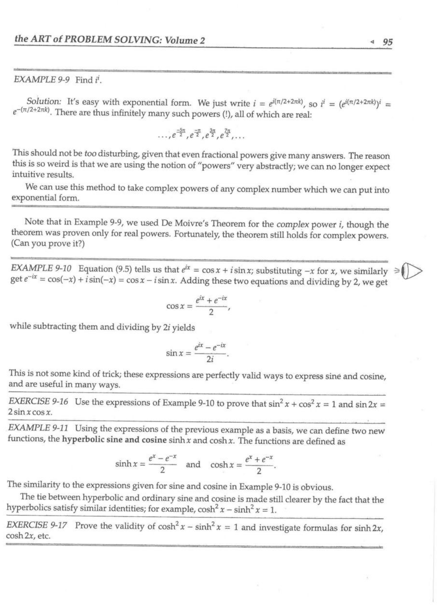

## Printed page 96

<!-- source: volume-2, PDF page 118, printed page 96 -->

The hyperbolic tangent, secant, etc. are defined in the familiar way; for example, $\tanh x = \frac{\sinh x}{\cosh x} = \frac{e^x - e^{-x}}{(e^x + e^{-x})}$.

### 9.7 Two for One

When we are working with rational variables and functions, the equation $f(x) = g(x)$ is just that, one equation. Let's consider the complex variable equation $a + bi = c + di$. The points in the complex plane represented by $a + bi$ and $c + di$ can only be the same if $a = c$ and $b = d$, so $a + bi = c + di$ gives us two equations, not just one. Now let's look at how this can be useful.

**EXAMPLE 9-12 Use DeMoivre's Theorem to get an expression for $\cos 3\theta$ in terms of $\cos \theta$.**

Solution: If we write DeMoivre's Theorem for $(\cos \theta + i \sin \theta)^3$, we have

$$\cos 3\theta + i \sin 3\theta = (\cos \theta + i \sin \theta)^3$$
$$= \cos^3 \theta + 3i \cos^2 \theta \sin \theta - 3 \cos \theta \sin^2 \theta - i \sin^3 \theta.$$

To get $\cos 3\theta$, we equate the real parts of the above equation, yielding

$$\cos 3\theta = \cos^3 \theta - 3 \cos \theta \sin^2 \theta$$
$$= \cos^3 \theta - 3 \cos \theta (1 - \cos^2 \theta)$$
$$= 4 \cos^3 \theta - 3 \cos \theta.$$

**EXERCISE 9-18 Find an expression for $\sin 3\theta$ in terms of $\sin \theta$.**

**EXERCISE 9-19 Show that**

$$\text{Im} \left( \sum_{n=1}^{j} k e^{i n \theta} \right) = \sum_{n=1}^{j} k \sin n \theta.$$

When is this helpful?

Clearly our new technique is very useful for problems involving $\cos n\theta$ and $\sin n\theta$.

### 9.8 The Roots of Unity

DeMoivre's Theorem can easily be used to find the $n$th roots of 1. Since $1 = e^{2\pi ki}$ for integers $k$, the $n$th roots are given by

$$1^{1/n} = e^{2\pi ki/n} = 1, \cos \frac{2\pi}{n} + i \sin \frac{2\pi}{n}, \cos \frac{4\pi}{n} + i \sin \frac{4\pi}{n}, \ldots$$

**EXERCISE 9-20 Write the three 3rd roots and the four 4th roots of 1 in Cartesian form.**

Original scan — PDF page 118

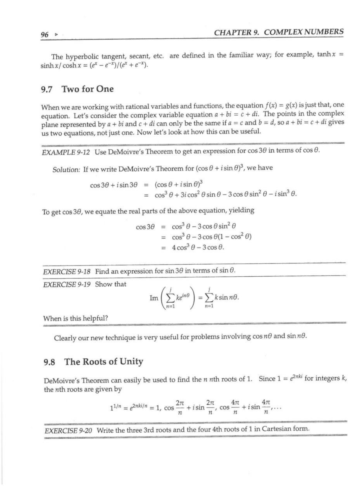

## Printed page 97

<!-- source: volume-2, PDF page 119, printed page 97 -->

These $n$th roots are interesting in a number of ways. First, we consider plotting them all in the complex plane. Since all their amplitudes are 1, all the roots lie on the unit circle. Moreover, their angles are equally spaced from 0 to $2\pi$, so they form a regular polygon! This is shown at right for $n = 7$. (In fact, the roots of any number form a regular polygon, but this fact is generally most often used for roots of unity.)

**EXERCISE 9-21** For what $n$ is $-1$ an $n$th root of 1? For what $n$ does $-1$ lie on the polygon drawn above?

**EXERCISE 9-22** How many 17th roots of 1 are there in the second quadrant?

Another property of the $n$th roots of 1 is that they all satisfy the equation

$$x^n - 1 = 0.$$

Since we know 1 is a root, $(x - 1)$ divides the polynomial on the left, which we can then factor as

$$(x - 1)(x^{n-1} + x^{n-2} + \cdots + 1) = 0.$$

For any root $\omega \neq 1$, we thus have

$$\omega^{n-1} + \omega^{n-2} + \cdots + 1 = 0,$$

a relation which is useful for many problems.

**EXAMPLE 9-13** If $\omega$ is one of the imaginary roots of the equation $x^3 = 1$, then find the product $(1 - \omega + \omega^2)(1 + \omega - \omega^2)$. (AHSME 1971)

**Solution:** Writing the given equation as $x^3 - 1 = 0$, we factor and find $(x - 1)(x^2 + x + 1) = 0.$ Since $\omega$ is imaginary, it is a root of $x^2 + x + 1$, so $\omega^2 + \omega + 1 = 0$. Hence we have $1 + \omega = -\omega^2$ and $1 + \omega^2 = -\omega$ and

$$(1 - \omega + \omega^2)(1 + \omega - \omega^2) = (-\omega - \omega)(-\omega^2 - \omega^2) = 4\omega^3 = 4,$$

since $\omega^3 = 1$.

**Problems to Solve for Chapter 9**

141. Find $\left| \frac{7-24i}{4+3i} \right|$. (MAΘ 1991)

142. Find $(1 + i)^4(2 - 2i)^3$. (MAΘ 1987)

143. Find the product of the $n$th roots of 1 in terms of $n$.

144. If $f(z) = \frac{z+1}{z-1}$, then find $f^{1991}(2 + i)$. (MAΘ 1991)

145. For how many positive real values of $K$ will $(2 + Ki)^3$ be a real number? (MAΘ 1992)

146. Show the line through the complex points $w$ and $z$ plotted in the complex plane has slope $\Im(z - w) / \Re(z - w).$

Original scan — PDF page 119

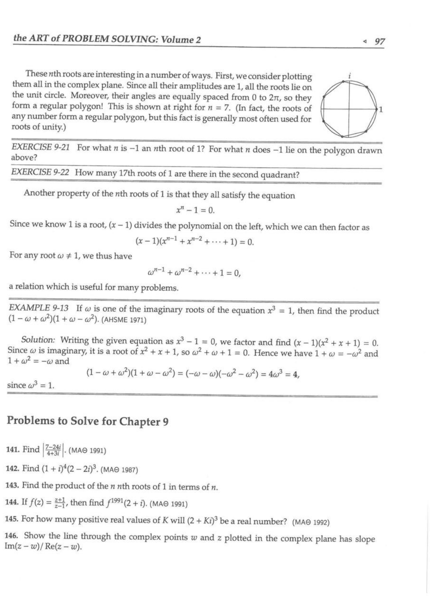

## Printed page 98

<!-- source: volume-2, PDF page 120, printed page 98 -->

147. The diagram at right shows several numbers in the complex plane. The circle is the unit circle centered at the origin. Which of the shown points could possibly be the reciprocal of $F$? (AHSME 1983)

148. If the six solutions of $x^6 = -64$ are written in the form $a + bi$, where $a$ and $b$ are real, then find the product of those solutions with $a > 0$. (AHSME 1990)

149. What is the graph of $|z| = \Im z + 1$? (MAΘ 1991)

150. Write $\cos 5\theta$ as a function of $\cos \theta$. (MAΘ 1990)

151. Find $\Im((\cos 12^\circ + i \sin 12^\circ + \cos 48^\circ + i \sin 48^\circ)^6)$.

152. If $\theta$ is a constant such that $0 < \theta < \pi$ and $x + \frac{1}{x} = 2 \cos \theta$, then for each positive integer $n$, find $x^n + \frac{1}{x^n}$ in terms of $n$ and $\theta$. (AHSME 1981)

153. Evaluate

$$\sum_{n=0}^{\infty} \frac{\cos(n\theta)}{2^n},$$

where $\cos \theta = 1/5$. (MAΘ 1991)

154. Suppose that the coefficients of the equation $x^n + a_{n-1}x^{n-1} + \cdots + a_1x + a_0 = 0$ are real and satisfy $0 < a_0 \leq a_1 \leq \cdots \leq a_{n-1} \leq 1$. Let $z$ be a complex root of the equation with $|z| \geq 1$. Show that $z^{n+1} = 1$. (This problem originally appeared on a contest used to determine the Chinese national team.) (MOP)

Original scan — PDF page 120

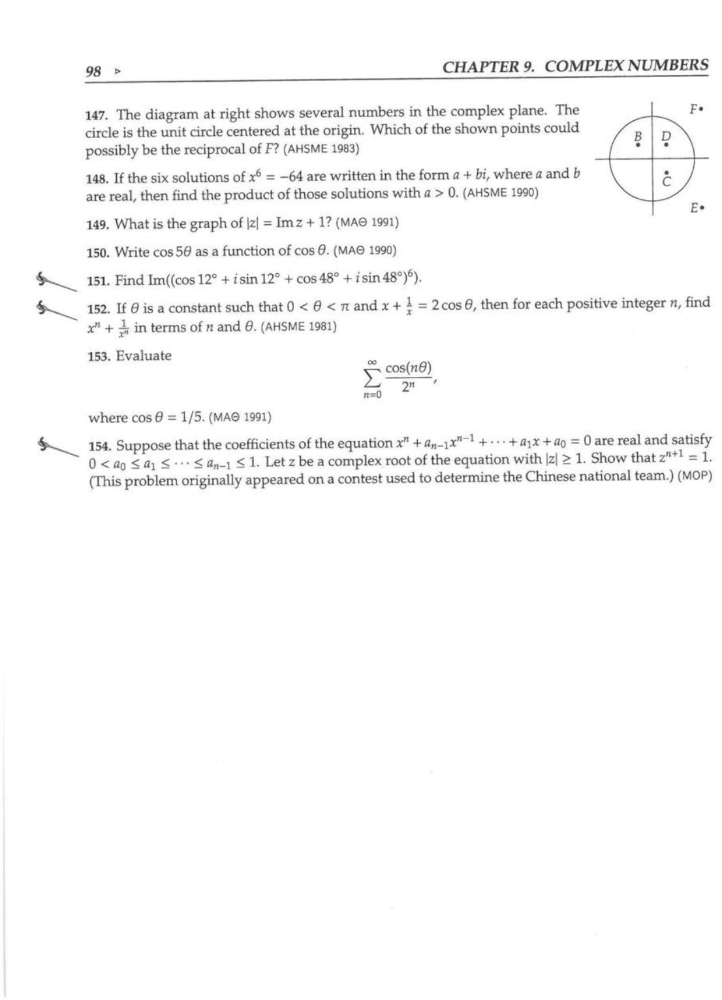

## Printed page 99

<!-- source: volume-2, PDF page 121, printed page 99 -->

Carl Friedrich Gauss was, among his many other achievements, one of the primary popularizers of complex numbers. One of the discoveries of which Gauss himself was proudest was the constructibility of the regular 17-gon.

The ancient Greeks were able to construct the equilateral triangle, and the regular pentagon, but no other regular polygons with a prime number of sides, but Gauss was at last able to extend this repertory. Given a segment of length 1, Gauss knew that any integer-length segment could be constructed. Moreover, the sum, difference and quotient of two segments can be constructed, and the square root of a segment can be constructed. Thus any segment whose length is an expression made up of sums, differences, quotients, and square roots of integers can be constructed.

As a simple example of such an expression, Gauss used the 17 seventeenth roots of unity to show that

$$\cos 360^\circ/17 = -\frac{1}{16} + \frac{1}{16}\sqrt{17} + \frac{1}{16}\sqrt{34 - 2\sqrt{17}} + \frac{1}{8}\sqrt{17 + 3\sqrt{17} - \sqrt{34 - 2\sqrt{17}} - 2\sqrt{34 + 2\sqrt{17}}}.$$

Once he could construct a segment of length $\cos 360^\circ/17$, Gauss could construct the point $(\cos 360^\circ/17, \sin 360^\circ/17)$, by laying off $\cos 360^\circ/17$ along the $x$ axis and drawing a perpendicular to the $x$ axis at that point. The intersection, $P$, of this line and the unit circle has polar angle $360^\circ/17$; copying the angle between the positive $x$ axis and $OP$ ($O$ is the origin) seventeen times around the unit circle provides the seventeen vertices of a 17-gon.

Gauss’s construction of the 17-gon is one of the most compelling examples of the geometry of complex numbers, and Gauss asked that his tombstone be made in the shape of this wonderful, constructible polygon.

Original scan — PDF page 121

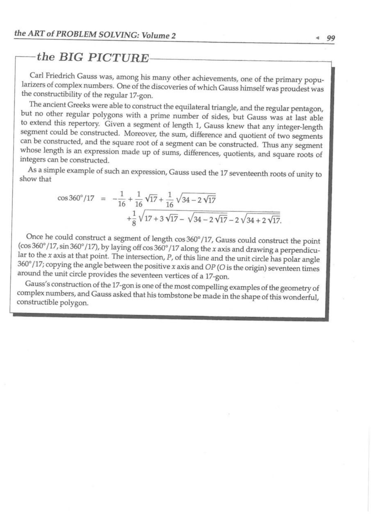

