# Chapter 10: Vectors and Matrices

Volume 2 · Printed pages 100–111 · PDF pages 122–133

[Volume contents](../index.md)

## Printed page 100

<!-- source: volume-2, PDF page 122, printed page 100 -->

Vectors and Matrices

### 10.1 What is a Vector?

A vector is simply an arrow from one point to another. For example, at right we have drawn some vectors in two dimensions (2D). Vectors can also be in three or, abstractly, even more dimensions. A vector is typically given a variable-type name, like $v$, and is denoted by $\vec{v}$. Also, the base point of a vector is called the tail and the end of the arrow the head.

The length of the vector $\vec{v}$ (distance from tail to head) is denoted by $||\vec{v}||$. A vector is typically regarded as depending only on its length and direction; the location of the starting point of the arrow is immaterial. Since the starting point doesn’t matter, we can “add” two vectors by moving the tail of one vector to the head of the other, as at left, where the boldface vector is the sum of the other two.

We can easily verify that vector addition defined in this way is commutative, so that $\vec{v} + \vec{w} = \vec{w} + \vec{v}$. Just draw the two additions and note that the two copies each of $\vec{v}$ and $\vec{w}$ are parallel, as at right.

Using our definition of vector addition we can quickly expand to multiplication by a positive real number: the vector $c\vec{v}$ for $c$ a positive real is the vector in the same direction as $\vec{v}$ but with length $c||\vec{v}||$. (Convince yourself that this makes sense.) The vector $\vec{0}$ is defined to be the vector with length zero.

Similarly, the vector $-\vec{v}$ is just a vector with the same length as $\vec{v}$, but in the opposite direction. This way we get $\vec{v} + (-\vec{v}) = \vec{0}$, as we would normally expect. We can then define $\vec{w} - \vec{v} = \vec{w} + (-\vec{v})$, and we see from the diagram that $\vec{w} - \vec{v}$ is the vector that runs from the head of $\vec{v}$ to the head of $\vec{w}$. This should not be a surprise since $\vec{v} + (\vec{w} - \vec{v}) = \vec{w} + (\vec{v} - \vec{v}) = \vec{w}$.

Original scan — PDF page 122

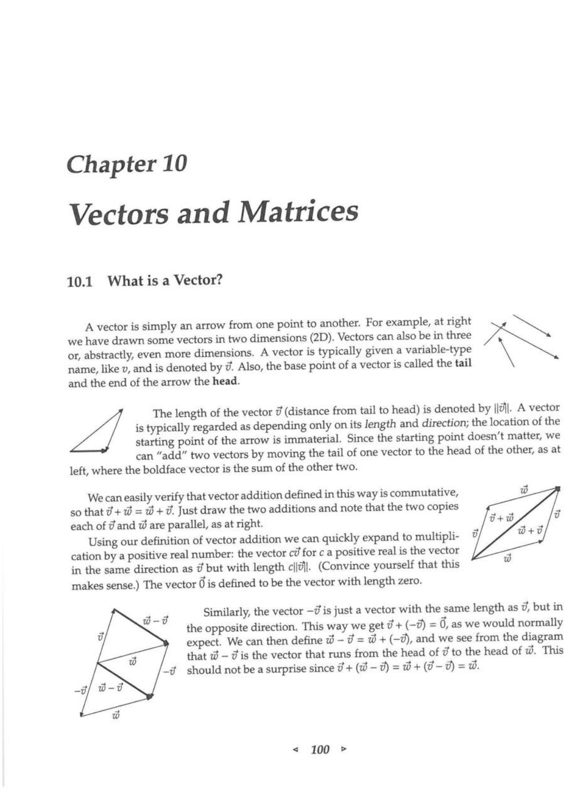

## Printed page 101

<!-- source: volume-2, PDF page 123, printed page 101 -->

### 10.2 The Dot Product

<!-- Heading restored for navigation from independently recognised source heading. -->

The length of the vector $\vec{w} - \vec{v}$ can be found using the law of cosines. Since $\vec{v}, \vec{w}$, and $\vec{w} - \vec{v}$ form a triangle whose sides have lengths $\|\vec{v}\|, \|\vec{w}\|$, and $\|\vec{w} - \vec{v}\|$, we have

$$\|\vec{w} - \vec{v}\|^2 = \|\vec{v}\|^2 + \|\vec{w}\|^2 - 2\|\vec{v}\|\|\vec{w}\| \cos \theta,$$

(10.1)

where $\theta$ is the angle between $\vec{v}$ and $\vec{w}$.

The expression $\|\vec{v}\|\|\vec{w}\| \cos \theta$ is called the dot product of $\vec{v}$ and $\vec{w}$; it is denoted by $\vec{v} \cdot \vec{w}$. We can then write (10.1) as

$$\|\vec{w} - \vec{v}\|^2 = \|\vec{v}\|^2 + \|\vec{w}\|^2 - 2\vec{v} \cdot \vec{w},$$

so that the dot product is given explicitly as

$$\vec{v} \cdot \vec{w} = \frac{\|\vec{v}\|^2 + \|\vec{w}\|^2 - \|\vec{w} - \vec{v}\|^2}{2}.$$

(10.2)

We can establish certain nice properties of the dot product.

1. $\vec{v} \cdot \vec{w} = \vec{w} \cdot \vec{v}$. (The dot product is commutative.)

2. $\vec{v} \cdot \vec{w} = 0$ for nonzero $\vec{v}$ and $\vec{w}$ if and only if $\vec{v}$ and $\vec{w}$ are perpendicular.

3. $(c\vec{v}) \cdot \vec{w} = c(\vec{v} \cdot \vec{w})$ for any real number $c$.

4. $\vec{u} \cdot (\vec{v} + \vec{w}) = \vec{u} \cdot \vec{v} + \vec{u} \cdot \vec{w}$. (The dot product is distributive.)

**EXAMPLE 10-1** Prove property 1 above.

Proof: Let $\theta_{\vec{w} \rightarrow \vec{v}}$ be the angle from $\vec{w}$ to $\vec{v}$, so that $\theta_{\vec{w} \rightarrow \vec{v}} = -\theta_{\vec{v} \rightarrow \vec{w}}$. Now we just write

$$\vec{w} \cdot \vec{v} = \|\vec{w}\| \|\vec{v}\| \cos \theta_{\vec{w} \rightarrow \vec{v}} = \|\vec{v}\| \|\vec{w}\| \cos(-\theta_{\vec{v} \rightarrow \vec{w}}) = \|\vec{v}\| \|\vec{w}\| \cos(\theta_{\vec{v} \rightarrow \vec{w}}) = \vec{v} \cdot \vec{w},$$

where we have used the fact that $\cos(-\theta) = \cos \theta$.

**EXERCISE 10-1** Prove properties 2 and 3 above.

Property 4 is proved using coordinates in the next section (see Example 10-2).

Properties 3 and 4 mean that the dot product is linear.

The use of vectors as abstract “arrows” is most useful in vector geometry, which we do not treat until Chapter 12. In the next section we will begin to examine vectors in a particular coordinate system, which is more pertinent to elementary problems.

Original scan — PDF page 123

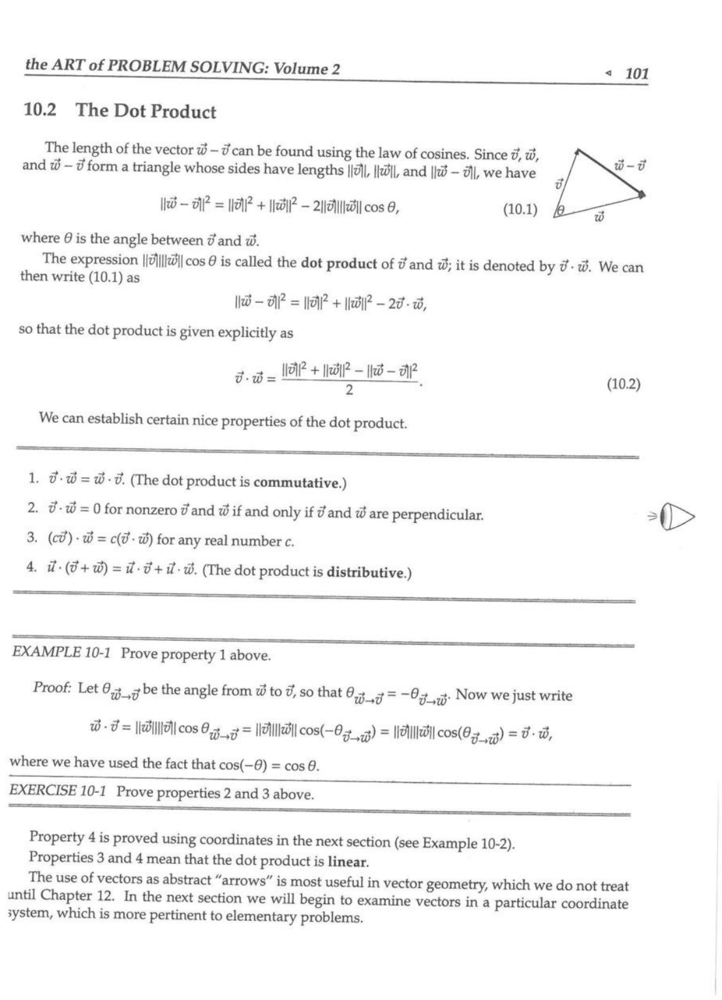

## Printed page 102

<!-- source: volume-2, PDF page 124, printed page 102 -->

### 10.3 Coordinate Representation of Vectors

The standard way to represent vectors in a coordinate system is to define an origin and place the tails of our vectors there. We can then use regular rectangular coordinates with the given origin at the center, as at right. We associate a vector with the coordinates of its head; if the head coordinates are $(x, y)$, the vector is represented as $(x, y)$ or $\binom{x}{y}$. The former representation is called a row vector and the latter a column vector. We'll generally use row vectors because they take up less space.

The power of the coordinate representation comes from the fact that we can use regular coordinate techniques. For example, the vector sum $(x_1 y_1) + (x_2 y_2)$ is just

$$\left((x_1 + x_2) (y_1 + y_2)\right).$$

**EXERCISE 10-2 What is the length of the vector $(2, 3)$?**

In the rectangular coordinate form, the dot product has a nice form. Consider two vectors $\vec{v}_1 = (x_1 y_1)$ and $\vec{v}_2 = (x_2 y_2)$ which form angles $\theta_1$ and $\theta_2$ with the positive $x$ axis. Their dot product is found using polar coordinates:

$$\vec{v}_1 \cdot \vec{v}_2 = \|\vec{v}_1\| \|\vec{v}_2\| \cos(\theta_1 - \theta_2)$$
$$= \|\vec{v}_1\| \|\vec{v}_2\| (\cos \theta_1 \cos \theta_2 + \sin \theta_1 \sin \theta_2)$$
$$= (\|\vec{v}_1\| \cos \theta_1) (\|\vec{v}_2\| \cos \theta_2) + (\|\vec{v}_1\| \sin \theta_1) (\|\vec{v}_2\| \sin \theta_2)$$
$$= x_1 x_2 + y_1 y_2.$$

**EXAMPLE 10-2 Prove that the dot product is distributive.**

Proof: Let $\vec{u} = (x_0 y_0), \vec{v} = (x_1 y_1)$, and $\vec{w} = (x_2 y_2)$. We have

$$\vec{u} \cdot (\vec{v} + \vec{w}) = x_0 (x_1 + x_2) + y_0 (y_1 + y_2) = (x_0 x_1 + y_0 y_1) + (x_0 x_2 + y_0 y_2) = (\vec{u} \cdot \vec{v}) + (\vec{u} \cdot \vec{w})$$

as desired.

We can easily extend the coordinate representation into three (or more) dimensions. The dot product in three dimensions (3D) is

$$x_1 x_2 + y_1 y_2 + z_1 z_2$$

and a similar expression holds in higher dimensions, even though we run out of letters.

**EXERCISE 10-3 Show that $(1, 17, -3, 2)$ is perpendicular to $(-6, 1, 5, 2)$.**

Original scan — PDF page 124

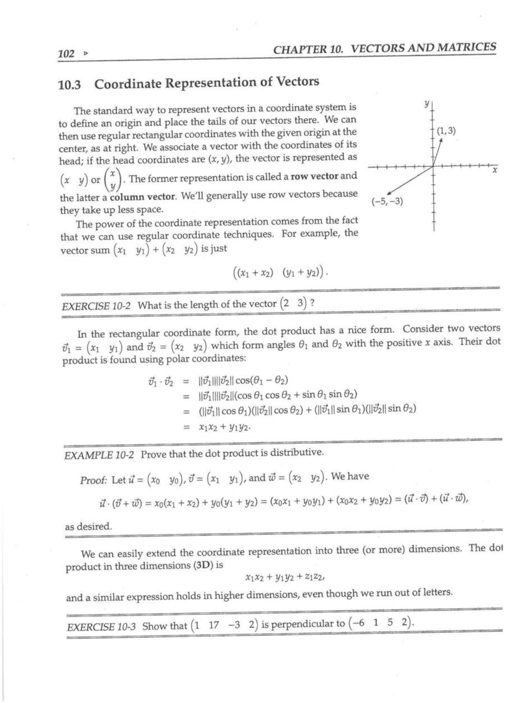

## Printed page 103

<!-- source: volume-2, PDF page 125, printed page 103 -->

The notion of vector addition gives us a swift, nice proof of the Triangle Inequality for complex numbers (page 90). If we view $\vec{v}$ and $\vec{w}$ as complex numbers $v$ and $w$, so that $\vec{v} = \begin{pmatrix} v_1 & v_2 \end{pmatrix} \equiv v_1 + v_2 i$ and $||\vec{v}|| = |v|$, the graph at right represents the addition $v + w$ in the complex plane. Since the vectors $\vec{v}, \vec{w}$, and $\vec{v} + \vec{w}$ form either a triangle or a straight line (when $\vec{v}$ and $\vec{w}$ are in the same direction), we have $||\vec{v}|| + ||\vec{w}|| \geq ||\vec{v} + \vec{w}||$ (since $||\vec{v}||, ||\vec{w}||$, and $||\vec{v} + \vec{w}||$ are the sides of a triangle, which may be degenerate). In complex number notation, this becomes $|v| + |w| \geq |v + w|$, and the equality condition of $v = cw$ follows from the observation that $||\vec{v}|| + ||\vec{w}|| = ||\vec{v} + \vec{w}||$ only if $\vec{v}$ and $\vec{w}$ are in the same direction, so $v_1 = cw_1$ and $v_2 = cw_2$.

### 10.4 What is a Matrix?

To understand what a matrix is, we will solve the following standard problem:

Given a point $(x, y)$, what is the new point obtained after rotating $(x, y)$ by an angle $\theta$ in the plane?

We can do this using polar coordinates as we did on page 49. Here, we will rotate the point, not the axes, through an angle of $\theta$ counterclockwise. If the polar coordinates of the point are initially $(r, \alpha)$, then after the rotation the coordinates are $(r, \alpha + \theta)$. Then we can go back to rectangular coordinates. Let’s call the new coordinates $(x', y')$; thus, we find

$$x' = r \cos(\alpha + \theta) = r(\cos \alpha \cos \theta - \sin \alpha \sin \theta)$$

$$y' = r \sin(\alpha + \theta) = r(\sin \alpha \cos \theta + \cos \alpha \sin \theta).$$

Since $r \cos \alpha = x$ and $r \sin \alpha = y$ we can write these in terms of the original coordinates:

$$x' = x \cos \theta - y \sin \theta$$

$$y' = x \sin \theta + y \cos \theta.\tag{10.3}$$

(Notice that these equations are different from those on page 49. This is because here we are rotating the point counterclockwise rather than the axes. We can see that the above equations are the same of those by noting that $\alpha$ on page 49 equals $-\theta$ here.) We have boiled the rotation down to a function from the old coordinates to the new coordinates. The functions for $x'$ and $y'$ are linear in $x$ and $y$, so they are completely specified by four coefficients; we can use this to develop an efficient notation for the transformation.

If we write the old and new points as the vectors $\begin{pmatrix} x \\ y \end{pmatrix}$ and $\begin{pmatrix} x' \\ y' \end{pmatrix}$, then we can encapsulate the information in the transformation equations (10.3) with the form

$$\begin{pmatrix} x' \\ y' \end{pmatrix} = \begin{pmatrix} \cos \theta & -\sin \theta \\ \sin \theta & \cos \theta \end{pmatrix} \begin{pmatrix} x \\ y \end{pmatrix}.\tag{10.4}$$

Compare this closely to (10.3). The object by which we “multiply” the vector $\begin{pmatrix} x \\ y \end{pmatrix}$ is a matrix; each item in it is called an entry. Each entry corresponds to a particular coefficient in equations (10.3), as

Original scan — PDF page 125

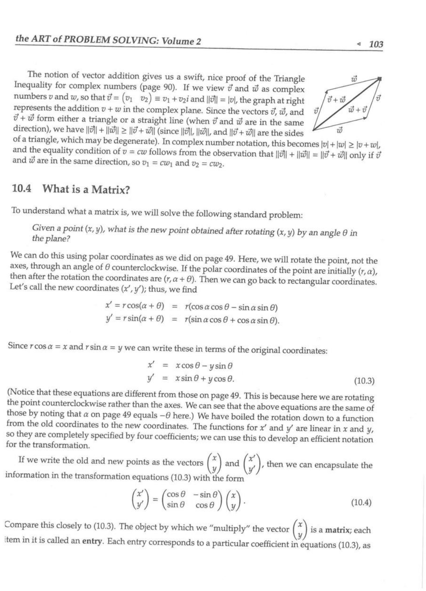

## Printed page 104

<!-- source: volume-2, PDF page 126, printed page 104 -->

a comparison shows. The upper left entry is the coefficient from $x$ to $x'$, the upper right is from $y$ to $x'$, the lower left is from $x$ to $y'$, and the lower right is from $y$ to $y'$.

We have gone from regarding the transformation (10.3) as transforming each coordinate according to an equation, to seeing it as the application of a transformation matrix to a vector. Let us examine the method by which, given only the right side of (10.4), we can get the left. In other words, given only the initial vector and the transformation matrix, how do we compute the transformed vector?

The answer is quite simple. To compute the first element of the new vector, we go across the first row of the matrix, multiplying the elements of the row by the corresponding elements of the vector. The resulting sum is the first element of the new vector. To compute the second element, we do the same with the second row of the matrix.

**EXAMPLE 10-3** Let’s carry out the process described above to multiply the vector $\begin{pmatrix} a \\ b \end{pmatrix}$ by the matrix $\begin{pmatrix} 2 & 3 \\ 4 & 5 \end{pmatrix}$. The first element of the product will be found by going across the top row of the matrix and down the vector to get $(2)(a) + (3)(b)$. The second element is formed with the second row of the matrix, going down the vector as before to get $(4)(a) + (5)(b)$. Thus we have

$$\begin{pmatrix} 2 & 3 \\ 4 & 5 \end{pmatrix} \begin{pmatrix} a \\ b \end{pmatrix} = \begin{pmatrix} 2a + 3b \\ 4a + 5b \end{pmatrix}.$$

**EXERCISE 10-4** Find the product $\begin{pmatrix} 2 & -4 \\ -6 & 8 \end{pmatrix} \begin{pmatrix} 1 \\ -1 \end{pmatrix}.$

**EXERCISE 10-5**

i. What is the effect of the matrix $\begin{pmatrix} 1 & 0 \\ 0 & -1 \end{pmatrix}$ on a general vector? Geometrically, what kind of a transformation is this?

ii. Find the matrix which takes any vector to itself. This is called the identity matrix.

iii. Can you guess what matrix multiplication looks like for 3D vectors?

Matrices are often named with letters, like vectors. Usually these are underlined, so the matrix named $A$ is written $\underline{A}$. It is easy to verify that matrix multiplication of a vector is linear, meaning that $A(\vec{v} + \vec{w}) = A\vec{v} + A\vec{w}$ and $A(c\vec{v}) = cA\vec{v}$.

**EXERCISE 10-6** Verify that matrix multiplication of a vector is linear.

### 10.5 Matrix Multiplication

Once we understand the role of matrices as transformations of vectors, we can ask: what happens when we apply two transformations in a row? Say we have the vector $\begin{pmatrix} 1 \\ 1 \end{pmatrix}$, and we apply first the

Original scan — PDF page 126

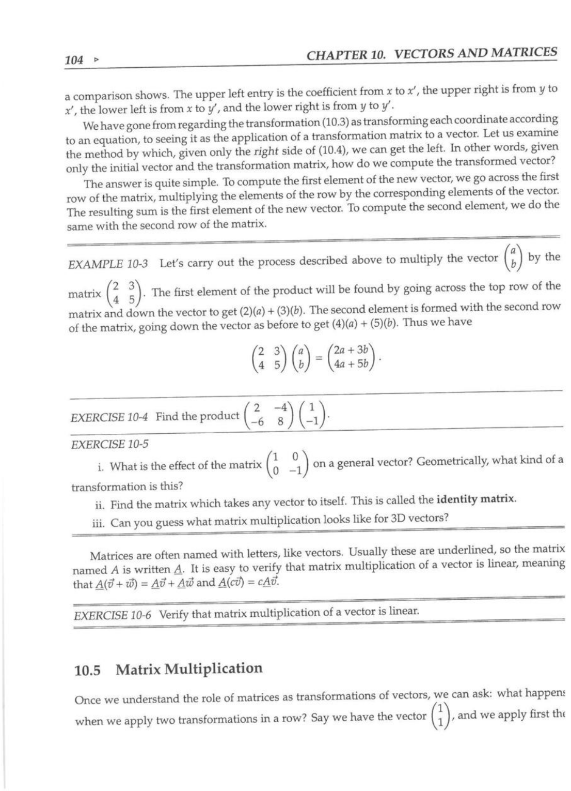

## Printed page 105

<!-- source: volume-2, PDF page 127, printed page 105 -->

matrix $\begin{pmatrix} 3 & -4 \\ 5 & -6 \end{pmatrix}$, then the matrix $\begin{pmatrix} -1 & 2 \\ 3 & -4 \end{pmatrix}$. The result will be
$$\begin{pmatrix} -1 & 2 \\ 3 & -4 \end{pmatrix} \left[ \begin{pmatrix} 3 & -4 \\ 5 & -6 \end{pmatrix} \begin{pmatrix} 1 \\ 1 \end{pmatrix} \right]$$

**EXERCISE 10-7 If you still feel uncomfortable with multiplying a vector by a matrix, evaluate the above product explicitly.**

Applying the matrices one at a time is fine; but suppose we wish to consider the two transformations as one, composite transformation? That is, we want to find a matrix $C$ such that
$$\begin{pmatrix} -1 & 2 \\ 3 & -4 \end{pmatrix} \left[ \begin{pmatrix} 3 & -4 \\ 5 & -6 \end{pmatrix} \begin{pmatrix} 1 \\ 1 \end{pmatrix} \right] = C \begin{pmatrix} 1 \\ 1 \end{pmatrix}$$

We shall define "matrix multiplication" so that the above holds with $C = \begin{pmatrix} -1 & 2 \\ 3 & -4 \end{pmatrix} \begin{pmatrix} 3 & -4 \\ 5 & -6 \end{pmatrix}$, the product of the two matrices.

How shall we define this product matrix $C$? In general we have
$$\begin{pmatrix} a & b \\ c & d \end{pmatrix} \left[ \begin{pmatrix} e & f \\ g & h \end{pmatrix} \begin{pmatrix} x \\ y \end{pmatrix} \right] = \begin{pmatrix} a & b \\ c & d \end{pmatrix} \begin{pmatrix} ex + fy \\ gx + hy \end{pmatrix}$$
$$= \begin{pmatrix} a(ex + fy) + b(gx + hy) \\ c(ex + fy) + d(gx + hy) \end{pmatrix}$$
$$= \begin{pmatrix} (ae + bg)x + (af + bh)y \\ (ce + dg)x + (cf + dh)y \end{pmatrix}$$
$$= \begin{pmatrix} ae + bg & af + bh \\ ce + dg & cf + dh \end{pmatrix}$$

We shall thus define the product $\begin{pmatrix} a & b \\ c & d \end{pmatrix} \begin{pmatrix} e & f \\ g & h \end{pmatrix}$ to be the matrix $\begin{pmatrix} ae + bg & af + bh \\ ce + dg & cf + dh \end{pmatrix}$; then everything will work nicely.

If this seems like a rigged game, it is! We have chosen matrix multiplication so that it means something we want. Observe that the way to do matrix multiplication is the same as when we multiplied a vector by a matrix. In fact, if we consider only the first column of $\begin{pmatrix} e & f \\ g & h \end{pmatrix}$ and the first column of the product, we have matrix multiplication of a vector; the same is true for the second columns.

**EXAMPLE 10-4 Find $\begin{pmatrix} -1 & 2 \\ 3 & -4 \end{pmatrix} \begin{pmatrix} 3 & -4 \\ 5 & -6 \end{pmatrix}$.**

Solution: To get the top left entry in the product, we go across the top row of the first matrix and down the left column of the second, to get $(-1)(3) + (2)(5) = 7$. To get the top right entry, we go across the top row of the first matrix and down the right column of the second, getting

Original scan — PDF page 127

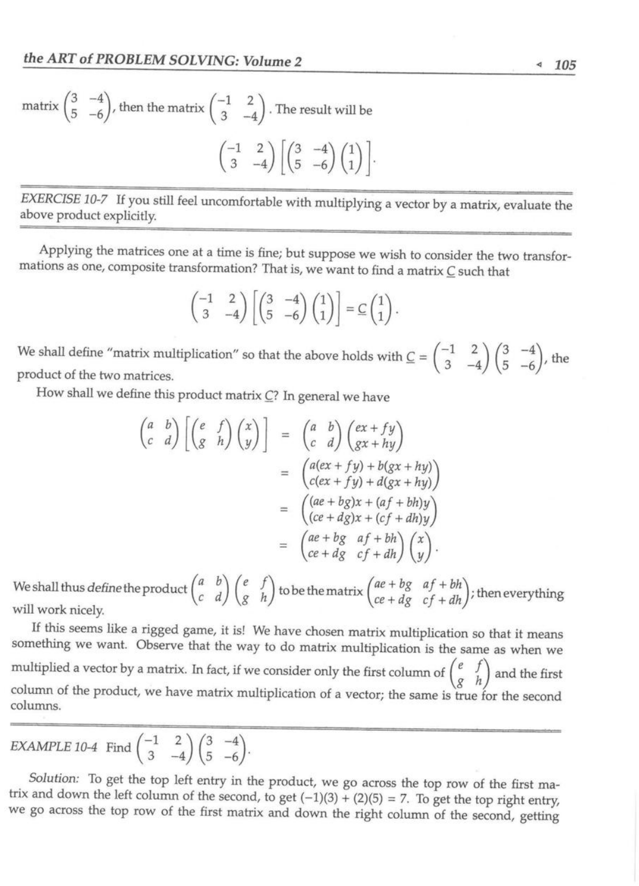

## Printed page 106

<!-- source: volume-2, PDF page 128, printed page 106 -->

$(-1)(-4) + (2)(-6) = -8$. To get the bottom left, we go across the bottom row of the first matrix and down the left column, getting $(3)(3) + (-4)(5) = -11$. To get the bottom right, we use the bottom row of the first matrix and the right column of the second, to get $(3)(-4) + (-4)(-6) = 12$. Thus the product is $\begin{pmatrix} 7 & -8 \\ -11 & 12 \end{pmatrix}$.

**EXERCISE 10-8** Verify that column by column, matrix multiplication of matrices looks just like matrix multiplication of vectors.

**EXAMPLE 10-5** By equation (10.4), a $90^\circ$ counterclockwise rotation is given by $\begin{pmatrix} 0 & -1 \\ 1 & 0 \end{pmatrix}$, and a $180^\circ$ rotation by $\begin{pmatrix} -1 & 0 \\ 0 & -1 \end{pmatrix}$. Doing one and then the other gives the transformation

$$\begin{pmatrix} -1 & 0 \\ 0 & -1 \end{pmatrix} \begin{pmatrix} 0 & -1 \\ 1 & 0 \end{pmatrix}$$

To find the upper left entry in the product, go across the first row of $\begin{pmatrix} -1 & 0 \\ 0 & -1 \end{pmatrix}$ and down the first column of $\begin{pmatrix} 0 & -1 \\ 1 & 0 \end{pmatrix}$ to get $(-1)(0) + (0)(1) = 0$. For the upper right, go across the same row of the first matrix, but down the second column of the second, to get $(-1)(-1) + (0)(0) = 1$. For the bottom entries we do the same thing, but going across the second row of the first matrix. The result is $\begin{pmatrix} 0 & 1 \\ -1 & 0 \end{pmatrix}$.

**EXERCISE 10-9** To what rotation does the product above correspond? Is this what you would expect?

**EXERCISE 10-10** Evaluate $\begin{pmatrix} 2 & -3 \\ -4 & 5 \end{pmatrix}$ $\begin{pmatrix} 1 & 1 \\ 2 & 3 \end{pmatrix}$.

**EXERCISE 10-11** Geometrically, what do you get when you reflect through the $x$ axis and then through the $y$ axis? Show you get the right result in matrices by multiplying the matrix for $x$ reflection, $\begin{pmatrix} -1 & 0 \\ 0 & 1 \end{pmatrix}$, by the matrix for $y$ reflection.

Since matrix multiplication is associative, $A(BC) = (AB)C$. We usually just write $ABC$ and do the multiplication in whichever order we want.

**WARNING:** It seems sensible that matrix multiplication would be commutative, so that $AB = BA$. However, this is NOT true!

**EXERCISE 10-12** Show that matrix multiplication is not commutative by finding a simple counterexample.

Since we can multiply matrices, we can also take them to positive integral powers, just writing $AAAA$ as $A^4$, for example.

Original scan — PDF page 128

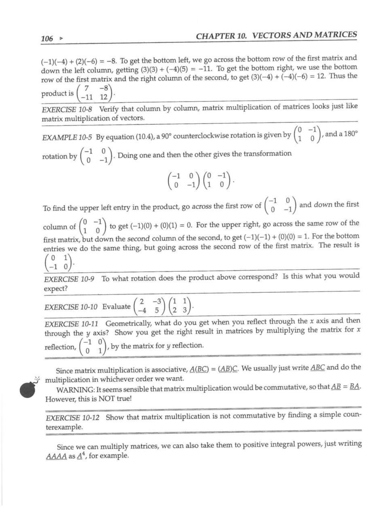

## Printed page 107

<!-- source: volume-2, PDF page 129, printed page 107 -->

**EXERCISE 10-13 Write down a matrix $A$ for a rotation by $60^\circ$. Find $A^6$ without any computation.**

### 10.6 Matrices in Higher Dimensions

A $2 \times 2$ matrix has been used to represent a transformation from one 2D vector to another. If you thought about Exercise 10-5, you may have figured out how to extend this to 3D vectors. In three dimensional space each point has an $x$ and $y$ coordinate as in 2D, but also has a $z$ coordinate to denote its distance above or below the $xy$ plane. The positive $x, y,$ and $z$ axes are situated as shown.

Here a transformation from a vector $(x, y, z)$ to a vector $(x', y', z')$ has the form $x' = ax + by + cz,$ etc. There are nine coefficients to the transformation, that from $x$ to $x'$, from $y$ to $x'$, from $z$ to $x'$, from $x$ to $y'$, etc. (compare this to the discussion of $2 \times 2$ matrix entries on page 104.) We represent the coefficients in exactly the same way as for 2D matrices.

**EXERCISE 10-14 Write down the $3 \times 3$ identity matrix.**

**EXAMPLE 10-6 We can easily write down the $3 \times 3$ matrix for a rotation by angle $\theta$ about the $z$ axis. Clearly, the new $z$ coordinate is the same as the old $z$ coordinate, so the coefficient from $z$ to $z'$ is 1, while the coefficients from $x$ and $y$ to $z'$ are 0 (no contribution). Also, neither $x'$ nor $y'$ is affected by $z,$ so these two coefficients are 0. Finally, the other coefficients come from the standard rotation matrix of equation (10.4). The matrix is thus**

$$
\begin{pmatrix}
\cos \theta & -\sin \theta & 0 \\
\sin \theta & \cos \theta & 0 \\
0 & 0 & 1
\end{pmatrix}.
$$

**EXERCISE 10-15 Find the $3 \times 3$ matrix for each of the following:**

i. Rotation about the $x$ axis.
ii. Squashing all vectors to $\vec{0},$ the origin.
iii. Reflection in the $xy$ plane.

It is pretty simple to show that $3 \times 3$ matrices work the same as $2 \times 2'$ in terms of associativity, noncommutativity, etc.

Since we can imagine vectors of more than 3 dimensions, we can similarly write down matrices which transform those vectors, such as $4 \times 4, 5 \times 5,$ etc. We can even write down matrices which are not square! For example, a $2 \times 3$ matrix (number of rows goes first) takes 3D vectors to 2D ones:

$$
\begin{pmatrix}
1 & 2 & 3 \\
4 & 5 & 6 \\
\end{pmatrix}
\begin{pmatrix}
a \\
b \\
c \\
\end{pmatrix}
= \begin{pmatrix}
a + 2b + 3c \\
4a + 5b + 6c \\
\end{pmatrix}.
$$

All you need to remember is that to find an entry in the product, we go across the corresponding row and down the corresponding column. Study the above example if this is still unclear.

Original scan — PDF page 129

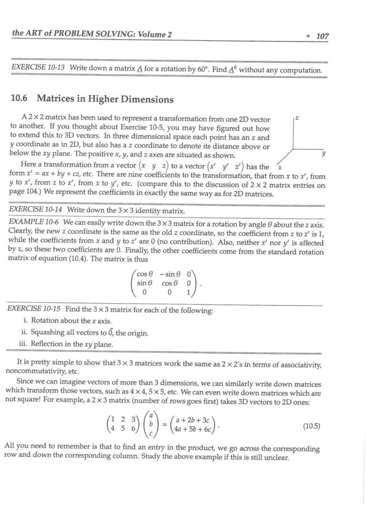

## Printed page 108

<!-- source: volume-2, PDF page 130, printed page 108 -->

**EXERCISE 10-16 Write down and multiply:**

i. Two $3 \times 3$ matrices.
ii. A $2 \times 4$ and a $4 \times 3$ matrix.
iii. A $1 \times 3$ and a $3 \times 1$ matrix. (To what does this correspond?) Compare the dimensions of the products to the dimensions of the original matrices in these three cases. Is there a pattern?

It seems strange, but only under certain circumstances can we multiply a $k \times l$ matrix by an $m \times n$ matrix. To see why, let the first matrix be $A$ and the second $B$.

**EXAMPLE 10-7 Consider the multiplication $A \vec{x}$. Find the dimensions of $\vec{x}$ and $A \vec{x}$, where $A$ is a $k \times l$ matrix.**

Solution: In the multiplication we will be going across rows of $A$ and down $\vec{x}$. Since $A$ has $l$ columns, each of its rows is $l$ entries long. Thus $\vec{x}$ has $l$ entries also, so is dimension $l$.

On the other hand, there will be one entry in the product $A \vec{x}$ for each row of $A$, as each entry in the product is formed by going across one row of $A$. Thus the product will have $k$ entries, so will be dimension $k$.

**EXERCISE 10-17 Compare the preceding discussion to equation (10.5). Do the two agree?**

For vectors $\vec{x}$ we have $(AB) \vec{x} = A(B \vec{x})$, by associativity. Clearly $\vec{x}$ must be an $n$-dimensional vector if $B$, which takes $n$-dimensional vectors to $m$-dimensional ones, can transform it. The product $B \vec{x}$ will be $m$-dimensional. But this product must be $l$-dimensional to be transformed by $A!$. Thus we must have $m = l$.

Furthermore, the dimension of $AB \vec{x}$ will be $k$, since $A$ was used last and its outputs are $k$-dimensional. Thus the product $AB$ takes $n$-dimensional vectors to $k$-dimensional ones, and must be a $k \times n$ matrix. It is this pattern that we were looking for in Exercise 10-16—go back and verify that it is true in those cases if you have not already.

### 10.7 Better Matrix Notation

Up to now we have written a general $2 \times 2$ matrix as $A = \begin{pmatrix} a & b \\ c & d \end{pmatrix}$. A better way to write this is by labelling each entry by its row and column numbers. We would then write

$$A = \begin{pmatrix} a_{11} & a_{12} \\ a_{21} & a_{22} \end{pmatrix}.$$

(10.6)

WARNING: As always with matrices, ROWS GO FIRST—for example, $a_{42}$ is an entry in the fourth row, second column of $A$, not the other way around.

We’ll often use the $a_{ij}$ notation because it is very efficient.

Original scan — PDF page 130

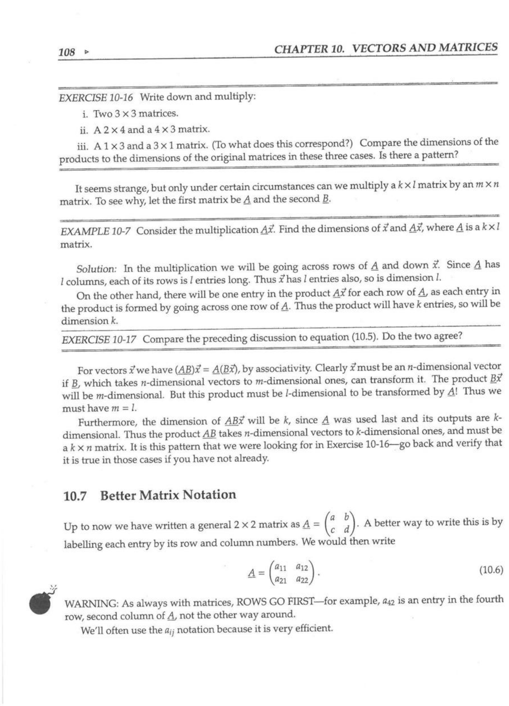

## Printed page 109

<!-- source: volume-2, PDF page 131, printed page 109 -->

**EXAMPLE 10-8 The $3 \times 3$ identity matrix is completely specified in this notation by**

$$a_{ij} = \begin{cases} 1, & i = j \\ 0, & i \neq j \end{cases}$$

Do you see why?

**EXAMPLE 10-9 The product rule takes a nice form in this notation. Given $\underline{AB} = \underline{C}$, with $\underline{A}$ an $l \times m$ matrix, $\underline{B}$ an $m \times n$, and $\underline{C}$ therefore a $l \times n$, we have**

$$c_{ij} = a_{i1}b_{1j} + a_{i2}b_{2j} + \ldots + a_{im}b_{mj},$$

or to compress even more,

$$c_{ij} = \sum_{k=1}^{m} a_{ik}b_{kj}.$$

If these expressions are unclear, write $\underline{A}$ and $\underline{B}$ in the form (10.6) and multiply out to see. Try starting with small values, like $l = 2$, $m = 3$, $n = 4$.

**EXERCISE 10-18 Express the matrix**

$$\begin{pmatrix} 0 & 1 & 2 \\ -1 & 0 & 1 \\ -2 & -1 & 0 \end{pmatrix}$$

in the manner of Example 10-8.

Problems to Solve for Chapter 10

155. Write down the 2D matrix for a rotation by $45^\circ$.

156. Show how the multiplication of rotation matrices can be used to remember the trig identities $\sin(x + y) = \sin x \cos y + \sin y \cos x$ and $\cos(x + y) = \cos x \cos y - \sin x \sin y$.

157. Find the product

$$\begin{pmatrix} 2 & 1 & 9 \\ -6 & 0 & -3 \\ 1 & 3 & 2 \end{pmatrix} \begin{pmatrix} -2 & 11 & -1 \\ 4 & 4 & -3 \\ 3 & -2 & 1 \end{pmatrix}.$$

158. Three vertices of parallelogram $PQRS$ are $P(-3, -2)$, $Q(1, -5)$, $R(9, 1)$ with $P$ and $R$ diagonally opposite. What is coordinate $S$? (AHSME 1963)

159. Find the cosine of the angle between the vectors $(3, 4, 5)$ and $(-1, 4, 3)$.

160. Matrix $\underline{A}$ has two rows, three columns. Matrix $\underline{B}$ has four rows, two columns. The existing product of these two matrices consists of how many elements? (MAΘ 1992)

161. Let $\underline{A}$ be the matrix

$$\begin{pmatrix} 15 & 2 \\ 6 & 7 \end{pmatrix}$$

Original scan — PDF page 131

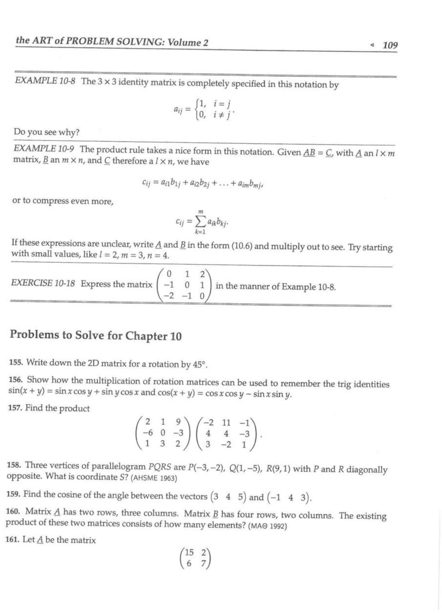

## Printed page 110

<!-- source: volume-2, PDF page 132, printed page 110 -->

and let $x$ be the sum of the entries of a matrix $B$ such that $AB = BA$. Find the smallest value of $x$ over all matrices $B$ whose entries are positive integers. (Mandelbrot #3)

162. What is the image of $\begin{pmatrix} 3 \\ 1 \\ 2 \end{pmatrix}$ under the mapping $\begin{pmatrix} 1 & 4 & 1 \\ -2 & 0 & 0 \\ 3 & 2 & -3 \end{pmatrix}$? (MAΘ 1991)

163. Find min $f$ and max $f$ where $x$ and $y$ are real numbers and

$$f(x, y) = 2 \sin x \cos y + 3 \sin x \sin y + 6 \cos x.$$

(M&IQ 1991)

Original scan — PDF page 132

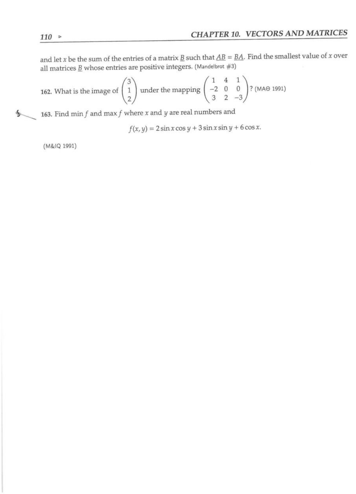

## Printed page 111

<!-- source: volume-2, PDF page 133, printed page 111 -->

Imagine an atom (particle of matter) sitting in space. There are many possible "states" the atom could be in: vibrating fast or slow, spinning around in different ways, and so on. But as we pointed out in a BIG PICTURE in Volume 1, quantum mechanics can't tell us exactly which state the atom is in, just the probabilities of its being in each state. These probabilities are often thought of as a vector, $\vec{P} = \begin{pmatrix} P_1 & P_2 & P_3 & \cdots \end{pmatrix}$, where $P_i$ is the probability of being in the $i$th state. So far we're on solid ground. But what if the atom has infinitely many possible states? Suddenly our vector has become infinite-dimensional!

Now imagine a particle of light—a photon—flies onto the scene and our atom absorbs it. This will cause our atom to switch from its initial state to some other state. How do we know what other state? We don't! Again, we only know the probabilities. If the atom started in state $i$, there is some probability $A_{i-1}$ that it ends up in state 1, some probability $A_{i-2}$ that it ends up in state 2, and so on. (What does $A_{i-1}$ represent?) Our original probability vector $\vec{P}$ thus transforms into a new probability vector $\vec{Q}$, which describes the probabilities after the absorption. How do we transform one vector to another? With a matrix, of course! We define a transition matrix $A$, so that $\vec{A}\vec{P} = \vec{Q}$:

$$
\begin{pmatrix}
A_{1-1} & A_{2-1} & \cdots \\
A_{1-2} & A_{2-2} & \cdots \\
\vdots & \vdots & \ddots
\end{pmatrix}
\begin{pmatrix}
P_1 \\
P_2 \\
\vdots
\end{pmatrix}
= \begin{pmatrix}
Q_1 \\
Q_2 \\
\vdots
\end{pmatrix}.
$$

If you are familiar with the rules of probability, you might be able to understand this in more depth. Why, for example, is $Q_1$, the probability we end up in state 1, equal to $P_1A_{1-1} + P_2A_{2-1} + P_3A_{3-1} + \cdots$? Can you see that we must have $P_1 + P_2 + P_3 + \cdots = Q_1 + Q_2 + Q_3 + \cdots = 1$?

To calculate the probability vectors and transition matrices takes some doing, but the mathematical apparatus of the infinite dimensional vectors involved is more or less the same as that for the humble 2D vectors we define in the text.

Original scan — PDF page 133

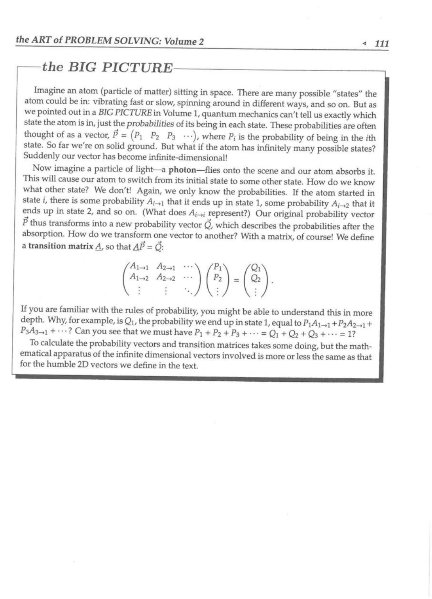

