# Chapter 11: Cross Products and Determinants

Volume 2 · Printed pages 112–123 · PDF pages 134–145

[Volume contents](../index.md)

## Printed page 112

<!-- source: volume-2, PDF page 134, printed page 112 -->

Chapter 11
Cross Products and Determinants

### 11.1 The Cross Product

We have seen in Chapter 10 that there is a connection between the dot product and vector lengths. We now define a special product between vectors which allows us to discuss areas.

So, given two 3D vectors $\vec{v}$ and $\vec{w}$, we shall define the cross product $\vec{v} \times \vec{w}$ to be the vector $\vec{x}$ such that

$$\vec{x} \cdot \vec{v} = \vec{x} \cdot \vec{w} = 0;$$

the length of $\vec{x}$ is the area of the parallelogram spanned by $\vec{v}$ and $\vec{w}$, as in the figure at right.

**EXAMPLE 11-1 For any vectors $\vec{v}$ and $\vec{w}$, we have $(\vec{v} \times \vec{w}) \cdot \vec{v} = 0$, since we have defined the cross product to be such that $(\vec{v} \times \vec{w}) \perp \vec{v}$.**

**EXERCISE 11-1 What is the area of the parallelogram spanned by $\vec{v}$ and $\vec{w}$ in terms of $||\vec{v}||, ||\vec{w}||$, and $\theta$, the angle between the two vectors?**

Given vectors $\vec{v}$ and $\vec{w}$, there are two vectors which satisfy our criteria for the cross product, one which points 'up' from the plane containing $\vec{v}$ and $\vec{w}$ and another which points 'down' from the plane. How do we know which vector is $\vec{v} \times \vec{w}$? There's no sound mathematical reason to choose one or the other, so we must adopt a convention which we can apply to any pair of vectors.

This brings us to the dreaded right hand rule. This is nothing more than a way to remember in which of the two possible directions we choose our cross product to be.

Consider the equation $\vec{v} \times \vec{w} = \vec{x}$. If you extend the index finger of your right hand along $\vec{v}$ and the middle finger along $\vec{w}$, then $\vec{x}$ will be along your thumb pointing perpendicular to the other two fingers.

**EXAMPLE 11-2 If we take $\vec{v} = (0, 1, 0)$ and $\vec{w} = (1, 0, 0)$, then find $\vec{v} \times \vec{w}$.**

Solution: Take the desired vector to be $\vec{x} = (a, b, c)$. Then the dot products of $\vec{x}$ with $\vec{v}$ and $\vec{w}$ are $b$ and $a$ respectively; by the first condition on the cross product these must both equal zero,

Original scan — PDF page 134

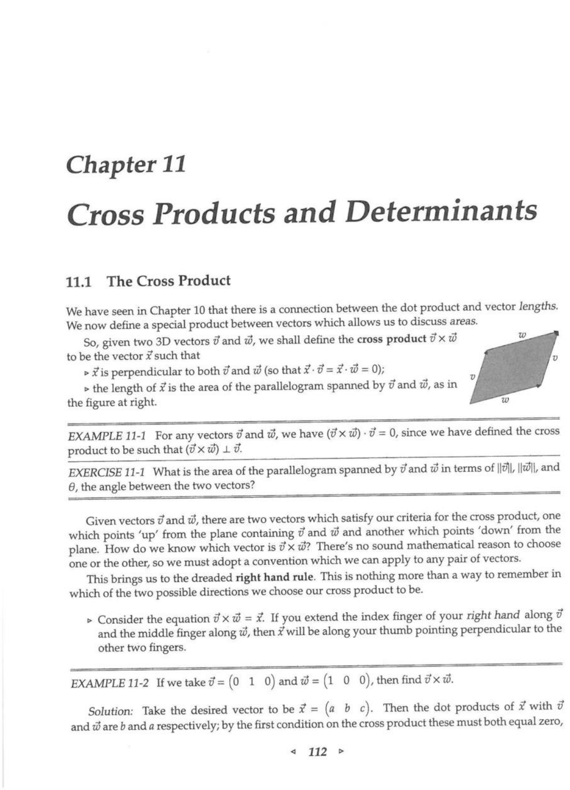

## Printed page 113

<!-- source: volume-2, PDF page 135, printed page 113 -->

so $\vec{x} = (0, 0, c)$. By the second condition, the length $||\vec{x}|| = |c|$ must be 1 (why?), so that $c$ is $\pm 1$. The right hand rule tells us that $\vec{x}$ is pointing down, so $\vec{x} = (0, 0, -1)$.

**EXERCISE 11-2** As $\vec{v}$ stays fixed and $\vec{w}$ rotates in a full circle, describe the path followed by the tip of $\vec{v} \times \vec{w}$.

**EXERCISE 11-3** Using the right hand rule, find the relationship between $\vec{v} \times \vec{w}$ and $\vec{w} \times \vec{v}$.

WARNING: Exercise 11-3 shows an important difference between the cross product and other products with which you are familiar. The cross product is NOT commutative; that is, $\vec{v} \times \vec{w} \neq \vec{w} \times \vec{v}$.

### 11.2 The Cross Product in Coordinates

Like the dot product, the cross product takes on a fairly simple form in the coordinate representation. If we take $\vec{v} = (x_1 y_1 z_1)$ and $\vec{w} = (x_2 y_2 z_2)$, then it can be shown that the vector

$$\vec{v} \times \vec{w} = \left( (y_1 z_2 - y_2 z_1) (z_1 x_2 - z_2 x_1) (x_1 y_2 - x_2 y_1) \right)$$

(11.1)

has the desired properties. Since we have seen that there is only one vector satisfying all three defining conditions, this must be the desired cross product.

**EXERCISE 11-4** Show that the vector $\vec{v} \times \vec{w}$ defined in (11.1) is perpendicular to both $\vec{v}$ and $\vec{w}$.

Although the cross product is not commutative, it is still linear, so $\vec{v} \times (\vec{w}_1 + \vec{w}_2) = (\vec{v} \times \vec{w}_1) + (\vec{v} \times \vec{w}_2)$ and $\vec{v} \times (c\vec{w}) = c(\vec{v} \times \vec{w})$. These properties can be easily verified using (11.1).

When we take the cross product of two vectors which are only two dimensional, we extend to three dimensions: we pretend that our vectors are actually three dimensional, with a $z$-component of 0. So if the vectors are $(x_1 y_1)$ and $(x_1 y_2)$, we write them as $(x_1 y_1 0)$ and $(x_1 y_2 0)$, tacking on a component of zero in the third dimension. We can then use (11.1).

**EXERCISE 11-5** Use (11.1) to verify that the cross product of two 2D vectors points either straight up or straight down (in three dimensions).

### 11.3 The Determinant

We are now able to ask (and answer) a question which has been hanging about since the introduction of matrices, namely, is there a “size” for matrices? The size of a vector is simply its length. For matrices, however, the size depends on area, which we are only now ready to tackle.

A very common way to represent a vector is to break it down in terms of the fundamental unit vectors $\vec{i} = (1 0)$ and $\vec{j} = (0 1)$: $(a b) = a\vec{i} + b\vec{j}$. (Similarly, in 3D we have $(a b c) = a\vec{i} + b\vec{j} + c\vec{k}$,

Original scan — PDF page 135

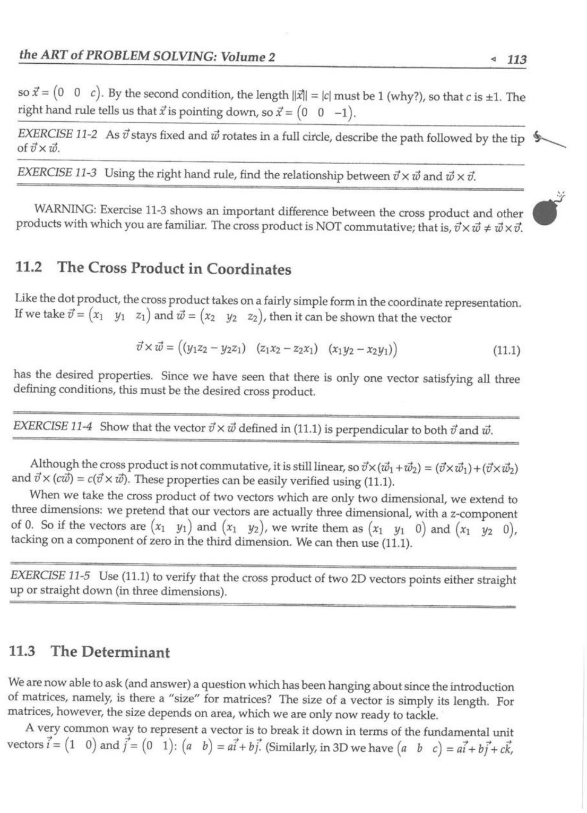

## Printed page 114

<!-- source: volume-2, PDF page 136, printed page 114 -->

where $\vec{k} = (0, 0, 1)$. Let us thus examine the action of a general 2D matrix $A = \begin{pmatrix} a_{11} & a_{12} \\ a_{21} & a_{22} \end{pmatrix}$ on the unit vectors $\vec{i}$ and $\vec{j}$. We find

$$A\vec{i} = \begin{pmatrix} a_{11} & a_{12} \\ a_{21} & a_{22} \end{pmatrix} \begin{pmatrix} 1 \\ 0 \end{pmatrix} = \begin{pmatrix} a_{11} \\ a_{21} \end{pmatrix}$$ and $$A\vec{j} = \begin{pmatrix} a_{11} & a_{12} \\ a_{21} & a_{22} \end{pmatrix} \begin{pmatrix} 0 \\ 1 \end{pmatrix} = \begin{pmatrix} a_{12} \\ a_{22} \end{pmatrix}$$

Originally, $\vec{i}$ and $\vec{j}$ spanned a parallelogram (square) of area 1. After transforming by $A$, the vectors span a parallelogram of area

$$\left|(A\vec{i})\times(A\vec{j})\right|=\left\lVert\begin{pmatrix}a_{11}\\a_{21}\end{pmatrix}\times\begin{pmatrix}a_{12}\\a_{22}\end{pmatrix}\right\rVert=\left|a_{11}a_{22}-a_{12}a_{21}\right|.$$

The quantity $a_{11} a_{22} - a_{12} a_{21}$ (no absolute value bars) is called the determinant of the 2D matrix $A$, and is written $|A|$ or det $A$. The determinant is thus the amount by which the area of the unit square is multiplied under transformation by $A$. Since $|A| = a_{11} a_{22} - a_{12} a_{21}$, we see that the determinant of a matrix can be negative. To what does this correspond? Since we've used cross products to find our determinant form, perhaps this sign change can be explained by them. A quick comparison of $|A|$ to the cross product $(A\vec{i}) \times (A\vec{j})$ reveals that a negative determinant corresponds to a matrix which reverses the direction of the cross product of two vectors. (Compare $\vec{i} \times \vec{j}$ to $(A\vec{i}) \times (A\vec{j})$. When are they in the same direction? Opposite directions?)

How does the area of any other parallelogram change? Such a parallelogram is spanned by some two vectors $\vec{v}$ and $\vec{w}$; these vectors can be written as linear combinations $v_1\vec{i} + v_2\vec{j}$ and $w_1\vec{i} + w_2\vec{j}$, where $v_1, v_2, w_1,$ and $w_2$ are real numbers.

**EXERCISE 11-6** Find the area of the parallelogram spanned by $\vec{v}$ and $\vec{w}$ in terms of $v_1, v_2, w_1,$ and $w_2$.

Under transformation by $A, \vec{v}$ and $\vec{w}$ become $v_1 A\vec{i} + v_2 A\vec{j}$ and $w_1 A\vec{i} + w_2 A\vec{j}$, using the linearity of matrix multiplication. The area of the parallelogram spanned by these transformed vectors is then the absolute value of

$$(v_1 A\vec{i} + v_2 A\vec{j}) \times (w_1 A\vec{i} + w_2 A\vec{j})$$

which by the linearity of the cross product is

$$(v_1 w_2 - w_1 v_2) (A\vec{i} \times A\vec{j}) + v_1 w_1 (A\vec{i} \times A\vec{i}) + v_2 w_2 (A\vec{j} \times A\vec{j}).\tag{11.2}$$

**EXERCISE 11-7** It looks like the coefficient of the first term in (11.2) should be $v_1 w_2 + w_1 v_2$, but we've written $v_1 w_2 - w_1 v_2$. Where does the - sign come from?

**EXERCISE 11-8** Prove that $\vec{v} \times \vec{v} = \vec{0}$ for any vector $\vec{v}$.

Original scan — PDF page 136

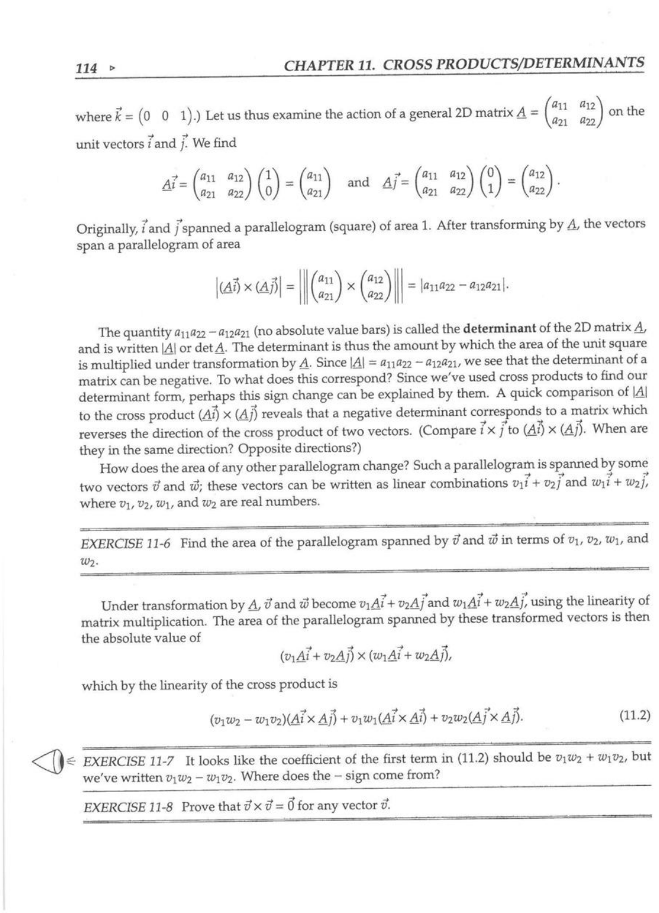

## Printed page 115

<!-- source: volume-2, PDF page 137, printed page 115 -->

Using Exercise 11-8, equation (11.2) is simplified to

$$\left( v_1 w_2 - v_2 w_1 \right) \left( \vec{A} i \times \vec{A} j \right) = |A| \left( v_1 w_2 - v_2 w_1 \right) \vec{k},$$

(11.3)

which has a magnitude of $|A|$ times the original area of the parallelogram! Thus the area of any parallelogram is multiplied by $|A|$ when transformed by $A$. (Again, negative $|A|$ means the original parallelogram is 'flipped' by $A$. Compare (11.3) to our description of negative determinants and cross products.) Even more strongly, since any area can be thought of as being covered by tiny little parallelograms, any area at all is multiplied by $|A|$.

**EXAMPLE 11-3** Find the determinant of

$$\begin{pmatrix} -2 & 2 \\ 1 & 3 \end{pmatrix}.$$

**Solution:** The determinant is $(-2)(3) - (2)(1) = -8.$

**EXERCISE 11-9** Consider the rectangle formed by the points $(2, 7), (2, 6), (4, 7),$ and $(4, 6).$ Is it still a rectangle after transformation by

$$\begin{pmatrix} 3 & 1 \\ 2 & .5 \end{pmatrix}$$?

By what factor has its area changed?

**EXERCISE 11-10** The circle with center $(-1, 3)$ and radius 2 is transformed into some figure $C$ by the matrix

$$\begin{pmatrix} 2 & 1 \\ -3 & 4 \end{pmatrix}.$$

Find the area of $C.$

The determinant is, it seems, a measure of how much a matrix stretches or squishes areas. What happens if we successively apply the transformations $A$ and then $B$? First an area $K$ is multiplied by $|A|$, then by $|B|$, so the final area is $|B| |A| K$. On the other hand, we saw in Chapter 10 that we can view the successive transformations as a single, overall transformation $BA$. Thus the area $K$ is transformed to $|BA| K$. Since the way of looking at the transformation (two separate or one compound) doesn't affect the final area, we must thus have

$$|BA| = |B| |A|$$

for any two matrices $A$ and $B.$

**EXERCISE 11-11** Find the determinant of the product

$$\begin{pmatrix} 2 & -3 \\ 7 & -4 \end{pmatrix} \begin{pmatrix} -5 & 1 \\ 3 & -1 \end{pmatrix} \begin{pmatrix} 2 & 6 \\ 0 & -4 \end{pmatrix}.$$

### 11.4 Determinants in Higher Dimensions

Determinants in dimensions greater than 2 can be defined by analogy. For example, the determinant of a $3 \times 3$ matrix is the amount by which the matrix stretches or squeezes volumes. The determinant of a general $3 \times 3$ matrix

$$\begin{pmatrix} a_{11} & a_{12} & a_{13} \\ a_{21} & a_{22} & a_{23} \\ a_{31} & a_{32} & a_{33} \end{pmatrix}$$

Original scan — PDF page 137

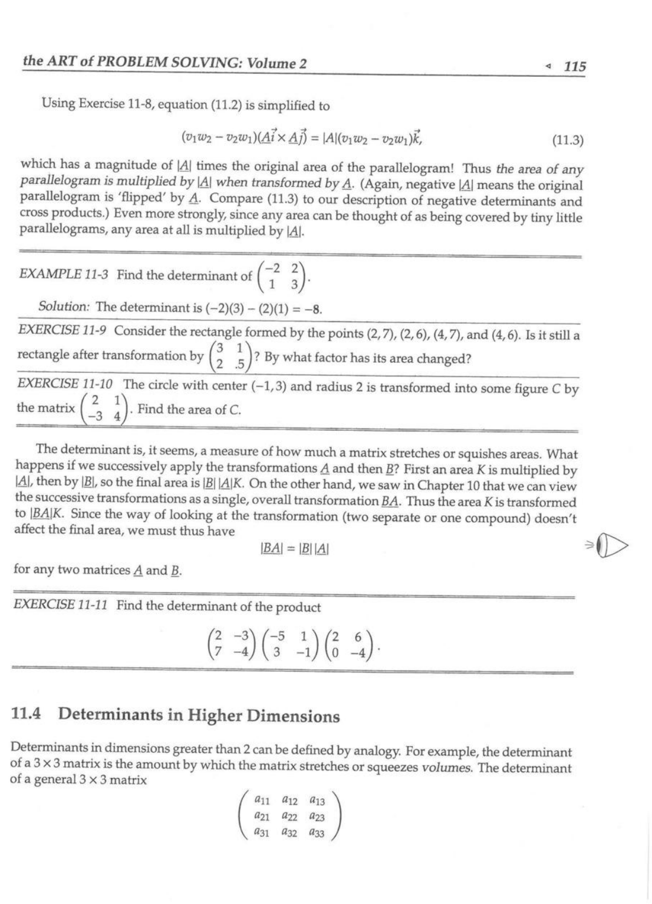

## Printed page 116

<!-- source: volume-2, PDF page 138, printed page 116 -->

turns out (after some none-too-pleasant analytic geometry) to be

$$a_{11}a_{22}a_{33} + a_{12}a_{23}a_{31} + a_{13}a_{21}a_{32} - a_{12}a_{21}a_{33} - a_{13}a_{22}a_{31} - a_{11}a_{23}a_{32}.$$

As you can see, each three-term product contains one and only one element from each row and column; in fact, the sum contains all three-term products which satisfy this criterion. All that’s left to understand is those strange +’s and −’s. Note that in each set of three the first indices are 1, 2, and 3 in that order, so the sign is determined from the second indices. In fact, if the order of the second indices is one switch away from the ordering 1, 2, 3 (e.g. 1, 2, 3 → 2, 1, 3) then the sign is −, and if it requires zero or two switches (e.g. 1, 2, 3 → 2, 1, 3 → 2, 3, 1) then the sign is +.

**EXAMPLE 11-4** We can use a simple shorthand to compute $3 \times 3$ determinants. Consider the determinant

$$\begin{vmatrix}
1 & 8 & -2 \\
3 & -4 & 9 \\
5 & -3 & 8
\end{vmatrix}.$$

(Note that the matrix is enclosed by vertical bars, rather than parentheses, to indicate the determinant.) We copy the first two columns on the other side of the bar, as:

$$\begin{array}{rrr|rr}
1&8&-2&1&8\\
3&-4&9&3&-4\\
5&-3&8&5&-3
\end{array}.$$

We can now get the determinant by forming products along all the long diagonals of this grid. We add the products up, giving a + sign to those going down and to the right and a − sign to those going up and to the right. In this case, the diagonals going down yield $(1)(-4)(8) = -32, (8)(9)(5) = 360,$ and $(-2)(3)(-3) = 18$. The diagonals going up, with their − signs, yield $-(5)(-4)(-2)=-40$, $-(-3)(9)(1)=27$, and $-(8)(3)(8)=-192$. Adding up all these terms gives $-32 + 360 + 18 - 40 + 27 - 192 = 141$ as the determinant.

**EXERCISE 11-12** Prove that the shorthand developed above works.

**EXERCISE 11-13** Prove that multiplying all the entries in one row of the $3 \times 3$ matrix $A$ by $c$ yields a matrix with determinant $c|A|$.

**EXERCISE 11-14** Matrix $B$ is formed by multiplying all elements of the $3 \times 3$ matrix $A$ by $c$. Find the determinant $|B|$ in terms of $|A|$.

### 11.5 Minors

We have seen that there are simple forms for the $2 \times 2$ and $3 \times 3$ determinants. But what of the more complicated matrices of higher dimension? We start from the $3 \times 3$ determinant of matrix $A$

$$\begin{vmatrix}
a_{11} & a_{12} & a_{13} \\
a_{21} & a_{22} & a_{23} \\
a_{31} & a_{32} & a_{33}
\end{vmatrix} = a_{11}a_{22}a_{33} - a_{11}a_{23}a_{32} + a_{12}a_{23}a_{31} - a_{12}a_{21}a_{33} + a_{13}a_{21}a_{32} - a_{13}a_{22}a_{31}.$$

Original scan — PDF page 138

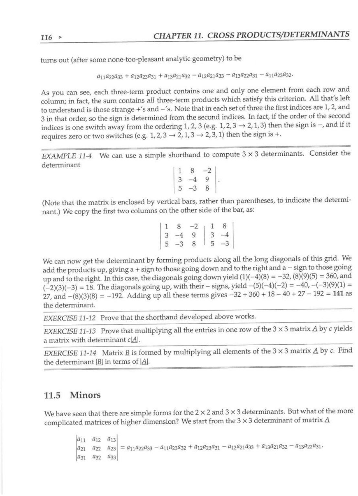

## Printed page 117

<!-- source: volume-2, PDF page 139, printed page 117 -->

Observe that the form of this determinant allows it to be broken down as

$$\begin{align*}
|A| &= a_{11}(a_{22}a_{33} - a_{23}a_{32}) - a_{12}(a_{21}a_{33} - a_{23}a_{31}) + a_{13}(a_{21}a_{32} - a_{22}a_{31}) \\
&= a_{11}\begin{vmatrix} a_{22} & a_{23} \\ a_{32} & a_{33} \end{vmatrix} - a_{12}\begin{vmatrix} a_{21} & a_{23} \\ a_{31} & a_{33} \end{vmatrix} + a_{13}\begin{vmatrix} a_{21} & a_{22} \\ a_{31} & a_{32} \end{vmatrix}.
\end{align*}$$

The $3 \times 3$ determinant can be evaluated solely in terms of $2 \times 2$ determinants! (Verify this by inspection.) In fact, we can write this in other ways as well:

$$\begin{align*}
a_{13}\begin{vmatrix} a_{21} & a_{22} \\ a_{31} & a_{32} \end{vmatrix} - a_{23}\begin{vmatrix} a_{11} & a_{12} \\ a_{31} & a_{32} \end{vmatrix} + a_{33}\begin{vmatrix} a_{11} & a_{12} \\ a_{21} & a_{22} \end{vmatrix} \\
\text{or} \\
- a_{21}\begin{vmatrix} a_{12} & a_{13} \\ a_{32} & a_{33} \end{vmatrix} + a_{22}\begin{vmatrix} a_{11} & a_{13} \\ a_{31} & a_{33} \end{vmatrix} - a_{23}\begin{vmatrix} a_{11} & a_{12} \\ a_{31} & a_{32} \end{vmatrix},
\end{align*}$$

to write two. (Verify these.) What are these forms? For each we have picked a row or column, and for each entry in the row or column multiplied the entry by the matrix formed by simply crossing out both the row and column in which the entry sits.

**EXERCISE 11-15 The one thing left out of the discussion is the signs preceding the terms in the sums. Can you figure out how these signs are chosen?**

We can immediately extend our observations to the case of any $n \times n$ matrix.

The step-by-step method to evaluate the determinant of any matrix.

1. Given an $n \times n$ matrix $A$, go along any row or column, entry by entry.

2. For each entry $a_{ij}$ in the row or column, find the determinant of the $(n-1) \times (n-1)$ matrix formed by crossing out the $i$th row and $j$th column of $A$. Call this matrix $A_{ij}$.

3. The determinant of $A$ is the sum of $(-1)^{i+j}a_{ij}|A_{ij}|$ for the entries in the chosen row or column.

This method is called expansion by minors, where the minors are the submatrices $A_{ij}$ formed by crossing out the $i$th row and the $j$th column. Always remember to add the correct signs to the terms, as denoted by the $(-1)^{i+j}$ term in the sum.

**EXERCISE 11-16 What does the matrix $a_{ij} = (-1)^{i+j}$ look like?**

**EXERCISE 11-17 We have seen by example that our method works for the $3 \times 3$ case. Show that it also works in the $2 \times 2$ case.**

**EXAMPLE 11-5 To make sure the explanation is clear, let’s use minors on the $4 \times 4$ matrix**

$$\begin{vmatrix} 1 & 3 & 5 & 7 \\ 2 & 1 & 0 & -1 \\ 2 & 4 & 6 & 8 \\ 6 & 5 & 3 & 2 \end{vmatrix}$$

Original scan — PDF page 139

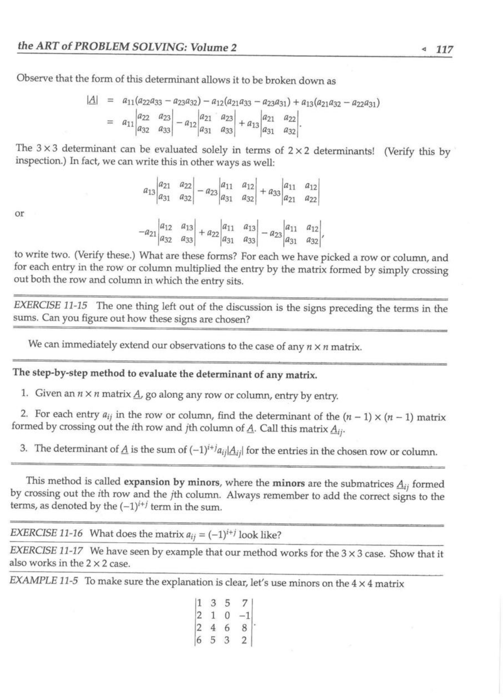

## Printed page 118

<!-- source: volume-2, PDF page 140, printed page 118 -->

Let's use the third column, to make use of the 0. The expansion is

$$
\begin{vmatrix}
2 & 1 & -1 \\
2 & 4 & 8 \\
6 & 5 & 2 \\
-0 & 1 & 3 \\
2 & 4 & 8 \\
6 & 5 & 2 \\
+6 & 1 & 3 \\
2 & 1 & -1 \\
6 & 5 & 2 \\
-3 & 1 & 3 \\
2 & 1 & -1 \\
2 & 4 & 8
\end{vmatrix}
$$

Evaluating the $3 \times 3$'s this is $5(-6) - 0(something) + 6(5) - 3(0) = 0$.

**EXERCISE 11-18** Write down a $3 \times 3$ determinant and evaluate it using expansion by minors. Evaluate it using the shortcut method to check your work.

**EXERCISE 11-19** Use minors to evaluate the determinant of the diagonal matrix

$$
\begin{pmatrix}
a_{11} & 0 & 0 & \cdots & 0 \\
0 & a_{22} & 0 & \cdots & 0 \\
\vdots & \vdots & \vdots & \ddots & \vdots \\
0 & 0 & 0 & \cdots & a_{nn}
\end{pmatrix}
$$

**EXERCISE 11-20** How about of the triangular matrix

$$
\begin{pmatrix}
a_{11} & 0 & 0 & \cdots & 0 \\
a_{21} & a_{22} & 0 & \cdots & 0 \\
\vdots & \vdots & \vdots & \ddots & \vdots \\
a_{n1} & a_{n2} & a_{n3} & \cdots & a_{nn}
\end{pmatrix}
$$

**EXERCISE 11-21** Prove that any matrix with a row or column made up of all 0's has determinant 0.

It is important to realize that minors only gives us a way to go from an $n \times n$ determinant to $n(n-1) \times (n-1)$ determinants. Thus it is not perfect—to do a $6 \times 6$ matrix by the minors method would mean doing $65 \times 5$'s, or $304 \times 4$'s, or $1203 \times 3$'s (which we could then do directly). In theory, we can (eventually) do any determinant this way. But as Example 11-5 shows, this is a lot of work, even for the $4 \times 4$ case.

### 11.6 Row and Column Operations

To think seriously about doing large determinants, we need a way to simplify them before we use minors. Luckily, there is such a method. It turns out that if we add any column to any other, the determinant is the same. What does "adding a column to another" look like? In the $3 \times 3$ case it could be

$$
\begin{vmatrix}
a_{11} & a_{12} & a_{13} \\
a_{21} & a_{22} & a_{23} \\
a_{31} & a_{32} & a_{33}
\end{vmatrix} = \begin{vmatrix}
a_{11} & a_{12} + a_{13} & a_{13} \\
a_{21} & a_{22} + a_{23} & a_{23} \\
a_{31} & a_{32} + a_{33} & a_{33}
\end{vmatrix}
$$

The same works for subtraction, and for rows instead of columns. Moreover, it works for adding any multiple of a row or column.

To see why this is useful, let us redo Example 11-5, which was so messy using minors.

Original scan — PDF page 140

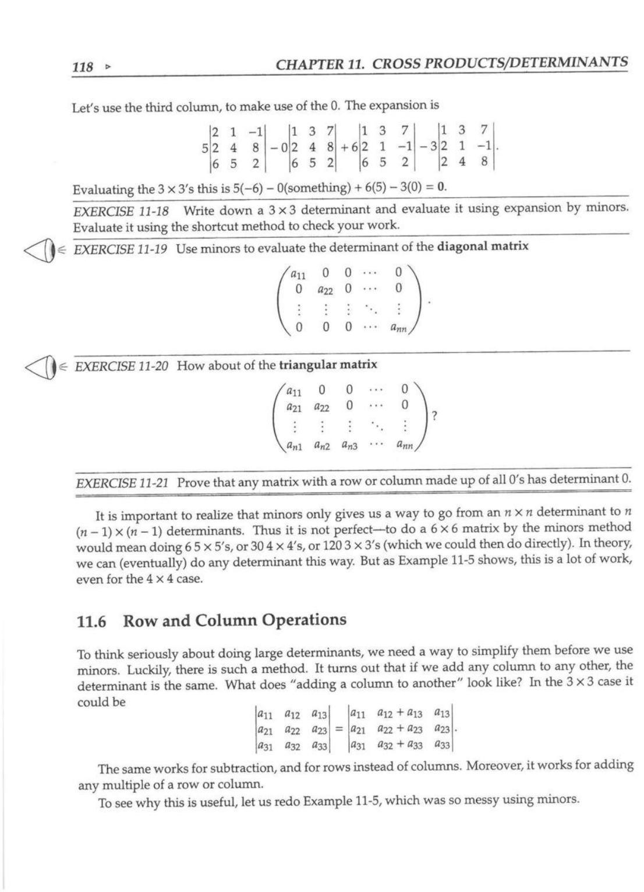

## Printed page 119

<!-- source: volume-2, PDF page 141, printed page 119 -->

**EXAMPLE 11-6 We evaluate the determinant**

$$\begin{vmatrix}
1 & 3 & 5 & 7 \\
2 & 1 & 0 & -1 \\
2 & 4 & 6 & 8 \\
6 & 5 & 3 & 2
\end{vmatrix}$$

Let's subtract the first row from the third to get

$$\begin{vmatrix}
1 & 3 & 5 & 7 \\
2 & 1 & 0 & -1 \\
1 & 1 & 1 & 1 \\
6 & 5 & 3 & 2
\end{vmatrix}$$

Now adding twice the second row to the first row we get

$$\begin{vmatrix}
5 & 5 & 5 & 5 \\
2 & 1 & 0 & -1 \\
1 & 1 & 1 & 1 \\
6 & 5 & 3 & 2
\end{vmatrix}$$

We can then subtract five times the third row from the first to get

$$\begin{vmatrix}
0 & 0 & 0 & 0 \\
2 & 1 & 0 & -1 \\
1 & 1 & 1 & 1 \\
6 & 5 & 3 & 2
\end{vmatrix}$$

which, upon expanding by minors along the first row, is clearly 0.

We don't often get it quite so nice as this. Usually, we do have to expand one or more of the minors. But by forming a row or column which is mostly 0's, with only one or two nonzero terms, we can greatly reduce the number of minors we need to do.

**EXERCISE 11-22 Do as little work as possible in evaluating the determinant**

$$\begin{vmatrix}
17 & 23 & 23 & 23 \\
17 & 17 & 23 & 23 \\
17 & 17 & 17 & 23 \\
17 & 17 & 17 & 17
\end{vmatrix}$$

**EXERCISE 11-23 Prove that any matrix with two identical rows or columns has determinant 0.**

**EXERCISE 11-24 Justify Exercises 11-13 and 11-14 in terms of minors.**

Original scan — PDF page 141

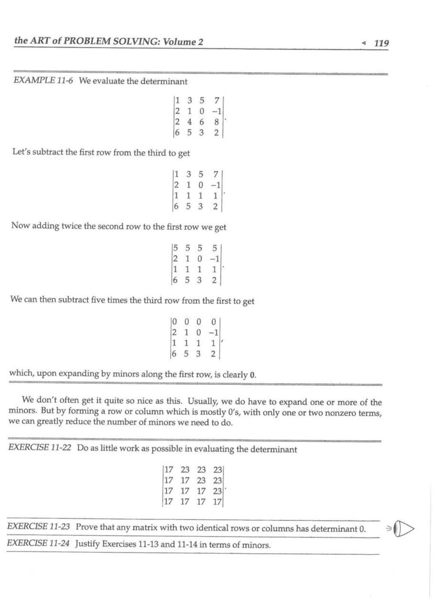

## Printed page 120

<!-- source: volume-2, PDF page 142, printed page 120 -->

**EXAMPLE 11-7 Remembering the formula (11.1) for the cross product isn’t so easy, but there is a very nice shorthand which does the trick. Recalling that the unit vectors are $\vec{i} = (1 0 0)$, $\vec{j} = (0 1 0)$, and $\vec{k} = (0 0 1)$, we can write**

$$\begin{pmatrix} x_1 & y_1 & z_1 \end{pmatrix} \times \begin{pmatrix} x_2 & y_2 & z_2 \end{pmatrix} = \begin{vmatrix} \vec{i} & \vec{j} & \vec{k} \\ x_1 & y_1 & z_1 \\ x_2 & y_2 & z_2 \end{vmatrix}.$$

There are many ways to see that this determinant is the cross product. For one thing, expansion by minors shows that it simplifies to $\vec{i}(y_1 z_2 - z_1 y_2) + \vec{j}(z_1 x_2 - x_1 z_2) + \vec{k}(x_1 y_2 - y_1 x_2)$, which is clearly equivalent to (11.1).

**EXERCISE 11-25 Using the previous example, show that**

$$\begin{pmatrix} x_0 & y_0 & z_0 \end{pmatrix} \cdot \left( \begin{pmatrix} x_1 & y_1 & z_1 \end{pmatrix} \times \begin{pmatrix} x_2 & y_2 & z_2 \end{pmatrix} \right) = \begin{vmatrix} x_0 & y_0 & z_0 \\ x_1 & y_1 & z_1 \\ x_2 & y_2 & z_2 \end{vmatrix}$$

for any vectors $(x_0 y_0 z_0), (x_1 y_1 z_1),$ and $(x_2 y_2 z_2)$. This is a simple form for the box product defined in Chapter 12, and provides an easy way to measure the volume of any parallelepiped.

**EXERCISE 11-26 Show that the cross product defined in Example 11-7 is perpendicular to both $(x_1 y_1 z_1)$ and $(x_2 y_2 z_2)$. (Use the previous exercise.)**

### 11.7 The Inverse of a Matrix

We have discussed how, using repeated multiplications, we can find “powers” $A^2, A^3$, etc. of a matrix $A$. We have had to wait for the determinant to define negative powers of matrices in a consistent way.

Given a real number $a \neq 0$, we always have $a^0 = 1$ and $a^{-1}a = 1$. For the $n \times n$ matrices, the equivalent to the real number 1 is the identity matrix $I_n$. We thus define $A^0 = I_n$ for $|A| \neq 0$. The restriction on the determinant of $A$ is equivalent to the requirement $a \neq 0$ for real numbers. Why? Remember that $|AB| = |A||B|$. We thus can expect that $|A^n| = |A|^n$. For $|A| \neq 0$, we thus have $|A|^0 = 1 = |A^0| = |I_n|$, which is correct. But for $|A| = 0, |A|^0 = 0^0$, which is undefined.

Once we have defined $A^0$, we can define the inverse $A^{-1}$ for $|A| \neq 0$ to be the matrix $B$ such that $AB = I_n$. If $A$ has an inverse, then it commutes with its inverse under multiplication. That is, we have $A^{-1}A = AA^{-1} = I_n$.

**EXERCISE 11-27 Use the original, geometric definition of the determinant to show that a matrix with determinant 0 can’t have an inverse.**

**EXAMPLE 11-8 Let’s find the inverse of a $2 \times 2$ matrix $A = \begin{pmatrix} a & b \\ c & d \end{pmatrix}$. Call the inverse $\begin{pmatrix} x & y \\ z & w \end{pmatrix}$, and write $\begin{pmatrix} a & b \\ c & d \end{pmatrix} \begin{pmatrix} x & y \\ z & w \end{pmatrix} = I_2 = \begin{pmatrix} 1 & 0 \\ 0 & 1 \end{pmatrix}$. Performing the multiplication, we get $\begin{pmatrix} ax + bz & ay + bw \\ cx + dz & cy + dw \end{pmatrix} =$**

Original scan — PDF page 142

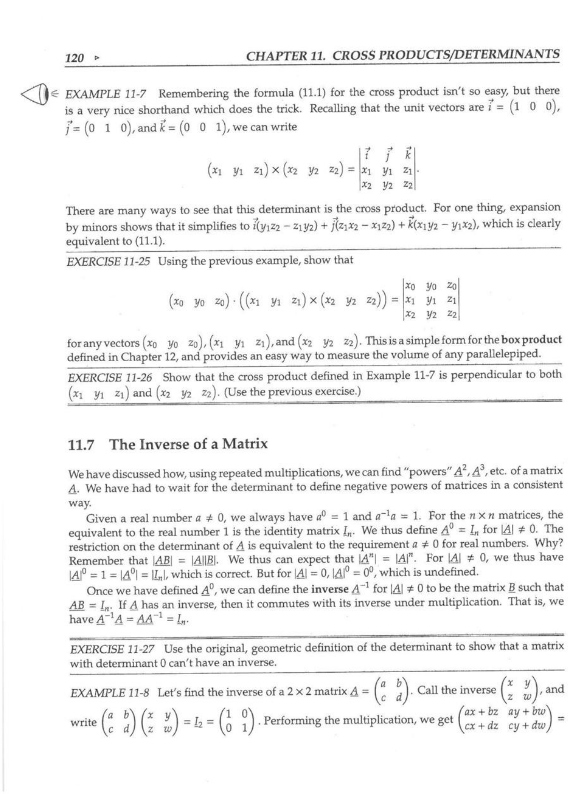

## Printed page 121

<!-- source: volume-2, PDF page 143, printed page 121 -->

so we have four equations: $ax + bz = 1; ay + bw = 0; cx + dz = 0; cy + dw = 1$. Solving these equations for $x, y, z, w$ we get $x = d/(ad - bc) = d/|A|, y = -b/|A|, z = -c/|A|, w = a/|A|$. Thus the inverse of the general $2 \times 2$ matrix $A = \begin{pmatrix} a & b \\ c & d \end{pmatrix}$ is given by

$$A^{-1} = \frac{1}{|A|} \begin{pmatrix} d & -b \\ -c & a \end{pmatrix}.$$

It is natural to ask whether there is a general prescription to find the inverse of a given matrix. There is, but it is quite a mess. We need first to define the transpose $A^T$ of a matrix $A$, which is just the matrix obtained by flipping the matrix over its main diagonal:

$$\begin{pmatrix} 1 & 2 & 3 \\ 4 & 5 & 6 \\ 7 & 8 & 9 \end{pmatrix}^T = \begin{pmatrix} 1 & 4 & 7 \\ 2 & 5 & 8 \\ 3 & 6 & 9 \end{pmatrix}.$$

(Another way to look at the transpose is that we have reversed the roles of rows and columns, so that every entry $a_{ij}$ is replaced by $a_{ji}$.)

To find the inverse of the $n \times n$ matrix $A$:

1. Replace each entry by the determinant of its minor.
2. Change the signs by multiplying each entry $a_{ij}$ by $(-1)^{i+j}$, as was done for minors.
3. Divide by $|A|$.
4. Transpose the matrix. The result is $A^{-1}$.

Although this is very messy, often you are only asked to find one element of the inverse, which is much simpler, as in Example 11-9. Also, remember that the determinant of $A^{-1}$ is $1/|A|$, so you don't need to compute the inverse at all to compute its determinant!

**EXERCISE 11-28 Show that the formula we obtained in Example 11-8 for the inverse of a $2 \times 2$ matrix agrees with the form we get using the general method.**

**EXAMPLE 11-9 Find the entry in the third row, second column of the inverse of**

$$\begin{pmatrix} 4 & 8 & 7 \\ 2 & 3 & 11 \\ 6 & 3 & 1 \end{pmatrix}.$$

Solution: Since we will need the determinant, let's find that first. We subtract twice the second row from the first and three times the second row from the third to get

$$\begin{pmatrix} 4 & 8 & 7 \\ 2 & 3 & 11 \\ 6 & 3 & 1 \end{pmatrix} = \begin{pmatrix} 0 & 2 & -15 \\ 2 & 3 & 11 \\ 0 & -6 & -32 \end{pmatrix}.$$

Original scan — PDF page 143

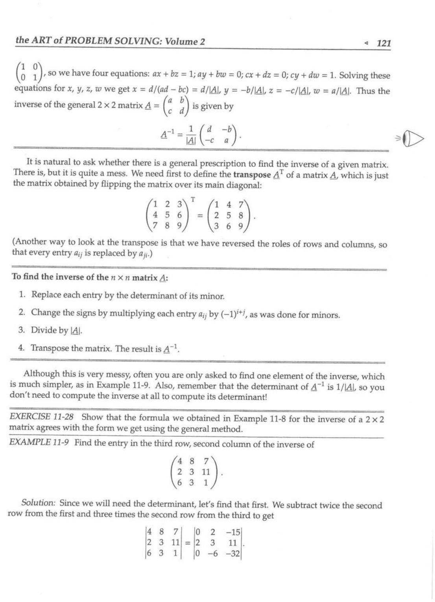

## Printed page 122

<!-- source: volume-2, PDF page 144, printed page 122 -->

Expanding by minors down the first column we have $-2 \begin{vmatrix} 2 & -15 \\ -6 & -32 \end{vmatrix}$, or 308. (Note how easy row operations make this; note also the sign due to the location of the 2.) Now the entry in the third row, second column of the inverse corresponds to the entry in the second row, third column of the matrix, because the last step is transposition. The entry we are interested in is thus the 11. Its minor is $\begin{pmatrix} 4 & 8 \\ 6 & 3 \end{pmatrix}$, with determinant $-36$. The sign changes because of the position of the 11, so we have 36. The entry in the inverse is just this divided by the determinant, or $36/308 = 9/77$.

**EXERCISE 11-29 Use the general method to find the inverse of the $4 \times 4$ identity matrix. Is this what you expected?**

**EXERCISE 11-30 Practice by finding the inverse of a random $3 \times 3$ matrix. Check that the inverse times the original matrix gives $I_3$.**

Just finding one entry of the inverse can require some work, so it is important to do as little as possible, using row and column operations to simplify the determinant and other shortcuts.

Once we have defined $A^{-1}$, we define $A^{-2} = (A^{-1})^2$, etc. We can now take any integral power of a matrix with nonzero determinant.

Problems to Solve for Chapter 11

164. $A$ is a 2 by 2 matrix whose entries are the first four prime numbers. What is the largest possible value of det $A$? (MAΘ 1992)

165. Find the value of $A$ if

$$A = \begin{vmatrix} 4 & 4 & -3 & 2 \\ -3 & -2 & 2 & 3 \\ 2 & 5 & 4 & -2 \\ 3 & -3 & -2 & 0 \end{vmatrix}$$

(MAΘ 1992)

166. For what value of $c$ will there be no inverse for the matrix

$$\begin{pmatrix} 1 & 4 & c \\ 2 & -1 & 7 \\ 3 & -2 & 11 \end{pmatrix}$$?

(MAΘ 1991)

167. Find the determinant of the product $CBA$, where $A = \begin{pmatrix} 2 & 1 \\ 3 & 4 \end{pmatrix}$, $B = \begin{pmatrix} 2 & 3 \\ 5 & 4 \end{pmatrix}$ and $C = \begin{pmatrix} 2 & 1 \\ 6 & 1 \end{pmatrix}$.

168. Evaluate the following determinant, giving the answer in factored form. (MAΘ 1991)

$$\begin{vmatrix} a & 1 & 1 & 1 \\ 1 & a & 1 & 1 \\ 1 & 1 & a & 1 \\ 1 & 1 & 1 & a \end{vmatrix}$$

Original scan — PDF page 144

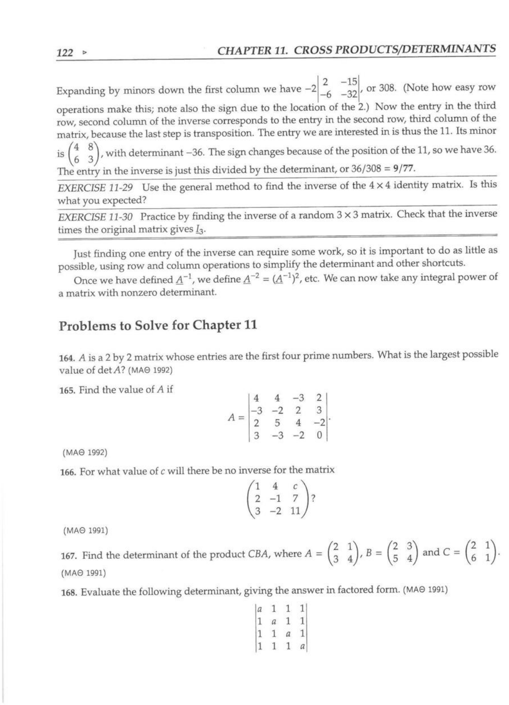

## Printed page 123

<!-- source: volume-2, PDF page 145, printed page 123 -->

169. If $\begin{vmatrix}W&X\\Y&Z\end{vmatrix}=4$, then find $\begin{vmatrix}4W&4X\\4Y&4Z\end{vmatrix}$. (MA$\Theta$ 1991)

170. Evaluate the determinant below.

$$
\begin{vmatrix}
3&1&1&1&1&1\\
3&3&1&1&1&1\\
3&3&3&1&1&1\\
3&3&3&3&1&1\\
3&3&3&3&3&1\\
3&3&3&3&3&3
\end{vmatrix}
$$

(Mandelbrot #1)

171. If $A=\begin{pmatrix}4&2\\1&1\end{pmatrix}$, then find $A^{-2}$. (MA$\Theta$ 1991)

172. Find a matrix whose determinant, when set equal to zero, represents the equation of a circle passing through the points $(-3,1)$, $(2,4)$, and $(5,-2)$. (MA$\Theta$ 1991)

Original scan — PDF page 145

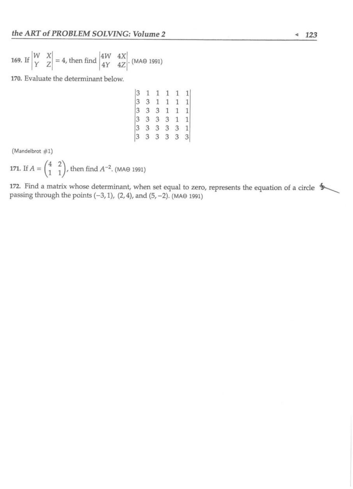

