# Chapter 12: Analytic Geometry

Volume 2 · Printed pages 124–142 · PDF pages 146–164

[Volume contents](../index.md)

## Printed page 124

<!-- source: volume-2, PDF page 146, printed page 124 -->

### 12.1 Lines, Angles, and Distances

Let point $A$ be $(x_1, 0)$ and point $B$ be $(x_2, y_2)$. Hence, we have

$$\tan \theta = \frac{BX}{AX} = \frac{y_2 - 0}{x_2 - x_1} = m,$$

the slope of line $l$. From this we see that if line $l$ makes an angle $\theta$ with the positive $x$ axis, then $\tan \theta$ equals the slope of the line.

**EXAMPLE 12-1** Find the slope of a line which makes a $120^\circ$ angle with the positive $x$ axis.

**Solution:** Applying $\tan \theta = m$, which works perfectly fine for obtuse angles since the slopes of such lines are negative, we find that the slope of the line is $\tan 120^\circ = m = -\sqrt{3}$.

How about two lines? Draw a horizontal line through the intersection point of lines $l$ and $n$. Let $\alpha$ be the angle line $l$ makes with the horizontal, $\beta$ be the angle between $l$ and $n$, and $\theta = \alpha + \beta$. Hence, if $m_1$ is the slope of $l$ and $m_2$ is the slope of $n$, we have $\tan \alpha = m_1$ and $\tan \theta = m_2$ and

$$\tan \beta = \tan(\theta - \alpha) = \frac{\tan \theta - \tan \alpha}{1 + \tan \theta \tan \alpha} = \frac{m_2 - m_1}{1 + m_1 m_2}.$$

**EXAMPLE 12-2** Find the acute angle made by the lines $2x - y = 3$ and $x - 3y = 4$.

**Solution:** The slopes of the two lines are 2 and 1/3, so from the above discussion we find

$$\tan \theta = \frac{\frac{1}{3} - 2}{1 + (1/3)(2)} = -1.$$

Since $\tan \theta = -1$, the angle between the lines is $135^\circ$. WARNING: The problem asks for the acute angle, not the obtuse angle. Hence, our desired answer is $180^\circ - 135^\circ = 45^\circ$. Keep an eye out for this; we can take the slopes of the line in either order, so $\tan \theta$ can be negative or positive, corresponding to the obtuse and acute angles between the lines, respectively.

Original scan — PDF page 146

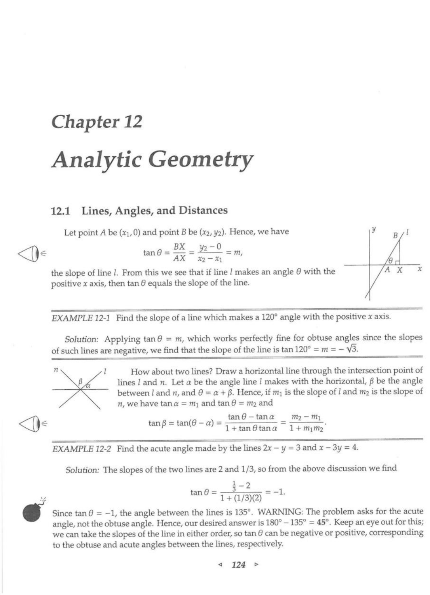

## Printed page 125

<!-- source: volume-2, PDF page 147, printed page 125 -->

**EXERCISE 12-1** Find the tangent of the obtuse angle formed by $2x-3y=4$ and $x-3y+2=0$.

### 12.2 Parameters

Curves are really one-dimensional figures, so we should be able to describe them with a single variable instead of the usual $x$ and $y$. Let’s start with the unit circle,

$$x^2 + y^2 = 1.$$

We can describe this circle with one variable using trigonometry. Recall that we can let $x = \cos \theta$ and $y = \sin \theta$. Hence, as $\theta$ ranges from 0 to $2\pi$, we trace out the entire circle. For this representation, we say that

$$x = \cos \theta$$
$$y = \sin \theta$$

are the parametric equations that describe the circle $x^2 + y^2 = 1$. The dummy variable $\theta$ is called the parameter. This parametric description is useful not only because it has only one variable $\theta$, but also because $\theta$ is unconstrained—it can take on any value. In our original $(x, y)$ descriptions, only certain pairs $(x, y)$ are on the circle.

Let’s try a more complicated circle:

$$(x - 5)^2 + (y - 3)^2 = 16.$$

We wish to find a pair of functions such that $x = f(\theta)$ and $y = g(\theta)$ describe the above circle. Note that if we write $x = 5 + f_1(\theta)$ and $y = 3 + g_1(\theta)$, our circle becomes

$$[f_1(\theta)]^2 + [g_1(\theta)]^2 = 16.$$

This is highly suggestive of our initial circle, so we let $f_1(\theta) = 4\cos \theta$ and $g_1(\theta) = 4\sin \theta$, and our parametric representation of the circle is

$$x = 5 + 4\cos \theta$$
$$y = 3 + 4\sin \theta.$$

**EXAMPLE 12-3 Find a parametric description of the line $2x + 3y = 5$.**

Solution: There are many possible representations; we find ours by solving the equation for $y$:

$$y = -\frac{2}{3}x + \frac{5}{3}.$$

Thus, one possible parametric description of the line is

$$x = t$$
$$y = -2t/3 + 5/3.$$

Original scan — PDF page 147

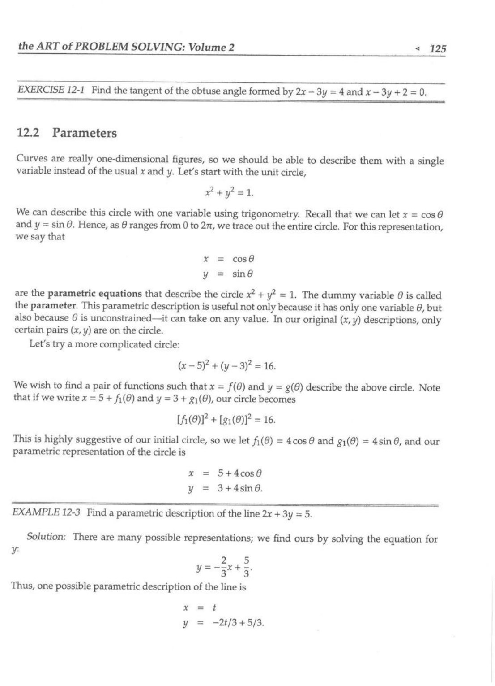

## Printed page 126

<!-- source: volume-2, PDF page 148, printed page 126 -->

**EXERCISE 12-2 Find a parametric representation for the curve $9x^2 - 4y^2 - 72x + 16y + 164 = 0$.**

**EXAMPLE 12-4 Find a general parametric representation for the ellipse**

$$\frac{(x-h)^2}{a^2} + \frac{(y-k)^2}{b^2} = 1.$$

Solution: Comparing this to the identity $\cos^2 \theta + \sin^2 \theta = 1$, we see that we can develop a parametric form by letting $(x-h)^2/a^2 = \cos^2 \theta$. Taking square roots, we find $x = h + a \cos \theta$. Similarly, we find $y = k + b \sin \theta$ to complete the problem. In the same method as above, we can use the identity $\sec^2 \theta - \tan^2 \theta = 1$ to develop a parameterization of a general hyperbola.

Just as important as finding parametric representations for curves is determining the original equation for a curve given the parametric equations describing it. Let’s try an example.

Find the equation of a curve satisfying the parametric equations

$$x = 3 + \log t^2$$
$$y = 2 - \log t.$$

To get rid of our parameter, we combine the equations to eliminate $t$, or solve for the parameter in one equation and substitute in the other. When trigonometric functions of parameters occur, we can also use various identities to get rid of the parameters. In this case, we note the first equation is equivalent to $x = 3 + 2 \log t$. Now we can eliminate $\log t$ by multiplying the equation for $y$ by 2 and adding the result $(2y = 4 - 2 \log t)$ to the equation for $x$, yielding $x + 2y = 7$ as the desired equation.

**EXAMPLE 12-5 Find the curve satisfying the parametric equations**

$$x = \cos t - \sin t$$
$$y = \sin 2t.$$

Solution: Recall from our discussion of trigonometry that squaring the first equation gives

$$x^2 = (\cos t - \sin t)^2 = \cos^2 t - 2 \sin t \cos t + \sin^2 t = 1 - \sin 2t.$$

Since $\sin 2t = y$, the desired equation is $x^2 = 1 - y$, a parabola.

**EXERCISE 12-3 Find the curve described by**

$$x = (\sin^2 \theta)/(\cos \theta)$$
$$y = \cos \theta.$$

Original scan — PDF page 148

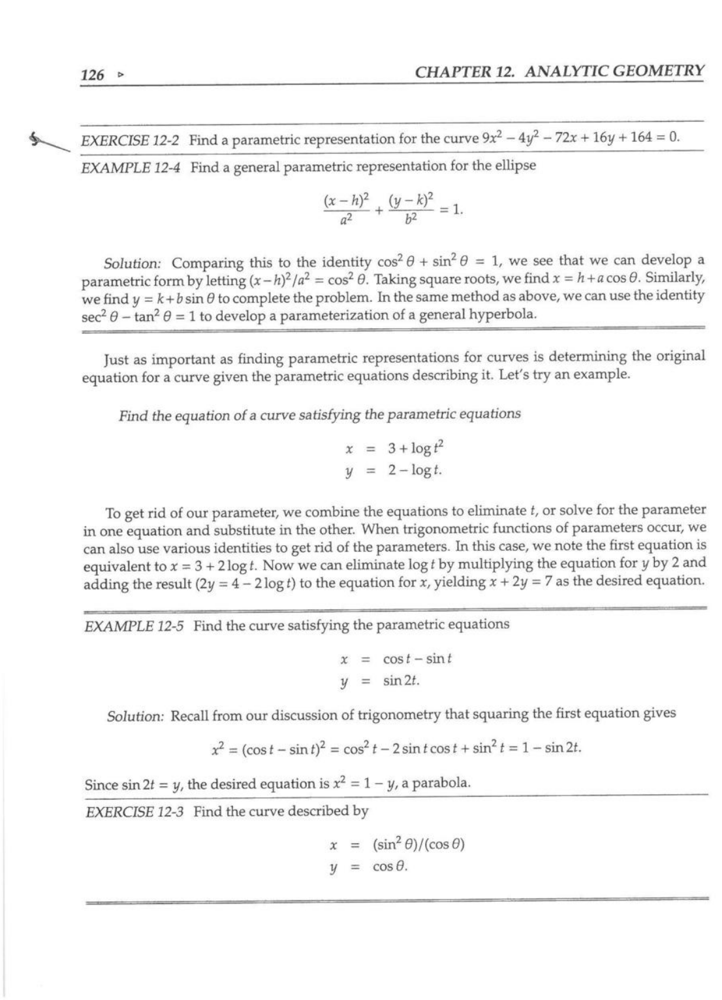

## Printed page 127

<!-- source: volume-2, PDF page 149, printed page 127 -->

### 12.3 Vectors

<!-- Heading restored for navigation from independently recognised source heading. -->

First we'll run through a quick review of a few important concepts which we'll be using in this chapter. In the diagram, let $O$ be the origin, $\vec{a}$ be the vector representing $\overrightarrow{OA}$, and $\vec{b}$ be the vector representing $\overrightarrow{OB}$. Since $\vec{a} \cdot \vec{b} = \|\vec{a}\| \|\vec{b}\| \cos \angle AOB$, we have

$$\vec{a} \cdot \vec{b} = (AO)(OB) \frac{OX}{AO} = (OB)(OX).$$

Thus the dot product of $\vec{a}$ and $\vec{b}$ is the length of $\vec{b}$ times the length of the projection of $OA$ onto $OB$ (segment $OX$ above). Make sure you understand this interpretation of the dot product as a measure of projection. Finally, recall that $\vec{a}$ and $\vec{b}$ are perpendicular if and only if $\vec{a} \cdot \vec{b} = 0$. (To what projection does a negative dot product correspond? Draw two vectors which have a negative dot product and you'll see!)

**EXAMPLE 12-6** Find the vector which is normal, or perpendicular, to the line $2x + 3y - 7 = 0$.

**Solution:** Consider two points $(x_1, y_1)$ and $(x_2, y_2)$ on the line. Hence, we have

$$2x_1 + 3y_1 - 7 = 0 \quad \text{and} \quad 2x_2 + 3y_2 - 7 = 0.$$

Subtracting the first from the second

$$2(x_2 - x_1) + 3(y_2 - y_1) = (2 \quad 3) \cdot (x_2 - x_1 \quad y_2 - y_1) = 0.$$

The second vector in the dot product is the vector in the direction of the line since $(x_1, y_1)$ and $(x_2, y_2)$ are on the line. Since the dot product is 0, the vector $(2 \quad 3)$ is normal to the line.

Our work on this problem shows us how to determine the vector, $\vec{v}$ from point $P_1 = (x_1, y_1)$ to $P_2 = (x_2, y_2)$. In going from $P_1$ to $P_2$, the $x$-coordinate changes by $x_2 - x_1$ and the $y$-coordinate by $y_2 - y_1$. These changes give us our vector, $\vec{v} = (x_2 - x_1 \quad y_2 - y_1).$

**EXAMPLE 12-7** Find the distance from $(x_0, y_0)$ to the line $Ax + By + C = 0$.

**Solution:** Let the line be line $l$ in the diagram and the point be $Z$. Suppose point $W(x_1, y_1)$ lies on $l$. If we draw a line through $Z$ parallel to $l$, the distance between the parallel line and $l$ is the desired distance. In the diagram this line through $Z$ intersects the normal to line $l$ through $W$ at $Y$. From this we see that the distance we seek is the length of the projection of $\overrightarrow{WZ}$ onto the normal $\vec{n}$ to line $l$ through $W$. As in the prior example we can show that this normal is $(A \quad B)$, and our distance is

$$\frac{|\overrightarrow{WZ} \cdot \vec{n}|}{\|\vec{n}\|} = \frac{|A(x_0 - x_1) + B(y_0 - y_1)|}{\sqrt{A^2 + B^2}} = \frac{|Ax_0 + By_0 - (Ax_1 + By_1)|}{\sqrt{A^2 + B^2}}.$$

Since $(x_1, y_1)$ is on $l$, we have $Ax_1 + By_1 = -C$, and the distance is

$$\frac{|Ax_0 + By_0 + C|}{\sqrt{A^2 + B^2}}.$$

Original scan — PDF page 149

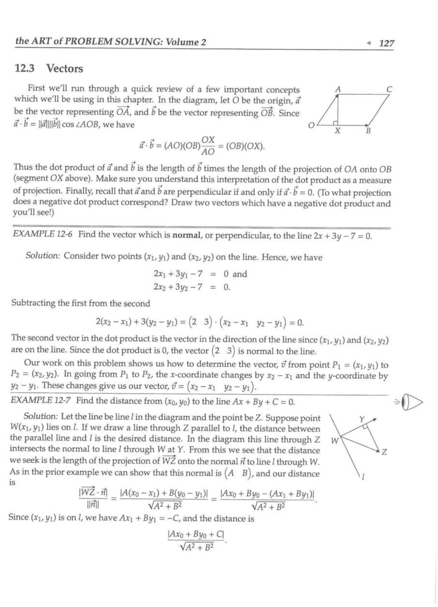

## Printed page 128

<!-- source: volume-2, PDF page 150, printed page 128 -->

**EXERCISE 12-4 In the previous example, why do we divide by $||\vec{n}||$ in determining the distance between the point and the line?**

Now let’s look at the cross product. First, $\vec{a} \times \vec{b}$ is a vector normal to the plane containing $\vec{a}$ and $\vec{b}$. The length of the cross product is found by

$$\|\vec{a} \times \vec{b}\| = \|\vec{a}\| \|\vec{b}\| \sin \angle AOB = (AO)(OB) \sin \angle AOB,$$

which is equal to the area of parallelogram $OACB$, where $C$ is found by copying vector $\overrightarrow{OB}$ at $A$. Since $[ABO]$ is half of this parallelogram, we can find $[ABO]$ as half the magnitude of $\vec{a} \times \vec{b}$.

**EXAMPLE 12-8 Find the area of the triangle with vertices $(5, 4), (3, 6),$ and $(2, 1)$.**

Solution: Let $A, B,$ and $C,$ respectively be the aforementioned vertices. Let’s write them as three dimensional points with 0 in the $z$ dimension (for example point $A$ is $(5,4,0)$) so we can use cross products. Let $C$ be the origin and $\vec{a}$ and $\vec{b}$ be $\overrightarrow{CA}$ and $\overrightarrow{CB}$. Hence, $\vec{a} = \begin{pmatrix} 5 - 2 & 4 - 1 & 0 - 0 \end{pmatrix} = \begin{pmatrix} 3 & 3 & 0 \end{pmatrix}$ and $\vec{b} = \begin{pmatrix} 1 & 5 & 0 \end{pmatrix}$. Thus, $\vec{a} \times \vec{b} = \begin{pmatrix} 0 & 0 & 12 \end{pmatrix}$. The magnitude of this is 12, so the area of the desired triangle is $12/2 = 6$.

**EXERCISE 12-5 Prove, using the same approach as in the prior example, that the area of the triangle with vertices $(x_1, y_1), (x_2, y_2),$ and $(x_3, y_3)$ is the absolute value of**

$$\frac{1}{2} \begin{vmatrix} x_1 & y_1 & 1 \\ x_2 & y_2 & 1 \\ x_3 & y_3 & 1 \end{vmatrix}.$$

**EXERCISE 12-6 Prove that if we have a convex polygon (meaning any segment connecting two points in the polygon is contained entirely within the polygon) with $n$ vertices in order at $(x_1, y_1), \ldots, (x_n, y_n)$, then we can find the area as follows. List the vertices vertically in order, putting the first point both first and last as in the middle two columns below, then find the products along diagonals as shown**

$$\begin{array}{cccc}
&x_1&y_1&\\
&x_2&y_2&\\
x_2y_1&x_3&y_3&x_1y_2\\
\vdots&\vdots&\vdots&\vdots\\
x_{n-1}y_{n-2}&x_n&y_n&x_{n-2}y_{n-1}\\
x_ny_{n-1}&x_1&y_1&x_{n-1}y_n\\
x_1y_n&&&x_ny_1
\end{array}$$

Let $S_l$ be the sum of the left column of products and $S_r$ the sum of the right column. The area is then $|S_r - S_l|/2$. Hint: Prove it first for a triangle, then use induction.

Original scan — PDF page 150

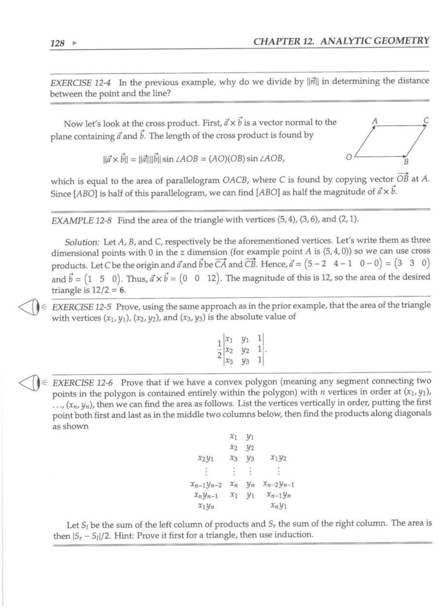

## Printed page 129

<!-- source: volume-2, PDF page 151, printed page 129 -->

We can also find the area of a polygon with lattice points (points with integer coordinates) as vertices using Pick's Theorem. Draw the polygon and let $I$ be the number of lattice points entirely within the polygon (we'll call these interior points) and $B$ be the number of points which lie on the boundary of polygon (which we'll call boundary points). Pick's Theorem states that the area contained in the polygon is

$$I + \frac{B}{2} - 1.$$

Suppose we are asked to find the area of $ABCD$ at right. There are 8 points inside $ABCD$ and 6 points on the boundary (the 4 vertices plus the points on $BC$ and $DC$). By Pick's Theorem, the area is therefore $8 + 6/2 - 1 = 10$.

We'll prove Pick's Theorem for convex polygons through a series of steps. We'll start with rectangles, then move to right triangles, then any triangle, then finally convex polygons.

**EXAMPLE 12-9** Prove that Pick's Theorem holds for a rectangle with sides of length $a$ and $b$ which are parallel to the coordinate axes.

**Proof:** The area of the rectangle is clearly $ab$, so we wish to prove that $I + B/2 - 1 = ab$. The interior points of the rectangle form an $a - 1$ by $b - 1$ grid, so $I = (a - 1)(b - 1)$. For the boundary there are 4 corners, $a - 1$ lattice points on each of one pair of sides and $b - 1$ lattice points on each of the other pair of sides. Hence, $B = 4 + 2(a - 1) + 2(b - 1)$. Thus, we have

$$I + B/2 - 1 = ab - a - b + 1 + (2 + a - 1 + b - 1) - 1 = ab,$$

as desired.

**EXERCISE 12-7** Use the proven fact that Pick's Theorem is true for rectangles to prove that it works for right triangles which have legs parallel to the coordinate axes.

Now we're ready for the toughest part of our proof; showing that Pick's Theorem holds for any triangle with integer vertices.

We can inscribe any such triangle $BEF$ in a rectangle such that the sides of the rectangle are parallel to the coordinate axes and one of the vertices of the triangle is a vertex of the rectangle as shown.

To prove Pick's Theorem for $\Delta BEF$ we'll apply Pick's Theorem to $ABCD$ and the three right triangles in $ABCD$ outside $\Delta BEF$. Let $I_\square$ and $B_\square$ be the number of interior points and boundary points of $ABCD$, respectively. Similarly, let $I_\Delta$ and $B_\Delta$ be the total number of interior and boundary points of all three right triangles and $I_*$ and $B_*$ be the number of interior and boundary points of $\Delta BEF$. To prove Pick's Theorem for $\Delta BEF$, we must show that $[BEF] = I_* + B_*/2 - 1$.

Since any interior point of $ABCD$ is either an interior point of one of the right triangles, a boundary point of $\Delta BEF$ besides one of the three vertices, or an interior point of $\Delta BEF$, we have

$$I_\square = I_\Delta + (B_* - 3) + I_*.$$

Similarly, any boundary point of one of the right triangles is either a boundary point of $ABCD$ or a boundary point of $\Delta BEF$, so we have

$$B_\Delta = B_\square + B_*.$$

Original scan — PDF page 151

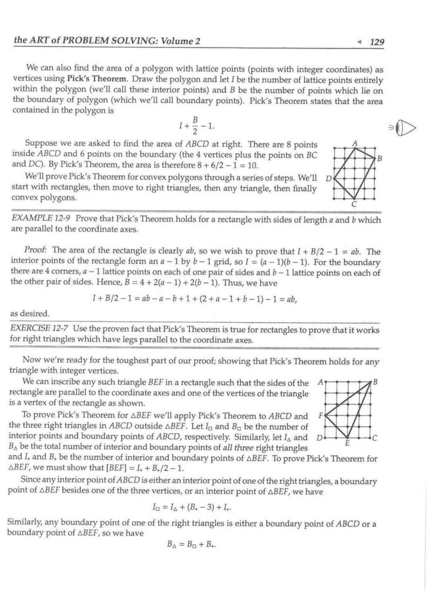

## Printed page 130

<!-- source: volume-2, PDF page 152, printed page 130 -->

Notice that in this equation we have counted the vertices of $\Delta BEF$ twice among the boundary points of the right triangles (once in $B_{\square}$ and once in $B_*$). This is necessary because each of these three vertices occur on two of the right triangles. Finally we are ready to evaluate the area of $\Delta BEF$ as the difference between the area of $ABCD$ and the area contained in the right triangles. Using Pick’s Theorem, the area of $ABCD$ is $I_{\square} + B_{\square}/2 - 1$ and that of the right triangles is $I_{\Delta} + B_{\Delta}/2 - 3$, where we subtract 3 because we are applying Pick’s Theorem 3 times. Hence we have

$$[BEF] = \left( I_{\square} + \frac{B_{\square}}{2} - 1 \right) - \left( I_{\Delta} + \frac{B_{\Delta}}{2} - 3 \right)$$

$$= I_{\Delta} + B_* - 3 + I_* + \frac{B_{\square}}{2} - 1 - I_{\Delta} - \frac{B_{\square} + B_*}{2} + 3$$

$$= \left( I_* + I_{\Delta} - I_{\Delta} \right) + \left( B_* + \frac{B_{\square}}{2} - \frac{B_{\square} + B_*}{2} \right) + (3 - 3 - 1)$$

$$= I_* + \frac{B_*}{2} - 1,$$

so we have proven that Pick’s Theorem holds for any triangle $[BEF]$. Note that in this proof, we have assumed that none of the sides of $\Delta BEF$ are parallel to a coordinate axis. Can you use a similar argument to the one above to address the case of one of the sides of $\Delta BEF$ being parallel to a coordinate axis?

**EXERCISE 12-8** Complete our proof of Pick’s Theorem for convex polygons by showing that we can divide any $n$ sided polygon into triangles, then apply Pick’s Theorem to the triangles to show that it holds for the polygon.

**EXERCISE 12-9** In our proof of Pick’s Theorem we stated that any triangle can be inscribed in a rectangle such that the sides of the rectangle are parallel to the coordinate axes and one of the vertices of the triangle is a vertex of the rectangle. Prove that this is true.

**EXERCISE 12-10** How can we extend our proof for convex polygons to prove Pick’s Theorem for non-convex polygons?

### 12.4 Points, Lines, and Planes

If we are describing points in space we need three coordinates, two for the $x$ and $y$ directions as in two dimensional graphing, and a third for distance above or below the standard $xy$ plane. As with two dimensions, we are often interested in finding the distance between two such points.

In the figure, let the points $A$ and $B$ be $(x_1, y_1, z_1)$ and $(x_2, y_2, z_2)$, respectively. The $x, y,$ and $z$ axes are also shown. We find the distance between $A$ and $B$ in much the same way as in two dimensions: using the Pythagorean Theorem. We draw a line through $A$ parallel to the $x$ axis and a line through $B$ parallel to the $z$ axis. We select points $X$ and $Y$ on these lines such that $XY$ is parallel to the $y$ axis. Since $AX, XY,$ and $BY$ are parallel to the coordinate axes, $\Delta AXY$ and $\Delta AYB$ are right triangles.

Clearly $Y$ has the same $x$ and $y$ coordinate as $B$ and the same $z$ coordinate as $A$. Hence $Y$ has coordinates $(x_2, y_2, z_1)$ and similarly, $X$ has coordinates

Original scan — PDF page 152

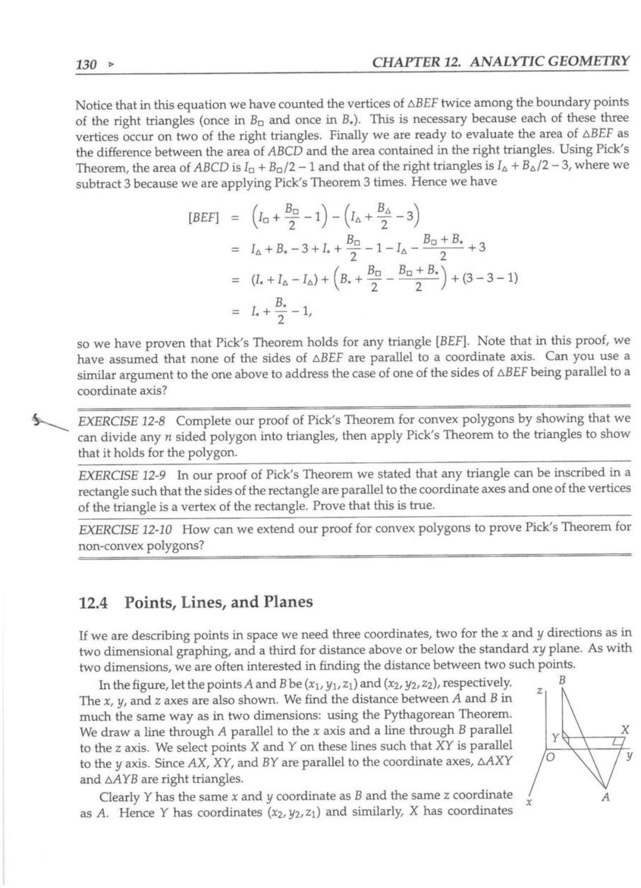

## Printed page 131

<!-- source: volume-2, PDF page 153, printed page 131 -->

Thus, $X$ and $A$ differ only in the $x$ coordinate and $AX = |x_2 - x_1|$. Similarly, we find $XY = |y_2 - y_1|$ and $BY = |z_2 - z_1|$. From the Pythagorean Theorem we have

$$AY = \sqrt{AX^2 + XY^2} = \sqrt{(x_2 - x_1)^2 + (y_2 - y_1)^2};$$

we then apply the Pythagorean Theorem to triangle $ABY$ to find

$$AB = \sqrt{AY^2 + BY^2} = \sqrt{(x_2 - x_1)^2 + (y_2 - y_1)^2 + (z_2 - z_1)^2}.$$

This is the distance formula for three dimensions. In much the same way as with two dimensions, we can show that the midpoint between two points in space is $((x_1 + x_2)/2, (y_1 + y_2)/2, (z_1 + z_2)/2)$.

How do we describe lines? Just as for lines in a plane, for lines in space we need a point on the line and a direction. For example, suppose we have a line through $(1, 2, 3)$ in the direction of $\vec{v}$, where $\vec{v} = \begin{pmatrix} 2 & 3 & 4 \end{pmatrix}$. Hence, $(1, 2, 3) + 2(2, 3, 4) = (5, 8, 11)$ is on the line, as is $(1, 2, 3) - 3(2, 3, 4) = (-5, -7, -9)$.

In fact, we get a point on the line by adding any multiple $t\vec{v}$ of $\vec{v}$ to $(1, 2, 3)$. Our line then becomes

$$\begin{pmatrix} x \\ y \\ z \end{pmatrix} = \begin{pmatrix} 1 \\ 2 \\ 3 \end{pmatrix} + t \begin{pmatrix} 2 \\ 3 \\ 4 \end{pmatrix}.$$

Hence we have described the line as a set of parametric equations:

$$x = 1 + 2t$$
$$y = 2 + 3t$$
$$z = 3 + 4t.$$

If we solve each of these for $t$, we can write

$$t = \frac{x - 1}{2} = \frac{y - 2}{3} = \frac{z - 3}{4}.$$

In this notation, we don't need to include the $t$ to describe the line.

**EXERCISE 12-11** Find a parametric representation for the line through $(1, -1, 3)$ and $(2, 3, 1)$.

Let's try planes. An equation of the form $AX + By = D$ describes a line in two dimensions, so it seems likely that an equation of the form $AX + By + Cz = D$ describes a plane in three dimensions. This is correct, but why?

Suppose we know that our plane contains the point $(1, 2, 3)$ and is perpendicular to the direction $\vec{v} = \begin{pmatrix} 2 & 1 & 4 \end{pmatrix}$. (Why do we use a vector perpendicular to a plane to denote the plane's direction?) Consider any point $(x, y, z)$ which is on the plane. The vector $\vec{w} = \begin{pmatrix} x - 1 & y - 2 & z - 3 \end{pmatrix}$ must be perpendicular to $\vec{v}$ since $\vec{w}$ is contained in the plane. Thus, we must have $\vec{w} \cdot \vec{v} = 0$, or

$$2(x - 1) + 1(y - 2) + 4(z - 3) = 0.$$

Our plane, then, is $2x + y + 4z = 16$. Notice that the coefficients match the directional components of the normal vector, $\vec{v}$. We can use this fact to quickly determine the equation of a plane. For example, if a plane contains $(2, 4, 1)$ and is normal to $\begin{pmatrix} -1 & 4 & 3 \end{pmatrix}$, the equation of the plane is $-x + 4y + 3z = c$ for some $c$. We find $c = 17$ by letting $(x, y, z) = (2, 4, 1)$, so the plane is $-x + 4y + 3z = 17$.

Original scan — PDF page 153

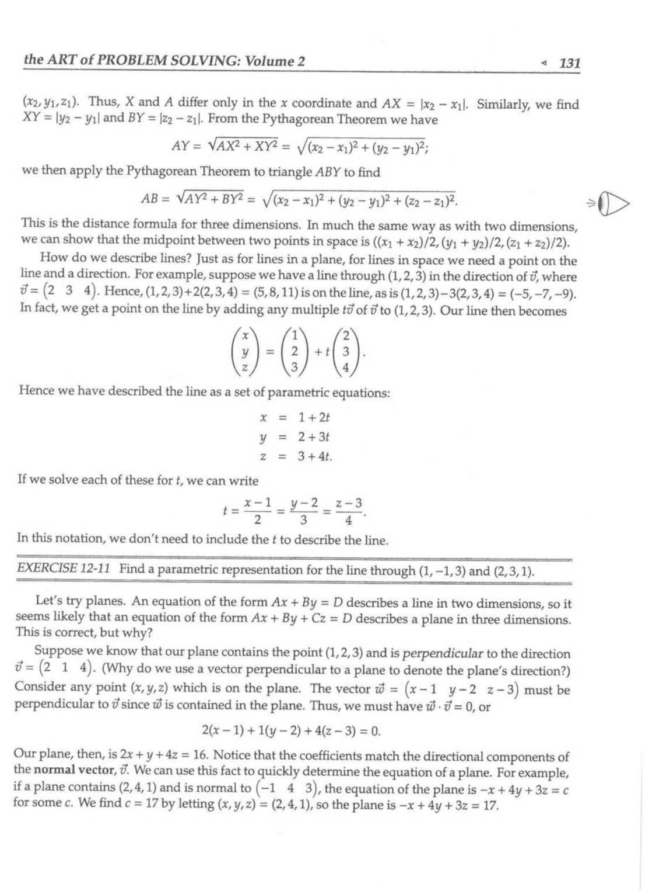

## Printed page 132

<!-- source: volume-2, PDF page 154, printed page 132 -->

**EXAMPLE 12-10 Find the equation of the plane passing through $(0, 3, -1), (2, -1, 2),$ and $(1, -4, 0)$.**

Solution: Let the three given points be $A, B,$ and $C,$ respectively. We have three points, so we have enough to determine a plane; however, we don't have a direction. Since we have three points in the plane, we can find two vectors parallel to the plane, namely $\overrightarrow{AB}$ and $\overrightarrow{AC}$. Hence, the direction normal to the plane is given by the cross product:

$$\overrightarrow{AB} \times \overrightarrow{AC} = (2 \cdot -4 \cdot 3) \times (1 \cdot -7 \cdot 1) = (17 \cdot 1 \cdot -10).$$

Thus, we have

$$\left( x \cdot y - 3 \cdot z + 1 \right) \cdot \left( 17 \cdot 1 \cdot -10 \right) = 0,$$

so our plane is $17x + y - 10z = 13.$

**EXERCISE 12-12 Find the plane through $(1, 2, 1), (0, -3, 1),$ and $(-1, -2, 2).$**

**EXERCISE 12-13 Find the distance from the point $(x_0, y_0, z_0)$ to the plane $Ax + By + Cz + D = 0.$**

Notice that we could also describe the plane in the example above as

$$\begin{pmatrix} x \\ y \\ z \end{pmatrix} = \begin{pmatrix} 0 \\ 3 \\ -1 \end{pmatrix} + u \begin{pmatrix} 2 \\ -4 \\ 3 \end{pmatrix} + v \begin{pmatrix} 1 \\ -7 \\ 1 \end{pmatrix}.$$

Since the two vectors $(2, -4, 3)$ and $(1, -7, 1)$ are parallel to the plane, we can add any multiples of these to the point $(0, 3, -1)$ in the plane to get other points in the plane. Hence, we can describe the plane with two parameters as

$$x = 2u + v$$

$$y = 3 - 4u - 7v$$

$$z = -1 + 3u + v.$$

We see from this that just as we can describe curves with a single parameter, we can describe surfaces with two.

Finally we are ready for volumes. Let $A = (x_1, y_1, z_1), B = (x_2, y_2, z_2),$ and $C = (x_3, y_3, z_3)$ be points in space and $\vec{a}, \vec{b},$ and $\vec{c}$ represent the vectors from $O$ to $A, B,$ and $C,$ respectively. As discussed above, $\vec{a} \times \vec{b}$ is a vector normal to plane $OAB$ whose length is the area of the parallelogram with sides $OA$ and $OB.$ Now, suppose we evaluate $\vec{c} \cdot (\vec{a} \times \vec{b}).$ We can write this as $||\vec{a} \times \vec{b}||(\vec{c} \cdot \vec{n}),$ where $n$ is the unit normal to plane $OAB,$ meaning it is the vector with length 1 in the direction of $\vec{a} \times \vec{b}.$

**EXERCISE 12-14 Why does $\vec{c} \cdot (\vec{a} \times \vec{b})$ equal $||\vec{a} \times \vec{b}||(\vec{c} \cdot \vec{n})?$**

Original scan — PDF page 154

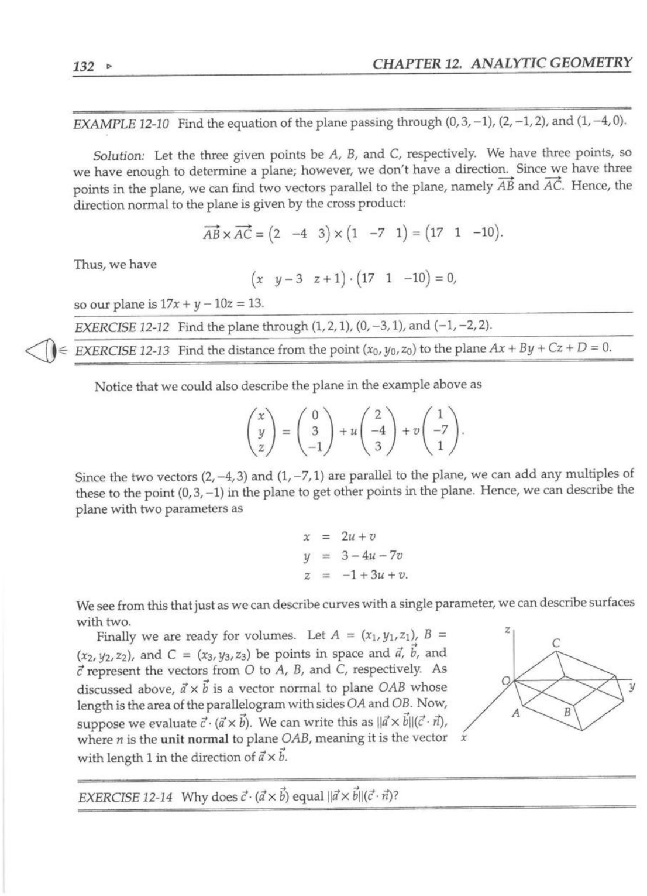

## Printed page 133

<!-- source: volume-2, PDF page 155, printed page 133 -->

Since $\vec{c} \cdot \vec{n}$ is the length of the projection of $c$ in the direction of $n$ and $\|\vec{n}\| = 1$, this product is equal to the distance from $C$ to plane OAB. Since $\|\vec{a} \times \vec{b}\|$ is the area of the parallelogram with sides OA and OB, the magnitude of the product $\|\vec{a} \times \vec{b}\|(\vec{c} \cdot \vec{n})$ is the volume of the parallelepiped with sides OA, OB, and OC. The product $\vec{c} \cdot (\vec{a} \times \vec{b})$ is often called the **box product** of the three vectors, and the magnitude is the same regardless of the order of $\vec{a}, \vec{b}$, and $\vec{c}$ in the product. Keep in mind that the product can be positive or negative, since the cross product of $\vec{a}$ and $\vec{b}$ may be on the same or opposite side of OAB as point $C$ (depending on which of $\vec{a}$ and $\vec{b}$ comes first in the cross product).

**EXERCISE 12-15** Prove that the box product $\vec{c} \cdot (\vec{a} \times \vec{b})$ has the same magnitude regardless of the order of $\vec{a}, \vec{b}$, and $\vec{c}$ in the product.

We can use this same approach to find the volume of the tetrahedron with vertices O, A, B, and C. This tetrahedron is a pyramid with base $\triangle AOB$ and altitude the same as that of the parallelepiped. Since the area of the triangle is half the area of the parallelogram with sides OA and OB and a pyramid has volume $(1/3)(\text{base area})(\text{height})$, the volume of the tetrahedron is then $[\vec{c} \cdot (\vec{a} \times \vec{b})] / 6$.

**EXAMPLE 12-11** Find the volume of the tetrahedron with vertices at $(1, 0, -2), (2, 3, 1), (2, 1, -4),$ and $(-1, 2, -1)$.

**Solution:** We can find the vectors $\vec{a}, \vec{b}$, and $\vec{c}$ above by designating one of the points as the origin O above and the other three as A, B, and C. Letting the first point be O, our vectors are $\vec{a} = (1, 3, 3), \vec{b} = (1, 1, -2),$ and $\vec{c} = (-2, 2, 1)$. Instead of finding the cross product of the first two vectors then dotting the result with the third vector, we note that in the dot product $\vec{c} \cdot (\vec{a} \times \vec{b})$, we merely multiply the first component of $\vec{a} \times \vec{b}$ by $-2$, the second by 2 and the third by 1. (Why? Look at the components of $\vec{c}$.) Hence, rather than evaluating the cross product

$$\begin{vmatrix}
\vec{i} & \vec{j} & \vec{k} \\
1 & 3 & 3 \\
1 & 1 & -2
\end{vmatrix},$$

we replace the $\vec{i}, \vec{j}, \vec{k}$ with the components of the third vector and we have

$$\vec{c} \cdot (\vec{a} \times \vec{b}) = \begin{vmatrix}
-2 & 2 & 1 \\
1 & 3 & 3 \\
1 & 1 & -2
\end{vmatrix} = 26.$$

Hence, our desired volume is $26/6 = 13/3$.

**EXERCISE 12-16** Show that the box product of any three vectors $(x_1, y_1, z_1), (x_2, y_2, z_2),$ and $(x_3, y_3, z_3)$ is

$$\begin{vmatrix}
x_1 & y_1 & z_1 \\
x_2 & y_2 & z_2 \\
x_3 & y_3 & z_3
\end{vmatrix}.$$

Use this to write a general formula for the volume of tetrahedron with vertices $(x_1, y_1, z_1), (x_2, y_2, z_2), (x_3, y_3, z_3),$ and $(x_4, y_4, z_4)$.

Original scan — PDF page 155

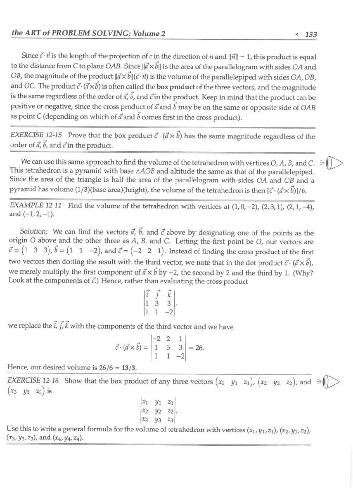

## Printed page 134

<!-- source: volume-2, PDF page 156, printed page 134 -->

### 12.5 Curved Surfaces

The equation $x^2 + y^2 = r^2$ is a circle when plotted in a plane; however, if we consider this as an equation in three dimensions, we have no restriction on $z$. Hence, for every value of $z$ we have a circle of radius $r$. The resulting graph is an infinite cylinder whose axis is the $z$ axis and radius has length $r$. We can write this with parameters $z$ and $\theta$ as

$$x = r \cos \theta$$
$$y = r \sin \theta$$
$$z = z.$$

The parameters $(r, \theta, z)$ as defined above can be used to identify any point in space, just as polar coordinates $(r, \theta)$ locate any point in the plane. Thus these cylindrical coordinates are a new set of three dimensional coordinates, which can be used where convenient as an alternative to the Cartesian coordinates $(x, y, z)$.

**EXAMPLE 12-12 Express the Cartesian point $(3, 3, 3)$ in cylindrical coordinates.**

Solution: The third coordinate remains the same, 3. The first two, $(3, 3)$, we put in polar coordinates as $r = 3\sqrt{2}$ and $\theta = 45^\circ$. Hence, the point is $(3\sqrt{2}, 45^\circ, 3)$.

**EXERCISE 12-17 Express the cylindrical coordinate point $(3, 120^\circ, -4)$ in rectangular coordinates.**

**EXERCISE 12-18 Find an equation in cylindrical coordinates for a cylinder whose axis is the $z$ axis.**

In the same way that a circle is the set of points equidistant from a given point in a plane, a sphere is the set of points equidistant from a given point in space. Let the center be $(x_0, y_0, z_0)$ and the distance be $\rho$. From the distance formula, for any point $(x, y, z)$ on the sphere we have

$$\rho = \sqrt{(x - x_0)^2 + (y - y_0)^2 + (z - z_0)^2}.$$

Squaring this we have the general form for a sphere: $(x - x_0)^2 + (y - y_0)^2 + (z - z_0)^2 = \rho^2.$

Having seen the parameterization for cylinders and knowing of the one for circles, we figure there must be some convenient parameterization for the sphere. We'll consider the sphere

$$x^2 + y^2 + z^2 = \rho^2.$$

Connect any point $P$ on the sphere with the origin $O$. Let $\phi$ be the angle formed by $OP$ and the positive $z$ axis, where $0 \leq \phi \leq \pi$. Hence, if the point is above the $xy$ plane (i.e. the plane $z = 0$), we have $0 \leq \phi \leq \pi/2$, and if it is below, $\pi/2 \leq \phi \leq \pi$. We then let $\theta$ be the angle between the projection, $OX$, of $OP$ onto the $xy$ plane and the positive $x$ axis, just as in polar and cylindrical coordinates. Since in the diagram $OP = \rho$ and $\angle POX = 90^\circ - \phi$, we find $PX = \rho \sin(90^\circ - \phi) = \rho \cos \phi$ and $OX = \rho \cos(90^\circ - \phi) = \rho \sin \phi$. If we then project $OX$ onto the $x$ axis, we find that the $x$ coordinate is

Original scan — PDF page 156

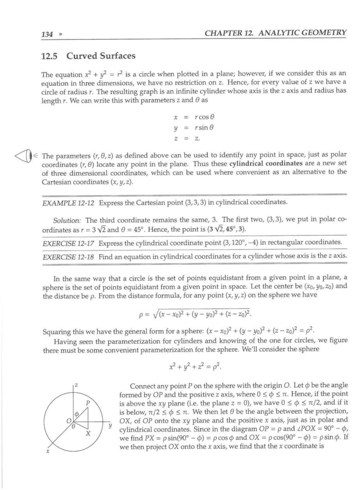

## Printed page 135

<!-- source: volume-2, PDF page 157, printed page 135 -->

$(OX)(\cos \theta) = \rho \cos \theta \sin \phi$ and the $y$ coordinate is $\rho \sin \theta \sin \phi$. Hence, we describe the sphere as

$$x = \rho \cos \theta \sin \phi$$
$$y = \rho \sin \theta \sin \phi$$
$$z = \rho \cos \phi.$$

These are spherical coordinates. For any point $P, \phi$ is the angle $OP$ makes with the positive $z$ axis, $\theta$ is the angle the projection of $OP$ onto the $xy$ plane makes with the positive $x$ axis, and $\rho$ is the length of $OP$.

**EXERCISE 12-19** Prove that $x^2 + y^2 + z^2 = \rho^2$ for our spherical parameterization above.

**EXAMPLE 12-13** Express the point $(-2\sqrt{2}, 2\sqrt{2}, 4)$ in spherical coordinates.

**Solution:** Finding $\rho$ is easy:

$$\rho = \sqrt{x^2 + y^2 + z^2} = \sqrt{(-2\sqrt{2})^2 + (2\sqrt{2})^2 + 4^2} = 4\sqrt{2}.$$

Since $z = \rho \cos \phi = 4\sqrt{2} \cos \phi$, we find $\cos \phi = \sqrt{2}/2$ and $\phi = 45^\circ$. Finally, the value of $\theta$ is the same as when we put $(-2\sqrt{2}, 2\sqrt{2})$ in polar coordinates, or $135^\circ$, since the point is in the second quadrant and $\tan \theta = -1$. Hence, the point is $(\rho, \theta, \phi) = (4\sqrt{2}, 135^\circ, 45^\circ).$

**EXAMPLE 12-14** Express the cylinder $x^2 + y^2 = 1$ in spherical coordinates.

**Solution:** Since $x = \rho \cos \theta \sin \phi$ and $y = \rho \sin \theta \sin \phi$, we have

$$x^2 + y^2 = \rho^2 \cos^2 \theta \sin^2 \phi + \rho^2 \sin^2 \theta \sin^2 \phi = \rho^2 \sin^2 \phi,$$

so our equation is $\rho^2 \sin^2 \phi = 1.$

**EXERCISE 12-20** Find the equation of a sphere with center at the origin in spherical coordinates.

**EXERCISE 12-21** What is the graph of $\rho = \rho_1$, where $\rho_1$ is a constant? How about $\theta = \theta_1$? And $\phi = \phi_1$?

**EXERCISE 12-22** What geometrical figure is described by the equation $x^2 + y^2 = z^2$?

### 12.6 Using Analytic Geometry

Although it’s usually a painful process, some geometry problems can be attacked by labelling the given figures in the plane and using algebra. We’ll just do an example here to show you how analytical geometry can be useful.

Original scan — PDF page 157

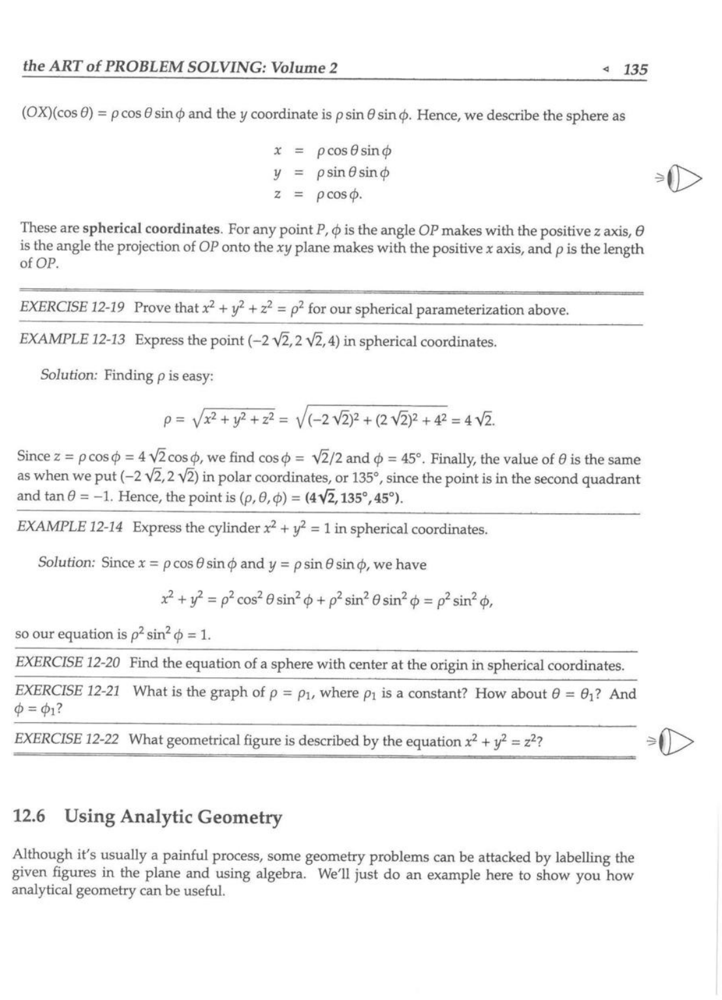

## Printed page 136

<!-- source: volume-2, PDF page 158, printed page 136 -->

**EXAMPLE 12-15 The sides $AD$ and $BC$ of a convex quadrilateral $ABCD$ are extended to meet at $E$. Let $H$ and $G$ be the midpoints of $BD$ and $AC$, respectively. Find the ratio of the area of the triangle $EHG$ to that of the quadrilateral $ABCD$. (Canada 1978)**

Solution: Let $A$ be the origin, $B$ be $(a, b)$, $C$ be $(c, d)$, and point $D$ be $(1, 0)$. Since point $E$ is on the $x$ axis, it is the point on line $BC$ where $y = 0$. Since the line through $B$ and $C$ is

$$y - b = \frac{d - b}{c - a}(x - a),$$

the coordinates of $E$ are $((ad - bc)/(d - b), 0)$. Since $G$ and $H$ are the midpoints of $AC$ and $BD$, they have coordinates $\left(\frac{c}{2}, \frac{d}{2}\right)$ and $\left(\frac{a+1}{2}, \frac{b}{2}\right)$, respectively. Using our methods from earlier in the chapter to find the area of a triangle, we have

$$[ABCD] = [AEB] - [CDE]$$

$$= \frac{1}{2} \left| \begin{array}{ccc}
0 & 0 & 1 \\
\frac{ad - bc}{d - b} & 0 & 1 \\
a & b & 1 \\
\end{array} \right| - \frac{1}{2} \left| \begin{array}{ccc}
c & d & 1 \\
1 & 0 & 1 \\
\frac{ad - bc}{d - b} & 0 & 1 \\
\end{array} \right|$$

$$= (bc - ad + d)/2$$

and

$$[GEH] = \frac{1}{2} \left| \begin{array}{ccc}
\frac{c}{2} & \frac{d}{2} & 1 \\
\frac{ad - bc}{d - b} & 0 & 1 \\
\frac{a+1}{2} & \frac{b}{2} & 1 \\
\end{array} \right|$$

$$= (bc - ad + d)/8$$

Hence, $[GEH] = [ABCD]/4$ and our desired ratio is 1/4.

WARNING: Don’t fall into the trap of using analytical geometry often to solve normal geometry problems. It is rarely the best way to go. For those of you who really like the concepts of analytical geometry, there is a happy medium between coordinate geometry and Euclidean principles: the use of vectors.

### 12.7 Vectors and Geometry Problems

First we’ll do a review of vector addition and subtraction. In the diagram, suppose we are interested in adding vectors $\overrightarrow{OA}$ and $\overrightarrow{OB}$. (Remember that the tail of the vector comes first in writing the vector, as in $\overrightarrow{OB}$.) If we let $O$ be the origin, we can write the two vectors as $\vec{A}$ and $\vec{B}$. To add these, we copy vector $\vec{B}$ with $A$ as its tail forming $\overrightarrow{AX}$. The result of the addition $\vec{A} + \vec{B}$ is the vector from our original starting point, $O$, to the final point, $X$, or

$$\vec{A} + \vec{B} = \overrightarrow{OX}.$$

Original scan — PDF page 158

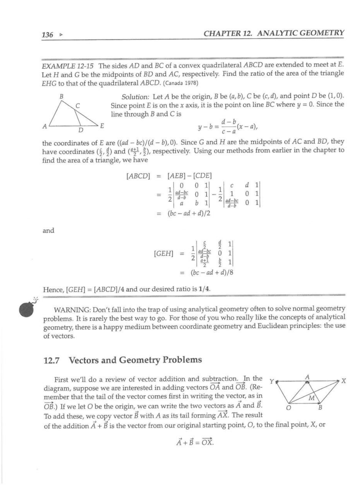

## Printed page 137

<!-- source: volume-2, PDF page 159, printed page 137 -->

Notice that in finding $\vec{A} + \vec{B}$, we start from $O$, travel in the magnitude and direction of $\vec{A}$, then travel $\vec{B}$. Similarly, to find $\vec{A} - \vec{B}$, we go from $O$ to $A$, then starting from $A$ we go in the direction and magnitude of $-\vec{B}$, or $\vec{AY}$ in the diagram. The result is $\overrightarrow{OY}$. Since $AY \parallel BO$ and $AY = BO$, quadrilateral $OBAY$ is a parallelogram. Hence, $\overrightarrow{OY}$ has the same magnitude and direction as $\overrightarrow{BA}$. Thus, we can represent the vector from $B$ to $A$ as $\vec{A} - \vec{B}$.

**EXERCISE 12-23** Show that for points $A, B$, and $C$, we can write $\overrightarrow{AB} + \overrightarrow{BC} = \overrightarrow{AC}$.

**EXERCISE 12-24** What is $\overrightarrow{AB} - \overrightarrow{AC}$?

There is one last important relation to take from this initial diagram. Since $OAXB$ is a parallelogram, point $M$, the intersection of the diagonals, is the midpoint of $AB$ and $OX$. Since $\overrightarrow{OM}$ is in the same direction as $\overrightarrow{OX}$ and $OX = 2(OM)$, we have

$$\overrightarrow{OM} = \frac{\overrightarrow{OX}}{2} = \frac{\vec{A} + \vec{B}}{2}.$$

**EXAMPLE 12-16** With respect to some arbitrary origin, points $A, B$, and $C$ are represented by $\vec{A}, \vec{B}$, and $\vec{C}$. Find vector representations of the sides and medians of $\Delta ABC$.

**Solution:** Side $AB$ is represented by the vector from $A$ to $B$, or $\vec{B} - \vec{A}$ by the discussion above. Similarly, the other two sides are $\vec{C} - \vec{B}$ and $\vec{A} - \vec{C}$. (The negatives of any of these three are also valid representations of the sides.) As for the median from point $A$, we know it connects $A$ to the midpoint of $BC$. We can represent the midpoint, $M$, of $BC$ as $\vec{M} = (\vec{B} + \vec{C})/2$. Hence, we have

$$\overrightarrow{AM} = \vec{M} - \vec{A} = \frac{\vec{B} + \vec{C} - 2\vec{A}}{2}.$$

The other medians are found in the same way.

**EXERCISE 12-25** Let $X$ be a point on $AB$ such that $AX = 2(BX)$. Find a vector representation for $\vec{X}$ in terms of $\vec{A}$ and $\vec{B}$.

**EXAMPLE 12-17** Let the sides $AB, BC$, and $AC$ of $\Delta ABC$ be $c, a$, and $b$, respectively, and the foot of the angle bisector from $A$ be point $D$. Prove that

$$\vec{D} = \frac{b\vec{B} + c\vec{C}}{b + c}.$$

**Proof:** In working the previous exercise, you should have found that the vector representation of a point $X$ on segment $YZ$ such that $XY = y$ and $XZ = z$

$$\vec{X} = \frac{z\vec{Y} + y\vec{Z}}{y + z}.$$

Original scan — PDF page 159

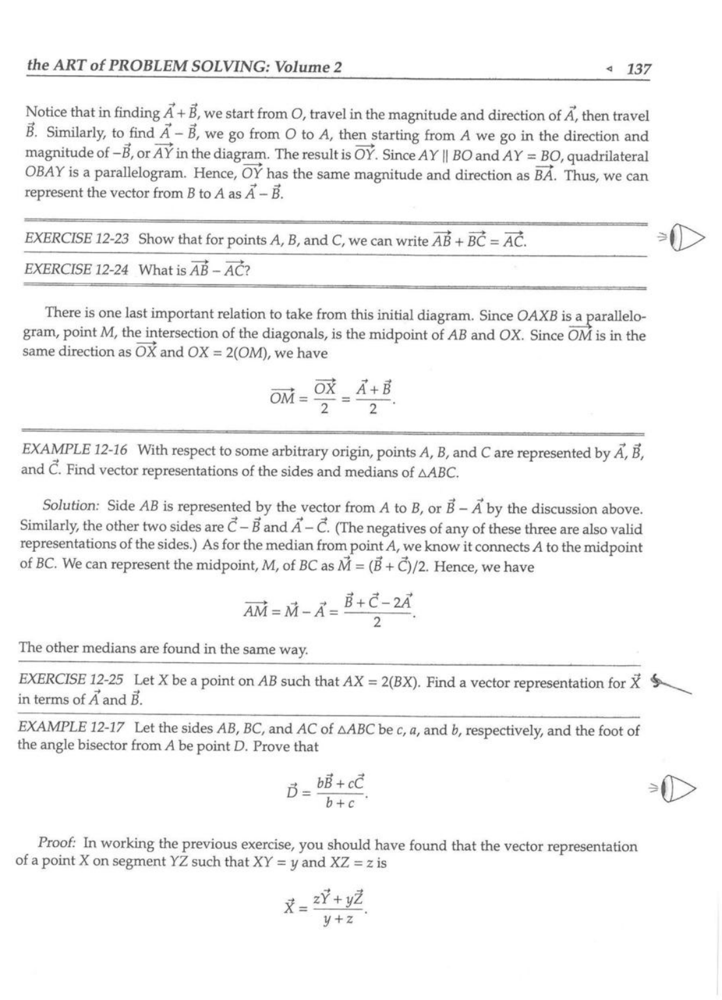

## Printed page 138

<!-- source: volume-2, PDF page 160, printed page 138 -->

Applying this to point $D$ on $BC$, we have

$$\vec{D} = \frac{(BD)\vec{C} + (CD)\vec{B}}{BD + CD}.$$

We need to relate $BD$ and $CD$ to the sides of the triangle, so we turn to the Angle Bisector Theorem, which gives $BD/CD = AB/AC = c/b$. Dividing the top and bottom of our fraction for $\vec{D}$ by $CD$, we find

$$\vec{D} = \frac{(c/b)\vec{C} + \vec{B}}{c/b + 1} = \frac{c\vec{C} + b\vec{B}}{c + b}.$$

We can use vectors to determine intersections. For example, how can we represent the centroid of a triangle with vectors? Let $\vec{G}$ be the vector representing the centroid, and the midpoints of $BC$ and $AC$ be at $M$ and $N$, respectively. Since $G$ is on $AM$ and $BN$, we know that $\overrightarrow{AG}$ is in the same direction as $\overrightarrow{AM}$ and $\overrightarrow{BG}$ is in the same direction as $\overrightarrow{BN}$. Here's the key: if vectors $\vec{x}$ and $\vec{y}$ are in the same direction, then there is some constant $c$ such that $\vec{x} = c\vec{y}$. (Why?) Hence, there is some pair of constants $c_1$ and $c_2$ such that $\overrightarrow{AG} = c_1\overrightarrow{AM}$ and $\overrightarrow{BG} = c_2\overrightarrow{BN}$, or

$$\vec{G} - \vec{A} = c_1\left(\frac{\vec{B} + \vec{C}}{2} - \vec{A}\right)$$

$$\vec{G} - \vec{B} = c_2\left(\frac{\vec{A} + \vec{C}}{2} - \vec{B}\right).$$

Since $\vec{G}$ must be the same in both of these, we find

$$\vec{G} = c_1\left(\frac{\vec{B} + \vec{C}}{2} - \vec{A}\right) + \vec{A} = c_2\left(\frac{\vec{A} + \vec{C}}{2} - \vec{B}\right) + \vec{B}.$$

Since $\vec{A}, \vec{B}$, and $\vec{C}$ are arbitrary, the coefficients of these must be the same on both sides of the equality above. Matching coefficients of $\vec{C}$, we have $c_1 = c_2$, and matching those of $\vec{A}$ or $\vec{B}$, we find they both equal 2/3. Putting these back in the above expression for $\vec{G}$, we have

$$\vec{G} = \frac{\vec{A} + \vec{B} + \vec{C}}{3}$$

as our representation of the centroid of $\Delta ABC$.

Let's try altitudes now. Let $H$ be the orthocenter of $\Delta ABC$. Since the line from $A$ through $H$ is perpendicular to $BC$, the vector $\vec{H} - \vec{A}$ must be normal to $\vec{B} - \vec{C}$. Vectors which are perpendicular have a dot product of 0 (remember this, it's a very good way to use vectors), so we can write

$(\vec{H} - \vec{A}) \cdot (\vec{B} - \vec{C}) = (\vec{H} - \vec{B}) \cdot (\vec{C} - \vec{A}) = (\vec{H} - \vec{C}) \cdot (\vec{A} - \vec{B}) = 0.$

(12.1)

Now we appear stuck. There's no obvious simple way to find $\vec{H}$. This leads us to yet another clever technique when working with vectors. We can choose any origin we want when working with vectors, so we should choose an origin which simplifies our problem. In most triangle problems,

Original scan — PDF page 160

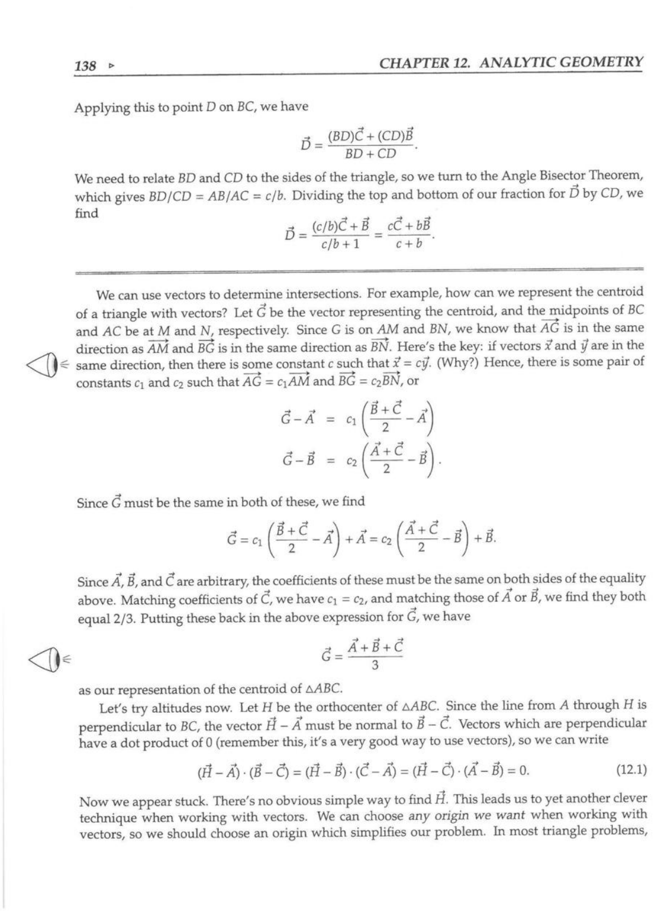

## Printed page 139

<!-- source: volume-2, PDF page 161, printed page 139 -->

this convenient origin is the circumcenter of the triangle, because in this case, $\vec{A}, \vec{B}$, and $\vec{C}$ all have the same length (because the circumcenter of a triangle is equidistant from the vertices of the triangle). Now let’s re-examine the equations (12.1) and try guessing a form of $\vec{H}$. The best one that stands out is simply $\vec{H} = \vec{A} + \vec{B} + \vec{C}$ since it is symmetric (since $\vec{A}, \vec{B}$, and $\vec{C}$ are arbitrary, symmetric forms are a good place to start). Thus, we find

$$\vec{H} - \vec{A} \cdot (\vec{B} - \vec{C}) = (\vec{B} + \vec{C}) \cdot (\vec{B} - \vec{C}) = \vec{B} \cdot \vec{B} - \vec{B} \cdot \vec{C} + \vec{C} \cdot \vec{B} - \vec{C} \cdot \vec{C}.$$

Since $\vec{B} \cdot \vec{C} = \vec{C} \cdot \vec{B}$ and $\vec{x} \cdot \vec{x} = \|\vec{x}\|^2$, we find $(\vec{H} - \vec{A}) \cdot (\vec{B} - \vec{C}) = \|\vec{B}\|^2 - \|\vec{C}\|^2 = 0$, since $\vec{B}$ and $\vec{C}$ have the same length. Similarly, the other two expressions are also 0 and we find that

$$\vec{H} = \vec{A} + \vec{B} + \vec{C}$$

is the vector representation of the orthocenter of a triangle when the origin is taken to be the circumcenter.

From this proof we see the importance of cleverly choosing the origin. (The circumcenter is usually best for triangles.) The following example shows how vectors can be used to simplify seemingly complicated problems.

**EXAMPLE 12-18** Vertex $A$ of the acute triangle $ABC$ is equidistant from the circumcenter $O$ and the orthocenter $H$. Determine all possible values for the measure of angle $A$. (IMO 1989)

**Solution:** Letting the circumcenter be the origin of our vector system, we can write the restriction that $O$ and $H$ are equidistant from $A$ as $\|\vec{A} - \vec{O}\| = \|\vec{A}\| = \|\vec{A} - \vec{H}\|$. Squaring this and noting that $\|\vec{A}\| = \|\vec{B}\| = \|\vec{C}\| = R$, the circumradius, and that $\vec{H} = \vec{A} + \vec{B} + \vec{C}$, we have

$$R^2 = \|\vec{A} - \vec{O}\|^2 = \|\vec{A} - \vec{H}\|^2 = \|\vec{B} + \vec{C}\|^2 = (\vec{B} + \vec{C}) \cdot (\vec{B} + \vec{C}).$$

Expanding the right side and noting that

$$a^2 = \|\vec{B} - \vec{C}\|^2 = (\vec{B} - \vec{C}) \cdot (\vec{B} - \vec{C}) = \|\vec{B}\|^2 + \|\vec{C}\|^2 - 2\vec{B} \cdot \vec{C},$$

where $a$ is the length of side $BC$, we find

$$R^2 = \|\vec{B}\|^2 + 2\vec{B} \cdot \vec{C} + \|\vec{C}\|^2 = \|\vec{B}\|^2 + \|\vec{C}\|^2 + \|\vec{B}\|^2 + \|\vec{C}\|^2 - a^2 = 4R^2 - a^2.$$

Hence, $a/R = \sqrt{3}$ and from the law of sines we have $a/R = 2\sin A$, so $\sin A = \sqrt{3}/2$ and $\angle A = 60^\circ$ is the only possible value of $\angle A$.

**EXERCISE 12-26** Use the result of Example 12-17 to show that if $I$ is the incenter of $\triangle ABC$ with $a = BC, b = AC$, and $c = AB$, then

$$\vec{I} = \frac{a\vec{A} + b\vec{B} + c\vec{C}}{a + b + c}.$$

**EXAMPLE 12-19** Prove that if the vectors from the origin $O$ to points $A$ and $C$ are $\vec{A}$ and $\vec{C}$, respectively, then

$$(\vec{A} - \vec{C}) \cdot (\vec{A} - \vec{C}) = \|\vec{A}\|^2 + \|\vec{C}\|^2 + \|\vec{A}\| \|\vec{C}\|$$

Original scan — PDF page 161

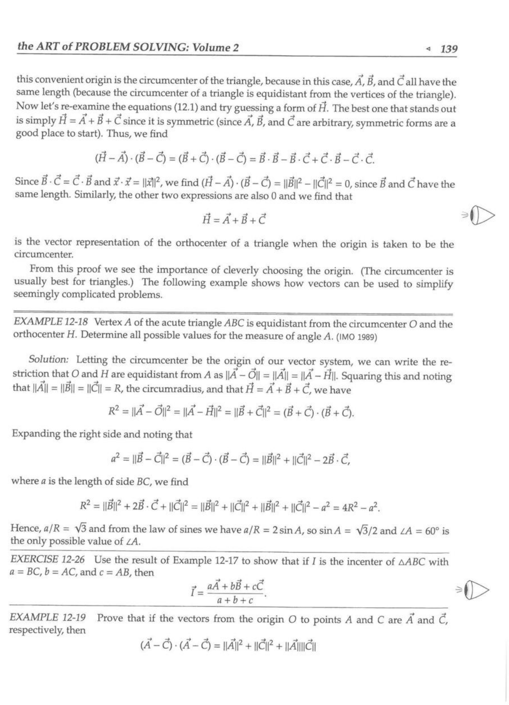

## Printed page 140

<!-- source: volume-2, PDF page 162, printed page 140 -->

implies that $\angle AOC = 120^\circ$.

Proof: Applying the law of cosines to $\triangle AOC$, we have
$$AC^2 = OA^2 + OC^2 - 2(OA)(OC) \cos \angle AOC.$$
Since $AC$ is represented by $\vec{A} - \vec{C}$, we have $AC^2 = \lVert \vec{A} - \vec{C}\rVert^2 = (\vec{A} - \vec{C}) \cdot (\vec{A} - \vec{C})$. Similarly, we have $OA = \lVert \vec{A}\rVert$ and $OC = \lVert \vec{C}\rVert$. Making these substitutions in our law of cosines, we have
$(\vec{A} - \vec{C}) \cdot (\vec{A} - \vec{C}) = \lVert \vec{A}\rVert^2 + \lVert \vec{C}\rVert^2 - 2\lVert\vec{A}\rVert\lVert \vec{C}\rVert \cos \angle AOC.$
Comparing this to the expression in the problem, we find $\cos \angle AOC = -1/2$, so $\angle AOC = 120^\circ$. When working with vectors, keep an eye out for expressions like the one in this problem so you can identify $120^\circ$ angles.

**EXERCISE 12-27 In the spirit of the above problem, what do we know about $\angle AOC$ if**
$(\vec{A} - \vec{C}) \cdot (\vec{A} - \vec{C}) = \lVert \vec{A}\rVert^2 + \lVert \vec{C}\rVert^2 - \lVert\vec{A}\rVert\lVert \vec{C}\rVert$?

Finally, let’s take a look at how we can use vectors on three dimensional problems. As we discussed in Volume 1, most three dimensional problems are merely two dimensional problems in hiding. The solution to the problem can be found by choosing the correct two dimensional cross section. There are some (but not too many) more complicated problems which cannot be solved with planar cross sections, but most of these are a bit beyond the scope of our discussion. We will, however, introduce the use of vectors to solve some of these problems.

**EXAMPLE 12-20 Let $G$ be the centroid of face $BCD$ of regular tetrahedron $ABCD$. Prove that $AG$ is perpendicular to $BCD$.**

Proof: For each point $X$, let the vector $\vec{X}$ represent the vector from the origin to $X$. Since $G$ is the centroid of $\triangle BCD$, we have
$$\vec{G} = \frac{\vec{B} + \vec{C} + \vec{D}}{3}.$$
In order to prove that $AG$ is perpendicular to face $BCD$, we must show that $\overrightarrow{AG}$ is perpendicular to some vector in the plane $BCD$. One such vector in the plane $BCD$ is $\vec{B} - \vec{C}$, the vector from $C$ to $B$. Hence, we must show that $(\overrightarrow{AG}) \cdot (\vec{B} - \vec{C}) = 0$. Now we choose the origin to simplify the problem. We let point $A$ be the origin because then $\overrightarrow{AG} = \vec{G}$, and vectors $\vec{B}, \vec{C}$, and $\vec{D}$ represent the edges from $A$ to the other vertices of the tetrahedron. Hence, we have
$(\overrightarrow{AG}) \cdot (\vec{B} - \vec{C}) = \left( \frac{\vec{B} + \vec{C} + \vec{D}}{3} \right) \cdot (\vec{B} - \vec{C}) = \frac{1}{3} (\vec{B} \cdot \vec{B} - \vec{C} \cdot \vec{C} + \vec{B} \cdot \vec{D} - \vec{C} \cdot \vec{D}).$
How do we evaluate each of these terms? First note that the lengths of $\vec{B}, \vec{C}$, and $\vec{D}$ are the same. Let this length be $x$. Hence, $\vec{B} \cdot \vec{B} = \vec{C} \cdot \vec{C} = x^2$. Since the faces of $ABCD$ are equilateral triangles, $\vec{B} \cdot \vec{D} = \vec{C} \cdot \vec{D} = x^2 \cos 60^\circ = x^2/2$. Making these substitutions in the above expression yields
$(\overrightarrow{AG}) \cdot (\vec{B} - \vec{C}) = 0,$

Original scan — PDF page 162

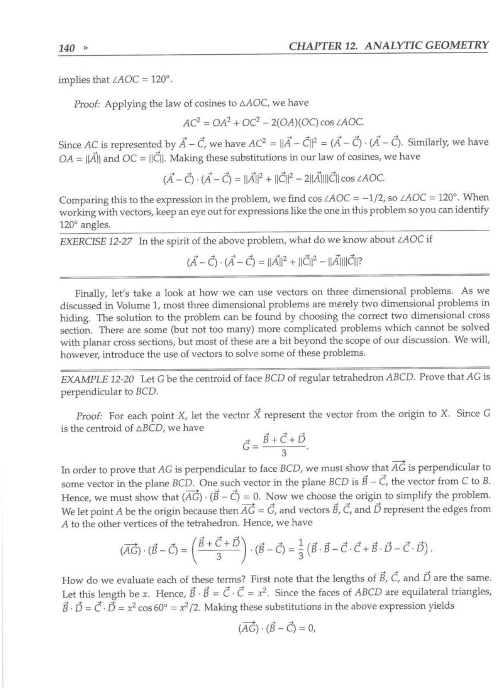

## Printed page 141

<!-- source: volume-2, PDF page 163, printed page 141 -->

as desired. Hence, the line from a vertex to the centroid of the opposite face of a regular tetrahedron is the altitude from that vertex to the opposite face.

**EXAMPLE 12-21 Point $X$ is such that**

$$\vec{X} = \frac{\vec{A} + \vec{B} + \vec{C}}{4}$$

represents the vector from the origin to $X$. A segment from each vertex of tetrahedron $ABCD$ is drawn to the centroid of the opposite face. Prove that $X$ is on all four of these segments, thus showing that they are concurrent. The point at the head of $\vec{X}$ defined above is called the centroid of the tetrahedron.

Proof: Let $G$ be the centroid of face $BCD$. To show that $X$ is on $AG$, we must prove that $\vec{X} - \vec{A}$ and $\vec{G} - \vec{A}$ are in the same direction. To prove these vectors are in the same direction we must show that there is some constant such that $\vec{X} - \vec{A} = c(\vec{G} - \vec{A})$. Writing these vectors in terms of the vertices, we find

$$\vec{X} - \vec{A} = \frac{\vec{A} + \vec{B} + \vec{C}}{4} - \vec{A} = \frac{\vec{B} + \vec{C} - 3\vec{A}}{4};$$

$$\vec{G} - \vec{A} = \frac{\vec{B} + \vec{C} - 3\vec{A}}{3}.$$

Hence, we have $\vec{X} - \vec{A} = (3/4)(\vec{G} - \vec{A})$. Thus, $X$ is on $AG$ and we can also show that $X$ is on each of the other 3 similarly defined segments, so all four of these segments are therefore concurrent. Furthermore, the point $X$ divides each segment in the ratio $3:1$, just like the centroid of an equilateral triangle divides each median in the ratio $2:1$.

**EXERCISE 12-28 If $ABCD$ is a regular tetrahedron, what can we say about the altitudes of $ABCD$ based on the prior example?**

**EXERCISE 12-29 Complete our analogy of the point $X$ in the above example in a regular tetrahedron to the centroid of an equilateral triangle. What is the ratio of the radius of the sphere inscribed in regular tetrahedron $ABCD$ to the altitude length of $ABCD$? How about the radius of the circumscribed sphere?**

**EXERCISE 12-30 Find the altitude length, the volume, the radius of the inscribed sphere, and the radius of the circumscribed sphere of a regular tetrahedron with side length 6.**

Problems to Solve for Chapter 12

173. Find the volume of the tetrahedron with vertices $A(0, -1, 3), B(3, 2, 1), C(1, -1, 2)$, and $D(2, 3, 1)$. (MAΘ 1991)

174. If $x = 1 + 2^p$ and $y = 1 + 2^{-p}$, then find $y$ in terms of $x$. (AHSME 1970)

175. Find the volume of the region satisfying $0 \leq z \leq 6$ and $x^2 + y^2 \leq z^2$.

Original scan — PDF page 163

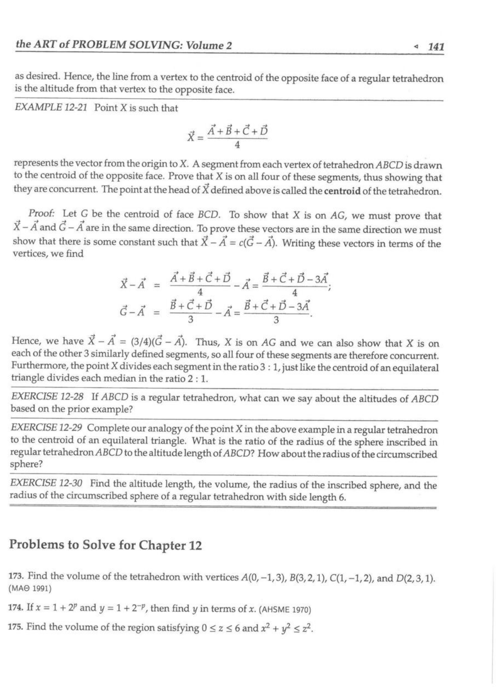

## Printed page 142

<!-- source: volume-2, PDF page 164, printed page 142 -->

176. Given a point $P$ in the octant of space where $x, y, z > 0$, the line connecting point $P$ with the origin makes angles $\theta_1$ with the $z$ axis, $\theta_2$ with the $x$ axis, and $\theta_3$ with the $y$ axis. Given that $\cos \theta_1 = R$ and $\cos \theta_2 = S$, find $\cos \theta_3$. (MAΘ 1992)

177. Find a parametric representation of the line through $(1, 2, 3)$ and $(-2, -1, -3)$.

178. If $A, B, C, D$ are four points in space such that

$$\angle ABC = \angle BCD = \angle CDA = \angle DAB = \pi/2,$$

prove that $A, B, C, D$ lie in a plane. (Canada 1976)

179. Find $k$ if $P, Q, R,$ and $S$ are points on the sides of quadrilateral $ABCD$ so that

$$\frac{AP}{PB} = \frac{BQ}{QC} = \frac{CR}{RD} = \frac{DS}{SA} = k,$$

and the area of quadrilateral $PQRS$ is exactly 52% of the area of quadrilateral $ABCD$. (USAMTS 3)

180. There are two spherical balls of different sizes lying in two corners of a rectangular room, each touching two walls and the floor. If there is a point on each ball which is 5 inches from each wall which that ball touches and 10 inches from the floor, then find the sum of the diameters of the balls. (AHSME 1977)

181. Let $P$ be a point on hypotenuse $AB$ (or its extension) of isosceles right triangle $ABC$. Prove that for all such $P, 2CP^2 = AP^2 + PB^2$. (AHSME 1969)

182. Find the volume of the region in space defined by $|x + y + z| + |x + y - z| \leq 8$, where $x, y, z \geq 0$. (Mandelbrot #1)

183. In right-angled parallelepiped $ABCDA_1B_1C_1D_1$ diagonal $AC_1$ is perpendicular to the plane containing triangle $A_1BD$. Prove that $ABCDA_1B_1C_1D_1$ is a cube. (M&IQ 1992)

184. The altitudes of a tetrahedron $ABCD$ are extended externally to points $E, F, G,$ and $H$ respectively, where $AE = k/h_a$, $BF = k/h_b$, $CG = k/h_c,$ and $DH = k/h_d$. Here, $k$ is a constant and $h_a$ denotes the length of the altitude of $ABCD$ from vertex $A,$ etc. Prove that the centroid of the tetrahedron $EFGH$ coincides with the centroid of $ABCD$. (Canada 1982)

Original scan — PDF page 164

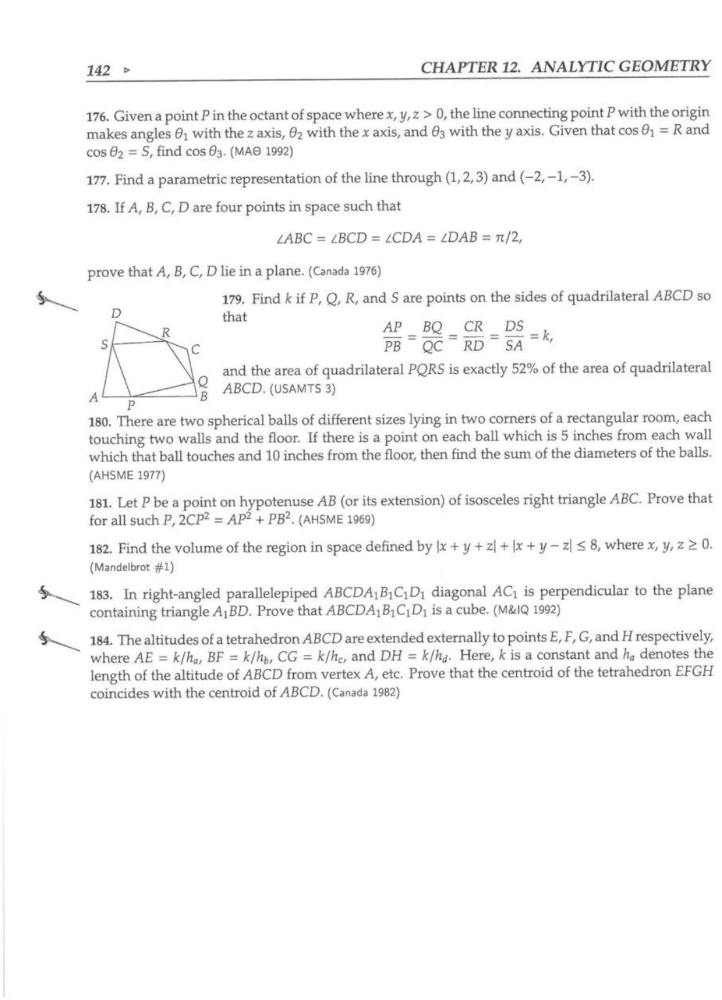

