# Chapter 13: Equations and Expressions

Volume 2 · Printed pages 143–158 · PDF pages 165–180

[Volume contents](../index.md)

## Printed page 143

<!-- source: volume-2, PDF page 165, printed page 143 -->

### 13.1 Linear Equations

In the first volume we solved linear equations in one variable and systems of equations in two variables. Since $x + y + z = 6$ describes a whole plane, there are clearly infinitely many solutions to this equation. What if we add another equation, like in the system below:

$$x + y + z = 6$$
$$x + 3y + 2z = 15?$$

How does this system differ from the systems of two equations we examined in Volume 1? There are 3 variables among the equations rather than 2. If a point $(x, y, z)$ satisfies both of these, then it must be on both of the planes they represent in three dimensional Cartesian space. Hence, it is on the line which is the intersection of the planes. Since a line also contains infinitely many points, we once again can’t find a finite number of solutions to the system. Let’s try adding another equation, so we have the system

$$x + y + z = 6$$
$$x + 3y + 2z = 15$$
$$2x - 2y + 3z = -9.$$

Since any solution to the first two equations lies on the line formed by the intersection of the corresponding planes, the simultaneous solution to all three equations is the intersection of this line with the third plane. In what ways can a line intersect a plane? The intersection can be a line (if the line is in the plane), a point (the most common), or no intersection (if the line is parallel to the plane).

Since we know how to solve a two variable, two equation system, we solve the three equation system by reducing it to a two variable one. We do this by eliminating $z$. This technique is the same as in Volume 1. If we multiply the first equation by 2 and the second by $-1$, our system is

$$2x + 2y + 2z = 12$$
$$-x - 3y - 2z = -15$$
$$2x - 2y + 3z = -9.$$

Original scan — PDF page 165

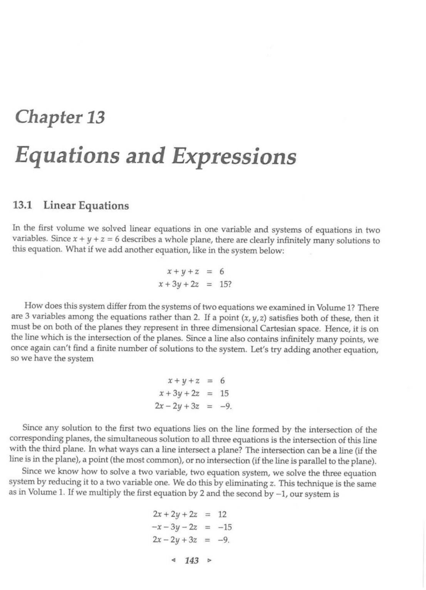

## Printed page 144

<!-- source: volume-2, PDF page 166, printed page 144 -->

Now we add the first equation to the second, yielding

$$2x + 2y + 2z = 12$$
$$x - y = -3$$
$$2x - 2y + 3z = -9.$$

We write the first equation back in its original form (just divide by 2), then multiply it by 3 and the last equation by $-1$ so we can eliminate $z$ from that one too:

$$3x + 3y + 3z = 18$$
$$x - y = -3$$
$$-2x + 2y - 3z = 9.$$

Now we add the first equation to the third, which gives us

$$3x + 3y + 3z = 18$$
$$x - y = -3$$
$$x + 5y = 27.$$

Now neither of the last two equations has a $z$. We can solve these last two equations to find $x = 2$ and $y = 5$. We’re not done though because we must go back and find $z$. Putting these $x$ and $y$ values back into the first equation, we find $z = -1$; thus, our answer is $(x, y, z) = (2, 5, -1)$. The method we have used is exactly the same as the elimination we used for systems of two equations in two variables (just a hair more complicated).

Notice that for 3 variables, we need at least 3 equations to determine a single solution. If we have fewer than three equations, there will either be no solutions (two equations determine parallel planes) or infinitely many solutions (two equations determine planes that intersect in a line).

If we have three equations do we always have a single solution? No! Remember from our two variable systems, that sometimes no solution exists (when the two lines are parallel), and sometimes there are infinitely many solutions (when the lines are the same). Similarly, with three equations and variables, two planes may be parallel, or one plane may be parallel to the intersection line of the other two. In these cases, there are no solutions since there is no point where all three planes intersect. Furthermore, the third plane might contain the entire intersection line of the other two planes. Here, there are infinitely many solutions (every point on the line is on all three planes).

**EXERCISE 13-1** Take three sheets of paper and investigate all the ways three planes can intersect (or not intersect) each other. Determine how many solutions there are to the system of equations representing the planes in each case. (For example, if all three sheets meet at a single point and not a line, there is only one solution.)

**EXAMPLE 13-1** Solve the following system of equations:

$$x + y + 3z = 2$$
$$x - 2y + 2z = 1$$
$$2x - y + 5z = 3.$$

Original scan — PDF page 166

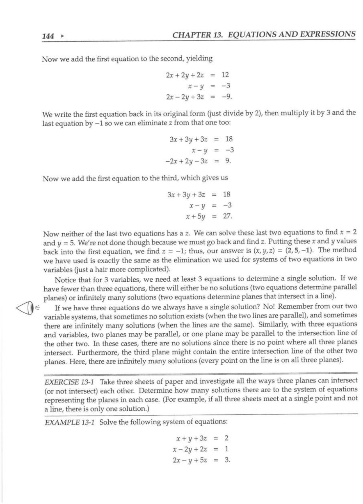

## Printed page 145

<!-- source: volume-2, PDF page 167, printed page 145 -->

First we eliminate $x$ from the second equation by subtracting the first from the second, yielding

$$x + y + 3z = 2$$
$$-3y - z = -1$$
$$2x - y + 5z = 3.$$

Now we use the first equation to eliminate $x$ from the last by multiplying the first equation by 2 and subtracting the result from the third equation. This process yields

$$x + y + 3z = 2$$
$$-3y - z = -1$$
$$-3y - z = -1.$$

The last two equations are the same. We can substitute any solution $(y, z)$ to these two equations into the first equation to get a value of $x$ such that $(x, y, z)$ is a solution to all three equations. There are infinitely many solutions $(y, z)$ to the last two equations and each leads to a solution $(x, y, z)$ to the original system. So there are infinitely many solutions $(x, y, z)$ to the system of three equations.

**EXERCISE 13-2 Name a few points which are solutions to the above system of equations.**

**EXERCISE 13-3 What would the solution to the prior example be if the third equation were $2x - y + 5z = 4$ instead?**

**EXERCISE 13-4 Why did we choose to eliminate $x$ from the equations first rather than eliminating $z$ as in our initial example?**

Rather than carrying around all the $x'$, $y'$, and $z'$, mathematicians have developed a shorthand, methodical way to solve these (and much bigger) systems of linear equations. For this technique, called Gaussian elimination, we copy the coefficients of our equations and the answers into a matrix as shown below, where each row of the matrix represents one of the equations. The system

$$x + y + z = 4$$
$$x - 2y + 3z = 4$$
$$-2x - 3y + z = -1$$

becomes

$$\begin{pmatrix}
1 & 1 & 1 & 4 \\
1 & -2 & 3 & 4 \\
-2 & -3 & 1 & -1 \\
\end{pmatrix},$$

where the coefficients of $x$ are in the first column, those of $y$ in the second, those of $z$ in the third, and the constants (which are always placed on the other side of the equal sign) are in the fourth column. We solve the system by first eliminating $x$ from the last two equations through standard matrix row operations. This is just like the operations we did to simplify determinants. If we add twice the first row of the matrix to the third row, we get

$$\begin{pmatrix}
1 & 1 & 1 & 4 \\
1 & -2 & 3 & 4 \\
0 & -1 & 3 & 7 \\
\end{pmatrix}.$$

Original scan — PDF page 167

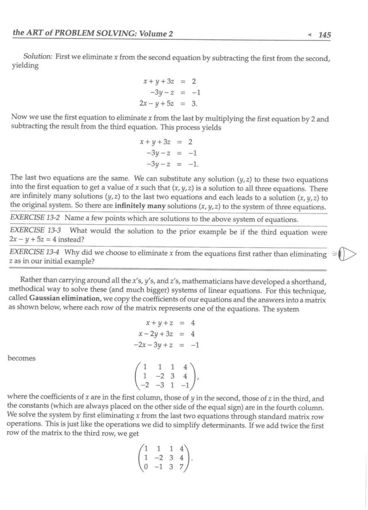

## Printed page 146

<!-- source: volume-2, PDF page 168, printed page 146 -->

Notice that the bottom left element is 0, so we have eliminated $x$ from that equation. We eliminate $x$ from the middle equation by subtracting the first row from the second, which leaves

$$\begin{pmatrix}
1 & 1 & 1 & 4 \\
0 & -3 & 2 & 0 \\
0 & -1 & 3 & 7
\end{pmatrix}.$$

Finally, we eliminate $y$ from the last equation by multiplying the last row by 3,

$$\begin{pmatrix}
1 & 1 & 1 & 4 \\
0 & -3 & 2 & 0 \\
0 & -3 & 9 & 21
\end{pmatrix},$$

and then subtracting the second row from the resulting third row. Our final matrix then is

$$\begin{pmatrix}
1 & 1 & 1 & 4 \\
0 & -3 & 2 & 0 \\
0 & 0 & 7 & 21
\end{pmatrix}.$$

If we convert this back into equations, we have

$$x + y + z = 4$$
$$-3y + 2z = 0$$
$$7z = 21$$

The last equation immediately gives us $z$, which we can use in the second to get $y$, then the first to get $x$. Make sure you see how this method is the same as our elimination technique. WARNING: Gaussian elimination works only if the coefficient of $x$ is nonzero in the first equation. If it is zero, you can't use the first row to eliminate $x$ from the other two equations. (Do you see why?) In such a case, you need to let the first row represent one of the other equations.

**EXAMPLE 13-2** What if Gaussian elimination results in

$$\begin{pmatrix}
1 & 1 & 1 & 4 \\
0 & -3 & 2 & 0 \\
0 & 0 & 0 & 0
\end{pmatrix}?$$

How about

$$\begin{pmatrix}
1 & 1 & 1 & 4 \\
0 & -3 & 2 & 0 \\
0 & 0 & 0 & 4
\end{pmatrix}?$$

**Solution:** For the first matrix, the corresponding equations are

$$x + y + z = 4$$
$$-3y + 2z = 0$$
$$0 = 0.$$

Original scan — PDF page 168

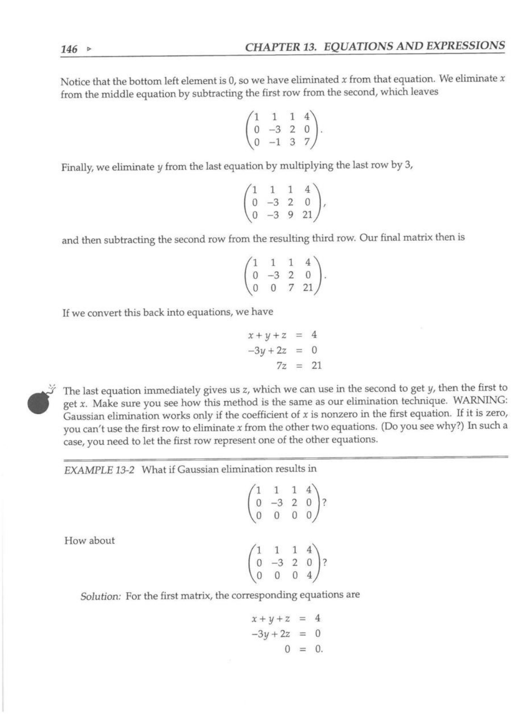

## Printed page 147

<!-- source: volume-2, PDF page 169, printed page 147 -->

The last equation is always true. The second equation gives us infinitely many pairs $(y, z)$ which we can use to find $x$'s, so there are infinitely many solutions. For the second matrix, the equations are

$$x + y + z = 4$$
$$-3y + 2z = 0$$
$$0 = 4.$$

Although again we can use the second to find infinitely many pairs $(y, z)$ and use these to get $x$'s, none of the resulting triplets $(x, y, z)$ will solve the last equation, which is clearly never true. Since the last equation can't ever be true, there is no point where all three can simultaneously be true. Hence, there are no solutions to this system.

**EXERCISE 13-5** Use Gaussian elimination to solve the system

$$4x + 2y + z = 3$$
$$2x - 3y + z = 6$$
$$x - 3y + 2z = 6.$$

You may think three variable systems are simple enough to do without Gaussian elimination, and the authors would certainly agree with you; however, as the systems get larger, the need for a methodical approach like Gaussian elimination increases drastically (most notably if you have such large systems that you need to program a computer to solve them—Gaussian elimination gives a nice algorithmic routine).

A different approach to equation solving is to express a system of equations as $A\vec{x} = \vec{b}$, where $A$ is a matrix representing the coefficients in the equations, $\vec{x}$ represents the variables, and $\vec{b}$ the constants. Take the system

$$x + 2y - 3z = 6$$
$$4x + y - 2z = 7$$
$$-x + y - 3z = 3.$$

We can represent this as

$$\begin{pmatrix}
1 & 2 & -3 \\
4 & 1 & -2 \\
-1 & 1 & -3
\end{pmatrix}\begin{pmatrix}
x \\
y \\
z
\end{pmatrix} = \begin{pmatrix}
6 \\
7 \\
3
\end{pmatrix},$$

because multiplying the two matrices on the left gives

$$\begin{pmatrix}
x + 2y - 3z \\
4x + y - 2z \\
-x + y - 3z
\end{pmatrix} = \begin{pmatrix}
6 \\
7 \\
3
\end{pmatrix},$$

which is the initial system of equations. If we can find $A^{-1}$, then we can solve the system of equations by multiplying both sides of $A\vec{x} = \vec{b}$ by $A^{-1}$, which gives $A^{-1}A\vec{x} = A^{-1}\vec{b}$, so

$$\vec{x} = A^{-1}\vec{b}.$$

Original scan — PDF page 169

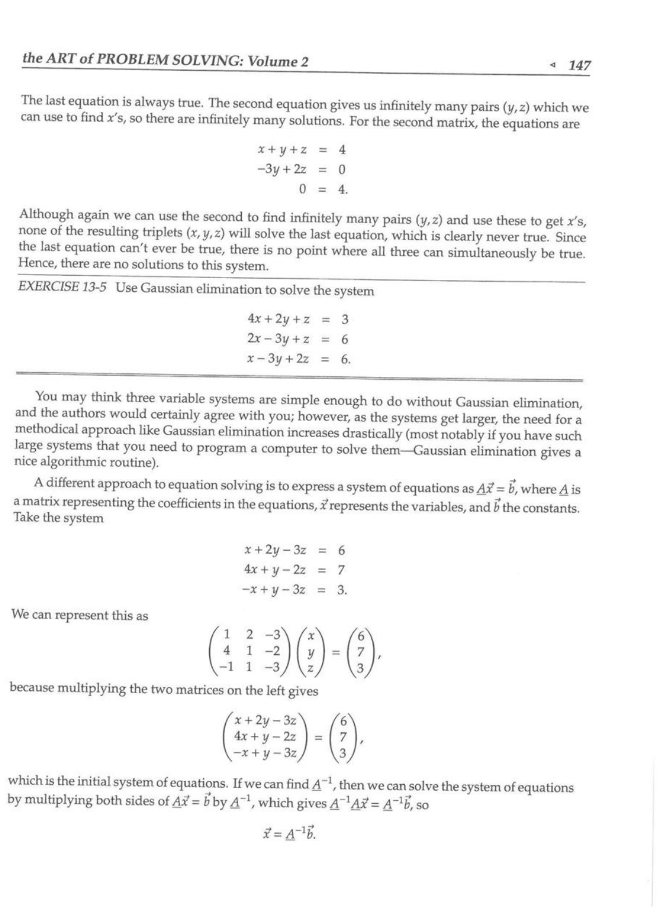

## Printed page 148

<!-- source: volume-2, PDF page 170, printed page 148 -->

Hence, we can solve the system of equations $\vec{Ax} = \vec{b}$ uniquely if and only if $\vec{A}$ is invertible. If $\vec{A}$ is not invertible, then we can't find a unique solution to the system of equations. This isn't the best method to solve systems of linear equations because inverting large matrices is a painful process; however, it does give us a good way to check if there is a solution.

Recall that a matrix is invertible if and only if its determinant is nonzero. Returning to the above system, since

$$\begin{vmatrix}
1 & 2 & -3 \\
4 & 1 & -2 \\
-1 & 1 & -3
\end{vmatrix} = 12,$$

the inverse of $\vec{A}$ exists, and the system has a single solution.

**EXAMPLE 13-3** Find all values of $a$ such that the system

$$ax + 2y + 3z = 1$$

$$2x + ay - 3z = 4$$

$$3x - y + 2z = -5$$

cannot be solved for a unique solution $(x, y, z)$.

**Solution:** Writing the system as $\vec{Ax} = \vec{b}$, we find the determinant of $\vec{A}$ as

$$\begin{vmatrix}
a & 2 & 3 \\
2 & a & -3 \\
3 & -1 & 2
\end{vmatrix} = 2a^2 - 12a - 32.$$

Setting this equal to zero, we find that the desired values of $a$ are $a = 8$ and $a = -2$. (Try them and see if there are any solutions $(x, y, z)$ when $a$ has these values.)

Speaking of bigger systems, what happens if we have more variables, like $w + x + y + z = 7$? How many linear equations do we need in four variables to have a chance at finding a unique (i.e. there's only one) solution? For two variables, we need 2 equations; for three variables, we need 3. It stands to reason that for four variables, we need 4 equations. Try to extend our earlier arguments for why we need 3 equations for three variables to figure out why we need 4 equations for 4 variables.

Four variable and larger systems are usually too tedious to solve by hand. Linear equations in many (by many we mean hundreds, or even thousands) variables are very common, so solving them is very important, but for this task we usually (always) use a computer. There are some larger systems which are solvable by hand, though, and these are the topic of the next section.

### 13.2 Convenient Systems

Some systems of equations have such a nice form that there's a slick and easy way to solve them. We'll start with a continuation of the last section. Solve the following system:

Original scan — PDF page 170

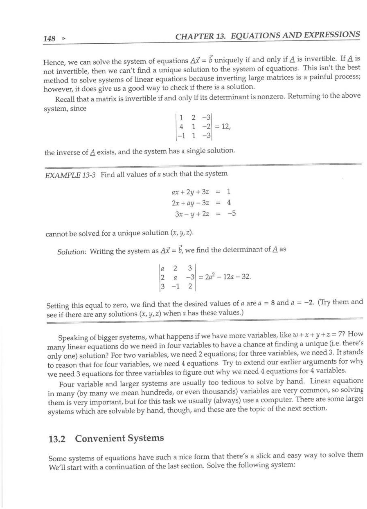

## Printed page 149

<!-- source: volume-2, PDF page 171, printed page 149 -->

$$2v + w + x + y + z = 4$$
$$v + 2w + x + y + z = 5$$
$$v + w + 2x + y + z = 6$$
$$v + w + 2y + z = 7$$
$$v + w + x + y + 2z = 8.$$

Before you start the tedious process of Gaussian elimination or the excruciating method of variable elimination, take a close look at the left side of the equations. They are very similar. This is our big tip-off that there's a slicker way to attack the problem. The key is finding a useful way to combine the equations. In such a symmetric looking system, the idea that stands out is simply adding the equations. If we add them all together we find

$$6v + 6w + 6x + 6y + 6z = 30,$$

so that $v + w + x + y + z = 5$. How does this help? Look at the first equation. We have

$$2v + w + x + y + z = v + (v + w + x + y + z) = 4.$$

We found that the quantity in parentheses is 5, so the equation becomes $v + 5 = 4$, or $v = -1$. We can use the same method to find the other variables, so that $(v, w, x, y, z) = (-1, 0, 1, 2, 3)$. Not too tough.

**EXERCISE 13-6** Find $(w, x, y, z)$ if

$$w + x + y = 20$$
$$w + x + z = 22$$
$$w + y + z = 24$$
$$x + y + z = 36.$$

This method is not restricted to linear systems. Try

$$a(a + b) = 108$$
$$b(a + b) = \frac{297}{4}.$$

Seeing the nice pattern on the left we try adding the equations, from which we have

$$a(a + b) + b(a + b) = (a + b)(a + b) = 108 + \frac{297}{4} = \frac{729}{4}.$$

Since $(a + b)^2 = 729/4$, we can take the square root to find $a + b = \pm 27/2$. First we try $a + b = 27/2$. Substituting this for $a + b$ in the first equation gives

$$a\left(\frac{27}{2}\right) = 108,$$

from which $a = 8$ and then $b = 11/2$. Similarly, if $a + b = -27/2$, we find $a = -8$ and $b = -11/2$. Thus, we find the two solutions using a little craftiness.

Original scan — PDF page 171

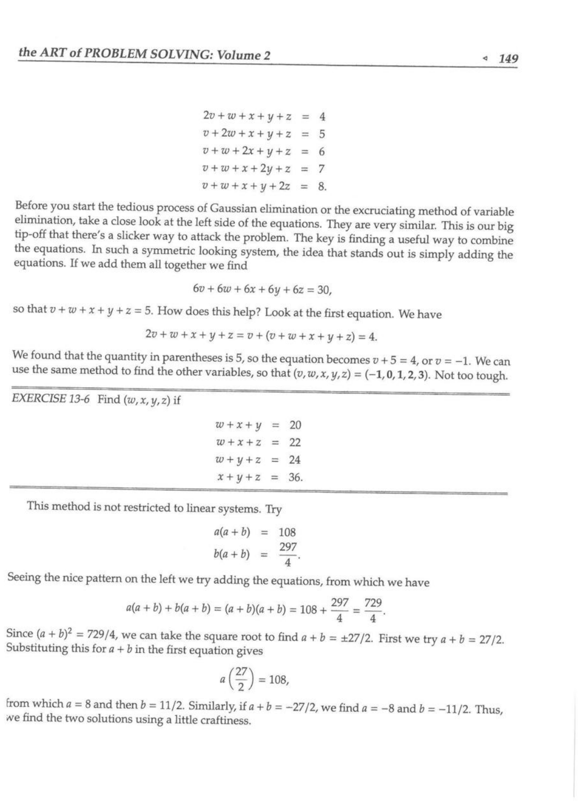

## Printed page 150

<!-- source: volume-2, PDF page 172, printed page 150 -->

**EXERCISE 13-7 Solve the following system of equations:**

$$xy = 12\sqrt{6}$$
$$yz = 54\sqrt{2}$$
$$zx = 48\sqrt{3}$$

At the end of the chapter, you’ll have a little more practice in attacking these 'convenient' systems. If you see a nice patterned system of equations, there’s usually some way to combine the equations through addition or multiplication to make finding the answer easy.

### 13.3 Symmetric Expressions and Advanced Factorizations

In the first volume, we investigated the sum and difference of two squares and of two cubes. For a quick review, we’ll list these relationships:

$$a^2 + b^2 = (a + b)^2 - 2ab$$
$$a^2 - b^2 = (a - b)(a + b)$$
$$a^3 + b^3 = (a + b)(a^2 - ab + b^2)$$
$$a^3 - b^3 = (a - b)(a^2 + ab + b^2).$$

We can extend the difference factorizations to any power $n$:

$$a^n - b^n = (a - b)(a^{n-1} + a^{n-2}b + a^{n-3}b^2 + \cdots + ab^{n-2} + b^{n-1})$$

and the sum factorizations to any odd power $2n + 1$:

$$a^{2n+1} + b^{2n+1} = (a + b)(a^{2n} - a^{2n-1}b + a^{2n-2}b^2 - \cdots - ab^{2n-1} + b^{2n}).$$

We know to look for these factorizations from the fact that $a = b$ and $a = -b$ are clearly solutions of $a^n - b^n = 0$ and $a^{2n+1} + b^{2n+1} = 0$, respectively. (Why?)

**EXERCISE 13-8 Prove the above factorizations for $a^n - b^n$ and $a^{2n+1} + b^{2n+1}$ using sums of geometric series.**

We also looked in Volume 1 at squares and cubes of binomials, for example:

$$(a + b)^2 = a^2 + 2ab + b^2$$
$$(a - b)^2 = a^2 - 2ab + b^2$$
$$(a + b)^3 = a^3 + 3a^2b + 3ab^2 + b^3$$
$$(a - b)^3 = a^3 - 3a^2b + 3ab^2 - b^3.$$

Original scan — PDF page 172

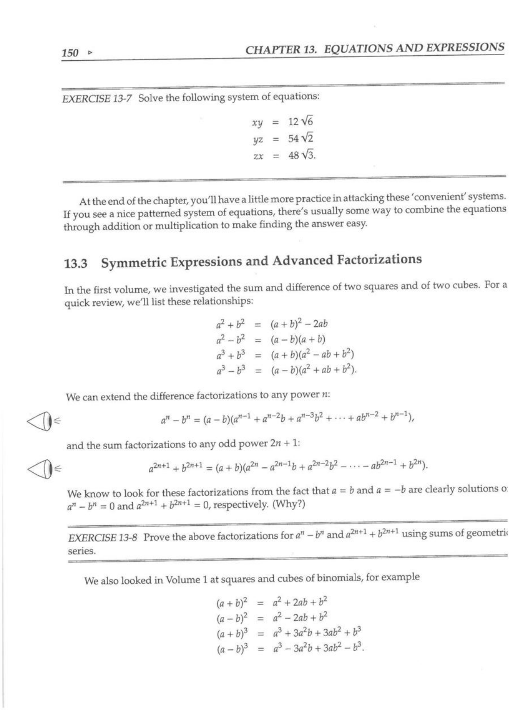

## Printed page 151

<!-- source: volume-2, PDF page 173, printed page 151 -->

What if we introduce more variables? For example, what is $(a + b + c)^2$? Let’s multiply it out:

$$\begin{align*}
(a + b + c)^2 &= (a + b + c)(a + b + c) \\
&= a(a + b + c) + b(a + b + c) + c(a + b + c) \\
&= a^2 + ab + ac + ba + b^2 + bc + ca + cb + c^2 \\
&= a^2 + b^2 + c^2 + 2(ab + bc + ca).
\end{align*}$$

Another way we can find this product is to realize that in the expansion of $(a + b + c)(a + b + c)$ all the resulting terms will be squares of the variables (like $a^2$) or products of two of them (like $ab$). The squares can only occur in one way, but the products of two variables can happen in two ways; for example, $ab$ can be made by taking an $a$ from the first $(a + b + c)$ and a $b$ from the second or by taking $b$ from the first and $a$ from the second. Hence, the coefficient of $ab$ is 2. Following this logic, the product is $a^2 + b^2 + c^2 + 2(ab + bc + ca)$ since the squares occur once and the products twice.

**EXAMPLE 13-4** Find $(a + b + c)^3$ using the above logic.

**Solution:** Write the product as

$$\begin{align*}
(a + b + c)(a + b + c)(a + b + c).
\end{align*}$$

What types of terms can we have in the product? All terms will involve the product of three variables. Some terms will be cubes, like $a^3$. Others will be one variable times the square of another, like $ab^2$. Still others are the product of all three, or $abc$. Consider the cubes first. Each can only occur once, so the expansion contains $a^3 + b^3 + c^3$. For the terms like $ab^2$, the $a$ can come from any of the three terms and the $b$’s then come from the other two terms. Hence, $ab^2$ occurs three times, as does $ba^2$, $bc^2$, etc. Finally, we check out $abc$. We have 3 choices for the source of $a$, leaving 2 choices for the source of $b$, and only 1 for that of $c$. Hence, $abc$ occurs 6 times. Putting this all together, we have

$$\begin{align*}
(a + b + c)(a + b + c)(a + b + c) = a^3 + b^3 + c^3 + 3(ab^2 + ba^2 + ac^2 + ca^2 + bc^2 + cb^2) + 6abc.
\end{align*}$$

How can we be sure we have all the terms? If we take the product of three quantities which each contain three terms, we should have $(3)(3)(3) = 27$ terms. Above, we have 3 cubes, 3 each of the terms like $ab^2$, and 6 $abc$’s. Thus, there are $3 + 3(6) + 6 = 27$ terms, so we found them all. If you’re skeptical, go ahead and multiply the product out completely and find out how the terms above arise.

**EXERCISE 13-9** Find $(a + b + c + d)^3$.

Reciprocal expressions are also very common. Let’s take a look. Write

$$\frac{1}{x} + \frac{1}{y} + \frac{1}{z}$$

with a common denominator. The common denominator is $xyz$; expressing each term with this denominator we have

$$\frac{1}{x} + \frac{1}{y} + \frac{1}{z} = \frac{yz + xz + xy}{xyz}.$$

Original scan — PDF page 173

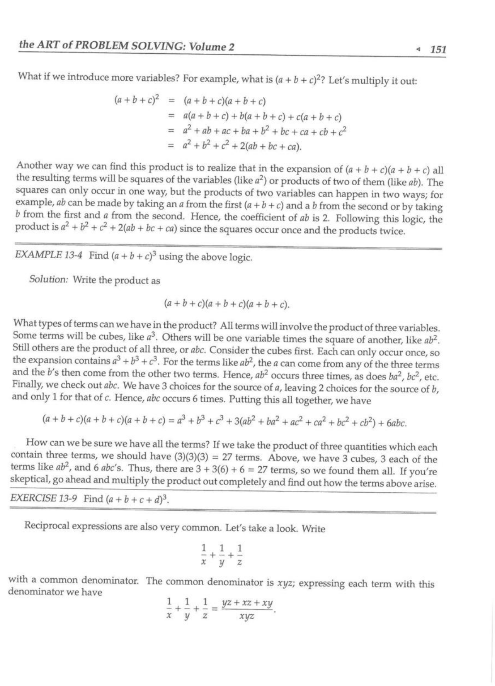

## Printed page 152

<!-- source: volume-2, PDF page 174, printed page 152 -->

**EXERCISE 13-10 Express**
$$\frac{1}{x^2yz} + \frac{1}{y^2zw} + \frac{1}{z^2wx} + \frac{1}{w^2xy}$$

with a common denominator.

**EXERCISE 13-11 If $x + y + z = 6$ and $xyz = 2$, then find**
$$\frac{1}{xy} + \frac{1}{yz} + \frac{1}{zx}.$$

### 13.4 More Polynomials

We'll start with a problem. Find $x, y,$ and $z$ if
$$x + y + z = 7$$
$$xy + yz + zx = -14$$
$$xyz = -120.$$

Seeing all of these symmetric sums, we might think to try some of the principles of the last section; however, we've seen these expressions before. On page 60 we saw symmetric sums relating roots to equations. In fact, from the given equations, we can deduce that $x, y,$ and $z$ are the roots of the polynomial
$$t^3 - 7t^2 - 14t + 120 = 0.$$

(Make sure you see how $x, y,$ and $z$ being the roots of this polynomial leads to the above system of equations.) To find $x, y,$ and $z,$ we just factor using our polynomial solving techniques:
$$t^3 - 7t^2 - 14t + 120 = (t - 5)(t - 6)(t + 4) = 0.$$

Hence, $x, y,$ and $z$ are 5, 6, and $-4.$

**EXERCISE 13-12 How many solutions $(x, y, z)$ are there to the above system?**

**EXAMPLE 13-5 Find all $(a, b, c)$ if**
$$2a + 3b + c = 11$$
$$6ab + 2ac + 3bc = 24$$
$$abc = -6.$$

Solution: These aren't the nice symmetric equations we saw in our discussion of coefficients and roots of a polynomial. We can make $2a + 3b + c$ a symmetric sum by letting $x = 2a$ and $y = 3b.$ We must also make these substitutions in the other two equations. Letting $a = x/2$ and $b = y/3,$ they become
$$x + y + c = 11$$
$$xy + cx + yc = 24$$
$$(xyc)/6 = -6.$$

Original scan — PDF page 174

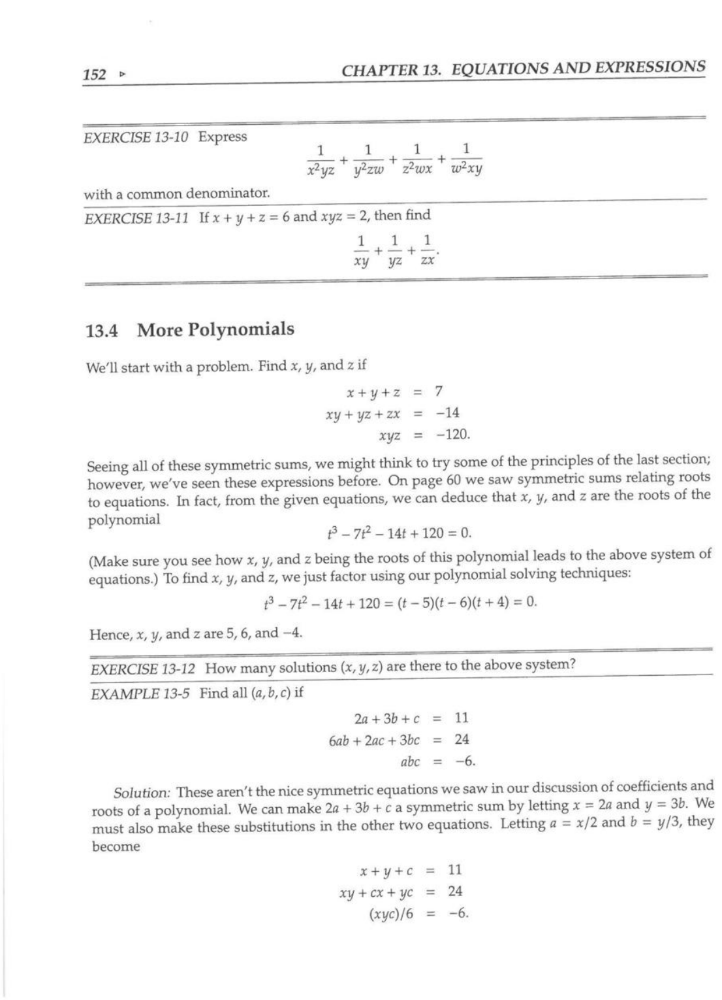

## Printed page 153

<!-- source: volume-2, PDF page 175, printed page 153 -->

Writing the last equation as $xyc = -36$, we find that we've made our desired three symmetric equations. We won't always be able to do this, but it's worth a shot. Thus, $x, y,$ and $c$ are the roots of

$$t^3 - 11t^2 + 24t + 36 = 0.$$

Factoring this yields

$$(t - 6)(t - 6)(t + 1) = 0,$$

so the $x, y,$ and $c$ are 6, 6, and $-1$. So which one's which? Like you should have seen in the previous exercise, we have to try all possible ways. If we let $(x, y, c) = (6, 6, -1),$ we find $(a, b, c) = (3, 2, -1).$ If we let $(x, y, c) = (6, -1, 6),$ we find $(a, b, c) = (3, -1/3, 6),$ and finally, for $(x, y, c) = (-1, 6, 6),$ we have $(a, b, c) = (-1/2, 2, 6).$ These are the three solutions for $a, b,$ and $c.$

We're not done with polynomials yet! How many points do we need to determine the graph of a line? Right, just two. How about a quadratic? We need three. For example, if the points are $(1, 5), (2, 11),$ and $(-1, -1),$ we write the quadratic as $y = ax^2 + bx + c$ and using the three points, we write

$$a + b + c = 5$$

$$4a + 2b + c = 11$$

$$a - b + c = -1.$$

Using the techniques from the first section of this chapter, we find that $(a, b, c) = (1, 3, 1),$ so our quadratic is $y = x^2 + 3x + 1$. Thus, if three points on one quadratic are the same as three points on another, then the two quadratics must be the same. For the same reason, four points determine a cubic, five determine a quartic, etc.

In the same spirit as above, what can we say about a linear equation with two different roots? Let the equation be $ax + b = 0$ and the roots be $x_1$ and $x_2$. Thus, we have

$$ax_1 + b = 0$$ and

$$ax_2 + b = 0.$$

Subtracting, we have $a(x_1 - x_2) = 0,$ so since $x_1$ and $x_2$ are different, $a$ must be 0 and so must $b.$ Thus, if we find a linear equation with two different roots, the equation is 0 everywhere.

Extending the above argument, we find that any quadratic with three distinct roots is everywhere 0, any cubic with four distinct roots is everywhere 0, and so on. So what kind of problem does this help us on?

Prove that

$$\frac{1}{a(a - b)(a - c)} + \frac{1}{b(b - c)(b - a)} + \frac{1}{c(c - a)(c - b)} = \frac{1}{abc}$$

for all sets of distinct nonzero numbers $\{a, b, c\}$. (M&IQ 1993)

Rather than showing that the left side equals $1/abc,$ we show that

$$\frac{1}{a(a - b)(a - c)} + \frac{1}{b(b - c)(b - a)} + \frac{1}{c(c - a)(c - b)} - \frac{1}{abc} = 0.$$

Original scan — PDF page 175

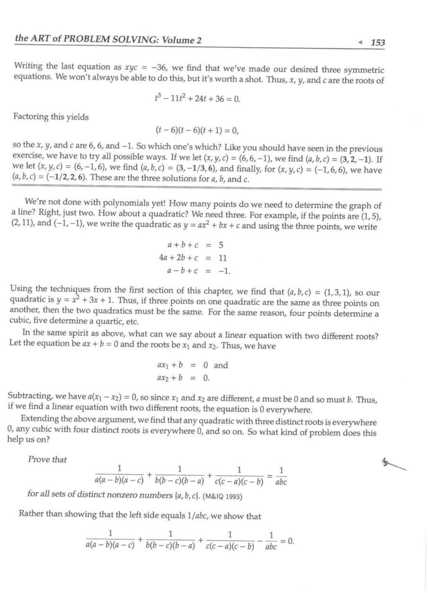

## Printed page 154

<!-- source: volume-2, PDF page 176, printed page 154 -->

Writing the left side with the common denominator $abc(a-b)(a-c)(b-c)$, we have

$$\frac{bc(b-c) - ac(a-c) + ab(a-b) - (a-b)(a-c)(b-c)}{abc(a-b)(a-c)(b-c)}$$

We can show that this is 0 by showing that the numerator is 0. Look at the numerator as a polynomial in $c$, meaning let $a$ and $b$ be constants and $c$ be a variable, or

$$f(c) = bc(b-c) - ac(a-c) + ab(a-b) - (a-b)(a-c)(b-c).$$

Since each term in $f(c)$ has degree 2 in $c$, meaning that the power of $c$ in each is at most $c^2$ (for example, the first term $bc(b-c)$ is $b^2c - bc^2$), $f(c)$ is a quadratic. If we can show that this quadratic has 3 different roots, then $f(c) = 0$ for all $c$. First let $c = a$; then we have

$$f(a) = ba(b-a) - a^2(0) + ab(a-b) - (a-b)(0)(b-a) = 0,$$

so $a$ is a root of $f(c)$. Similarly, $f(b) = 0$ and $f(0) = 0$. Since $a, b,$ and 0 are three distinct roots of the quadratic $f(c), f(c) = 0$ everywhere, or

$$bc(b-c) - ac(a-c) + ab(a-b) - (a-b)(a-c)(b-c) = 0.$$

Thus

$$\frac{bc(b-c) - ac(a-c) + ab(a-b) - (a-b)(a-c)(b-c)}{abc(a-b)(a-c)(b-c)} = 0,$$

and we have proven the identity.

Of course, you could use a ton of algebra to prove this identity, but this method is much faster for complex identities. Simpler identities are easier to prove with direct algebra.

**EXERCISE 13-13** Prove that

$$\frac{b+c}{(a-b)(a-c)} + \frac{c+a}{(b-c)(b-a)} + \frac{a+b}{(c-a)(c-b)} = 0$$

for all sets of distinct nonzero numbers $\{a, b, c\}$.

### 13.5 Squares and Cubes

In Volume 1, we used squaring and cubing to solve equations with the variable inside the square root or the cube root. For example, to solve

$$\sqrt[3]{x+3} = 2,$$

we cube the equation to find $x+3 = 8$, so $x = 5$.

These techniques are useful for other types of problems as well. For example, suppose we want to simplify $\sqrt{6 + \sqrt{11}} - \sqrt{6 - \sqrt{11}}$. It's not obvious that we can simplify $\sqrt{6 + \sqrt{11}}$ in the way we can write $\sqrt{4 + 2\sqrt{3}} = 1 + \sqrt{3}$. (See if you can simplify $\sqrt{6 + \sqrt{11}}$ on your own!) Instead, we let

$$x = \sqrt{6 + \sqrt{11}} - \sqrt{6 - \sqrt{11}}.$$

Original scan — PDF page 176

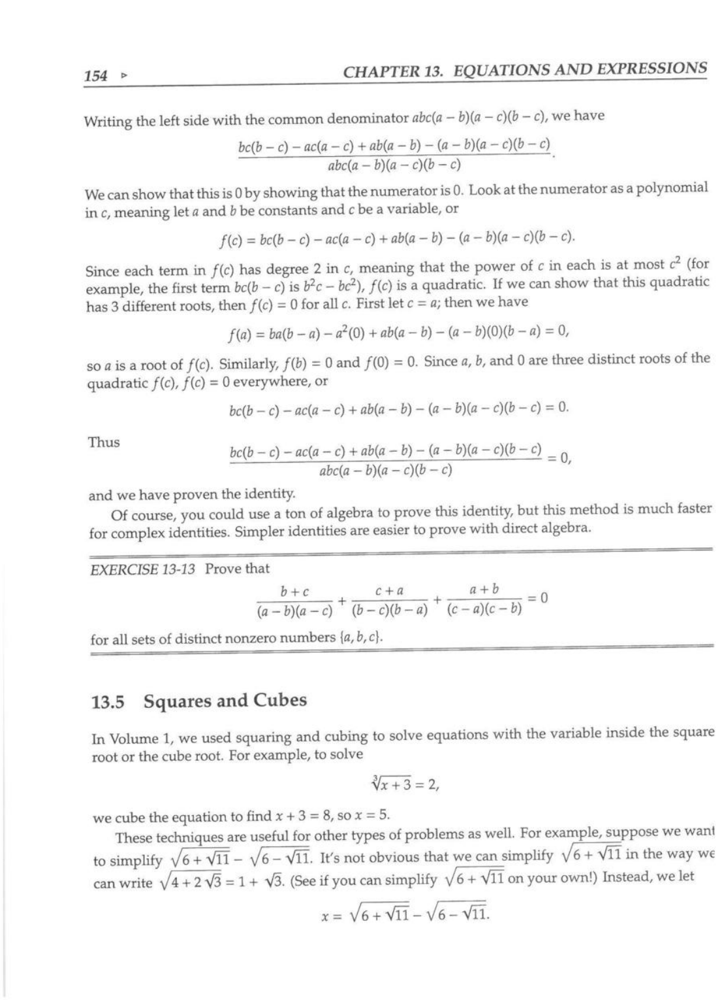

## Printed page 155

<!-- source: volume-2, PDF page 177, printed page 155 -->

To clear out the square roots, square both sides, leaving

$$x^2 = 6 + \sqrt{11} - 2\sqrt{36 - 11} + 6 - \sqrt{11} = 12 - 10 = 2.$$

Hence, $x = \sqrt{2}$. (Why not $x = -\sqrt{2}$?)

Squaring or cubing often simplifies equations involving radicals, so try it when all else fails.

### 13.6 Using Graphing

We'll cover a whole genre of problems with a simple example.

For how many positive numbers $x$ does $\cos x = x/8$? (MAΘ 1987)

We can't possibly hope to actually find the solutions, but even a rough sketch will enable us to count the solutions. We graph $y = \cos x$ (solid line) and $y = x/8$ (dashed line). Where these graphs meet, we have $\cos x = x/8$ and hence a solution to our equation. There are three intersections of the graphs, so there are 3 solutions.

Problems to Solve for Chapter 13

185. If $a \neq b$, $a^3 - b^3 = 19x^3$, and $a - b = x$, find $a$ in terms of $x$. (AHSME 1975)

186. Solve the system of equations

$$\begin{align*}
(x + y)(x + y + z) &= 66 \\
(y + z)(x + y + z) &= 99 \\
(z + x)(x + y + z) &= 77.
\end{align*}$$

(M&IQ 1992)

187. If $a, b,$ and $c$ are real numbers such that $a^2 + b^2 + c^2 = 1$, then what is the minimum value of $ab + bc + ca$? (MAΘ 1987)

188. Find the prime factorization of $2^{22} + 1$. (MAΘ 1991)

189. Four positive integers are given. We select any three of these integers, find their arithmetic average, and add this result to the fourth integer. In this way, the numbers 29, 23, 21, and 17 are obtained. What are the four original numbers? (AHSME 1955)

190. Simplify the product below. (AHSME 1981)

$$\left( \frac{1}{x + y + z} \right) \left( \frac{1}{x} + \frac{1}{y} + \frac{1}{z} \right) \left( \frac{1}{xy + yz + zx} \right) \left( \frac{1}{xy} + \frac{1}{yz} + \frac{1}{zx} \right).$$

Original scan — PDF page 177

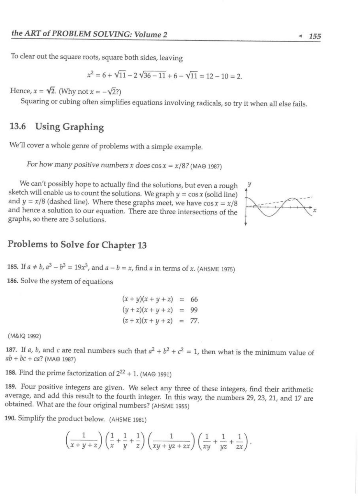

## Printed page 156

<!-- source: volume-2, PDF page 178, printed page 156 -->

191. Evaluate
$$\frac{\sqrt{\sqrt{5} + 2} + \sqrt{\sqrt{5} - 2}}{\sqrt{\sqrt{5} + 1}} - \sqrt{3 - 2\sqrt{2}}.$$

(AHSME 1976)

192. Find all ordered triples $(x, y, z)$ which satisfy
$$x + y - z = 0$$
$$zx - xy + yz = 27$$
$$xyz = 54.$$

(Mandelbrot #1)

193. The simultaneous system below has no solution for what real values of $n$?
$$nx + y = 1$$
$$ny + z = 1$$
$$x + nz = 1$$

(AHSME 1973)

194. Prove that it is not possible to assign the integers $1, 2, 3, \ldots, 20$ to the twenty vertices of a regular dodecahedron so that the five numbers at the vertices of each of the twelve pentagonal faces have the same sum. (USAMTS 1)

195. Consider the system of equations:
$$a_1 + 8a_2 + 27a_3 + 64a_4 = 1$$
$$8a_1 + 27a_2 + 64a_3 + 125a_4 = 27$$
$$27a_1 + 64a_2 + 125a_3 + 216a_4 = 125$$
$$64a_1 + 125a_2 + 216a_3 + 343a_4 = 343.$$

These four equations determine $a_1, a_2, a_3,$ and $a_4$. Show that
$$a_1(x + 1)^3 + a_2(x + 2)^3 + a_3(x + 3)^3 + a_4(x + 4)^3 \equiv (2x + 1)^3,$$
i.e., these two polynomials are identically the same. Use this to show that $a_1 + a_2 + a_3 + a_4 = 8$ and that $64a_1 + 27a_2 + 8a_3 + a_4 = 729$. (Mandelbrot #3)

196. In a rectangular solid, the area of the top face is 135, the area of the front face is 30, and the area of the right face is 50. Find the volume of the solid. (MAΘ 1990)

197. Prove the identity
$$\frac{bc(b + c)}{(a - b)(a - c)} + \frac{ca(c + a)}{(b - c)(b - a)} + \frac{ab(a + b)}{(c - a)(c - b)} = a + b + c$$
for distinct nonzero numbers $a, b,$ and $c$. (M&IQ 1993)

198. Factor the expression $x^2 - y^2 - z^2 + 2yz + x + y - z$ completely. (AHSME 1963)

Original scan — PDF page 178

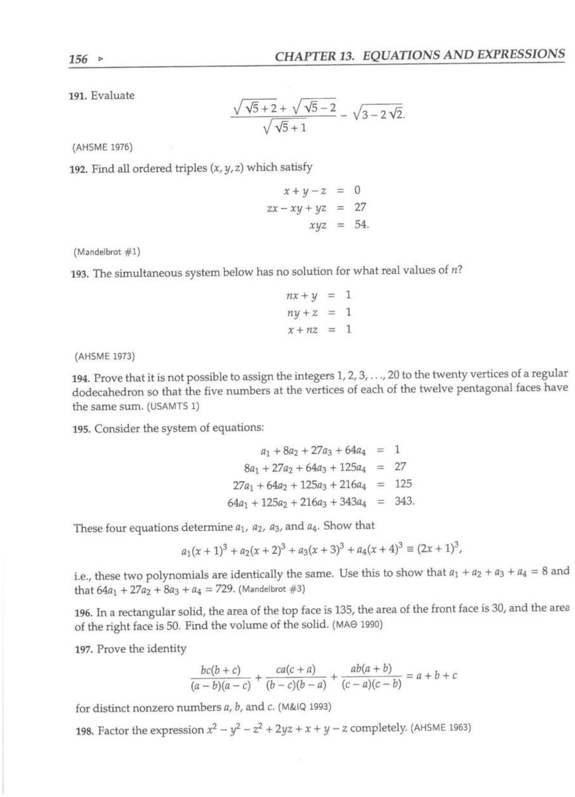

## Printed page 157

<!-- source: volume-2, PDF page 179, printed page 157 -->

199. If $a, b,$ and $c$ are non-zero real numbers such that
$$\frac{a+b-c}{c} = \frac{a-b+c}{b} = \frac{-a+b+c}{a},$$
then find all possible values of
$$\frac{(a+b)(b+c)(c+a)}{abc}.$$

(AHSME 1978)

200. Find $5a + 7b + 9c$ if nonzero $a, b,$ and $c$ satisfy the equations
$$ab = 2(a+b)$$
$$bc = 3(b+c)$$
$$ca = 4(c+a).$$

(USAMTS 1)

201. Find $x^2$ if $\sqrt[3]{x+9} - \sqrt[3]{x-9} = 3.$ (AHSME 1963)

202. Reduce the fraction
$$\frac{a^2 + b^2 - c^2 + 2ab}{a^2 + c^2 - b^2 + 2ac}.$$

(AHSME 1960)

203. Find the sum $\sqrt[3]{5+2\sqrt{13}} + \sqrt[3]{5-2\sqrt{13}}.$

204. If $xyz = x^3 + y^3 + z^3 = 4$ and $xy^2 + x^2y + yz^2 + y^2z + zx^2 + z^2x = 12,$ then find the real value of $xy + yz + zx.$ (Mandelbrot #3)

205. Let $g(x) = x^5 + x^4 + x^3 + x^2 + x + 1.$ What is the remainder when the polynomial $g(x^{12})$ is divided by the polynomial $g(x)?$ (AHSME 1977)

206. Find all triples of positive real numbers $(x, y, z)$ which satisfy the following system:
$$\sqrt[3]{x} - \sqrt[3]{y} - \sqrt[3]{z} = 16$$
$$\sqrt[4]{x} - \sqrt[4]{y} - \sqrt[4]{z} = 8$$
$$\sqrt[6]{x} - \sqrt[6]{y} - \sqrt[6]{z} = 4.$$

(MOP)

207. Prove that the equation $4a^2 + 4a = b^2 + b$ has no positive integer solutions $(a, b).$ (Canada 1977)

208. Find the positive integer solutions $(x, y)$ of the equation $x^2 + 3 = y(x+2).$ (M&IQ 1992)

209. Let $a, b,$ and $c$ be real numbers such that
$$(bc - a^2)^{-1} + (ca - b^2)^{-1} + (ab - c^2)^{-1} = 0.$$

Prove that
$$a(bc - a^2)^{-2} + b(ca - b^2)^{-2} + c(ab - c^2)^{-2} = 0.$$

(IMO 1985)

Original scan — PDF page 179

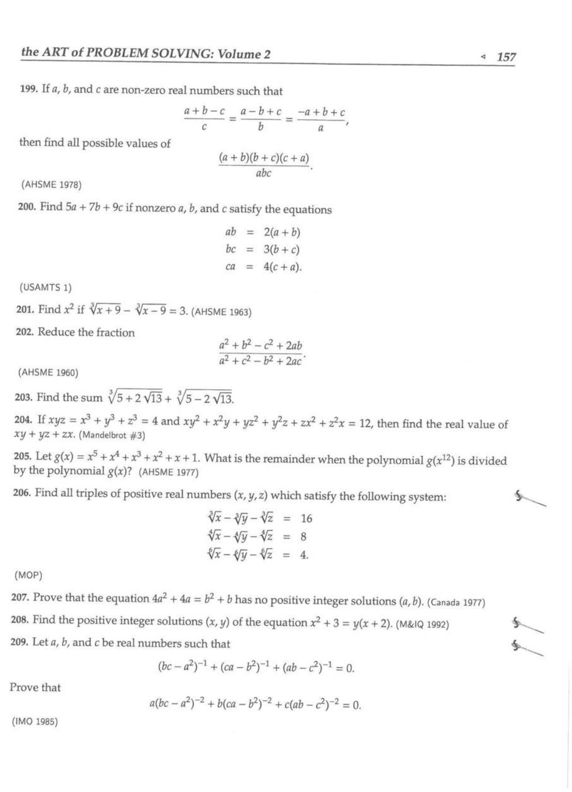

## Printed page 158

<!-- source: volume-2, PDF page 180, printed page 158 -->

Mathematics is generally seen as a European endeavor, passed from the Greeks to the Romans to the Europeans of the Renaissance, and this is reflected in the nomenclature we use. However, many of the discoveries we now refer to by European names we actually anticipated by Indian or Chinese mathematicians.

For example, the "Gaussian elimination" we used in this chapter to solve sets of linear equations was used in the Chinese Nine Chapters on the Mathematical Art, written around 250 B.C.! (Gauss lived around 1800.) Amazingly, the Chinese work used notation very similar to what we use today, forming the coefficients into a grid and using operations to simplify the grid.

Similarly, the "Pascal's Triangle" which puts the binomial coefficients into a simple triangular pattern was developed in China, in almost exactly its modern form, as early as 1100. (Pascal lived in the 1600's.) Another modern method anticipated by the Chinese was "Horner's method," a simple numerical algorithm for finding the roots of a polynomial which was rediscovered by Horner in the 1800's.

So why don't we call these formulas and methods by more accurate names? This is an intricate historical question, but the simple answer is that not enough cultural exchange took place with China for Chinese methods to diffuse west. It is for similar reasons that the math developed by the Maya culture of Mexico never interacted with the stream from which modern math came. On the other hand, a great deal of Indian, Arabic, and Egyptian math came to Europe through trade. Hence the name algebra, from the Arabic al-jabr. The Arabs preserved and extended the methods of the Greeks; Ptolemy's major work in astronomy is still known as Almagest, Arabic for "the great work." Both the Arabs and Indians had the quadratic formula, and much geometry lost to Europe.

While historians of math universally acknowledge the contributions and achievements of the mathematicians of other cultures, those contributions still get the short shrift in nomenclature. Except for the odd Brahmagupta's or Chinese Remainder Theorem, our mathematical names come almost entirely from European rediscoverers.

Original scan — PDF page 180

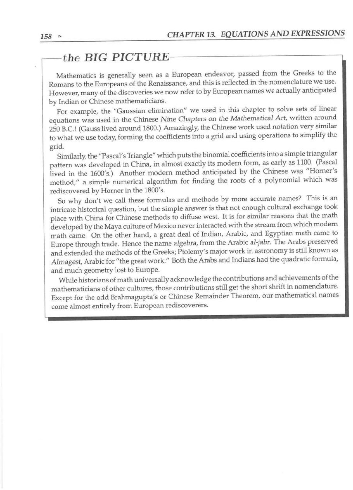

