# Chapter 14: Inequalities

Volume 2 · Printed pages 159–169 · PDF pages 181–191

[Volume contents](../index.md)

## Printed page 159

<!-- source: volume-2, PDF page 181, printed page 159 -->

Chapter 14

Inequalities

In Volume 1 we discussed how to work with inequalities which are sometimes true. For example, $x > 0$ is only true when $x$ is positive. In this chapter, we will work with inequalities which are always true, like the Trivial Inequality we discussed in Volume 1, $x^2 \geq 0$ for all real numbers $x$. Many readers will likely have never seen anything like the problems at the end of this chapter before. For this reason (and because inequality problems are lots of fun), we have gathered many problems to try out. Once you've learned how to work with inequalities, you'll likely find them as interesting as we do.

### 14.1 Trivial Inequality Revisited

The square of any real number is nonnegative. It's that simple. For example,

Prove that $\cos 2\theta + \sin^2\theta$ is nonnegative for all angles $\theta$.

Our strategy here is to manipulate the given expression to the square of a real quantity. Since

$$\cos 2\theta + \sin^2\theta = \cos^2\theta - \sin^2\theta + \sin^2\theta = \cos^2\theta,$$

and $\cos^2\theta \geq 0$ because $\cos^2\theta$ is the square of $\cos \theta$, we conclude that $\cos 2\theta + \sin^2\theta \geq 0$.

**EXERCISE 14-1 Prove that $4x^2 - 12xy + 9y^2 \geq 0$ for all real number pairs $(x, y)$.**

**EXAMPLE 14-1 Find the minimum value of $x^2 + 2x + 2$.**

Solution: Since $x^2 + 2x + 2 = (x + 1)^2 + 1$, the minimum is 1 because $(x + 1)^2 \geq 0$.

**EXERCISE 14-2 Show that $(x^2 + 1)(y^2 + 1) \geq (xy + 1)^2$ for all $x$ and $y$.**

The Trivial Inequality is the most basic general (i.e. always true) inequality, and can be used in many, many ways. If no method is clear in solving an inequality problem, this is often the best place to start.

Original scan — PDF page 181

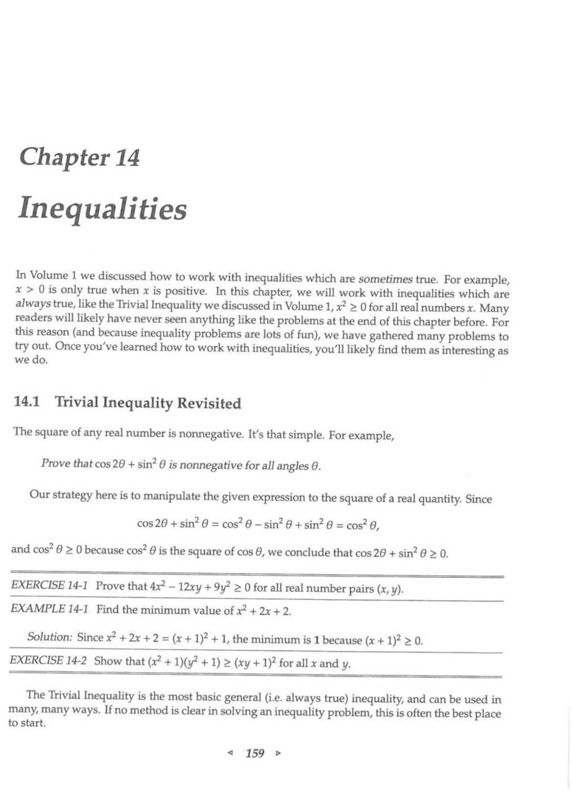

## Printed page 160

<!-- source: volume-2, PDF page 182, printed page 160 -->

### 14.2 Arithmetic Mean-Geometric Mean Inequality

The Arithmetic Mean-Geometric Mean Inequality, commonly called AM-GM, states that the arithmetic mean of a set of positive numbers is greater than or equal to the geometric mean of those numbers. Recall that the arithmetic mean of a set of $n$ numbers is the sum of the numbers divided by $n$ and the geometric mean is the $n$th root of the product of the numbers. Hence, we can write

$$\frac{a_1 + a_2 + a_3 + \cdots + a_n}{n} \geq \sqrt{a_1 a_2 a_3 \cdots a_n},$$

for positive numbers $a_1, a_2, a_3, \ldots, a_n$.

WARNING: AM-GM only works if all the numbers are nonnegative! Can you find a counterexample if some are negative?

**EXAMPLE 14-2 Prove the AM-GM Inequality for $n = 2$.**

Solution: With $n = 2$, AM-GM asserts that for positive numbers $a$ and $b$,

$$\frac{a + b}{2} \geq \sqrt{ab}.$$

This brings us to a most important inequality solving technique: working backwards. We use reversible steps to manipulate what we’re trying to prove into something that’s easy to prove. For the given problem, we start by multiplying both sides by 2 and squaring, yielding

$$a^2 + 2ab + b^2 \geq 4ab.$$

Subtracting $4ab$ from both sides, we have $a^2 - 2ab + b^2 \geq 0$. The left side of this is just $(a - b)^2$, which as the square of a real number is clearly always nonnegative.

WARNING: A key aspect of working backwards is checking that the logic works when used in reverse order. Thus we must check that we can start from $(a - b)^2 \geq 0$, which we know is true, to obtain $(a + b)/2 \geq \sqrt{ab}$, which we want to prove is true. The only step that we may balk at is taking the square root of both sides of $a^2 + 2ab + b^2 \geq 4ab$ to get $(a + b) \geq 2\sqrt{ab}$; we can do this because we restrict $a$ and $b$ to positive numbers.

When writing proofs for papers or contests, you should present your solution working forwards, even if you find the solution working backwards.

As the above proof suggests, many problems which can be solved with AM-GM can also be handled using the Trivial Inequality and lots of algebra. In general, this is not recommended, because AM-GM and the other inequalities we’ll introduce in this chapter reduce the amount of work enormously.

To prove the AM-GM Inequality, we’ll start with a lemma.

Lemma. Suppose $x$ and $y$ are positive real numbers such that $x > y$. If we decrease $x$ and increase $y$ by some positive quantity $\epsilon$ such that $x - \epsilon \geq y + \epsilon$, then $(x - \epsilon)(y + \epsilon) > xy$. Hence, by subtracting $\epsilon$ from $x$ and adding it to $y$, we leave the average of the two numbers unchanged while increasing their product.

Original scan — PDF page 182

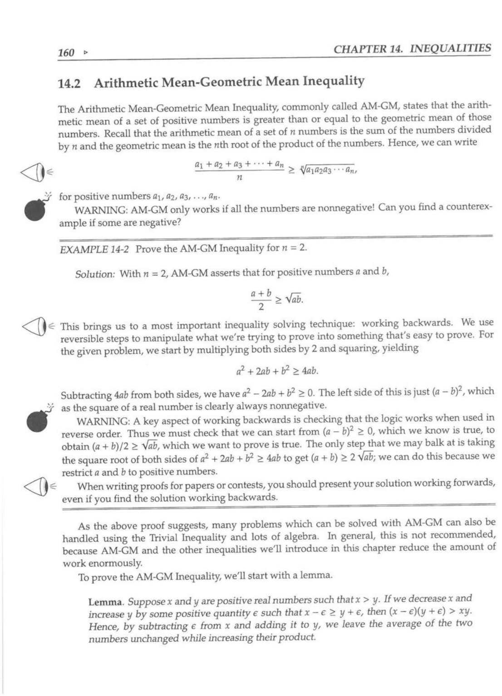

## Printed page 161

<!-- source: volume-2, PDF page 183, printed page 161 -->

The proof of the lemma is pretty simple. We wish to show that $(x - \epsilon)(y + \epsilon) - xy > 0$. Expanding the product $(x - \epsilon)(y + \epsilon)$, we find that

$$
(x - \epsilon)(y + \epsilon) - xy = (x - y)\epsilon - \epsilon^2
$$

Since $x - \epsilon \geq y + \epsilon$, we have $x - y \geq 2\epsilon$, so

$$
(x - \epsilon)(y + \epsilon) - xy \geq 2\epsilon^2 - \epsilon^2 = \epsilon^2 \geq 0.
$$

Hence, we conclude that $(x - \epsilon)(y + \epsilon) \geq xy$.

Now on to our proof of AM-GM. Suppose $a_1, a_2, \ldots, a_n$ are positive real numbers with average $A$ and product $P$. If all the $a_i$ are equal, then both the arithmetic mean and the geometric mean are equal to $A$. (Why?) Suppose not all $a_i$ equal $A$. Let $a_j$ be the one number closest to $A$ without being equal to $A$. Without loss of generality, let $a_j < A$. Since the average of the numbers is $A$, there is some member of the set of numbers greater than $A$. Let $a_k$ be the greatest of these numbers. Clearly we must have $a_k - A \geq A - a_j$ since $a_j$ is closer to $A$ than any other $a_i$ not equal to $A$.

We now use our lemma. Replace $a_j$ with $A$ and $a_k$ with $a_k - (A - a_j)$. Note that $a_k - (A - a_j) \geq a_j + (A - a_j)$, so we can apply our lemma with $(A - a_j)$ as our $\epsilon$. By our lemma, the average of the numbers in the new set is the same, but the product is now higher. If we continue this process, we make one of the members of the set equal to $A$ with each application of the process. Hence, in some finite number of steps, we will make all the numbers equal to $A$. Thus, we prove that of all sets of positive numbers with average $A$, the set with maximum product has all elements equal to $A$. Thus, the maximum possible value of the geometric mean of the set is $A$. This maximum only occurs when all elements equal $A$ (since if one or more are not equal to $A$, the product of the numbers can be increased by the process above).

Note that we have made a big deal of when the equality holds (meaning the equality portion of the nonstrict inequality occurs). This is a very important part of inequality problems, so don't overlook it.

One very useful technique in applying AM-GM is breaking the question into parts.

**EXAMPLE 14-3 Prove that for all positive numbers $x, y,$ and $z$,**

$$
x^2 + y^2 + z^2 \geq xy + yz + xz.
$$

Proof: Seeing the sum on the greater than side, we may think to try AM-GM directly, but this yields $(x^2 + y^2 + z^2)/3 \geq \sqrt{3x^2y^2z^2}$, which clearly isn't too helpful. If we look at the less than side, we see products of two numbers, which suggests using AM-GM on just $x^2$ and $y^2$, yielding $(x^2 + y^2)/2 \geq xy$. Similarly, we can show $(x^2 + z^2)/2 \geq xz$ and $(y^2 + z^2)/2 \geq yz$. Adding these three inequalities gives $x^2 + y^2 + z^2 \geq xy + xz + yz$ as desired. Notice how we divided the inequality to be proven into three separate inequalities.

**EXERCISE 14-3 When does equality hold in the previous example?**

**EXAMPLE 14-4 Show that**

$$
x^2y^2 + x^2z^2 + y^2z^2 \geq x^2yz + xy^2z + xyz^2.
$$

Original scan — PDF page 183

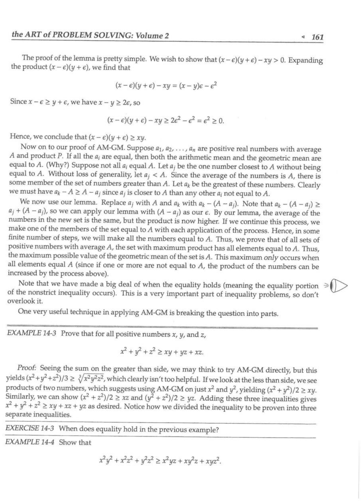

## Printed page 162

<!-- source: volume-2, PDF page 184, printed page 162 -->

Solution: Seeing the products like $x^2y^2$ on the left side, we may be tempted to try AM-GM, yielding

$$\frac{x^4 + y^4}{2} \geq x^2y^2.$$

WARNING: Why is this not likely to be useful? Because in the expression we are trying to prove, $x^2y^2$ is on the greater side rather than the lesser side like in our above AM-GM result. Don’t spend too long chasing dead ends like this. With AM-GM the solution is usually pretty straightforward. Since this problem looks similar in form to the last one, let’s try the same technique. We use AM-GM on $x^2y^2$ and $x^2z^2$ to get

$$\frac{x^2y^2 + x^2z^2}{2} \geq \sqrt{(x^2y^2)(x^2z^2)}.$$

Notice that the $x^2y^2$ is now on the greater side as desired. Simplifying the right side gives us the inequality $(x^2y^2 + x^2z^2)/2 \geq x^2yz$. Aha! Just like last time, we can do this twice more and add the three resulting inequalities to prove the given inequality. (When does equality occur?)

**EXERCISE 14-4 Show that $\frac{a}{b} + \frac{b}{a} \geq 2$ for all positive pairs $(a, b)$, and find where equality holds.**

### 14.3 Cauchy’s Inequality

Recall from our discussion of vectors that the dot product of two vectors $\vec{x}$ and $\vec{y}$ is

$$\vec{x} \cdot \vec{y} = \|x\| \|y\| \cos \theta,$$

where $\theta$ is the angle between the two vectors. Since $\cos \theta \leq 1$, $\|x\| \|y\| \cos \theta \leq \|x\| \|y\|$. Thus, $\vec{x} \cdot \vec{y} \leq \|x\| \|y\|$. Writing $\vec{x}$ and $\vec{y}$ in terms of their Cartesian coordinates, they are $(x_1 x_2 \cdots x_n)$ and $(y_1 y_2 \cdots y_n)$. Using these coordinates and squaring both sides of the inequality $\vec{x} \cdot \vec{y} \leq \|x\| \|y\|$, we have

$$(x_1 y_1 + x_2 y_2 + \cdots + x_n y_n)^2 \leq (x_1^2 + x_2^2 + \cdots + x_n^2) (y_1^2 + y_2^2 + \cdots + y_n^2).$$

This very important inequality is called Cauchy’s Inequality, or sometimes the Cauchy-Schwarz Inequality.

**EXAMPLE 14-5 Use the above proof to determine the equality condition for Cauchy’s Inequality.**

Solution: The inequality entered our problem when we noted that $\cos \theta \leq 1$. Thus, equality holds only if $\cos \theta = 1$, or $\theta = 0^\circ$. In this case, $\vec{x}$ and $\vec{y}$ are in the same direction so the ratio of the components of $\vec{x}$ to the components of $\vec{y}$ is constant, or

$$\frac{x_1}{y_1} = \frac{x_2}{y_2} = \cdots = \frac{x_n}{y_n}.$$

**EXERCISE 14-5 Prove that**

$$(a_1 x + b_1)^2 + (a_2 x + b_2)^2 + (a_3 x + b_3)^2 + \cdots + (a_n x + b_n)^2 \geq 0$$

and use this fact to prove Cauchy’s Inequality. Hint: Write the left side as a quadratic equation in $x$ and note that a quadratic equation is nonnegative for all $x$ if and only if the discriminant is nonpositive.

Original scan — PDF page 184

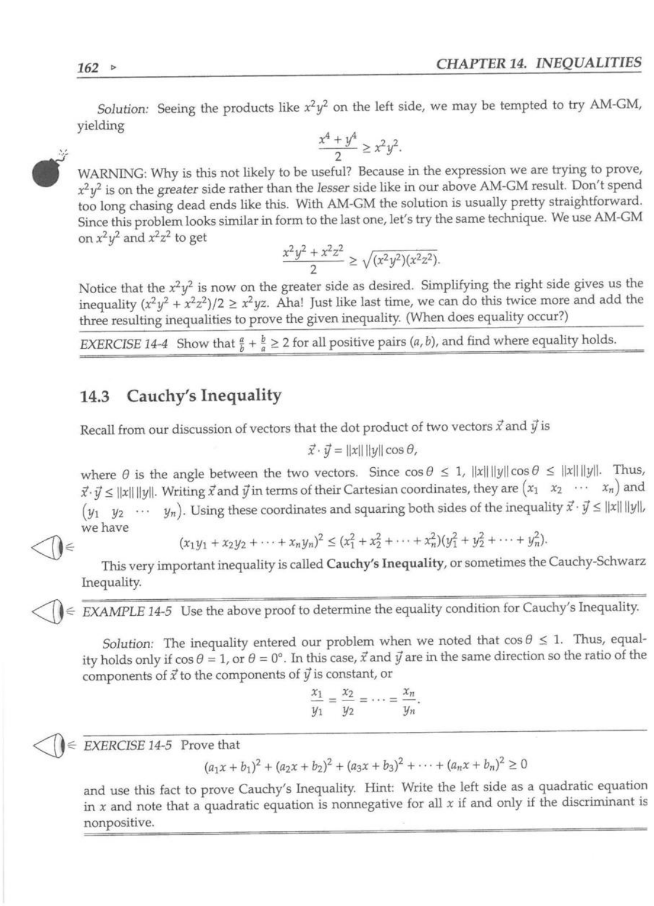

## Printed page 163

<!-- source: volume-2, PDF page 185, printed page 163 -->

As the form of Cauchy’s Inequality suggests, it is most obviously useful for problems involving products of sums or squares of sums.

**EXAMPLE 14-6 Prove that**

$$1^2 + 2^2 + \cdots + n^2 \geq \frac{(1 + 2 + \cdots + n)^2}{n}$$

for all integers $n \geq 1$.

Proof: Seeing the square of a sum, we think of Cauchy’s Inequality. We multiply both sides by $n$ to isolate the square of a sum as in Cauchy’s Inequality, leaving

$$\left(1^2 + 2^2 + \cdots + n^2\right)(n) \geq (1 + 2 + \cdots + n)^2.$$

If we write $n$ as $(1^2 + 1^2 + \cdots + 1^2)$, we have

$$\left(1^2 + 2^2 + \cdots + n^2\right)\left(1^2 + 1^2 + \cdots + 1^2\right) \geq (1 + 2 + \cdots + n)^2,$$

which is true by Cauchy’s Inequality. (Note once again how we have worked backwards to solve this problem. Show that each of the steps we have taken is reversible.)

**EXAMPLE 14-7 Show that if $\alpha$ and $\beta$ are angles in the first quadrant, then**

$$\left(\frac{\cos^3 \alpha}{\cos \beta} + \frac{\sin^3 \alpha}{\sin \beta}\right) \cos(\alpha - \beta) \geq 1.$$

(Mandelbrot #3)

Proof: Writing $\cos(\alpha - \beta) = \cos \alpha \cos \beta + \sin \alpha \sin \beta$, the left hand side becomes

$$\left(\frac{\cos^3 \alpha}{\cos \beta} + \frac{\sin^3 \alpha}{\sin \beta}\right) (\cos \alpha \cos \beta + \sin \alpha \sin \beta).$$

Seeing the product of sums, we apply Cauchy:

$$\left(\frac{\cos^3 \alpha}{\cos \beta} + \frac{\sin^3 \alpha}{\sin \beta}\right) (\cos \alpha \cos \beta + \sin \alpha \sin \beta) \geq$$

$$\left(\sqrt{\left(\frac{\cos^3 \alpha}{\cos \beta}\right) (\cos \alpha \cos \beta)} + \sqrt{\left(\frac{\sin^3 \alpha}{\sin \beta}\right) (\sin \alpha \sin \beta)}\right)^2.$$

The lesser side is

$$\left(\sqrt{\cos^4 \alpha} + \sqrt{\sin^4 \alpha}\right)^2 = \left(\cos^2 \alpha + \sin^2 \alpha\right)^2 = 1,$$

so we have our desired inequality.

Original scan — PDF page 185

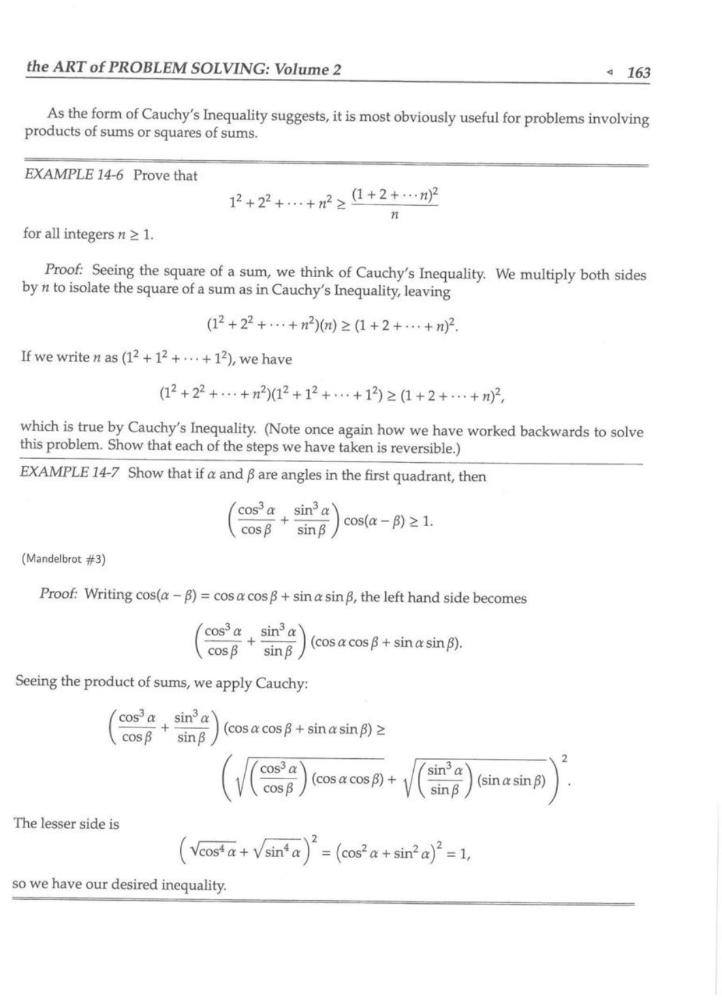

## Printed page 164

<!-- source: volume-2, PDF page 186, printed page 164 -->

### 14.4 Maximization and Minimization

In algebra class you were probably asked a question like 'If Farmer Bob has 40 feet of fence, what is the largest rectangular field that Farmer Bob can fence off?' You were then taught to let $x$ and $y$ be the dimensions of the field, so $2x + 2y = 40$. The area is $xy = x(20 - x)$, and you completed the square to find

$$\text{Area} = -(x - 10)^2 + 100.$$

By the Trivial Inequality the maximum area is 100 and occurs when $x = y = 10$, or when the field is a square. This is a fine approach, but what if we were told that Farmer Bob has 96 square inches of wrapping paper and asked to find the volume of the largest rectangular box he can wrap with the paper. Now we have three variables and our completing the squares method isn't quite as helpful.

For these optimization (either minimization or maximization) problems, we can often apply AM-GM, Cauchy's Inequality, or the Trivial Inequality. For Farmer Bob's wrapping problem, we let $x, y,$ and $z$ be the dimensions of the box. The surface area of the box is to be covered by the paper, so

$$2(xy + yz + zx) = 96.$$

We wish to maximize $xyz$. Applying AM-GM to the three terms in the sum above, we have

$$\frac{xy + yz + zx}{3} \geq \sqrt[3]{(xy)(yz)(zx)} = (xyz)^{2/3}.$$

Using our first equation, we find $xyz \leq 64$, so 64 is the maximum volume. (How did we know to get $xyz$ on the lesser side?) Applying the equality condition for AM-GM we further find that the box attains this maximum volume when $xy = yz = zx,$ or $x = y = z = 4$. Thus, the box of maximum volume is a cube.

WARNING: Although boxes are usually cubes and rectangles usually squares in this type of problem, don't assume this will be the case every time. You must use the equality conditions of inequality to prove it. Furthermore, your assumption may not always be correct!

It is very important to show that equality can be attained, because if it cannot, then we haven't found the maximum. For example, if we are told that $x$ is a two digit number and asked to find its maximum value, we cannot assume from the true statement $x \leq 100$ that 100 is the maximum, because 100 cannot be attained. Thus, optimization problems are two part problems: show that the desired quantity can be no higher or lower than the optimal value, and show that the optimal value can be attained.

**EXAMPLE 14-8 If $xyz = 27$ and $x, y,$ and $z$ are positive, find the minimum value of $x + y + z$.**

Solution: Since we are minimizing, we want $x + y + z$ on the greater side. (Why?) Using AM-GM we have

$$\frac{x + y + z}{3} \geq \sqrt[3]{xyz} = 3.$$

Hence $x + y + z \geq 9$, where equality is attained when $x = y = z = 3$. Thus, our minimum value is 9.

**EXERCISE 14-6 Find the maximum value of $xyz$ if $2x + y + z = 12$ and $x, y, z > 0$.**

Original scan — PDF page 186

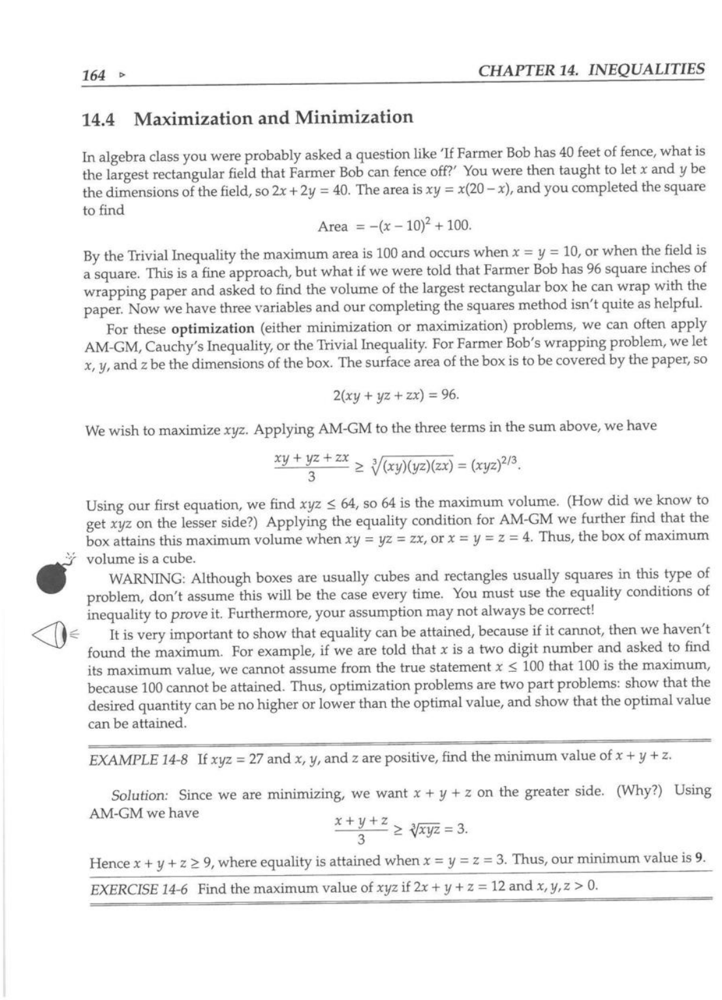

## Printed page 165

<!-- source: volume-2, PDF page 187, printed page 165 -->

We are sometimes interested in finding the smallest or the largest member of a set. We denote the smallest number in set $A$ by $\min A$ and the largest by $\max A$. Hence, by $\min\{x, y, z\}$, we mean the smallest of the numbers $x, y$, and $z$. Furthermore, by $\max\{x, y, z\}$, we mean consider all sets $\{x, y, z\}$, find the minimum element of each set, then find the maximum of all these minimum elements.

**EXAMPLE 14-9** If $x + y = 4$, find $\max\{x, y\}$.

**Solution:** Without loss of generality, let $x \geq y$. Hence $\min\{x, y\} = y$. Thus, we are trying to maximize $y$ such that $y \leq x$ and $x + y = 4$. Since $x + y \geq y + y = 2y$, we have $4 \geq 2y$, so $y \leq 2$. Thus, the maximum value of $y$ is 2. We must show that this value can be attained, which it can when $x = y = 2$.

**EXERCISE 14-7** We might try to use the above "without loss of generality let $x \geq y$" approach on the following:

$$\text{If } 2x + y = 4, \text{ find } \max\{x, y\}.$$

Could we? Why or why not?

### 14.5 Geometry and Inequalities

Because there are so many symmetric expressions in geometry, such as Heron’s formula or the perimeter of a triangle, there are very many inequalities which can be derived with the help of geometrical principles. One purely geometric tool which is often useful in attacking geometric inequalities is the Triangle Inequality, which states that the sum of any two sides of a triangle is greater than the third side. (Prove this inequality!) Since the Triangle Inequality is a strict inequality in geometry (meaning there can never be equality), it is generally not useful on nonstrict inequality problems.

This section will mostly be examples, with a few helpful hints scattered about. In these problems, you will need to use many geometric relations as well as the Triangle Inequality, the other inequalities in this chapter, and the ever important fact that $\cos \theta$ and $\sin \theta$ are less than or equal to 1.

**EXAMPLE 14-10** Prove that the cube of the perimeter of a triangle is greater than or equal to 108 times the product of its area and its circumradius.

**Proof:** First we write out what we are asked to prove:

$$(a + b + c)^3 \geq 108[ABC]R.$$

Seeing the product $[ABC]R$, we recall that $4[ABC]R = abc$, so our expression becomes

$$(a + b + c)^3 \geq 27abc.$$

Taking the cube root and dividing by 3 we have

$$\frac{a + b + c}{3} \geq \sqrt[3]{abc},$$

which is true by AM-GM. (Are all of our steps reversible?)

Original scan — PDF page 187

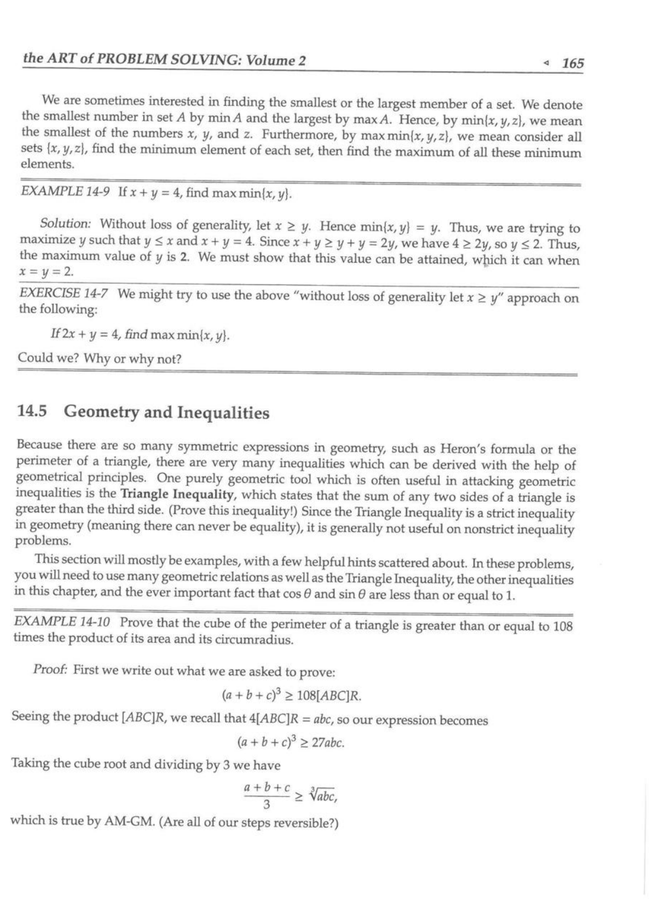

## Printed page 166

<!-- source: volume-2, PDF page 188, printed page 166 -->

**EXERCISE 14-8 Use the previous result to prove that $p^3 = 108[ABC]R$ if and only if $\Delta ABC$ is equilateral.**

**EXAMPLE 14-11 Show that if a quadrilateral is cyclic with consecutive sides $a, b, c,$ and $d$ and diagonals $p$ and $q,$ then**

$$pq \leq \sqrt{(a^2 + b^2)(c^2 + d^2)}$$

(ARML 1987)

Proof: From Ptolemy’s Theorem (page 35) we have $ac + bd = pq$; hence the above expression becomes $(ac + bd) \leq \sqrt{(a^2 + b^2)(c^2 + d^2)}$. Squaring this inequality, we have

$$(a^2 + b^2)(c^2 + d^2) \geq (ac + bd)^2$$

which is just Cauchy’s Inequality and therefore true.

As you do more work with geometric inequalities, you’ll find that knowing the few important ways to find the area of a triangle is very useful in solving geometric inequalities.

### 14.6 Wrap-Up and Parting Hints

Most of the very important inequality solving techniques are discussed among the previous sections, but there are still a couple approaches we haven’t seen.

► If $A \geq B$ and $B \geq C,$ then $A \geq C.$ Sometimes you may find it necessary to use an intermediate expression, like $B$ above, to show that $A \geq C.$

► If $A$ and $B$ are positive and $1/A \geq 1/B,$ then $B \geq A.$ Sometimes you will be given an inequality whose denominators are easier to work with than the numerators. Take reciprocals and reverse the inequality sign; perhaps this will simplify the problem.

► Don’t forget the Triangle Inequality for complex numbers when faced with $|x + y|!$ Remember that $|x + y| \leq |x| + |y|.$

**EXAMPLE 14-12 As a parting shot, we introduce a few more advanced inequalities. We have introduced the arithmetic mean and the geometric mean, but we can also define a harmonic mean (HM) as the reciprocal of the average of the reciprocals, and a root mean square (RMS) as the square root of the average of the squares. For any set of positive numbers $\{a_1, a_2, \ldots, a_n\},$ we then have**

$$RMS \geq AM \geq GM \geq HM,$$

or

$$\sqrt{\frac{a_1^2 + a_2^2 + \cdots + a_n^2}{n}} \geq \frac{a_1 + a_2 + \cdots + a_n}{n} \geq \sqrt{a_1 a_2 \cdots a_n} \geq \frac{n}{\frac{1}{a_1} + \frac{1}{a_2} + \cdots + \frac{1}{a_n}}.$$

We can extend this discussion past the root mean square to even higher powers to obtain the Power Mean Inequality, which states that if $m > n,$ then

$$\sqrt{\frac{a_1^m + a_2^m + \cdots + a_k^m}{k}} \geq \sqrt{\frac{a_1^n + a_2^n + \cdots + a_k^n}{k}}.$$

Original scan — PDF page 188

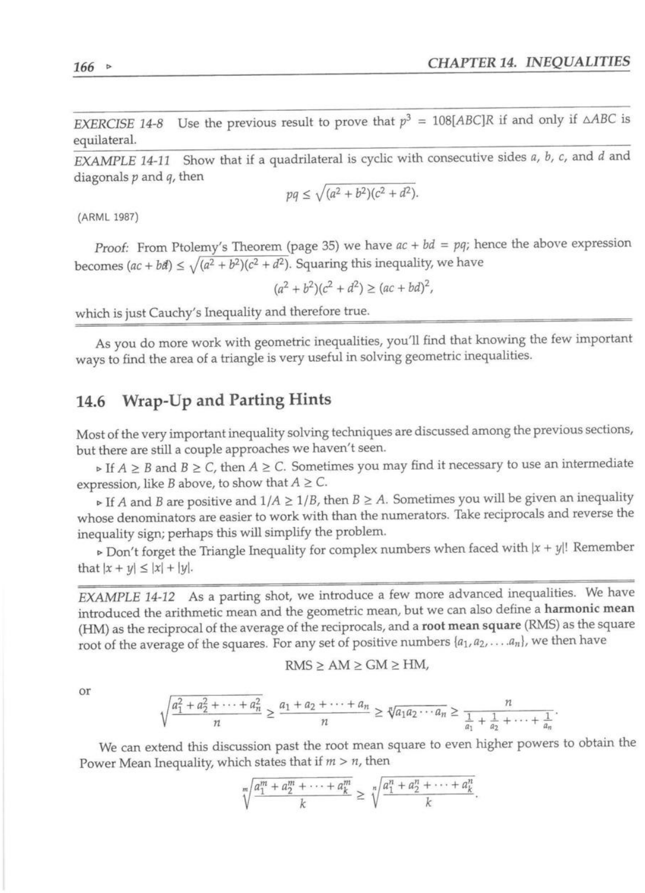

## Printed page 167

<!-- source: volume-2, PDF page 189, printed page 167 -->

**EXERCISE 14-9 Write the Power Mean Inequality in summation notation.**

**EXERCISE 14-10 Show that for $m = 2, n = 1$, the Power Mean Inequality is merely RMS $\geq$ AM.**

Problems to Solve for Chapter 14

If inequalities are new to you, be patient. It takes practice to get good at them!

210. If $x$ and $y$ are real and $x^2 + y^2 = 1$, compute the maximum value of $(x + y)^2$. (ARML 1985)

211. Let $xyz = 1$ for positive $x, y, z$. Show that $\min\{x + y, x + z, y + z\}$ has no maximum value. (Mandelbrot #1)

212. Show that if $\alpha$ and $\beta$ are first quadrant angles and

$$\left( \frac{\cos^3 \alpha}{\cos \beta} + \frac{\sin^3 \alpha}{\sin \beta} \right) \cos(\alpha - \beta) = 1,$$

then $\alpha = \beta$. (Mandelbrot #3)

213. If $A, B, C,$ and $D$ are positive numbers such that $A + 2B + 3C + 4D = 8$, then what is the maximum value of ABCD? (MAΘ 1991)

214. For positive $x, y, z$ such that $xyz = 1$, use the AM-GM Inequality to show that $\min\{x + y, x + z, y + z\} = 2$. (Mandelbrot #1)

215. For positive $x, y, z$ such that $x + y + z = 3$, show that $\max\{xy, xz, yz\} = 1$. (Mandelbrot #1)

216. Show that for any two positive real numbers $a$ and $b$,

$$\frac{a + b}{2} - \sqrt{ab} \geq \sqrt{\frac{a^2 + b^2}{2}} - \frac{a + b}{2},$$

by showing that this inequality is equivalent to

$$\frac{(a + b)^2}{2} \geq \sqrt{(2ab)(a^2 + b^2)}$$

and then using the AM-GM Inequality. (Mandelbrot #1)

217. Let $r_1, r_2, \ldots, r_n$ be $n$ real numbers each greater than zero. Prove that for any real number $x > 0$,

$$\left(x + r_1\right)\left(x + r_2\right) \cdots \left(x + r_n\right) \leq \left(x + \frac{r_1 + r_2 + \cdots + r_n}{n}\right)^n.$$

(Mandelbrot #3)

218. What is the smallest positive integer $n$ such that $\sqrt{n} - \sqrt{n - 1} < .01$? (AHSME 1978)

Original scan — PDF page 189

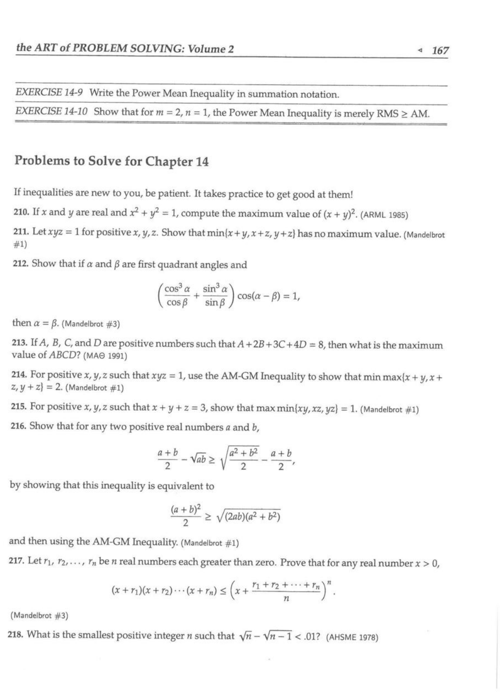

## Printed page 168

<!-- source: volume-2, PDF page 190, printed page 168 -->

219. Let $x$ be a real number and let $f(x) = \sum_{i=1}^{10} |x - F_i|$, where $F_i$ is the $i$th Fibonacci number; i.e. $F_1 = F_2 = 1$ and $F_n = F_{n-1} + F_{n-2}$ for $n > 2$. Find the minimum value of $f(x)$. (USAMTS 2)

220. Let $r_1, r_2, \ldots, r_n$ be $n$ real numbers each greater than zero. Prove that for any real number $x > 0$,

$$\left(x + r_1\right)\left(x + r_2\right) \cdots \left(x + r_n\right) \geq \left(x + \sqrt[n]{r_1 r_2 \cdots r_n}\right)^n.$$

(Mandelbrot #3)

221. If $x^3 - 12x^2 + ax - 64$ has real, nonnegative roots, find $a$. (Mandelbrot #1)

222. Prove that $\sqrt{n} \leq \sqrt[n]{n!}$ for every positive integer $n$. (USAMTS 1)

223. Let $a, b, c,$ and $d$ be the areas of the triangular faces of a tetrahedron, and let $h_a, h_b, h_c,$ and $h_d$ be the corresponding altitudes of the tetrahedron. If $V$ denotes the volume of the tetrahedron, prove that

$$\left(a + b + c + d\right)\left(h_a + h_b + h_c + h_d\right) \geq 48V.$$

(USAMTS 3)

224. Find the smallest integer $n$ such that

$$\left(x^2 + y^2 + z^2\right)^2 \leq n\left(x^4 + y^4 + z^4\right)$$

for all real numbers $x, y,$ and $z$. (AHSME 1977)

225. Cars A and B travel the same distance. Car A travels half the distance at $u$ miles per hour and half at $v$ miles per hour. Car B travels half the time at $u$ miles per hour and half at $v$ miles per hour. The average speed of Car A is $x$ miles per hour and that of Car B is $y$ miles per hour. Prove that $x \leq y$. (AHSME 1973)

226. Prove that the product of two sides of a triangle is always greater than the product of the diameters of the inscribed circle and the circumscribed circle. (IMO 1985)

227. Triangle ABC has side lengths $AB = 6, AC = 5,$ and $BC = 4$. A point $P$ in the interior of $\Delta ABC$ is a distance $l$ from $BC,$ a distance $m$ from $AC,$ and a distance $n$ from $AB$. If $l^2 + m^2 + n^2 = 225/44,$ then find $l$. (Mandelbrot #2)

228. Show that for all positive $a$ and $b$ with root mean square RMS, arithmetic mean AM, geometric mean GM, and harmonic mean HM, we have RMS - AM $\geq GM - HM$. (Mandelbrot #1)

229. If $a, b,$ and $c$ are each positive and $a + b + c = 6,$ show that

$$\left(a + \frac{1}{b}\right)^2 + \left(b + \frac{1}{c}\right)^2 + \left(c + \frac{1}{a}\right)^2 \geq \frac{75}{4}.$$

(ARML 1987)

230. At a wedding reception $n$ guests have assembled into $m$ groups to converse. (The groups are not necessarily equal sized.) The host is preparing $m$ square cakes, each with an ornate ribbon adorning its perimeter, to serve to the $m$ groups. No guest is allowed to have more than $25\text{ cm}^2$ of cake. Prove that no more than $20\sqrt{mn}$ cm of ribbon is needed to embellish the $m$ cakes. (Mandelbrot #3)

Original scan — PDF page 190

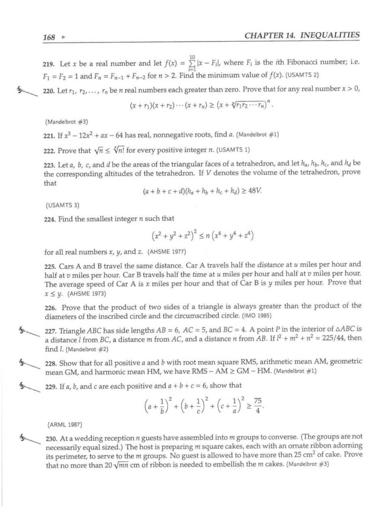

## Printed page 169

<!-- source: volume-2, PDF page 191, printed page 169 -->

231. Let $ABCD$ be a tetrahedron having each sum of opposite edges equal to 1. Prove that

$$r_A + r_B + r_C + r_D \leq \frac{\sqrt{3}}{3},$$

where $r_A, r_B, r_C, r_D$ are the inradii of the faces, equality holding if $ABCD$ is regular. (IMO 1986)

232. The circumcircle $k$ of acute $\Delta ABC$ has radius $r$. The bisectors of the angles of the triangle intersect the circle again in the points $A', B'$ and $C'$. If $P$ and $Q$ are the areas of $\Delta ABC$ and $\Delta A'B'C'$, respectively, prove the inequality $16Q^3 \geq 27r^4P$. (IMO 1989)

233. Prove that if $x_i > 0$ for all $i$ then

$$\left( x_1^{19} + x_2^{19} + \cdots + x_n^{19} \right) \left( x_1^{93} + x_2^{93} + \cdots + x_n^{93} \right) \geq \left( x_1^{20} + x_2^{20} + \cdots + x_n^{20} \right) \left( x_1^{92} + x_2^{92} + \cdots + x_n^{92} \right),$$

and find when equality holds. (Mandelbrot #3)

234. Let $M$ be an interior point of the triangle $ABC$ such that $\angle AMC = 90^\circ$, $\angle AMB = 150^\circ$, and $\angle BMC = 120^\circ$. The circumcenters of the triangles $AMC, AMB$, and $BMC$ are $P, Q$, and $R$ respectively. Prove that the area of $\Delta PQR$ is greater than or equal to the area of $\Delta ABC$. (Bulgaria 1993)

Original scan — PDF page 191

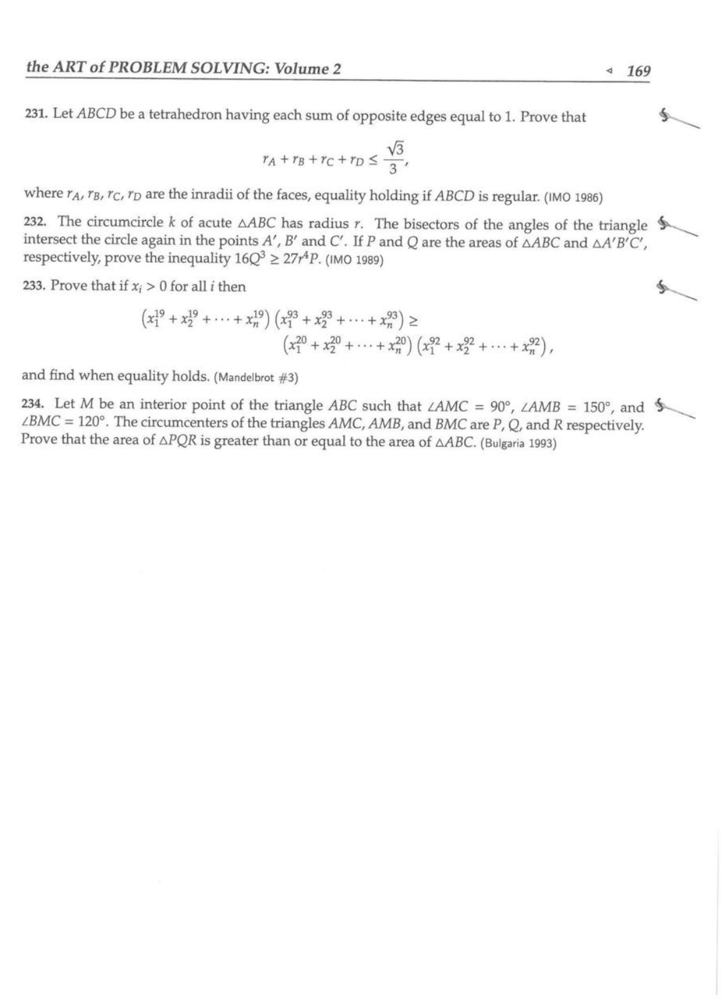

