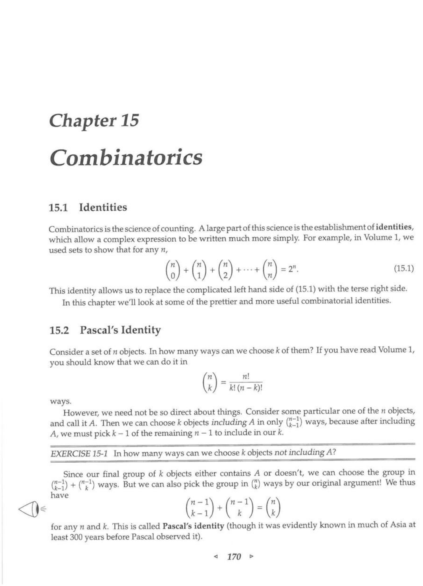
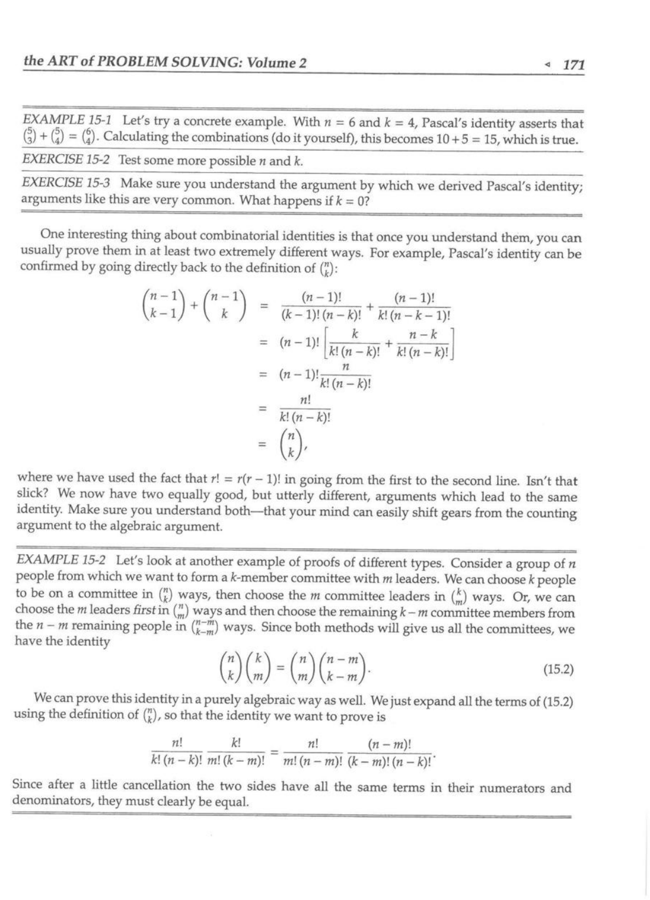
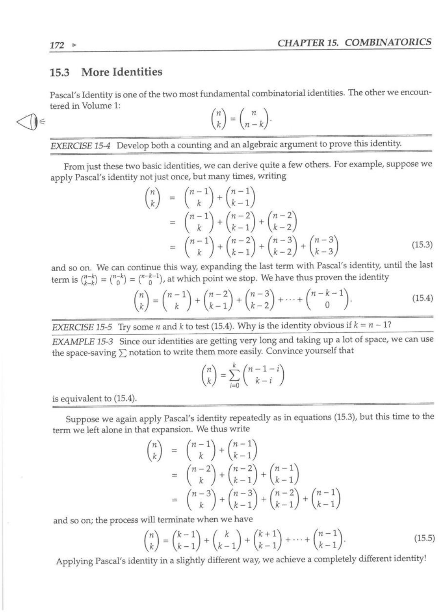
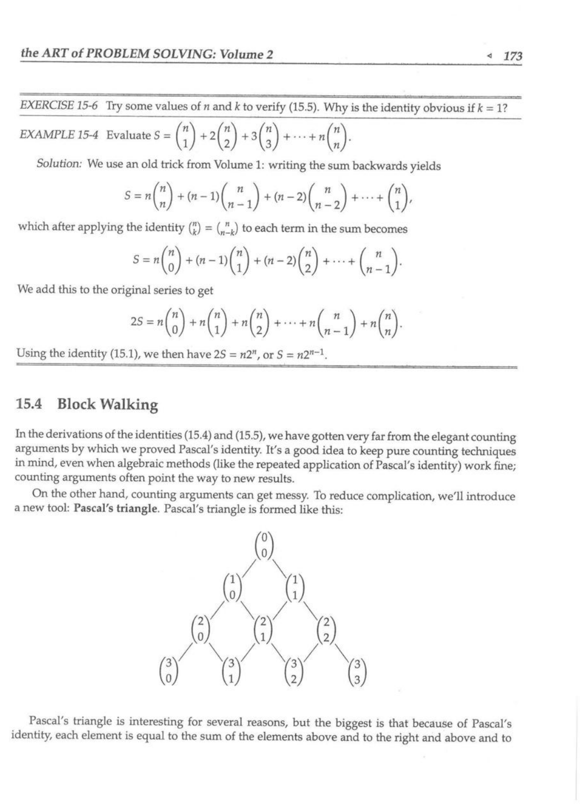
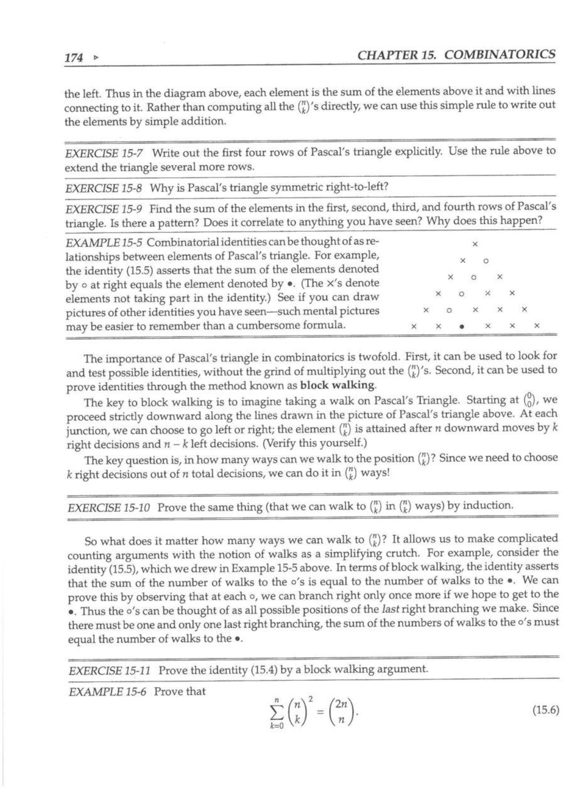
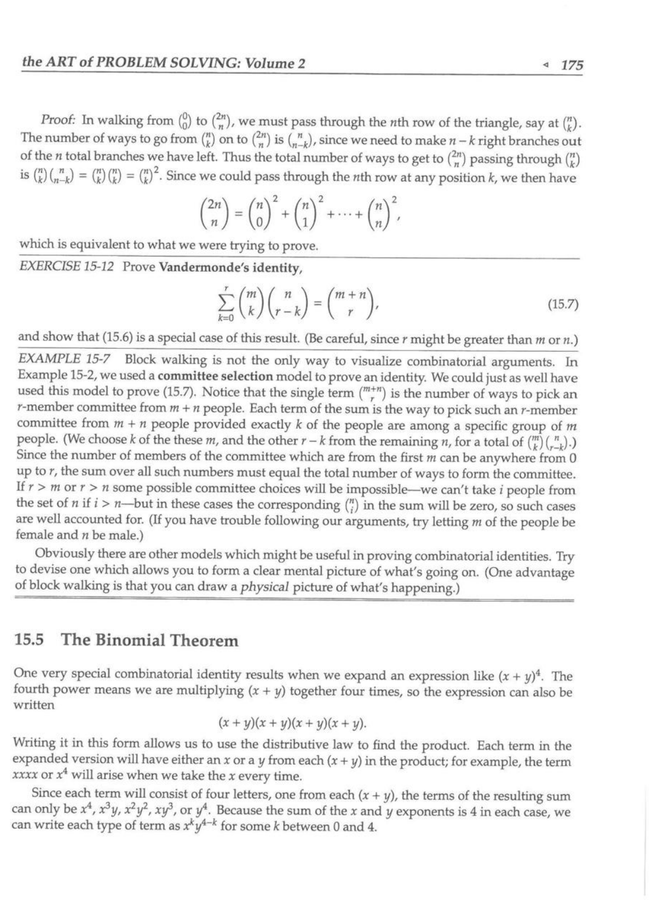
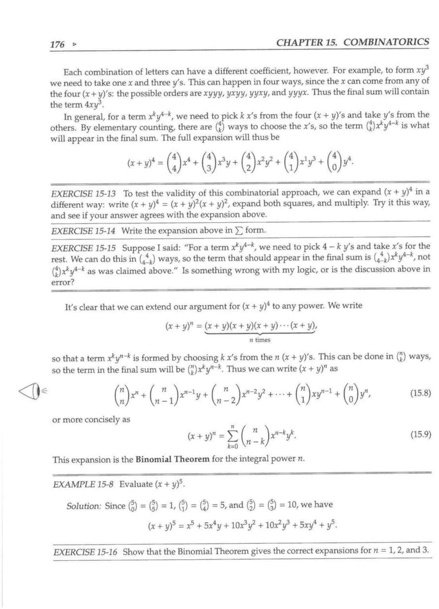
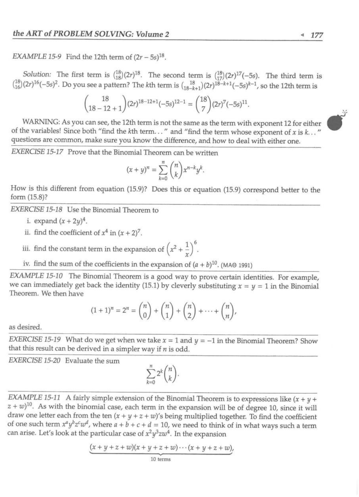
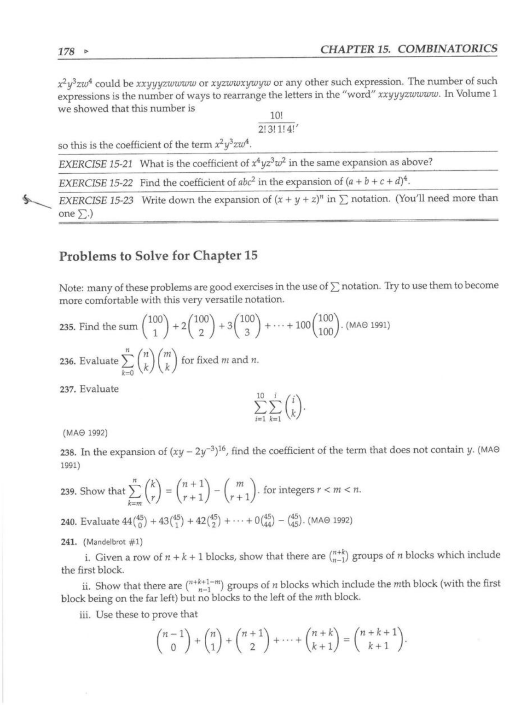
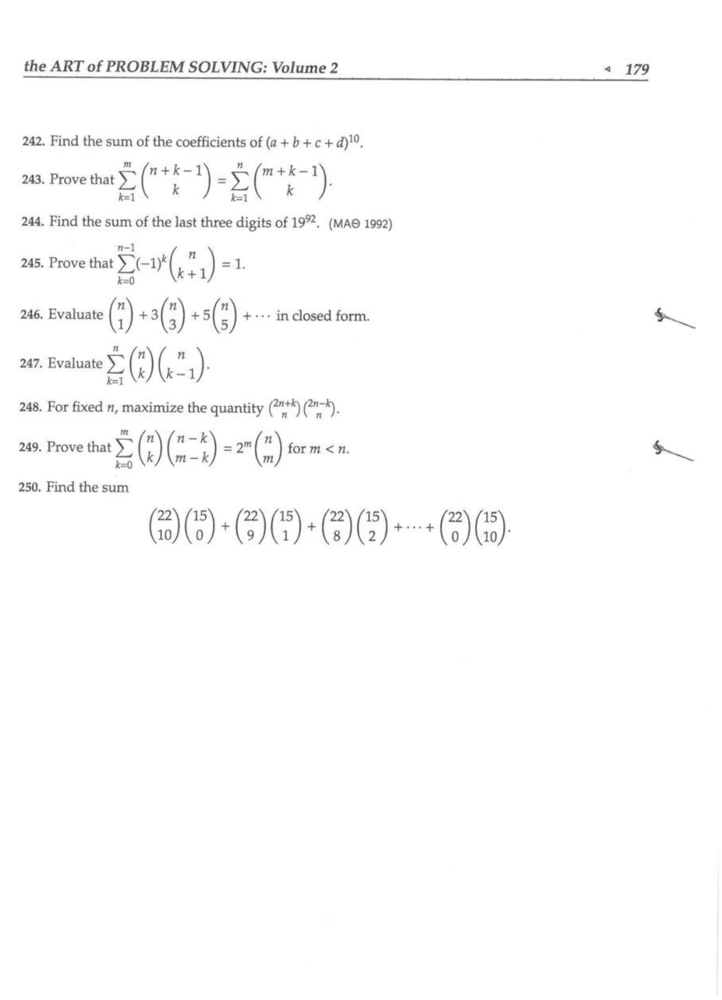

# Chapter 15: Combinatorics

Volume 2 · Printed pages 170–179 · PDF pages 192–201

[Volume contents](../index.md)

## Printed page 170

<!-- source: volume-2, PDF page 192, printed page 170 -->

### 15.1 Identities

Combinatorics is the science of counting. A large part of this science is the establishment of identities, which allow a complex expression to be written much more simply. For example, in Volume 1, we used sets to show that for any $n$,

$$\binom{n}{0} + \binom{n}{1} + \binom{n}{2} + \cdots + \binom{n}{n} = 2^n.$$

(15.1)

This identity allows us to replace the complicated left hand side of (15.1) with the terse right side.

In this chapter we’ll look at some of the prettier and more useful combinatorial identities.

### 15.2 Pascal’s Identity

Consider a set of $n$ objects. In how many ways can we choose $k$ of them? If you have read Volume 1, you should know that we can do it in

$$\binom{n}{k} = \frac{n!}{k! (n-k)!}$$

ways.

However, we need not be so direct about things. Consider some particular one of the $n$ objects, and call it $A$. Then we can choose $k$ objects including $A$ in only $\binom{n-1}{k-1}$ ways, because after including $A$, we must pick $k-1$ of the remaining $n-1$ to include in our $k$.

**EXERCISE 15-1 In how many ways can we choose $k$ objects not including $A$?**

Since our final group of $k$ objects either contains $A$ or doesn’t, we can choose the group in $\binom{n-1}{k-1} + \binom{n-1}{k}$ ways. But we can also pick the group in $\binom{n}{k}$ ways by our original argument! We thus have

$$\binom{n-1}{k-1} + \binom{n-1}{k} = \binom{n}{k}$$

for any $n$ and $k$. This is called Pascal’s identity (though it was evidently known in much of Asia at least 300 years before Pascal observed it).

Original scan — PDF page 192

## Printed page 171

<!-- source: volume-2, PDF page 193, printed page 171 -->

**EXAMPLE 15-1 Let’s try a concrete example. With $n = 6$ and $k = 4$, Pascal’s identity asserts that $\binom{5}{3} + \binom{5}{4} = \binom{6}{4}$. Calculating the combinations (do it yourself), this becomes $10 + 5 = 15$, which is true.**

**EXERCISE 15-2 Test some more possible $n$ and $k$.**

**EXERCISE 15-3 Make sure you understand the argument by which we derived Pascal’s identity; arguments like this are very common. What happens if $k = 0$?**

One interesting thing about combinatorial identities is that once you understand them, you can usually prove them in at least two extremely different ways. For example, Pascal’s identity can be confirmed by going directly back to the definition of $\binom{n}{k}$:

$$\binom{n-1}{k-1} + \binom{n-1}{k} = \frac{(n-1)!}{(k-1)! (n-k)!} + \frac{(n-1)!}{k! (n-k-1)!}$$

$$= (n-1)! \left[ \frac{k}{k! (n-k)!} + \frac{n-k}{k! (n-k)!} \right]$$

$$= (n-1)! \frac{n}{k! (n-k)!}$$

$$= \frac{n!}{k! (n-k)!}$$

$$= \binom{n}{k},$$

where we have used the fact that $r! = r(r-1)!$ in going from the first to the second line. Isn’t that slick? We now have two equally good, but utterly different, arguments which lead to the same identity. Make sure you understand both—that your mind can easily shift gears from the counting argument to the algebraic argument.

**EXAMPLE 15-2 Let’s look at another example of proofs of different types. Consider a group of $n$ people from which we want to form a $k$-member committee with $m$ leaders. We can choose $k$ people to be on a committee in $\binom{n}{k}$ ways, then choose the $m$ committee leaders in $\binom{k}{m}$ ways. Or, we can choose the $m$ leaders first in $\binom{n}{m}$ ways and then choose the remaining $k-m$ committee members from the $n-m$ remaining people in $\binom{n-m}{k-m}$ ways. Since both methods will give us all the committees, we have the identity**

$$\binom{n}{k} \binom{k}{m} = \binom{n}{m} \binom{n-m}{k-m}. \tag{15.2}$$

We can prove this identity in a purely algebraic way as well. We just expand all the terms of (15.2) using the definition of $\binom{n}{k}$, so that the identity we want to prove is

$$\frac{n!}{k! (n-k)!} \frac{k!}{m! (k-m)!} = \frac{n!}{m! (n-m)!} \frac{(n-m)!}{(k-m)! (n-k)!}.$$

Since after a little cancellation the two sides have all the same terms in their numerators and denominators, they must clearly be equal.

Original scan — PDF page 193

## Printed page 172

<!-- source: volume-2, PDF page 194, printed page 172 -->

### 15.3 More Identities

Pascal’s Identity is one of the two most fundamental combinatorial identities. The other we encountered in Volume 1:

$$\binom{n}{k} = \binom{n}{n-k}$$

**EXERCISE 15-4 Develop both a counting and an algebraic argument to prove this identity.**

From just these two basic identities, we can derive quite a few others. For example, suppose we apply Pascal’s identity not just once, but many times, writing

$$\binom{n}{k} = \binom{n-1}{k} + \binom{n-1}{k-1}$$

$$= \binom{n-1}{k} + \binom{n-2}{k-1} + \binom{n-2}{k-2}$$

$$= \binom{n-1}{k} + \binom{n-2}{k-1} + \binom{n-3}{k-2} + \binom{n-3}{k-3}$$

(15.3)

and so on. We can continue this way, expanding the last term with Pascal’s identity, until the last term is $\binom{n-k}{k-k} = \binom{n-k}{0} = \binom{n-k-1}{0}$, at which point we stop. We have thus proven the identity

$$\binom{n}{k} = \binom{n-1}{k} + \binom{n-2}{k-1} + \binom{n-3}{k-2} + \cdots + \binom{n-k-1}{0}$$

(15.4)

**EXERCISE 15-5 Try some $n$ and $k$ to test (15.4). Why is the identity obvious if $k = n-1$?**

**EXAMPLE 15-3 Since our identities are getting very long and taking up a lot of space, we can use the space-saving $\sum$ notation to write them more easily. Convince yourself that**

$$\binom{n}{k} = \sum_{i=0}^{k} \binom{n-1-i}{k-i}$$

is equivalent to (15.4).

Suppose we again apply Pascal’s identity repeatedly as in equations (15.3), but this time to the term we left alone in that expansion. We thus write

$$\binom{n}{k} = \binom{n-1}{k} + \binom{n-1}{k-1}$$

$$= \binom{n-2}{k} + \binom{n-2}{k-1} + \binom{n-1}{k-1}$$

$$= \binom{n-3}{k} + \binom{n-3}{k-1} + \binom{n-2}{k-1} + \binom{n-1}{k-1}$$

and so on; the process will terminate when we have

$$\binom{n}{k} = \binom{k-1}{k-1} + \binom{k}{k-1} + \binom{k+1}{k-1} + \cdots + \binom{n-1}{k-1}$$

(15.5)

Applying Pascal’s identity in a slightly different way, we achieve a completely different identity!

Original scan — PDF page 194

## Printed page 173

<!-- source: volume-2, PDF page 195, printed page 173 -->

**EXERCISE 15-6** Try some values of $n$ and $k$ to verify (15.5). Why is the identity obvious if $k=1$?

**EXAMPLE 15-4** Evaluate $S=\binom{n}{1}+2\binom{n}{2}+3\binom{n}{3}+\cdots+n\binom{n}{n}$.

Solution: We use an old trick from Volume 1: writing the sum backwards yields

$$S=n\binom{n}{n}+(n-1)\binom{n}{n-1}+(n-2)\binom{n}{n-2}+\cdots+\binom{n}{1},$$

which after applying the identity $\binom{n}{k}=\binom{n}{n-k}$ to each term in the sum becomes

$$S=n\binom{n}{0}+(n-1)\binom{n}{1}+(n-2)\binom{n}{2}+\cdots+\binom{n}{n-1}.$$

We add this to the original series to get

$$2S=n\binom{n}{0}+n\binom{n}{1}+n\binom{n}{2}+\cdots+n\binom{n}{n-1}+n\binom{n}{n}.$$

Using the identity (15.1), we then have $2S=n2^n$, or $S=n2^{n-1}$.

### 15.4 Block Walking

In the derivations of the identities (15.4) and (15.5), we have gotten very far from the elegant counting arguments by which we proved Pascal's identity. It's a good idea to keep pure counting techniques in mind, even when algebraic methods (like the repeated application of Pascal's identity) work fine; counting arguments often point the way to new results.

On the other hand, counting arguments can get messy. To reduce complication, we'll introduce a new tool: **Pascal's triangle**. Pascal's triangle is formed like this:

$$
\begin{array}{ccccccc}
&&&\binom00&&&\\
&&\binom10&&\binom11&&\\
&\binom20&&\binom21&&\binom22&\\
\binom30&&\binom31&&\binom32&&\binom33
\end{array}
$$

Pascal's triangle is interesting for several reasons, but the biggest is that because of Pascal's identity, each element is equal to the sum of the elements above and to the right and above and to

Original scan — PDF page 195

## Printed page 174

<!-- source: volume-2, PDF page 196, printed page 174 -->

Thus in the diagram above, each element is the sum of the elements above it and with lines connecting to it. Rather than computing all the $\binom{n}{k}$'s directly, we can use this simple rule to write out the elements by simple addition.

**EXERCISE 15-7 Write out the first four rows of Pascal's triangle explicitly. Use the rule above to extend the triangle several more rows.**

**EXERCISE 15-8 Why is Pascal's triangle symmetric right-to-left?**

**EXERCISE 15-9 Find the sum of the elements in the first, second, third, and fourth rows of Pascal's triangle. Is there a pattern? Does it correlate to anything you have seen? Why does this happen?**

**EXAMPLE 15-5 Combinatorial identities can be thought of as relationships between elements of Pascal's triangle. For example, the identity (15.5) asserts that the sum of the elements denoted by $\circ$ at right equals the element denoted by $\bullet$. (The $\circ$'s denote elements not taking part in the identity.) See if you can draw pictures of other identities you have seen—such mental pictures may be easier to remember than a cumbersome formula.**

The importance of Pascal's triangle in combinatorics is twofold. First, it can be used to look for and test possible identities, without the grind of multiplying out the $\binom{n}{k}$'s. Second, it can be used to prove identities through the method known as block walking.

The key to block walking is to imagine taking a walk on Pascal's Triangle. Starting at $\binom{0}{0}$, we proceed strictly downward along the lines drawn in the picture of Pascal's triangle above. At each junction, we can choose to go left or right; the element $\binom{n}{k}$ is attained after $n$ downward moves by $k$ right decisions and $n-k$ left decisions. (Verify this yourself.)

The key question is, in how many ways can we walk to the position $\binom{n}{k}$? Since we need to choose $k$ right decisions out of $n$ total decisions, we can do it in $\binom{n}{k}$ ways!

**EXERCISE 15-10 Prove the same thing (that we can walk to $\binom{n}{k}$ in $\binom{n}{k}$ ways) by induction.**

So what does it matter how many ways we can walk to $\binom{n}{k}$? It allows us to make complicated counting arguments with the notion of walks as a simplifying crutch. For example, consider the identity (15.5), which we drew in Example 15-5 above. In terms of block walking, the identity asserts that the sum of the number of walks to the $\circ$'s is equal to the number of walks to the $\bullet$. We can prove this by observing that at each $\circ$, we can branch right only once more if we hope to get to the $\bullet$. Thus the $\circ$'s can be thought of as all possible positions of the last right branching we make. Since there must be one and only one last right branching, the sum of the numbers of walks to the $\circ$'s must equal the number of walks to the $\bullet$.

**EXERCISE 15-11 Prove the identity (15.4) by a block walking argument.**

**EXAMPLE 15-6 Prove that**

$$\sum_{k=0}^{n} \binom{n}{k}^2 = \binom{2n}{n}.$$

Original scan — PDF page 196

## Printed page 175

<!-- source: volume-2, PDF page 197, printed page 175 -->

Proof: In walking from $\binom{0}{0}$ to $\binom{2n}{n}$, we must pass through the $n$th row of the triangle, say at $\binom{n}{k}$. The number of ways to go from $\binom{n}{k}$ on to $\binom{2n}{n}$ is $\binom{n}{n-k}$, since we need to make $n-k$ right branches out of the $n$ total branches we have left. Thus the total number of ways to get to $\binom{2n}{n}$ passing through $\binom{n}{k}$ is $\binom{n}{k} \binom{n}{n-k} = \binom{n}{k} \binom{n}{k} = \binom{n}{k}^2$. Since we could pass through the $n$th row at any position $k$, we then have

$$\binom{2n}{n} = \binom{n}{0}^2 + \binom{n}{1}^2 + \cdots + \binom{n}{n}^2,$$

which is equivalent to what we were trying to prove.

**EXERCISE 15-12 Prove Vandermonde’s identity,**

$$\sum_{k=0}^{r} \binom{m}{k} \binom{n}{r-k} = \binom{m+n}{r},$$

(15.7)

and show that (15.6) is a special case of this result. (Be careful, since $r$ might be greater than $m$ or $n$.)

**EXAMPLE 15-7 Block walking is not the only way to visualize combinatorial arguments. In Example 15-2, we used a committee selection model to prove an identity. We could just as well have used this model to prove (15.7). Notice that the single term $\binom{m+n}{r}$ is the number of ways to pick an $r$-member committee from $m+n$ people. Each term of the sum is the way to pick such an $r$-member committee from $m+n$ people provided exactly $k$ of the people are among a specific group of $m$ people. (We choose $k$ of the these $m$, and the other $r-k$ from the remaining $n$, for a total of $\binom{m}{k} \binom{n}{r-k}$.) Since the number of members of the committee which are from the first $m$ can be anywhere from 0 up to $r$, the sum over all such numbers must equal the total number of ways to form the committee. If $r > m$ or $r > n$ some possible committee choices will be impossible—we can’t take $i$ people from the set of $n$ if $i > n$—but in these cases the corresponding $\binom{n}{i}$ in the sum will be zero, so such cases are well accounted for. (If you have trouble following our arguments, try letting $m$ of the people be female and $n$ be male.)**

Obviously there are other models which might be useful in proving combinatorial identities. Try to devise one which allows you to form a clear mental picture of what’s going on. (One advantage of block walking is that you can draw a physical picture of what’s happening.)

### 15.5 The Binomial Theorem

One very special combinatorial identity results when we expand an expression like $(x+y)^4$. The fourth power means we are multiplying $(x+y)$ together four times, so the expression can also be written

$$(x+y)(x+y)(x+y)(x+y).$$

Writing it in this form allows us to use the distributive law to find the product. Each term in the expanded version will have either an $x$ or a $y$ from each $(x+y)$ in the product; for example, the term $xxxx$ or $x^4$ will arise when we take the $x$ every time.

Since each term will consist of four letters, one from each $(x+y)$, the terms of the resulting sum can only be $x^4$, $x^3y$, $x^2y^2$, $xy^3$, or $y^4$. Because the sum of the $x$ and $y$ exponents is 4 in each case, we can write each type of term as $x^k y^{4-k}$ for some $k$ between 0 and 4.

Original scan — PDF page 197

## Printed page 176

<!-- source: volume-2, PDF page 198, printed page 176 -->

Each combination of letters can have a different coefficient, however. For example, to form $xy^3$ we need to take one $x$ and three $y$'s. This can happen in four ways, since the $x$ can come from any of the four $(x+y)$'s: the possible orders are $xyyy, yxyy, yyxy,$ and $yyyx$. Thus the final sum will contain the term $4xy^3$.

In general, for a term $x^k y^{4-k}$, we need to pick $k$ $x$'s from the four $(x+y)$'s and take $y$'s from the others. By elementary counting, there are $\binom{4}{k}$ ways to choose the $x$'s, so the term $\binom{4}{k} x^k y^{4-k}$ is what will appear in the final sum. The full expansion will thus be

$$ (x+y)^4 = \binom{4}{4} x^4 + \binom{4}{3} x^3 y + \binom{4}{2} x^2 y^2 + \binom{4}{1} x^1 y^3 + \binom{4}{0} y^4. $$

**EXERCISE 15-13** To test the validity of this combinatorial approach, we can expand $(x+y)^4$ in a different way: write $(x+y)^4 = (x+y)^2 (x+y)^2$, expand both squares, and multiply. Try it this way, and see if your answer agrees with the expansion above.

**EXERCISE 15-14** Write the expansion above in $\sum$ form.

**EXERCISE 15-15** Suppose I said: "For a term $x^k y^{4-k}$, we need to pick $4-k$ $y$'s and take $x$'s for the rest. We can do this in $\binom{4}{4-k}$ ways, so the term that should appear in the final sum is $\binom{4}{4-k} x^k y^{4-k}$, not $\binom{4}{k} x^k y^{4-k}$ as was claimed above." Is something wrong with my logic, or is the discussion above in error?

It's clear that we can extend our argument for $(x+y)^4$ to any power. We write

$$ (x+y)^n = \underbrace{(x+y)(x+y)(x+y)\cdots(x+y)}_{n \text{ times}}, $$

so that a term $x^k y^{n-k}$ is formed by choosing $k$ $x$'s from the $n$ $(x+y)$'s. This can be done in $\binom{n}{k}$ ways, so the term in the final sum will be $\binom{n}{k} x^k y^{n-k}$. Thus we can write $(x+y)^n$ as

$$ \binom{n}{n} x^n + \binom{n}{n-1} x^{n-1} y + \binom{n}{n-2} x^{n-2} y^2 + \cdots + \binom{n}{1} xy^{n-1} + \binom{n}{0} y^n,\tag{15.8} $$

or more concisely as

$$ (x+y)^n = \sum_{k=0}^{n} \binom{n}{n-k} x^{n-k} y^k.\tag{15.9} $$

This expansion is the Binomial Theorem for the integral power $n$.

**EXAMPLE 15-8** Evaluate $(x+y)^5$.

Solution: Since $\binom{5}{0} = \binom{5}{5} = 1, \binom{5}{1} = \binom{5}{4} = 5,$ and $\binom{5}{2} = \binom{5}{3} = 10,$ we have

$$ (x+y)^5 = x^5 + 5x^4 y + 10x^3 y^2 + 10x^2 y^3 + 5xy^4 + y^5. $$

**EXERCISE 15-16** Show that the Binomial Theorem gives the correct expansions for $n = 1, 2,$ and 3.

Original scan — PDF page 198

## Printed page 177

<!-- source: volume-2, PDF page 199, printed page 177 -->

**EXAMPLE 15-9 Find the 12th term of $(2r - 5s)^{18}$.**

Solution: The first term is $\binom{18}{18}(2r)^{18}$. The second term is $\binom{18}{17}(2r)^{17}(-5s)$. The third term is $\binom{18}{16}(2r)^{16}(-5s)^2$. Do you see a pattern? The $k$th term is $\binom{18}{18-k+1}(2r)^{18-k+1}(-5s)^{k-1}$, so the 12th term is

$$\binom{18}{18-12+1}(2r)^{18-12+1}(-5s)^{12-1} = \binom{18}{7}(2r)^7(-5s)^{11}.$$

WARNING: As you can see, the 12th term is not the same as the term with exponent 12 for either of the variables! Since both "find the $k$th term..." and "find the term whose exponent of $x$ is $k...$" questions are common, make sure you know the difference, and how to deal with either one.

**EXERCISE 15-17 Prove that the Binomial Theorem can be written**

$$(x + y)^n = \sum_{k=0}^{n} \binom{n}{k} x^{n-k} y^k.$$

How is this different from equation (15.9)? Does this or equation (15.9) correspond better to the form (15.8)?

**EXERCISE 15-18 Use the Binomial Theorem to**

i. expand $(x + 2y)^4$.
ii. find the coefficient of $x^4$ in $(x + 2)^7$.
iii. find the constant term in the expansion of $\left(x^2 + \frac{1}{x}\right)^6$.
iv. find the sum of the coefficients in the expansion of $(a + b)^10$. (MAΘ 1991)

**EXAMPLE 15-10 The Binomial Theorem is a good way to prove certain identities. For example, we can immediately get back the identity (15.1) by cleverly substituting $x = y = 1$ in the Binomial Theorem. We then have**

$$(1 + 1)^n = 2^n = \binom{n}{0} + \binom{n}{1} + \binom{n}{2} + \cdots + \binom{n}{n},$$

as desired.

**EXERCISE 15-19 What do we get when we take $x = 1$ and $y = -1$ in the Binomial Theorem? Show that this result can be derived in a simpler way if $n$ is odd.**

**EXERCISE 15-20 Evaluate the sum**

$$\sum_{k=0}^{n} 2^k \binom{n}{k}.$$

**EXAMPLE 15-11 A fairly simple extension of the Binomial Theorem is to expressions like $(x + y + z + w)^{10}$. As with the binomial case, each term in the expansion will be of degree 10, since it will draw one letter each from the ten $(x + y + z + w)'$ being multiplied together. To find the coefficient of one such term $x^a y^b z^c w^d$, where $a + b + c + d = 10$, we need to think of in what ways such a term can arise. Let’s look at the particular case of $x^2 y^3 zw^4$. In the expansion**

$$\underbrace{(x + y + z + w)(x + y + z + w) \cdots (x + y + z + w)}_{10 terms}$$

Original scan — PDF page 199

## Printed page 178

<!-- source: volume-2, PDF page 200, printed page 178 -->

$x^2 y^3 z w^4$ could be $xxyyyzwww$ or $xyzwwxywyw$ or any other such expression. The number of such expressions is the number of ways to rearrange the letters in the "word" $xxyyyzwww$. In Volume 1 we showed that this number is

$$\frac{10!}{2! 3! 1! 4!}$$

so this is the coefficient of the term $x^2 y^3 z w^4$.

**EXERCISE 15-21** What is the coefficient of $x^4 yz^3 w^2$ in the same expansion as above?

**EXERCISE 15-22** Find the coefficient of $abc^2$ in the expansion of $(a + b + c + d)^4$.

**EXERCISE 15-23** Write down the expansion of $(x + y + z)^n$ in $\sum$ notation. (You'll need more than one $\sum$.)

**Problems to Solve for Chapter 15**

Note: many of these problems are good exercises in the use of $\sum$ notation. Try to use them to become more comfortable with this very versatile notation.

235. Find the sum $\binom{100}{1} + 2 \binom{100}{2} + 3 \binom{100}{3} + \cdots + 100 \binom{100}{100}$. (MAΘ 1991)

236. Evaluate $\sum_{k=0}^{n} \binom{n}{k} \binom{m}{k}$ for fixed $m$ and $n$.

237. Evaluate

$$\sum_{i=1}^{10} \sum_{k=1}^{i} \binom{i}{k}$$

(MAΘ 1992)

238. In the expansion of $(xy - 2y^{-3})^{16}$, find the coefficient of the term that does not contain $y$. (MAΘ 1991)

239. Show that $\sum_{k=m}^{n} \binom{k}{r} = \binom{n+1}{r+1} - \binom{m}{r+1}$. for integers $r < m < n$.

240. Evaluate $44 \binom{45}{0} + 43 \binom{45}{1} + 42 \binom{45}{2} + \cdots + 0 \binom{45}{44} - \binom{45}{45}$. (MAΘ 1992)

241. (Mandelbrot #1)

i. Given a row of $n + k + 1$ blocks, show that there are $\binom{n+k}{n-1}$ groups of $n$ blocks which include the first block.

ii. Show that there are $\binom{n+k+1-m}{n-1}$ groups of $n$ blocks which include the $m$th block (with the first block being on the far left) but no blocks to the left of the $m$th block.

iii. Use these to prove that

$$\binom{n-1}{0} + \binom{n}{1} + \binom{n+1}{2} + \cdots + \binom{n+k}{k+1} = \binom{n+k+1}{k+1}$$

Original scan — PDF page 200

## Printed page 179

<!-- source: volume-2, PDF page 201, printed page 179 -->

242. Find the sum of the coefficients of $(a + b + c + d)^{10}$.

243. Prove that $\sum_{k=1}^{m} \binom{n+k-1}{k} = \sum_{k=1}^{n} \binom{m+k-1}{k}$.

244. Find the sum of the last three digits of $19^{92}$. (MAΘ 1992)

245. Prove that $\sum_{k=0}^{n-1} (-1)^k \binom{n}{k+1} = 1$.

246. Evaluate $\binom{n}{1} + 3 \binom{n}{3} + 5 \binom{n}{5} + \cdots$ in closed form.

247. Evaluate $\sum_{k=1}^{n} \binom{n}{k} \binom{n}{k-1}$.

248. For fixed $n$, maximize the quantity $\binom{2n+k}{n} \binom{2n-k}{n}$.

249. Prove that $\sum_{k=0}^{m} \binom{n}{k} \binom{n-k}{m-k} = 2^m \binom{n}{m}$ for $m < n$.

250. Find the sum

$$\binom{22}{10} \binom{15}{0} + \binom{22}{9} \binom{15}{1} + \binom{22}{8} \binom{15}{2} + \cdots + \binom{22}{0} \binom{15}{10}.$$

Original scan — PDF page 201

