# Chapter 16: Sequences and Series

Volume 2 · Printed pages 180–195 · PDF pages 202–217

[Volume contents](../index.md)

## Printed page 180

<!-- source: volume-2, PDF page 202, printed page 180 -->

### 16.1 Fractions in Other Bases

In Volume 1 we examined how to express integers in other bases, but what about fractions? The places after the decimal point in a base ten number represent $1/10$, $1/100$, $1/1000$, etc., so the places after the decimal point in base $k$ represent $1/k$, $1/k^2$, $1/k^3$, etc. For example, to find $0.112_3$ as a base 10 fraction, we simply add $1(1/3) + 1(1/9) + 2(1/27) = 14/27$.

**EXAMPLE 16-1 Find $0.324_5$ as a base 10 fraction.**

Solution: In Volume 1 we evaluated repeating decimals by multiplying by the appropriate power of 10 and subtracting. Since we are using base 5, we multiply by a power of 5 instead. Since the repeating group is of length 3, we use $5^3$, so

$$x = 0.324324324 \ldots$$

$$125x = 324.324324324 \ldots$$

Subtracting the first from the second (and remembering that the expressions on the right are in base 5, we have $124x = 324_5 = 89$, so $x = 89/124$.

Getting to base 10 from some other base is pretty easy, but writing a given fraction as a decimal in some other base isn’t always so simple.

Let’s try writing $1/2$ in base 3. Since $1/2$ is more than $1/3$ but less than $2(1/3)$, the first decimal place is 1. This leaves $1/2 - 1/3 = 1/6$ for the remainder. Again $2(1/9) > 1/6 > 1/9$, so the next decimal place is 1 also, leaving $1/6 - 1/9 = 1/18$ for the rest. Continuing in this manner, we keep getting ones seemingly forever. This leads us to suspect that $1/2 = 0.\bar{1}_3$. Using our above method to evaluate $0.\bar{1}_3$, we find that it indeed equals $1/2$.

This example gives us a general method for writing a fraction in base $k$. Evaluate each of the successive decimal places until the decimal either terminates or a pattern emerges. If we find a pattern, we must then show that our suspected decimal does in fact equal the desired fraction.

Original scan — PDF page 202

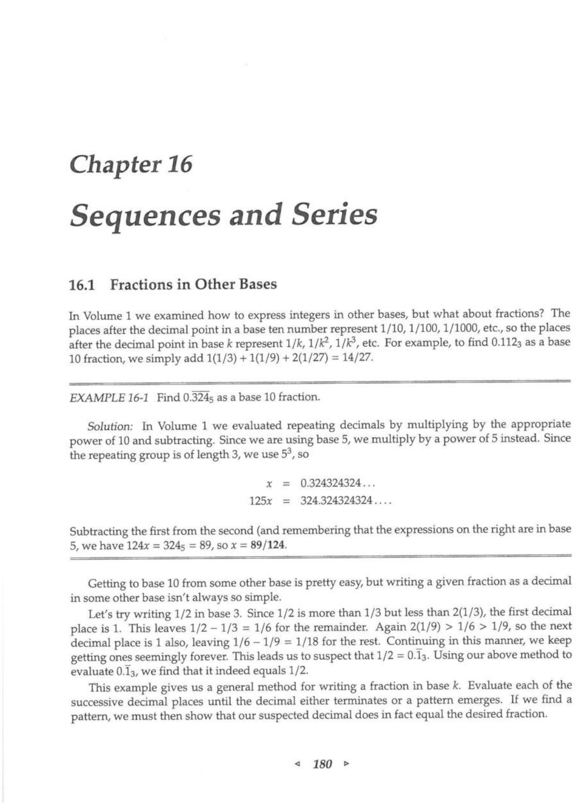

## Printed page 181

<!-- source: volume-2, PDF page 203, printed page 181 -->

**EXAMPLE 16-2 Find 5/6 as a base 5 decimal.**

Solution: The first decimal place is 4, leaving $5/6 - 4(1/5) = 1/30$. Since $1/30 < (1/5)^2$, the next decimal place is 0. Since $1/30 > 4(1/5)^3$, the next place is 4, leaving 1/750 for the rest. Thus, the following decimal is 0 (since $1/750 < 1/625$), and we begin to see the pattern $0.404040 \ldots$. We can quickly verify that $0.404040 \ldots = 5/6$.

### 16.2 $\Sigma$ome $\Sigma$pecial $\Sigma$eries

When faced with a sum, we would usually be much happier with a closed form, a simple formula without dots or $\Sigma$'s. For example, given $1 + 2 + 3 + \cdots + n$, we can easily use the formula for the sum of an arithmetic series to get

$$1 + 2 + 3 + \cdots + n = \frac{n}{2}(n + 1) = \frac{n(n + 1)}{2}. \tag{16.1}$$

This simple form provides an instant answer if someone asks you to find $1 + 2 + \cdots + 1001$. Rather than do the thousand-term summation, you just plug 1001 in for $n$ to get $(1001)(1002)/2$. That's the beauty of a closed form.

**EXERCISE 16-1 Write down the closed forms for $2 + 4 + 6 + \cdots + 2n$ and $1 + 3 + 5 + \cdots + (2n - 1)$.**

Having gotten those three out of the way, let's consider something meatier:

$$S(n) = 1 + 4 + 9 + \cdots + n^2 = \sum_{i=1}^{n} i^2.$$

None of the techniques we used in Volume 1 seem to work very well here. A different method will do it, and give some practice in using $\Sigma$ notation at the same time. We need to use the basic combinatorial identity

$$\binom{k}{k} + \binom{k+1}{k} + \binom{k+2}{k} + \cdots \binom{n}{k} = \binom{n+1}{k+1},$$

derived on page 172.

How does the combinatorial sum relate? If we write

$$i^2 = i^2 + i - i = i(i - 1) + i = 2\binom{i}{2} + i,$$

the connection becomes more clear. We then have

$$\sum_{i=1}^{n} i^2 = \sum_{i=1}^{n} \left[ 2\binom{i}{2} + i \right]$$

$$= 2\sum_{i=1}^{n} \binom{i}{2} + \sum_{i=1}^{n} i.$$

Original scan — PDF page 203

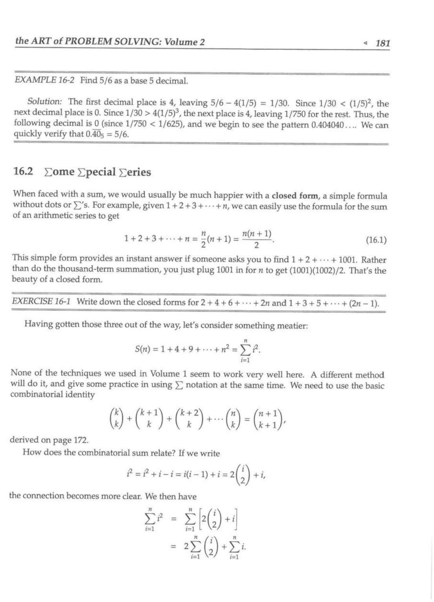

## Printed page 182

<!-- source: volume-2, PDF page 204, printed page 182 -->

These sums may be simplified using the combinatorial identity above to get

$$\sum_{i=1}^{n} i^2 = 2 \binom{n+1}{3} + \binom{n+1}{2}$$

$$= \frac{n(n+1)(2n+1)}{6}.$$

Can you follow the transition from the next-to-last to the last step?

We can, in principle at least, extend this type of argument to find $\sum i^r$ for any integer $r$. All we need is to find an expression for $i^r$ as $a_r \binom{i}{r} + a_{r-1} \binom{i}{r-1} + \cdots + a_1 \binom{i}{1}$. (In the proof above for $r = 2$, we had $a_2 = 2$ and $a_1 = 1$, though we concealed the structure somewhat by using just $i$ instead of $\binom{i}{1}$.) We can always do this, by expanding the combinatorial terms and equating coefficients in the polynomial which results, if we put in enough time and effort.

**EXAMPLE 16-3** One case for which it is worthwhile to put in the effort is for $r = 3$. We need to find $a_1, a_2,$ and $a_3$ so that

$$i^3 = a_3 \binom{i}{3} + a_2 \binom{i}{2} + a_1 \binom{i}{1}.$$

Expanding, this is

$$i^3 = \frac{a_3}{6} (i)(i-1)(i-2) + \frac{a_2}{2} (i)(i-1) + a_1 i.$$

We could expand the products and equate coefficients of $i^3, i^2,$ and $i,$ but there's a slicker way to find $a_1, a_2,$ and $a_3$. Since the above relation must hold for all positive $i,$ we choose $i = 1,$ so $1^3 = 0 + 0 + a_1,$ or $a_1 = 1$. Similarly, $i = 2$ gives $8 = 0 + a_2 + 2a_1,$ so $a_2 = 6.$ Finally $i = 3$ gives $27 = a_3 + 3a_2 + 3a_1,$ or $a_3 = 6.$ Thus,

$$\sum_{i=1}^{n} i^3 = 6 \sum_{i=1}^{n} \binom{i}{3} + 6 \sum_{i=1}^{n} \binom{i}{2} + \sum_{i=1}^{n} \binom{i}{1} = 6 \binom{n+1}{4} + 6 \binom{n+1}{3} + \binom{n+1}{2}.$$

**EXERCISE 16-2** Simplify the expression above to show

$$\sum_{i=1}^{n} i^3 = \binom{n+1}{2}^2.$$

### 16.3 The Fibonacci Numbers

The sequences we have seen up to now have all had their $n$th term defined as a function of $n.$ However, some sequences are not so simple. For these, the $n$th term can only be defined in terms of the previous terms. Such a sequence is called recursive. We have actually already seen some recursions. For example, the definition of an arithmetic sequence by

$$x_1 = a;$$

$$x_n = x_{n-1} + d, \quad n > 1;$$

Original scan — PDF page 204

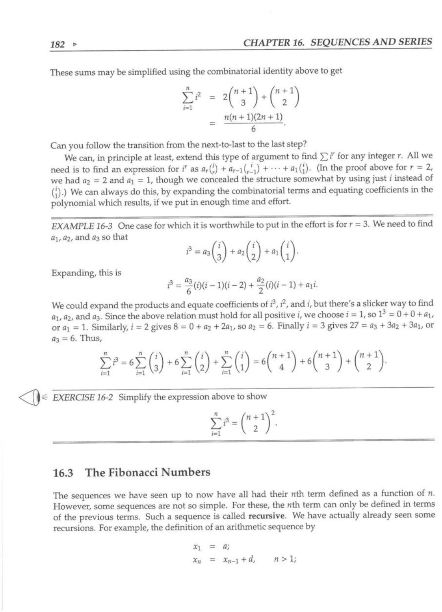

## Printed page 183

<!-- source: volume-2, PDF page 205, printed page 183 -->

is a recursive definition. In this case, however, we can also find the closed form $x_n = a + (n-1)d$. A closed form cannot contain other terms of the sequence or summation symbols; unfortunately, in many cases one either does not exist, or is terribly complicated. In such circumstances we have to stick to recursion.

By far the most important recursion is the Fibonacci numbers. The definition is extremely simple: each term is the sum of the previous two. We start with the first two terms 0, 1. The sequence then goes

$$0, 1, 1, 2, 3, 5, 8, 13, \ldots$$

**EXERCISE 16-3** Write down the next few terms of the sequence.

Let's make the definition of the Fibonacci numbers more precise. The Fibonacci numbers are a sequence $F_k, k = 0, 1, 2, \ldots$, such that $F_0 = 0, F_1 = 1$, and for $k > 1, F_k = F_{k-1} + F_{k-2}$.

The Fibonacci numbers have tons of interesting properties. For example, consider the limit as $k \to \infty$ of the ratio $F_k/F_{k-1}$. We write

$$\phi = \lim_{k \to \infty} \frac{F_k}{F_{k-1}} = \lim_{k \to \infty} \frac{F_{k-1} + F_{k-2}}{F_{k-1}} = 1 + \lim_{k \to \infty} \frac{F_{k-2}}{F_{k-1}} = 1 + \frac{1}{\phi},$$

where the last step is the only tricky one. Since $k$ is going to infinity, if the limit $\phi$ exists at all, it is the same for $k$ as for $k-1$. Thus, in the limit, the ratio $F_{k-2}/F_{k-1}$ equals the ratio $F_{k-1}/F_k$, or $1/\phi$. This may seem fishy, but it is entirely rigorous, IF THE LIMIT $\phi$ EXISTS. We assume here that it does, because the Fibonacci seem fairly well-behaved; to prove that fact is more complicated. Thus be warned that there is a missing proof to make all this rigorous.

With that warning in mind, we can go on to do what equation (16.2) begs us to do: solve for $\phi$. Multiplying by $\phi$ (assuming $\phi$ to be nonzero) and rearranging, the equation $\phi = 1 + 1/\phi$ becomes $\phi^2 - \phi - 1 = 0$. By the quadratic formula, we get

$$\phi = \frac{1 + \sqrt{5}}{2}.$$

This is the "golden ratio," called this because it has certain interesting properties and because the Greeks felt the most aesthetically pleasing rectangles had the ratio of sides $1:\phi$. (You can even today find many rectangular objects which have been made in the golden ratio.)

**EXERCISE 16-4** The quadratic equation for $\phi$, $\phi^2 - \phi - 1 = 0$, has two roots. Why did we choose the one we did as the desired value?

There are many other interesting facts about the Fibonacci numbers. For example, it is relatively simple to prove that

$$F_{n-1}F_{n+1} = F_n^2 + (-1)^n.$$

You can easily verify that this works for small $n$; we'll prove it by induction. For the base case, we have $F_0F_2 = 0$ and $F_1^2 + (-1)^1 = 0$, so $F_0F_2 = F_1^2 + (-1)^1$. To do the inductive step we assume the relation holds for $n-1$, so that

$$F_{n-2}F_n = F_n^2 + (-1)^{n-1},$$

Original scan — PDF page 205

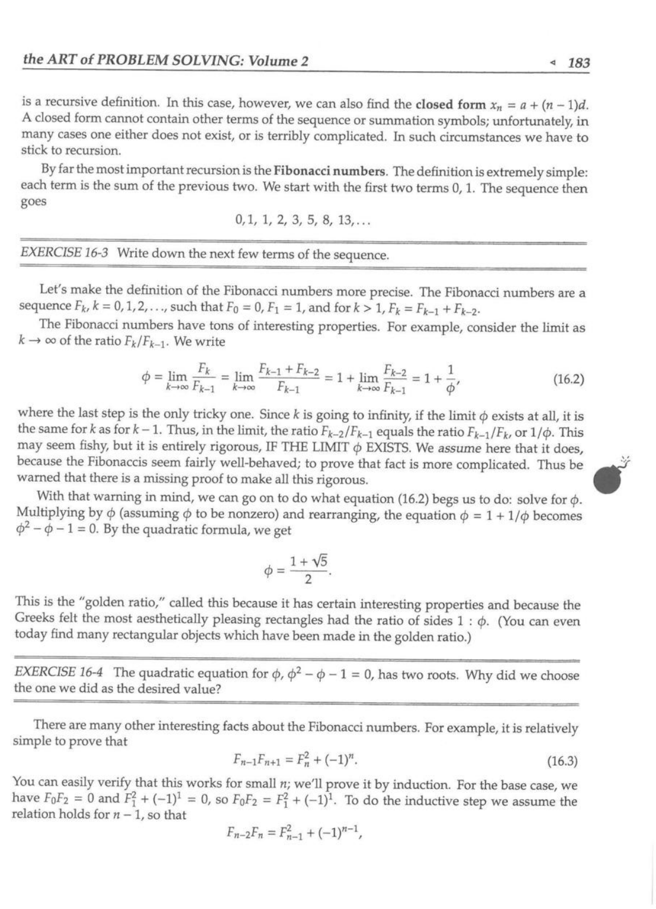

## Printed page 184

<!-- source: volume-2, PDF page 206, printed page 184 -->

$$F_{n-1}^2 - F_{n-2}F_n = -(-1)^{n-1} = (-1)^n.$$

We wish to use this to show that the relation holds for $n$. We have

$$F_{n-1}F_{n+1} = (F_n - F_{n-2})(F_n + F_{n-1})$$
$$= F_n^2 - F_{n-2}F_n + (F_n - F_{n-2})F_{n-1}.$$

Since $F_n - F_{n-2} = F_{n-1}$, by (*) we have

$$F_{n-1}F_{n+1} = F_n^2 - F_{n-2}F_n + F_{n-1}^2 = F_n^2 + (F_{n-1}^2 - F_{n-2}F_n) = F_n^2 + (-1)^n,$$

as desired.

**EXERCISE 16-5** Prove the following Fibonacci identities.

i. $F_n = F_{n-2} + F_{n-3} + \cdots + F_0 + 1$
ii. $F_0^2 + F_1^2 + \cdots + F_n^2 = F_nF_{n+1}$
iii. $F_1 + F_3 + F_5 + \cdots + F_{2n-1} = F_{2n}$

Perhaps the most interesting Fibonacci identity of all is that $F_n$ can be written as a sum of $\binom{n}{k}$'s:

$$F_{n+1} = \binom{n}{0} + \binom{n-1}{1} + \binom{n-2}{2} + \cdots$$

(16.4)

We can prove this is an especially simple way. First observe that (16.4) holds for $n = 0$ and $n = 1$; we get $F_1 = \binom{0}{0} = 1$ and $F_2 = \binom{1}{0} = 1$. Then we show that the sum on the right side of (16.4) satisfies the Fibonacci relation:

$$\begin{align*}
\left( \binom{n-1}{0} + \binom{n-2}{1} + \binom{n-3}{2} + \cdots \right) + \left( \binom{n}{0} + \binom{n-1}{1} + \binom{n-2}{2} + \cdots \right) \\
= \binom{n}{0} + \left( \binom{n-1}{0} + \binom{n-1}{1} \right) + \left( \binom{n-2}{1} + \binom{n-2}{2} \right) + \cdots \\
= \binom{n+1}{0} + \binom{n}{1} + \binom{n-1}{2} + \cdots
\end{align*}$$

We have used Pascal's identity to get from the second to the third line. Since Pascal's identity $\binom{n}{k} = \binom{n-1}{k-1} + \binom{n-1}{k}$ holds for any $n$ and $k$, even if $k > n$, we don't have to worry about where the sums end.

Because the combinatorial sum in (16.4) satisfies the Fibonacci relation and matches $F_{n+1}$ for $n = 0$ and 1, it must be identical to $F_{n+1}$ for all $n$.

### 16.4 Dealing with Recurrences

A general recurrence relation tends to be a fairly complicated beast, but a knowledge of how they work often makes it possible to derive facts about them.

Original scan — PDF page 206

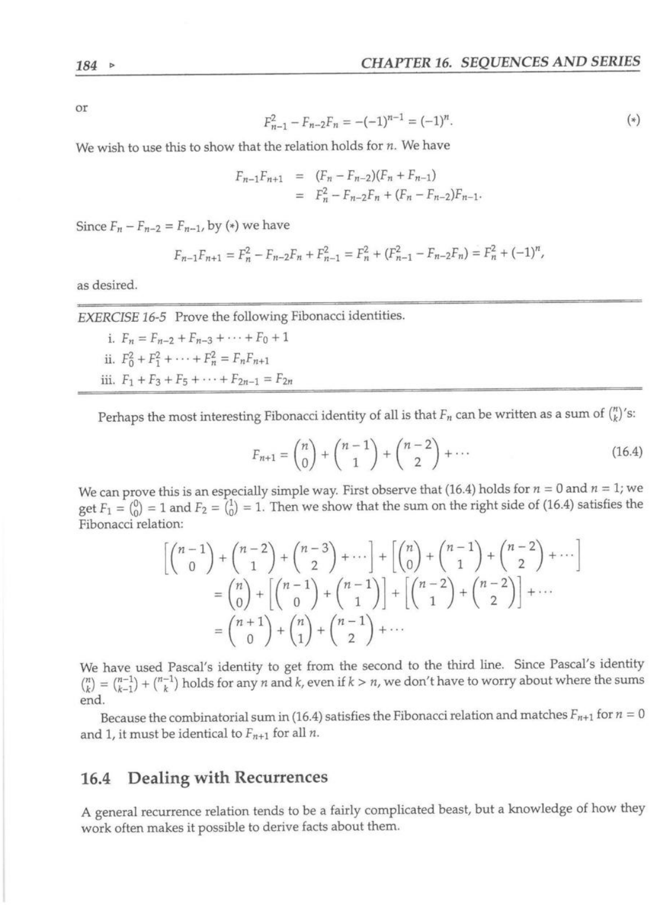

## Printed page 185

<!-- source: volume-2, PDF page 207, printed page 185 -->

A common problem is to take a recurrence relation, like $x_k = x_{k-1} + x_{k-2}$, and find a closed form expression for the $n$th term. If we could do this, we could find the $n$th term by plugging $n$ directly into some formula, rather than first having to compute the first $n-1$ terms using the recurrence formula.

However, this simple-seeming request leads to difficult problems. To see this, let’s try to find a closed form for $F_n$, the $n$th Fibonacci number. One method is to make the guess that the Fibonacci sequence $\{F_n\}$ can be written as the sum of two geometric sequences $\{ar^n\}$ and $\{bs^n\}$, so that $F_n = ar^n + bs^n$ for all $n$. The sum must satisfy the Fibonacci relation $F_{k-1} + F_k = F_{k+1}$, so we have

$$ar^{k-1} + bs^{k-1} + ar^k + bs^k = ar^{k+1} + bs^{k+1}. \tag{16.5}$$

You might be able to solve this with some effort, but a simpler way exists. We can rewrite (16.5) as

$$ar^{n-1} + ar^n - ar^{n+1} = -bs^{n-1} - bs^n + bs^{n+1},$$

or

$$ar^{n-1}(1 + r - r^2) = -bs^{n-1}(1 + s - s^2). \tag{16.6}$$

Since $r \neq s$ by the assumption that we have different geometric series, the only way the two sides of (16.6) can be equal for all $n$ is if $1 + r - r^2 = 1 + s - s^2 = 0$.

**EXERCISE 16-6** Why can’t the two sides of (16.6) be equal for all $n$ unless they are both equal to 0?

We have thus shown that both $r$ and $s$ satisfy the quadratic equation $x^2 - x - 1 = 0$. Solving this equation by the quadratic formula, we thus find

$$r = \frac{1 + \sqrt{5}}{2} \quad \text{and} \quad s = \frac{1 - \sqrt{5}}{2}$$.

**EXERCISE 16-7** Check by hand that $r$ and $s$ above satisfy $x^2 - x - 1 = 0$.

Our choices of $r$ and $s$ force the summed sequence $\{ar^n + bs^n\}$ to satisfy the Fibonacci relation, no matter what $a$ and $b$ are. We can thus construct lots of sequences which satisfy the relation just by choosing different $a$ and $b$.

**EXERCISE 16-8** Suppose we take $a = b = 1$. Write down the terms of $\{ar^n + bs^n\}$ for $n = 0, 1, 2,$ and 3 and show that they do satisfy the Fibonacci relation.

**EXAMPLE 16-4** What are $a$ and $b$ for the Fibonacci series? We set

$$ar^0 + bs^0 = a + b = F_0 = 0$$

and

$$ar^1 + bs^1 = a \left( \frac{1 + \sqrt{5}}{2} \right) + b \left( \frac{1 - \sqrt{5}}{2} \right) = F_1 = 1$$

and solve the resulting system of equations. Using the first equation to write $b = -a$, the second equation gives

$$a \left( \frac{1 + \sqrt{5}}{2} \right) + (-a) \left( \frac{1 - \sqrt{5}}{2} \right) = 1,$$

which yields $a = 1/\sqrt{5}$. Substituting this into the first equation yields $b = -1/\sqrt{5}$.

Original scan — PDF page 207

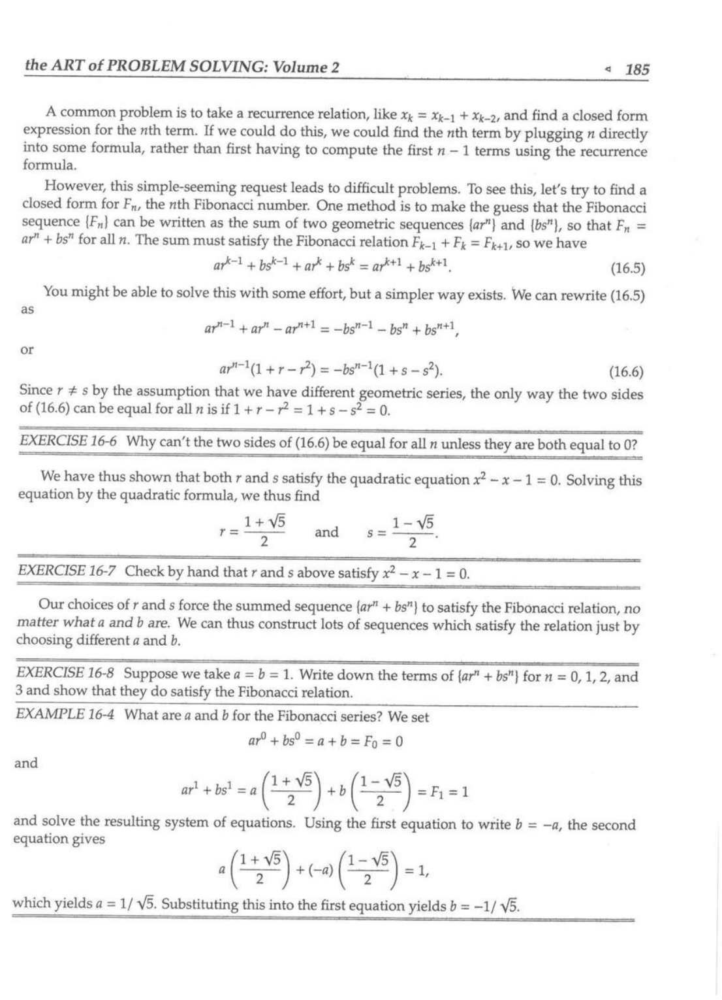

## Printed page 186

<!-- source: volume-2, PDF page 208, printed page 186 -->

Using Example 16-4, we can now write down the general closed form for the Fibonacci sequence as

$$F_n = ar^n + bs^n = \left( \frac{1}{\sqrt{5}} \right) \left( \frac{1 + \sqrt{5}}{2} \right)^n + \left( -\frac{1}{\sqrt{5}} \right) \left( \frac{1 - \sqrt{5}}{2} \right)^n$$

$$= \frac{1}{\sqrt{5}} \left[ \left( \frac{1 + \sqrt{5}}{2} \right)^n - \left( \frac{1 - \sqrt{5}}{2} \right)^n \right]$$

This is called Binet's formula for the Fibonacci sequence.

**EXERCISE 16-9 Show that Binet's formula gives the correct values for $F_0, F_1, F_2$, and $F_3$. (You should have already calculated $r^2, r^3, s^2$, and $s^3$ for Exercise 16-8.)**

**EXERCISE 16-10 Consider a sequence $\{G_n\}$ with $G_{k+1} = G_k + 2G_{k-1}$ for $k \geq 1$, with $G_0 = 0$ and $G_1 = 1$. Find the general term $G_n$ in closed form.**

**EXERCISE 16-11 What changes would we have to make to our scheme to handle a three-term recursion relation like $X_{k+1} = \alpha X_k + \beta X_{k-1} + \gamma X_{k-2}$?**

### 16.5 Dealing with Sums

We are often asked to add up a series (especially an infinite one), with no other information to go on. To do this for arbitrary series can require complicated maneuvering, as for the derivation of $\sum_{i=1}^{n} i^2$. The vast majority of sums are too hard to do at all! Many are on the border: someone has done them, but only with a lot (perhaps years) of work. A classic example of this kind is the simple-seeming sum $\sum_{i=1}^{\infty} \frac{1}{i^2}$, for which the answer is the unfathomable $\frac{n^2}{6}$. The moral: don't spend too long with a sum unless you have good reason to believe it is doable.

As an example of a common method, consider the series

$$\sum_{i=1}^{n} \frac{1}{i(i+1)} = \frac{1}{1 \cdot 2} + \frac{1}{2 \cdot 3} + \frac{1}{3 \cdot 4} + \cdots + \frac{1}{n \cdot (n+1)}$$

This is the simplest example of a telescoping series, so called because the series can be made to fold up like a telescope, leaving only a couple of terms behind. The key is the partial fraction decomposition

$$\frac{1}{n(n+1)} = \frac{1}{n} - \frac{1}{n+1}$$

Verify that this equality is valid. Once you accept that, we can write the series as

$$\left( \frac{1}{1} - \frac{1}{2} \right) + \left( \frac{1}{2} - \frac{1}{3} \right) + \left( \frac{1}{3} - \frac{1}{4} \right) + \cdots + \left( \frac{1}{n-1} - \frac{1}{n} \right) + \left( \frac{1}{n} - \frac{1}{n+1} \right).$$

If we now cancel all the terms which come in both as $+$ and $-$, we are left with only

$$\frac{1}{1} - \frac{1}{n+1} = \frac{n}{n+1}.$$

Original scan — PDF page 208

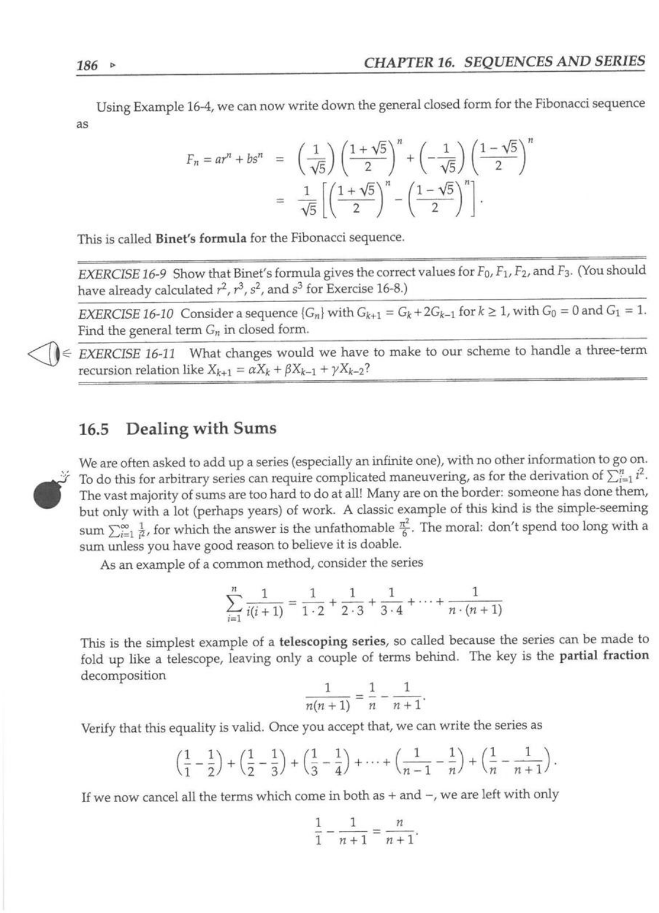

## Printed page 187

<!-- source: volume-2, PDF page 209, printed page 187 -->

Expanding the terms a bit has allowed us to roll the entire series up into two terms.

The method of partial fractions is a crucial one in analyzing series. Here we'll discuss how to do this for expressions of the form $(ax + b)/[(x - c)(x - d)]$, since these are the most commonly occurring expressions in sums requiring partial fractions.

Find the partial fraction decomposition of

$$\frac{2x - 1}{x^2 - 4x + 3}$$

The first step is factoring the denominator as $(x - 3)(x - 1)$. We can then express the given fraction as a sum of terms whose numerators are constants and denominators are the factors $x - 1$ and $x - 3$, or

$$\frac{2x - 1}{(x - 1)(x - 3)} = \frac{A}{x - 1} + \frac{B}{x - 3}$$

We only need these two terms because rational expressions which sum to $(2x - 1)/[(x - 1)(x - 3)]$ must have common denominator $(x - 1)(x - 3)$; hence the denominator of each term in the sum must be a factor of $(x - 1)(x - 3)$.

We now find $A$ and $B$ by multiplying the above equation by $(x - 1)(x - 3)$ to get $2x - 1 = A(x - 3) + B(x - 1)$. Letting $x = 1$, we find $1 = -2A$, or $A = -1/2$. Letting $x = 3$, we find $5 = 2B$, or $B = 5/2$. Thus we have

$$\frac{2x - 1}{(x - 1)(x - 3)} = \frac{-1/2}{x - 1} + \frac{5/2}{x - 3}$$

We can extend our process to any rational expression $f(x)/g(x)$, where $f$ and $g$ are polynomials with rational coefficients such that $\deg f < \deg g$ by first factoring $g(x)$ into unfactorable linear and quadratic expressions with rational coefficients. We then equate $f(x)/g(x)$ to a sum of terms, where the terms are determined by the factors of $g(x)$.

For each linear factor $x - c$ of $g(x)$, we have a term of the form $a_i/(x - c)$; for each quadratic factor there is a term of the form $(a_i x + a_j)/(x^2 + cx + d)$. The only subtlety comes in the case of repeated factors. If the factor $h(x)$ occurs $n$ times, then we will have the $n$ terms $a_1/h(x), a_2/(h(x))^2, a_3/(h(x))^3, \ldots, a_n/(h(n))^n$. Once we've found all our terms, we then find all our unknown $a_i$'s as we did above; multiply both sides of $f(x)/g(x) = (\text{sum of terms}) g(x)$ and cleverly choose $x$'s.

Many complicated sums can be analyzed with suitably involved partial fraction decompositions and telescoping. Even products can telescope, as the first example shows.

**EXERCISE 16-12 Find $\sum_{n=1}^{\infty} \frac{n}{(n+1)(n+2)}$. (MAΘ 1992)**

**EXAMPLE 16-5 Evaluate $\prod_{n=1}^{13} \frac{n(n+2)}{(n+4)^2}$. (Mandelbrot #2)**

Solution: Let's expand the $\Pi$ notation to get

$$\frac{(1)(3)}{(5)(5)} \cdot \frac{(2)(4)}{(6)(6)} \cdot \frac{(3)(5)}{(7)(7)} \cdots \frac{(13)(15)}{(17)(17)}$$

Original scan — PDF page 209

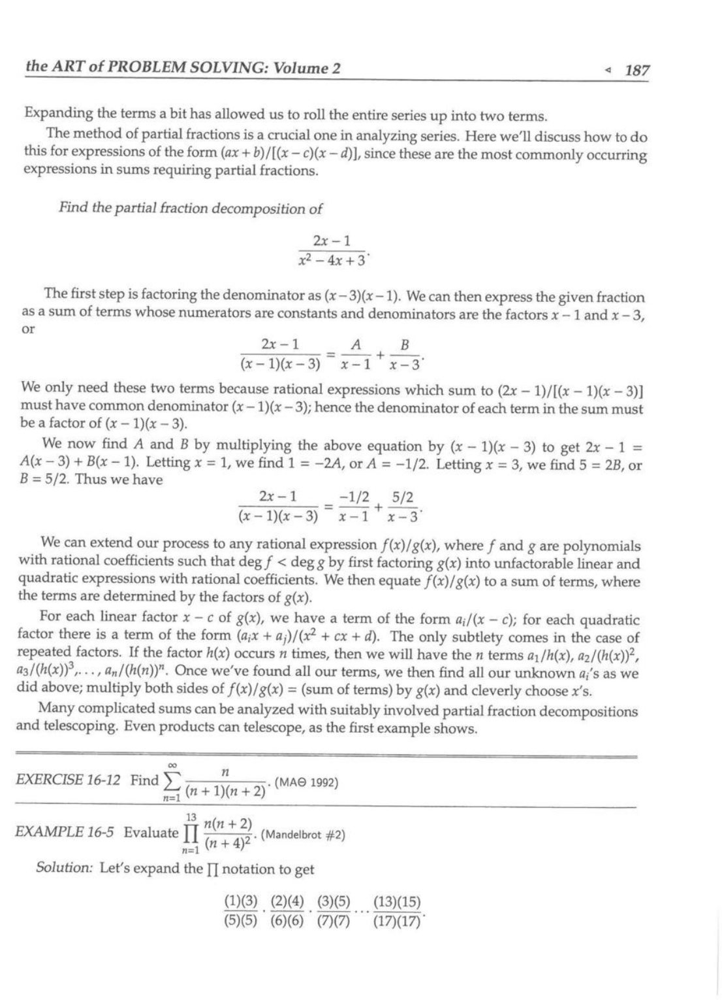

## Printed page 188

<!-- source: volume-2, PDF page 210, printed page 188 -->

What cancels? In the numerator of the product there are one 1, one 2, two 3's, two 4's, two 5's, two each of 6 through 13, one 14, and one 15. In the denominator there are two each of 5 through 17. Thus everything cancels except for

$$\frac{1 \cdot 2 \cdot 3 \cdot 4 \cdot 4}{14 \cdot 15 \cdot 16 \cdot 17 \cdot 17} = \frac{3}{7 \cdot 5 \cdot 16 \cdot 17 \cdot 17} = \frac{3}{161840}.$$

**EXAMPLE 16-6** Telescoping isn't the only general method for evaluating sums. In fact, the solution to this one looks quite a bit like our standard methods from Volume 1:

Find $$\sum_{n=1}^{\infty} \frac{2n}{3^{n+1}}$$ (MAΘ 1990)

**Solution:** We call the sum $S$, so that

$$S = \frac{2}{9} + \frac{4}{27} + \frac{6}{81} + \frac{8}{243} + \cdots$$

We then divide $S$ by 3, to get

$$S/3 = \frac{2}{27} + \frac{4}{81} + \frac{6}{243} \cdots$$

The clever part is to subtract the series for $S/3$ from that for $S$, to get a pure geometric series:

$$S - S/3 = 2S/3 = \frac{2}{9} + \frac{2}{27} + \frac{2}{81} + \frac{2}{243} + \cdots$$

$$= \frac{2/9}{1 - (1/3)}$$

$$= \frac{1}{3}$$

so $S = 3(1/3)/2 = 1/2.$

**EXERCISE 16-13** Do the previous example in another way, by writing

$$\sum_{n=1}^{\infty} \frac{2n}{3^{n+1}} = \frac{2}{3} \sum_{n=1}^{\infty} \sum_{m=n}^{\infty} \frac{1}{3^m}$$

and evaluating the second summation first. (Make sure you see the clever way in which the double sum is equal to the single sum!)

### 16.6 The Binomial Theorem Revisited

Recall the Binomial Theorem, which allows us to expand any positive integral power of a binomial expression like $(x + y)$:

$$(x + y)^n = \binom{n}{0} x^n y^0 + \binom{n}{1} x^{n-1} y^1 + \cdots + \binom{n}{n} x^0 y^n.$$

Original scan — PDF page 210

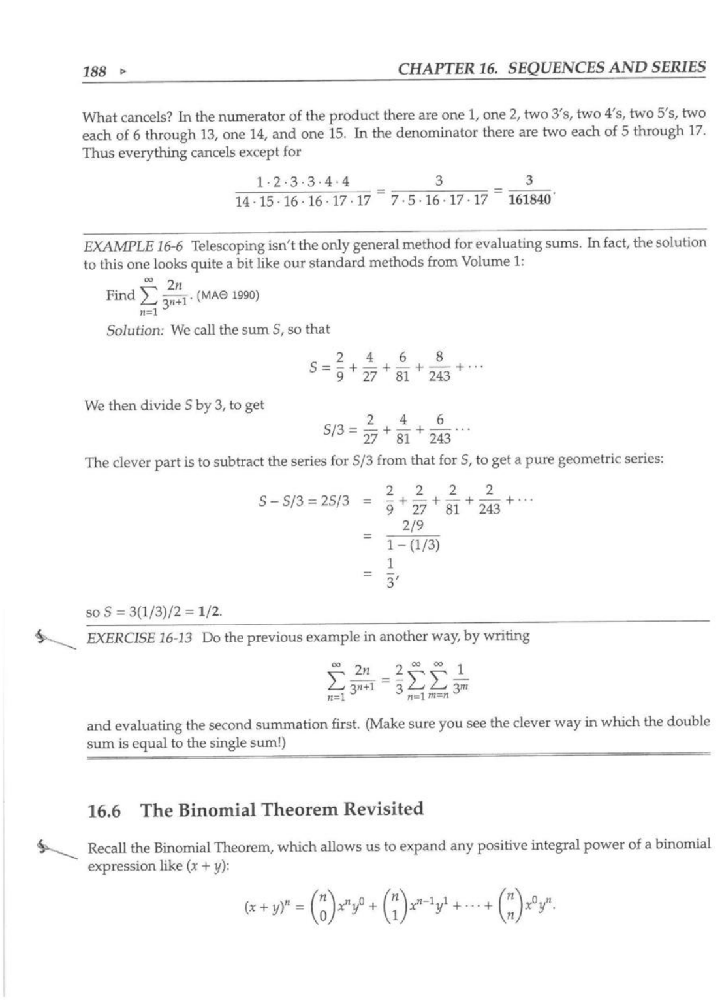

## Printed page 189

<!-- source: volume-2, PDF page 211, printed page 189 -->

Of course, this gives no information about expansions like $(x + y)^{1/2}$, or $(x + y)^{-1}$. After all, what is $\binom{1/2}{3}$? $\binom{-1}{7}$?

It turns out, however, that there is an extension of the Binomial Theorem to cover just such weird cases. The key to writing down the new theorem is to define quantities $\binom{n}{k}$ where $n$ is not a positive integer. To make this new definition correspond well to the old definition, we write the old definition in a new way:

$$\binom{n}{k} = \frac{n!}{k!(n - k)!} = \frac{n(n - 1)(n - 2) \cdots (n - k + 1)}{k!}$$

Since there is no satisfactory definition of the factorial $n!$ if $n$ is not a positive integer, the first definition $n!/k!(n - k)!$ won't do us any good. But suppose we try to blindly use the alternate way of writing $\binom{n}{k}$ for $n = 1/2, k = 3$. We get

$$\frac{(1/2)(1/2 - 1)(1/2 - 2)}{3!} = \frac{(1/2)(-1/2)(-3/2)}{6} = \frac{1}{16},$$

which is a perfectly reasonable result! This second way of writing $\binom{n}{k}$ allows us to define it for any $n$.

WARNING: Although $n$ can be any real number in the new expression for $\binom{n}{k}$, $k$ must still be a nonnegative integer, since we have a $k!$ in the definition. Also, note that $\binom{n}{0} = 1$ for all $n$. As a final warning, if $n$ is not a positive integer we must abandon any hope of connecting $\binom{n}{k}$ to real combinatorial actions like picking $k$ things from a set of $n$.

**EXAMPLE 16-7** Evaluate $\binom{7/3}{4}$.

**Solution:** We have

$$\binom{7/3}{4} = \frac{(7/3)(7/3 - 1)(7/3 - 2)(7/3 - 3)}{4!} = \frac{(7/3)(4/3)(1/3)(-2/3)}{24} = -\frac{7}{243}.$$

**EXERCISE 16-14** Evaluate $\binom{-3}{4}$ and $\binom{-7/3}{3}$.

**EXERCISE 16-15** Use our new definition to look at $\binom{n}{k}$, where $n$ is a positive integer and $k > n$.

**EXERCISE 16-16** Simplify $\binom{-1}{n}$.

**EXAMPLE 16-8** Show that if $n$ and $r$ are positive integers, then

$$\binom{-n}{r} = (-1)^r \binom{n + r - 1}{r}.$$

**Proof:** We simply write out $\binom{-n}{r}$ as

$$\binom{-n}{r} = \frac{[-n][- (n + 1)][- (n + 2)] \cdots [- (n + r - 1)]}{r(r - 1)(r - 2) \cdots 1}$$

$$= \frac{(-1)^r (n)(n + 1)(n + 2) \cdots (n + r - 1)}{r!}$$

$$= \frac{(-1)^r (n + r - 1)!}{(n - 1)!r!}$$

$$= (-1)^r \binom{n + r - 1}{r},$$

and we’re done!

Original scan — PDF page 211

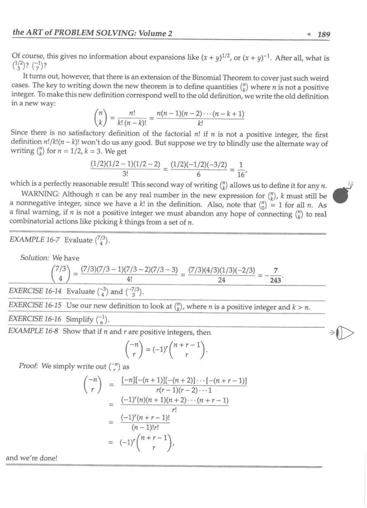

## Printed page 190

<!-- source: volume-2, PDF page 212, printed page 190 -->

Using our new definition of $\binom{n}{k}$, we now can write the statement of the expanded Binomial Theorem: for any real number $n$,

$$x + y^n = \binom{n}{0} x^n y^0 + \binom{n}{1} x^{n-1} y^1 + \binom{n}{2} x^{n-2} y^2 + \cdots$$

This looks suspiciously like the original Binomial Theorem! The only difference is that instead of showing the expanded series as terminating at some point, it keeps on going. This is because, if $n$ is not a positive integer, the terms

$$\frac{n}{1}, \frac{n(n-1)}{2}, \frac{n(n-1)(n-2)}{6}, \cdots$$

will never hit zero.

If $n$ is a positive integer, then at some point the fractions will have an $(n-n)$ term on top, and will thus all be zero. Thus for positive integers $n$, we get back the familiar, terminating version.

**EXAMPLE 16-9** Calculate $1.2^{-1/3}$ to a few decimal places.

**Solution:** From the general Binomial Theorem we have

$$(1 + .2)^{-1/3} = \binom{-1/3}{0} (1^{-1/3})(.2)^0 + \binom{-1/3}{1} (1^{-4/3})(.2)^1 + \cdots$$

$$= (1)(1)(1) + (-1/3)(1)(.2) + (2/9)(1)(.04) + \cdots$$

$$= 1 - .0666 + .0088 - \cdots$$

$$\approx 0.9422.$$

While not exactly right, this approximation is pretty close to the actual value.

**EXERCISE 16-17** Estimate $1/(2.12)^2$ using the general Binomial Theorem.

As with any infinite series, we have to consider convergence carefully when using the general Binomial Theorem. That is, does our sum add up to a finite result or does it just get bigger and bigger as more terms are added on? Remember that the terms of a series must tend to 0 if it is to converge, although just because the terms tend to 0, the series doesn't have to converge. Way out in the series created by the Binomial Theorem, the term looks like

$$\binom{n}{large \#} x^{n-large \#} y^{large \#},$$

or

$$\binom{n}{large \#} x^n \left( \frac{y^{large \#}}{x^{large \#}} \right).$$

Since $x^n$ is fixed, and $\binom{n}{large \#}$ tends to a finite limit as the large number gets big (we won't prove this here, as it's off the track a good bit), the important term is the last term. This term will tend to 0 if $|x| > |y|$, but won't if $|x| \leq |y|$. Thus, in order for the series to converge, we must have $|x| > |y|$.

**WARNING:** Although $|x| > |y|$ forces the terms of the series to tend to 0, this does not in itself assure that the series converges. (Always keep in mind the series $1 + \frac{1}{2} + \frac{1}{3} + \cdots$, which diverges even though its terms tend to 0.) The binomial series does converge as long as $|x| > |y|$, but this requires proof (which we won't get into here).

Original scan — PDF page 212

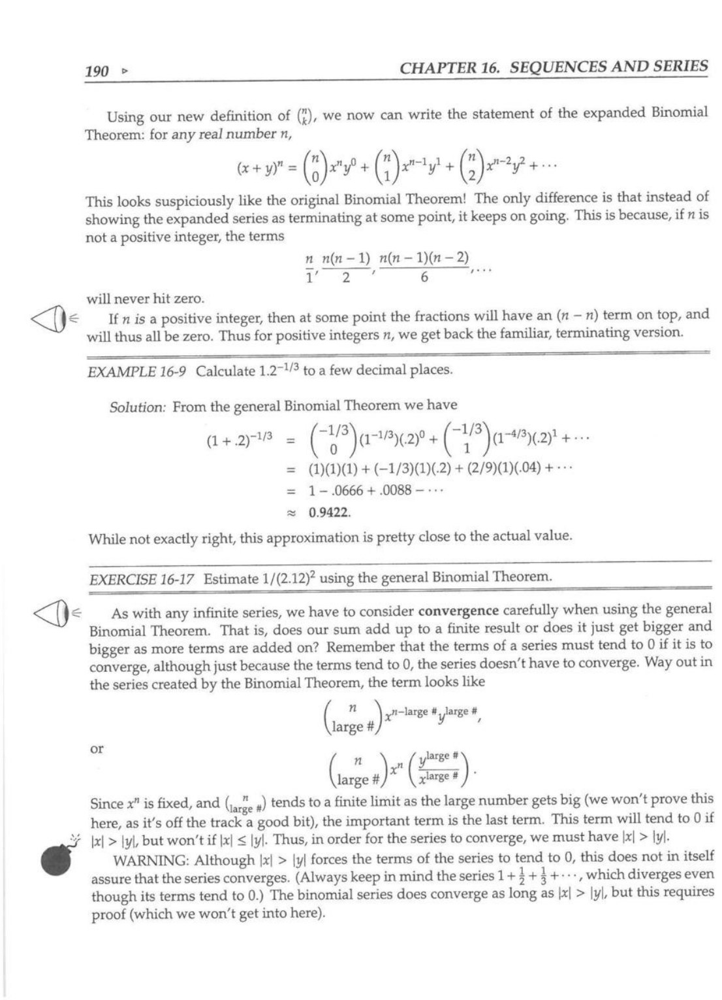

## Printed page 191

<!-- source: volume-2, PDF page 213, printed page 191 -->

**EXAMPLE 16-10 The Binomial Theorem allows us to make quick estimates of many square roots, fractions, etc. For example, consider $\frac{1}{n+\epsilon}$, where $\epsilon$ is small compared to $n$. (This Greek letter, pronounced EP-si-lon, is often called upon for the low-status job of representing a small number.) By the Binomial Theorem we have**

$$\frac{1}{n+\epsilon} = (n+\epsilon)^{-1} = \binom{-1}{0} n^{-1} \epsilon^0 + \binom{-1}{1} n^{-2} \epsilon^1 + \binom{-1}{2} n^{-3} \epsilon^2 + \cdots$$

Since the terms in the series expansion get smaller and smaller, using more and more terms will give a better and better approximation to the true value of $\frac{1}{n+\epsilon}$. Taking only the first two terms yields the so-called first-order approximation

$$(n+\epsilon)^{-1} \approx n^{-1} - \epsilon n^{-2} = \frac{n-\epsilon}{n^2}$$

The order of the approximation is the highest power of $\epsilon$ which appears, which is why this one is called first order.

**EXERCISE 16-18 Find the exact value of $1/101$ using a calculator, then compare to the first order approximation, which you can do by hand. (Hint: use $A = 100$ and $\epsilon = 1$. Was the extra precision worth digging out the calculator?**

**EXERCISE 16-19 Guess what a second order approximation to $(n+\epsilon)^{-1}$ would be. How about "zero-th" order?**

**EXERCISE 16-20 Find a first order approximation to $\sqrt{A^2+\epsilon}$ and use it to estimate $\sqrt{17}$ without a calculator.**

### 16.7 Harmonic Sequences

In Volume 1 we discussed arithmetic and geometric sequences. In particular, these sequences have the property that any element $a_n$ is the arithmetic or geometric mean of the two adjacent terms $a_{n-1}$ and $a_{n+1}$. (Make sure you see why this is so.)

But the arithmetic and geometric means aren’t the only types of means. In particular, suppose we construct a harmonic sequence, where every term is the harmonic mean of its neighbors:

$$a_n = \frac{2}{\frac{1}{a_{n-1}} + \frac{1}{a_{n+1}}}$$

If we invert both sides of this equation, we have

$$\frac{1}{a_n} = \frac{\frac{1}{a_{n-1}} + \frac{1}{a_{n+1}}}{2},$$

so that $1/a_n$ is the arithmetic mean of $1/a_{n-1}$ and $1/a_{n+1}$! Thus a harmonic sequence can be formed by taking the reciprocals of the terms of an arithmetic sequence.

Original scan — PDF page 213

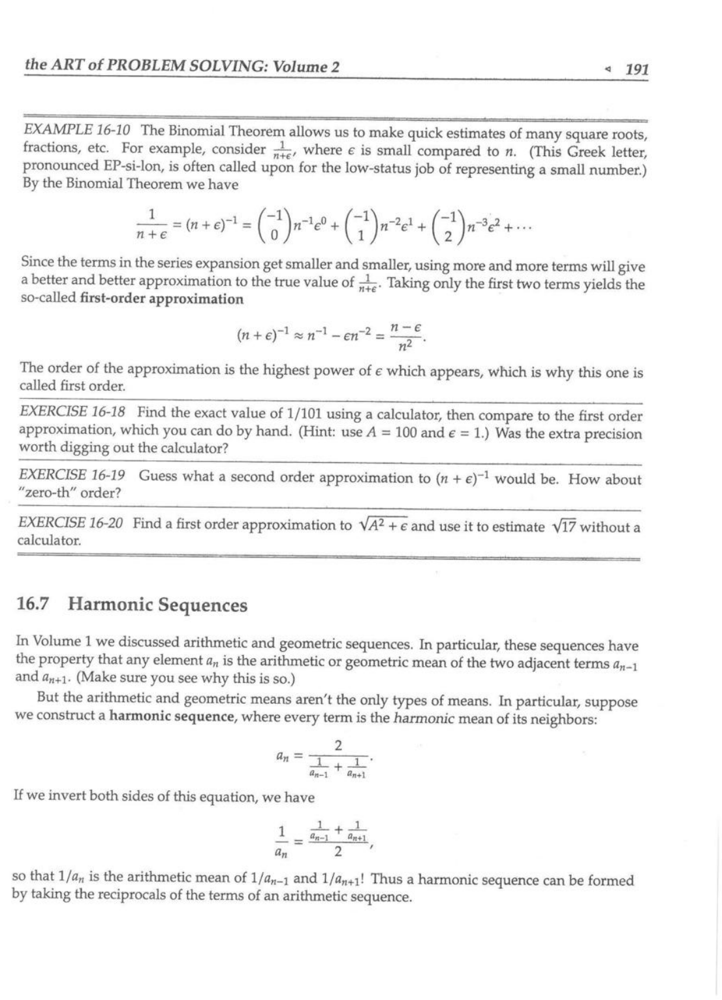

## Printed page 192

<!-- source: volume-2, PDF page 214, printed page 192 -->

**EXAMPLE 16-11 Since 1, 3, 5, ... is an arithmetic sequence, $\frac{1}{1}, \frac{1}{3}, \frac{1}{5}, ...$ is a harmonic sequence.**

**EXERCISE 16-21 Which are harmonic sequences?**

i. $2, 1, \frac{2}{3}, \frac{1}{2}, ...$
ii. $\frac{1}{4}, \frac{3}{10}, \frac{3}{8}, \frac{1}{2}, ...$
iii. $\frac{1}{2}, \frac{1}{4}, \frac{1}{8}, \frac{1}{16}, ...$

Problems to Solve for Chapter 16

251. If the sum of the first $3n$ positive integers is 150 more than the sum of the first $n$ positive integers, then find the sum of the first $4n$ positive integers. (AHSME 1970)

252. In the harmonic sequence $6, 3, 2, \frac{3}{2}, \frac{6}{5}, ...$, what will the eighth term be? (MAΘ 1990)

253. Evaluate $\sum_{k=1}^{10} k^2 + k + 1$. (MAΘ 1991)

254. Express in simplest form:

$$\left(1 + \frac{1}{2}\right)\left(1 + \frac{1}{3}\right)\left(1 + \frac{1}{4}\right)\left(1 + \frac{1}{5}\right)\left(1 + \frac{1}{6}\right)\left(1 + \frac{1}{7}\right).$$

(MATHCOUNTS 1988)

255. Given $a_0 = 1, a_1 = 3$, and the general relation $a_n^2 - a_{n-1}a_{n+1} = (-1)^n$ for $n \geq 1$, find $a_3$. (AHSME 1958)

256. What is the sum of all proper fractions with a denominator less than or equal to 30? (MATHCOUNTS 1988)

257. Evaluate $\frac{1}{2 \cdot 4} + \frac{1}{4 \cdot 6} + \frac{1}{6 \cdot 8} + \cdots + \frac{1}{18 \cdot 20}$. (MATHCOUNTS 1989)

258. Evaluate the infinite product

$$2^{1/3}4^{1/9}8^{1/27}16^{1/81} \cdots$$

(Mandelbrot #1)

259. If $a_{n+1} = 2a_n - 3a_{n-1}$, where $a_1 = 2$ and $a_2 = -1$, then find $a_5$. (MAΘ 1991)

260. Compute the sum

$$\frac{1}{\sqrt{2} + \sqrt{1}} + \frac{1}{\sqrt{3} + \sqrt{2}} + \frac{1}{\sqrt{4} + \sqrt{3}} + \cdots + \frac{1}{\sqrt{25} + \sqrt{24}}$$

261. For a finite sequence $A = (a_1, a_2, \ldots, a_n)$ of numbers, the Cesaro sum of $A$ is defined to be

$$\frac{S_1 + S_2 + \cdots + S_n}{n},$$

Original scan — PDF page 214

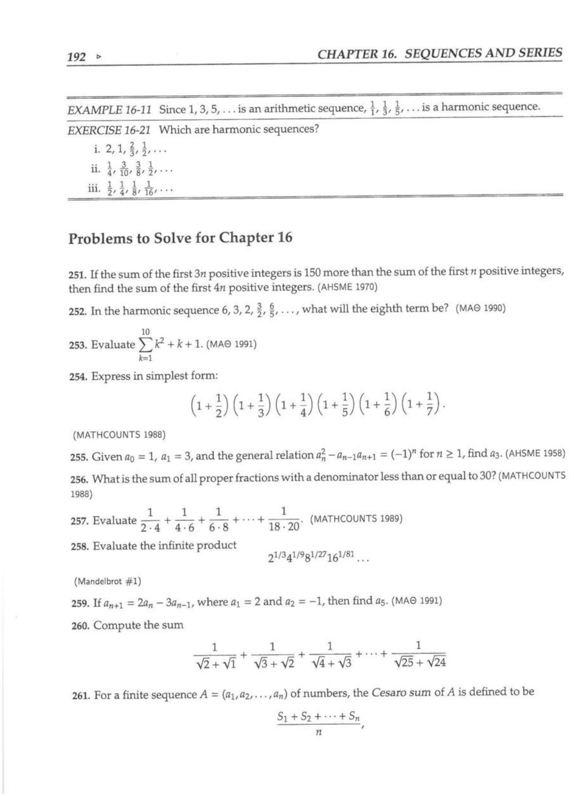

## Printed page 193

<!-- source: volume-2, PDF page 215, printed page 193 -->

where $S_k=a_1+a_2+\cdots+a_k$. If the Cesaro sum of the 99-term sequence $(a_1,a_2,\ldots,a_{99})$ is 1000, what is the Cesaro sum of the 100-term sequence $(1,a_1,a_2,\ldots,a_{99})$? (AHSME 1992)

262. Given that $v_1=2$, $v_2=4$ and $v_{n+1}=3v_n-v_{n-1}$, prove that $v_n=2F_{2n-1}$, where the terms $F_n$ are the Fibonacci numbers.

263. Evaluate $\displaystyle\sum_{k=1}^{\infty}\frac{k^2}{2^k}$. (Mandelbrot #2)

264. Find the sum $\displaystyle\sum_{n=3}^{\infty}\frac{4}{(4n-3)(4n+1)}$. (MA$\Theta$ 1990)

265. In terms of $p=\displaystyle\sum_{k=1}^{\infty}\frac{1}{k^2}$ and $q=\displaystyle\sum_{k=1}^{\infty}\frac{1}{k^3}$, evaluate $\displaystyle\sum_{j=1}^{\infty}\sum_{k=1}^{\infty}\frac{1}{(j+k)^3}$. (Mandelbrot #3)

266. Simplify the product $\displaystyle\left(1-\frac13\right)\left(1-\frac14\right)\left(1-\frac15\right)\cdots\left(1-\frac1n\right)$. (AHSME 1959)

267. If $n$ is a multiple of 4, evaluate the sum $1+2i+3i^2+\cdots+(n+1)i^n$. (AHSME 1964)

268. Given $f(0)=3$, $f(1)=-1$, and $f(n)=f(n-2)-f(n-1)$, find $f(100)$ in terms of the Fibonacci numbers $(F_0,F_1,\ldots,F_{101})$, where $F_n=F_{n-1}+F_{n-2}$ and $F_0=0$ and $F_1=1$. (MA$\Theta$ 1992)

269. Consider the following triangle of integers, where each number below the apex of the triangle is the sum of the three numbers which are above it to the left, directly above it, and above it to the right. (Empty spaces count as zeroes.) Show that from the third row on, each row contains at least one even number. (USAMTS 1)

$$
\begin{array}{rrrrrrrrr}
&&&&1&&&&\\
&&&1&1&1&&&\\
&&1&2&3&2&1&&\\
&1&3&6&7&6&3&1&\\
1&4&10&16&19&16&10&4&1
\end{array}
$$

270. Prove the identity

$$\frac{1(2)}2+\frac{2(3)}2+\frac{3(4)}2+\cdots+\frac{n(n+1)}2=1(n)+2(n-1)+\cdots+(n-1)(2)+n(1)$$

where $n$ is any positive integer. (M&IQ 1991)

271. Define two sequences of rational numbers as follows: let $a_0=2$ and $b_0=3$, and recursively define $a_n=\dfrac{a_{n-1}^2}{b_{n-1}}$ and $b_n=\dfrac{b_{n-1}^2}{a_{n-1}}$. Find $b_8$, leaving your answer in the exponential form $m^n/p^q$. (Mandelbrot #2)

272. Find the coefficient of the fourth term of $(1-2x)^{1/3}$. (MA$\Theta$ 1991)

273. For a sequence $u_1,u_2,\ldots$, define $\Delta^1(u_n)=u_{n+1}-u_n$ and, for all integers $k>1$, $\Delta^k(u_n)=\Delta^1(\Delta^{k-1}(u_n))$. If $u_n=n^3+n$, then find the smallest $k$ such that $\Delta^k(u_n)=0$ for all $n$. (AHSME 1976)

274. If $R_n=\frac12(a^n+b^n)$, where $a=3+2\sqrt2$, $b=3-2\sqrt2$ and $n=0,1,2,\ldots$, then find the units digit

Original scan — PDF page 215

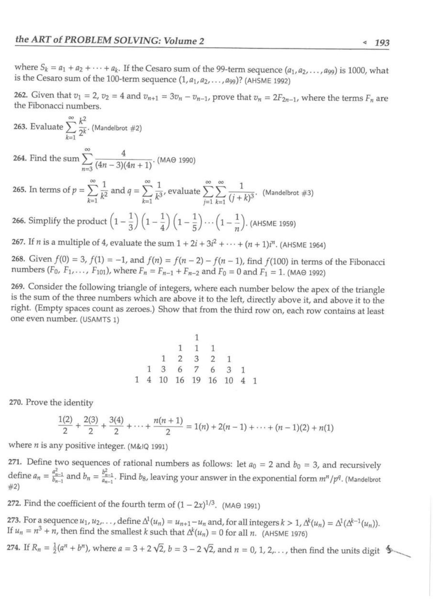

## Printed page 194

<!-- source: volume-2, PDF page 216, printed page 194 -->

of $R_{12345}$. (AHSME 1990)

275. If the sequence $\{a_n\}$ is recursively defined by $a_1 = 2$, and $a_{n+1} = a_n + 2n$ for $n \geq 1$ then find $a_{100}$. (AHSME 1984)

276. Let a sequence $\{u_n\}$ be defined by $u_1 = 5$ and the relation $u_{n+1} - u_n = 3 + 4(n-1)$, $n = 1, 2, 3, \ldots$. If $u_n$ is expressed as a polynomial in $n$, what is the algebraic sum of its coefficients? (AHSME 1969)

277. Find $\sum_{n=0}^{\infty} \frac{\sin(nx)}{3^n}$ if $\sin x = 1/3$ and $0 \leq x \leq \pi/2$. (MAΘ 1992)

278. Let $a_1 < a_2 < a_3 < \cdots < a_n < \cdots$ be positive integers such that $a_{2n} = a_n + n$ for $n = 1, 2, 3, \ldots$. It is known that if $a_n$ is a prime number, then $n$ is a prime number. Find, with proof, $a_{1993}$. (Bulgaria 1993)

279. Let $n$ be a positive integer and let $a_n$ denote the number of positive integers which can be formed whose digits are chosen from 1, 3, 4 and the sum of whose digits are equal to $n$. Prove that $a_{2n}$ is a perfect square for every $n$. (Bulgaria 1993)

280. A collection of $2n$ letters contains 2 each of $n$ different letters. The collection is partitioned into $n$ pairs, each pair containing 2 letters which may be the same or different. Denote the number of distinct partitions by $u_n$. (Partitions differing in the order of the pairs in the partition or in the order of the two letters in the pairs are not considered distinct.) Prove that $u_{n+1} = (n+1)u_n - (n(n-1)/2)u_{n-2}$. (IMO 1985)

281. A sequence of numbers $a_1, a_2, a_3, \ldots$ satisfies $a_1 = 1/2$ and $a_1 + a_2 + \cdots + a_n = n^2 a_n$ for $n \geq 1$. Find $a_n$ in terms of $n$. (Canada 1975)

Original scan — PDF page 216

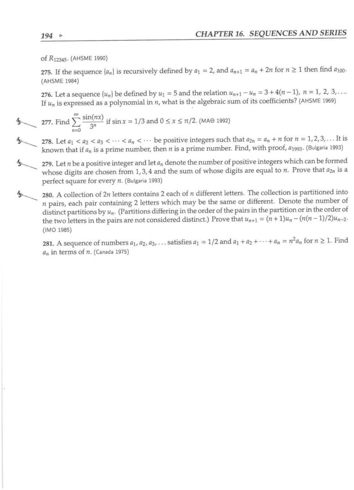

## Printed page 195

<!-- source: volume-2, PDF page 217, printed page 195 -->

Mathematics is often seen as a rigid, step-by-step discipline. But the creation of mathematics usually proceeds in a haphazard, seat-of-the-pants manner. Consider this derivation by Euler. Prominent mathematicians of the 1700's, including Gottfried Wilhelm Leibniz and James Bernoulli, had tried and failed to evaluate the infinite series

$$\frac{1}{1^2} + \frac{1}{2^2} + \frac{1}{3^2} + \cdots,$$

but Euler finally did it. He used an expression which will be familiar to students of calculus,

$$\sin x = x - \frac{x^3}{3!} + \frac{x^5}{5!} - \cdots$$

The zeroes of $\sin x$ are 0, $\pm \pi$, $\pm 2\pi$, etc., so Euler made the leap of claiming that the polynomial on the right hand side can be factored as

$$x - \frac{x^3}{3!} + \frac{x^5}{5!} - \cdots = x \left(1 - \frac{x}{\pi}\right) \left(1 + \frac{x}{\pi}\right) \left(1 - \frac{x}{2\pi}\right) \left(1 + \frac{x}{2\pi}\right) \cdots,$$

since both sides are 0 at the same places. Dividing both sides by $x$ and simplifying the right side, we get

$$1 - \frac{x^2}{3!} + \frac{x^4}{5!} - \cdots = \left(1 - \frac{x^2}{\pi^2}\right) \left(1 - \frac{x^2}{4\pi^2}\right) \left(1 - \frac{x^2}{9\pi^2}\right) \cdots$$

The constant terms of both sides agree, both being 1, so this crazy procedure might be valid. Setting the $x^2$ coefficients equal, we have

$$-\frac{1}{6} = -\frac{1}{\pi^2} - \frac{1}{4\pi^2} - \frac{1}{9\pi^2} - \cdots,$$

or, multiplying both sides by $-\pi^2$,

$$\frac{\pi^2}{6} = \frac{1}{1^2} + \frac{1}{2^2} + \frac{1}{3^2} + \cdots$$

And that’s it! Later, of course, the proof had to be tightened up and made rigorous, but as it stands the derivation is a testament to the power of unfettered creativity in mathematics.

Original scan — PDF page 217

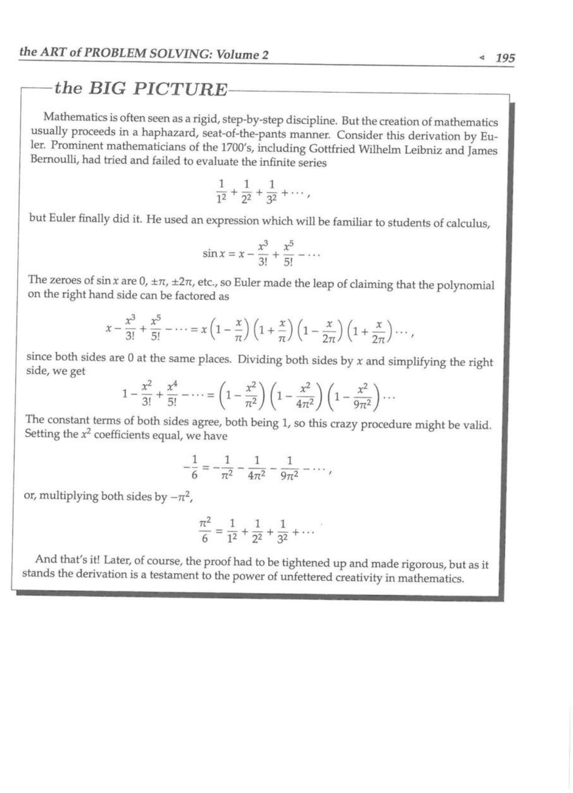

