# Chapter 17: Counting in the Twilight Zone

Volume 2 · Printed pages 196–210 · PDF pages 218–232

[Volume contents](../index.md)

## Printed page 196

<!-- source: volume-2, PDF page 218, printed page 196 -->

Chapter 17

Counting in the Twilight Zone

In Volume 1 we examined a great many counting methods, but all were based on the rock of common sense. In this chapter we will look at counting methods which go far beyond common sense, and thus allow the counting of far more interesting things.

### 17.1 One to One

We will escape the realm of common sense with the help of the obvious-seeming proposition that if a one to one correspondence can be drawn between the members of two groups, the two groups are equal in size. Recall that one to one (also written 1-1 or 1:1) means that each object in either group corresponds to one and only one object in the other.

**EXAMPLE 17-1 Prove that the number of integers greater than 0 and less than 100 equals the number of integers greater than 100 and less than 200.**

Proof: For any integer $n$ in the first group (so $0 < n < 100$) the corresponding integer in the second group will be $n + 100$. Clearly $100 < n + 100 < 200$. It is clear that every integer $n$ in the first group has a single counterpart $n + 100$ in the second, and that every integer $m$ in the second group has a single counterpart $m - 100$ in the first group. Thus the correspondence is one to one, and the two groups of numbers are the same size.

### 17.2 Clever Correspondences

Like any obvious statement, the one to one correspondence principle is useless taken by itself. I must be coupled with a clever correspondence if it is to have any power.

A common example is of the form:

A dog trainer wants to buy 8 dogs all of which are either cocker spaniels, Irish setters, or Russian wolfhounds. In how many ways can she make the choice?

Original scan — PDF page 218

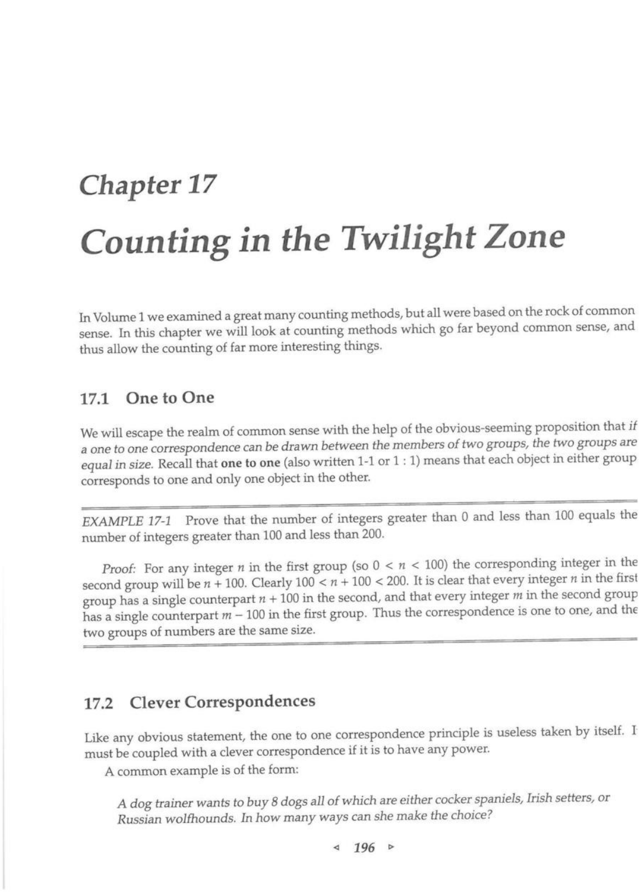

## Printed page 197

<!-- source: volume-2, PDF page 219, printed page 197 -->

The problem is an example of making selections with repetition, because we can choose as many as we wish from each category. At face value it doesn't seem any harder than many problems we tackled in Volume 1. However, if you try it you'll see it's much harder.

**EXERCISE 17-1 Think about the problem until you see why it can't easily be done with our previous methods.**

Our problem can be solved with a neat one to one correspondence. Namely, for each choice of 8 dogs we can write a sequence like

$$ddd_{dd_{ddd}}.$$

The number of $d$'s before the first $\_$ represents the number of spaniels, the number in the middle the number of setters, and the number after the second $\_$ the number of wolfhounds.

**EXAMPLE 17-2 To what choice of dog varieties does the sequence above correspond?**

Solution: Since there are three $d$'s before the first $\_$, we have three spaniels. Since there are two $d$'s in the middle, there are two setters. Since there are three $d$'s at the end, there are three wolfhounds. (Note that this is in fact a legal sequence since exactly eight dogs are accounted for.)

**EXERCISE 17-2 Prove that we can write exactly one sequence for each choice of dogs, and that each sequence corresponds to exactly one choice of dogs. What happens in the case that there are zero dogs of some variety? Is this OK?**

Since we have established in Exercise 17-2 a one to one correspondence between choices of dogs and sequences, all we have to count is the number of sequences. But counting the sequences is easy, since each sequence is just a matter of choosing two positions for the $\_$'s out of 10 total positions. (There are 10 positions because we have 8 $d$'s and 2 $\_$'s.) The number of ways to choose 2 positions out of 10 is $\binom{10}{2} = 45.$

**EXERCISE 17-3 Find (and prove) a simple formula for the number of ways to buy $n$ dogs if there are $r$ varieties to choose from.**

**EXERCISE 17-4 Prove that the number you found in the previous exercise is equal to the number of solutions in nonnegative integers of $x_1 + x_2 + \cdots + x_r = n.$**

There are many other ways to set up one to one correspondences; in general, when a problem looks too difficult by other methods, look for a correspondence to a simpler problem. It will in general require some creativity on your part to come up with the particular correspondences which do the job, but you'll get a feel for what works with experience.

**EXAMPLE 17-3 In how many ways may five people be seated in a row of twenty chairs given that no two people may sit next to one another?**

Original scan — PDF page 219

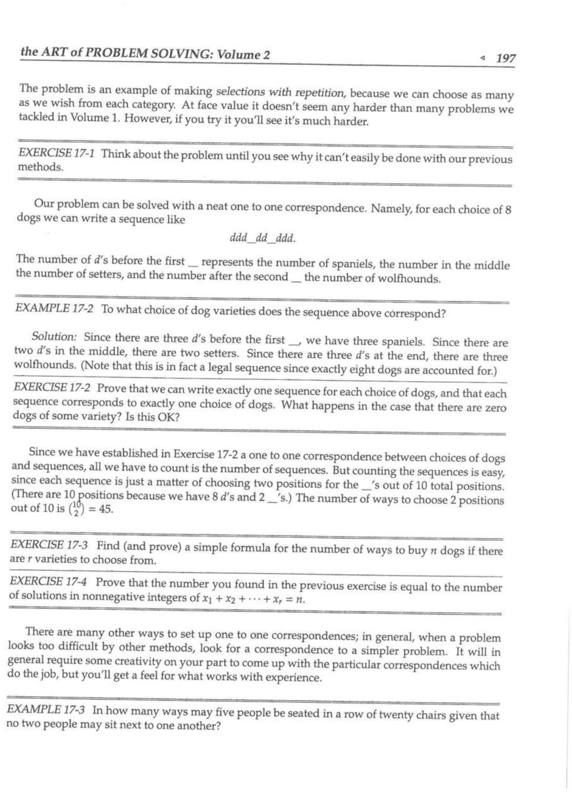

## Printed page 198

<!-- source: volume-2, PDF page 220, printed page 198 -->

Solution: Consider some arrangement of the five people as specified, then take one chair out from between each pair of people. What you’re left with is a unique arrangement of 5 people in 16 chairs without restrictions. Similarly, starting with an unrestricted arrangement of 5 people in 16 chairs, adding a chair between each pair of people gives a unique arrangement of 5 non-adjacent people in 20 chairs. (Convince yourself of these two assertions.) Thus there is a one to one correspondence between the restricted 20-chair arrangements of the problem and unrestricted 16-chair arrangements. The number of unrestricted 16-chair arrangements is the number of ways to choose 5 chairs out of 16, or $\binom{16}{5}$.

**EXAMPLE 17-4 How many nonnegative integer solutions are there to $x_1 + x_2 + x_3 \leq 50$?**

Solution: We have seen how to solve $x_1 + x_2 + \cdots + x_r = n$, but the inequality complicates the problem. We might be tempted to successively solve $x_1 + x_2 + x_3 = 50$, then $x_1 + x_2 + x_3 = 49$, and so on, then try to simplify the sum of the results. But creative thinking yields a different way: just put as much of the 50 as is desired into $x_1 + x_2 + x_3$, and put the rest into a new variable $y$. With this idea, it becomes clear that a one to one correspondence exists between nonnegative solutions of our inequality and nonnegative solutions of the equality $x_1 + x_2 + x_3 + y = 50$, which by Exercises 17-3 and 17-4 has $\binom{53}{3}$ solutions.

### 17.3 Easy as …

In the first volume we used sets and Venn diagrams to attack problems like:

There are 100 students taking language classes at Austin High School. If 60 are taking German and 75 are taking Spanish and these are the only languages taught, how many students take both Spanish and German?

Let’s try a new approach. Say there are $x$ students taking both languages. We could try counting the number of students taking languages by just adding the number of students in each language, or $60 + 75 = 135$. Since we know there are 100 students taking languages, we have made a mistake. Our error is in counting students taking both languages twice, once for German and once for Spanish. Thus, we must subtract from 135 the number of students taking both languages so that we only count them once. Hence, the total number of students taking language classes is $135 - x$. Setting this equal to 100 we find $x = 35$.

This is the heart of the Principle of Inclusion-Exclusion, or PIE: if we count something twice, subtract it once so we only count it once. It’s that simple! When we move from two classes to three, the counting becomes a bit trickier, but the concept is the same. For example, let’s call the classes $A, B$, and $C$ and let the number of students in each be $\#(A), \#(B),$ and $\#(C)$, respectively. To take care of overcounting students in both classes $A$ and $B$, we must subtract the number of students in both classes, which we’ll call $\#(A \cap B)$. Similarly, we subtract the number of students in both $B$ and $C$ and in both $A$ and $C$, for a total of

$$\#(A) + \#(B) + \#(C) - \#(A \cap B) - \#(A \cap C)$$

students. To convince yourself that this takes care of students enrolled in two classes, pretend you are in exactly two of the classes. How many times are you added to the total? Subtracted? How many times are you counted?

Original scan — PDF page 220

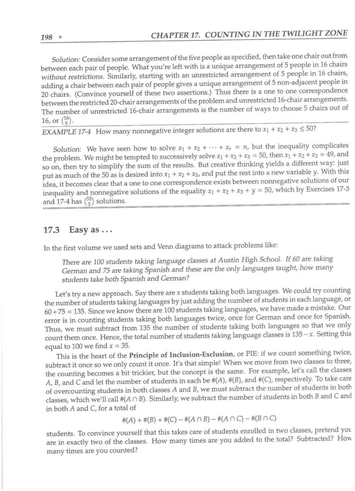

## Printed page 199

<!-- source: volume-2, PDF page 221, printed page 199 -->

Now what if you're in all three classes? You're added three times and subtracted three times, so you're not counted at all! To take care of this, we must add back the number of students in all three classes. This makes our total number of students

$$\#(A) + \#(B) + \#(C) - \#(A \cap B) - \#(A \cap C) - \#(B \cap C) + \#(A \cap B \cap C).$$

**EXERCISE 17-5** Again, pretend you are in 1, 2, or 3 classes and make sure that the aforementioned method only counts you once no matter how many times you are added or subtracted.

**EXERCISE 17-6** What if there were 4 classes? How about 5 classes?

**EXAMPLE 17-5** How many positive integers less than or equal to 1000 do not have 2, 3, or 5 among their prime factors?

**Solution:** We count the number of positive integers less than or equal to 1000 which do have 2, 3, or 5 among their prime factors and subtract that number from 1000 to find how many do not. There are $1000/2 = 500$ multiples of 2, $[1000/3] = 333$ multiples of 3 and $1000/5 = 200$ multiples of 5 in this range, for a total of $500 + 333 + 200 = 1033$ positive integers less than or equal to 1000 with 2, 3, or 5 as a factor. We've obviously overlooked something. We've badly overcounted, because many numbers are multiples of more than just one of these three numbers. Applying the Principle of Inclusion-Exclusion, we subtract from 1033 the number of multiples of both 2 and 3, of both 2 and 5, and of both 3 and 5. Finally, we then add to the result the number of integers which are multiples of all three.

Any number which is a multiple of 2 and 3 is a multiple of $(2)(3) = 6$, since 2 and 3 have no common nontrivial factors. Hence, we seek the multiples of 6, 10, 15, and $2(3)(5) = 30$. There are $[1000/6] = 166$ multiples of 6, $[1000/10] = 100$ multiples of 10, $[1000/15] = 66$ multiples of 15, and $[1000/30] = 33$ multiples of 30. By PIE, there are

$$1033 - 166 - 100 - 66 + 33 = 734$$

integers less than or equal to 1000 with 2, 3, or 5 among their factors. Hence, there are $1000 - 734 = 266$ integers in that range which are not multiples of 2, 3, or 5.

**EXERCISE 17-7** Suppose there is some number of objects placed in $n$ categories $A_1, A_2, \ldots, A_n$, where each object may be in more than one category. Let $\#(A_i)$ be the number of objects in category $A_i$. Suppose $\#(A_i)$ is the same for all $i$, $\#(A_i \cap A_j)$ is the same for all distinct pairs $(i, j)$, $\#(A_i \cap A_j \cap A_k)$ is the same for all triples $(i, j, k)$, etc. Show that the Principle of Inclusion-Exclusion gives

$$\#(A_1 \cup A_2 \cup A_3 \cup \cdots \cup A_n) = \binom{n}{1} \#(A_1) - \binom{n}{2} \#(A_1 \cap A_2) + \binom{n}{3} \#(A_1 \cap A_2 \cap A_3) - \binom{n}{4} \#(A_1 \cap A_2 \cap A_3 \cap A_4) + \cdots + (-1)^n \binom{n}{n} \#(A_1 \cap A_2 \cap \cdots \cap A_n).$$

This application of the Principle of Inclusion-Exclusion is very useful in problems containing symmetry.

**EXAMPLE 17-6** There are four baskets numbered from 1 to 4 and four balls numbered from 1 to 4. Each basket is allowed to have at most two balls. In how many ways can the balls be placed in the baskets such that no ball has the same number as the basket it is in?

Original scan — PDF page 221

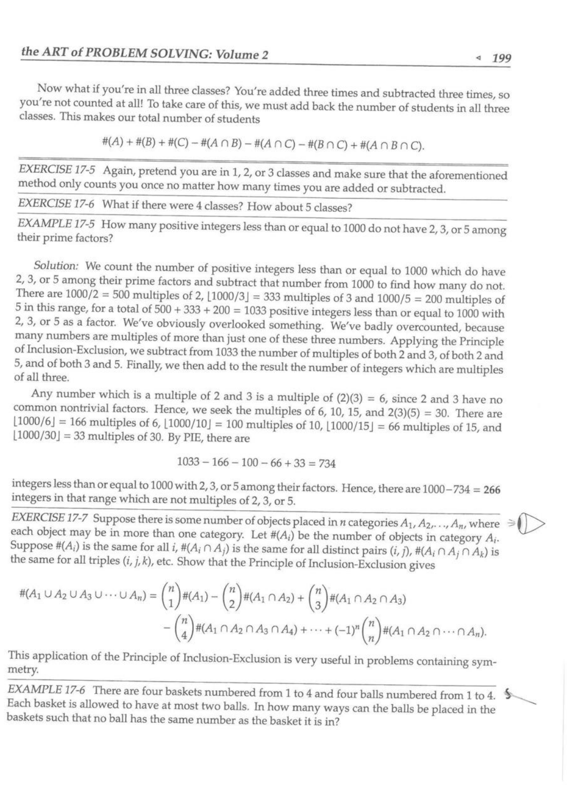

## Printed page 200

<!-- source: volume-2, PDF page 222, printed page 200 -->

This problem has symmetry, so we apply the concepts of the previous exercise. First we count the number of ways to put the balls in the baskets with no restrictions. There are 4! ways to put the balls in 4 different baskets. There are $\binom{4}{1} \binom{4}{2} (3)(2)$ ways to put two balls in one basket and the others in their own baskets (4 ways to pick the basket with two balls, 6 ways to pick the balls in that basket, $(3)(2)$ ways to put the other balls in different baskets). Finally, we can put two balls each in two baskets in $\binom{4}{2} \binom{4}{2}$ ways (6 ways to pick the two non-empty baskets and 6 ways to distribute the balls among these baskets). Hence there are $24 + 144 + 36 = 204$ ways to put the balls in the baskets.

To solve the problem, we will count the ways the balls can be put in the baskets such that at least one ball has the same number as the basket that holds it. Let $\#(i)$ be the number of ways to fill the baskets such that basket $i$ holds ball $i$. From the previous exercise, we seek the quantity

$$\binom{4}{1} \#(1) - \binom{4}{2} \#(1 \cap 2) + \binom{4}{3} \#(1 \cap 2 \cap 3) - \binom{4}{4} \#(1 \cap 2 \cap 3 \cap 4).$$

For the first, after we put ball 1 in basket 1, we can either put another ball in that basket or put all the balls in the other baskets. The former can be done in $\binom{3}{1} (3^2) = 27$ ways (3 ways to pick the other ball in basket 1, $3^2$ ways to put the other balls in the other baskets); the latter can be done in $\binom{3}{1} \binom{3}{2} (2) + 3! = 24$ ways, where we divide this into the case of two of the balls in one of the other three baskets and the case of the other three being in different baskets. For $\#(1 \cap 2)$ we put balls 1 and 2 in baskets 1 and 2. The other two balls can be put in the baskets in $2 + (2)(2)(2) + (2)(2) = 14$ ways, where we consider the cases of putting 2, 1, or 0 of the remaining balls in the first two baskets. (Make sure you see this.) The last two are easy. After we put 3 balls in the right baskets, the other has four choices and we can only get them all right in 1 way. Putting these in our above expression, there are

$$4(27 + 24) - 6(14) + 4(4) - 1(1) = 135$$

ways to put the balls in the baskets so that at least one ball is in the right basket. This leaves $204 - 135 = 69$ ways of filling the baskets so that no ball has the same number as the basket that holds it.

This is a very complicated counting problem, and you may argue that you would be better off just listing the possibilities and counting. Using the Principle of Inclusion-Exclusion is better than listing and counting because it’s awfully hard to tell if we’ve listed all the possibilities, and as the number of possibilities gets large (what if there were 6 balls and 6 baskets), the listing and counting method becomes very unreliable.

### 17.4 Generating Functions

When it comes to counting, generating functions are the cleverest thing there is. The idea of generating functions is that functions can be manipulated in various ways which combinatorial quantities cannot, so to examine the properties of some combinatorial function $A(k)$, we instead look at the function

$$A(0) + A(1)x + A(2)x^2 + A(3)x^3 + \cdots,$$

where the coefficient $A(k)$ of $x^k$ is the number of ways event $k$ can occur. Perhaps the simplest example of a useful generating function is

$$\binom{n}{0} + \binom{n}{1}x + \binom{n}{2}x^2 + \cdots + \binom{n}{n}x^n,$$

Original scan — PDF page 222

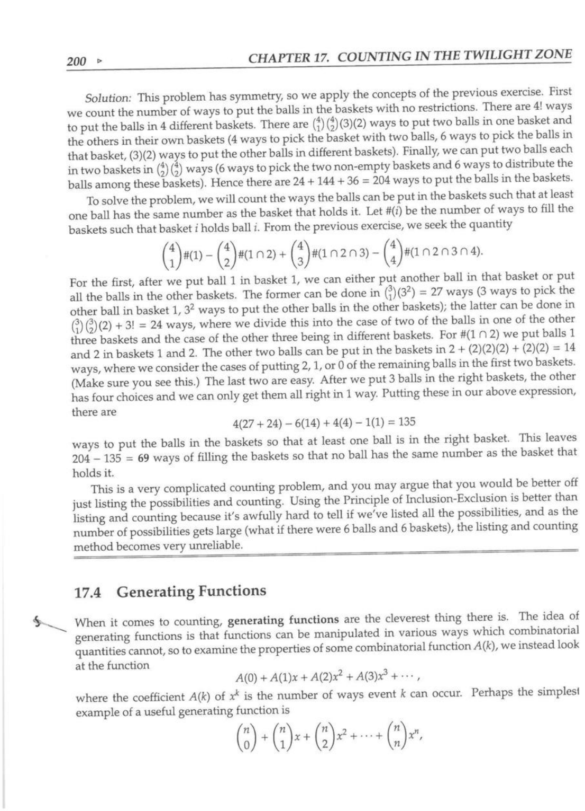

## Printed page 201

<!-- source: volume-2, PDF page 223, printed page 201 -->

where we let $A(k) = \binom{n}{k}$ for some fixed $n$. We could say that this is the generating function for the number of ways we can get $k$ heads when flipping $n$ different coins. The power of writing this as a function is that we can use the Binomial Theorem to convert the function to the simple $(x+1)^n$. In Chapter 15, we saw that this function can then be used to rapidly get identities like $\binom{n}{0} + \binom{n}{1} + \cdots + \binom{n}{n} = 2^n, \binom{n}{1} + \binom{n}{3} + \cdots = \binom{n}{0} + \binom{n}{2} + \cdots$, and so on.

Another type of generating function can be used to look at distribution problems. For example, suppose we let $A(k)$ be the number of ways in which we can collect $k$ from 5 people if each person gives either 0, 1, or 3 dollars. Rather than writing out the generating function, we consider the generating function for each person individually. Any single person has 1 way to give $0, 1$ way to give $1$, no ways to give $2, 1$ way to give $3$, and no ways to give anything larger, so the individual generating function is $(1x^0 + 1x^1 + 1x^3)$. The reason the individual function is interesting is that the overall generating function can be found by multiplying the individual functions together!

Why? Consider some set of possible contributions, say $1, 3, 3, 0, 3$. This corresponds to the set of generating terms

$$x^1 \cdot x^3 \cdot x^3 \cdot x^0 \cdot x^3;$$

that is, there is a one to one correspondence between sets of contributions and generating terms in the product. Since we want to count every set of contributions once, we want to count every generating term once. Multiplying the individual functions together does exactly this, by the distributive property! Hence the $k$th term of the expansion of

$$(1+x+x^3)(1+x+x^3)(1+x+x^3)(1+x+x^3) = (1+x+x^3)^5$$

will give the number of ways to collect $k$ from the five people.

**EXERCISE 17-8** The argument above, that the overall generating function can be found by multiplying the individual generating functions, is the linchpin of everything we’ll do with generating functions. Make sure you understand it well right now, or the rest of this section won’t make sense.

**EXAMPLE 17-7** Ten people with one dollar each and one person with three dollars get together to buy an eight-dollar pizza. In how many ways can they do it?

**Solution:** Each of the ten people with one dollar contributes a generating function $(1+x)$, and the last person contributes $(1+x+x^2+x^3)$. Thus the overall generating function is

$$(1+x)^{10}(1+x+x^2+x^3).$$

By the Binomial Theorem, this becomes

$$\left(1 + \binom{10}{1}x + \binom{10}{2}x^2 + \cdots + \binom{10}{10}x^{10}\right)(1+x+x^2+x^3).$$

Recall that we are interested in an eight dollar total contribution, which means we want the coefficient of $x^8$. By the distributive property, the sum becomes

$$(1+x+x^2+x^3) + \binom{10}{1}(x+x^2+x^3+x^4) + \cdots + \binom{10}{10}(x^{10}+x^{11}+x^{12}+x^{13}),$$

Original scan — PDF page 223

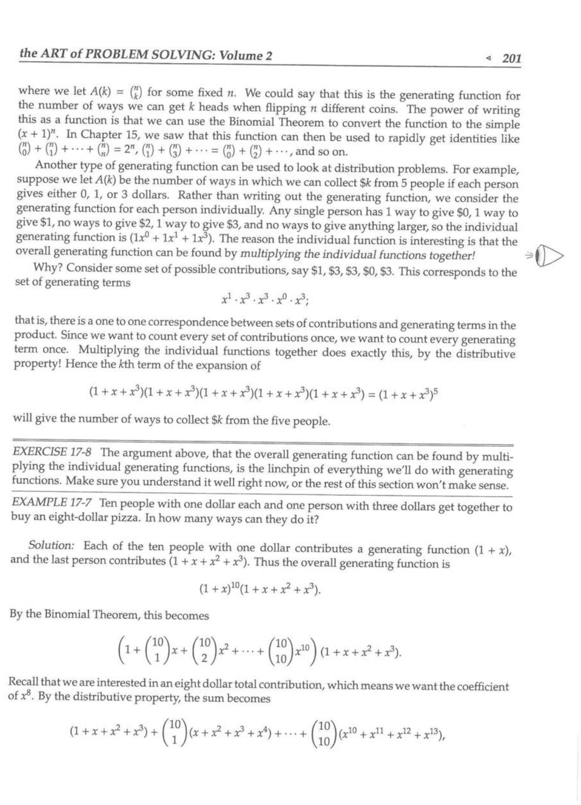

## Printed page 202

<!-- source: volume-2, PDF page 224, printed page 202 -->

and the coefficient of the $x^8$ term is

$$\binom{10}{5} + \binom{10}{6} + \binom{10}{7} + \binom{10}{8}.$$

**EXERCISE 17-9** Write down a factored generating function for the number of solutions of $e_1 + e_2 + e_3 = k$, where $e_1$ is even, $e_2$ odd, and $e_3$ prime.

In dealing with generating functions, we use several identities for simplification. The Binomial Theorem is often key, as are the geometric series identities

$$1 + x + x^2 + x^3 + \cdots = \frac{1}{1-x}$$

(17.1)

and

$$1 + x + x^2 + \cdots + x^r = \frac{1-x^{r+1}}{1-x}$$

(17.2)

For example, consider distributing 23 toys among 6 children such that no child gets more than 5 or less than 2 toys. Each child contributes a generating function $x^2 + x^3 + x^4 + x^5$, so the overall generating function is

$$\left(x^2 + x^3 + x^4 + x^5\right)^6 = x^{12}(1+x+x^2+x^3)^6.$$

By identity (17.2), the sum $1+x+x^2+x^3$ is equal to $(1-x^4)/(1-x)$, so our generating function is $x^{12}(1-x^4)^6(1-x)^{-6}$. We get rid of the $x^{12}$ by noting that the coefficient of $x^{23}$ in $x^{12}(1-x^4)^6(1-x)^{-6}$ is the same as the coefficient of $x^{11}$ in $(1-x^4)^6(1-x)^{-6}$. By the Binomial Theorem, once for the positive exponent $n = 6$ and once for the negative exponent $n = -6$, we expand this latter product into

$$\left[ \binom{6}{0} - \binom{6}{1}x^4 + \binom{6}{2}x^8 - \cdots + \binom{6}{6}x^{24} \right] \left[ \binom{-6}{0} - \binom{-6}{1}x + \binom{-6}{2}x^2 - \cdots \right].$$

All that's left is to find the coefficient of $x^{11}$. This is simple, because the only contributing terms are $-\binom{6}{0}\binom{-6}{11}, \binom{6}{1}\binom{-6}{7}$, and $-\binom{6}{2}\binom{-6}{3}$. Thus the coefficient of the $x^{11}$ term, and therefore the number of ways to perform the required task, is

$$-\binom{6}{0}\binom{-6}{11} + \binom{6}{1}\binom{-6}{7} - \binom{6}{2}\binom{-6}{3}.$$

**EXERCISE 17-10** In how many ways can we get a sum of 25 when 10 distinct dice are rolled?

### 17.5 Partitions

One of the most beautiful applications of generating functions is in counting partitions, ways to split an integer into parts. (For example, some partitions of 5 are 3+1+1, 4+1, 3+2, and 5.) There is no simple formula for the general partition problem, as you'll discover if you try to find one, but generating functions provide an interesting window into the general problem and many variations

Original scan — PDF page 224

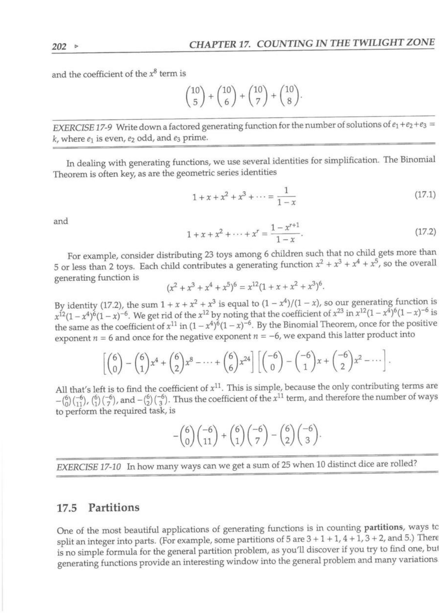

## Printed page 203

<!-- source: volume-2, PDF page 225, printed page 203 -->

To find a generating function for the number of partitions of $n$, you might think that it suffices to consider that each contributing number can be 0, 1, 2, ..., so that each contributor has an individual generating function $(1 + x + x^2 + \cdots)$. However, this is no good because it considers $1 + 2$ and $2 + 1$ as different partitions (and furthermore, we don't know how many contributors there are)! Instead, we realize that a partition is just a list of numbers: the partition $4 + 3 + 3 + 1$ of 11, for example, is equivalent to the description "one 1, two 3's, one 4." Thus we let number of 1's in the partition be one contributor, the number of 2's be a contributor, and so on. The 1's, then, contribute an individual generating function $1 + x + x^2 + \cdots$, where the 1 corresponds to zero 1's in the partition, the $x$ to one 1, the $x^2$ to two 1's, and so on.

**EXERCISE 17-11** Find the individual generating function for the number of 2's in the partition.

Since the number of $k$'s in the partition contributes an individual generating function given by $1 + x^k + x^{2k} + \cdots$, the overall generating function is

$$\frac{(1 + x + x^2 + \cdots)(1 + x^2 + x^4 + \cdots)(1 + x^3 + x^6 + \cdots)}{(1 - x)(1 - x^2)(1 - x^3) \cdots}$$

**EXERCISE 17-12** Expand the product above up to the $x^4$ term. Show that the coefficient of $x^1$ is the number of partitions of 1, the coefficient of $x^2$ is the number of partitions of 2, and similarly for 3 and 4.

**EXAMPLE 17-8** Using the geometric series formula, the factor $1 + x^k + x^{2k} + \cdots$ equals $1/(1 - x^k)$. Thus the generating function (17.3) can also be written

$$\frac{1}{(1 - x)(1 - x^2)(1 - x^3) \cdots}$$

Once we can find a generating function for the general partition problem, we can easily specialize it. How many ways can $n$ be partitioned into 2's, 3's and 4's? The individual generating functions are $1 + x^2 + x^4 + \cdots, 1 + x^3 + \cdots,$ and $1 + x^4 + \cdots,$ so the overall generating function is

$$\frac{(1 + x^2 + x^4 + \cdots)(1 + x^3 + x^6 + \cdots)(1 + x^4 + x^8 + \cdots)}{(1 - x)(1 - x^2)(1 - x^3) \cdots}$$

How many ways can $n$ be partitioned with at most two of any integer? The individual generating functions are $1 + x + x^2, 1 + x^2 + x^4, 1 + x^3 + x^6,$ and so on, so the overall generating function is

$$\frac{(1 + x + x^2)(1 + x^2 + x^4)(1 + x^3 + x^6)}{(1 - x)(1 - x^2)(1 - x^3) \cdots}$$

Granted that evaluating the $n$th coefficient of such generating functions, which must be done to get a numerical answer, is not easy; however, mere possession of the generating function can allow interesting analysis.

Original scan — PDF page 225

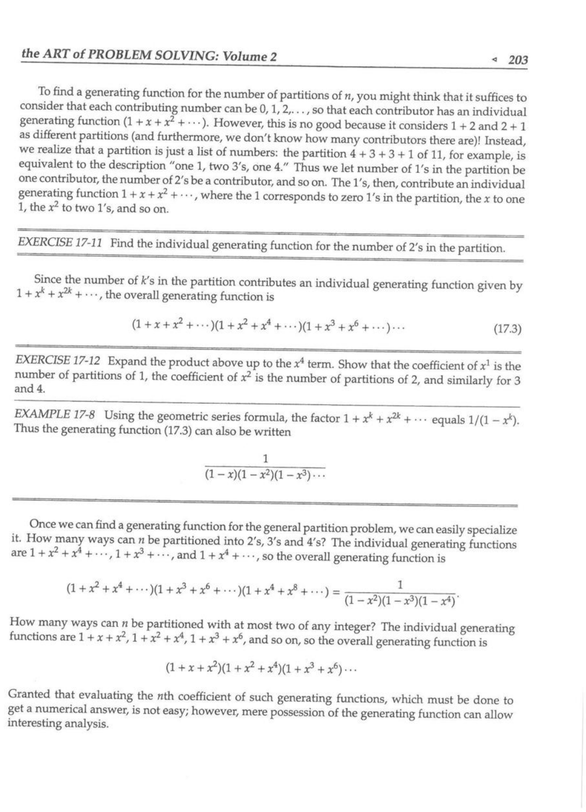

## Printed page 204

<!-- source: volume-2, PDF page 226, printed page 204 -->

**EXAMPLE 17-9 Prove that the number of partitions of $n$ in which no part appears exactly once is equal to the number of partitions in which no part is congruent to 1 or 5 (mod 6).**

Solution: We find the two generating functions separately and prove they are equal. For the first one, the individual generating function for the number of 1's becomes $1 + x^2 + x^3 + x^4 + \cdots$. We must delete the $x$ because it corresponds to exactly one 1, a situation forbidden by the problem. Similarly we must delete the second term of each individual generating function in (17.3), so the overall generating function is

$$\left(1 + x^2 + x^3 + \cdots\right)\left(1 + x^4 + x^6 + \cdots\right)\left(1 + x^6 + x^9 + \cdots\right) \cdots$$

which using the geometric series formula is

$$\left(1 + \frac{x^2}{1-x}\right)\left(1 + \frac{x^4}{1-x^2}\right)\left(1 + \frac{x^6}{1-x^3}\right) \cdots$$

$$= \frac{1-x+x^2}{1-x} \cdot \frac{1-x^2+x^4}{1-x^2} \cdot \frac{1-x^3+x^6}{1-x^3} \cdots$$

$$= \frac{(1-x+x^2)(1+x)}{(1-x)(1+x)} \cdot \frac{(1-x^2+x^4)(1+x^2)}{(1-x^2)(1+x^2)} \cdots$$

$$= \frac{1+x^3}{1-x^2} \cdot \frac{1+x^6}{1-x^4} \cdot \frac{1+x^9}{1-x^6} \cdots$$

$$= \frac{1}{1-x^2} \cdot \frac{1}{1-x^3} \cdot \frac{1}{1-x^4} \cdot \frac{1}{1-x^6} \cdot \frac{1}{1-x^8} \cdots$$

where the last equality is found by cancelling each $1 + x^{3k}$ in the numerator with a $1 - x^{6k} = (1 + x^{3k})(1 - x^{3k})$ farther out in the denominator, leaving a $1 - x^{3k}$ in the denominator. All that's left in the denominator when we're through is $1 - x^k$ for all $k$ not congruent to 1 or 5 (mod 6). (Confirm these calculations yourself.) Hence this is exactly the generating function for the number of partitions into parts not congruent to 1 or 5 (mod 6), so the generating functions are equal and we're done.

As you've seen, effective use of generating functions requires quite a bit of skill with series manipulation. With practice, these operations will become easy. Once you've learned calculus, come back to the study of generating functions (a college discrete mathematics book may help); the operations of integration and differentiation vastly widen the scope of generating function applications.

### 17.6 Counting on Graphs

We'll start with a basic grid counting problem. Suppose Andy the Ant sits at point 1 and wishes to go to point 20 but can only walk down or to the right. If Andy can only turn at other numbered points, how many different paths can Andy take from 1 to 20?

One such path is 1-6-11-16-17-18-19-20. Clearly to go from 1 to 20, Andy must take 7 steps, 3 down and 4 to the right. Our problem is to count the number of orders in which Andy can take three steps to the right out of seven steps. Thus, our answer is simply $\binom{7}{3} = 35$.

Original scan — PDF page 226

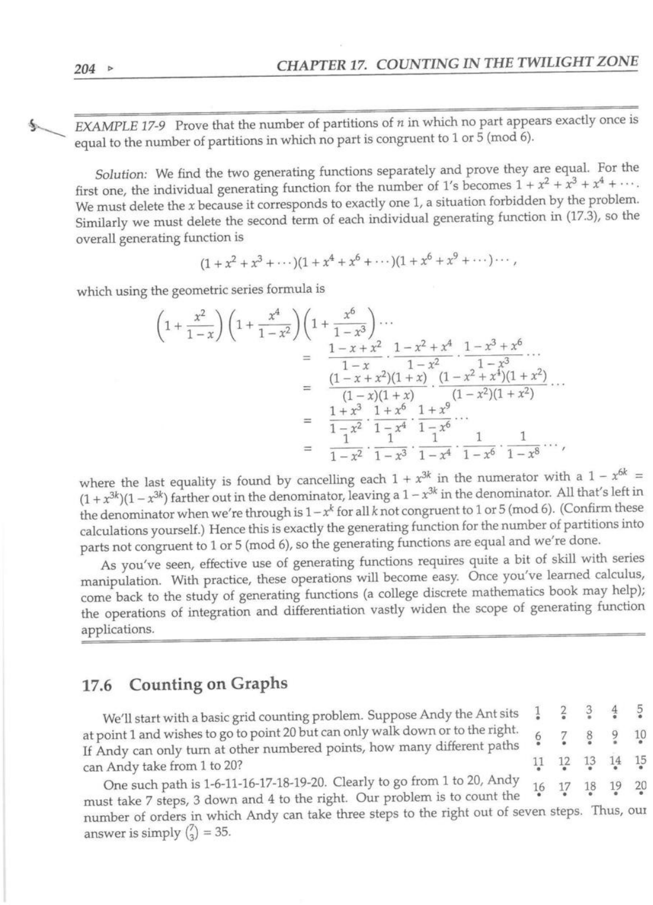

## Printed page 205

<!-- source: volume-2, PDF page 227, printed page 205 -->

Now suppose Anna the Anteater comes and sits on point 5, so that Andy can't safely go to point 4, 5, 9, or 10. How many paths can Andy take now? Our problem isn't so simple, because many of Andy's earlier paths are disallowed.

Notice that any successful path must go through either point 2 or point 6. Hence, if we let #(i) be the number of paths from point $i$ to point 20, we have #(1) = #(2) + #(6). Instead of working forward in this manner, let's work backwards. For example, for each of the points on the bottom row there is only 1 path to point 20, so put a 1 beneath each of these vertices.

There’s only one successful path from 15, but from point 14 we can go through either point 15 or point 19. Similarly, for any point $i$, the number of paths from $i$ to 20 is the sum of the numbers of paths from the point directly to the right of $i$ and from the point below $i$. Thus, we put a 2 below point 14, a 3 below 13, and so on filling out next to the last row. To go from point 8 to point 20, we must go first to point 13, so there are 3 paths from point 8 to 20. Continuing as before, we fill out the grid with numbers representing the number of paths from each point to point 20. Thus, we find our desired answer is 22.

**EXERCISE 17-13** Can we use our backwards counting approach on three-dimensional grid problems?

Nearly every problem involving counting on a grid can be solved working backwards as we did in counting Andy’s paths which avoid Anna the Anteater; however, the recursive method we have used for these grids is applicable to other types of problems as well.

**EXERCISE 17-14** Mike starts at one corner of a tetrahedron. In a move, he walks along any edge to a different corner. In how many ways can he end up where he started after 6 moves?

### 17.7 Counting Infinite Sets

One really astounding consequence of the one-to-one correspondence principle is that it allows us to "count" infinite sets. Even though there is no finite number which equals the size of an infinite set, we can use one-to-one correspondences to show that certain sets are the same size, or that one set is bigger than another.

One usual example of an infinite set is the positive integers,

$$\{1, 2, 3, 4, \ldots\}.$$

However, we can place the set of all integers in correspondence with the positive integers, like so:

$$\begin{array}{rrrrrrrrrrrr}
1 & 2 & 3 & 4 & 5 & 6 & 7 & 8 & 9 & 10 & 11 & \ldots \\
0 & 1 & -1 & 2 & -2 & 3 & -3 & 4 & -4 & 5 & -5 & \ldots \\
\end{array}$$

Since they can be placed in correspondence, the set of all integers is the same size as the set of positive integers, even though the positive integers are wholly contained by the integers! How can this be? When dealing with infinite sets, such oddities are not rare.

**WARNING:** Never say there are the same number of positive integers as all integers; there is no meaning to the phrase the number of positive integers. Refer only to the sizes of the sets involved.

Original scan — PDF page 227

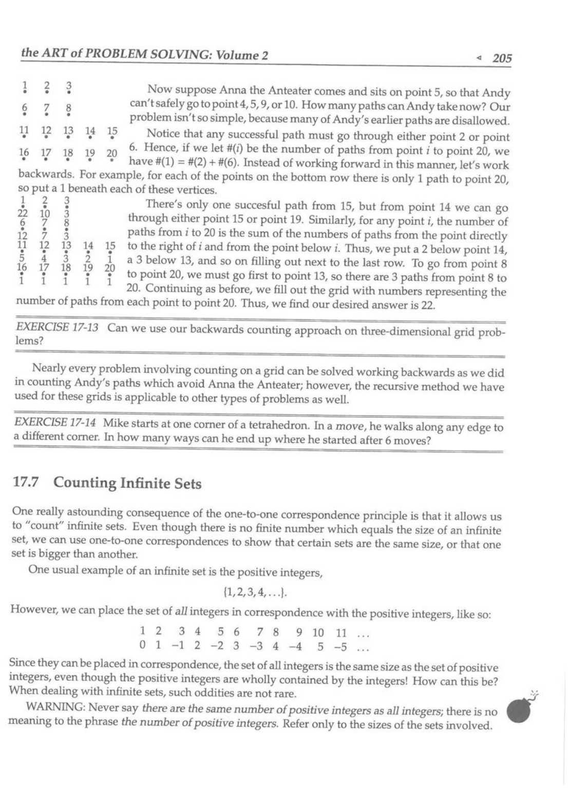

## Printed page 206

<!-- source: volume-2, PDF page 228, printed page 206 -->

**EXERCISE 17-15 Show that the sets of odd and even positive integers each have the same size as the set of all positive integers.**

**EXAMPLE 17-10 Even the set of all positive rational numbers, which seems immensely larger than the set of positive integers, is actually the same size. We make the correspondence by writing the rationals in a grid:**

$$\frac{1}{1} \quad \frac{1}{2} \quad \frac{1}{3} \quad \frac{1}{4} \quad \dots$$
$$\frac{2}{1} \quad \frac{2}{2} \quad \frac{2}{3} \quad \frac{2}{4} \quad \dots$$
$$\frac{3}{1} \quad \frac{3}{2} \quad \frac{3}{3} \quad \frac{3}{4} \quad \dots$$
$$\frac{4}{1} \quad \frac{4}{2} \quad \frac{4}{3} \quad \frac{4}{4} \quad \dots$$
$$\vdots \quad \vdots \quad \vdots \quad \ddots$$

We can create a similar grid for the positive integers by filling up along the diagonals as follows:

$$1 \quad 2 \quad 4 \quad 7 \quad \dots$$
$$3 \quad 5 \quad 8 \quad 12 \quad \dots$$
$$6 \quad 9 \quad 13 \quad 18 \quad \dots$$
$$10 \quad 14 \quad 19 \quad 25 \quad \dots$$
$$\vdots \quad \vdots \quad \vdots \quad \ddots$$

We then correspond each rational to the integer in the corresponding place in the grid.

Given all these examples, you might be starting to think that any infinite set can be placed in one-to-one correspondence with the positive integers. Not so. The set of real numbers is larger than the set of positive integers, as was proven by Georg Cantor in the late 1800’s. His famous diagonal proof is one of the classic beautiful proofs of math.

The proof goes as follows. Assume that we can list all the real numbers one after the other. We will show that there is one real number which is not in the list, contradicting the assertion that we have listed them all. Let the list be as follows, where each $a_{ij}$ is a single digit:

$$a_{10}.a_{11}a_{12}a_{13}\dots$$
$$a_{20}.a_{21}a_{22}a_{23}\dots$$
$$a_{30}.a_{31}a_{32}a_{33}\dots$$
$$\vdots \quad \vdots \quad \vdots \quad \ddots$$

Now form a new number as follows: let $b_1$ be any digit which is different from $a_{11}$; let $b_2$ be any digit which is different from $a_{22}$; $b_3$ different from $a_{33}$; and so on. Consider the number

$$x = 0.b_1b_2b_3b_4\dots$$

Clearly $x$ is different from $a_{10}.a_{11}a_{12}a_{13}\dots$, since they differ in the first place after the decimal ($b_1 \neq a_{11}$). Similarly, $x$ is different from $a_{20}.a_{21}a_{22}a_{23}\dots$, since $b_2 \neq a_{22}$. In like manner, $x$ must be different from every number in our list. Thus $x$ is not in our list, so our original assertion that the list contained all the real numbers must have been false.

In other words, we can’t list the real numbers in correspondence with the positive integers, for no such list can contain all the reals. There is no way to correspond the real numbers to the positive

Original scan — PDF page 228

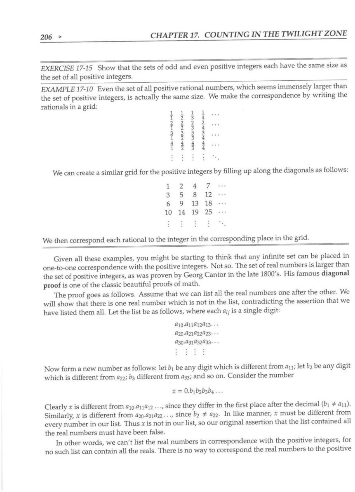

## Printed page 207

<!-- source: volume-2, PDF page 229, printed page 207 -->

integers: the set of reals is larger. This should be surprising—two infinite sets which are not the same size?! Sets which can be corresponded to the positive integers are called *countably infinite*, while sets which cannot be so corresponded are called *uncountable*.

**EXAMPLE 17-11** With infinity, we invariably get strangeness. One bizarre result is that the set of all real numbers is the same size as the set of real numbers in any finite range, say $(-1, 1)$.

The one-to-one correspondence can be seen geometrically in the picture at right, where we have wrapped the segment around into a semicircle. Each point $P$ on the segment is paired in a 1-1 manner with a point $P'$ on the real number line by drawing the line shown.

Those with a more analytic bent might like the following correspondence better. We take

$$x \longleftrightarrow \tan(\pi x/2),$$

where $x$ is in the range $(-1, 1)$, so $\pi x/2$ spans the period $(-\pi/2, \pi/2)$ of tangent and $\tan(\pi x/2)$ thus spans the entire range $(-\infty, \infty)$.

**EXERCISE 17-16** Given two segments of lengths $a$ and $b$, give both a geometric and an analytic proof that the two sets of points are the same size.

**Problems to Solve for Chapter 17**

282. Five balls are numbered 1 to 5. Three boxes are numbered 1 to 3. How many distinct ways can the balls be put in the boxes if two boxes have two balls each and the other box has the remaining ball? (MAΘ 1992)

283. How many positive integers less than 101 are multiples of 5 or 7, but not both? (Mandelbrot #1)

284. In how many ways can 3 squares be chosen from a 5 by 5 grid so that no two chosen squares are in the same row or column? (Mandelbrot #3)

285. Lines $L_1, L_2, \ldots, L_{100}$ are distinct. All lines $L_{4n}, n$ a positive integer, are parallel to each other. All lines $L_{4n-3}, n$ a positive integer, pass through a given point $A$. Find the maximum number of points of intersection of pairs of lines from the complete set $\{L_1, L_2, \ldots, L_{100}\}$. (AHSME 1976)

286. How many solutions in positive integers are there to $x_1 + x_2 + \cdots + x_8 = 19$?

287. Let the set $S = \{a_1, a_2, a_3, \ldots, a_{12}\}$, where all 12 elements are distinct. We wish to form sets each of which contain one or more elements of set $S$ with the restriction that the subscript of each element in a specific set must be an integral multiple of the smallest subscript in the set (e.g. the sets $\{a_2, a_4, a_{10}\}, \{a_6, a_{12}\}, \{a_9\}$ are all acceptable.) How many such sets can be formed? (MAΘ 1991)

288. In how many ways can 3 Americans, 4 Germans, 2 Frenchmen, and 3 Russians sit around a circular table if those of the same country sit together? (MAΘ 1991)

Original scan — PDF page 229

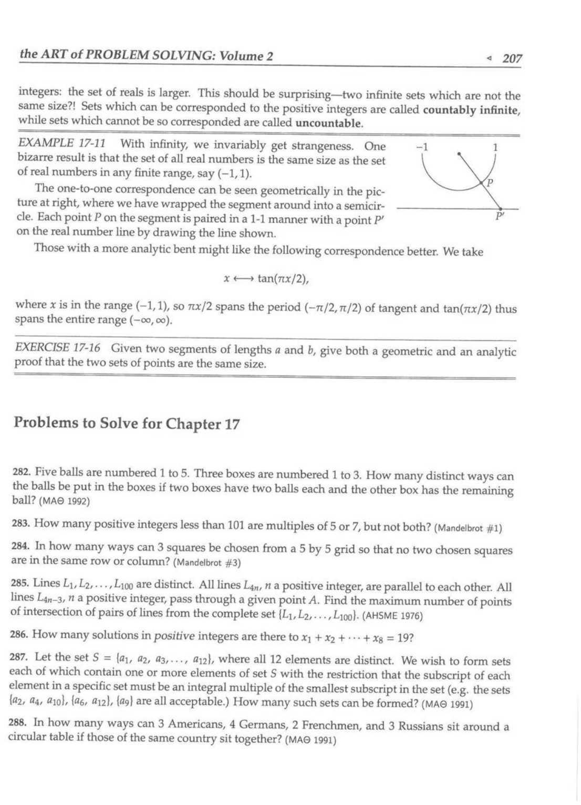

## Printed page 208

<!-- source: volume-2, PDF page 230, printed page 208 -->

289. On their return to land, the seven exiles from Gilligan’s Island, as well as Gilligan’s pet ape, are seated in a row for a welcome home meal. In how many ways can the eight be seated if Ginger is tactfully seated next to neither Gilligan nor his ape? (Mandelbrot #3)

290. Twenty chairs are set up in a row for the Princeton garlic-eating contest. Only five eaters attend the competition, but none will sit next to any other. In how many ways can the eaters be seated? (Mandelbrot #3)

Grid for Problem 291:

$$\begin{array}{rrrrr}
1&2&3&4&5\\10&9&8&7&6\\11&12&13&14&15\\20&19&18&17&16\\21&22&23&24&25\\30&29&28&27&26
\end{array}$$

291. Points in a grid are numbered as shown. Movements from point number $A$ to point number $B$ can only be made if $B > A$ and the two points are in the same row or column. Find the total number of ways to go from point 1 to point 30. (MAΘ 1992)

292. How many lines in a three-dimensional rectangular coordinate system pass through four distinct points of the form $(i, j, k)$, where $i, j, k$ are positive integers not exceeding four? (Can you generalize this to $i, j, k \leq n$?) (AHSME 1981)

293. Six people sat down along one side of a banquet table completely ignoring their name cards. In how many ways could this have been done so that no person was seated where his/her name card was placed? (MAΘ 1992)

294. Find generating functions for

i. the number of partitions of a number into even integers.

ii. the number of partitions of a number into different odd integers.

iii. the number of ways to give a dollar amount of change with standard U.S. bills (\$1, \$5, \$10, \$20, \$50, or \$100).

iv. the number of nonnegative integer solutions of $2x + 3y + 7z = n$ with $z < 4$.

295. When $(a + b + c + d)^{10}$ is expanded and like terms combined, how many terms are in the result? (MAΘ 1992)

296. For any set $S$, let $|S|$ denote the number of elements in $S$, and let $n(S)$ be the number of subsets of $S$, including the empty set and the set $S$ itself. If $A, B,$ and $C$ are sets for which

$$n(A) + n(B) + n(C) = n(A \cup B \cup C)$$ and $|A| = |B| = 100,$

then what is the minimum possible value of $|A \cap B \cap C|$? (AHSME 1991)

297. Suppose that 7 boys and 13 girls line up in a row. Let $S$ be the number of places in the row where a boy and a girl are standing next to each other. For example, for the row GBBGGGBGBGGGBGBGGBGG we have $S = 12$. If all possible orders of these 20 people are considered, what is the average value of $S$? Can you generalize this result to a group of $m$ boys and $n$ girls? (AHSME 1989)

298. Let $n$ be an even integer not less than 4. A cube with edge $n$ in length (briefly, an $n$-cube) is constructed from $n^3$ unit cubes (briefly, $u$-cubes). There are $\frac{n^3}{4}$ different colors given and exactly 4 $u$-cubes are colored in each of these given colors. Prove that one can choose $n u$-cubes of different colors, no two of which are in the same level (a level is a set of $n^2 u$-cubes whose centers lie in a plane

Original scan — PDF page 230

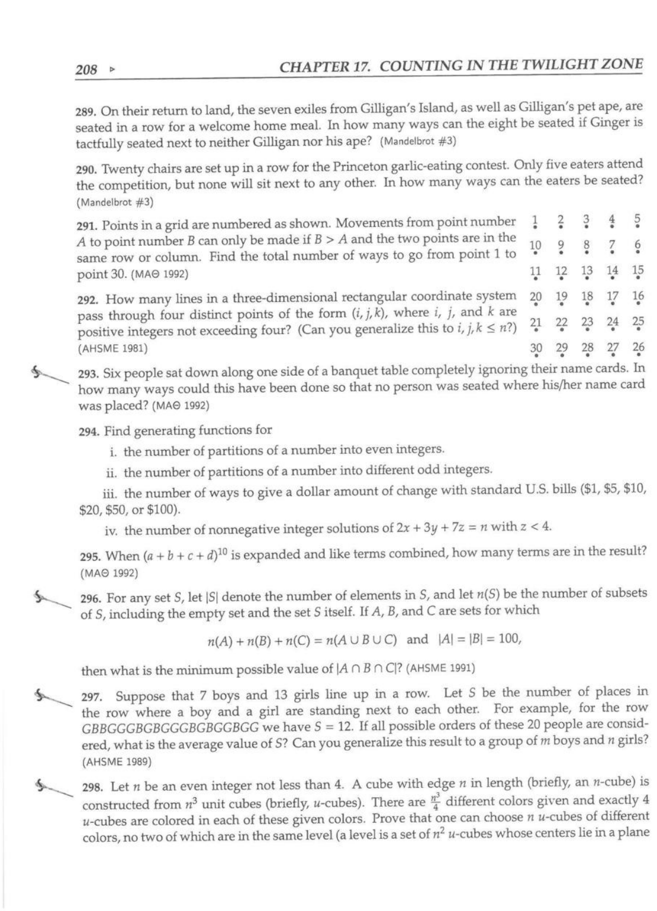

## Printed page 209

<!-- source: volume-2, PDF page 231, printed page 209 -->

parallel to one of the faces of the $n$ cube). (M&IQ 1991)

299. A walk consists of a sequence of steps of length 1 taken in directions north, south, east, or west. A walk is self-avoiding if it never passes through the same point twice. Let $f(n)$ denote the number of $n$-step self-avoiding walks which begin at the origin. Show that $2^n < f(n) \leq 4 \cdot 3^{n-1}$. (Canada 1979)

300. Let $n$ be a fixed positive integer. Find the sum of all positive integers with the following property: In base 2, it has exactly $2n$ digits consisting of $n$ 1's and $n$ 0's. (The first digit cannot be 0.) (Canada 1991)

Original scan — PDF page 231

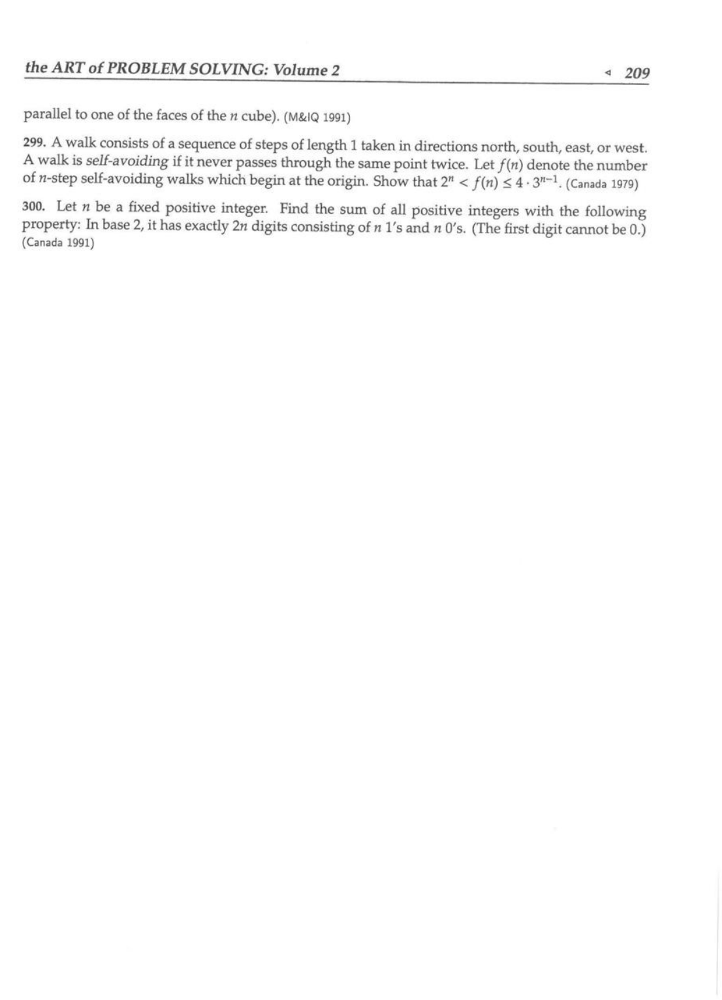

## Printed page 210

<!-- source: volume-2, PDF page 232, printed page 210 -->

Georg Cantor, who came up with the modern way of identifying infinite sets using 1-1 correspondences and discovered uncountable sets, discovered other weird things as well. One of the weirdest is the Cantor set. To construct a Cantor set we start with an ordinary segment and cut out the middle third. We then cut out the middle thirds of each subsegment which remains, leaving four smaller segments. We continue cutting out middle thirds forever, as shown.

We can compute the length of the Cantor set: at each step the length is multiplied by 2/3, so the final length is $(2/3)(2/3)(2/3)\cdots$, which tends to 0. But just because its length is 0 doesn't mean it contains no points! Consider our segment to be a number line from 0 to 1, where each decimal is written in base 3. In taking out the first middle third, we take out all decimals which start with 0.1..., leaving in those which start 0.0... or 0.2... Similarly, taking out the second middle third gets rid of those numbers which start 0.01... or 0.21..., leaving those which start 0.00..., 0.02..., 0.20..., or 0.22... Continuing in this manner, the Cantor set contains all numbers whose base-3 decimal representation contains no 1's. The set is far from being empty.

The Cantor set actually contains as many points as the entire line segment! We can set up the 1-1 correspondence as follows. Any number in the Cantor set has a decimal representation made up of 0's and 2's. Convert all the 2's to 1's and consider this new representation as a base-2 decimal representation. In this way, every number in the Cantor set corresponds to a number in $(0,1)$. Similarly, every number in $(0,1)$ corresponds to a number in the Cantor set, by doing the reverse process: write the decimal in base 2, convert 1's to 2's, and think of the new decimal as a base-3 representation. This is a one to one correspondence, so the sets of points are the same size.

So the Cantor set has length 0, but as many points as the entire segment $(0,1)$. (Think this one over a little before you buy it!)

Original scan — PDF page 232

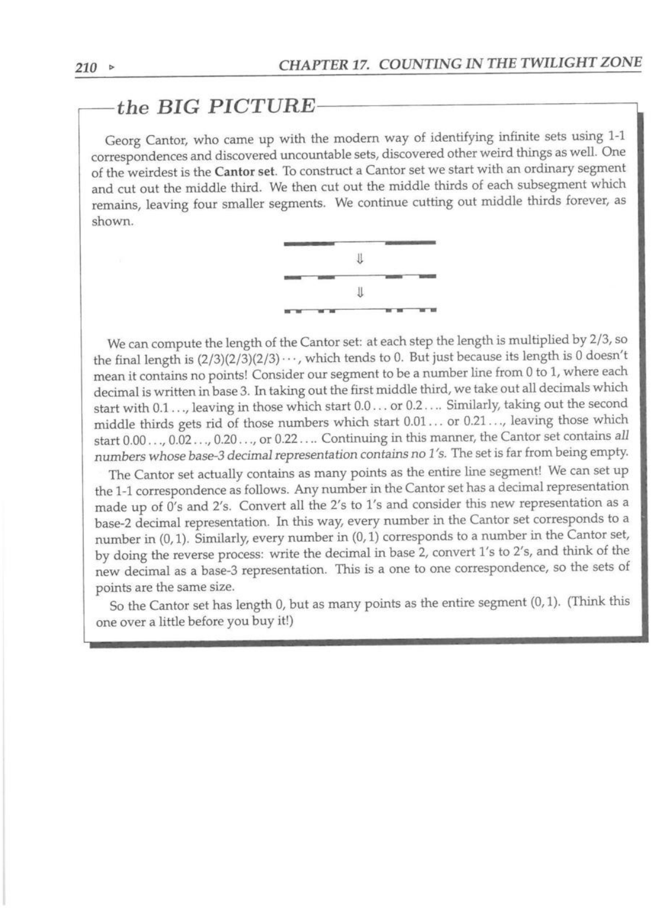

