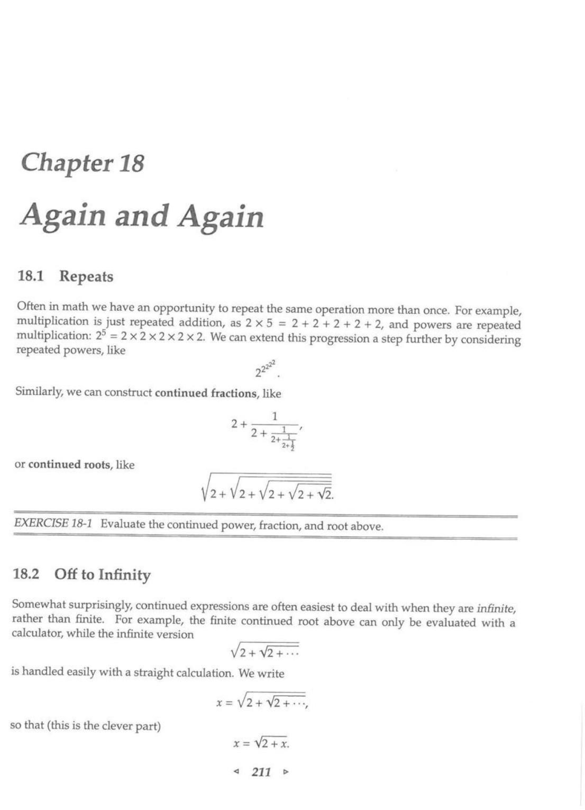
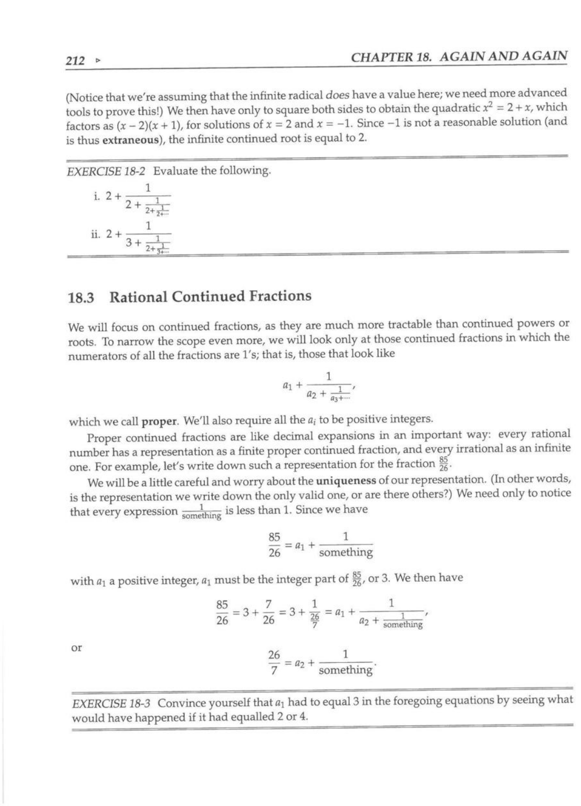
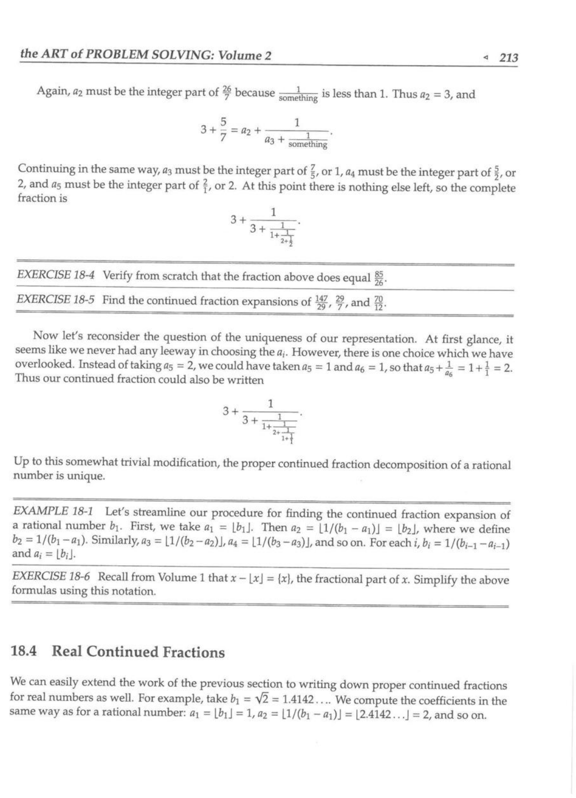
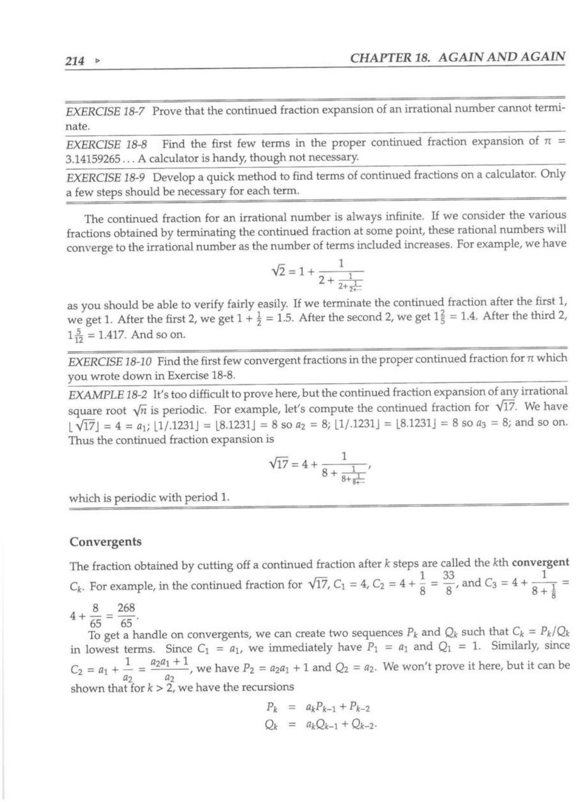
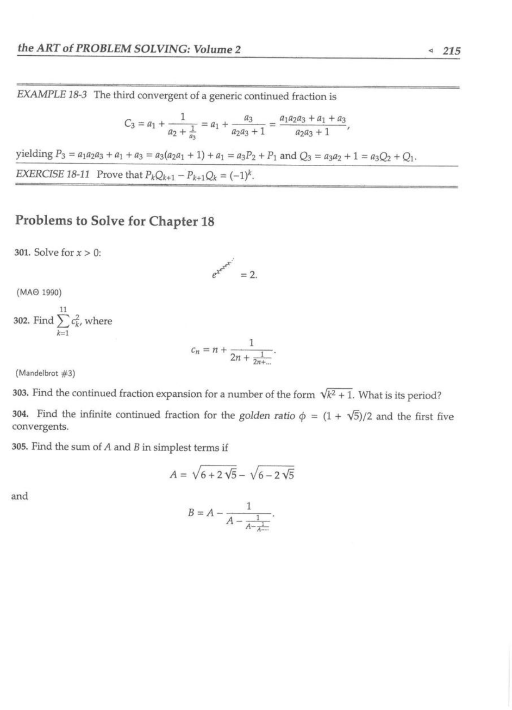

# Chapter 18: Again and Again

Volume 2 · Printed pages 211–215 · PDF pages 233–237

[Volume contents](../index.md)

## Printed page 211

<!-- source: volume-2, PDF page 233, printed page 211 -->

Chapter 18

Again and Again

### 18.1 Repeats

Often in math we have an opportunity to repeat the same operation more than once. For example, multiplication is just repeated addition, as $2 \times 5 = 2 + 2 + 2 + 2 + 2$, and powers are repeated multiplication: $2^5 = 2 \times 2 \times 2 \times 2 \times 2$. We can extend this progression a step further by considering repeated powers, like

$$2^{2^{2^{2^{2}}}}.$$

Similarly, we can construct continued fractions, like

$$2 + \frac{1}{2 + \frac{1}{2 + \frac{1}{2}}},$$

or continued roots, like

$$\sqrt{2 + \sqrt{2 + \sqrt{2 + \sqrt{2}}}}.$$

**EXERCISE 18-1 Evaluate the continued power, fraction, and root above.**

### 18.2 Off to Infinity

Somewhat surprisingly, continued expressions are often easiest to deal with when they are infinite, rather than finite. For example, the finite continued root above can only be evaluated with a calculator, while the infinite version

$$\sqrt{2 + \sqrt{2 + \cdots}}$$

is handled easily with a straight calculation. We write

$$x = \sqrt{2 + \sqrt{2 + \cdots}}$$

so that (this is the clever part)

$$x = \sqrt{2 + x}.$$

Original scan — PDF page 233

## Printed page 212

<!-- source: volume-2, PDF page 234, printed page 212 -->

(Notice that we’re assuming that the infinite radical does have a value here; we need more advanced tools to prove this!) We then have only to square both sides to obtain the quadratic $x^2 = 2 + x$, which factors as $(x - 2)(x + 1)$, for solutions of $x = 2$ and $x = -1$. Since $-1$ is not a reasonable solution (and is thus extraneous), the infinite continued root is equal to 2.

**EXERCISE 18-2 Evaluate the following.**

i. $2 + \frac{1}{2 + \frac{1}{2 + \cdots}}$
ii. $2 + \frac{1}{3 + \frac{1}{3 + \cdots}}$

### 18.3 Rational Continued Fractions

We will focus on continued fractions, as they are much more tractable than continued powers or roots. To narrow the scope even more, we will look only at those continued fractions in which the numerators of all the fractions are 1’s; that is, those that look like

$$a_1 + \frac{1}{a_2 + \frac{1}{a_3 + \cdots}}$$

which we call proper. We’ll also require all the $a_i$ to be positive integers.

Proper continued fractions are like decimal expansions in an important way: every rational number has a representation as a finite proper continued fraction, and every irrational as an infinite one. For example, let’s write down such a representation for the fraction $\frac{85}{26}$.

We will be a little careful and worry about the uniqueness of our representation. (In other words, is the representation we write down the only valid one, or are there others?) We need only to notice that every expression $\frac{1}{something}$ is less than 1. Since we have

$$\frac{85}{26} = a_1 + \frac{1}{something}$$

with $a_1$ a positive integer, $a_1$ must be the integer part of $\frac{85}{26}$, or 3. We then have

$$\frac{85}{26} = 3 + \frac{7}{26} = 3 + \frac{1}{26}$$

or

$$\frac{26}{7} = a_2 + \frac{1}{something}$$

**EXERCISE 18-3 Convince yourself that $a_1$ had to equal 3 in the foregoing equations by seeing what would have happened if it had equalled 2 or 4.**

Original scan — PDF page 234

## Printed page 213

<!-- source: volume-2, PDF page 235, printed page 213 -->

Again, $a_2$ must be the integer part of $\frac{26}{7}$ because $\frac{1}{something}$ is less than 1. Thus $a_2 = 3$, and

$$3 + \frac{5}{7} = a_2 + \frac{1}{a_3 + \frac{1}{something}}.$$

Continuing in the same way, $a_3$ must be the integer part of $\frac{7}{5}$, or 1, $a_4$ must be the integer part of $\frac{5}{2}$, or 2, and $a_5$ must be the integer part of $\frac{2}{1}$, or 2. At this point there is nothing else left, so the complete fraction is

$$3 + \frac{1}{3 + \frac{1}{1 + \frac{1}{2 + \frac{1}{2}}}}.$$

**EXERCISE 18-4** Verify from scratch that the fraction above does equal $\frac{85}{26}$.

**EXERCISE 18-5** Find the continued fraction expansions of $\frac{147}{29}$, $\frac{29}{7}$, and $\frac{70}{12}$.

Now let’s reconsider the question of the uniqueness of our representation. At first glance, it seems like we never had any leeway in choosing the $a_i$. However, there is one choice which we have overlooked. Instead of taking $a_5 = 2$, we could have taken $a_5 = 1$ and $a_6 = 1$, so that $a_5 + \frac{1}{a_6} = 1 + \frac{1}{1} = 2$. Thus our continued fraction could also be written

$$3 + \frac{1}{3 + \frac{1}{1 + \frac{1}{2 + \frac{1}{1 + \frac{1}{2}}}}}$$

Up to this somewhat trivial modification, the proper continued fraction decomposition of a rational number is unique.

**EXAMPLE 18-1** Let’s streamline our procedure for finding the continued fraction expansion of a rational number $b_1$. First, we take $a_1 = \lfloor b_1 \rfloor$. Then $a_2 = \lfloor 1/(b_1 - a_1) \rfloor = \lfloor b_2 \rfloor$, where we define $b_2 = 1/(b_1 - a_1)$. Similarly, $a_3 = \lfloor 1/(b_2 - a_2) \rfloor, a_4 = \lfloor 1/(b_3 - a_3) \rfloor$, and so on. For each $i, b_i = 1/(b_{i-1} - a_{i-1})$ and $a_i = \lfloor b_i \rfloor$.

**EXERCISE 18-6** Recall from Volume 1 that $x - \lfloor x \rfloor = \{x\}$, the fractional part of $x$. Simplify the above formulas using this notation.

### 18.4 Real Continued Fractions

We can easily extend the work of the previous section to writing down proper continued fractions for real numbers as well. For example, take $b_1 = \sqrt{2} = 1.4142 \ldots$. We compute the coefficients in the same way as for a rational number: $a_1 = \lfloor b_1 \rfloor = 1, a_2 = \lfloor 1/(b_1 - a_1) \rfloor = \lfloor 2.4142 \ldots \rfloor = 2$, and so on.

Original scan — PDF page 235

## Printed page 214

<!-- source: volume-2, PDF page 236, printed page 214 -->

**EXERCISE 18-7 Prove that the continued fraction expansion of an irrational number cannot terminate.**

**EXERCISE 18-8 Find the first few terms in the proper continued fraction expansion of $\pi = 3.14159265 \ldots$. A calculator is handy, though not necessary.**

**EXERCISE 18-9 Develop a quick method to find terms of continued fractions on a calculator. Only a few steps should be necessary for each term.**

The continued fraction for an irrational number is always infinite. If we consider the various fractions obtained by terminating the continued fraction at some point, these rational numbers will converge to the irrational number as the number of terms included increases. For example, we have

$$\sqrt{2} = 1 + \frac{1}{2 + \frac{1}{2 + \frac{1}{2 + \ldots}}}$$

as you should be able to verify fairly easily. If we terminate the continued fraction after the first 1, we get 1. After the first 2, we get $1 + \frac{1}{2} = 1.5$. After the second 2, we get $1\frac{2}{5} = 1.4$. After the third 2, $1\frac{5}{12} = 1.417$. And so on.

**EXERCISE 18-10 Find the first few convergent fractions in the proper continued fraction for $\pi$ which you wrote down in Exercise 18-8.**

**EXAMPLE 18-2 It's too difficult to prove here, but the continued fraction expansion of any irrational square root $\sqrt{n}$ is periodic. For example, let's compute the continued fraction for $\sqrt{17}$. We have $[\sqrt{17}] = 4 = a_1; [1/.1231] = [8.1231] = 8$ so $a_2 = 8; [1/.1231] = [8.1231] = 8$ so $a_3 = 8$; and so on. Thus the continued fraction expansion is**

$$\sqrt{17} = 4 + \frac{1}{8 + \frac{1}{8 + \ldots}}$$

which is periodic with period 1.

Convergents

The fraction obtained by cutting off a continued fraction after $k$ steps are called the $k$th convergent $C_k$. For example, in the continued fraction for $\sqrt{17}, C_1 = 4, C_2 = 4 + \frac{1}{8} = \frac{33}{8}$, and $C_3 = 4 + \frac{1}{8 + \frac{1}{8}} = 4 + \frac{8}{65} = \frac{268}{65}$.

To get a handle on convergents, we can create two sequences $P_k$ and $Q_k$ such that $C_k = P_k / Q_k$ in lowest terms. Since $C_1 = a_1$, we immediately have $P_1 = a_1$ and $Q_1 = 1$. Similarly, since $C_2 = a_1 + \frac{1}{a_2} = \frac{a_2 a_1 + 1}{a_2}$, we have $P_2 = a_2 a_1 + 1$ and $Q_2 = a_2$. We won't prove it here, but it can be shown that for $k > 2$, we have the recursions

$$P_k = a_k P_{k-1} + P_{k-2}$$

$$Q_k = a_k Q_{k-1} + Q_{k-2}.$$

Original scan — PDF page 236

## Printed page 215

<!-- source: volume-2, PDF page 237, printed page 215 -->

**EXAMPLE 18-3 The third convergent of a generic continued fraction is**

$$C_3 = a_1 + \frac{1}{a_2 + \frac{1}{a_3}} = a_1 + \frac{a_3}{a_2 a_3 + 1} = \frac{a_1 a_2 a_3 + a_1 + a_3}{a_2 a_3 + 1},$$

yielding $P_3 = a_1 a_2 a_3 + a_1 + a_3 = a_3 (a_2 a_1 + 1) + a_1 = a_3 P_2 + P_1$ and $Q_3 = a_3 a_2 + 1 = a_3 Q_2 + Q_1$.

**EXERCISE 18-11 Prove that $P_k Q_{k+1} - P_{k+1} Q_k = (-1)^k$.**

Problems to Solve for Chapter 18

302. Find $\sum_{k=1}^{11} c_k^2$, where

$$c_n = n + \frac{1}{2n + \frac{1}{2n+...}}.$$

(Mandelbrot #3)

303. Find the continued fraction expansion for a number of the form $\sqrt{k^2 + 1}$. What is its period?

304. Find the infinite continued fraction for the golden ratio $\phi = (1 + \sqrt{5})/2$ and the first five convergents.

305. Find the sum of $A$ and $B$ in simplest terms if

$$A = \sqrt{6 + 2\sqrt{5}} - \sqrt{6 - 2\sqrt{5}}$$

and

$$B = A - \frac{1}{A - \frac{1}{A - \frac{1}{A - \dots}}}.$$

Original scan — PDF page 237

