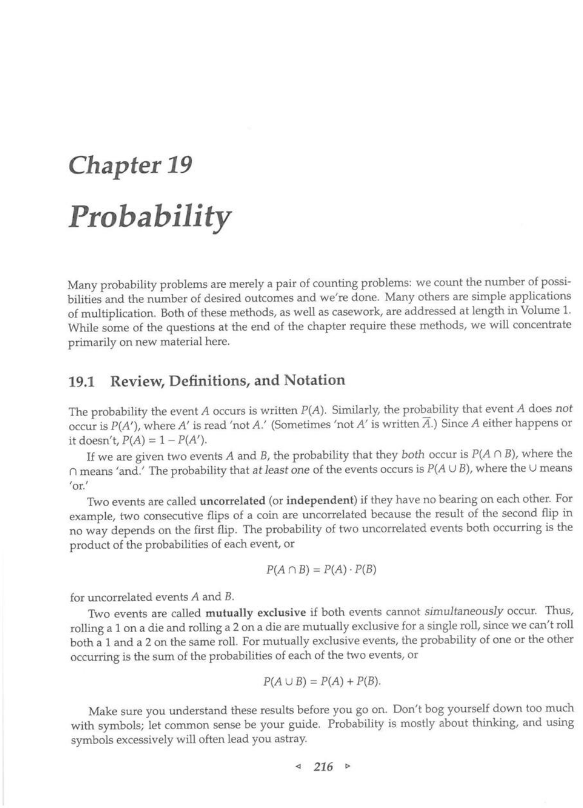
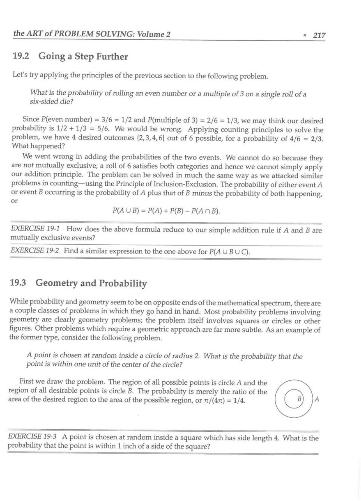
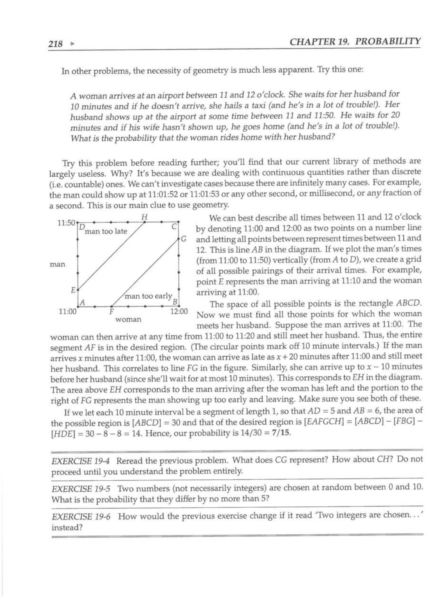
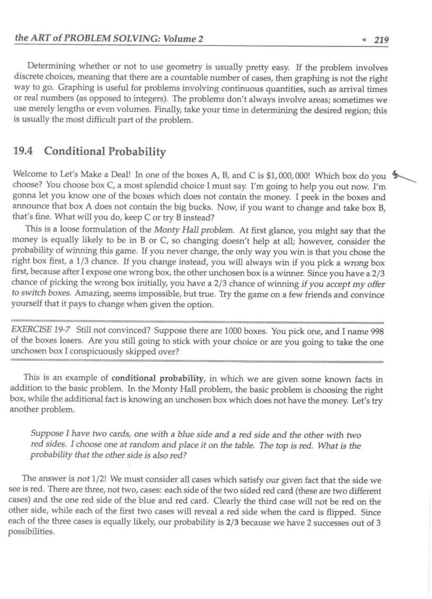
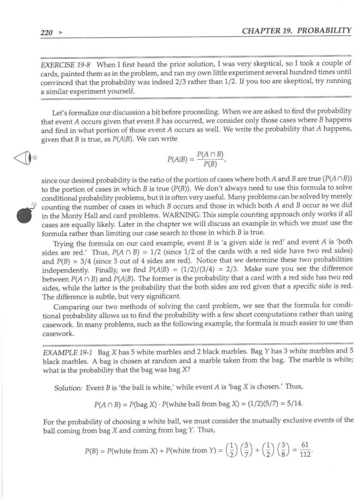
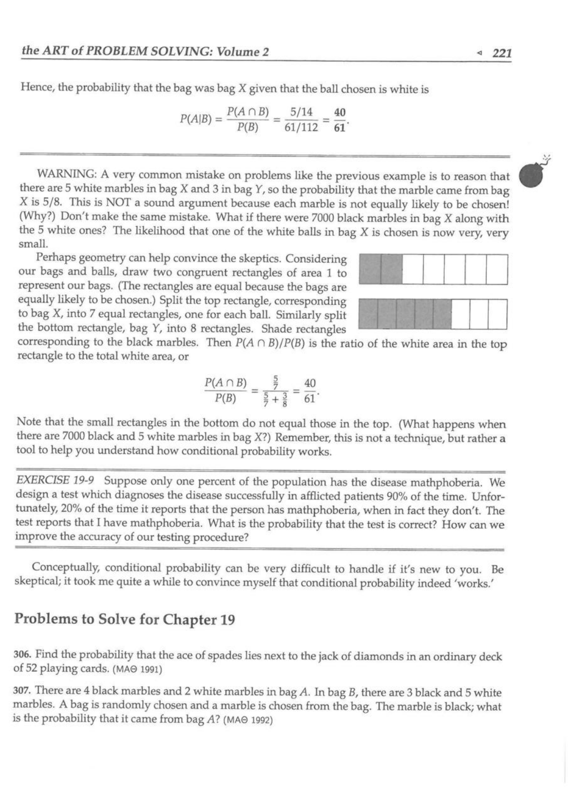
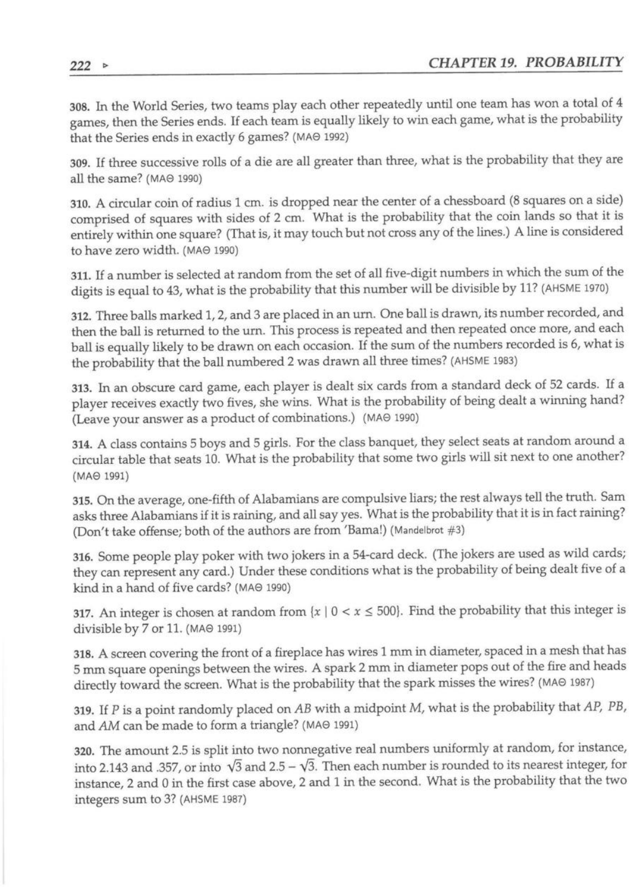
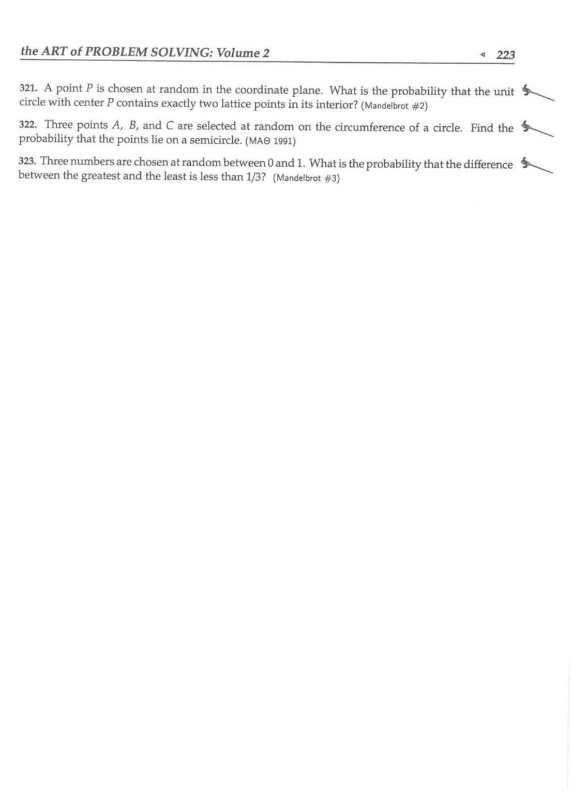

# Chapter 19: Probability

Volume 2 · Printed pages 216–223 · PDF pages 238–245

[Volume contents](../index.md)

## Printed page 216

<!-- source: volume-2, PDF page 238, printed page 216 -->

Chapter 19
Probability

Many probability problems are merely a pair of counting problems: we count the number of possibilities and the number of desired outcomes and we’re done. Many others are simple applications of multiplication. Both of these methods, as well as casework, are addressed at length in Volume 1. While some of the questions at the end of the chapter require these methods, we will concentrate primarily on new material here.

### 19.1 Review, Definitions, and Notation

The probability the event $A$ occurs is written $P(A)$. Similarly, the probability that event $A$ does not occur is $P(A')$, where $A'$ is read ‘not $A$.’ (Sometimes ‘not $A$’ is written $\bar{A}$.) Since $A$ either happens or it doesn’t, $P(A) = 1 - P(A')$.

If we are given two events $A$ and $B$, the probability that they both occur is $P(A \cap B)$, where the $\cap$ means ‘and.’ The probability that at least one of the events occurs is $P(A \cup B)$, where the $\cup$ means ‘or.’

Two events are called uncorrelated (or independent) if they have no bearing on each other. For example, two consecutive flips of a coin are uncorrelated because the result of the second flip in no way depends on the first flip. The probability of two uncorrelated events both occurring is the product of the probabilities of each event, or

$$P(A \cap B) = P(A) \cdot P(B)$$

for uncorrelated events $A$ and $B$.

Two events are called mutually exclusive if both events cannot simultaneously occur. Thus, rolling a 1 on a die and rolling a 2 on a die are mutually exclusive for a single roll, since we can’t roll both a 1 and a 2 on the same roll. For mutually exclusive events, the probability of one or the other occurring is the sum of the probabilities of each of the two events, or

$$P(A \cup B) = P(A) + P(B).$$

Make sure you understand these results before you go on. Don’t bog yourself down too much with symbols; let common sense be your guide. Probability is mostly about thinking, and using symbols excessively will often lead you astray.

Original scan — PDF page 238

## Printed page 217

<!-- source: volume-2, PDF page 239, printed page 217 -->

### 19.2 Going a Step Further

<!-- Heading restored for navigation from independently recognised source heading. -->

Let's try applying the principles of the previous section to the following problem.

What is the probability of rolling an even number or a multiple of 3 on a single roll of a six-sided die?

Since $P(\text{even number}) = \frac{3}{6} = \frac{1}{2}$ and $P(\text{multiple of 3}) = \frac{2}{6} = \frac{1}{3}$, we may think our desired probability is $\frac{1}{2} + \frac{1}{3} = \frac{5}{6}$. We would be wrong. Applying counting principles to solve the problem, we have 4 desired outcomes $\{2, 3, 4, 6\}$ out of 6 possible, for a probability of $\frac{4}{6} = \frac{2}{3}$. What happened?

We went wrong in adding the probabilities of the two events. We cannot do so because they are not mutually exclusive; a roll of 6 satisfies both categories and hence we cannot simply apply our addition principle. The problem can be solved in much the same way as we attacked similar problems in counting—using the Principle of Inclusion-Exclusion. The probability of either event $A$ or event $B$ occurring is the probability of $A$ plus that of $B$ minus the probability of both happening, or

$$P(A \cup B) = P(A) + P(B) - P(A \cap B).$$

**EXERCISE 19-1 How does the above formula reduce to our simple addition rule if $A$ and $B$ are mutually exclusive events?**

**EXERCISE 19-2 Find a similar expression to the one above for $P(A \cup B \cup C).$**

### 19.3 Geometry and Probability

While probability and geometry seem to be on opposite ends of the mathematical spectrum, there are a couple classes of problems in which they go hand in hand. Most probability problems involving geometry are clearly geometry problems; the problem itself involves squares or circles or other figures. Other problems which require a geometric approach are far more subtle. As an example of the former type, consider the following problem.

A point is chosen at random inside a circle of radius 2. What is the probability that the point is within one unit of the center of the circle?

First we draw the problem. The region of all possible points is circle $A$ and the region of all desirable points is circle $B$. The probability is merely the ratio of the area of the desired region to the area of the possible region, or $\pi/(4\pi) = \frac{1}{4}$.

**EXERCISE 19-3 A point is chosen at random inside a square which has side length 4. What is the probability that the point is within 1 inch of a side of the square?**

Original scan — PDF page 239

## Printed page 218

<!-- source: volume-2, PDF page 240, printed page 218 -->

In other problems, the necessity of geometry is much less apparent. Try this one:

A woman arrives at an airport between 11 and 12 o'clock. She waits for her husband for 10 minutes and if he doesn't arrive, she hails a taxi (and he's in a lot of trouble!). Her husband shows up at the airport at some time between 11 and 11:50. He waits for 20 minutes and if his wife hasn't shown up, he goes home (and he's in a lot of trouble!). What is the probability that the woman rides home with her husband?

Try this problem before reading further; you'll find that our current library of methods are largely useless. Why? It's because we are dealing with continuous quantities rather than discrete (i.e. countable) ones. We can't investigate cases because there are infinitely many cases. For example, the man could show up at 11:01:52 or 11:01:53 or any other second, or millisecond, or any fraction of a second. This is our main clue to use geometry.

We can best describe all times between 11 and 12 o'clock by denoting 11:00 and 12:00 as two points on a number line and letting all points between represent times between 11 and 12. This is line AB in the diagram. If we plot the man's times (from 11:00 to 11:50) vertically (from A to D), we create a grid of all possible pairings of their arrival times. For example, point E represents the man arriving at 11:10 and the woman arriving at 11:00.

The space of all possible points is the rectangle ABCD. Now we must find all those points for which the woman meets her husband. Suppose the man arrives at 11:00. The woman can then arrive at any time from 11:00 to 11:20 and still meet her husband. Thus, the entire segment AF is in the desired region. (The circular points mark off 10 minute intervals.) If the man arrives x minutes after 11:00, the woman can arrive as late as x + 20 minutes after 11:00 and still meet her husband. This correlates to line FG in the figure. Similarly, she can arrive up to x - 10 minutes before her husband (since she'll wait for at most 10 minutes). This corresponds to EH in the diagram. The area above EH corresponds to the man arriving after the woman has left and the portion to the right of FG represents the man showing up too early and leaving. Make sure you see both of these.

If we let each 10 minute interval be a segment of length 1, so that AD = 5 and AB = 6, the area of the possible region is $[ABCD] = 30$ and that of the desired region is $[EAFGCH] = [ABCD] - [FBG] - [HDE] = 30 - 8 - 8 = 14$. Hence, our probability is $14/30 = 7/15$.

**EXERCISE 19-4** Reread the previous problem. What does CG represent? How about CH? Do not proceed until you understand the problem entirely.

**EXERCISE 19-5** Two numbers (not necessarily integers) are chosen at random between 0 and 10. What is the probability that they differ by no more than 5?

**EXERCISE 19-6** How would the previous exercise change if it read 'Two integers are chosen...' instead?

Original scan — PDF page 240

## Printed page 219

<!-- source: volume-2, PDF page 241, printed page 219 -->

Determining whether or not to use geometry is usually pretty easy. If the problem involves discrete choices, meaning that there are a countable number of cases, then graphing is not the right way to go. Graphing is useful for problems involving continuous quantities, such as arrival times or real numbers (as opposed to integers). The problems don't always involve areas; sometimes we use merely lengths or even volumes. Finally, take your time in determining the desired region; this is usually the most difficult part of the problem.

### 19.4 Conditional Probability

Welcome to Let's Make a Deal! In one of the boxes A, B, and C is \$1,000,000! Which box do you choose? You choose box C, a most splendid choice I must say. I'm going to help you out now. I'm gonna let you know one of the boxes which does not contain the money. I peek in the boxes and announce that box A does not contain the big bucks. Now, if you want to change and take box B, that's fine. What will you do, keep C or try B instead?

This is a loose formulation of the Monty Hall problem. At first glance, you might say that the money is equally likely to be in B or C, so changing doesn't help at all; however, consider the probability of winning this game. If you never change, the only way you win is that you chose the right box first, a 1/3 chance. If you change instead, you will always win if you pick a wrong box first, because after I expose one wrong box, the other unchosen box is a winner. Since you have a 2/3 chance of picking the wrong box initially, you have a 2/3 chance of winning if you accept my offer to switch boxes. Amazing, seems impossible, but true. Try the game on a few friends and convince yourself that it pays to change when given the option.

**EXERCISE 19-7 Still not convinced? Suppose there are 1000 boxes. You pick one, and I name 998 of the boxes losers. Are you still going to stick with your choice or are you going to take the one unchosen box I conspicuously skipped over?**

This is an example of conditional probability, in which we are given some known facts in addition to the basic problem. In the Monty Hall problem, the basic problem is choosing the right box, while the additional fact is knowing an unchosen box which does not have the money. Let's try another problem.

Suppose I have two cards, one with a blue side and a red side and the other with two red sides. I choose one at random and place it on the table. The top is red. What is the probability that the other side is also red?

The answer is not 1/2! We must consider all cases which satisfy our given fact that the side we see is red. There are three, not two, cases: each side of the two sided red card (these are two different cases) and the one red side of the blue and red card. Clearly the third case will not be red on the other side, while each of the first two cases will reveal a red side when the card is flipped. Since each of the three cases is equally likely, our probability is 2/3 because we have 2 successes out of 3 possibilities.

Original scan — PDF page 241

## Printed page 220

<!-- source: volume-2, PDF page 242, printed page 220 -->

**EXERCISE 19-8** When I first heard the prior solution, I was very skeptical, so I took a couple of cards, painted them as in the problem, and ran my own little experiment several hundred times until convinced that the probability was indeed 2/3 rather than 1/2. If you too are skeptical, try running a similar experiment yourself.

Let’s formalize our discussion a bit before proceeding. When we are asked to find the probability that event $A$ occurs given that event $B$ has occurred, we consider only those cases where $B$ happens and find in what portion of those event $A$ occurs as well. We write the probability that $A$ happens, given that $B$ is true, as $P(A|B)$. We can write

$$P(A|B) = \frac{P(A \cap B)}{P(B)},$$

since our desired probability is the ratio of the portion of cases where both $A$ and $B$ are true ($P(A \cap B)$) to the portion of cases in which $B$ is true ($P(B)$). We don’t always need to use this formula to solve conditional probability problems, but it is often very useful. Many problems can be solved by merely counting the number of cases in which $B$ occurs and those in which both $A$ and $B$ occur as we did in the Monty Hall and card problems. WARNING: This simple counting approach only works if all cases are equally likely. Later in the chapter we will discuss an example in which we must use the formula rather than limiting our case search to those in which $B$ is true.

Trying the formula on our card example, event $B$ is ‘a given side is red’ and event $A$ is ‘both sides are red.’ Thus, $P(A \cap B) = 1/2$ (since 1/2 of the cards with a red side have two red sides) and $P(B) = 3/4$ (since 3 out of 4 sides are red). Notice that we determine these two probabilities independently. Finally, we find $P(A|B) = (1/2)/(3/4) = 2/3$. Make sure you see the difference between $P(A \cap B)$ and $P(A|B)$. The former is the probability that a card with a red side has two red sides, while the latter is the probability that the both sides are red given that a specific side is red. The difference is subtle, but very significant.

Comparing our two methods of solving the card problem, we see that the formula for conditional probability allows us to find the probability with a few short computations rather than using casework. In many problems, such as the following example, the formula is much easier to use than casework.

**EXAMPLE 19-1 Bag $X$ has 5 white marbles and 2 black marbles. Bag $Y$ has 3 white marbles and 5 black marbles. A bag is chosen at random and a marble taken from the bag. The marble is white; what is the probability that the bag was bag $X$?**

Solution: Event $B$ is ‘the ball is white,’ while event $A$ is ‘bag $X$ is chosen.’ Thus,

$$P(A \cap B) = P(\text{bag } X) \cdot P(\text{white ball from bag } X) = (1/2)(5/7) = 5/14.$$

For the probability of choosing a white ball, we must consider the mutually exclusive events of the ball coming from bag $X$ and coming from bag $Y$. Thus,

$$P(B) = P(\text{white from } X) + P(\text{white from } Y) = \left(\frac{1}{2}\right)\left(\frac{5}{7}\right) + \left(\frac{1}{2}\right)\left(\frac{3}{8}\right) = \frac{61}{112}.$$

Original scan — PDF page 242

## Printed page 221

<!-- source: volume-2, PDF page 243, printed page 221 -->

Hence, the probability that the bag was bag $X$ given that the ball chosen is white is

$$P(A|B) = \frac{P(A \cap B)}{P(B)} = \frac{5/14}{61/112} = \frac{40}{61}.$$

WARNING: A very common mistake on problems like the previous example is to reason that there are 5 white marbles in bag $X$ and 3 in bag $Y$, so the probability that the marble came from bag $X$ is 5/8. This is NOT a sound argument because each marble is not equally likely to be chosen! (Why?) Don’t make the same mistake. What if there were 7000 black marbles in bag $X$ along with the 5 white ones? The likelihood that one of the white balls in bag $X$ is chosen is now very, very small.

Perhaps geometry can help convince the skeptics. Considering our bags and balls, draw two congruent rectangles of area 1 to represent our bags. (The rectangles are equal because the bags are equally likely to be chosen.) Split the top rectangle, corresponding to bag $X$, into 7 equal rectangles, one for each ball. Similarly split the bottom rectangle, bag $Y$, into 8 rectangles. Shade rectangles corresponding to the black marbles. Then $P(A \cap B)/P(B)$ is the ratio of the white area in the top rectangle to the total white area, or

$$\frac{P(A \cap B)}{P(B)} = \frac{\frac{5}{7}}{\frac{5}{7} + \frac{3}{8}} = \frac{40}{61}.$$

Note that the small rectangles in the bottom do not equal those in the top. (What happens when there are 7000 black and 5 white marbles in bag $X$?) Remember, this is not a technique, but rather a tool to help you understand how conditional probability works.

**EXERCISE 19-9 Suppose only one percent of the population has the disease mathphobia. We design a test which diagnoses the disease successfully in afflicted patients 90% of the time. Unfortunately, 20% of the time it reports that the person has mathphobia, when in fact they don’t. The test reports that I have mathphobia. What is the probability that the test is correct? How can we improve the accuracy of our testing procedure?**

Conceptually, conditional probability can be very difficult to handle if it’s new to you. Be skeptical; it took me quite a while to convince myself that conditional probability indeed ‘works.’

Problems to Solve for Chapter 19

306. Find the probability that the ace of spades lies next to the jack of diamonds in an ordinary deck of 52 playing cards. (MAΘ 1991)

307. There are 4 black marbles and 2 white marbles in bag $A$. In bag $B$, there are 3 black and 5 white marbles. A bag is randomly chosen and a marble is chosen from the bag. The marble is black; what is the probability that it came from bag $A$? (MAΘ 1992)

Original scan — PDF page 243

## Printed page 222

<!-- source: volume-2, PDF page 244, printed page 222 -->

308. In the World Series, two teams play each other repeatedly until one team has won a total of 4 games, then the Series ends. If each team is equally likely to win each game, what is the probability that the Series ends in exactly 6 games? (MAΘ 1992)

309. If three successive rolls of a die are all greater than three, what is the probability that they are all the same? (MAΘ 1990)

310. A circular coin of radius 1 cm. is dropped near the center of a chessboard (8 squares on a side) comprised of squares with sides of 2 cm. What is the probability that the coin lands so that it is entirely within one square? (That is, it may touch but not cross any of the lines.) A line is considered to have zero width. (MAΘ 1990)

311. If a number is selected at random from the set of all five-digit numbers in which the sum of the digits is equal to 43, what is the probability that this number will be divisible by 11? (AHSME 1970)

312. Three balls marked 1, 2, and 3 are placed in an urn. One ball is drawn, its number recorded, and then the ball is returned to the urn. This process is repeated and then repeated once more, and each ball is equally likely to be drawn on each occasion. If the sum of the numbers recorded is 6, what is the probability that the ball numbered 2 was drawn all three times? (AHSME 1983)

313. In an obscure card game, each player is dealt six cards from a standard deck of 52 cards. If a player receives exactly two fives, she wins. What is the probability of being dealt a winning hand? (Leave your answer as a product of combinations.) (MAΘ 1990)

314. A class contains 5 boys and 5 girls. For the class banquet, they select seats at random around a circular table that seats 10. What is the probability that some two girls will sit next to one another? (MAΘ 1991)

315. On the average, one-fifth of Alabamians are compulsive liars; the rest always tell the truth. Sam asks three Alabamians if it is raining, and all say yes. What is the probability that it is in fact raining? (Don’t take offense; both of the authors are from ‘Bama!) (Mandelbrot #3)

316. Some people play poker with two jokers in a 54-card deck. (The jokers are used as wild cards; they can represent any card.) Under these conditions what is the probability of being dealt five of a kind in a hand of five cards? (MAΘ 1990)

317. An integer is chosen at random from $\{x \mid 0 < x \leq 500\}$. Find the probability that this integer is divisible by 7 or 11. (MAΘ 1991)

318. A screen covering the front of a fireplace has wires 1 mm in diameter, spaced in a mesh that has 5 mm square openings between the wires. A spark 2 mm in diameter pops out of the fire and heads directly toward the screen. What is the probability that the spark misses the wires? (MAΘ 1987)

319. If $P$ is a point randomly placed on $AB$ with a midpoint $M$, what is the probability that $AP, PB,$ and $AM$ can be made to form a triangle? (MAΘ 1991)

320. The amount 2.5 is split into two nonnegative real numbers uniformly at random, for instance, into 2.143 and .357, or $\sqrt{3}$ and $2.5 - \sqrt{3}$. Then each number is rounded to its nearest integer, for instance, 2 and 0 in the first case above, 2 and 1 in the second. What is the probability that the two integers sum to 3? (AHSME 1987)

Original scan — PDF page 244

## Printed page 223

<!-- source: volume-2, PDF page 245, printed page 223 -->

321. A point $P$ is chosen at random in the coordinate plane. What is the probability that the unit circle with center $P$ contains exactly two lattice points in its interior? (Mandelbrot #2)

322. Three points $A, B,$ and $C$ are selected at random on the circumference of a circle. Find the probability that the points lie on a semicircle. (MAΘ 1991)

323. Three numbers are chosen at random between 0 and 1. What is the probability that the difference between the greatest and the least is less than $1/3$? (Mandelbrot #3)

Original scan — PDF page 245

