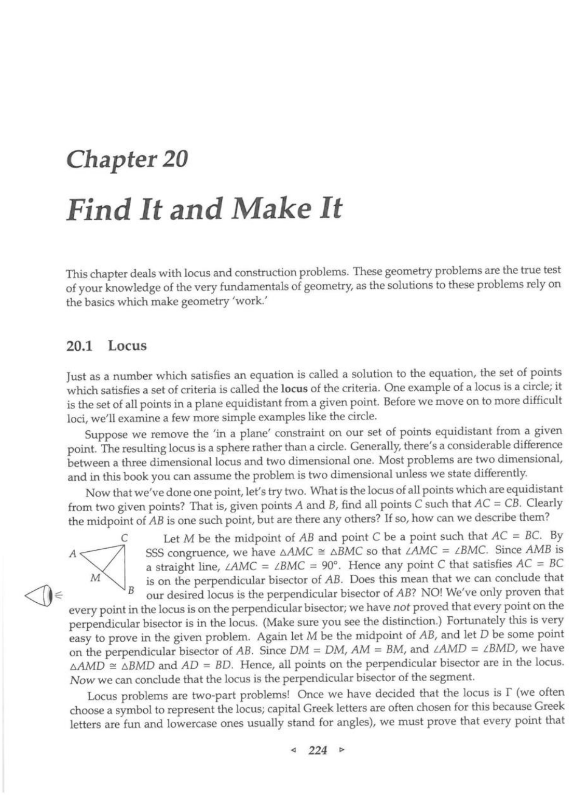
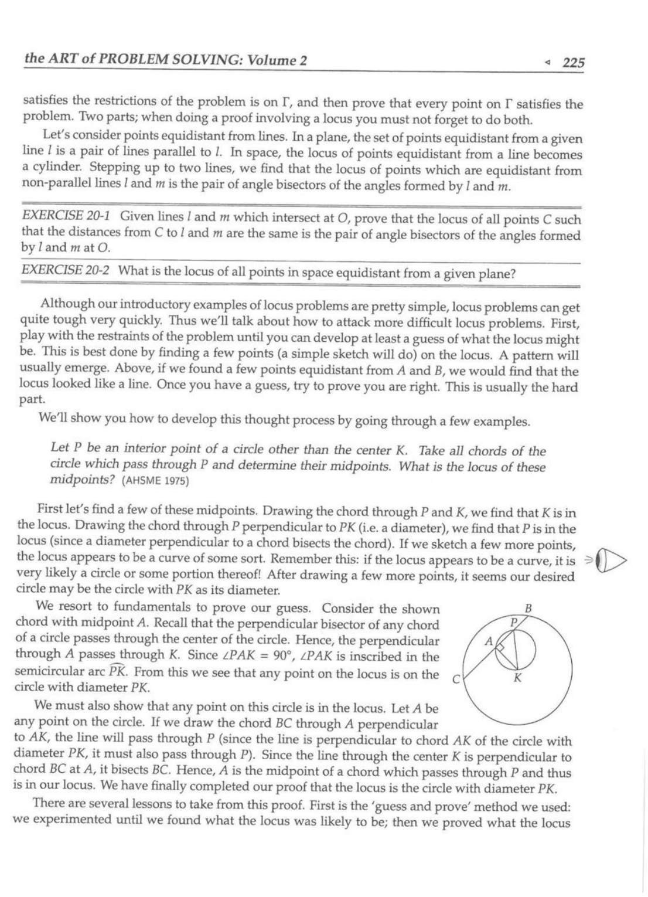
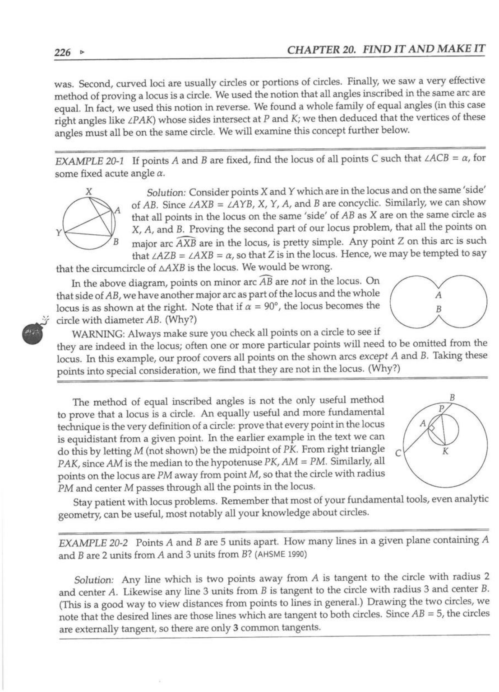
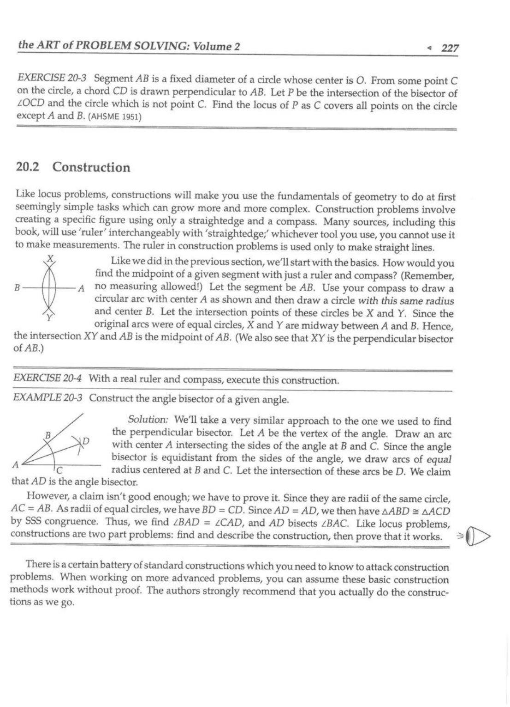
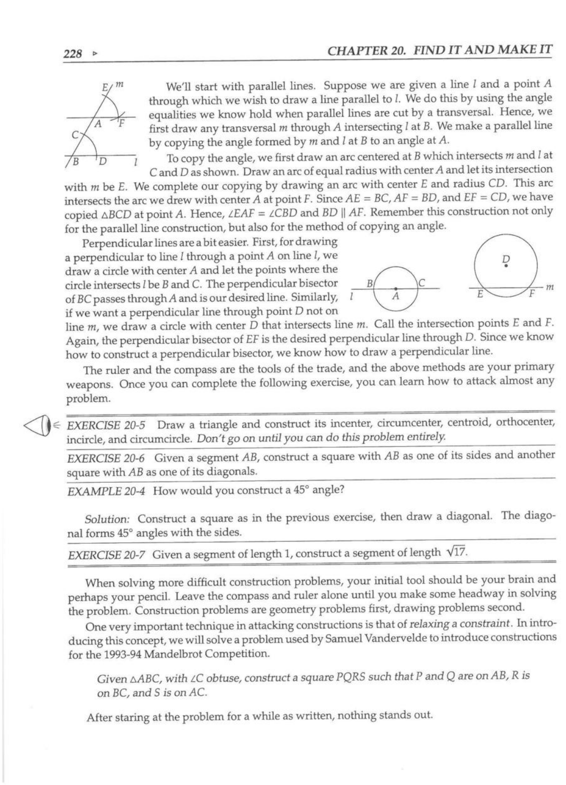
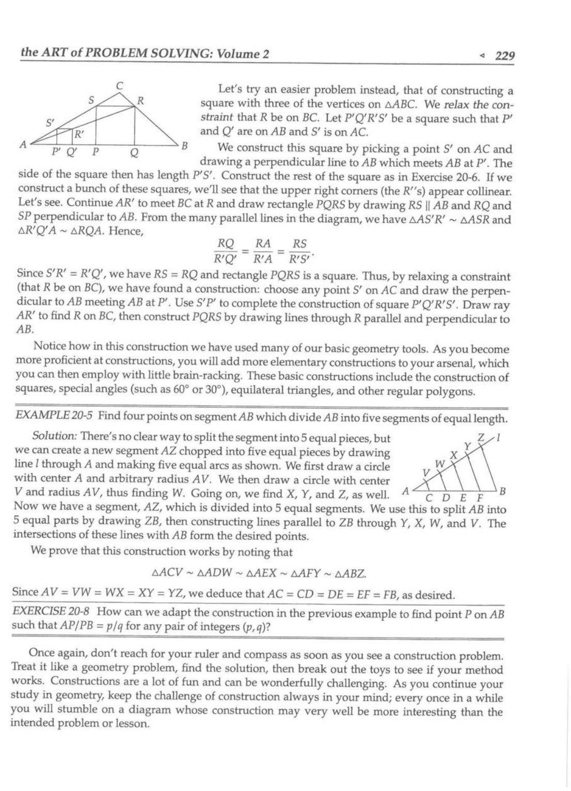
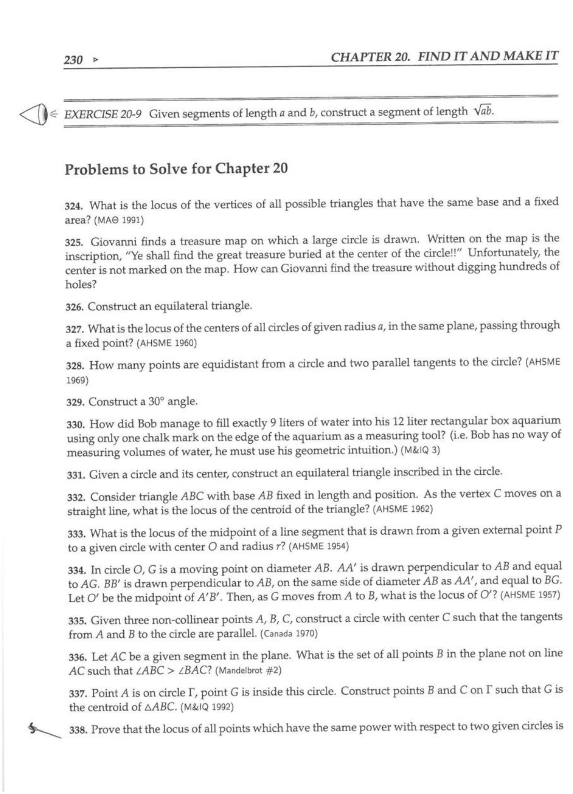
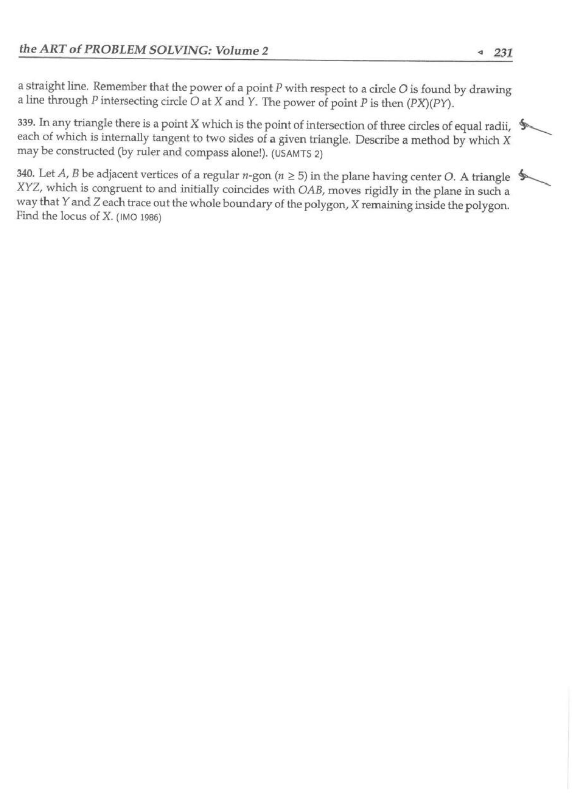
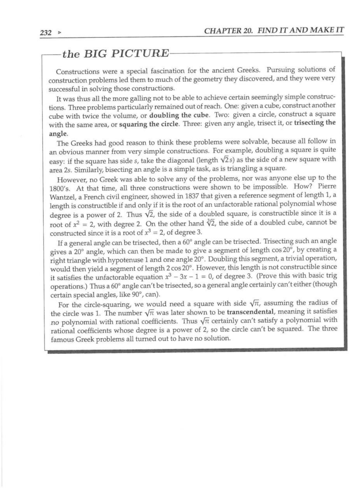

# Chapter 20: Find It and Make It

Volume 2 · Printed pages 224–232 · PDF pages 246–254

[Volume contents](../index.md)

## Printed page 224

<!-- source: volume-2, PDF page 246, printed page 224 -->

This chapter deals with locus and construction problems. These geometry problems are the true test of your knowledge of the very fundamentals of geometry, as the solutions to these problems rely on the basics which make geometry 'work.'

### 20.1 Locus

Just as a number which satisfies an equation is called a solution to the equation, the set of points which satisfies a set of criteria is called the locus of the criteria. One example of a locus is a circle; it is the set of all points in a plane equidistant from a given point. Before we move on to more difficult loci, we'll examine a few more simple examples like the circle.

Suppose we remove the 'in a plane' constraint on our set of points equidistant from a given point. The resulting locus is a sphere rather than a circle. Generally, there's a considerable difference between a three dimensional locus and two dimensional one. Most problems are two dimensional, and in this book you can assume the problem is two dimensional unless we state differently.

Now that we've done one point, let's try two. What is the locus of all points which are equidistant from two given points? That is, given points $A$ and $B$, find all points $C$ such that $AC = CB$. Clearly the midpoint of $AB$ is one such point, but are there any others? If so, how can we describe them?

Let $M$ be the midpoint of $AB$ and point $C$ be a point such that $AC = BC$. By SSS congruence, we have $\Delta AMC \cong \Delta BMC$ so that $\angle AMC = \angle BMC$. Since AMB is a straight line, $\angle AMC = \angle BMC = 90^\circ$. Hence any point $C$ that satisfies $AC = BC$ is on the perpendicular bisector of $AB$. Does this mean that we can conclude that our desired locus is the perpendicular bisector of $AB$? NO! We've only proven that every point in the locus is on the perpendicular bisector; we have not proved that every point on the perpendicular bisector is in the locus. (Make sure you see the distinction.) Fortunately this is very easy to prove in the given problem. Again let $M$ be the midpoint of $AB$, and let $D$ be some point on the perpendicular bisector of $AB$. Since $DM = DM$, $AM = BM$, and $\angle AMD = \angle BMD$, we have $\Delta AMD \cong \Delta BMD$ and $AD = BD$. Hence, all points on the perpendicular bisector are in the locus. Now we can conclude that the locus is the perpendicular bisector of the segment.

Locus problems are two-part problems! Once we have decided that the locus is $\Gamma$ (we often choose a symbol to represent the locus; capital Greek letters are often chosen for this because Greek letters are fun and lowercase ones usually stand for angles), we must prove that every point that

Original scan — PDF page 246

## Printed page 225

<!-- source: volume-2, PDF page 247, printed page 225 -->

satisfies the restrictions of the problem is on $\Gamma$, and then prove that every point on $\Gamma$ satisfies the problem. Two parts; when doing a proof involving a locus you must not forget to do both.

Let's consider points equidistant from lines. In a plane, the set of points equidistant from a given line $l$ is a pair of lines parallel to $l$. In space, the locus of points equidistant from a line becomes a cylinder. Stepping up to two lines, we find that the locus of points which are equidistant from non-parallel lines $l$ and $m$ is the pair of angle bisectors of the angles formed by $l$ and $m$.

**EXERCISE 20-1** Given lines $l$ and $m$ which intersect at $O$, prove that the locus of all points $C$ such that the distances from $C$ to $l$ and $m$ are the same is the pair of angle bisectors of the angles formed by $l$ and $m$ at $O$.

**EXERCISE 20-2** What is the locus of all points in space equidistant from a given plane?

Although our introductory examples of locus problems are pretty simple, locus problems can get quite tough very quickly. Thus we'll talk about how to attack more difficult locus problems. First, play with the restraints of the problem until you can develop at least a guess of what the locus might be. This is best done by finding a few points (a simple sketch will do) on the locus. A pattern will usually emerge. Above, if we found a few points equidistant from $A$ and $B$, we would find that the locus looked like a line. Once you have a guess, try to prove you are right. This is usually the hard part.

We'll show you how to develop this thought process by going through a few examples.

Let $P$ be an interior point of a circle other than the center $K$. Take all chords of the circle which pass through $P$ and determine their midpoints. What is the locus of these midpoints? (AHSME 1975)

First let's find a few of these midpoints. Drawing the chord through $P$ and $K$, we find that $K$ is in the locus. Drawing the chord through $P$ perpendicular to $PK$ (i.e. a diameter), we find that $P$ is in the locus (since a diameter perpendicular to a chord bisects the chord). If we sketch a few more points, the locus appears to be a curve of some sort. Remember this: if the locus appears to be a curve, it is very likely a circle or some portion thereof! After drawing a few more points, it seems our desired circle may be the circle with $PK$ as its diameter.

We resort to fundamentals to prove our guess. Consider the shown chord with midpoint $A$. Recall that the perpendicular bisector of any chord of a circle passes through the center of the circle. Hence, the perpendicular through $A$ passes through $K$. Since $\angle PAK = 90^\circ$, $\angle PAK$ is inscribed in the semicircular arc $\widehat{PK}$. From this we see that any point on the locus is on the circle with diameter $PK$.

We must also show that any point on this circle is in the locus. Let $A$ be any point on the circle. If we draw the chord $BC$ through $A$ perpendicular to $AK$, the line will pass through $P$ (since the line is perpendicular to chord $AK$ of the circle with diameter $PK$, it must also pass through $P$). Since the line through the center $K$ is perpendicular to chord $BC$ at $A$, it bisects $BC$. Hence, $A$ is the midpoint of a chord which passes through $P$ and thus is in our locus. We have finally completed our proof that the locus is the circle with diameter $PK$.

There are several lessons to take from this proof. First is the 'guess and prove' method we used: we experimented until we found what the locus was likely to be; then we proved what the locus

Original scan — PDF page 247

## Printed page 226

<!-- source: volume-2, PDF page 248, printed page 226 -->

was. Second, curved loci are usually circles or portions of circles. Finally, we saw a very effective method of proving a locus is a circle. We used the notion that all angles inscribed in the same arc are equal. In fact, we used this notion in reverse. We found a whole family of equal angles (in this case right angles like $\angle PAK$) whose sides intersect at $P$ and $K$; we then deduced that the vertices of these angles must all be on the same circle. We will examine this concept further below.

**EXAMPLE 20-1** If points $A$ and $B$ are fixed, find the locus of all points $C$ such that $\angle ACB = \alpha$, for some fixed acute angle $\alpha$.

**Solution:** Consider points $X$ and $Y$ which are in the locus and on the same 'side' of $AB$. Since $\angle AXB = \angle AYB$, $X, Y, A$, and $B$ are concyclic. Similarly, we can show that all points in the locus on the same 'side' of $AB$ as $X$ are on the same circle as $X, A$, and $B$. Proving the second part of our locus problem, that all the points on major arc $\widehat{AXB}$ are in the locus, is pretty simple. Any point $Z$ on this arc is such that $\angle AZB = \angle AXB = \alpha$, so that $Z$ is in the locus. Hence, we may be tempted to say that the circumcircle of $\triangle AXB$ is the locus. We would be wrong.

In the above diagram, points on minor arc $\widehat{AB}$ are not in the locus. On that side of $AB$, we have another major arc as part of the locus and the whole locus is as shown at the right. Note that if $\alpha = 90^\circ$, the locus becomes the circle with diameter $AB$. (Why?)

**WARNING:** Always make sure you check all points on a circle to see if they are indeed in the locus; often one or more particular points will need to be omitted from the locus. In this example, our proof covers all points on the shown arcs except $A$ and $B$. Taking these points into special consideration, we find that they are not in the locus. (Why?)

The method of equal inscribed angles is not the only useful method to prove that a locus is a circle. An equally useful and more fundamental technique is the very definition of a circle: prove that every point in the locus is equidistant from a given point. In the earlier example in the text we can do this by letting $M$ (not shown) be the midpoint of $PK$. From right triangle $PAK$, since $AM$ is the median to the hypotenuse $PK$, $AM = PM$. Similarly, all points on the locus are $PM$ away from point $M$, so that the circle with radius $PM$ and center $M$ passes through all the points in the locus.

Stay patient with locus problems. Remember that most of your fundamental tools, even analytic geometry, can be useful, most notably all your knowledge about circles.

**EXAMPLE 20-2** Points $A$ and $B$ are 5 units apart. How many lines in a given plane containing $A$ and $B$ are 2 units from $A$ and 3 units from $B$? (AHSME 1990)

**Solution:** Any line which is two points away from $A$ is tangent to the circle with radius 2 and center $A$. Likewise any line 3 units from $B$ is tangent to the circle with radius 3 and center $B$. (This is a good way to view distances from points to lines in general.) Drawing the two circles, we note that the desired lines are those lines which are tangent to both circles. Since $AB = 5$, the circles are externally tangent, so there are only 3 common tangents.

Original scan — PDF page 248

## Printed page 227

<!-- source: volume-2, PDF page 249, printed page 227 -->

**EXERCISE 20-3 Segment $AB$ is a fixed diameter of a circle whose center is $O$. From some point $C$ on the circle, a chord $CD$ is drawn perpendicular to $AB$. Let $P$ be the intersection of the bisector of $\angle OCD$ and the circle which is not point $C$. Find the locus of $P$ as $C$ covers all points on the circle except $A$ and $B$. (AHSME 1951)**

### 20.2 Construction

Like locus problems, constructions will make you use the fundamentals of geometry to do at first seemingly simple tasks which can grow more and more complex. Construction problems involve creating a specific figure using only a straightedge and a compass. Many sources, including this book, will use 'ruler' interchangeably with 'straightedge'; whichever tool you use, you cannot use it to make measurements. The ruler in construction problems is used only to make straight lines.

Like we did in the previous section, we'll start with the basics. How would you find the midpoint of a given segment with just a ruler and compass? (Remember, no measuring allowed!) Let the segment be $AB$. Use your compass to draw a circular arc with center $A$ as shown and then draw a circle with this same radius and center $B$. Let the intersection points of these circles be $X$ and $Y$. Since the original arcs were of equal circles, $X$ and $Y$ are midway between $A$ and $B$. Hence, the intersection $XY$ and $AB$ is the midpoint of $AB$. (We also see that $XY$ is the perpendicular bisector of $AB$.)

**EXERCISE 20-4 With a real ruler and compass, execute this construction.**

**EXAMPLE 20-3 Construct the angle bisector of a given angle.**

Solution: We'll take a very similar approach to the one we used to find the perpendicular bisector. Let $A$ be the vertex of the angle. Draw an arc with center $A$ intersecting the sides of the angle at $B$ and $C$. Since the angle bisector is equidistant from the sides of the angle, we draw arcs of equal radius centered at $B$ and $C$. Let the intersection of these arcs be $D$. We claim that $AD$ is the angle bisector.

However, a claim isn't good enough; we have to prove it. Since they are radii of the same circle, $AC = AB$. As radii of equal circles, we have $BD = CD$. Since $AD = AD$, we then have $\Delta ABD \cong \Delta ACD$ by SSS congruence. Thus, we find $\angle BAD = \angle CAD$, and $AD$ bisects $\angle BAC$. Like locus problems, constructions are two part problems: find and describe the construction, then prove that it works.

There is a certain battery of standard constructions which you need to know to attack construction problems. When working on more advanced problems, you can assume these basic construction methods work without proof. The authors strongly recommend that you actually do the constructions as we go.

Original scan — PDF page 249

## Printed page 228

<!-- source: volume-2, PDF page 250, printed page 228 -->

We'll start with parallel lines. Suppose we are given a line $l$ and a point $A$ through which we wish to draw a line parallel to $l$. We do this by using the angle equalities we know hold when parallel lines are cut by a transversal. Hence, we first draw any transversal $m$ through $A$ intersecting $l$ at $B$. We make a parallel line by copying the angle formed by $m$ and $l$ at $B$ to an angle at $A$.

To copy the angle, we first draw an arc centered at $B$ which intersects $m$ and $l$ at $C$ and $D$ as shown. Draw an arc of equal radius with center $A$ and let its intersection with $m$ be $E$. We complete our copying by drawing an arc with center $E$ and radius $CD$. This arc intersects the arc we drew with center $A$ at point $F$. Since $AE = BC$, $AF = BD$, and $EF = CD$, we have copied $\Delta BCD$ at point $A$. Hence, $\angle EAF = \angle CBD$ and $BD \parallel AF$. Remember this construction not only for the parallel line construction, but also for the method of copying an angle.

Perpendicular lines are a bit easier. First, for drawing a perpendicular to line $l$ through a point $A$ on line $l$, we draw a circle with center $A$ and let the points where the circle intersects $l$ be $B$ and $C$. The perpendicular bisector of $BC$ passes through $A$ and is our desired line. Similarly, if we want a perpendicular line through point $D$ not on line $m$, we draw a circle with center $D$ that intersects line $m$. Call the intersection points $E$ and $F$. Again, the perpendicular bisector of $EF$ is the desired perpendicular line through $D$. Since we know how to construct a perpendicular bisector, we know how to draw a perpendicular line.

The ruler and the compass are the tools of the trade, and the above methods are your primary weapons. Once you can complete the following exercise, you can learn how to attack almost any problem.

**EXERCISE 20-5** Draw a triangle and construct its incenter, circumcenter, centroid, orthocenter, incircle, and circumcircle. Don't go on until you can do this problem entirely.

**EXERCISE 20-6** Given a segment $AB$, construct a square with $AB$ as one of its sides and another square with $AB$ as one of its diagonals.

**EXAMPLE 20-4** How would you construct a $45^\circ$ angle?

**Solution:** Construct a square as in the previous exercise, then draw a diagonal. The diagonal forms $45^\circ$ angles with the sides.

**EXERCISE 20-7** Given a segment of length 1, construct a segment of length $\sqrt{17}$.

When solving more difficult construction problems, your initial tool should be your brain and perhaps your pencil. Leave the compass and ruler alone until you make some headway in solving the problem. Construction problems are geometry problems first, drawing problems second.

One very important technique in attacking constructions is that of relaxing a constraint. In introducing this concept, we will solve a problem used by Samuel Vandervelde to introduce constructions for the 1993-94 Mandelbrot Competition.

Given $\Delta ABC$, with $\angle C$ obtuse, construct a square $PQRS$ such that $P$ and $Q$ are on $AB$, $R$ is on $BC$, and $S$ is on $AC$.

After staring at the problem for a while as written, nothing stands out.

Original scan — PDF page 250

## Printed page 229

<!-- source: volume-2, PDF page 251, printed page 229 -->

Let's try an easier problem instead, that of constructing a square with three of the vertices on $\Delta ABC$. We relax the constraint that $R$ be on $BC$. Let $P'Q'R'S'$ be a square such that $P'$ and $Q'$ are on $AB$ and $S'$ is on $AC$.

We construct this square by picking a point $S'$ on $AC$ and drawing a perpendicular line to $AB$ which meets $AB$ at $P'$. The side of the square then has length $P'S'$. Construct the rest of the square as in Exercise 20-6. If we construct a bunch of these squares, we'll see that the upper right corners (the $R''$'s) appear collinear. Let's see. Continue $AR'$ to meet $BC$ at $R$ and draw rectangle $PQRS$ by drawing $RS \parallel AB$ and $RQ$ and $SP$ perpendicular to $AB$. From the many parallel lines in the diagram, we have $\Delta AS'R' \sim \Delta ASR$ and $\Delta R'Q'A \sim \Delta RQA$. Hence,

$$\frac{RQ}{R'Q'} = \frac{RA}{R'A} = \frac{RS}{R'S'}$$

Since $S'R' = R'Q'$, we have $RS = RQ$ and rectangle $PQRS$ is a square. Thus, by relaxing a constraint (that $R$ be on $BC$), we have found a construction: choose any point $S'$ on $AC$ and draw the perpendicular to $AB$ meeting $AB$ at $P'$. Use $S'P'$ to complete the construction of square $P'Q'R'S'$. Draw ray $AR'$ to find $R$ on $BC$, then construct $PQRS$ by drawing lines through $R$ parallel and perpendicular to $AB$.

Notice how in this construction we have used many of our basic geometry tools. As you become more proficient at constructions, you will add more elementary constructions to your arsenal, which you can then employ with little brain-racking. These basic constructions include the construction of squares, special angles (such as $60^\circ$ or $30^\circ$), equilateral triangles, and other regular polygons.

**EXAMPLE 20-5 Find four points on segment $AB$ which divide $AB$ into five segments of equal length.**

Solution: There's no clear way to split the segment into five equal pieces, but we can create a new segment $AZ$ chopped into five equal pieces by drawing line $l$ through $A$ and making five equal arcs as shown. We first draw a circle with center $A$ and arbitrary radius $AV$. We then draw a circle with center $V$ and radius $AV$, thus finding $W$. Going on, we find $X, Y$, and $Z$, as well. Now we have a segment, $AZ$, which is divided into five equal segments. We use this to split $AB$ into 5 equal parts by drawing $ZB$, then constructing lines parallel to $ZB$ through $Y, X, W$, and $V$. The intersections of these lines with $AB$ form the desired points.

We prove that this construction works by noting that

$$\Delta ACV \sim \Delta ADW \sim \Delta AEX \sim \Delta AFY \sim \Delta ABZ.$$

Since $AV = VW = WX = XY = YZ$, we deduce that $AC = CD = DE = EF = FB$, as desired.

**EXERCISE 20-8 How can we adapt the construction in the previous example to find point $P$ on $AB$ such that $AP/PB = p/q$ for any pair of integers $(p, q)?$**

Once again, don't reach for your ruler and compass as soon as you see a construction problem. Treat it like a geometry problem, find the solution, then break out the toys to see if your method works. Constructions are a lot of fun and can be wonderfully challenging. As you continue your study in geometry, keep the challenge of construction always in your mind; every once in a while you will stumble on a diagram whose construction may very well be more interesting than the intended problem or lesson.

Original scan — PDF page 251

## Printed page 230

<!-- source: volume-2, PDF page 252, printed page 230 -->

**EXERCISE 20-9 Given segments of length $a$ and $b$, construct a segment of length $\sqrt{ab}$.**

Problems to Solve for Chapter 20

324. What is the locus of the vertices of all possible triangles that have the same base and a fixed area? (MAΘ 1991)

325. Giovanni finds a treasure map on which a large circle is drawn. Written on the map is the inscription, "Ye shall find the great treasure buried at the center of the circle!!" Unfortunately, the center is not marked on the map. How can Giovanni find the treasure without digging hundreds of holes?

326. Construct an equilateral triangle.

327. What is the locus of the centers of all circles of given radius $a$, in the same plane, passing through a fixed point? (AHSME 1960)

328. How many points are equidistant from a circle and two parallel tangents to the circle? (AHSME 1969)

329. Construct a $30^\circ$ angle.

330. How did Bob manage to fill exactly 9 liters of water into his 12 liter rectangular box aquarium using only one chalk mark on the edge of the aquarium as a measuring tool? (i.e. Bob has no way of measuring volumes of water, he must use his geometric intuition.) (M&IQ 3)

331. Given a circle and its center, construct an equilateral triangle inscribed in the circle.

332. Consider triangle ABC with base $AB$ fixed in length and position. As the vertex $C$ moves on a straight line, what is the locus of the centroid of the triangle? (AHSME 1962)

333. What is the locus of the midpoint of a line segment that is drawn from a given external point $P$ to a given circle with center $O$ and radius $r$? (AHSME 1954)

334. In circle $O$, $G$ is a moving point on diameter $AB$. $AA'$ is drawn perpendicular to $AB$ and equal to $AG$. $BB'$ is drawn perpendicular to $AB$, on the same side of diameter $AB$ as $AA'$, and equal to $BG$. Let $O'$ be the midpoint of $A'B'$. Then, as $G$ moves from $A$ to $B$, what is the locus of $O'$? (AHSME 1957)

335. Given three non-collinear points $A, B, C$, construct a circle with center $C$ such that the tangents from $A$ and $B$ to the circle are parallel. (Canada 1970)

336. Let $AC$ be a given segment in the plane. What is the set of all points $B$ in the plane not on line $AC$ such that $\angle ABC > \angle BAC$? (Mandelbrot #2)

337. Point $A$ is on circle $\Gamma$, point $G$ is inside this circle. Construct points $B$ and $C$ on $\Gamma$ such that $G$ is the centroid of $\Delta ABC$. (M&IQ 1992)

338. Prove that the locus of all points which have the same power with respect to two given circles is

Original scan — PDF page 252

## Printed page 231

<!-- source: volume-2, PDF page 253, printed page 231 -->

a straight line. Remember that the power of a point $P$ with respect to a circle $O$ is found by drawing a line through $P$ intersecting circle $O$ at $X$ and $Y$. The power of point $P$ is then $(PX)(PY)$.

339. In any triangle there is a point $X$ which is the point of intersection of three circles of equal radii, each of which is internally tangent to two sides of a given triangle. Describe a method by which $X$ may be constructed (by ruler and compass alone!). (USAMTS 2)

340. Let $A, B$ be adjacent vertices of a regular $n$-gon ($n \geq 5$) in the plane having center $O$. A triangle $XYZ$, which is congruent to and initially coincides with $OAB$, moves rigidly in the plane in such a way that $Y$ and $Z$ each trace out the whole boundary of the polygon, $X$ remaining inside the polygon. Find the locus of $X$. (IMO 1986)

Original scan — PDF page 253

## Printed page 232

<!-- source: volume-2, PDF page 254, printed page 232 -->

Constructions were a special fascination for the ancient Greeks. Pursuing solutions of construction problems led them to much of the geometry they discovered, and they were very successful in solving those constructions.

It was thus all the more galling not to be able to achieve certain seemingly simple constructions. Three problems particularly remained out of reach. One: given a cube, construct another cube with twice the volume, or doubling the cube. Two: given a circle, construct a square with the same area, or squaring the circle. Three: given any angle, trisect it, or trisecting the angle.

The Greeks had good reason to think these problems were solvable, because all follow in an obvious manner from very simple constructions. For example, doubling a square is quite easy: if the square has side $s$, take the diagonal $(\sqrt{2} s)$ as the side of a new square with area $2s$. Similarly, bisecting an angle is a simple task, as is triangling a square.

However, no Greek was able to solve any of the problems, nor was anyone else up to the 1800’s. At that time, all three constructions were shown to be impossible. How? Pierre Wantzel, a French civil engineer, showed in 1837 that given a reference segment of length 1, a length is constructible if and only if it is the root of an unfactorable rational polynomial whose degree is a power of 2. Thus $\sqrt{2}$, the side of a doubled square, is constructible since it is a root of $x^2 = 2$, with degree 2. On the other hand $\sqrt[3]{2}$, the side of a doubled cube, cannot be constructed since it is a root of $x^3 = 2$, of degree 3.

If a general angle can be trisected, then a $60^\circ$ angle can be trisected. Trisecting such an angle gives a $20^\circ$ angle, which can then be made to give a segment of length $\cos 20^\circ$, by creating a right triangle with hypotenuse 1 and one angle $20^\circ$. Doubling this segment, a trivial operation, would then yield a segment of length $2 \cos 20^\circ$. However, this length is not constructible since it satisfies the unfactorable equation $x^3 - 3x - 1 = 0$, of degree 3. (Prove this with basic trig operations.) Thus a $60^\circ$ angle can’t be trisected, so a general angle certainly can’t either (though certain special angles, like $90^\circ$, can).

For the circle-squaring, we would need a square with side $\sqrt{\pi}$, assuming the radius of the circle was 1. The number $\sqrt{\pi}$ was later shown to be transcendental, meaning it satisfies no polynomial with rational coefficients. Thus $\sqrt{\pi}$ certainly can’t satisfy a polynomial with rational coefficients whose degree is a power of 2, so the circle can’t be squared. The three famous Greek problems all turned out to have no solution.

Original scan — PDF page 254

