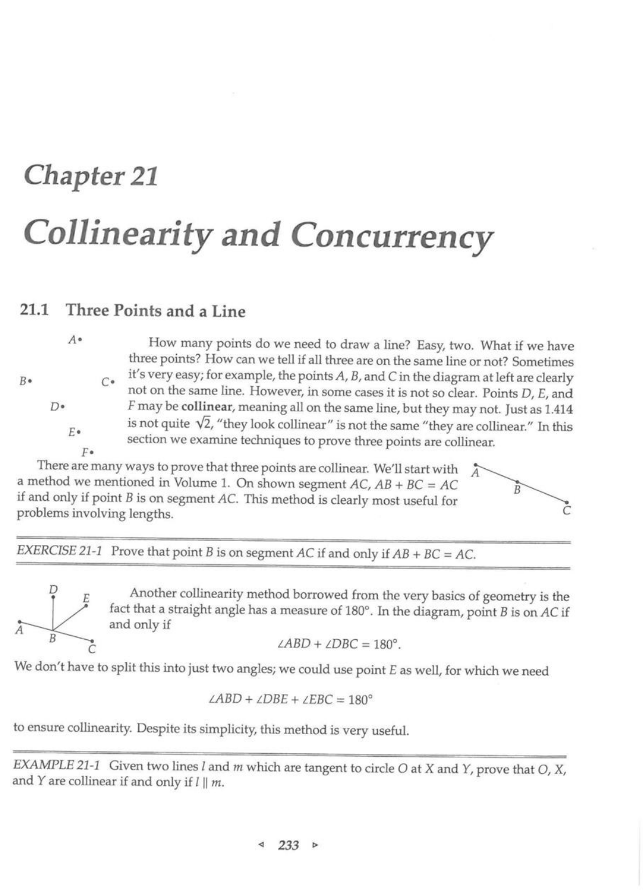
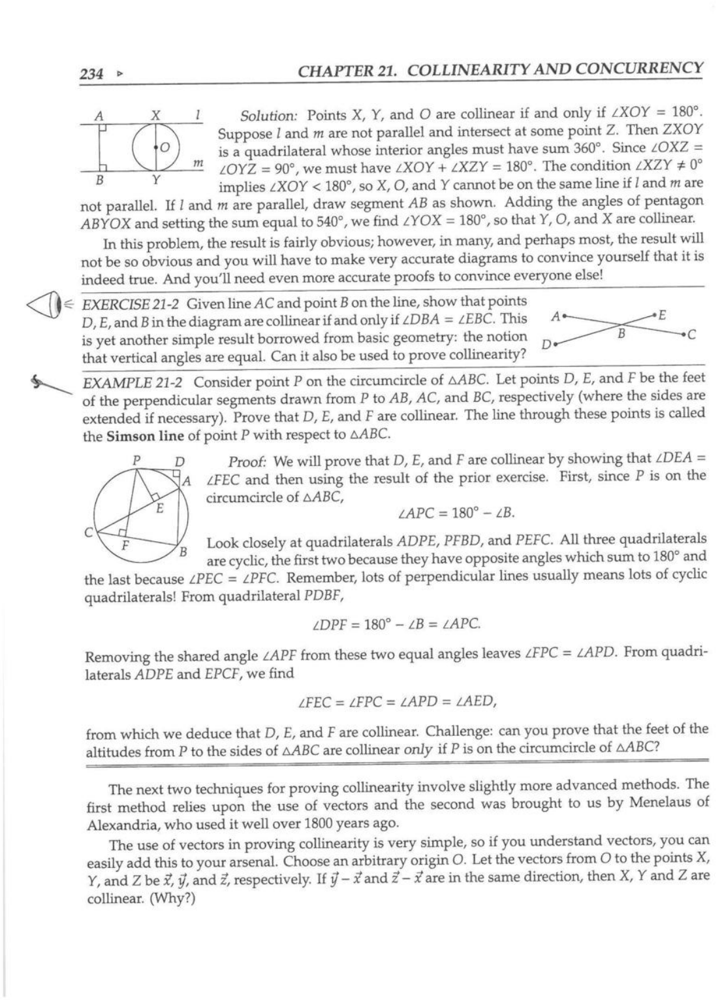
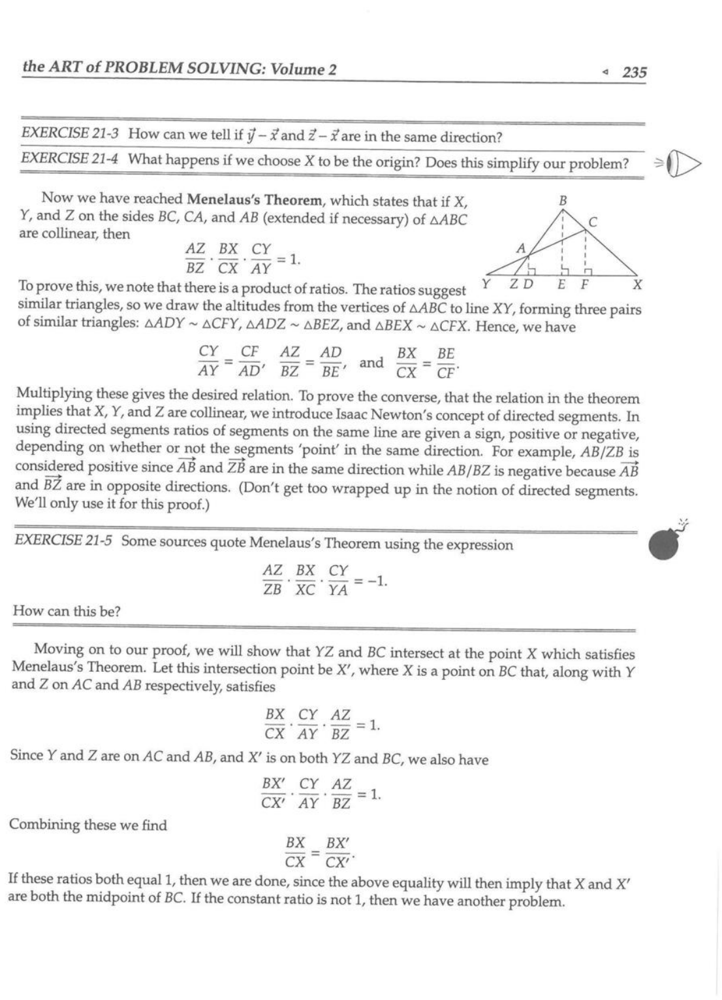
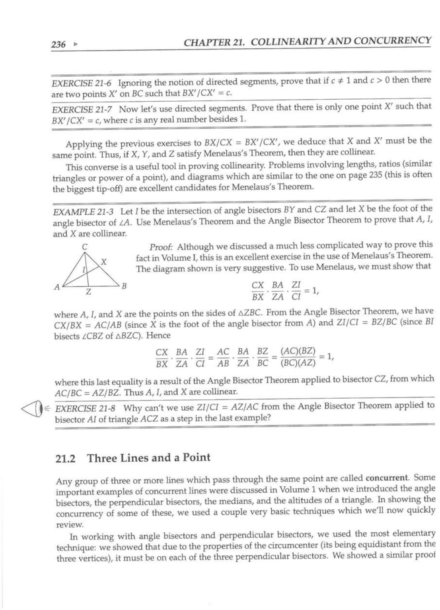
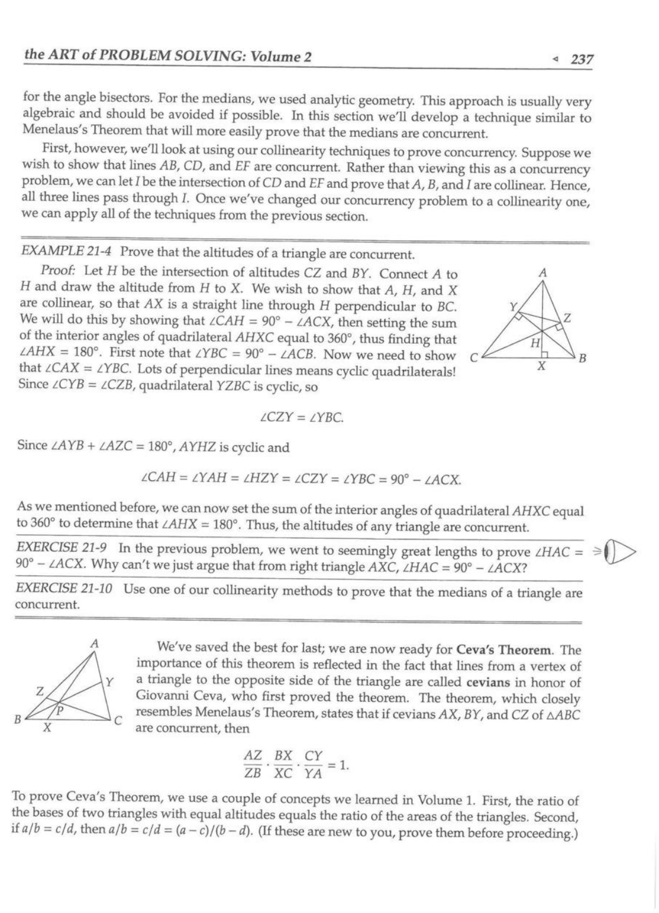
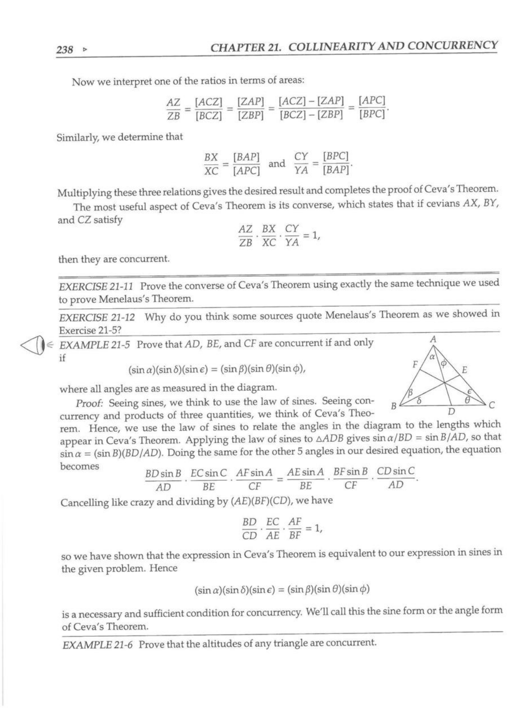
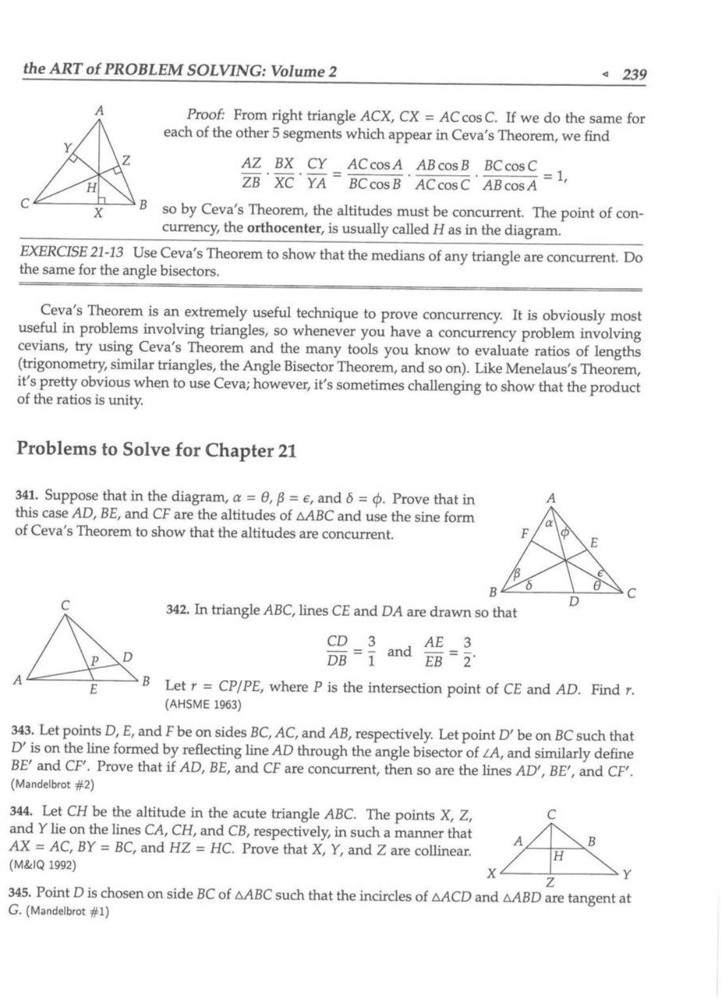
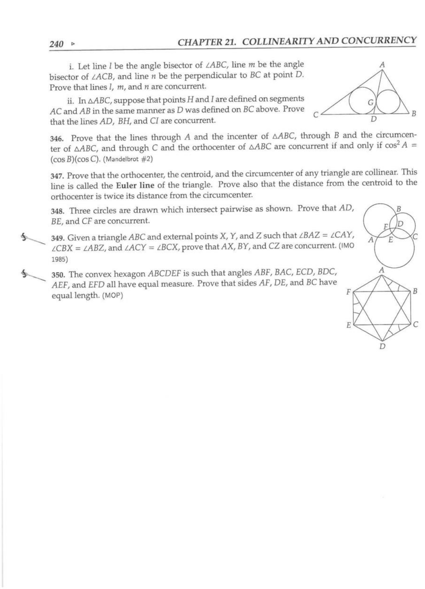

# Chapter 21: Collinearity and Concurrency

Volume 2 · Printed pages 233–240 · PDF pages 255–262

[Volume contents](../index.md)

## Printed page 233

<!-- source: volume-2, PDF page 255, printed page 233 -->

### 21.1 Three Points and a Line

How many points do we need to draw a line? Easy, two. What if we have three points? How can we tell if all three are on the same line or not? Sometimes it's very easy; for example, the points $A, B,$ and $C$ in the diagram at left are clearly not on the same line. However, in some cases it is not so clear. Points $D, E,$ and $F$ may be collinear, meaning all on the same line, but they may not. Just as 1.414 is not quite $\sqrt{2}$, "they look collinear" is not the same "they are collinear." In this section we examine techniques to prove three points are collinear.

There are many ways to prove that three points are collinear. We'll start with a method we mentioned in Volume 1. On shown segment $AC, AB + BC = AC$ if and only if point $B$ is on segment $AC$. This method is clearly most useful for problems involving lengths.

**EXERCISE 21-1 Prove that point $B$ is on segment $AC$ if and only if $AB + BC = AC$.**

Another collinearity method borrowed from the very basics of geometry is the fact that a straight angle has a measure of $180^\circ$. In the diagram, point $B$ is on $AC$ if and only if

$$\angle ABD + \angle DBC = 180^\circ.$$

We don't have to split this into just two angles; we could use point $E$ as well, for which we need

$$\angle ABD + \angle DBE + \angle EBC = 180^\circ$$

to ensure collinearity. Despite its simplicity, this method is very useful.

**EXAMPLE 21-1 Given two lines $l$ and $m$ which are tangent to circle $O$ at $X$ and $Y$, prove that $O, X,$ and $Y$ are collinear if and only if $l \parallel m$.**

Original scan — PDF page 255

## Printed page 234

<!-- source: volume-2, PDF page 256, printed page 234 -->

Solution: Points $X, Y,$ and $O$ are collinear if and only if $\angle XOY = 180^\circ$. Suppose $l$ and $m$ are not parallel and intersect at some point $Z$. Then $ZXOY$ is a quadrilateral whose interior angles must have sum $360^\circ$. Since $\angle OXZ = \angle OYZ = 90^\circ,$ we must have $\angle XOY + \angle XZY = 180^\circ$. The condition $\angle XZY \neq 0^\circ$ implies $\angle XOY < 180^\circ,$ so $X, O,$ and $Y$ cannot be on the same line if $l$ and $m$ are not parallel. If $l$ and $m$ are parallel, draw segment $AB$ as shown. Adding the angles of pentagon $ABYOX$ and setting the sum equal to $540^\circ,$ we find $\angle YOX = 180^\circ,$ so that $Y, O,$ and $X$ are collinear.

In this problem, the result is fairly obvious; however, in many, and perhaps most, the result will not be so obvious and you will have to make very accurate diagrams to convince yourself that it is indeed true. And you’ll need even more accurate proofs to convince everyone else!

**EXERCISE 21-2 Given line $AC$ and point $B$ on the line, show that points $D, E,$ and $B$ in the diagram are collinear if and only if $\angle DBA = \angle EBC.$ This is yet another simple result borrowed from basic geometry: the notion that vertical angles are equal. Can it also be used to prove collinearity?**

**EXAMPLE 21-2 Consider point $P$ on the circumcircle of $\triangle ABC.$ Let points $D, E,$ and $F$ be the feet of the perpendicular segments drawn from $P$ to $AB, AC,$ and $BC,$ respectively (where the sides are extended if necessary). Prove that $D, E,$ and $F$ are collinear. The line through these points is called the Simson line of point $P$ with respect to $\triangle ABC.$**

Proof: We will prove that $D, E,$ and $F$ are collinear by showing that $\angle DEA = \angle FEC$ and then using the result of the prior exercise. First, since $P$ is on the circumcircle of $\triangle ABC,$

$$\angle APC = 180^\circ - \angle B.$$

Look closely at quadrilaterals $ADPE,$ $PFBD,$ and $PEFC.$ All three quadrilaterals are cyclic, the first two because they have opposite angles which sum to $180^\circ$ and the last because $\angle PEC = \angle PFC.$ Remember, lots of perpendicular lines usually means lots of cyclic quadrilaterals! From quadrilateral $PDBF,$

$$\angle DPF = 180^\circ - \angle B = \angle APC.$$

Removing the shared angle $\angle APF$ from these two equal angles leaves $\angle FPC = \angle APD.$ From quadrilaterals $ADPE$ and $EPCF,$ we find

$$\angle FEC = \angle FPC = \angle APD = \angle AED,$$

from which we deduce that $D, E,$ and $F$ are collinear. Challenge: can you prove that the feet of the altitudes from $P$ to the sides of $\triangle ABC$ are collinear only if $P$ is on the circumcircle of $\triangle ABC$?

The next two techniques for proving collinearity involve slightly more advanced methods. The first method relies upon the use of vectors and the second was brought to us by Menelaus of Alexandria, who used it well over 1800 years ago.

The use of vectors in proving collinearity is very simple, so if you understand vectors, you can easily add this to your arsenal. Choose an arbitrary origin $O.$ Let the vectors from $O$ to the points $X, Y,$ and $Z$ be $\vec{x}, \vec{y},$ and $\vec{z},$ respectively. If $\vec{y} - \vec{x}$ and $\vec{z} - \vec{x}$ are in the same direction, then $X, Y,$ and $Z$ are collinear. (Why?)

Original scan — PDF page 256

## Printed page 235

<!-- source: volume-2, PDF page 257, printed page 235 -->

**EXERCISE 21-3** How can we tell if $\vec{y}-\vec{x}$ and $\vec{z}-\vec{x}$ are in the same direction?

**EXERCISE 21-4** What happens if we choose $X$ to be the origin? Does this simplify our problem?

Now we have reached Menelaus’s Theorem, which states that if $X$, $Y$, and $Z$ on the sides $BC$, $CA$, and $AB$ (extended if necessary) of $\Delta ABC$ are collinear, then

$$\frac{AZ}{BZ} \cdot \frac{BX}{CX} \cdot \frac{CY}{AY} = 1.$$

To prove this, we note that there is a product of ratios. The ratios suggest similar triangles, so we draw the altitudes from the vertices of $\Delta ABC$ to line $XY$, forming three pairs of similar triangles: $\Delta ADY \sim \Delta CFY$, $\Delta ADZ \sim \Delta BEZ$, and $\Delta BEX \sim \Delta CFX$. Hence, we have

$$\frac{CY}{AY} = \frac{CF}{AD}, \quad \frac{AZ}{BZ} = \frac{AD}{BE},$$

and $$\frac{BX}{CX} = \frac{BE}{CF}.$$

Multiplying these gives the desired relation. To prove the converse, that the relation in the theorem implies that $X$, $Y$, and $Z$ are collinear, we introduce Isaac Newton’s concept of directed segments. In using directed segments ratios of segments on the same line are given a sign, positive or negative, depending on whether or not the segments ‘point’ in the same direction. For example, $AB/ZB$ is considered positive since $\overrightarrow{AB}$ and $\overrightarrow{ZB}$ are in the same direction while $AB/BZ$ is negative because $\overrightarrow{AB}$ and $\overrightarrow{BZ}$ are in opposite directions. (Don’t get too wrapped up in the notion of directed segments. We’ll only use it for this proof.)

---

**EXERCISE 21-5** Some sources quote Menelaus’s Theorem using the expression

$$\frac{AZ}{ZB} \cdot \frac{BX}{XC} \cdot \frac{CY}{YA} = -1.$$

How can this be?

Moving on to our proof, we will show that $YZ$ and $BC$ intersect at the point $X$ which satisfies Menelaus’s Theorem. Let this intersection point be $X'$, where $X$ is a point on $BC$ that, along with $Y$ and $Z$ on $AC$ and $AB$ respectively, satisfies

$$\frac{BX}{CX} \cdot \frac{CY}{AY} \cdot \frac{AZ}{BZ} = 1.$$

Since $Y$ and $Z$ are on $AC$ and $AB$, and $X'$ is on both $YZ$ and $BC$, we also have

$$\frac{BX'}{CX'} \cdot \frac{CY}{AY} \cdot \frac{AZ}{BZ} = 1.$$

Combining these we find

$$\frac{BX}{CX} = \frac{BX'}{CX'}.$$

If these ratios both equal 1, then we are done, since the above equality will then imply that $X$ and $X'$ are both the midpoint of $BC$. If the constant ratio is not 1, then we have another problem.

Original scan — PDF page 257

## Printed page 236

<!-- source: volume-2, PDF page 258, printed page 236 -->

**EXERCISE 21-6 Ignoring the notion of directed segments, prove that if $c \neq 1$ and $c > 0$ then there are two points $X'$ on BC such that $BX'/CX' = c$.**

**EXERCISE 21-7 Now let’s use directed segments. Prove that there is only one point $X'$ such that $BX'/CX' = c$, where $c$ is any real number besides 1.**

Applying the previous exercises to $BX/CX = BX'/CX'$, we deduce that $X$ and $X'$ must be the same point. Thus, if $X, Y$, and $Z$ satisfy Menelaus’s Theorem, then they are collinear.

This converse is a useful tool in proving collinearity. Problems involving lengths, ratios (similar triangles or power of a point), and diagrams which are similar to the one on page 235 (this is often the biggest tip-off) are excellent candidates for Menelaus’s Theorem.

**EXAMPLE 21-3 Let $I$ be the intersection of angle bisectors $BY$ and $CZ$ and let $X$ be the foot of the angle bisector of $\angle A$. Use Menelaus’s Theorem and the Angle Bisector Theorem to prove that $A, I$, and $X$ are collinear.**

Proof: Although we discussed a much less complicated way to prove this fact in Volume I, this is an excellent exercise in the use of Menelaus’s Theorem. The diagram shown is very suggestive. To use Menelaus, we must show that

$$\frac{CX}{BX} \cdot \frac{BA}{ZA} \cdot \frac{ZI}{CI} = 1,$$

where $A, I$, and $X$ are the points on the sides of $\Delta ZBC$. From the Angle Bisector Theorem, we have $CX/BX = AC/AB$ (since $X$ is the foot of the angle bisector from $A$) and $ZI/CI = BZ/BC$ (since BI bisects $\angle CBZ$ of $\Delta BZC$). Hence

$$\frac{CX}{BX} \cdot \frac{BA}{ZA} \cdot \frac{ZI}{CI} = \frac{AC}{AB} \cdot \frac{BA}{ZA} \cdot \frac{BZ}{BC} = \frac{(AC)(BZ)}{(BC)(AZ)} = 1,$$

where this last equality is a result of the Angle Bisector Theorem applied to bisector $CZ$, from which $AC/BC = AZ/BZ$. Thus $A, I$, and $X$ are collinear.

**EXERCISE 21-8 Why can’t we use $ZI/CI = AZ/AC$ from the Angle Bisector Theorem applied to bisector $AI$ of triangle $ACZ$ as a step in the last example?**

### 21.2 Three Lines and a Point

Any group of three or more lines which pass through the same point are called concurrent. Some important examples of concurrent lines were discussed in Volume 1 when we introduced the angle bisectors, the perpendicular bisectors, the medians, and the altitudes of a triangle. In showing the concurrency of some of these, we used a couple very basic techniques which we’ll now quickly review.

In working with angle bisectors and perpendicular bisectors, we used the most elementary technique: we showed that due to the properties of the circumcenter (its being equidistant from the three vertices), it must be on each of the three perpendicular bisectors. We showed a similar proof

Original scan — PDF page 258

## Printed page 237

<!-- source: volume-2, PDF page 259, printed page 237 -->

for the angle bisectors. For the medians, we used analytic geometry. This approach is usually very algebraic and should be avoided if possible. In this section we’ll develop a technique similar to Menelaus’s Theorem that will more easily prove that the medians are concurrent.

First, however, we’ll look at using our collinearity techniques to prove concurrency. Suppose we wish to show that lines AB, CD, and EF are concurrent. Rather than viewing this as a concurrency problem, we can let $I$ be the intersection of CD and EF and prove that A, B, and I are collinear. Hence, all three lines pass through $I$. Once we’ve changed our concurrency problem to a collinearity one, we can apply all of the techniques from the previous section.

**EXAMPLE 21-4** Prove that the altitudes of a triangle are concurrent.

**Proof:** Let $H$ be the intersection of altitudes CZ and BY. Connect $A$ to $H$ and draw the altitude from $H$ to $X$. We wish to show that A, H, and X are collinear, so that AX is a straight line through $H$ perpendicular to BC. We will do this by showing that $\angle CAH = 90^\circ - \angle ACX$, then setting the sum of the interior angles of quadrilateral AHXC equal to 360°, thus finding that $\angle AHX = 180^\circ$. First note that $\angle YBC = 90^\circ - \angle ACB$. Now we need to show that $\angle CAX = \angle YBC$. Lots of perpendicular lines means cyclic quadrilaterals! Since $\angle CYB = \angle CZB$, quadrilateral YZBC is cyclic, so

$$\angle CZY = \angle YBC.$$

Since $\angle AYB + \angle AZC = 180^\circ$, AYHZ is cyclic and

$$\angle CAH = \angle YAH = \angle HZY = \angle CZY = \angle YBC = 90^\circ - \angle ACX.$$

As we mentioned before, we can now set the sum of the interior angles of quadrilateral AHXC equal to 360° to determine that $\angle AHX = 180^\circ$. Thus, the altitudes of any triangle are concurrent.

**EXERCISE 21-9** In the previous problem, we went to seemingly great lengths to prove $\angle HAC = 90^\circ - \angle ACX$. Why can’t we just argue that from right triangle AXC, $\angle HAC = 90^\circ - \angle ACX?$

**EXERCISE 21-10** Use one of our collinearity methods to prove that the medians of a triangle are concurrent.

We’ve saved the best for last; we are now ready for Ceva’s Theorem. The importance of this theorem is reflected in the fact that lines from a vertex of a triangle to the opposite side of the triangle are called cevians in honor of Giovanni Ceva, who first proved the theorem. The theorem, which closely resembles Menelaus’s Theorem, states that if cevians AX, BY, and CZ of $\Delta ABC$ are concurrent, then

$$\frac{AZ}{ZB} \cdot \frac{BX}{XC} \cdot \frac{CY}{YA} = 1.$$

To prove Ceva’s Theorem, we use a couple of concepts we learned in Volume 1. First, the ratio of the bases of two triangles with equal altitudes equals the ratio of the areas of the triangles. Second, if $a/b = c/d$, then $a/b = c/d = (a - c)/(b - d)$. (If these are new to you, prove them before proceeding.)

Original scan — PDF page 259

## Printed page 238

<!-- source: volume-2, PDF page 260, printed page 238 -->

Now we interpret one of the ratios in terms of areas:

$$\frac{AZ}{ZB} = \frac{[ACZ]}{[BCZ]} = \frac{[ZAP]}{[ZBP]} = \frac{[ACZ] - [ZAP]}{[BCZ] - [ZBP]} = \frac{[APC]}{[BPC]}$$

Similarly, we determine that

$$\frac{BX}{XC} = \frac{[BAP]}{[APC]}$$ and $$\frac{CY}{YA} = \frac{[BPC]}{[BAP]}$$

Multiplying these three relations gives the desired result and completes the proof of Ceva’s Theorem.

The most useful aspect of Ceva’s Theorem is its converse, which states that if cevians $AX, BY,$ and $CZ$ satisfy

$$\frac{AZ}{ZB} \cdot \frac{BX}{XC} \cdot \frac{CY}{YA} = 1,$$

then they are concurrent.

**EXERCISE 21-11** Prove the converse of Ceva’s Theorem using exactly the same technique we used to prove Menelaus’s Theorem.

**EXERCISE 21-12** Why do you think some sources quote Menelaus’s Theorem as we showed in Exercise 21-5?

**EXAMPLE 21-5** Prove that $AD, BE,$ and $CF$ are concurrent if and only if

$$(\sin \alpha)(\sin \delta)(\sin \epsilon) = (\sin \beta)(\sin \theta)(\sin \phi),$$

where all angles are as measured in the diagram.

**Proof:** Seeing sines, we think to use the law of sines. Seeing concurrency and products of three quantities, we think of Ceva’s Theorem. Hence, we use the law of sines to relate the angles in the diagram to the lengths which appear in Ceva’s Theorem. Applying the law of sines to $\triangle ADB$ gives $\sin \alpha/BD = \sin B/AD,$ so that $\sin \alpha = (\sin B)(BD/AD).$ Doing the same for the other 5 angles in our desired equation, the equation becomes

$$\frac{BD \sin B}{AD} \cdot \frac{EC \sin C}{BE} \cdot \frac{AF \sin A}{CF} = \frac{AE \sin A}{BE} \cdot \frac{BF \sin B}{CF} \cdot \frac{CD \sin C}{AD}.$$

Cancelling like crazy and dividing by $(AE)(BF)(CD),$ we have

$$\frac{BD}{CD} \cdot \frac{EC}{AE} \cdot \frac{AF}{BF} = 1,$$

so we have shown that the expression in Ceva’s Theorem is equivalent to our expression in sines in the given problem. Hence

$$(\sin \alpha)(\sin \delta)(\sin \epsilon) = (\sin \beta)(\sin \theta)(\sin \phi)$$

is a necessary and sufficient condition for concurrency. We’ll call this the sine form or the angle form of Ceva’s Theorem.

**EXAMPLE 21-6** Prove that the altitudes of any triangle are concurrent.

Original scan — PDF page 260

## Printed page 239

<!-- source: volume-2, PDF page 261, printed page 239 -->

Proof: From right triangle $ACX$, $CX = AC\cos C$. If we do the same for each of the other 5 segments which appear in Ceva’s Theorem, we find

$$\frac{AZ}{ZB} \cdot \frac{BX}{XC} \cdot \frac{CY}{YA} = \frac{AC\cos A}{BC\cos B} \cdot \frac{AB\cos B}{AC\cos C} \cdot \frac{BC\cos C}{AB\cos A} = 1,$$

so by Ceva’s Theorem, the altitudes must be concurrent. The point of concurrency, the orthocenter, is usually called $H$ as in the diagram.

**EXERCISE 21-13 Use Ceva’s Theorem to show that the medians of any triangle are concurrent. Do the same for the angle bisectors.**

Ceva’s Theorem is an extremely useful technique to prove concurrency. It is obviously most useful in problems involving triangles, so whenever you have a concurrency problem involving cevians, try using Ceva’s Theorem and the many tools you know to evaluate ratios of lengths (trigonometry, similar triangles, the Angle Bisector Theorem, and so on). Like Menelaus’s Theorem, it’s pretty obvious when to use Ceva; however, it’s sometimes challenging to show that the product of the ratios is unity.

Problems to Solve for Chapter 21

341. Suppose that in the diagram, $\alpha = \theta$, $\beta = \epsilon$, and $\delta = \phi$. Prove that in this case $AD$, $BE$, and $CF$ are the altitudes of $\Delta ABC$ and use the sine form of Ceva’s Theorem to show that the altitudes are concurrent.

342. In triangle $ABC$, lines $CE$ and $DA$ are drawn so that

$$\frac{CD}{DB} = \frac{3}{1} \text{ and } \frac{AE}{EB} = \frac{3}{2}.$$

Let $r = CP/PE$, where $P$ is the intersection point of $CE$ and $AD$. Find $r$. (AHSME 1963)

343. Let points $D$, $E$, and $F$ be on sides $BC$, $AC$, and $AB$, respectively. Let point $D'$ be on $BC$ such that $D'$ is on the line formed by reflecting line $AD$ through the angle bisector of $\angle A$, and similarly define $BE'$ and $CF'$. Prove that if $AD$, $BE$, and $CF$ are concurrent, then so are the lines $AD'$, $BE'$, and $CF'$. (Mandelbrot #2)

344. Let $CH$ be the altitude in the acute triangle $ABC$. The points $X$, $Z$, and $Y$ lie on the lines $CA$, $CH$, and $CB$, respectively, in such a manner that $AX = AC$, $BY = BC$, and $HZ = HC$. Prove that $X$, $Y$, and $Z$ are collinear. (M&IQ 1992)

345. Point $D$ is chosen on side $BC$ of $\Delta ABC$ such that the incircles of $\Delta ACD$ and $\Delta ABD$ are tangent at $G$. (Mandelbrot #1)

Original scan — PDF page 261

## Printed page 240

<!-- source: volume-2, PDF page 262, printed page 240 -->

i. Let line $l$ be the angle bisector of $\angle ABC$, line $m$ be the angle bisector of $\angle ACB$, and line $n$ be the perpendicular to $BC$ at point $D$. Prove that lines $l, m,$ and $n$ are concurrent.

ii. In $\triangle ABC$, suppose that points $H$ and $I$ are defined on segments $AC$ and $AB$ in the same manner as $D$ was defined on $BC$ above. Prove that the lines $AD, BH,$ and $CI$ are concurrent.

346. Prove that the lines through $A$ and the incenter of $\triangle ABC$, through $B$ and the circumcenter of $\triangle ABC$, and through $C$ and the orthocenter of $\triangle ABC$ are concurrent if and only if $\cos^2 A = (\cos B)(\cos C)$. (Mandelbrot #2)

347. Prove that the orthocenter, the centroid, and the circumcenter of any triangle are collinear. This line is called the **Euler line** of the triangle. Prove also that the distance from the centroid to the orthocenter is twice its distance from the circumcenter.

348. Three circles are drawn which intersect pairwise as shown. Prove that $AD,$ $BE,$ and $CF$ are concurrent.

349. Given a triangle $ABC$ and external points $X, Y,$ and $Z$ such that $\angle BAZ = \angle CAY,$ $\angle CBX = \angle ABZ,$ and $\angle ACY = \angle BCX,$ prove that $AX, BY,$ and $CZ$ are concurrent. (IMO 1985)

350. The convex hexagon $ABCDEF$ is such that angles $ABF, BAC, ECD, BDC, AEF,$ and $EFD$ all have equal measure. Prove that sides $AF, DE,$ and $BC$ have equal length. (MOP)

Original scan — PDF page 262

