# Chapter 22: Geometry Tidbits

Volume 2 · Printed pages 241–251 · PDF pages 263–273

[Volume contents](../index.md)

## Printed page 241

<!-- source: volume-2, PDF page 263, printed page 241 -->

This chapter contains several advanced concepts in geometry problem solving. Rather than put little needles all over the chapter, we warn you now that most of this chapter is quite challenging.

### 22.1 Projections

In Volume 1 we discussed distortions, in which we stretched a figure in one dimension. We found that a distortion doesn’t preserve length or area, but it does preserve ratios of lengths (in the same direction) and areas. For example, if triangle ABC is distorted to make AB'C' as shown, we don’t have $[ABC] = [AB'C']$; however, $[ABC] / [ABD] = [AB'C'] / [AB'D']$.

A projection is very similar to a distortion; in a projection, we map a figure in one plane into a figure in another plane. In the simplest type of projection, we project $\Delta ABC$ in plane X onto $\Delta DEF$ in plane Y by pretending that there is a large ‘sun’ directly above the planes such that $\Delta DEF$ is the ‘shadow’ of $\Delta ABC$. Thus, AD is perpendicular to plane Y, as are CF and BE. Because of these perpendicularities, this type of projection is called an orthogonal projection. To better understand orthogonal projections, draw a triangle on a clear piece of plastic or glass with a thick marker. Go outside when the sun is overhead and see what kind of shadows the triangle makes as you move it around. You should notice that the results of an orthogonal projection are exactly the same as a distortion.

As with distortions, orthogonal projections do not preserve lengths but they do preserve ratios of lengths and ratios of areas. For example, in our figure, $BG / GC = EH / HF$ and $[ABG] / [AGC] = [DEH] / [DHF]$. This preservation of ratios of lengths can be seen by first raising plane Y until point B coincides with point E. The similar triangles BGH and BCF will then give the desired result.

**EXERCISE 22-1 Note in the diagram that the lengths whose ratio is preserved are lengths of segments with the same orientation. Construct an example to show that if two coplanar segments do not have the same orientation, then their projections do not necessarily have the same ratio as the original segments.**

Original scan — PDF page 263

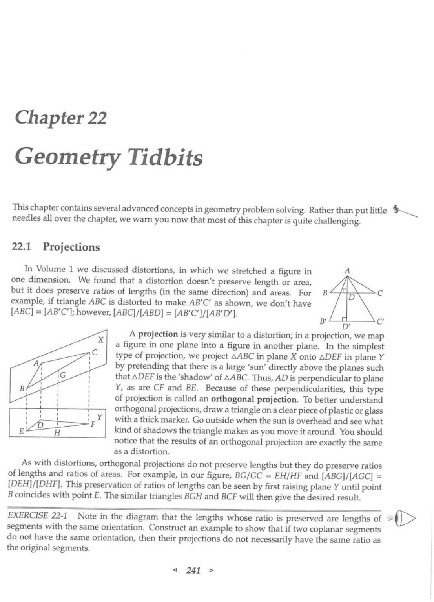

## Printed page 242

<!-- source: volume-2, PDF page 264, printed page 242 -->

**EXERCISE 22-2 Must we make similar orientation restrictions for the ratio of areas?**

Now the important question: what good are orthogonal projections? The answer to this is the preservation of ratios. Using this property, we can project complicated figures into simple ones to solve problems.

**EXAMPLE 22-1 Prove that the area of an ellipse with major axis and minor axis of lengths $2a$ and $2b$, respectively, is $ab\pi$.**

Proof: We do this by projecting the ellipse into a figure whose area we can find, namely a circle with diameter $2b$. To take advantage of the constant ratio of areas, we must have some other relevant figure projected along with the ellipse. For this example, we consider the triangle formed by the endpoints of the major axis and one endpoint of the minor axis. Let this triangle be $ABC$ and its projection be $A'B'C'$. Hence we have $[ABC] = ab$ and $[A'B'C'] = b^2$. (Why?) Since orthogonal projections preserve ratio of areas, we have

$$\frac{\text{Area of ellipse}}{[ABC]} = \frac{\text{Area of circle}}{[A'B'C']}.$$

Since the area of the circle is $b^2\pi$, we quickly find that the area of the ellipse is $ab\pi$.

**EXAMPLE 22-2 Find the maximum value for the area of a triangle inscribed in an ellipse with minor axis 1 and major axis 100. (Mandelbrot #2)**

Solution: Dealing with inscribed figures in an ellipse can be pretty tricky, so we perform an orthogonal projection to map the ellipse to a circle with diameter 1. Let $ABC$ be the triangle of maximum area inscribed in the circle and $\Delta DEF$ be the triangle inscribed in the ellipse whose projection is $\Delta ABC$. Since the ratio of areas is preserved, $\Delta DEF$ must be the largest possible triangle inscribed in the ellipse. Now our problem is finding the maximum area of a triangle inscribed in a circle of diameter 1. This is just an equilateral triangle, which has area $3\sqrt{3}/16$. From the preservation of ratios, we have

$$\frac{[ABC]}{Area of circle} = \frac{[DEF]}{Area of ellipse}.$$

Thus,

$$[DEF] = \frac{(3\sqrt{3}/16)[(1/2)(100/2)\pi]}{\pi/4} = \frac{75\sqrt{3}}{4}.$$

**EXERCISE 22-3 Could we have used an orthogonal projection to project the ellipse in the previous exercise into a circle with radius 100 rather than radius 1?**

Orthogonal projections are generally most useful when we can project odd shapes, such as an ellipse, into regular ones, like a circle. As you will see in one of the problems at the end of the chapter, orthogonal projections can also be used to attack three-dimensional problems by projecting planar parts of the figure in the problem.

Original scan — PDF page 264

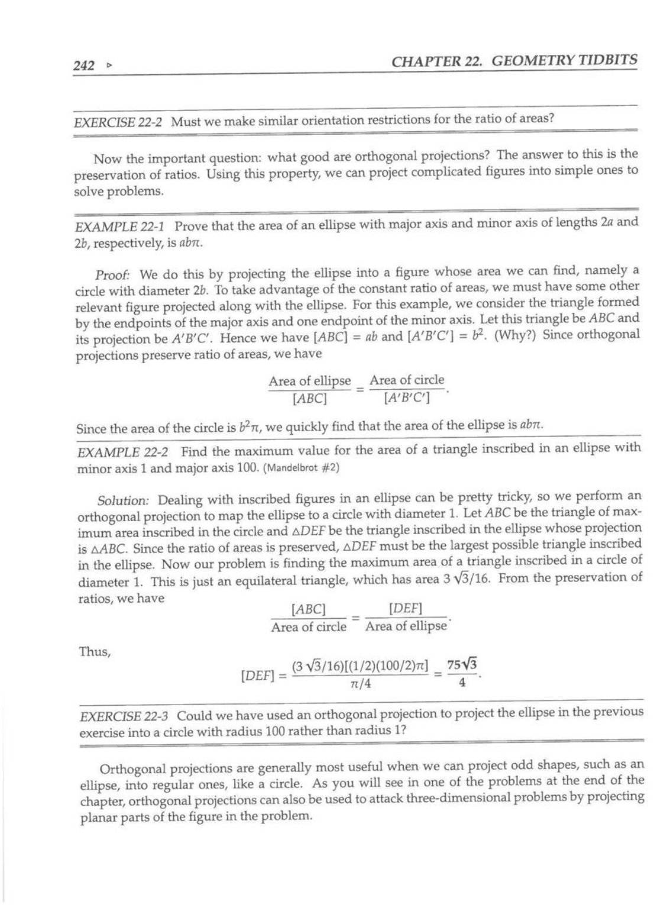

## Printed page 243

<!-- source: volume-2, PDF page 265, printed page 243 -->

Orthogonal projections are not the only projections possible. Suppose that rather than a large sun shining directly above our plane, we have just a single point of light. The result, called a central projection, is shown in the figure. Point $C$ is the center of projection, or the point of light. The images of the projections of $A$ and $B$ are $A'$ and $B'$, respectively.

If instead of light emanating from a point we take consider parallel beams of light, we get a parallel projection. Note that orthogonal projections are parallel projections in which the projection rays (lines $AA'$ and $BB'$) are perpendicular to the plane of the image, i.e. $AA'$ is perpendicular to plane $Y$.

**EXAMPLE 22-3** In parallel projections, ratios of lengths and areas are preserved, just as in orthogonal projections. This is proven in the same manner as we did with orthogonal projections, using the parallel rays and similar triangles.

**EXERCISE 22-4** Construct an example to show that central projections do not preserve ratios of lengths.

In general, the most useful projection is the orthogonal projection; however, make sure you understand the other types of projection as well.

### 22.2 Inversion

**Inversion with respect to a circle** is one of the most bizarre useful geometric transformations. Let the circle about which we are inverting have center $O$ and radius $R$. The image of a point $P$ is the point $P'$ on ray $\overrightarrow{OP}$ such that $\overrightarrow{OP} \cdot \overrightarrow{OP'} = R^2$. To get a handle on what this does, let's investigate what happens to a few particular points.

First consider point $C$ on the circle. Since $OC = R$, $OC' = R^2/OC = R$ as well. Hence, the image of $C$ is itself. Now try point $A$, outside the circle. Since $OA > R$, $OA' = R^2/OA < R$. Thus, $A'$ is inside the circle on ray $\overrightarrow{OA}$. Similarly, we can show that the image of $B$, a point inside the circle, is outside the circle. What about the image of $O$? Since $OO = 0$, the image of $O$ must be infinitely far away from $O$. We call this image the point at infinity. Similarly, the image of the "point at infinity" is $O$.

**EXERCISE 22-5** Investigate the "point at infinity" concept. Let the radius be 10 and find the length of $OA'$ if $OA = 1$, $OA = 0.1$, etc., and if $OA = 100$, $OA = 1000$, etc.

Original scan — PDF page 265

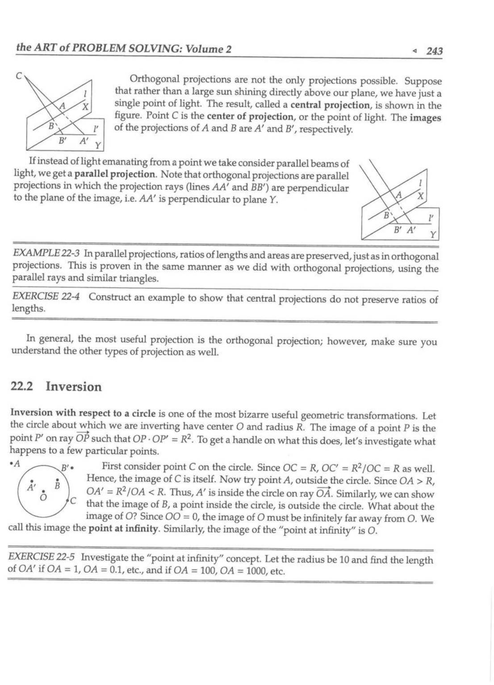

## Printed page 244

<!-- source: volume-2, PDF page 266, printed page 244 -->

Extending these basic examples, we see that the image of the circle we are inverting about is the circle itself. By moving point $A$ along the line through $O$ and $A$ in the diagram, we find that the image of any line through the origin is that line itself. Let’s investigate the line through points $A$ and $C$ on the circle. Points on chord $AC$ map to $\widehat{AC}$ outside circle $O$. Points on the line past $C$ map to $\widehat{OC}$ and those on the line past $A$ map to $\widehat{OA}$. We find (though we haven’t proven this) that the inverse of a line which does not pass through the center of a circle is a circle which passes through the center of inversion. Going backwards, the image of a circle through the center of inversion is a line. Similarly, we can find that the image of any circle not passing through the center of inversion is also a circle.

**EXAMPLE 22-4** Prove that the image of a line intersecting the circle of inversion but not passing through the center is a circle and not some other strange curve.

**Proof:** We’ll first deal with the portion of the image outside circle $O$. Let point $X$ be some point on chord $AC$ with image $Y$. We wish to show that point $Y$ lies on the circle which passes through $A, C$, and $O$ (since these three points are clearly on the image). By the definition of inversion, $OY/OA = OA/OX$. Thus by SAS similarity, $\Delta XOA \sim \Delta AOY$, and $\angle CAO = \angle AYO$. Since $\Delta OAC$ is isosceles, we have $\angle ACO = \angle CAO = \angle AYO$; hence, $YAOC$ is a cyclic quadrilateral. From this, we find that any point on chord $AC$ has an image on the circumcircle of $\Delta ACO$.

Once again using the definition of inversion, for points outside the circle we have $OX/OC = OC/OY$ and $OA/OX = OY/OA$. From this we see that

$$\Delta OCX \sim \Delta OYC$$ and $$\Delta OAX \sim \Delta OYA.$$

These relations give us

$$\angle OCX = \angle OYC = \angle OAX,$$

so $AOCX$ is a cyclic quadrilateral. Thus, we have shown that the image of every point on line $AC$ is on the circumcircle of $\Delta OAC$. To complete the proof, we must go backward to show that the image of every point on the circle is on line $AC$, so that by inverting line $AC$, we get every point on the circumcircle of $\Delta OAC$ rather than just a portion of the circle. We haven’t shown that $O$ is on the image, but this is trivial because the center of inversion is on the image of any line. (Why?)

Read through this proof closely; it shows why inversion works. It should also convince you that cyclic quadrilaterals are an excellent problem solving aid. Don’t get too intimidated by this proof; using inversion generally isn’t this tough. Furthermore, as you’ve seen throughout the ART of PROBLEM SOLVING many of the tools which we use ‘easily’ have very complicated proofs.

**EXERCISE 22-6** Given a point $P$ outside circle $O$, construct the point which is the inversion of point $P$ with respect to $O$.

Inversion is a pretty complex process; what can we use it for? One answer to that is shown in the proof above: we can convert cyclic quadrilateral problems to collinearity problems. For example, in the proof above, proving that three points are collinear is equivalent to proving that their images are all on the same circle with the center of inversion. Thus, if we are asked to show that three points are

Original scan — PDF page 266

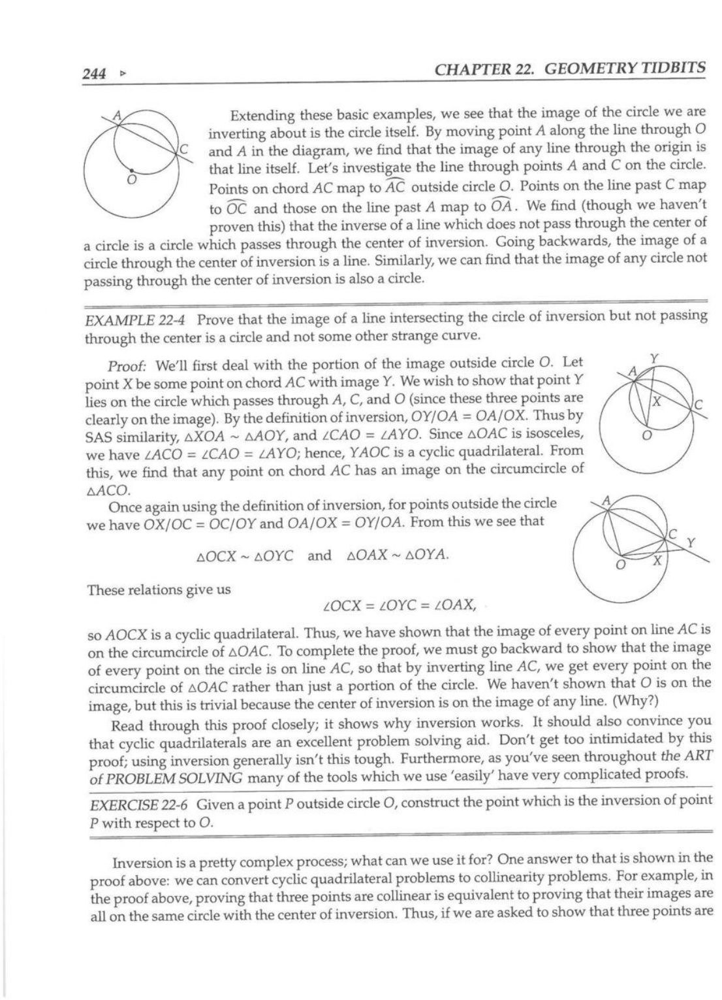

## Printed page 245

<!-- source: volume-2, PDF page 267, printed page 245 -->

collinear, we can instead perform an inversion with respect to some circle and show that the image points and the center of inversion are concyclic. Clearly, such a method is only useful in problems involving circles. Inversion problems are quite rare, so don't dive into inversion until after you've tried other approaches. However, playing with inversion is fun, so take the time to invert all sorts of figures and see what results!

### 22.3 Homothecy

In Volume 1 we discussed dilations and stated that a figure and its image under dilation are homothetic, meaning that all lines through corresponding points of the two figures share a common point.

In the figure, triangles ABC and DEF are homothetic, and O is the center of homothecy. Note that line MN connecting midpoints of corresponding sides of the two triangles also passes through the center of homothecy. Furthermore, since one figure is a dilation of the other, we have

$$\frac{OC}{OF} = \frac{OM}{ON} = \frac{OB}{OE} = \frac{OA}{OD} = \frac{CA}{FD} = \frac{BC}{EF} = \frac{AB}{DE}.$$

These are the most important properties of homothecy: that lines through corresponding points in a figure and its image are concurrent, and that the above ratios are all the same.

Using homothetic figures is generally just like using similar figures. Recall from Volume 1 that any two similar figures with the same orientation are homothetic. The advantage of homothecy over simple similarity is the center of homothecy: it is easy to find the ratio of the two figures (for example, just find OC/OF above) and the concurrency of lines through corresponding parts of homothetic figures is often useful.

Always keep an eye open for homothetic figures; they are generally pretty easy to spot. Homothecy is most common in problems involving centroids, equilateral triangles, internally tangent circles, and other problems in which the center of homothecy is some special point.

**EXERCISE 22-7 Are two internally tangent circles homothetic? If so, what is the center of homothecy?**

**EXAMPLE 22-5 An equilateral triangle has sides of length 18. Three $60^\circ$ arcs of radius 6 and with centers at the vertices are drawn inside the triangle. Find the area of the triangle formed by joining midpoints of these three arcs. (MAΘ 1990)**

Solution: The resulting triangle is homothetic to the original triangle, and the centroid of the original triangle is the center of homothecy. (Why?) To find the ratio of the two triangles, we note that the distance from the centroid of the original triangle to a vertex is $(2/3)(\text{altitude}) = (2/3)(9\sqrt{3}) = 6\sqrt{3}$. The vertices of the smaller triangle are 6 units closer to the center, so are $6\sqrt{3} - 6$ away. Hence, the triangles' side lengths have ratio $6\sqrt{3}/(6\sqrt{3} - 6) = (3 + \sqrt{3})/2$, and thus their areas have ratio $[(3 + \sqrt{3})/2]^2 = (6 + 3\sqrt{3})/2$. Finally, the smaller triangle has area

$$\frac{(18)^2\sqrt{3}}{(6 + 3\sqrt{3})/2} = 108\sqrt{3} - 162.$$

Original scan — PDF page 267

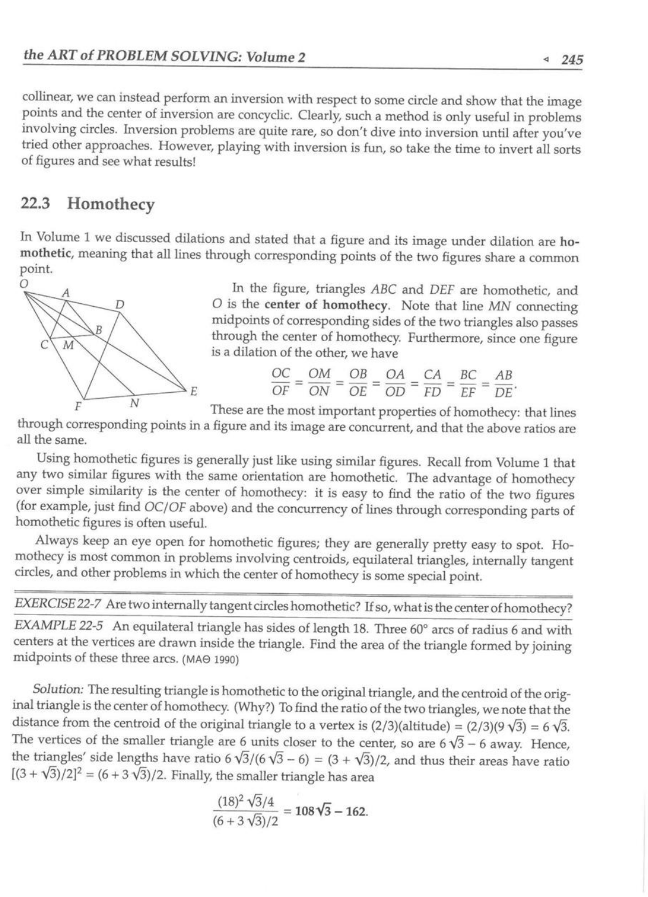

## Printed page 246

<!-- source: volume-2, PDF page 268, printed page 246 -->

Notice the advantage of using homothecy; we don’t have to find the ratio of a pair of sides to find the ratio of the triangles’ corresponding lengths.

**EXERCISE 22-8** In $\Delta ABC$, $D$ is the midpoint of $BC$, $E$ is the midpoint of $AC$, and $F$ is the midpoint $AB$. Show that $\Delta ABC$ and $\Delta DEF$ are homothetic. What is the center of homothecy?

### 22.4 Geometric Continuity

Given a region with area $K$ and a line $l$, show that we can find a line parallel to $l$ which divides the region into two regions of area $K/2$.

Start from position 1, where the line is entirely below the figure. Consider the area in the region below the line. Initially, this area is 0. As we move the line steadily up from position 1 to position 3, this area ranges continuously from 0 to $K$. Hence, at some point, it must equal $K/2$.

This is all we must do to solve geometric continuity problems: define some continuous function in terms of the given figures (such as the area below the line above), show that this function varies over a range which includes the desired value (the range 0 to $K$ above), and finally conclude that the desired value can be attained because the function is continuous.

**EXAMPLE 22-6** Given a region of area $A$ and a point $P$, show that there is some line through $P$ which divides the region into two equal areas.

**Proof:** Draw a line through $P$. By rotating this line about $P$, we can form any other line through $P$. Now we must find some function in terms of this line which continuously covers some range that includes a case of a line bisecting the area of the region. The only such function which seems plausible is choosing the area on one side of the line. Thus, we choose some point $Q$ on the line and consider the region’s area to the left of $PQ$ (standing at $P$ and looking at $Q$). Let the initial configuration be such that this area is $X$ as shown. Consider what happens as we rotate the line $180^\circ$. The line rotates to itself, but with $Q$ on the other side of $P$. Hence, the area to the left of $PQ$ is now $Y = A - X$. In a $180^\circ$ rotation, the area to the left of $PQ$ ranges continuously from $X$ to $A - X$, so it must at some point be equal to $A/2$ (since $A/2$ always lies in this range).

One point we have breezed over in this discussion is proving that the areas really range continuously rather than jumping from one value to the next. While it is intuitively obvious in the first example that by gradually moving the line from below the region to above the region continuously changes the area below the line, we must find a way to mathematically prove this. For this proof, we must show that for a given line which cuts the region into two pieces, we can increase or decrease the area below the line by any small amount, no matter how small, through sliding the line up or down.

Original scan — PDF page 268

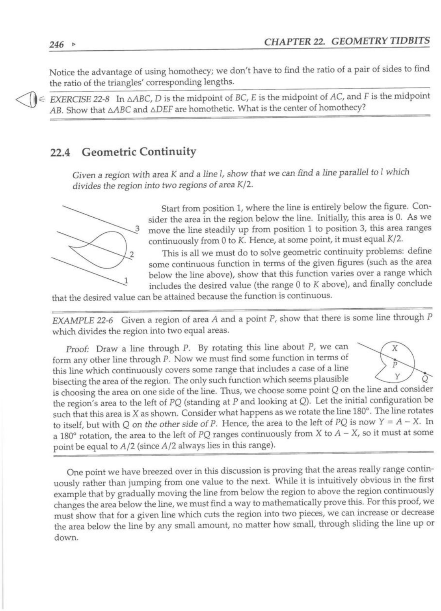

## Printed page 247

<!-- source: volume-2, PDF page 269, printed page 247 -->

Let $\epsilon$ be some very small number. Let the area in the region below the line $CD$ shown be $X$. We wish to show that no matter how small $\epsilon$ is, we can find another line parallel to the first which leaves less than $X + \epsilon$ of the region’s area below. Since the region is finite, we can draw lines $l$ and $m$ perpendicular to $CD$ such that the entire region lies between $l$ and $m$. Points $C$ and $D$ are the intersections of the original line with these new lines. Let $CD = y$. We choose $A$ and $B$ on lines $l$ and $m$ such that $AD = BC = \epsilon/y$. Hence, the area of the region below line $AB$ is less than $X + [ABCD] = X + \epsilon$, as desired. Hence, for any discrete area difference, no matter how small, we can make a smaller change of area; therefore, the area change as we slide the line across the region is continuous as claimed.

Try to understand the proof, why we need to do it, and why it shows that the area varies continuously from 0 to $K$ as we slide a line from below the region to above it. If you have trouble understanding the details, move on and come back later. While the details aren’t trivial, they aren’t as important as the other techniques this chapter offers.

It’s pretty obvious when these continuity arguments are called for; all these problems require us to find the existence of some line or plane intersecting some continuous region (as opposed to a smattering of points, which we’ll look at next section).

**EXERCISE 22-9** Given a point $P$ in a finite region $\Gamma$, show that we can draw 12 rays from $P$ which divide the region into 12 regions of equal area.

### 22.5 Given a Finite Number of...

Once again, we introduce this topic with a problem.

**Prove Sylvester’s Theorem**, which states that given $n$ distinct points in the plane ($n \geq 2$) not all collinear there is some line that goes through exactly two of the points.

**EXERCISE 22-10** Create a few sets of points to see why Sylvester’s Theorem seems true, but is not obvious.

For any set of three points which are not collinear, we define a number $\alpha$ as the smallest distance from one of the three points to the line through the other two. There are three such distances for each set of three points (one for each point); $\alpha$ is the smallest of the three. Since there are finitely many points, there are finitely many values for $\alpha$; consider the three points for which $\alpha$ is smallest. Let the points be $A, B,$ and $C$, such that the distance from $A$ to $BC$ is this minimum $\alpha$. We will show that the line containing $B$ and $C$ does not pass through any other of the $n$ points.

Original scan — PDF page 269

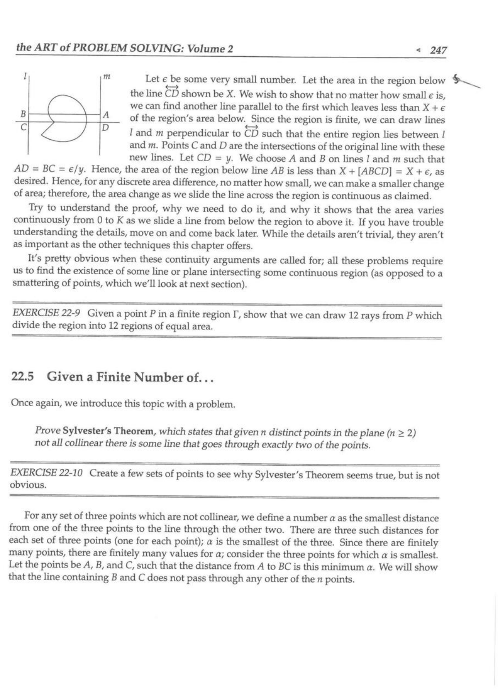

## Printed page 248

<!-- source: volume-2, PDF page 270, printed page 248 -->

Draw altitude $AE$ of $\Delta ABC$. Since $AE$ is the shortest altitude of $\Delta ABC$, point $E$ must lie between $B$ and $C$ as shown. Note that the length of $AE$ is the aforementioned minimum $\alpha$ value. Suppose for the sake of contradiction that another point $D$ lies on $BC$. Without loss of generality, let $D$ be to the left of $E$ as in our diagram. We consider two cases: point $D$ outside $C$ and point $D$ between $B$ and $C$. For the former, we have the first diagram, in which $CX < AE$ since $CX$ is shorter than the altitude from $E$ to $AD$, which in turn is less than $AE$. (Prove it.) Thus, points $A, C,$ and $D$ have a smaller $\alpha$ value than the set $\{A, B, C\}$, which contradicts the fact that this latter set has the minimum $\alpha$ value. Hence, $D$ cannot be among the original $n$ points. Similarly, if $D$ is on segment $BC$ we have $DX < AE$, which once again is a contradiction. Hence, no point on line $BC$ besides $B$ and $C$ can be among the original $n$ points and we have found a line through exactly 2 of the $n$ points.

Problems like this are difficult, but if you ever come to a problem involving some finite number of points about which you need to prove the existence of something special, try the showing that the set of three points which form a triangle of maximum or minimum area, perimeter, or even altitude length (as we did with Sylvester’s Theorem) is the desired set.

**EXERCISE 22-11** In proving Sylvester’s Theorem, we assumed the set of points is finite. Why can’t we use an infinite set? Find a counterexample to the theorem if infinitely many points are allowed.

**Problems to Solve for Chapter 22**

Beware, not all of these problems require the concepts taught in this chapter; we’ve mixed in a few toughies from other geometric subjects. Note that, by the standards of other chapters, many to most of these problems deserve a needle.

351. Consider triangle $ABC$ with medians $AD, BE,$ and $CF$. If the area of $\Delta ABC$ is 12, what is the area of the triangle $D'E'F'$, where $D', E',$ and $F'$ are the reflections of $D, E,$ and $F$ through $A, B,$ and $C$ respectively? (MAΘ 1991)

352. Given two parallel lines which do not pass through point $O$, describe the images of the lines upon an inversion with respect to a circle with center $O$.

353. Show that for any quadrilateral inscribed in a circle of radius 1, the length of the shortest side is less than or equal to $\sqrt{2}$. (Canada 1969)

354. The figure $F$ is such that the projections of $F$ on the non-parallel planes $\alpha$ and $\beta$ are straight lines. Is it true that $F$ must be a straight line? (M&IQ 1992)

355. Let $\Delta ABC$ be a right triangle of area 1. Let $DEF$ be the points obtained by reflecting $A, B,$ and $C$ respectively in their opposite sides. Find the area of $DEF$. (Canada 1989)

356. Prove that if the area of a quadrilateral is half the product of its diagonals, then the quadrilateral is orthodiagonal. (M&IQ 1991)

357. Two circles are drawn which intersect at $O$. Suppose that the tangents to the circles at $O$ are perpendicular. Such circles are called orthogonal circles. Describe the images of the circles upon an

Original scan — PDF page 270

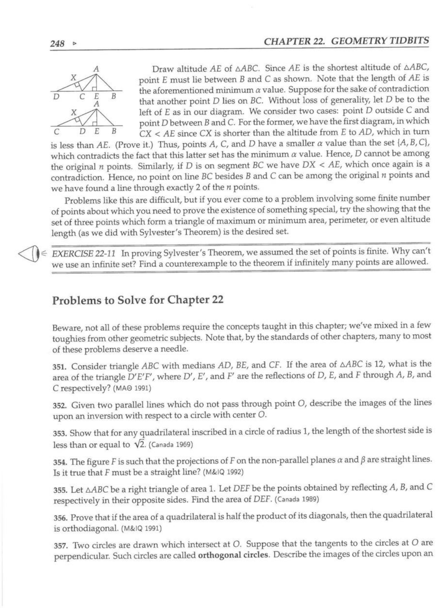

## Printed page 249

<!-- source: volume-2, PDF page 271, printed page 249 -->

inversion with respect to a circle centered at $O$.

358. Suppose that three circles are given in the plane in such a way that they divide the plane into 8 components. Let $R$ be the region in the plane consisting of all points in at least 2 of the three circles. The boundary of $R$ consists of 6 arcs of circles. Prove that the sum of the degree measures of these arcs is a constant, independent of the original three circles. (MOP)

359. Prove that the orthocenter cannot be the midpoint of two of the altitudes of a given triangle. (M&IQ 1991)

360. Let $A$ and $B$ be two simple closed figures in the plane. Prove that there exists a line which simultaneously bisects both the area of both figures. This is called the Pancake Theorem.

361. Let quadrilateral $ABCD$ be circumscribed around a circle. Prove that the incircle of $\Delta ABC$ is tangent to the incircle of $\Delta ACD$. (M&IQ 1991)

362. Given $2n$ points in the plane, no three of which are collinear, prove that there exist at least $n$ different lines, each passing through two points in the set and dividing the remaining $2n - 2$ points in half ($n - 1$ points on each side). (Mandelbrot #3)

363. Two circles are internally tangent. A triangle is formed with one vertex on each circle (not at the tangent point) and the third at the tangent point. Find the maximum area of such a triangle if the circles' radii are 1 and 3. (Mandelbrot #1)

364. Let $S$ be a simple closed curve. Prove that there exists some line $l$ which simultaneously bisects the length of curve $S$ and bisects the area of the region enclosed by $S$. (Mandelbrot #2)

365. Prove that if the altitude of isosceles trapezoid $ABCD$ ($AB \parallel CD$) is equal to $\frac{1}{2}(AB + CD)$, then $ABCD$ is orthodiagonal. (M&IQ 1991)

366. Given any smooth convex figure, prove that it is possible to draw a square which contains the entire figure and has all four sides tangent to the figure. (Mandelbrot #2)

367. A cylindrical hole of radius 1 is drilled along one of the long diagonals of a cube of side length 3. Find the area of one of the six congruent faces of the resulting solid. (Mandelbrot #3)

368. Given two orthogonal circles which intersect at $A$ and $B$, we draw a third circle with center $A$ and radius $AB$. Let $C$ and $D$ be the points besides $B$ where this third circle meets the other two. Prove that $CD$ is a diameter of the third circle.

369. Find, with proof, the minimum number of equilateral triangles of side 1 which are needed to cover a square of side 1 entirely. (MOP)

370. The incircle of $\Delta ABC$ touches the sides $BC, CA, AB$ at the points $D, E, F$ respectively. Let $X, Y, Z$ be the midpoints of $EF, FD, DE$, respectively. Prove that the incenter of $ABC$, the circumcenter of $ABC$, and the circumcenter of $XYZ$ are collinear. (IMO 1986)

371. Given points $A, B,$ and $C$, we draw lines through $A, B,$ and $C$ parallel to $BC, AC,$ and $AB$ respectively. These three lines form a new triangle similar to $\Delta ABC$ but twice as large which has $A, B,$ and $C$ as the midpoints of its sides. We call this new triangle the first outer medial triangle. If

Original scan — PDF page 271

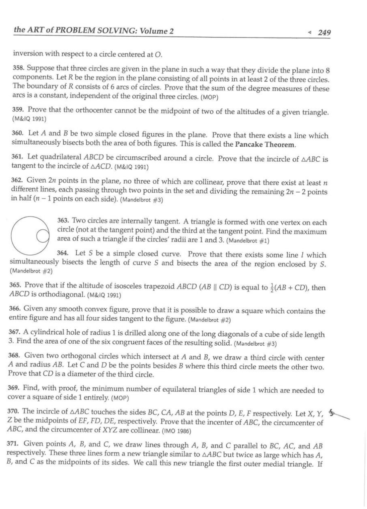

## Printed page 250

<!-- source: volume-2, PDF page 272, printed page 250 -->

we repeat this construction on the vertices of the new triangle we arrive at the second outer medial triangle. (Mandelbrot #3)

i. Construct the first outer medial triangle of any triangle $ABC$.

ii. Given $n \geq 3$ points in the plane, no three of which are collinear, prove that one can find three points whose first outer medial triangle contains all the remaining $n-3$ points in its interior or sides.

iii. Given $n \geq 3$ points in the plane, no three of which are collinear, prove that one can find three points whose second outer medial triangle contains none of the other points in its interior.

372. We are given a triangle $ABC$ and three rectangles $R_1, R_2, R_3$ with sides parallel to two fixed perpendicular directions and such that their union covers the sides $AB, BC,$ and $CA$. That is, each point on the perimeter of $ABC$ is contained in or on at least one of the rectangles. Prove that all points inside the triangle are also covered by the union of $R_1, R_2, R_3$. (IMO 1985)

Original scan — PDF page 272

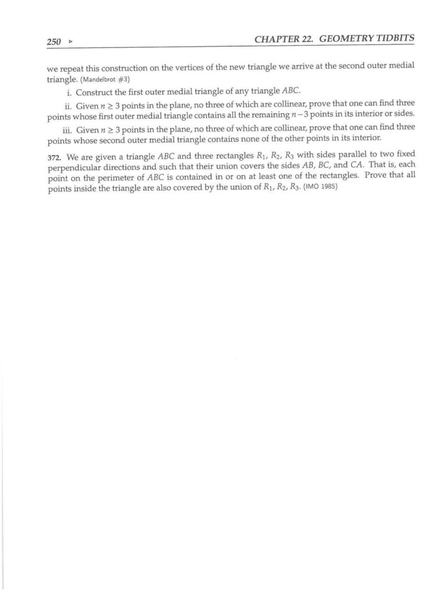

## Printed page 251

<!-- source: volume-2, PDF page 273, printed page 251 -->

After Euclid presented his five basic axioms of geometry, many geometers felt uncomfortable with one of them—the parallel postulate, which states that given a line $l$ and a point $P$ not on $l$, there is exactly one line through $P$ parallel to $l$. Compared to "through any two points there is exactly one line" or "all right angles are equal," the parallel postulate is ugly, longwinded, complex. Thus many hoped that the parallel postulate might turn out to be provable from the other four axioms.

To attempt to prove the postulate, several mathematicians tried assuming the postulate to be false, seeking a contradiction. Rather than finding a contradiction, though, they found an entire new type of geometry.

In non-Euclidean geometry, the parallel postulate does not hold. The simplest type is geometry on the surface of a sphere. Here the equivalent of a straight line is a great circle—an equator. Any two equators intersect, so there is no such thing as parallel lines on the sphere. Instead of exactly one parallel line through $P$, there are none. In another type of non-Euclidean geometry, there are infinitely many parallels. This hyperbolic geometry is (obviously) less easy to visualize, but is an equally good geometry in terms of producing interesting results.

As you might expect, strange things happen in non-Euclidean geometry. For example, in spherical geometry the sum of the angles of a triangle is always greater than $180^\circ$, as you can see if you try drawing a large triangle on a sphere.

Even though prominent mathematicians—Lobachevsky, Riemann, Gauss—studied non-Euclidean geometry in the early 1800's, the subject was kept under wraps for many years, not quite seen as serious. But it later led to many very serious things, not the least of which are Einstein's theory of general relativity, which maintains that our spacetime is curved and non-Euclidean, and many M.C. Escher artworks, which tile the hyperbolic plane with frogs, angels, and devils.

Original scan — PDF page 273

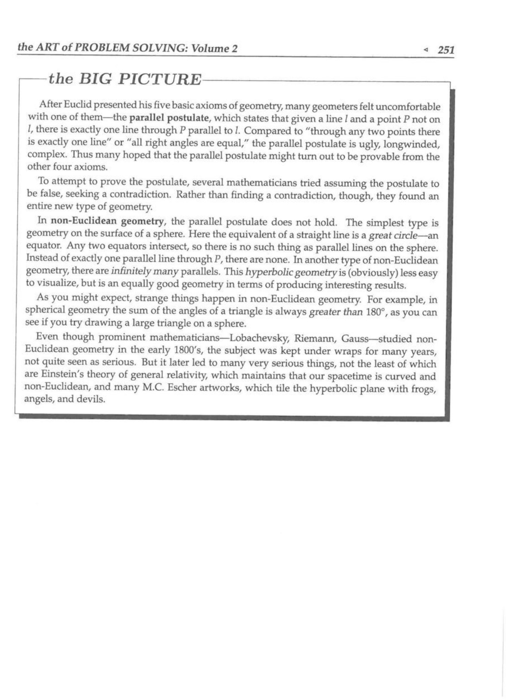

