# Chapter 23: Number Theory

Volume 2 · Printed pages 252–265 · PDF pages 274–287

[Volume contents](../index.md)

## Printed page 252

<!-- source: volume-2, PDF page 274, printed page 252 -->

Chapter 23
Number Theory

WARNING: This chapter assumes a full competence with the modular arithmetic discussed in Volume 1. Make sure you are quite comfortable with mods before you continue.

### 23.1 Divisibility

You may think that we must have exhausted the subject of divisibility in Volume 1. That is nearly true, but there are a number of points which remain to be made. (Don’t be discouraged if you find this section sticky, as our discussion is fairly subtle.)

First, though, a quick review. If a number $a$ divides another number $b$, we write $a|b$; for instance, $6|12$ and $17|1717$. Showing $a|b$ is the same as showing $b = ka$ for some integer $k$—do you see why? The greatest common divisor or GCD of two integers $a$ and $b$ is the largest integer which divides both, and is written $(a,b)$. For instance, $(18,12) = 6, (56,40) = 8,$ and $(17,23) = 1$. Two numbers whose GCD is 1 share no common divisors, and are called relatively prime. If you aren’t familiar with these concepts, try some more examples until you feel comfortable, or go through the relevant sections of Volume 1.

Consider one number which divides the product of two others: $a|bc$. It should be intuitively clear that $a$ can be split into two parts such that one divides $b$ and the other divides $c$. That is, we can find two numbers $a_1$ and $a_2$ such that $a_1a_2 = a, a_1|b,$ and $a_2|c$. For example, for $12|8 \cdot 9,$ we have $12 = 4 \cdot 3, 4|8,$ and $3|9$.

If $p$ is a prime, the only way to split it into two parts is as $p \cdot 1$. Thus if $p|bc,$ we always have either $p|b$ or $p|c$.

Still another point can be made along these lines. Since $a|bc,$ we have $ka = bc$ for some $k,$ and thus $k = bc/a = (b/a_1)(c/a_2)$ for some integers $a_1$ and $a_2$ such that $a_1|b$ and $a_2|c$. Hence both $b/a_1$ and $c/a_2$ are integers. Thus $b/a_1|bc/a$ since their quotient, $c/a_2,$ is an integer. However, since $a_1$ divides both $a$ and $b,$ it divides the greatest common divisor $(a,b).$ Thus $b/(a,b)|b/a_1,$ so $b/(a,b)|bc/a$ for any $a,b,$ and $c.$

**EXERCISE 23-1 In the last argument, we asserted that since $a_1|(a,b), b/(a,b)|b/a_1.$ Why is this so?**

Original scan — PDF page 274

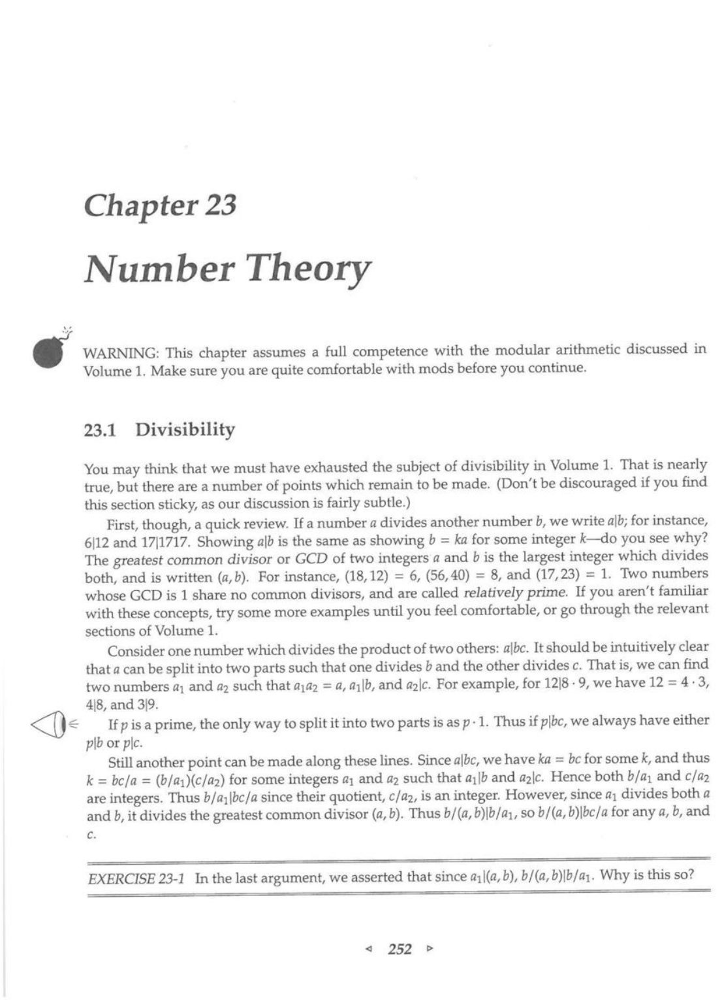

## Printed page 253

<!-- source: volume-2, PDF page 275, printed page 253 -->

Many divisibility-related facts can be understood by referring to the prime factorizations of the numbers in question. For example, a fact we will use occasionally is that if we take two numbers $a$ and $b$ and divide them by their greatest common divisor $g = (a, b)$, the resulting integers $a/g$ and $b/g$ will be relatively prime. Why? We use contradiction. If some prime $p$ divides both $a/g$ and $b/g$, then $a/pg$ and $b/pg$ are integers, so $pg$ divides both $a$ and $b$. But $g$ is supposed to be the largest number which divides both $a$ and $b$, so this is impossible. Hence no prime divides both $a/g$ and $b/g$, so $(a/g, b/g) = 1$.

**EXAMPLE 23-1** Prove that if $ab$ is a perfect square and $(a, b) = 1$, then both $a$ and $b$ must be perfect squares.

**Proof:** Consider the prime factorization $ab = p_1^{e_1} \cdots p_k^{e_k}$. If $ab$ is a square, all the $e_i$ are even and each term $p_i^{e_i}$ is a square in its own right. (Do you see why?) Each prime in the factorization divides either $a$ or $b$ but not both, since we have $(a, b) = 1$. Thus each term $p_i^{e_i}$ in the factorization completely divides either $a$ or $b$. Hence, $a$ is the product of many terms $p_i^{e_i}$, each of which is a square; since it’s a product of squares, $a$ is itself a square. Similarly for $b$.

The arguments of this section may seem like more trouble than they’re worth, but much of both this chapter and Chapter 24 rely on these and similar facts. You may want to go back through some of the proofs again. Focus especially on how we use concepts of the greatest common divisor and relatively prime integers; these simple ideas are at the core of all the number theory you’ll study.

### 23.2 Division in Congruences

In Volume 1, we made the point that division does not work in the obvious way with congruences. That is, given a congruence like $ad \equiv bd \pmod{m}$, we can’t cancel the $d$ to get $a \equiv b \pmod{m}$. Why not? A simple counterexample: we have $2 \equiv 20 \pmod{6}$, but not $1 \equiv 10 \pmod{6}$. What has happened? [If you don’t understand this example, you should go back and review the section on congruences in Volume 1.]

To figure out what has happened, remember what it means for 2 and 20 to be congruent $(\pmod{6})$. It means that they differ by some multiple of 6, say $6q$. When we halve the two numbers, their difference will also be cut in half, to $3q$. The numbers will still be congruent $(\pmod{6})$ only if this new difference is a multiple of 6. If $q$ is odd, this won’t be the case, and the division will fail. In our specific case, the difference between 2 and 20 is 18; halving gives 9, which is not divisible by 6 anymore.

So can we say anything at all about division? Certainly. The difference $3q$ above may not always be divisible by 6, but it is always divisible by 3. Thus while $2a \equiv 2b \pmod{6}$ does not yield $a \equiv b \pmod{6}$, it does yield $a \equiv b \pmod{3}$.

Let’s look back at the general problem. The equation

$$ad \equiv bd \pmod{m}$$

(23.1)

means that $ad$ and $bd$ differ by $mq$ for some $q$. This means that $a$ and $b$ differ by $mq/d$, which must be an integer since $a$ and $b$ are integers. Thus $d|mq$. By the rules of the previous section, this means that

Original scan — PDF page 275

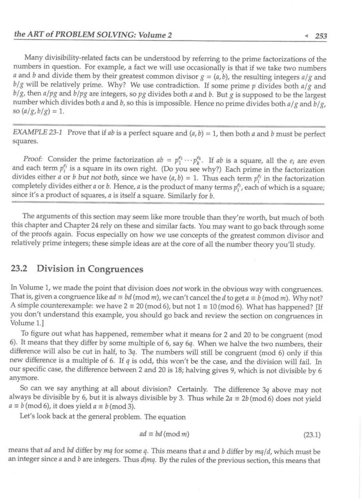

## Printed page 254

<!-- source: volume-2, PDF page 276, printed page 254 -->

$m / (m, d) | mq / d$. We thus have that $a - b = mq / d$ is divisible by $m / (m, d)$ (or $a - b \equiv 0 \pmod{m / (m, d)}$), and (23.1) hence becomes

$$a \equiv b \pmod{m / (m, d)}. \tag{23.2}$$

This is the general division rule for congruences. Try a few examples to see how this division works. Notice that $ad \equiv bd \pmod{m}$ implies $a \equiv b \pmod{m}$ if and only if $(m, d) = 1$, i.e. if $m$ and $d$ have no common factors.

**EXERCISE 23-2** Compare our $2 \equiv 20 \pmod{6}$ example to equation (23.2).

**EXERCISE 23-3** Divide out the common factors in the following congruences.

i. $6a \equiv 6b \pmod{20}$
ii. $23 \equiv 138 \pmod{5}$
iii. $12 \equiv 30 \pmod{9}$

**EXAMPLE 23-2** A nice thing happens when the base of the congruence is a prime. We then have $ad \equiv bd \pmod{p}$. We have two cases. First, $d$ can be a multiple of $p$: $d = kp$. Then $ad = akp \equiv 0$ and $bd = bkp \equiv 0$, and the congruence reduces to $0 \equiv 0$. Not too interesting.

In the other case, $d$ is not a multiple of $p$ so $d$ and $p$ have no common factors besides 1. Since $p$ is prime, this means that $(d, p) = 1$, so we can write

$$ad \equiv bd \pmod{p} \quad a \equiv b \pmod{p / (d, p)} \quad a \equiv b \pmod{p}.$$

Thus in congruences $(\pmod{p})$, $p$ a prime, division works! Just make sure you don't divide out any multiples of $p$.

**WARNING:** It is an extremely common error to forget that division doesn't work in the normal way in congruences. Don't make it. Always remember to divide the modulus $m$ by the greatest common divisor of $m$ and the divided quantity $d$, as in equation (23.2), which you should study carefully.

### 23.3 Solving Linear Congruences

The reason division is so important is that it allows us to solve linear congruences, expressions of the form $rx + s \equiv t \pmod{m}$. Let's look at the example

$$1233x + 45 \equiv 9090 \pmod{24}.$$

First of all, we can subtract the 45 from both sides, since we found in Volume 1 that subtraction always works in congruences. We then have

$$1233x \equiv 9045 \pmod{24}.$$

The next step is to mod out both 1233 and 9045 by 24. This is crucial—because working with such large numbers would be messy and confusing, we use the convenient fact that modding everything

Original scan — PDF page 276

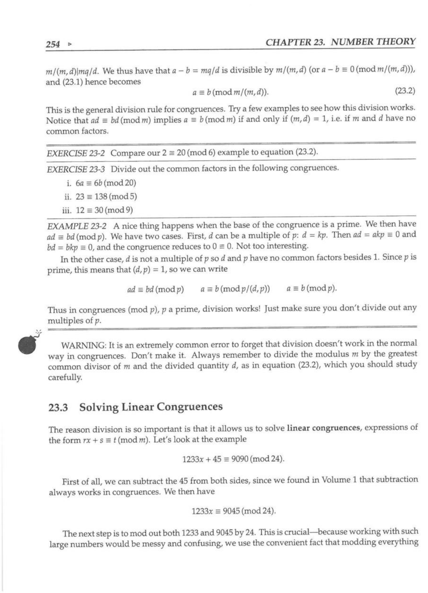

## Printed page 255

<!-- source: volume-2, PDF page 277, printed page 255 -->

out will not change the result. Dividing each large number by 24 and taking only the remainder (do this yourself), we find that $1233 \equiv 9 \pmod{24}$ and $9045 \equiv 21 \pmod{24}$. Our equation becomes

$$9x \equiv 21 \pmod{24}.$$

We can immediately divide both sides by 3, the common factor of 9 and 21—but we also need to divide the 24 by $(24, 3) = 3$, as in Section 23.2. The equation is then

$$3x \equiv 7 \pmod{8},$$

and we have only to get rid of the "3" in $3x$ to be finished. To do this, we add 8's to the right hand side, since $8 \equiv 0 \pmod{8}$. We have

$$3x \equiv 7 \equiv 15 \equiv 23 \equiv 31 \equiv \cdots \pmod{8},$$

and we can take our choice of where to stop. In this case, we'll stop at 15, writing $3x \equiv 15 \pmod{8}$, because we can then divide both sides by 3 (the 8 is unchanged because 3 and 8 are relatively prime) to get the final answer of

$$x \equiv 5 \pmod{8}.$$

Thus the solutions to our congruence are ..., $-11, -3, 5, 13, 21, \ldots$, or $5 + 8j$ for any integer $j$.

**EXERCISE 23-4** Solve the congruences. (Watch out, some strange things happen!)

i. $1235x + 45 \equiv 9090 \pmod{24}$
ii. $1235x + 45 \equiv 9090 \pmod{11}$
iii. $1235x + 45 \equiv 9087 \pmod{11}$
iv. $1232x + 45 \equiv 9090 \pmod{24}$

**EXAMPLE 23-3** The general solution to a linear congruence looks like $x \equiv a \pmod{m}$. This can also be written as $x = a + mj$ for any integer $j$. Such a representation allows us to solve more than one congruence simultaneously. Consider two congruences: if one yields $x = 5 + 6j$ ($x \equiv 5 \pmod{6}$) and the other $x = 4 + 7k$ ($x \equiv 4 \pmod{7}$), we write $5 + 6j = 4 + 7k$, or

$$1 + 6j = 7k \implies 7k \equiv 1 \pmod{6},$$

since $7k$ is 1 more than a multiple of 6. Solving the resulting linear congruence yields $k \equiv 1 \pmod{6}$, so $k = 1 + 6l$ for any integer $l$. Thus $x = 4 + 7k = 4 + 7(1 + 6l) = 11 + 42l$ for any integer $l$. As usual for simultaneous expressions, simultaneous congruences may have no solution (for example, $x \equiv 2 \pmod{4}$ and $x \equiv 1 \pmod{10}$).

**EXERCISE 23-5** Solve simultaneously the three congruences $3x \equiv 4 \pmod{7}, 4x \equiv 5 \pmod{8}$, and $5x \equiv 6 \pmod{9}$.

**WARNING:** Although the method of Example 23-3 is a nice, mechanical way to solve systems of linear congruences, don't let it blind you to more clever approaches. For example, the system $x \equiv 4 \pmod{5}, x \equiv 5 \pmod{6}, x \equiv 6 \pmod{7}$ is most easily solved by noting that it forces $x + 1$ to be divisible by 5, 6, and 7, so that $x + 1 = 5 \cdot 6 \cdot 7 \cdot j = 210j$, and $x = 210j - 1$. Watch for these shortcuts.

Original scan — PDF page 277

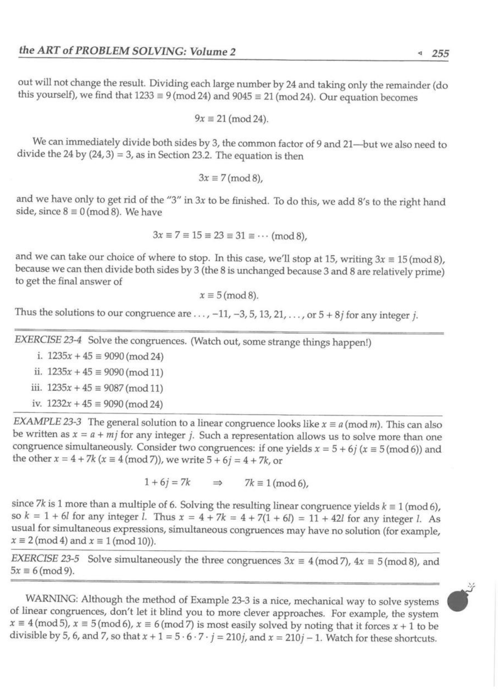

## Printed page 256

<!-- source: volume-2, PDF page 278, printed page 256 -->

### 23.4 Solving Quadratic Congruences

A quadratic congruence is of the form $rx^2 + sx + t \equiv u \pmod{m}$. Unfortunately, this general form is too difficult to do much with, so we'll ignore the $sx$ term. We can then reduce to the form $rx^2 \equiv v \pmod{m}$, with $v = u - t$.

We can use the division rules just as we used them for linear congruences to get still simpler, to the form $x^2 \equiv v' \pmod{m'}$. Thus the problem is to find the square roots of $v' \pmod{m'}$, or numbers whose squares are congruent to $v' \pmod{m'}$.

**EXAMPLE 23-4 Not all numbers even have a square root. For example, suppose we are working in $\pmod{6}$. The squares of all the numbers are $0^2 = 0, 1^2 = 1, 2^2 = 4, 3^2 = 9 \equiv 3, 4^2 \equiv (-2)^2 = 4,$ and $5^2 \equiv (-1)^2 = 1$. (Note how we have simplified the arithmetic by using the facts that $4 \equiv -2$ and $5 \equiv -1.$) Thus 0 has the square root 0, 1 has the two square roots 1 and 5, 4 has the square roots 2 and 4, and 3 has the square root 3. However, 2 and 5 have no square roots at all, because there are no numbers which, when squared, give 2 or 5 $\pmod{6}$.**

**EXAMPLE 23-5 In the previous example, why did we only consider the squares of the numbers from 0 to 5?**

Solution: Every number after 5 is congruent to some number from 0 to 5 $\pmod{6}$. Since the squares of congruent numbers are congruent, we need only compute the squares of 0 through 5 to analyze the squares of all integers $\pmod{6}$. Note also the pattern of the nonzero squares in the example: 1, 4, 3, 4, 1. The sequence is symmetric. This is not an accident. Since $(u)^2 = (-u)^2,$ we have $(u)^2 \equiv (-u)^2 \pmod{6}$. Noting that $5 \equiv -1 \pmod{6}$ and $4 \equiv -2 \pmod{6}$ explains the symmetry of our squares.

A number which has a square root $\pmod{m}$ is called a quadratic residue $\pmod{m}$.

**EXERCISE 23-6 Find all quadratic residues in $\pmod{7}, 8,$ and 9.**

**EXAMPLE 23-6 The most quadratic residues there can be $\pmod{n}$ for an even integer $n = 2m$ is $m + 1$. This is because even if $0^2, 1^2, \ldots, m^2$ are all different, the rest of the squares will be copies of these first $m + 1$ numbers: $(m + 1)^2 \equiv (m - 1)^2, (m + 2)^2 \equiv (m - 2)^2,$ and so on. For example, since $2m \equiv 0 \pmod{2m},$ we can write**

$$(m + 1)^2 \equiv m^2 + 2m + 1 \equiv m^2 - 2m + 1 \equiv (m - 1)^2 \pmod{2m}.$$

Write down the squares of 0, 1, 2, 3, 4, 5, and 6 $\pmod{6}$ to see this.

**EXERCISE 23-7 What is the most quadratic residues there can be $\pmod{n}$ for $n = 2m + 1$ an odd integer?**

**EXAMPLE 23-7 Let $p$ be a prime other than 2. If there are two numbers $u$ and $v$ such that $u^2 \equiv v^2 \pmod{p},$ then $u^2 - v^2 \equiv 0 \pmod{p},$ so that $u^2 - v^2 = (u - v)(u + v)$ is a multiple of $p.$ Since $p$ is prime, this implies that either $u - v$ is a multiple of $p,$ so $u \equiv v \pmod{p},$ or $u + v$ is a multiple of $p,$ so $u \equiv -v \pmod{p}.$**

Thus when we write down the quadratic residues $0^2, 1^2, \ldots, (p - 1)^2,$ there can be no duplications, except that the last $(p - 1)/2$ are copies of the first $(p - 1)/2$ nonzero squares, much like described in Example 23-6. In other words, an odd prime $p$ always has the maximum $(p + 1)/2$ residues.

Original scan — PDF page 278

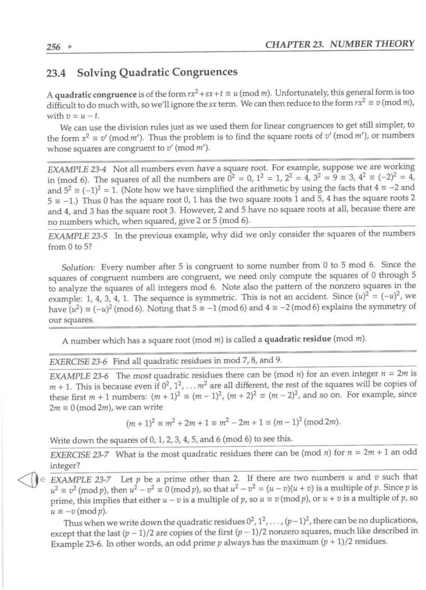

## Printed page 257

<!-- source: volume-2, PDF page 279, printed page 257 -->

On the other hand, a nonprime like 15 will not achieve the maximum: the squares of 0 through 14 evaluated mod 15 are

$$0, 1, 4, 9, 1, 10, 6, 4, 4, 6, 10, 1, 9, 4, 1.$$

There are only 6 residues—0, 1, 4, 6, 9, 10—rather than the maximum of $(15 + 1)/2 = 8.$

**EXERCISE 23-8** Verify the assertions of the previous example for $p = 11$ and $p = 17.$

Actually solving the quadratic congruence $x^2 \equiv v (\bmod m)$ (finding the square roots of $v$) is not at all an easy problem. In number theory, it's very common for simple-seeming equations to contain enormous complexities, and this is one.

The most important use of quadratic residues is in knowing certain special cases of numbers which aren't residues. For example, the squares $(\bmod 4)$ are 0, 1, 0, and 1—the only residues are 0 and 1! This is of paramount importance in many applications.

**EXERCISE 23-9** Find all quadratic residues $(\bmod 3)$ and $(\bmod 8).$

### 23.5 The Sum of the Divisors

In Volume 1 we derived a formula for the number of positive divisors of some number

$$n = p_1^{e_1} p_2^{e_2} \cdots p_k^{e_k},$$

namely

$$d(n) = (e_1 + 1)(e_2 + 1) \cdots (e_k + 1).$$

A similar, though more involved, problem is to find the sum of all the divisors of $n$, which we call $s(n).$

**EXAMPLE 23-8** If $n = 12$, the divisors are 1, 2, 3, 4, 6, and 12, so $d(n) = 6$. We write $s(n) = 1 + 2 + 3 + 4 + 6 + 12 = 28.$

A very clever method exists to find $s(n)$. Clearly it is the sum of expressions $p_1^{f_1} \cdots p_k^{f_k}$, where each $f_i$ is nonnegative and less than or equal to the corresponding $e_i$ in (23.3). But rather than write down all such expressions, we can get them in one fell swoop by writing the product

$$s(n) = (1 + p_1 + p_1^2 + \cdots + p_1^{e_1}) (1 + p_2 + p_2^2 + \cdots + p_2^{e_2}) \cdots (1 + p_k + p_k^2 + \cdots + p_k^{e_k}).$$

**EXAMPLE 23-9** The factorization of 12 is $2^2 \cdot 3$, so the product is

$$(1 + 2 + 4)(1 + 3) = 1 + 2 + 4 + 3 + 6 + 12,$$

as desired.

**EXERCISE 23-10** Write down and expand the product for $n = 16, 20$, and 28.

Original scan — PDF page 279

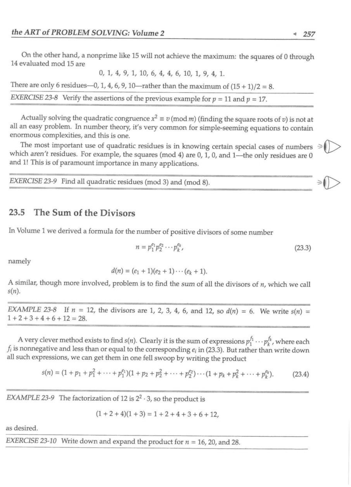

## Printed page 258

<!-- source: volume-2, PDF page 280, printed page 258 -->

**EXERCISE 23-11 Why does this product give the sum of the divisors?**

**EXERCISE 23-12 Make the product (23.4) simpler using the formula for the sum of a geometric series.**

**EXERCISE 23-13 Why are**

$$d(n) = \sum_{d|n} 1 \quad \text{and} \quad s(n) = \sum_{d|n} d$$

correct expressions for $d(n)$ and $s(n)$? Do you like them?

One ancient fascination in number theory is perfect numbers, numbers $n$ for which $s(n) = 2n$. For example, $s(6) = 1 + 2 + 3 + 6 = 12$, so 6 is perfect. Numbers $n$ for which $s(n) > 2n$ are called abundant, because they have many large divisors; numbers $n$ for which $s(n) < 2n$ are called deficient.

**EXERCISE 23-14 Classify 24, 26, and 28 as abundant, deficient, or perfect.**

**EXERCISE 23-15 Show that any number of the form**

$$2^k(2^{k+1} - 1)$$

is perfect if $(2^{k+1} - 1)$ is prime. This form was discovered by Euclid, and all known perfect numbers have this form. (In particular, no odd perfect numbers have ever been found.)

**EXERCISE 23-16 Show that 6 and 28 have the form of the previous exercise, and find the third smallest perfect number.**

### 23.6 Fermat’s Theorem

Consider doing arithmetic (mod $p$), with $p$ a prime. If we take powers of some number $a$ (where $a \neq 0$ (mod $p$)), the numbers $a^2, a^3$, etc. cannot all be different (mod $p$), because they are all in the range from 0 to $p - 1$. Thus some two of them must be the same, say $a^r$ and $a^s$. Assume $r > s$; if $a^r \equiv a^s$ (mod $p$), we can write $a^{r-s} \equiv 1$ (mod $p$), since $p$ is prime. Thus the powers of $a$ will hit 1 before they repeat, and will look like

$$a, a^2, a^3, \ldots, a^t \equiv 1, a^{t+1} \equiv a, a^{t+2} \equiv a^2, \ldots, a^{2t} \equiv 1, a^{2t+1} \equiv a, \ldots$$

(23.5)

We’ll call the smallest positive integer $t$ such that $a^t \equiv 1$ the period of a number (mod $p$) of $a$.

**EXERCISE 23-17 Find the periods of 1, 2, 3, 4, 5, and 6 (mod 7).**

Original scan — PDF page 280

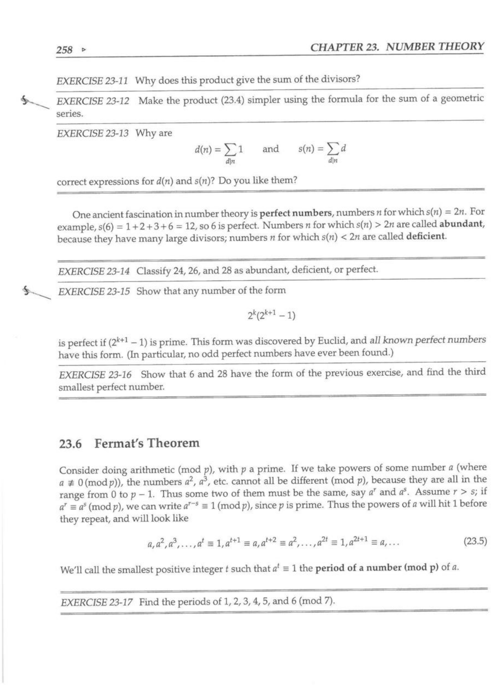

## Printed page 259

<!-- source: volume-2, PDF page 281, printed page 259 -->

We can say some interesting things about the period of a number $a$ (mod $p$). Consider the set of numbers $\{1, 2, 3, \ldots, p-1\}$. If we multiply all these numbers by $a$ we get $\{a, 2a, 3a, \ldots, (p-1)a\}$. Since none of the new numbers $ka$ is divisible by $p$, all are congruent to some number in the set $\{1, 2, \ldots, p-1\}$. (Why do we leave 0 out?) Moreover, no two of $\{a, 2a, 3a, \ldots, (p-1)a\}$ are congruent: if $ka \equiv ja$ (mod $p$), then $k \equiv j$ (mod $p$). (Why can we cancel the $a$?) This means that the set $\{a, 2a, \ldots, (p-1)a\}$ is just a rearrangement of $\{1, 2, \ldots, p-1\}$ when taken (mod $p$). We thus have

$$a \cdot 2a \cdot 3a \cdots (p-1)a \equiv 1 \cdot 2 \cdot 3 \cdots (p-1) \pmod{p},$$

and cancelling all common factors leaves

$$a^{p-1} \equiv 1 \pmod{p}.$$

(23.6)

This equation is true for all primes $p$ and for all numbers $a \neq 0$ (mod $p$), and is called Fermat’s Theorem. It is an extremely important theorem of number theory, as you will see.

**EXERCISE 23-18** Verify Fermat’s Theorem for $p = 7$ and $a = 1, 2, 3, \ldots, 6$.

**EXAMPLE 23-10** Find $4^{87}$ (mod 17).

Solution: From Fermat, $4^{16} \equiv 1$ (mod 17). Raising both sides to the fifth power, we have $4^{80} \equiv 1$ (mod 17), so that

$$4^{87} \equiv 4^7 \equiv 4 \cdot (4^2)^3 \equiv 4 \cdot (16)^3 \equiv 4 \cdot (-1)^3 \equiv -4 \equiv 13 \pmod{17}.$$

**EXERCISE 23-19** Find $6^{1000}$ (mod 23).

So what does Fermat’s Theorem mean for the period of a number $a$? First of all, the period is at most $p-1$, since the period is the smallest power which gives 1. Moreover, looking at the list (23.5) we can see that the only powers $u$ which give $a^u \equiv 1$ are multiples of $t$: $a^t \equiv 1, a^{2t} \equiv 1$, etc. Since $a^{p-1} \equiv 1, p-1$ must thus be a multiple of $t$, meaning that $t$ must be a divisor of $p-1$ for any $a$. This puts a strict limit on the possible periods.

**EXERCISE 23-20** Find all possible periods a number can have (mod 23), (mod 17), and (mod 7).

**EXAMPLE 23-11** We know that every period divides $p-1$, but especially interesting are elements $g$ whose period is exactly $p-1$. For such an element $g$, the list

$$g, g^2, g^3, \ldots, g^{p-1}$$

is just a rearrangement of $1, 2, \ldots, p-1$, since all are different and none is congruent to 0. Thus if we have such a $g$, called a primitive root, every element of $\{1, 2, 3, \ldots, p-1\}$ is congruent to $g^e$ for some exponent $e$.

**EXERCISE 23-21** Let the divisors of $p-1$ be $d_1, d_2, \ldots$. Prove that if we have a primitive root $g$ (mod $p$), then for each $d_i$ there is an element with period $d_i$.

Original scan — PDF page 281

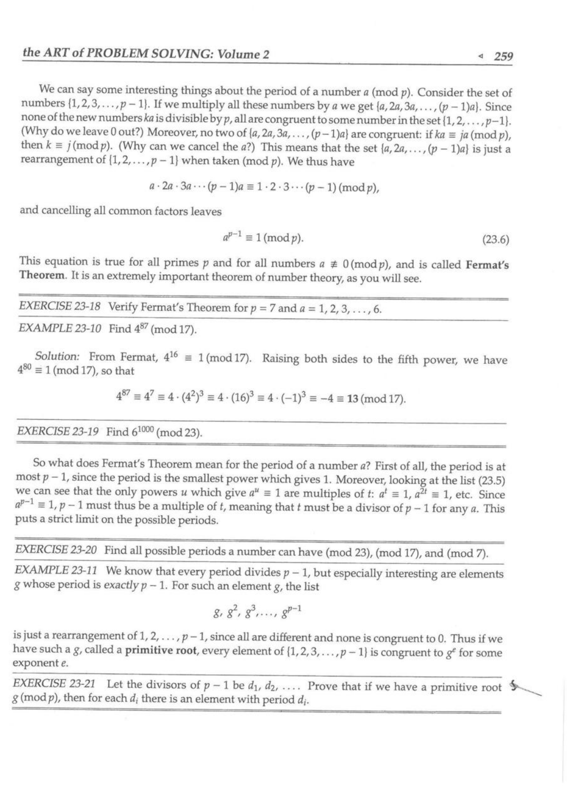

## Printed page 260

<!-- source: volume-2, PDF page 282, printed page 260 -->

### 23.7 The $\phi$ Function

Suppose we try to extend Fermat’s theorem to systems where the base $m$ is not prime. We will immediately encounter several problems. (Follow along with the proof of Fermat’s Theorem from the previous section.) The first comes when we try to show that there are no duplicates in the set $\{a, 2a, 3a, \ldots, (m-1)a\}$ by cancelling the $a$ from the congruence $ka \equiv ja \pmod{m}$. We can only make this cancellation if $(m, a) = 1$, so our entire proof breaks down if $a$ is not relatively prime to $m$. (Why was this not a problem when $m$ was prime?) The second problem occurs when we try to cancel the common factors from both sides of

$$1 \cdot 2 \cdots (m-1) \equiv a \cdot 2a \cdots (m-1)a \pmod{m}.$$

We can only make this cancellation if all the numbers $1, 2, \ldots, m-1$ are relatively prime to $m$, which they won’t be if $m$ is not prime. This is a more serious problem.

We can get around the problem if we start out listing only those integers which are relatively prime to $m$. For example, for $m = 14$, the list would be $\{1, 3, 5, 9, 11, 13\}$.

**EXERCISE 23-22** Write down all numbers relatively prime to $m = 20, m = 15,$ and $m = 12.$

We are thus forced to use, instead of the list of all positive integers less than $m$, a new list of integers less than $m$ and relatively prime to it. Using this list, which we’ll write as $\{1, r_1, r_2, \ldots, m-1\}$ since 1 and $m-1$ are always relatively prime to $m$, we can then see that $\{a, r_1a, r_2a, \ldots, (m-1)a\}$ is a rearrangement of $\{1, r_1, r_2, \ldots, m-1\}$ if $(a, m) = 1$ by the same argument as before: each $r_i a$ is still relatively prime to $m$ because $a$ and $r_i$ are, and $r_i a \equiv r_j a \pmod{m}$ means that $r_i \equiv r_j \pmod{m}$ (since $(a, m) = 1$). Since the two lists are the same $(\pmod{m})$, we have

$$a \cdot r_1a \cdot r_2a \cdots (m-1)a \equiv 1 \cdot r_1 \cdot r_2 \cdots (m-1) \pmod{m}.$$

Moreover, since all the $r_i$ are relatively prime to $m$, we can cancel them, getting

$$a \cdot a \cdots a \equiv 1 \pmod{m}.$$

Here’s our final problem: how many $a$’s are there? There is an $a$ for each number in our list, or one for every number less than $m$ that is relatively prime to $m$. We will thus form a new function, $\phi(m)$, to represent the number of integers less than $m$ and relatively prime to $m$; the statement of our theorem becomes

$$a^{\phi(m)} \equiv 1 \pmod{m}$$

for all $m$ and all $a$ relatively prime to $m.$

**EXAMPLE 23-12** Find $\phi(16).$

Solution: Since 2 is the only prime which divides 16, the odds are all relatively prime to it, and the evens aren’t. Thus we just need to count the odds 1, 3, \ldots, 15 which are less than 16 to find that $\phi(16) = 8.$

**EXERCISE 23-23** Find $\phi(12)$ and $\phi(11).$

Original scan — PDF page 282

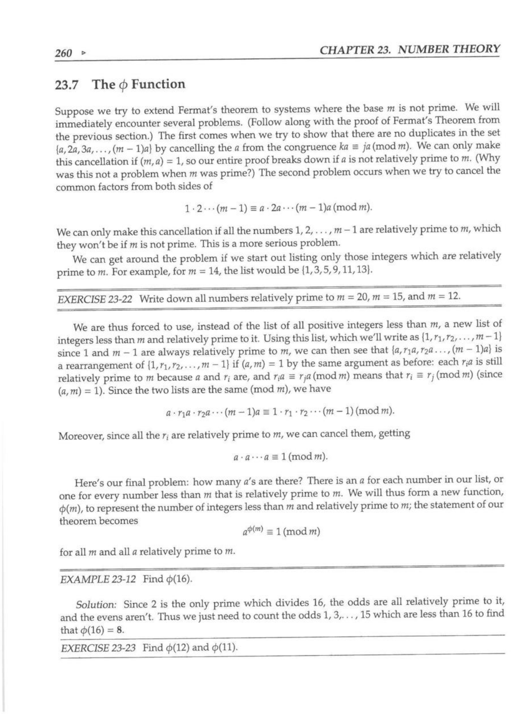

## Printed page 261

<!-- source: volume-2, PDF page 283, printed page 261 -->

**EXAMPLE 23-13 Since $a^{\phi(m)} \equiv 1 \pmod{m}$ for $a$ relatively prime to $m$, every number relatively prime to $m$ has a period $(\mod m)$, and that period must be a divisor of $\phi(m)$.**

Any number not relatively prime to $m$ doesn’t have a period $(\mod m)$. If $(m, a) = g \neq 1$, then $(m, a^k) \geq g$ for any power $k$. But if $a^k \equiv 1 \pmod{m}$, then $a^k = jm + 1$ for some $j$, and $(a^k, m) = 1$, a contradiction.

**EXERCISE 23-24 Find $\phi(p)$ for $p$ prime. Show why the formula $a^{\phi(m)} \equiv 1 \pmod{m}$ is considered to be a generalization of Fermat’s Theorem. (It is called Euler’s generalization.)**

**EXERCISE 23-25 Find $\phi(p^k)$ for $p$ prime and $k$ a positive integer.**

**EXAMPLE 23-14 Prove that the $\phi$ function is multiplicative; that is, $\phi(mn) = \phi(m)\phi(n)$ as long as $(m, n) = 1$.**

Solution: This is a difficult proof, but a very worthwhile one, since proving that a function is multiplicative usually tells you an enormous amount about the structure of the function.

List the integers from 1 to $mn$ in a grid, as:

$$
\begin{array}{c c c c c c}
1 & m + 1 & 2m + 1 & \cdots & (n - 1)m + 1 \\
2 & m + 2 & 2m + 2 & \cdots & (n - 1)m + 2 \\
\vdots & \vdots & \vdots & \ddots & \vdots \\
m & 2m & 3m & \cdots & mn
\end{array}
$$

Now consider any element $r$ which is not relatively prime to $m$: $(m, r) = d \neq 1$. Then any element in the row

$$
r \quad m + r \quad 2m + r \quad \cdots \quad (n - 1)m + r
$$

is not relatively prime to $mn$: since $d$ divides the multiple of $m$ and $d$ divides $r$, then $d$ divides the whole thing. Thus, when counting elements relatively prime to $mn$, we only need to consider rows starting with elements relatively prime to $m$. By definition, there are $\phi(m)$ such rows.

So consider one such row, made up of elements $km + r$ for $k = 0, 1, \ldots, (n - 1)$. The row contains $n$ elements, and no two of these elements are congruent $(\mod n)$, since $jm + r \equiv km + r (\mod n)$ would imply $j \equiv k (\mod n)$. (This is where we use the assumption that $(m, n) = 1$. Make sure you see how.) Since we have $n$ elements and no two are congruent, the elements of the row are a rearrangement of $0, 1, 2, \ldots, n - 1 (\mod n)$. Thus $\phi(n)$ of these elements are relatively prime. All in all, there are $\phi(m)$ rows of elements relatively prime to $m$, with $\phi(n)$ elements in each row relatively prime to $n$, so there are $\phi(m)\phi(n)$ total elements relatively prime to $mn$.

WARNING: A multiplicative function $f$ only necessarily satisfies $f(mn) = f(m)f(n)$ when $m$ and $n$ are relatively prime! For example, you can directly calculate that $\phi(4) = 2$, $\phi(2) = 1$, and $\phi(8) = 4 \neq \phi(4)\phi(2)$.

**EXAMPLE 23-15 Using Example 23-14 and Exercise 23-25, we can write down a general formula for $\phi(m)$ in terms of the prime factorization $m = p_1^{e_1}p_2^{e_2} \cdots p_k^{e_k}$. We use the multiplicative property of $\phi$ along with the fact that $(p_i^{e_i}, p_j^{e_j}) = 1$ for $i \neq j$ to write**

$$
\phi(p_1^{e_1}p_2^{e_2} \cdots p_k^{e_k}) = \phi(p_1^{e_1})\phi(p_2^{e_2}) \cdots \phi(p_k^{e_k}).
$$

Original scan — PDF page 283

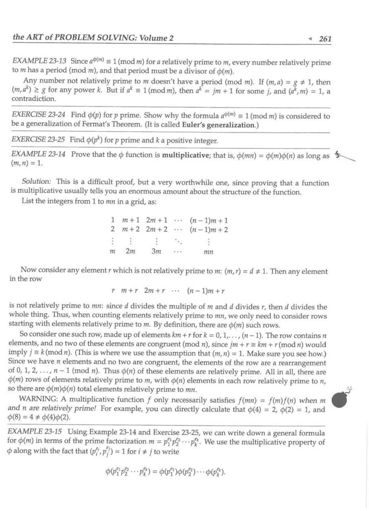

## Printed page 262

<!-- source: volume-2, PDF page 284, printed page 262 -->

Since $\phi(p_i^{e_i}) = p_i^{e_i} \left(1 - \frac{1}{p_i}\right)$, this becomes

$$\phi(m) = p_1^{e_1} \left(1 - \frac{1}{p_1}\right) p_2^{e_2} \left(1 - \frac{1}{p_2}\right) \cdots p_k^{e_k} \left(1 - \frac{1}{p_k}\right)$$

$$= m \left(1 - \frac{1}{p_1}\right) \left(1 - \frac{1}{p_2}\right) \cdots \left(1 - \frac{1}{p_k}\right).$$

**EXERCISE 23-26 Find $\phi(6876)$.**

### 23.8 Wilson’s Theorem

Wilson’s Theorem is rarely useful, but is very powerful when it is useful. The theorem states that for any prime $p$, we have

$$\left(p - 1\right)! \equiv -1 \pmod{p}.$$

**EXAMPLE 23-16 Wilson’s Theorem only works for primes. If $m$ is composite, $m = ab$ for some $a$ and $b$ which are less than $m$. The product $(m - 1)! = (m - 1)(m - 2) \cdots (2)(1)$ contains both $a$ and $b$, so is divisible by $m$. Thus $(m - 1)! \equiv 0 \pmod{m}$ if $m$ is not prime.**

**EXERCISE 23-27 The slick preceding example actually glosses over a major point: what if $a = b$? Then only one of $a$ and $b$ appears in $(m - 1)(m - 2) \cdots (2)(1)$. Does this yield any counterexamples to $(m - 1)! \equiv 0 \pmod{m}$? Find them, and prove that the equation is still true for all other cases.**

To prove Wilson’s Theorem, we consider some primitive root $g \pmod{p}$. By the definition of a primitive root, the numbers $\{g, g^2, \ldots, g^{p-1}\}$ are the same as the numbers $\{1, 2, \ldots, p-1\} \pmod{p}$. We then have

$$\left(p - 1\right)! = 1 \cdot 2 \cdot 3 \cdots \left(p - 2\right) \cdot \left(p - 1\right) = g \cdot g^2 \cdot g^3 \cdots g^{p-1} = g^{p(p-1)/2}.$$

But $g^p \equiv g(g^{p-1}) \equiv g$, so $(p - 1)! \equiv g^{p(p-1)/2} \equiv g^{p(p-1)/2} \equiv g^{p(p-1)/2}$. Let $t = g^{p(p-1)/2}$; then $t^2 \equiv 1 \pmod{p}$, since $t^2 = g^{p-1}$. Thus $t^2 - 1 \equiv 0$, or $(t - 1)(t + 1) \equiv 0$, or $t \equiv \pm 1$. Since the period of $g$ is $p - 1$, we can’t have $t \equiv g^{p-1}/2 \equiv 1$, because $(p - 1)/2 < p - 1$. (Remember, $g^{p-1}$ is the smallest power of $g$ congruent to 1 mod $p$.) Thus, $(p - 1)! \equiv g^{p(p-1)/2} \equiv t \equiv -1$, and we’re done.

**EXERCISE 23-28 The proof of Wilson’s Theorem is an excellent example of the way in which primitive roots and powers can be used to prove statements in number theory. Go through it again, and make sure you understand every step.**

Original scan — PDF page 284

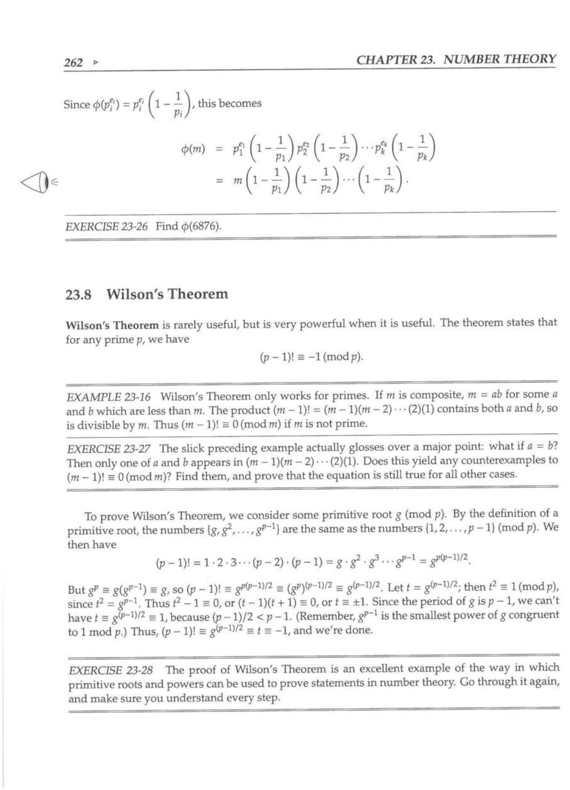

## Printed page 263

<!-- source: volume-2, PDF page 285, printed page 263 -->

373. Show that for all prime numbers $p$ greater than 3, 24 divides $p^2 - 1$ evenly. (AHSME 1973)

374. Given that $n - 4$ is divisible by 5, list which of the following are also divisible by 5:

$$n^2 - 1, n^2 - 4, n^2 - 16, n + 4, n^4 - 1.$$

(Mandelbrot #3)

375. If the same number $r$ is the remainder when each of the numbers 1059, 1417, and 2312 is divided by $d$, where $d$ is an integer greater than one, find $d - r$. (AHSME 1976)

376. Find the sum of all $x$, $1 \leq x \leq 100$, such that 7 divides $x^2 + 15x + 1$. (Mandelbrot #3)

377. What is the largest integer which must evenly divide all integers of the form $n^5 - n$? (AHSME 1957)

378. What is the units digit of $7^{(7^7)}$? (MAΘ 1990)

379. What is the size of the largest subset $S$ of $\{1, 2, 3, \ldots, 50\}$ such that no pair of distinct elements of $S$ has a sum divisible by 7? (AHSME 1992)

380. Let $f(x) = x^2 + 3x + 2$ and let $S$ be the set of integers $\{0, 1, 2, \ldots, 25\}$. Find the number of members $s$ of $S$ such that $f(s)$ has remainder zero when divided by six. (AHSME 1964)

381. For any integer $n$ greater than 1, how many prime numbers are there greater than $n! + 1$ and less than $n! + n$? (AHSME 1969)

382. Find the last three digits of $9^{105}$. (Mandelbrot #2)

383. What is the smallest possible value of $n$ such that

$$\sqrt{\frac{3}{1} \cdot \frac{4}{2} \cdot \frac{5}{3} \cdots \frac{n+2}{n}}$$

is a rational number? (MATHCOUNTS 1992)

384. Adam and Ben start their new jobs on the same day. Adam’s schedule is 3 workdays followed by 1 rest day. Ben’s schedule is 7 workdays followed by 3 rest days. On how many of their first 1000 days do both have rest-days on the same day? (AHSME 1993)

385. Find the last two digits of $7^{9999}$. (MATHCOUNTS 1986)

386. What is the least number of $n$ consecutive positive integers, $n > 1$, that have a sum of 1000? (MAΘ 1987)

387. Let $x$ and $y$ be integers such that $2x + 3y$ is a multiple of 17. Show that $9x + 5y$ must also be a multiple of 17. (USAMTS 1)

388. Note that 1990 can be “turned into a square” by adding a digit on its right, and some digits on its left; i.e., $419904 = 648^2$. Prove that 1991 cannot be turned into a square by the same procedure; i.e., there are no digits $d, x, y, \ldots$ such that ... $yx1991d$ is a perfect square. (USAMTS 3)

Original scan — PDF page 285

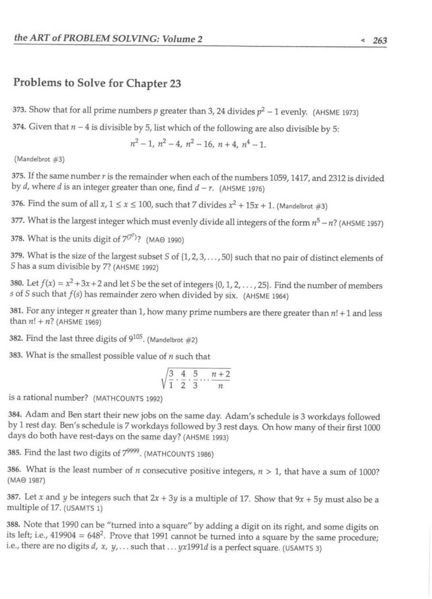

## Printed page 264

<!-- source: volume-2, PDF page 286, printed page 264 -->

389. Prove that for all natural numbers $k, k^5 - k$ is a multiple of 10. (M&IQ 1991)

390. If $x$ and $y$ are positive integers and neither of them are divisible by 5, show that $x^4 + 4y^4$ is divisible by 5. (M&IQ 1991)

391. Prove that if exactly one of the positive integers $x$ and $y$ is a multiple of 5, then $x^4 + 4y^4$ is not a multiple of 5. (M&IQ 1991)

392. Prove that if $p$ and $p + 2$ are both prime integers greater than 3, then 6 is a factor of $p + 1$. (Canada 1973)

393. Let $n$ be an integer. If the tens digit of $n^2$ is 7, what is the units digit of $n^2$? (Canada 1978)

394. Prove that none of the numbers $a_n = 1001001 \cdots 1001$ is prime, where $n = 2, 3, 4, \ldots$ denotes the number of occurrences of the digit 1 in $a_n$. (M&IQ 3)

395. Let $p$ be a prime number. Prove that there exists an integer $a$ such that $p|(a^2 - a + 3)$ if and only if there exists an integer $b$ such that $p|(b^2 - b + 25)$. (This problem originally appeared on a contest used to determine the Chinese national team.) (MOP)

396. Each of the numbers $x_1, x_2, \ldots, x_n$ equals 1 or $-1$, and

$$x_1x_2x_3x_4 + x_2x_3x_4x_5 + \cdots + x_{n-2}x_{n-1}x_nx_1 + x_{n-1}x_nx_1x_2 + x_nx_1x_2x_3 = 0.$$

Prove that $n$ is divisible by 4. (IMO 1985)

397. Prove that $d(n)$ and $s(n)$, the number of and sum of the divisors of $n$ respectively, are multiplicative functions. (Remember, a multiplicative function $f$ only necessarily satisfies the identity $f(mn) = f(m)f(n)$ when $(m, n) = 1.$)

398. Find the positive integer $m$ such that the polynomial $p^3 + 2p + m$ divides $p^{12} - p^{11} + 3p^{10} + 11p^3 - p^2 + 23p + 30.$

399. Prove that, for all positive integer pairs $(a, b)$ where $b > 2, 2^b - 1$ does not evenly divide $2^a + 1.$

400. Let $d$ be any positive integer not equal to 2, 5, or 13. Show that one can find distinct $(a, b)$ in the set $\{2, 5, 13, d\}$ such that $ab - 1$ is not a perfect square. (IMO 1986)

401. Let $a$ and $b$ be integers and $n$ a positive integer. Prove that $b^{n-1}a(a + b)(a + 2b) \cdots (a + (n-1)b)/n!$ is an integer. (IMO 1985)

402. Prove that a positive integer is a sum of at least two consecutive positive integers if and only if it is not a power of two. (Canada 1976)

Original scan — PDF page 286

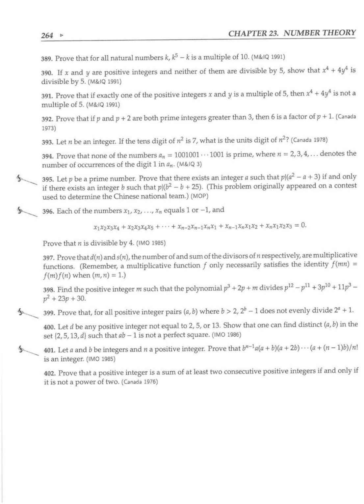

## Printed page 265

<!-- source: volume-2, PDF page 287, printed page 265 -->

Number theory has traditionally been viewed as one of the least "applied" branches of mathematics, one distant from ordinary human activities. But with modern approaches to cryptography—the study of codes—number theory has come to the forefront of a wide range of present and future applications.

Traditionally in cryptography, if I could send you a code, I could read other codes sent to you. Thus if both Richard and I sent you coded material, I could read his messages and he mine. This was undesirable, but thought to be unavoidable. However, in the late 1970's mathematicians discovered that number-theoretical methods could be used in which I can send you coded messages without being able to decode other coded messages sent to you.

To see the basic idea, let's consider the Massey-Omura cryptosystem. We can easily devise a way to convert a message into some (probably large) number, and to convert numbers back into messages. (Come up with a method yourself.) So imagine I have a message/number $M$ to send to you. Everyone interested in sending or receiving coded messages has a secret encoding number $e$ and decoding number $d$, such that $de \equiv 1 (\bmod q - 1)$, where $q$ is some huge prime (say, 100 digits) used by everyone.

To send me a message $M$, Richard calculates $M^{e_R} (\bmod q)$ and sends it to me. This is garble to me, since, not having Richard's encoder $e_R$ or decoder $d_R$, I can't unscramble the message. I take the message to the power of $e_S$, and send the result, $M^{e_R e_S} (\bmod q)$, back to Richard. Even though he knows $M$ and $M^{e_R e_S} (\bmod q)$, Richard can't extract $e_S$—at least, no one has yet figured out how to do so in less than 10,000 years or so. Since Richard can't get $e_S$, my code is still secure. Richard takes the number I gave him to the $d_R$ power now, sending me $M^{d_R e_R e_S} \equiv M^{e_S} (\bmod q)$. (Since $d_R e_R \equiv 1 (\bmod q - 1)$, $M^{d_R e_R} \equiv M (\bmod q)$ by Fermat's Theorem, which allows this simplification. Make sure you see why.) I then get the message $M$ by taking my number $M^{e_S}$ to the $d_S$ power, again using Fermat's Theorem. Richard's code is secure, since I can't get $e_R$ from $M^{e_R} (\bmod q)$, which I got initially, and $M$, which I now have.

So number theory provides a nice way to send codes securely, with neither party learning the other's code. The major caveat is that the whole scheme fails if someone figures out how to get $e$ from $M^{e_R} (\bmod q)$ and $M$—and mathematicians are, of course, working on that problem.

Original scan — PDF page 287

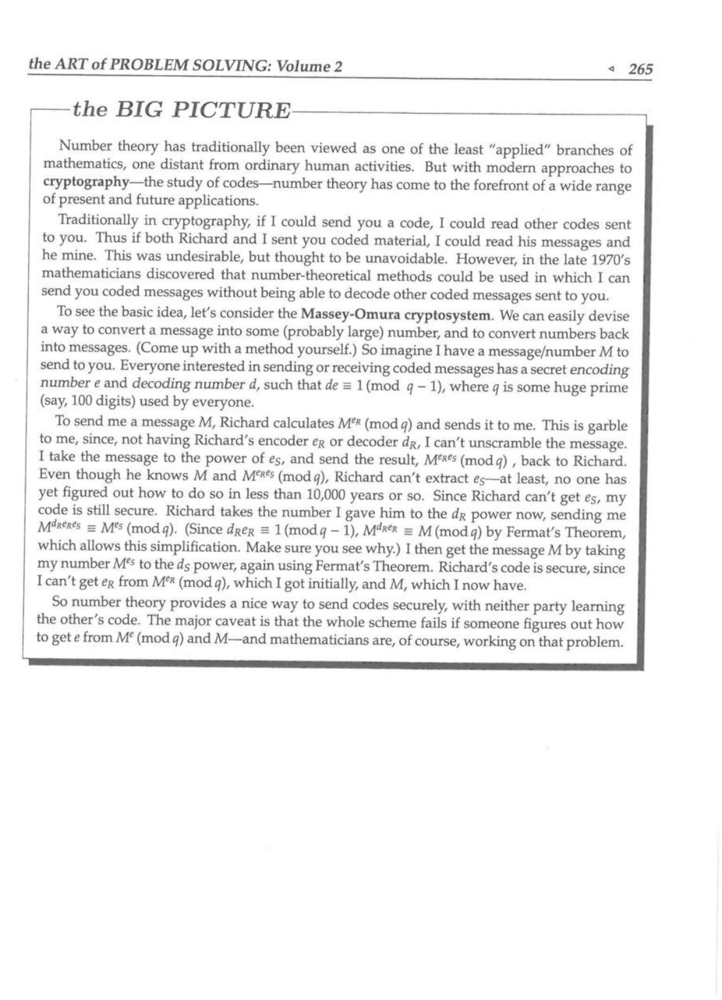

