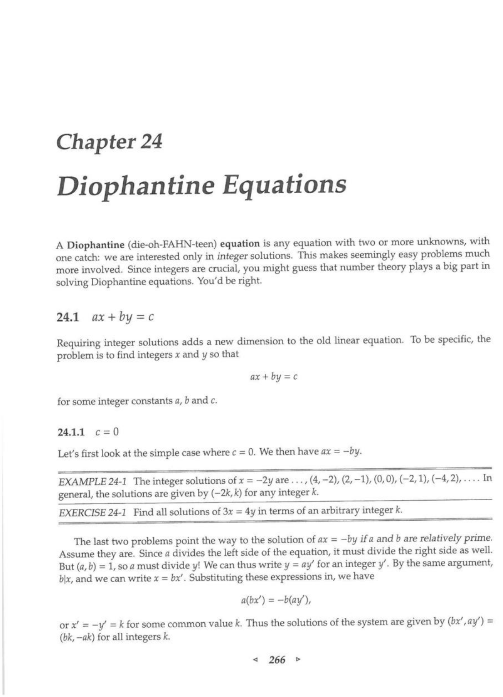
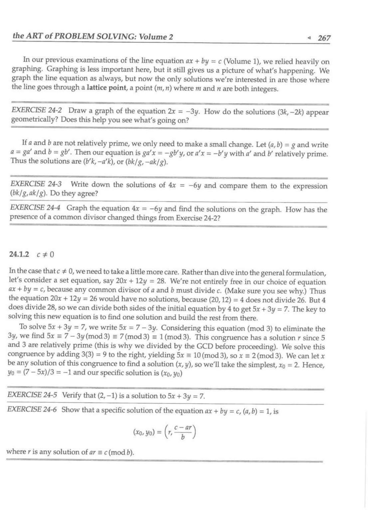
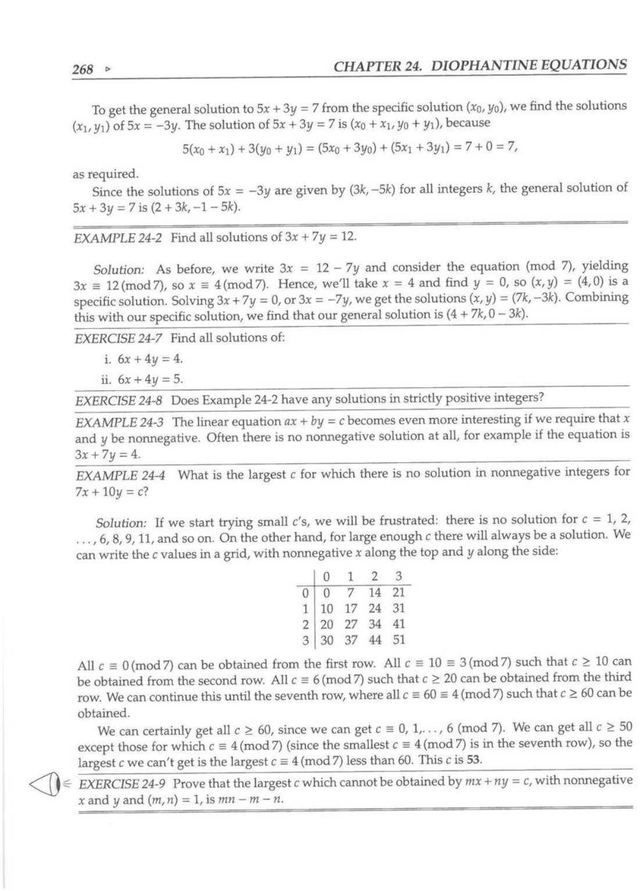
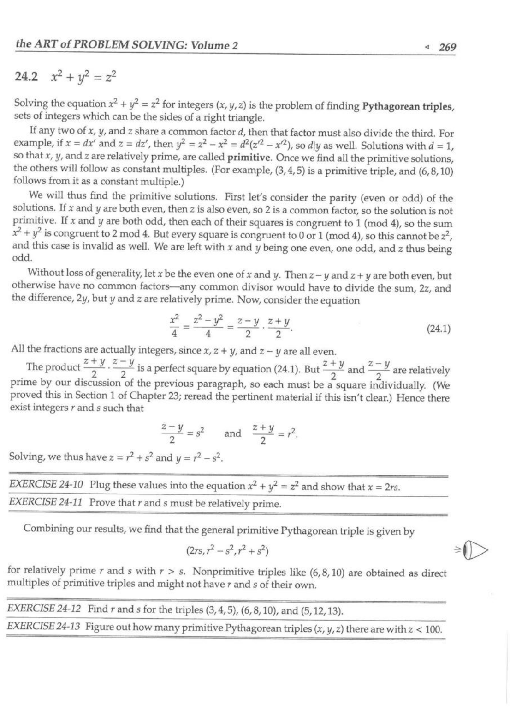
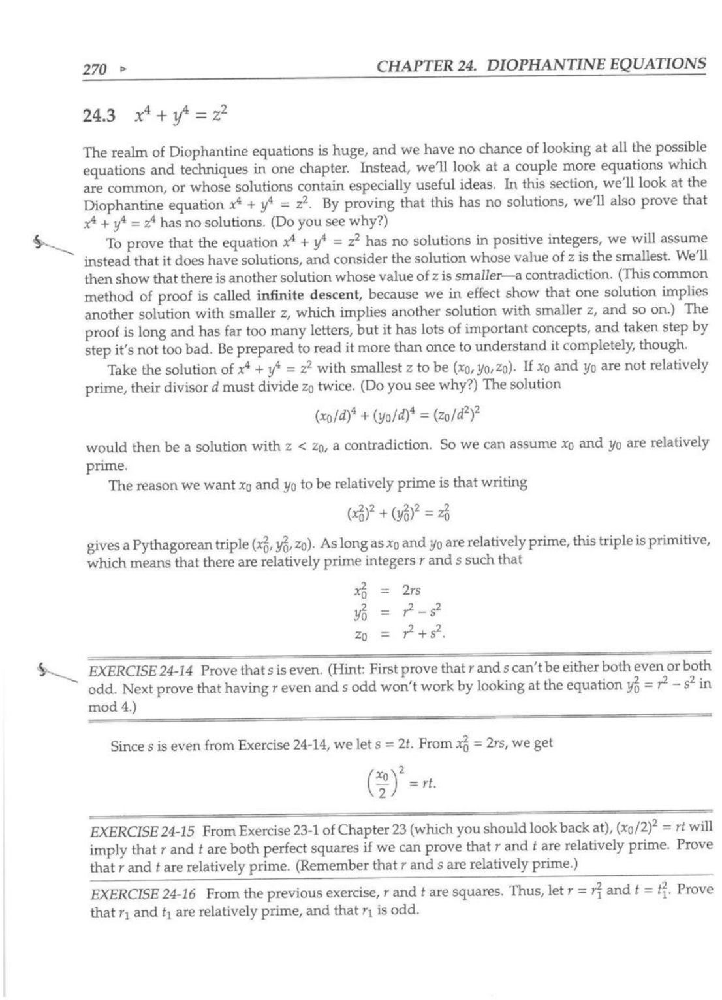
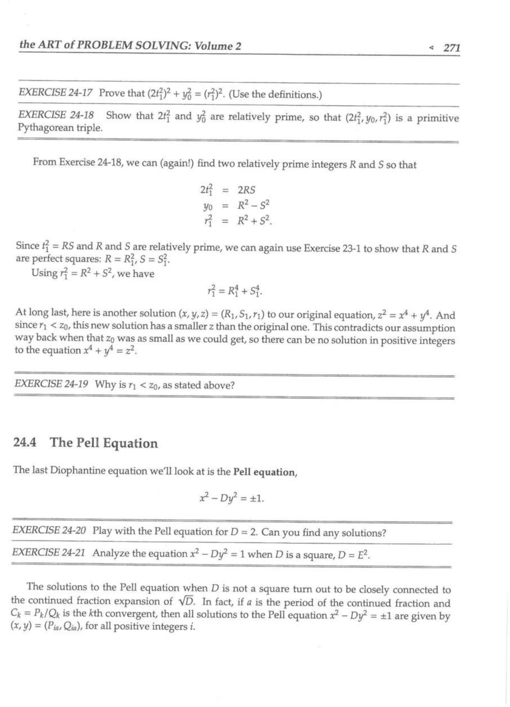
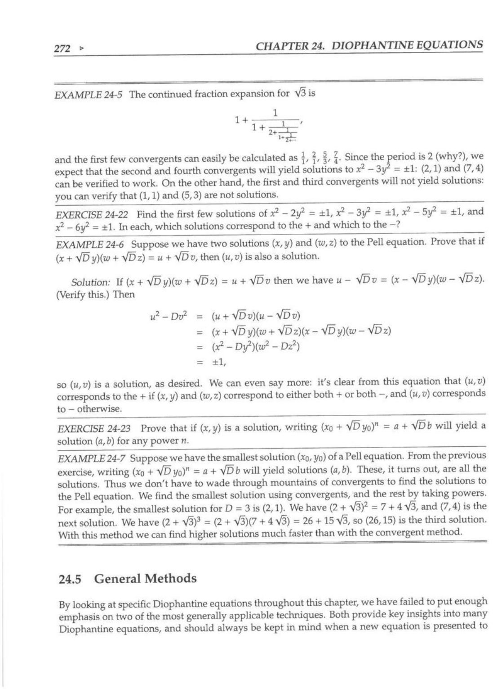
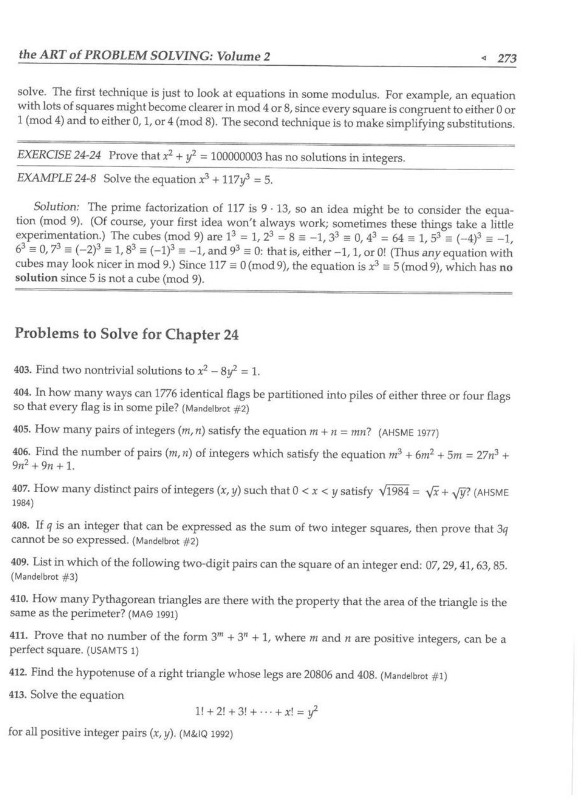
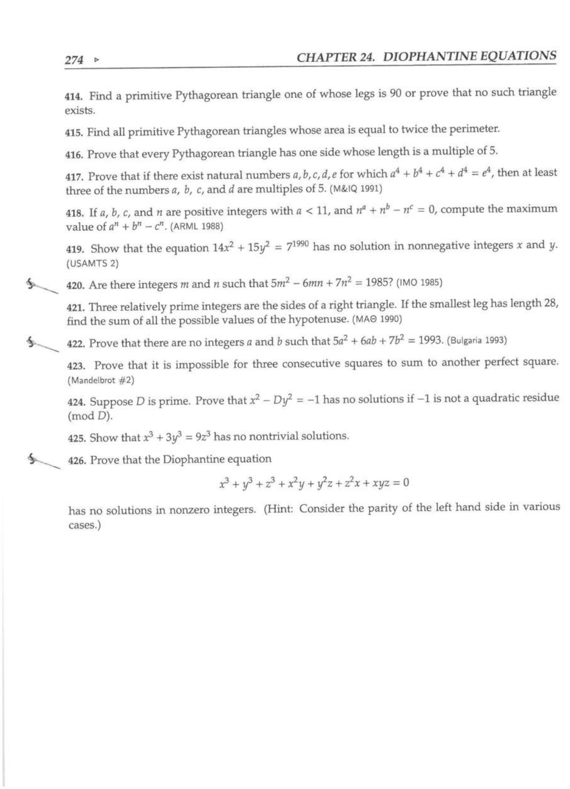

# Chapter 24: Diophantine Equations

Volume 2 · Printed pages 266–274 · PDF pages 288–296

[Volume contents](../index.md)

## Printed page 266

<!-- source: volume-2, PDF page 288, printed page 266 -->

Chapter 24

Diophantine Equations

A Diophantine (die-oh-FAHN-teen) equation is any equation with two or more unknowns, with one catch: we are interested only in integer solutions. This makes seemingly easy problems much more involved. Since integers are crucial, you might guess that number theory plays a big part in solving Diophantine equations. You’d be right.

### 24.1 $ax + by = c$

Requiring integer solutions adds a new dimension to the old linear equation. To be specific, the problem is to find integers $x$ and $y$ so that

$$ax + by = c$$

for some integer constants $a, b$ and $c$.

### 24.1.1 $c = 0$

Let’s first look at the simple case where $c = 0$. We then have $ax = -by$.

**EXAMPLE 24-1 The integer solutions of $x = -2y$ are $\ldots, (4, -2), (2, -1), (0, 0), (-2, 1), (-4, 2), \ldots$. In general, the solutions are given by $(-2k, k)$ for any integer $k$.**

**EXERCISE 24-1 Find all solutions of $3x = 4y$ in terms of an arbitrary integer $k$.**

The last two problems point the way to the solution of $ax = -by$ if $a$ and $b$ are relatively prime. Assume they are. Since $a$ divides the left side of the equation, it must divide the right side as well. But $(a, b) = 1$, so $a$ must divide $y!$. We can thus write $y = ay'$ for an integer $y'$. By the same argument, $b|x$, and we can write $x = bx'$. Substituting these expressions in, we have

$$a(bx') = -b(ay')$$

or $x' = -y' = k$ for some common value $k$. Thus the solutions of the system are given by $(bx', ay') = (bk, -ak)$ for all integers $k$.

Original scan — PDF page 288

## Printed page 267

<!-- source: volume-2, PDF page 289, printed page 267 -->

In our previous examinations of the line equation $ax + by = c$ (Volume 1), we relied heavily on graphing. Graphing is less important here, but it still gives us a picture of what's happening. We graph the line equation as always, but now the only solutions we're interested in are those where the line goes through a lattice point, a point $(m, n)$ where $m$ and $n$ are both integers.

**EXERCISE 24-2** Draw a graph of the equation $2x = -3y$. How do the solutions $(3k, -2k)$ appear geometrically? Does this help you see what's going on?

If $a$ and $b$ are not relatively prime, we only need to make a small change. Let $(a, b) = g$ and write $a = ga'$ and $b = gb'$. Then our equation is $ga'x = -gb'y$, or $a'x = -b'y$ with $a'$ and $b'$ relatively prime. Thus the solutions are $(b'k, -a'k)$, or $(bk/g, -ak/g)$.

**EXERCISE 24-3** Write down the solutions of $4x = -6y$ and compare them to the expression $(bk/g, ak/g)$. Do they agree?

**EXERCISE 24-4** Graph the equation $4x = -6y$ and find the solutions on the graph. How has the presence of a common divisor changed things from Exercise 24-2?

### 24.1.2 $c \neq 0$

In the case that $c \neq 0$, we need to take a little more care. Rather than dive into the general formulation, let's consider a set equation, say $20x + 12y = 28$. We're not entirely free in our choice of equation $ax + by = c$, because any common divisor of $a$ and $b$ must divide $c$. (Make sure you see why.) Thus the equation $20x + 12y = 26$ would have no solutions, because $(20, 12) = 4$ does not divide 26. But 4 does divide 28, so we can divide both sides of the initial equation by 4 to get $5x + 3y = 7$. The key to solving this new equation is to find one solution and build the rest from there.

To solve $5x + 3y = 7$, we write $5x = 7 - 3y$. Considering this equation (mod 3) to eliminate the $3y$, we find $5x \equiv 7 - 3y \pmod{3} \equiv 7 \pmod{3} \equiv 1 \pmod{3}$. This congruence has a solution $r$ since 5 and 3 are relatively prime (this is why we divided by the GCD before proceeding). We solve this congruence by adding $3(3) = 9$ to the right, yielding $5x \equiv 10 \pmod{3}$, so $x \equiv 2 \pmod{3}$. We can let $x$ be any solution of this congruence to find a solution $(x, y)$, so we'll take the simplest, $x_0 = 2$. Hence, $y_0 = (7 - 5x)/3 = -1$ and our specific solution is $(x_0, y_0)$

**EXERCISE 24-5** Verify that $(2, -1)$ is a solution to $5x + 3y = 7$.

**EXERCISE 24-6** Show that a specific solution of the equation $ax + by = c$, $(a, b) = 1$, is

$$x_0, y_0 = \left( r, \frac{c - ar}{b} \right)$$

where $r$ is any solution of $ar \equiv c \pmod{b}$.

Original scan — PDF page 289

## Printed page 268

<!-- source: volume-2, PDF page 290, printed page 268 -->

To get the general solution to $5x + 3y = 7$ from the specific solution $(x_0, y_0)$, we find the solutions $(x_1, y_1)$ of $5x = -3y$. The solution of $5x + 3y = 7$ is $(x_0 + x_1, y_0 + y_1)$, because

$$5(x_0 + x_1) + 3(y_0 + y_1) = (5x_0 + 3y_0) + (5x_1 + 3y_1) = 7 + 0 = 7,$$

as required.

Since the solutions of $5x = -3y$ are given by $(3k, -5k)$ for all integers $k$, the general solution of $5x + 3y = 7$ is $(2 + 3k, -1 - 5k)$.

**EXAMPLE 24-2** Find all solutions of $3x + 7y = 12$.

**Solution:** As before, we write $3x = 12 - 7y$ and consider the equation $(\text{mod } 7)$, yielding $3x \equiv 12 (\text{mod } 7)$, so $x \equiv 4 (\text{mod } 7)$. Hence, we'll take $x = 4$ and find $y = 0$, so $(x, y) = (4, 0)$ is a specific solution. Solving $3x + 7y = 0$, or $3x = -7y$, we get the solutions $(x, y) = (7k, -3k)$. Combining this with our specific solution, we find that our general solution is $(4 + 7k, 0 - 3k)$.

**EXERCISE 24-7** Find all solutions of:

i. $6x + 4y = 4$.
ii. $6x + 4y = 5$.

**EXERCISE 24-8** Does Example 24-2 have any solutions in strictly positive integers?

**EXAMPLE 24-3** The linear equation $ax + by = c$ becomes even more interesting if we require that $x$ and $y$ be nonnegative. Often there is no nonnegative solution at all, for example if the equation is $3x + 7y = 4$.

**EXAMPLE 24-4** What is the largest $c$ for which there is no solution in nonnegative integers for $7x + 10y = c$?

**Solution:** If we start trying small $c$'s, we will be frustrated: there is no solution for $c = 1, 2, \ldots, 6, 8, 9, 11$, and so on. On the other hand, for large enough $c$ there will always be a solution. We can write the $c$ values in a grid, with nonnegative $x$ along the top and $y$ along the side:

| | 0 | 1 | 2 | 3 |
| :--- | :--- | :--- | :--- | :--- |
| 0 | 0 | 7 | 14 | 21 |
| 1 | 10 | 17 | 24 | 31 |
| 2 | 20 | 27 | 34 | 41 |
| 3 | 30 | 37 | 44 | 51 |

All $c \equiv 0 (\text{mod } 7)$ can be obtained from the first row. All $c \equiv 10 \equiv 3 (\text{mod } 7)$ such that $c \geq 10$ can be obtained from the second row. All $c \equiv 6 (\text{mod } 7)$ such that $c \geq 20$ can be obtained from the third row. We can continue this until the seventh row, where all $c \equiv 60 \equiv 4 (\text{mod } 7)$ such that $c \geq 60$ can be obtained.

We can certainly get all $c \geq 60$, since we can get $c \equiv 0, 1, \ldots, 6 (\text{mod } 7)$. We can get all $c \geq 50$ except those for which $c \equiv 4 (\text{mod } 7)$ (since the smallest $c \equiv 4 (\text{mod } 7)$ is in the seventh row), so the largest $c$ we can't get is the largest $c \equiv 4 (\text{mod } 7)$ less than 60. This $c$ is 53.

**EXERCISE 24-9** Prove that the largest $c$ which cannot be obtained by $mx + ny = c$, with nonnegative $x$ and $y$ and $(m, n) = 1$, is $mn - m - n$.

Original scan — PDF page 290

## Printed page 269

<!-- source: volume-2, PDF page 291, printed page 269 -->

### 24.2 $x^2 + y^2 = z^2$

Solving the equation $x^2 + y^2 = z^2$ for integers $(x, y, z)$ is the problem of finding Pythagorean triples, sets of integers which can be the sides of a right triangle.

If any two of $x, y,$ and $z$ share a common factor $d$, then that factor must also divide the third. For example, if $x = dx'$ and $z = dz'$, then $y^2 = z^2 - x^2 = d^2(z'^2 - x'^2)$, so $d|y$ as well. Solutions with $d = 1,$ so that $x, y,$ and $z$ are relatively prime, are called primitive. Once we find all the primitive solutions, the others will follow as constant multiples. (For example, $(3, 4, 5)$ is a primitive triple, and $(6, 8, 10)$ follows from it as a constant multiple.)

We will thus find the primitive solutions. First let's consider the parity (even or odd) of the solutions. If $x$ and $y$ are both even, then $z$ is also even, so 2 is a common factor, so the solution is not primitive. If $x$ and $y$ are both odd, then each of their squares is congruent to 1 (mod 4), so the sum $x^2 + y^2$ is congruent to 2 mod 4. But every square is congruent to 0 or 1 (mod 4), so this cannot be $z^2,$ and this case is invalid as well. We are left with $x$ and $y$ being one even, one odd, and $z$ thus being odd.

Without loss of generality, let $x$ be the even one of $x$ and $y$. Then $z - y$ and $z + y$ are both even, but otherwise have no common factors—any common divisor would have to divide the sum, $2z,$ and the difference, $2y,$ but $y$ and $z$ are relatively prime. Now, consider the equation

$$\frac{x^2}{4} = \frac{z^2 - y^2}{4} = \frac{z - y}{2} \cdot \frac{z + y}{2}.$$

(24.1)

All the fractions are actually integers, since $x, z + y,$ and $z - y$ are all even.

The product $\frac{z + y}{2} \cdot \frac{z - y}{2}$ is a perfect square by equation (24.1). But $\frac{z + y}{2}$ and $\frac{z - y}{2}$ are relatively prime by our discussion of the previous paragraph, so each must be a square individually. (We proved this in Section 1 of Chapter 23; reread the pertinent material if this isn't clear.) Hence there exist integers $r$ and $s$ such that

$$\frac{z - y}{2} = s^2 \quad \text{and} \quad \frac{z + y}{2} = r^2.$$

Solving, we thus have $z = r^2 + s^2$ and $y = r^2 - s^2$.

**EXERCISE 24-10 Plug these values into the equation $x^2 + y^2 = z^2$ and show that $x = 2rs.$**

**EXERCISE 24-11 Prove that $r$ and $s$ must be relatively prime.**

Combining our results, we find that the general primitive Pythagorean triple is given by

$$\left(2rs, r^2 - s^2, r^2 + s^2\right)$$

for relatively prime $r$ and $s$ with $r > s$. Nonprimitive triples like $(6, 8, 10)$ are obtained as direct multiples of primitive triples and might not have $r$ and $s$ of their own.

**EXERCISE 24-12 Find $r$ and $s$ for the triples $(3, 4, 5), (6, 8, 10),$ and $(5, 12, 13).$**

**EXERCISE 24-13 Figure out how many primitive Pythagorean triples $(x, y, z)$ there are with $z < 100.$**

Original scan — PDF page 291

## Printed page 270

<!-- source: volume-2, PDF page 292, printed page 270 -->

### 24.3 $x^4+y^4=z^2$

<!-- Heading restored for navigation from independently recognised source heading. -->

The realm of Diophantine equations is huge, and we have no chance of looking at all the possible equations and techniques in one chapter. Instead, we'll look at a couple more equations which are common, or whose solutions contain especially useful ideas. In this section, we'll look at the Diophantine equation $x^4 + y^4 = z^2$. By proving that this has no solutions, we'll also prove that $x^4 + y^4 = z^4$ has no solutions. (Do you see why?)

To prove that the equation $x^4 + y^4 = z^2$ has no solutions in positive integers, we will assume instead that it does have solutions, and consider the solution whose value of $z$ is the smallest. We'll then show that there is another solution whose value of $z$ is smaller—a contradiction. (This common method of proof is called infinite descent, because we in effect show that one solution implies another solution with smaller $z$, which implies another solution with smaller $z$, and so on.) The proof is long and has far too many letters, but it has lots of important concepts, and taken step by step it's not too bad. Be prepared to read it more than once to understand it completely, though.

Take the solution of $x^4 + y^4 = z^2$ with smallest $z$ to be $(x_0, y_0, z_0)$. If $x_0$ and $y_0$ are not relatively prime, their divisor $d$ must divide $z_0$ twice. (Do you see why?) The solution

$$\left( \frac{x_0}{d} \right)^4 + \left( \frac{y_0}{d} \right)^4 = \left( \frac{z_0}{d^2} \right)^2$$

would then be a solution with $z < z_0$, a contradiction. So we can assume $x_0$ and $y_0$ are relatively prime.

The reason we want $x_0$ and $y_0$ to be relatively prime is that writing

$$\left( \frac{x_0}{2} \right)^2 + \left( \frac{y_0}{2} \right)^2 = z_0^2$$

gives a Pythagorean triple $(x_0^2, y_0^2, z_0)$. As long as $x_0$ and $y_0$ are relatively prime, this triple is primitive, which means that there are relatively prime integers $r$ and $s$ such that

$$x_0^2 = 2rs$$
$$y_0^2 = r^2 - s^2$$
$$z_0^2 = r^2 + s^2.$$

**EXERCISE 24-14** Prove that $s$ is even. (Hint: First prove that $r$ and $s$ can't be either both even or both odd. Next prove that having $r$ even and $s$ odd won't work by looking at the equation $y_0^2 = r^2 - s^2$ in mod 4.)

Since $s$ is even from Exercise 24-14, we let $s = 2t$. From $x_0^2 = 2rs$, we get

$$\left( \frac{x_0}{2} \right)^2 = rt.$$

**EXERCISE 24-15** From Exercise 23-1 of Chapter 23 (which you should look back at), $(x_0/2)^2 = rt$ will imply that $r$ and $t$ are both perfect squares if we can prove that $r$ and $t$ are relatively prime. Prove that $r$ and $t$ are relatively prime. (Remember that $r$ and $s$ are relatively prime.)

**EXERCISE 24-16** From the previous exercise, $r$ and $t$ are squares. Thus, let $r = r_1^2$ and $t = t_1^2$. Prove that $r_1$ and $t_1$ are relatively prime, and that $r_1$ is odd.

Original scan — PDF page 292

## Printed page 271

<!-- source: volume-2, PDF page 293, printed page 271 -->

**EXERCISE 24-17 Prove that $(2t_1^2)^2 + y_0^2 = (r_1^2)^2$. (Use the definitions.)**

**EXERCISE 24-18 Show that $2t_1^2$ and $y_0^2$ are relatively prime, so that $(2t_1^2, y_0, r_1^2)$ is a primitive Pythagorean triple.**

From Exercise 24-18, we can (again!) find two relatively prime integers $R$ and $S$ so that

$$2t_1^2 = 2RS$$
$$y_0 = R^2 - S^2$$
$$r_1^2 = R^2 + S^2.$$

Since $t_1^2 = RS$ and $R$ and $S$ are relatively prime, we can again use Exercise 23-1 to show that $R$ and $S$ are perfect squares: $R = R_1^2$, $S = S_1^2$.

Using $r_1^2 = R^2 + S^2$, we have

$$r_1^2 = R_1^4 + S_1^4.$$

At long last, here is another solution $(x, y, z) = (R_1, S_1, r_1)$ to our original equation, $z^2 = x^4 + y^4$. And since $r_1 < z_0$, this new solution has a smaller $z$ than the original one. This contradicts our assumption way back when that $z_0$ was as small as we could get, so there can be no solution in positive integers to the equation $x^4 + y^4 = z^2.$

**EXERCISE 24-19 Why is $r_1 < z_0$, as stated above?**

### 24.4 The Pell Equation

The last Diophantine equation we'll look at is the Pell equation,

$$x^2 - Dy^2 = \pm 1.$$

**EXERCISE 24-20 Play with the Pell equation for $D = 2$. Can you find any solutions?**

**EXERCISE 24-21 Analyze the equation $x^2 - Dy^2 = 1$ when $D$ is a square, $D = E^2.$**

The solutions to the Pell equation when $D$ is not a square turn out to be closely connected to the continued fraction expansion of $\sqrt{D}$. In fact, if $a$ is the period of the continued fraction and $C_k = P_k / Q_k$ is the $k$th convergent, then all solutions to the Pell equation $x^2 - Dy^2 = \pm 1$ are given by $(x, y) = (P_{ia}, Q_{ia})$, for all positive integers $i$.

Original scan — PDF page 293

## Printed page 272

<!-- source: volume-2, PDF page 294, printed page 272 -->

**EXAMPLE 24-5 The continued fraction expansion for $\sqrt{3}$ is**

$$1 + \frac{1}{1 + \frac{1}{2 + \frac{1}{1 + \frac{1}{2 + \cdots}}}},$$

and the first few convergents can easily be calculated as $\frac{1}{1}, \frac{2}{1}, \frac{5}{3}, \frac{7}{4}$. Since the period is 2 (why?), we expect that the second and fourth convergents will yield solutions to $x^2 - 3y^2 = \pm 1$: (2,1) and (7,4) can be verified to work. On the other hand, the first and third convergents will not yield solutions: you can verify that (1,1) and (5,3) are not solutions.

**EXERCISE 24-22 Find the first few solutions of $x^2 - 2y^2 = \pm 1$, $x^2 - 3y^2 = \pm 1$, $x^2 - 5y^2 = \pm 1$, and $x^2 - 6y^2 = \pm 1$. In each, which solutions correspond to the $+$ and which to the $-$?**

**EXAMPLE 24-6 Suppose we have two solutions $(x, y)$ and $(w, z)$ to the Pell equation. Prove that if $(x + \sqrt{D} y)(w + \sqrt{D} z) = u + \sqrt{D} v$, then $(u, v)$ is also a solution.**

Solution: If $(x + \sqrt{D} y)(w + \sqrt{D} z) = u + \sqrt{D} v$ then we have $u - \sqrt{D} v = (x - \sqrt{D} y)(w - \sqrt{D} z)$. (Verify this.) Then

$$u^2 - Dv^2 = (u + \sqrt{D} v)(u - \sqrt{D} v)$$

$$= (x + \sqrt{D} y)(w + \sqrt{D} z)(x - \sqrt{D} y)(w - \sqrt{D} z)$$

$$= (x^2 - Dy^2)(w^2 - Dz^2)$$

$$= \pm 1,$$

so $(u, v)$ is a solution, as desired. We can even say more: it's clear from this equation that $(u, v)$ corresponds to the $+$ if $(x, y)$ and $(w, z)$ correspond to either both $+$ or both $-$, and $(u, v)$ corresponds to $-$ otherwise.

**EXERCISE 24-23 Prove that if $(x, y)$ is a solution, writing $(x_0 + \sqrt{D} y_0)^n = a + \sqrt{D} b$ will yield a solution $(a, b)$ for any power $n$.**

**EXAMPLE 24-7 Suppose we have the smallest solution $(x_0, y_0)$ of a Pell equation. From the previous exercise, writing $(x_0 + \sqrt{D} y_0)^n = a + \sqrt{D} b$ will yield solutions $(a, b)$. These, it turns out, are all the solutions. Thus we don't have to wade through mountains of convergents to find the solutions to the Pell equation. We find the smallest solution using convergents, and the rest by taking powers. For example, the smallest solution for $D = 3$ is (2,1). We have $(2 + \sqrt{3})^2 = 7 + 4\sqrt{3}$, and (7,4) is the next solution. We have $(2 + \sqrt{3})^3 = (2 + \sqrt{3})(7 + 4\sqrt{3}) = 26 + 15\sqrt{3}$, so (26,15) is the third solution. With this method we can find higher solutions much faster than with the convergent method.**

### 24.5 General Methods

By looking at specific Diophantine equations throughout this chapter, we have failed to put enough emphasis on two of the most generally applicable techniques. Both provide key insights into many Diophantine equations, and should always be kept in mind when a new equation is presented to

Original scan — PDF page 294

## Printed page 273

<!-- source: volume-2, PDF page 295, printed page 273 -->

solve. The first technique is just to look at equations in some modulus. For example, an equation with lots of squares might become clearer in mod 4 or 8, since every square is congruent to either 0 or 1 (mod 4) and to either 0, 1, or 4 (mod 8). The second technique is to make simplifying substitutions.

**EXERCISE 24-24 Prove that $x^2 + y^2 = 100000003$ has no solutions in integers.**

**EXAMPLE 24-8 Solve the equation $x^3 + 117y^3 = 5$.**

Solution: The prime factorization of 117 is $9 \cdot 13$, so an idea might be to consider the equation (mod 9). (Of course, your first idea won't always work; sometimes these things take a little experimentation.) The cubes (mod 9) are $1^3 = 1$, $2^3 = 8 \equiv -1$, $3^3 = 0$, $4^3 = 64 \equiv 1$, $5^3 = (-4)^3 \equiv -1$, $6^3 = 0$, $7^3 = (-2)^3 \equiv 1$, $8^3 = (-1)^3 \equiv -1$, and $9^3 = 0$: that is, either $-1$, 1, or 0! (Thus any equation with cubes may look nicer in mod 9.) Since 117 $\equiv 0$ (mod 9), the equation is $x^3 \equiv 5$ (mod 9), which has no solution since 5 is not a cube (mod 9).

Problems to Solve for Chapter 24

403. Find two nontrivial solutions to $x^2 - 8y^2 = 1$.

404. In how many ways can 1776 identical flags be partitioned into piles of either three or four flags so that every flag is in some pile? (Mandelbrot #2)

405. How many pairs of integers $(m, n)$ satisfy the equation $m + n = mn$? (AHSME 1977)

406. Find the number of pairs $(m, n)$ of integers which satisfy the equation $m^3 + 6m^2 + 5m = 27n^3 + 9n^2 + 9n + 1$.

407. How many distinct pairs of integers $(x, y)$ such that $0 < x < y$ satisfy $\sqrt{1984} = \sqrt{x} + \sqrt{y}$? (AHSME 1984)

408. If $q$ is an integer that can be expressed as the sum of two integer squares, then prove that $3q$ cannot be so expressed. (Mandelbrot #2)

409. List in which of the following two-digit pairs can the square of an integer end: 07, 29, 41, 63, 85. (Mandelbrot #3)

410. How many Pythagorean triangles are there with the property that the area of the triangle is the same as the perimeter? (MAΘ 1991)

411. Prove that no number of the form $3^m + 3^n + 1$, where $m$ and $n$ are positive integers, can be a perfect square. (USAMTS 1)

412. Find the hypotenuse of a right triangle whose legs are 20806 and 408. (Mandelbrot #1)

413. Solve the equation

$$1! + 2! + 3! + \cdots + x! = y^2$$

for all positive integer pairs $(x, y)$. (M&IQ 1992)

Original scan — PDF page 295

## Printed page 274

<!-- source: volume-2, PDF page 296, printed page 274 -->

414. Find a primitive Pythagorean triangle one of whose legs is 90 or prove that no such triangle exists.

415. Find all primitive Pythagorean triangles whose area is equal to twice the perimeter.

416. Prove that every Pythagorean triangle has one side whose length is a multiple of 5.

417. Prove that if there exist natural numbers $a, b, c, d, e$ for which $a^4 + b^4 + c^4 + d^4 = e^4$, then at least three of the numbers $a, b, c$, and $d$ are multiples of 5. (M&IQ 1991)

418. If $a, b, c$, and $n$ are positive integers with $a < 11$, and $n^a + n^b - n^c = 0$, compute the maximum value of $a^n + b^n - c^n$. (ARML 1988)

419. Show that the equation $14x^2 + 15y^2 = 7^{1990}$ has no solution in nonnegative integers $x$ and $y$. (USAMTS 2)

420. Are there integers $m$ and $n$ such that $5m^2 - 6mn + 7n^2 = 1985$? (IMO 1985)

421. Three relatively prime integers are the sides of a right triangle. If the smallest leg has length 28, find the sum of all the possible values of the hypotenuse. (MAΘ 1990)

422. Prove that there are no integers $a$ and $b$ such that $5a^2 + 6ab + 7b^2 = 1993$. (Bulgaria 1993)

423. Prove that it is impossible for three consecutive squares to sum to another perfect square. (Mandelbrot #2)

424. Suppose $D$ is prime. Prove that $x^2 - Dy^2 = -1$ has no solutions if $-1$ is not a quadratic residue (mod $D$).

425. Show that $x^3 + 3y^3 = 9z^3$ has no nontrivial solutions.

426. Prove that the Diophantine equation

$$x^3 + y^3 + z^3 + x^2y + y^2z + z^2x + xyz = 0$$

has no solutions in nonzero integers. (Hint: Consider the parity of the left hand side in various cases.)

Original scan — PDF page 296

