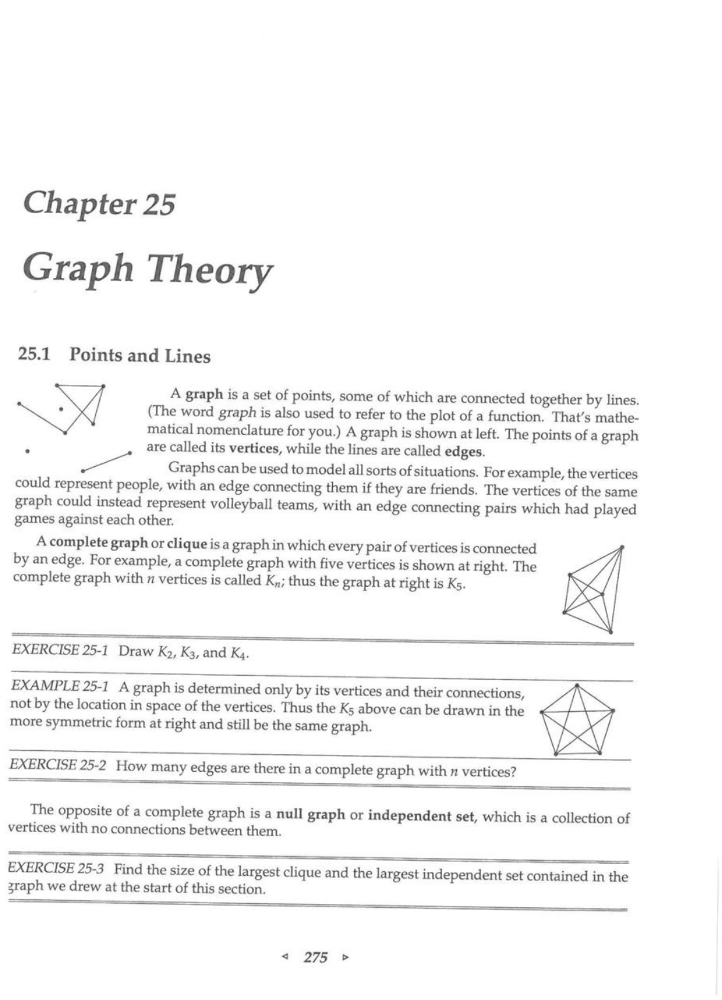
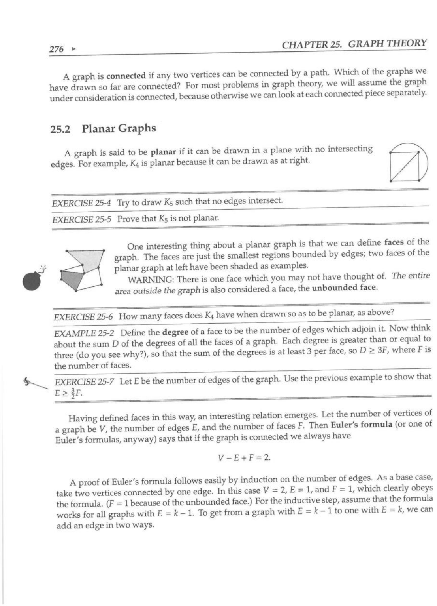
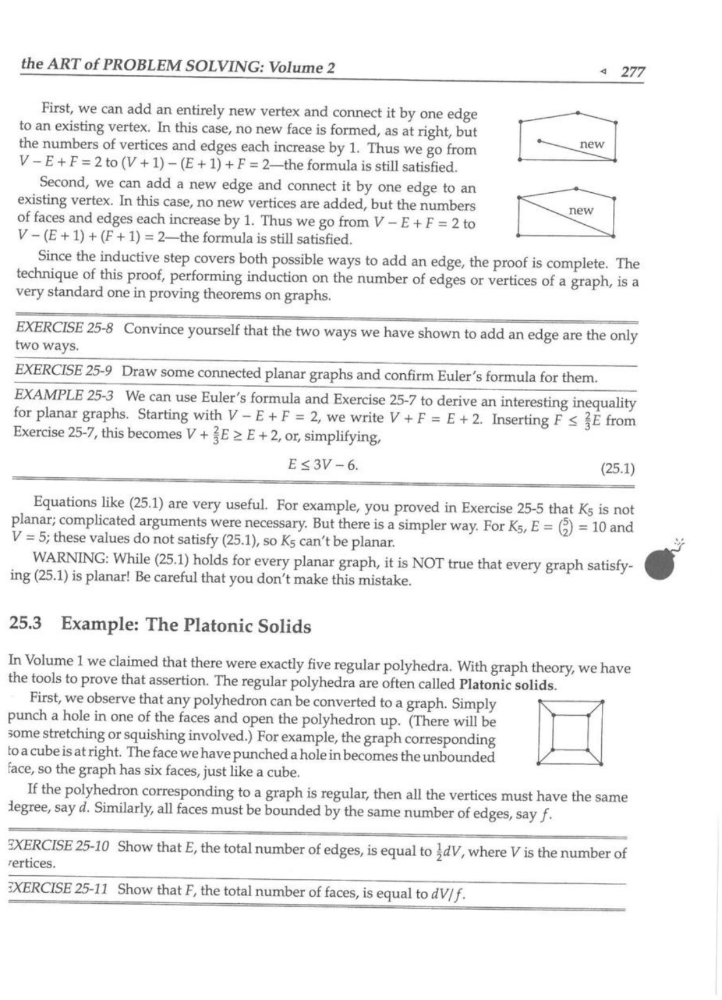
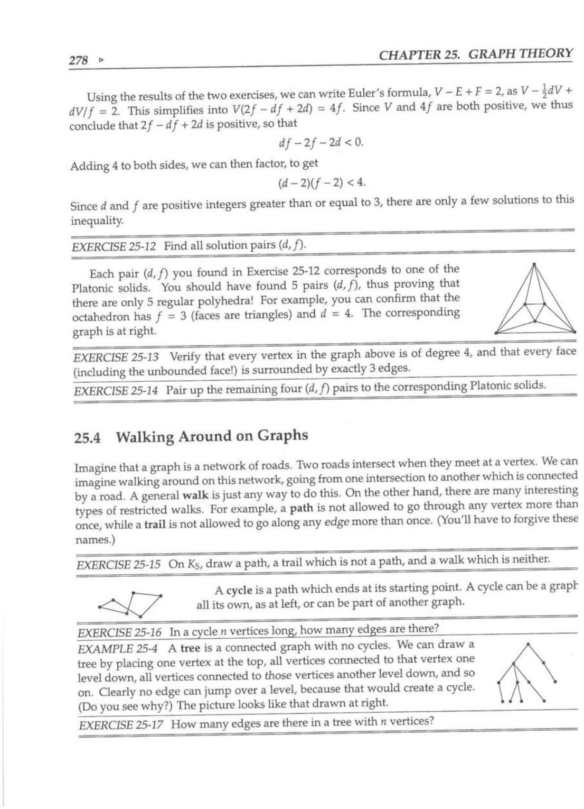
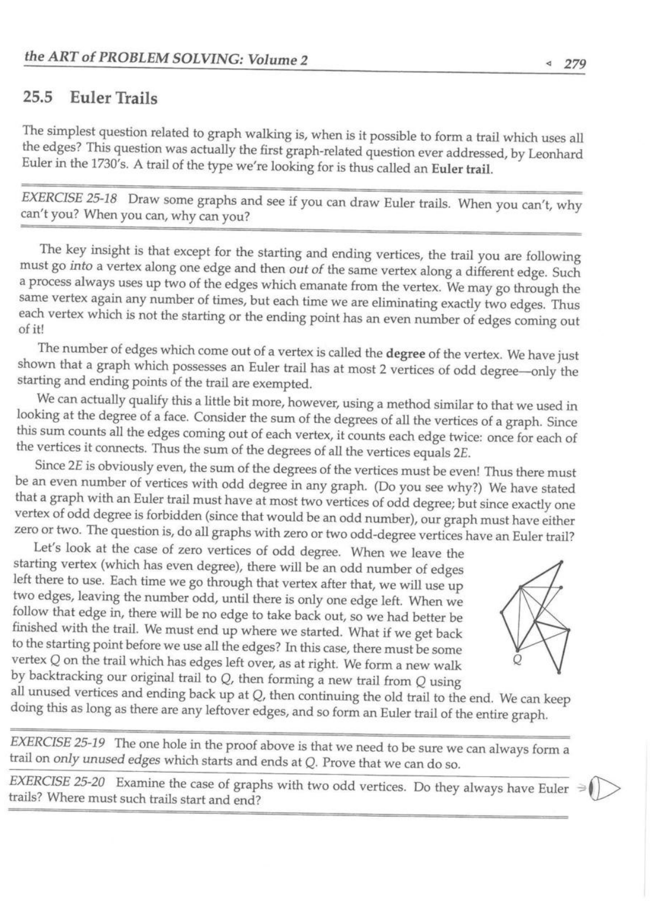
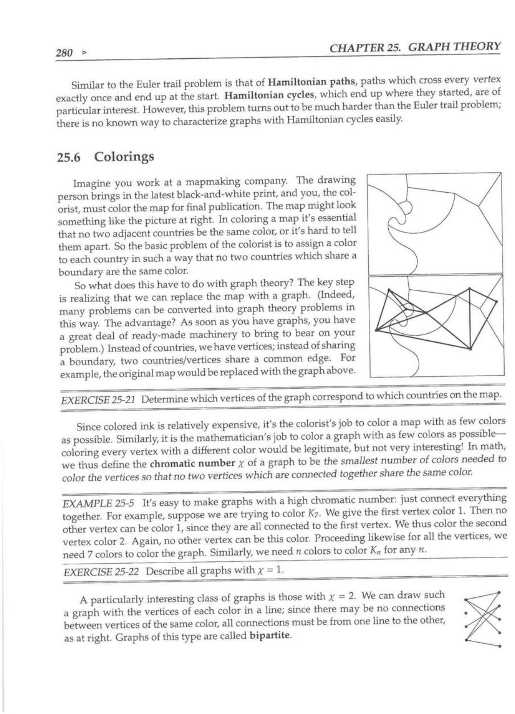
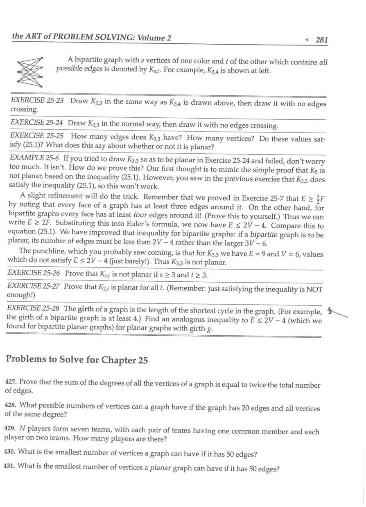
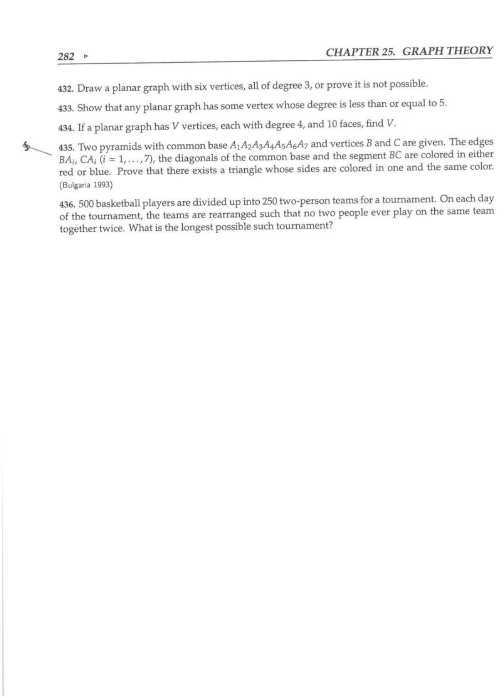
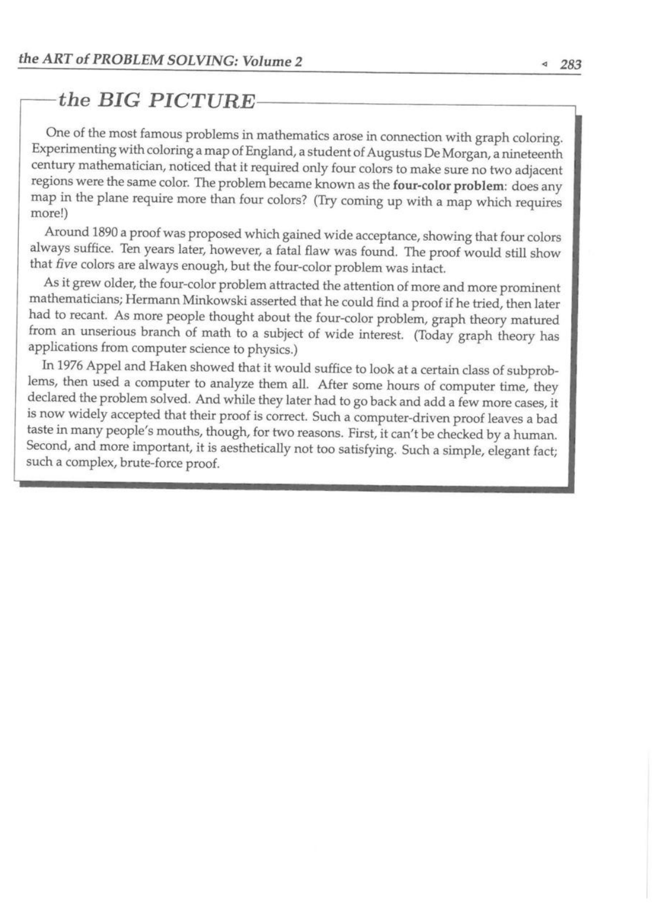

# Chapter 25: Graph Theory

Volume 2 · Printed pages 275–283 · PDF pages 297–305

[Volume contents](../index.md)

## Printed page 275

<!-- source: volume-2, PDF page 297, printed page 275 -->

### 25.1 Points and Lines

A graph is a set of points, some of which are connected together by lines. (The word graph is also used to refer to the plot of a function. That’s mathematical nomenclature for you.) A graph is shown at left. The points of a graph are called its vertices, while the lines are called edges.

Graphs can be used to model all sorts of situations. For example, the vertices could represent people, with an edge connecting them if they are friends. The vertices of the same graph could instead represent volleyball teams, with an edge connecting pairs which had played games against each other.

A complete graph or clique is a graph in which every pair of vertices is connected by an edge. For example, a complete graph with five vertices is shown at right. The complete graph with $n$ vertices is called $K_n$; thus the graph at right is $K_5$.

**EXERCISE 25-1 Draw $K_2, K_3,$ and $K_4$.**

**EXAMPLE 25-1 A graph is determined only by its vertices and their connections, not by the location in space of the vertices. Thus the $K_5$ above can be drawn in the more symmetric form at right and still be the same graph.**

**EXERCISE 25-2 How many edges are there in a complete graph with $n$ vertices?**

The opposite of a complete graph is a null graph or independent set, which is a collection of vertices with no connections between them.

**EXERCISE 25-3 Find the size of the largest clique and the largest independent set contained in the graph we drew at the start of this section.**

Original scan — PDF page 297

## Printed page 276

<!-- source: volume-2, PDF page 298, printed page 276 -->

A graph is connected if any two vertices can be connected by a path. Which of the graphs we have drawn so far are connected? For most problems in graph theory, we will assume the graph under consideration is connected, because otherwise we can look at each connected piece separately.

### 25.2 Planar Graphs

A graph is said to be planar if it can be drawn in a plane with no intersecting edges. For example, $K_4$ is planar because it can be drawn as at right.

**EXERCISE 25-4 Try to draw $K_5$ such that no edges intersect.**

**EXERCISE 25-5 Prove that $K_5$ is not planar.**

One interesting thing about a planar graph is that we can define faces of the graph. The faces are just the smallest regions bounded by edges; two faces of the planar graph at left have been shaded as examples.

WARNING: There is one face which you may not have thought of. The entire area outside the graph is also considered a face, the unbounded face.

**EXERCISE 25-6 How many faces does $K_4$ have when drawn so as to be planar, as above?**

**EXAMPLE 25-2 Define the degree of a face to be the number of edges which adjoin it. Now think about the sum $D$ of the degrees of all the faces of a graph. Each degree is greater than or equal to three (do you see why?), so that the sum of the degrees is at least 3 per face, so $D \geq 3F$, where $F$ is the number of faces.**

**EXERCISE 25-7 Let $E$ be the number of edges of the graph. Use the previous example to show that $E \geq \frac{3}{2}F$.**

Having defined faces in this way, an interesting relation emerges. Let the number of vertices of a graph be $V$, the number of edges $E$, and the number of faces $F$. Then Euler’s formula (or one of Euler’s formulas, anyway) says that if the graph is connected we always have

$$V - E + F = 2.$$

A proof of Euler’s formula follows easily by induction on the number of edges. As a base case, take two vertices connected by one edge. In this case $V = 2$, $E = 1$, and $F = 1$, which clearly obeys the formula. ($F = 1$ because of the unbounded face.) For the inductive step, assume that the formula works for all graphs with $E = k - 1$. To get from a graph with $E = k - 1$ to one with $E = k$, we can add an edge in two ways.

Original scan — PDF page 298

## Printed page 277

<!-- source: volume-2, PDF page 299, printed page 277 -->

First, we can add an entirely new vertex and connect it by one edge to an existing vertex. In this case, no new face is formed, as at right, but the numbers of vertices and edges each increase by 1. Thus we go from $V - E + F = 2$ to $(V + 1) - (E + 1) + F = 2$—the formula is still satisfied.

Second, we can add a new edge and connect it by one edge to an existing vertex. In this case, no new vertices are added, but the numbers of faces and edges each increase by 1. Thus we go from $V - E + F = 2$ to $V - (E + 1) + (F + 1) = 2$—the formula is still satisfied.

Since the inductive step covers both possible ways to add an edge, the proof is complete. The technique of this proof, performing induction on the number of edges or vertices of a graph, is a very standard one in proving theorems on graphs.

**EXERCISE 25-8** Convince yourself that the two ways we have shown to add an edge are the only two ways.

**EXERCISE 25-9** Draw some connected planar graphs and confirm Euler’s formula for them.

**EXAMPLE 25-3** We can use Euler’s formula and Exercise 25-7 to derive an interesting inequality for planar graphs. Starting with $V - E + F = 2$, we write $V + F = E + 2$. Inserting $F \leq \frac{2}{3}E$ from Exercise 25-7, this becomes $V + \frac{2}{3}E \geq E + 2$, or, simplifying,

$$E \leq 3V - 6.$$

(25.1)

Equations like (25.1) are very useful. For example, you proved in Exercise 25-5 that $K_5$ is not planar; complicated arguments were necessary. But there is a simpler way. For $K_5$, $E = \binom{5}{2} = 10$ and $V = 5$; these values do not satisfy (25.1), so $K_5$ can’t be planar.

**WARNING:** While (25.1) holds for every planar graph, it is NOT true that every graph satisfying (25.1) is planar! Be careful that you don’t make this mistake.

### 25.3 Example: The Platonic Solids

In Volume 1 we claimed that there were exactly five regular polyhedra. With graph theory, we have the tools to prove that assertion. The regular polyhedra are often called Platonic solids.

First, we observe that any polyhedron can be converted to a graph. Simply punch a hole in one of the faces and open the polyhedron up. (There will be some stretching or squishing involved.) For example, the graph corresponding to a cube is at right. The face we have punched a hole in becomes the unbounded face, so the graph has six faces, just like a cube.

If the polyhedron corresponding to a graph is regular, then all the vertices must have the same degree, say $d$. Similarly, all faces must be bounded by the same number of edges, say $f$.

**EXERCISE 25-10** Show that $E$, the total number of edges, is equal to $\frac{1}{2}dV$, where $V$ is the number of vertices.

**EXERCISE 25-11** Show that $F$, the total number of faces, is equal to $dV/f$.

Original scan — PDF page 299

## Printed page 278

<!-- source: volume-2, PDF page 300, printed page 278 -->

Using the results of the two exercises, we can write Euler’s formula, $V - E + F = 2$, as $V - \frac{1}{2}dV + dV/f = 2$. This simplifies into $V(2f - df + 2d) = 4f$. Since $V$ and $4f$ are both positive, we thus conclude that $2f - df + 2d$ is positive, so that

$$df - 2f - 2d < 0.$$

Adding 4 to both sides, we can then factor, to get

$$(d - 2)(f - 2) < 4.$$

Since $d$ and $f$ are positive integers greater than or equal to 3, there are only a few solutions to this inequality.

**EXERCISE 25-12** Find all solution pairs $(d, f)$.

Each pair $(d, f)$ you found in Exercise 25-12 corresponds to one of the Platonic solids. You should have found 5 pairs $(d, f)$, thus proving that there are only 5 regular polyhedra! For example, you can confirm that the octahedron has $f = 3$ (faces are triangles) and $d = 4$. The corresponding graph is at right.

**EXERCISE 25-13** Verify that every vertex in the graph above is of degree 4, and that every face (including the unbounded face!) is surrounded by exactly 3 edges.

**EXERCISE 25-14** Pair up the remaining four $(d, f)$ pairs to the corresponding Platonic solids.

### 25.4 Walking Around on Graphs

Imagine that a graph is a network of roads. Two roads intersect when they meet at a vertex. We can imagine walking around on this network, going from one intersection to another which is connected by a road. A general walk is just any way to do this. On the other hand, there are many interesting types of restricted walks. For example, a path is not allowed to go through any vertex more than once, while a trail is not allowed to go along any edge more than once. (You’ll have to forgive these names.)

**EXERCISE 25-15** On $K_5$, draw a path, a trail which is not a path, and a walk which is neither.

A cycle is a path which ends at its starting point. A cycle can be a graph all its own, as at left, or can be part of another graph.

**EXERCISE 25-16** In a cycle $n$ vertices long, how many edges are there?

**EXAMPLE 25-4** A tree is a connected graph with no cycles. We can draw a tree by placing one vertex at the top, all vertices connected to that vertex one level down, all vertices connected to those vertices another level down, and so on. Clearly no edge can jump over a level, because that would create a cycle. (Do you see why?) The picture looks like that drawn at right.

**EXERCISE 25-17** How many edges are there in a tree with $n$ vertices?

Original scan — PDF page 300

## Printed page 279

<!-- source: volume-2, PDF page 301, printed page 279 -->

### 25.5 Euler Trails

<!-- Heading restored for navigation from independently recognised source heading. -->

The simplest question related to graph walking is, when is it possible to form a trail which uses all the edges? This question was actually the first graph-related question ever addressed, by Leonhard Euler in the 1730’s. A trail of the type we’re looking for is thus called an Euler trail.

**EXERCISE 25-18 Draw some graphs and see if you can draw Euler trails. When you can’t, why can’t you? When you can, why can you?**

The key insight is that except for the starting and ending vertices, the trail you are following must go into a vertex along one edge and then out of the same vertex along a different edge. Such a process always uses up two of the edges which emanate from the vertex. We may go through the same vertex again any number of times, but each time we are eliminating exactly two edges. Thus each vertex which is not the starting or the ending point has an even number of edges coming out of it!

The number of edges which come out of a vertex is called the degree of the vertex. We have just shown that a graph which possesses an Euler trail has at most 2 vertices of odd degree—only the starting and ending points of the trail are exempted.

We can actually qualify this a little bit more, however, using a method similar to that we used in looking at the degree of a face. Consider the sum of the degrees of all the vertices of a graph. Since this sum counts all the edges coming out of each vertex, it counts each edge twice: once for each of the vertices it connects. Thus the sum of the degrees of all the vertices equals 2E.

Since 2E is obviously even, the sum of the degrees of the vertices must be even! Thus there must be an even number of vertices with odd degree in any graph. (Do you see why?) We have stated that a graph with an Euler trail must have at most two vertices of odd degree; but since exactly one vertex of odd degree is forbidden (since that would be an odd number), our graph must have either zero or two. The question is, do all graphs with zero or two odd-degree vertices have an Euler trail?

Let’s look at the case of zero vertices of odd degree. When we leave the starting vertex (which has even degree), there will be an odd number of edges left there to use. Each time we go through that vertex after that, we will use up two edges, leaving the number odd, until there is only one edge left. When we follow that edge in, there will be no edge to take back out, so we had better be finished with the trail. We must end up where we started. What if we get back to the starting point before we use all the edges? In this case, there must be some vertex $Q$ on the trail which has edges left over, as at right. We form a new walk by backtracking our original trail to $Q$, then forming a new trail from $Q$ using all unused vertices and ending back up at $Q$, then continuing the old trail to the end. We can keep doing this as long as there are any leftover edges, and so form an Euler trail of the entire graph.

**EXERCISE 25-19 The one hole in the proof above is that we need to be sure we can always form a trail on only unused edges which starts and ends at $Q$. Prove that we can do so.**

**EXERCISE 25-20 Examine the case of graphs with two odd vertices. Do they always have Euler trails? Where must such trails start and end?**

Original scan — PDF page 301

## Printed page 280

<!-- source: volume-2, PDF page 302, printed page 280 -->

Similar to the Euler trail problem is that of Hamiltonian paths, paths which cross every vertex exactly once and end up at the start. Hamiltonian cycles, which end up where they started, are of particular interest. However, this problem turns out to be much harder than the Euler trail problem; there is no known way to characterize graphs with Hamiltonian cycles easily.

### 25.6 Colorings

Imagine you work at a mapmaking company. The drawing person brings in the latest black-and-white print, and you, the colorist, must color the map for final publication. The map might look something like the picture at right. In coloring a map it's essential that no two adjacent countries be the same color, or it's hard to tell them apart. So the basic problem of the colorist is to assign a color to each country in such a way that no two countries which share a boundary are the same color.

So what does this have to do with graph theory? The key step is realizing that we can replace the map with a graph. (Indeed, many problems can be converted into graph theory problems in this way. The advantage? As soon as you have graphs, you have a great deal of ready-made machinery to bring to bear on your problem.) Instead of countries, we have vertices; instead of sharing a boundary, two countries/vertices share a common edge. For example, the original map would be replaced with the graph above.

**EXERCISE 25-21 Determine which vertices of the graph correspond to which countries on the map.**

Since colored ink is relatively expensive, it's the colorist's job to color a map with as few colors as possible. Similarly, it is the mathematician's job to color a graph with as few colors as possible—coloring every vertex with a different color would be legitimate, but not very interesting! In math, we thus define the chromatic number $\chi$ of a graph to be the smallest number of colors needed to color the vertices so that no two vertices which are connected together share the same color.

**EXAMPLE 25-5 It's easy to make graphs with a high chromatic number: just connect everything together. For example, suppose we are trying to color $K_7$. We give the first vertex color 1. Then no other vertex can be color 1, since they are all connected to the first vertex. We thus color the second vertex color 2. Again, no other vertex can be this color. Proceeding likewise for all the vertices, we need 7 colors to color the graph. Similarly, we need $n$ colors to color $K_n$ for any $n$.**

**EXERCISE 25-22 Describe all graphs with $\chi = 1$.**

A particularly interesting class of graphs is those with $\chi = 2$. We can draw such a graph with the vertices of each color in a line; since there may be no connections between vertices of the same color, all connections must be from one line to the other, as at right. Graphs of this type are called bipartite.

Original scan — PDF page 302

## Printed page 281

<!-- source: volume-2, PDF page 303, printed page 281 -->

A bipartite graph with $s$ vertices of one color and $t$ of the other which contains all possible edges is denoted by $K_{s,t}$. For example, $K_{3,4}$ is shown at left.

**EXERCISE 25-23** Draw $K_{2,3}$ in the same way as $K_{3,4}$ is drawn above, then draw it with no edges crossing.

**EXERCISE 25-24** Draw $K_{3,3}$ in the normal way, then draw it with no edges crossing.

**EXERCISE 25-25** How many edges does $K_{3,3}$ have? How many vertices? Do these values satisfy (25.1)? What does this say about whether or not it is planar?

**EXAMPLE 25-6** If you tried to draw $K_{3,3}$ so as to be planar in Exercise 25-24 and failed, don't worry too much. It isn't. How do we prove this? Our first thought is to mimic the simple proof that $K_{5}$ is not planar, based on the inequality (25.1). However, you saw in the previous exercise that $K_{3,3}$ does satisfy the inequality (25.1), so this won't work.

A slight refinement will do the trick. Remember that we proved in Exercise 25-7 that $E \geq \frac{3}{2} F$ by noting that every face of a graph has at least three edges around it. On the other hand, for bipartite graphs every face has at least four edges around it! (Prove this to yourself.) Thus we can write $E \geq 2 F$. Substituting this into Euler's formula, we now have $E \leq 2 V - 4$. Compare this to equation (25.1). We have improved that inequality for bipartite graphs: if a bipartite graph is to be planar, its number of edges must be less than $2 V - 4$ rather than the larger $3 V - 6$.

The punchline, which you probably saw coming, is that for $K_{3,3}$ we have $E = 9$ and $V = 6$, values which do not satisfy $E \leq 2 V - 4$ (just barely!). Thus $K_{3,3}$ is not planar.

**EXERCISE 25-26** Prove that $K_{s,t}$ is not planar if $s \geq 3$ and $t \geq 3$.

**EXERCISE 25-27** Prove that $K_{2,t}$ is planar for all $t$. (Remember: just satisfying the inequality is NOT enough!)

**EXERCISE 25-28** The girth of a graph is the length of the shortest cycle in the graph. (For example, the girth of a bipartite graph is at least 4.) Find an analogous inequality to $E \leq 2 V - 4$ (which we found for bipartite planar graphs) for planar graphs with girth $g$.

**Problems to Solve for Chapter 25**

427. Prove that the sum of the degrees of all the vertices of a graph is equal to twice the total number of edges.

428. What possible numbers of vertices can a graph have if the graph has 20 edges and all vertices of the same degree?

429. $N$ players form seven teams, with each pair of teams having one common member and each player on two teams. How many players are there?

430. What is the smallest number of vertices a graph can have if it has 50 edges?

431. What is the smallest number of vertices a planar graph can have if it has 50 edges?

Original scan — PDF page 303

## Printed page 282

<!-- source: volume-2, PDF page 304, printed page 282 -->

432. Draw a planar graph with six vertices, all of degree 3, or prove it is not possible.

433. Show that any planar graph has some vertex whose degree is less than or equal to 5.

434. If a planar graph has $V$ vertices, each with degree 4, and 10 faces, find $V$.

435. Two pyramids with common base $A_1A_2A_3A_4A_5A_6A_7$ and vertices $B$ and $C$ are given. The edges $BA_i, CA_i$ ($i = 1, \ldots, 7$), the diagonals of the common base and the segment $BC$ are colored in either red or blue. Prove that there exists a triangle whose sides are colored in one and the same color. (Bulgaria 1993)

436. 500 basketball players are divided up into 250 two-person teams for a tournament. On each day of the tournament, the teams are rearranged such that no two people ever play on the same team together twice. What is the longest possible such tournament?

Original scan — PDF page 304

## Printed page 283

<!-- source: volume-2, PDF page 305, printed page 283 -->

One of the most famous problems in mathematics arose in connection with graph coloring. Experimenting with coloring a map of England, a student of Augustus De Morgan, a nineteenth century mathematician, noticed that it required only four colors to make sure no two adjacent regions were the same color. The problem became known as the four-color problem: does any map in the plane require more than four colors? (Try coming up with a map which requires more!)

Around 1890 a proof was proposed which gained wide acceptance, showing that four colors always suffice. Ten years later, however, a fatal flaw was found. The proof would still show that five colors are always enough, but the four-color problem was intact.

As it grew older, the four-color problem attracted the attention of more and more prominent mathematicians; Hermann Minkowski asserted that he could find a proof if he tried, then later had to recant. As more people thought about the four-color problem, graph theory matured from an unserious branch of math to a subject of wide interest. (Today graph theory has applications from computer science to physics.)

In 1976 Appel and Haken showed that it would suffice to look at a certain class of subproblems, then used a computer to analyze them all. After some hours of computer time, they declared the problem solved. And while they later had to go back and add a few more cases, it is now widely accepted that their proof is correct. Such a computer-driven proof leaves a bad taste in many people's mouths, though, for two reasons. First, it can't be checked by a human. Second, and more important, it is aesthetically not too satisfying. Such a simple, elegant fact; such a complex, brute-force proof.

Original scan — PDF page 305

