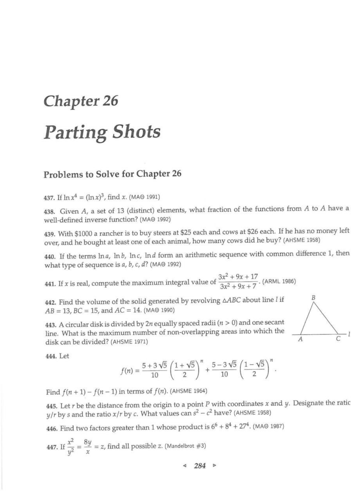
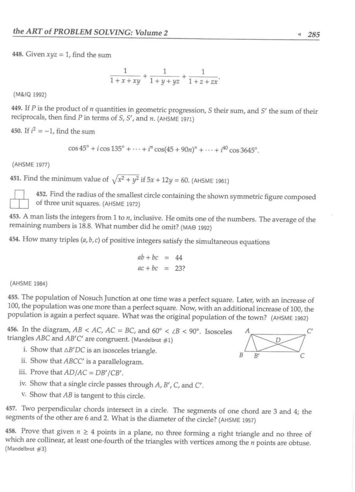
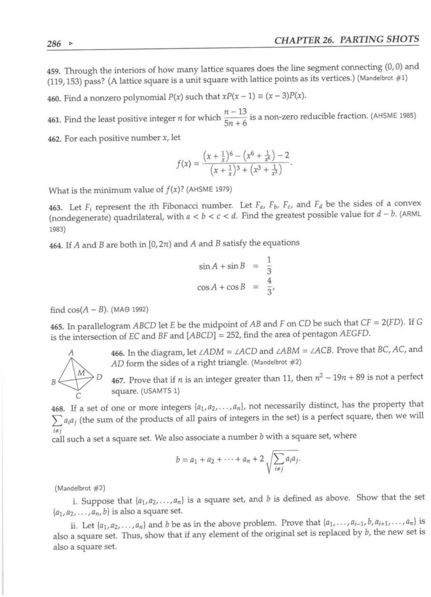
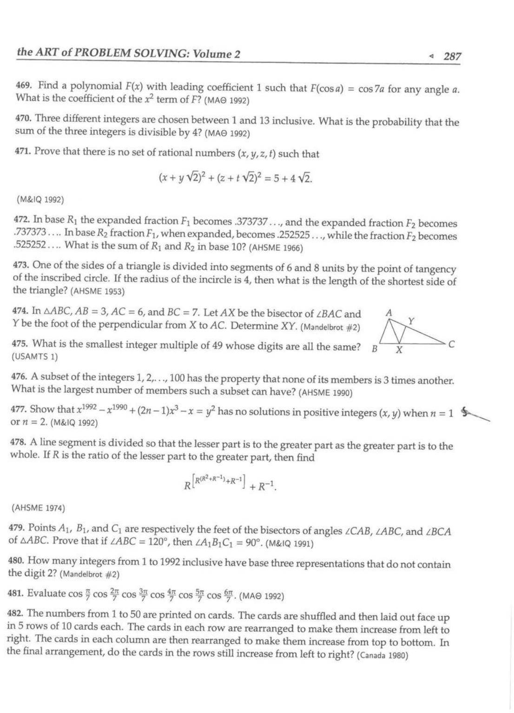
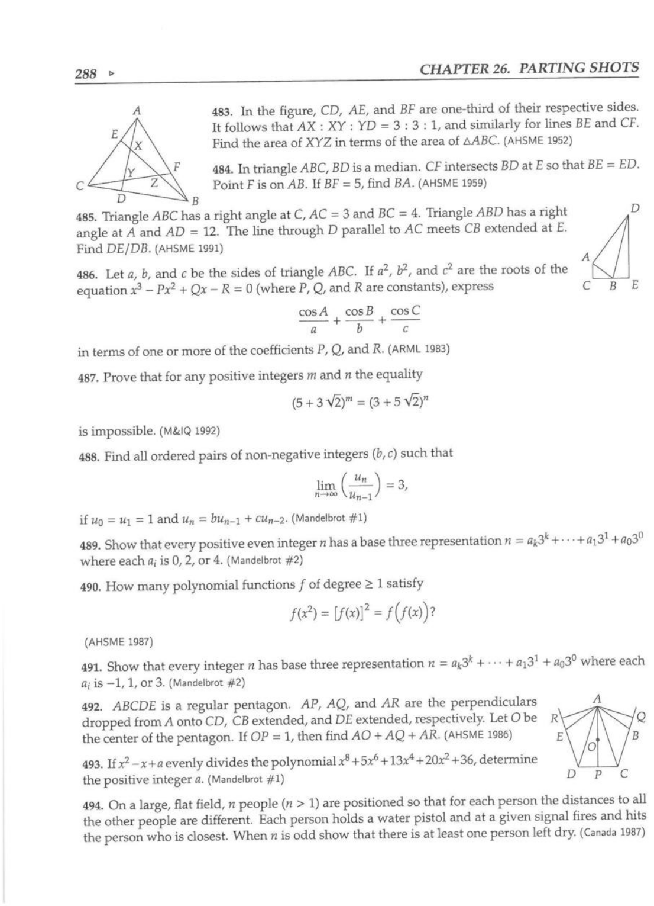
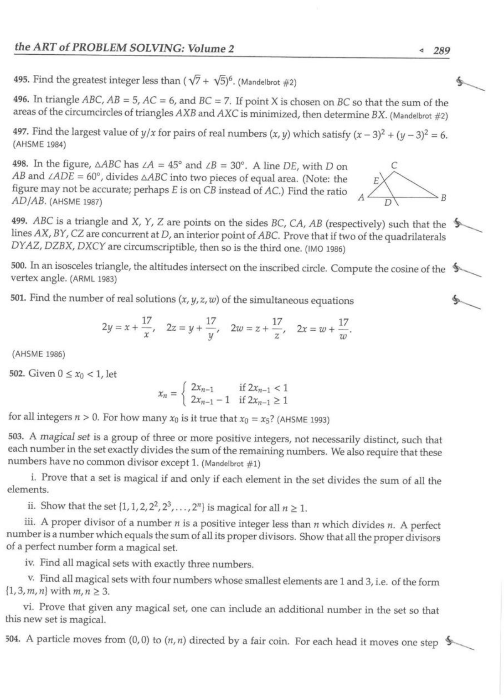
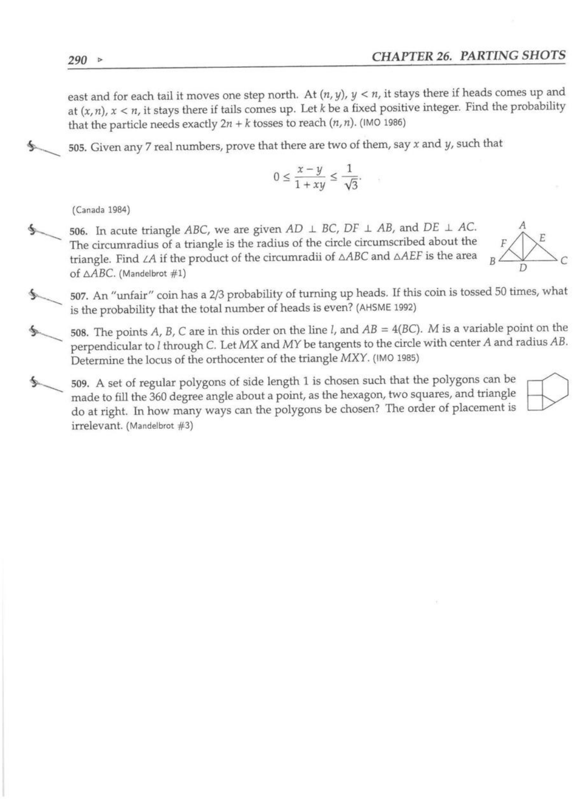

# Chapter 26: Parting Shots

Volume 2 · Printed pages 284–290 · PDF pages 306–312

[Volume contents](../index.md)

## Printed page 284

<!-- source: volume-2, PDF page 306, printed page 284 -->

Chapter 26

Parting Shots

Problems to Solve for Chapter 26

437. If $\ln x^4 = (\ln x)^3$, find $x$. (MAΘ 1991)

438. Given $A$, a set of 13 (distinct) elements, what fraction of the functions from $A$ to $A$ have a well-defined inverse function? (MAΘ 1992)

439. With $1000$ a rancher is to buy steers at $25$ each and cows at $26$ each. If he has no money left over, and he bought at least one of each animal, how many cows did he buy? (AHSME 1958)

440. If the terms $\ln a$, $\ln b$, $\ln c$, $\ln d$ form an arithmetic sequence with common difference $1$, then what type of sequence is $a, b, c, d$? (MAΘ 1992)

441. If $x$ is real, compute the maximum integral value of $\frac{3x^2 + 9x + 17}{3x^2 + 9x + 7}$. (ARML 1986)

442. Find the volume of the solid generated by revolving $\Delta ABC$ about line $l$ if $AB = 13$, $BC = 15$, and $AC = 14$. (MAΘ 1990)

443. A circular disk is divided by $2n$ equally spaced radii ($n > 0$) and one secant line. What is the maximum number of non-overlapping areas into which the disk can be divided? (AHSME 1971)

444. Let

$$f(n) = \frac{5 + 3\sqrt{5}}{10} \left( \frac{1 + \sqrt{5}}{2} \right)^n + \frac{5 - 3\sqrt{5}}{10} \left( \frac{1 - \sqrt{5}}{2} \right)^n.$$

Find $f(n + 1) - f(n - 1)$ in terms of $f(n)$. (AHSME 1964)

445. Let $r$ be the distance from the origin to a point $P$ with coordinates $x$ and $y$. Designate the ratio $y/r$ by $s$ and the ratio $x/r$ by $c$. What values can $s^2 - c^2$ have? (AHSME 1958)

446. Find two factors greater than 1 whose product is $6^6 + 8^4 + 27^4$. (MAΘ 1987)

447. If $\frac{x^2}{y^2} = \frac{8y}{x} = z$, find all possible $z$. (Mandelbrot #3)

Original scan — PDF page 306

## Printed page 285

<!-- source: volume-2, PDF page 307, printed page 285 -->

448. Given $xyz = 1$, find the sum

$$\frac{1}{1+x+xy} + \frac{1}{1+y+yz} + \frac{1}{1+z+zx}.$$

(M&IQ 1992)

449. If $P$ is the product of $n$ quantities in geometric progression, $S$ their sum, and $S'$ the sum of their reciprocals, then find $P$ in terms of $S, S'$, and $n$. (AHSME 1971)

450. If $i^2 = -1$, find the sum

$$\cos 45^\circ + i \cos 135^\circ + \cdots + i^n \cos(45 + 90n)^\circ + \cdots + i^{40} \cos 3645^\circ.$$

(AHSME 1977)

451. Find the minimum value of $\sqrt{x^2 + y^2}$ if $5x + 12y = 60$. (AHSME 1961)

452. Find the radius of the smallest circle containing the shown symmetric figure composed of three unit squares. (AHSME 1972)

453. A man lists the integers from 1 to $n$, inclusive. He omits one of the numbers. The average of the remaining numbers is 18.8. What number did he omit? (MAΘ 1992)

454. How many triples $(a, b, c)$ of positive integers satisfy the simultaneous equations

$$ab + bc = 44$$

$$ac + bc = 23?$$

(AHSME 1984)

455. The population of Nosuch Junction at one time was a perfect square. Later, with an increase of 100, the population was one more than a perfect square. Now, with an additional increase of 100, the population is again a perfect square. What was the original population of the town? (AHSME 1962)

456. In the diagram, $AB < AC, AC = BC$, and $60^\circ < \angle B < 90^\circ$. Isosceles triangles $ABC$ and $AB'C'$ are congruent. (Mandelbrot #1)

i. Show that $\Delta B'DC$ is an isosceles triangle.

ii. Show that $ABCC'$ is a parallelogram.

iii. Prove that $AD/AC = DB'/CB'$.

iv. Show that a single circle passes through $A, B', C$, and $C'$.

v. Show that $AB$ is tangent to this circle.

457. Two perpendicular chords intersect in a circle. The segments of one chord are 3 and 4; the segments of the other are 6 and 2. What is the diameter of the circle? (AHSME 1957)

458. Prove that given $n \geq 4$ points in a plane, no three forming a right triangle and no three of which are collinear, at least one-fourth of the triangles with vertices among the $n$ points are obtuse. (Mandelbrot #3)

Original scan — PDF page 307

## Printed page 286

<!-- source: volume-2, PDF page 308, printed page 286 -->

459. Through the interiors of how many lattice squares does the line segment connecting $(0, 0)$ and $(119, 153)$ pass? (A lattice square is a unit square with lattice points as its vertices.) (Mandelbrot #1)

460. Find a nonzero polynomial $P(x)$ such that $xP(x - 1) \equiv (x - 3)P(x)$.

461. Find the least positive integer $n$ for which $\frac{n - 13}{5n + 6}$ is a non-zero reducible fraction. (AHSME 1985)

462. For each positive number $x$, let

$$f(x) = \frac{\left(x + \frac{1}{x}\right)^6 - \left(x^6 + \frac{1}{x^6}\right) - 2}{\left(x + \frac{1}{x}\right)^3 + \left(x^3 + \frac{1}{x^3}\right)}$$

What is the minimum value of $f(x)$? (AHSME 1979)

463. Let $F_i$ represent the $i$th Fibonacci number. Let $F_a, F_b, F_c,$ and $F_d$ be the sides of a convex (nondegenerate) quadrilateral, with $a < b < c < d$. Find the greatest possible value for $d - b$. (ARML 1983)

464. If $A$ and $B$ are both in $[0, 2\pi)$ and $A$ and $B$ satisfy the equations

$$\sin A + \sin B = \frac{1}{3}$$

$$\cos A + \cos B = \frac{4}{3},$$

find $\cos(A - B)$. (MAΘ 1992)

465. In parallelogram $ABCD$ let $E$ be the midpoint of $AB$ and $F$ on $CD$ be such that $CF = 2(FD)$. If $G$ is the intersection of $EC$ and $BF$ and $[ABCD] = 252$, find the area of pentagon $AEGFD$.

466. In the diagram, let $\angle ADM = \angle ACD$ and $\angle ABM = \angle ACB$. Prove that $BC, AC,$ and $AD$ form the sides of a right triangle. (Mandelbrot #2)

467. Prove that if $n$ is an integer greater than 11, then $n^2 - 19n + 89$ is not a perfect square. (USAMTS 1)

468. If a set of one or more integers $\{a_1, a_2, \ldots, a_n\}$, not necessarily distinct, has the property that $\sum_{i \neq j} a_i a_j$ (the sum of the products of all pairs of integers in the set) is a perfect square, then we will call such a set a square set. We also associate a number $b$ with a square set, where

$$b = a_1 + a_2 + \cdots + a_n + 2\sqrt{\sum_{i \neq j} a_i a_j}.$$

(Mandelbrot #2)

i. Suppose that $\{a_1, a_2, \ldots, a_n\}$ is a square set, and $b$ is defined as above. Show that the set $\{a_1, a_2, \ldots, a_n, b\}$ is also a square set.

ii. Let $\{a_1, a_2, \ldots, a_n\}$ and $b$ be as in the above problem. Prove that $\{a_1, \ldots, a_{i-1}, b, a_{i+1}, \ldots, a_n\}$ is also a square set. Thus, show that if any element of the original set is replaced by $b$, the new set is also a square set.

Original scan — PDF page 308

## Printed page 287

<!-- source: volume-2, PDF page 309, printed page 287 -->

469. Find a polynomial $F(x)$ with leading coefficient 1 such that $F(\cos a) = \cos 7a$ for any angle $a$. What is the coefficient of the $x^2$ term of $F$? (MAΘ 1992)

470. Three different integers are chosen between 1 and 13 inclusive. What is the probability that the sum of the three integers is divisible by 4? (MAΘ 1992)

471. Prove that there is no set of rational numbers $(x, y, z, t)$ such that

$$x + y \sqrt{2}^2 + (z + t \sqrt{2}^2) = 5 + 4 \sqrt{2}.$$

(M&IQ 1992)

472. In base $R_1$ the expanded fraction $F_1$ becomes $.373737 \ldots$, and the expanded fraction $F_2$ becomes $.737373 \ldots$. In base $R_2$ fraction $F_1$, when expanded, becomes $.252525 \ldots$, while the fraction $F_2$ becomes $.525252 \ldots$. What is the sum of $R_1$ and $R_2$ in base 10? (AHSME 1966)

473. One of the sides of a triangle is divided into segments of 6 and 8 units by the point of tangency of the inscribed circle. If the radius of the incircle is 4, then what is the length of the shortest side of the triangle? (AHSME 1953)

474. In $\triangle ABC$, $AB = 3$, $AC = 6$, and $BC = 7$. Let $AX$ be the bisector of $\angle BAC$ and $Y$ be the foot of the perpendicular from $X$ to $AC$. Determine $XY$. (Mandelbrot #2)

475. What is the smallest integer multiple of 49 whose digits are all the same? (USAMTS 1)

476. A subset of the integers 1, 2, ..., 100 has the property that none of its members is 3 times another. What is the largest number of members such a subset can have? (AHSME 1990)

477. Show that $x^{1992} - x^{1990} + (2n - 1)x^3 - x = y^2$ has no solutions in positive integers $(x, y)$ when $n = 1$ or $n = 2$. (M&IQ 1992)

478. A line segment is divided so that the lesser part is to the greater part as the greater part is to the whole. If $R$ is the ratio of the lesser part to the greater part, then find

$$R \left[ R^{R^2 + R^{-1}} + R^{-1} \right] + R^{-1}.$$

(AHSME 1974)

479. Points $A_1, B_1$, and $C_1$ are respectively the feet of the bisectors of angles $\angle CAB, \angle ABC,$ and $\angle BCA$ of $\triangle ABC$. Prove that if $\angle ABC = 120^\circ$, then $\angle A_1 B_1 C_1 = 90^\circ$. (M&IQ 1991)

480. How many integers from 1 to 1992 inclusive have base three representations that do not contain the digit 2? (Mandelbrot #2)

481. Evaluate $\cos \frac{\pi}{7} \cos \frac{2\pi}{7} \cos \frac{3\pi}{7} \cos \frac{4\pi}{7} \cos \frac{5\pi}{7} \cos \frac{6\pi}{7}$. (MAΘ 1992)

482. The numbers from 1 to 50 are printed on cards. The cards are shuffled and then laid out face up in 5 rows of 10 cards each. The cards in each row are rearranged to make them increase from left to right. The cards in each column are then rearranged to make them increase from top to bottom. In the final arrangement, do the cards in the rows still increase from left to right? (Canada 1980)

Original scan — PDF page 309

## Printed page 288

<!-- source: volume-2, PDF page 310, printed page 288 -->

483. In the figure, CD, AE, and BF are one-third of their respective sides. It follows that $AX : XY : YD = 3 : 3 : 1$, and similarly for lines BE and CF. Find the area of XYZ in terms of the area of $\Delta ABC$. (AHSME 1952)

484. In triangle ABC, BD is a median. CF intersects BD at E so that BE = ED. Point F is on AB. If BF = 5, find BA. (AHSME 1959)

485. Triangle ABC has a right angle at C, AC = 3 and BC = 4. Triangle ABD has a right angle at A and AD = 12. The line through D parallel to AC meets CB extended at E. Find DE/DB. (AHSME 1991)

486. Let a, b, and c be the sides of triangle ABC. If $a^2, b^2,$ and $c^2$ are the roots of the equation $x^3 - Px^2 + Qx - R = 0$ (where P, Q, and R are constants), express

$$\frac{\cos A}{a} + \frac{\cos B}{b} + \frac{\cos C}{c}$$

in terms of one or more of the coefficients $P, Q,$ and $R$. (ARML 1983)

487. Prove that for any positive integers $m$ and $n$ the equality

$$(5 + 3\sqrt{2})^m = (3 + 5\sqrt{2})^n$$

is impossible. (M&IQ 1992)

488. Find all ordered pairs of non-negative integers $(b, c)$ such that

$$\lim_{n \to \infty} \left( \frac{u_n}{u_{n-1}} \right) = 3,$$

if $u_0 = u_1 = 1$ and $u_n = bu_{n-1} + cu_{n-2}$. (Mandelbrot #1)

489. Show that every positive even integer $n$ has a base three representation $n = a_k 3^k + \cdots + a_1 3^1 + a_0 3^0$ where each $a_i$ is 0, 2, or 4. (Mandelbrot #2)

490. How many polynomial functions $f$ of degree $\geq 1$ satisfy

$$f(x^2) = [f(x)]^2 = f(f(x))?$$

(AHSME 1987)

491. Show that every integer $n$ has base three representation $n = a_k 3^k + \cdots + a_1 3^1 + a_0 3^0$ where each $a_i$ is -1, 1, or 3. (Mandelbrot #2)

492. ABCDE is a regular pentagon. AP, AQ, and AR are the perpendiculars dropped from A onto CD, CB extended, and DE extended, respectively. Let O be the center of the pentagon. If OP = 1, then find AO + AQ + AR. (AHSME 1986)

493. If $x^2 - x + a$ evenly divides the polynomial $x^8 + 5x^6 + 13x^4 + 20x^2 + 36$, determine the positive integer $a$. (Mandelbrot #1)

494. On a large, flat field, $n$ people ($n > 1$) are positioned so that for each person the distances to all the other people are different. Each person holds a water pistol and at a given signal fires and hits the person who is closest. When $n$ is odd show that there is at least one person left dry. (Canada 1987)

Original scan — PDF page 310

## Printed page 289

<!-- source: volume-2, PDF page 311, printed page 289 -->

495. Find the greatest integer less than $(\sqrt{7} + \sqrt{5})^6$. (Mandelbrot #2)

496. In triangle $ABC$, $AB = 5$, $AC = 6$, and $BC = 7$. If point $X$ is chosen on $BC$ so that the sum of the areas of the circumcircles of triangles $AXB$ and $AXC$ is minimized, then determine $BX$. (Mandelbrot #2)

497. Find the largest value of $y/x$ for pairs of real numbers $(x, y)$ which satisfy $(x - 3)^2 + (y - 3)^2 = 6$. (AHSME 1984)

498. In the figure, $\triangle ABC$ has $\angle A = 45^\circ$ and $\angle B = 30^\circ$. A line $DE$, with $D$ on $AB$ and $\angle ADE = 60^\circ$, divides $\triangle ABC$ into two pieces of equal area. (Note: the figure may not be accurate; perhaps $E$ is on $CB$ instead of $AC$.) Find the ratio $AD/AB$. (AHSME 1987)

499. $ABC$ is a triangle and $X, Y, Z$ are points on the sides $BC, CA, AB$ (respectively) such that the lines $AX, BY, CZ$ are concurrent at $D$, an interior point of $ABC$. Prove that if two of the quadrilaterals $DYAZ, DZBX, DXCY$ are circumscriptible, then so is the third one. (IMO 1986)

500. In an isosceles triangle, the altitudes intersect on the inscribed circle. Compute the cosine of the vertex angle. (ARML 1983)

501. Find the number of real solutions $(x, y, z, w)$ of the simultaneous equations

$$2y = x + \frac{17}{x}, \quad 2z = y + \frac{17}{y}, \quad 2w = z + \frac{17}{z}, \quad 2x = w + \frac{17}{w}.$$

(AHSME 1986)

502. Given $0 \leq x_0 < 1$, let

$$x_n = \begin{cases} 2x_{n-1} & \text{if } 2x_{n-1} < 1 \\ 2x_{n-1} - 1 & \text{if } 2x_{n-1} \geq 1 \end{cases}$$

for all integers $n > 0$. For how many $x_0$ is it true that $x_0 = x_5$? (AHSME 1993)

503. A magical set is a group of three or more positive integers, not necessarily distinct, such that each number in the set exactly divides the sum of the remaining numbers. We also require that these numbers have no common divisor except 1. (Mandelbrot #1)

i. Prove that a set is magical if and only if each element in the set divides the sum of all the elements.

ii. Show that the set $\{1, 1, 2, 2^2, 2^3, \ldots, 2^n\}$ is magical for all $n \geq 1$.

iii. A proper divisor of a number $n$ is a positive integer less than $n$ which divides $n$. A perfect number is a number which equals the sum of all its proper divisors. Show that all the proper divisors of a perfect number form a magical set.

iv. Find all magical sets with exactly three numbers.

v. Find all magical sets with four numbers whose smallest elements are 1 and 3, i.e. of the form $\{1, 3, m, n\}$ with $m, n \geq 3$.

vi. Prove that given any magical set, one can include an additional number in the set so that this new set is magical.

504. A particle moves from $(0, 0)$ to $(n, n)$ directed by a fair coin. For each head it moves one step

Original scan — PDF page 311

## Printed page 290

<!-- source: volume-2, PDF page 312, printed page 290 -->

east and for each tail it moves one step north. At $(n, y), y < n$, it stays there if heads come up and at $(x, n), x < n$, it stays there if tails come up. Let $k$ be a fixed positive integer. Find the probability that the particle needs exactly $2n + k$ tosses to reach $(n, n)$. (IMO 1986)

505. Given any 7 real numbers, prove that there are two of them, say $x$ and $y$, such that

$$0 \leq \frac{x - y}{1 + xy} \leq \frac{1}{\sqrt{3}}.$$

(Canada 1984)

506. In acute triangle $ABC$, we are given $AD \perp BC$, $DF \perp AB$, and $DE \perp AC$. The circumradius of a triangle is the radius of the circle circumscribed about the triangle. Find $\angle A$ if the product of the circumradii of $\triangle ABC$ and $\triangle AEF$ is the area of $\triangle ABC$. (Mandelbrot #1)

507. An "unfair" coin has a 2/3 probability of turning up heads. If this coin is tossed 50 times, what is the probability that the total number of heads is even? (AHSME 1992)

508. The points $A, B, C$ are in this order on the line $l$, and $AB = 4(BC)$. $M$ is a variable point on the perpendicular to $l$ through $C$. Let $MX$ and $MY$ be tangents to the circle with center $A$ and radius $AB$. Determine the locus of the orthocenter of the triangle $MXY$. (IMO 1985)

509. A set of regular polygons of side length 1 is chosen such that the polygons can be made to fill the 360 degree angle about a point, as the hexagon, two squares, and triangle do at right. In how many ways can the polygons be chosen? The order of placement is irrelevant. (Mandelbrot #3)

Original scan — PDF page 312

