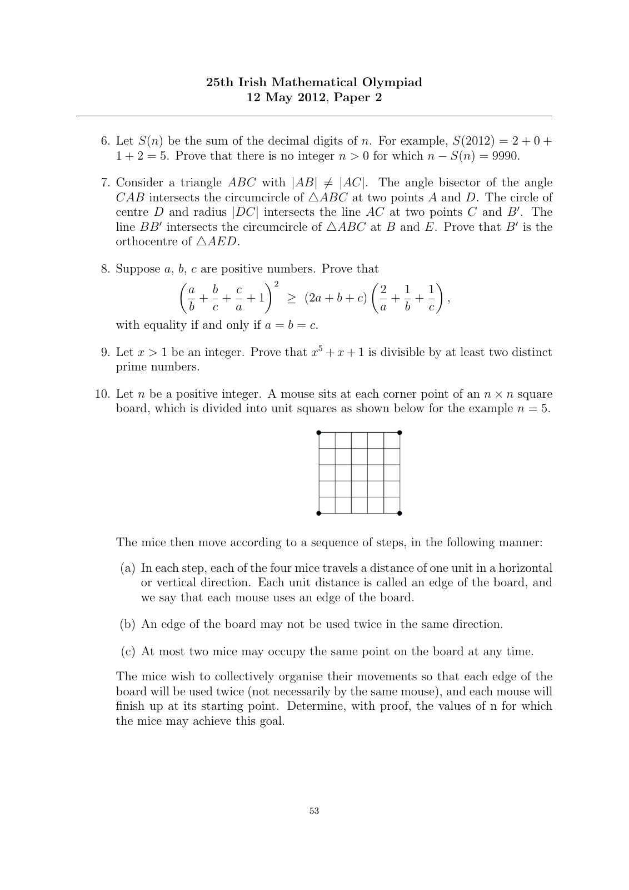

# IrMO 2012 · 12 May 2012

## Q1 | Partition by forbidden sums | combinatorics

Let $C=\{1,2,\ldots,20\}$ and $S=\{4,5,9,14,23,37\}$. Find sets $A,B$ such that (a) $A\cap B=\varnothing$; (b) $A\cup B=C$; (c) the sum of two distinct elements of $A$ is not in $S$; (d) the sum of two distinct elements of $B$ is not in $S$.

## Q2 | Tangent circumcircles | geometry

$A,B,C,D$ are four points in that order on a circle $K$. $AB\perp BC$ and $BC\perp CD$. $X$ lies on the circumference between $A,D$. $AX$ extended meets $CD$ extended at $E$, and $DX$ extended meets $BA$ extended at $F$. Prove the circumcircles of $AXF$ and $DXE$ are tangent and their common tangent line passes through the centre of $K$.

## Q3 | Integer coefficient polynomials | algebra, number-theory

Find with proof all polynomials $f$ with nonnegative integer coefficients, $f(1)=8$ and $f(2)=2012$.

## Q4 | Integer triangles with sixty degrees | geometry, number-theory

There exists an infinite set of triangles whose side lengths are integers with no common factors and with one and only one angle equal to $60^\circ$. One such triangle has side lengths $5,7,8$. Find two more.

## Q5 | Best inequality constant | inequalities

(a) Show for $x,y>0$ that $(x+y)^5\ge12xy(x^3+y^3)$.

(b) Prove $12$ is the best possible constant: for every $K>12$ there exist $x,y>0$ such that $(x+y)^5<Kxy(x^3+y^3)$.

## Q6 | Digit sum obstruction | number-theory

Let $S(n)$ be the sum of the decimal digits of $n$; for example $S(2012)=5$. Prove there is no integer $n>0$ for which $n-S(n)=9990$.

## Q7 | Angle bisector and orthocentre | geometry

Consider triangle $ABC$ with $|AB|\ne|AC|$. The bisector of $\angle CAB$ meets its circumcircle at $A,D$. The circle with centre $D$ and radius $|DC|$ meets line $AC$ at $C,B'$. Line $BB'$ meets the circumcircle at $B,E$. Prove $B'$ is the orthocentre of triangle $AED$.

## Q8 | Cyclic rational inequality | inequalities

For $a,b,c>0$, prove
$$\left(\frac ab+\frac bc+\frac ca+1\right)^2\ge(2a+b+c)\left(\frac2a+\frac1b+\frac1c\right),$$
with equality if and only if $a=b=c$.

## Q9 | Distinct prime divisors | number-theory, algebra

Let $x>1$ be an integer. Prove $x^5+x+1$ is divisible by at least two distinct primes.

## Q10 | Mice on a square board | combinatorics

Let $n$ be a positive integer. A mouse sits at each corner of an $n\times n$ board divided into unit squares (source diagram shows $n=5$).

(a) At each step each of the four mice travels one unit horizontally or vertically along an edge of the board.

(b) An edge may not be used twice in the same direction.

(c) At most two mice may occupy the same point at any time.

The mice wish to arrange their movements so that every edge is used twice (not necessarily by the same mouse), and each mouse ends at its starting point. Determine with proof the values of $n$ for which this is possible.

