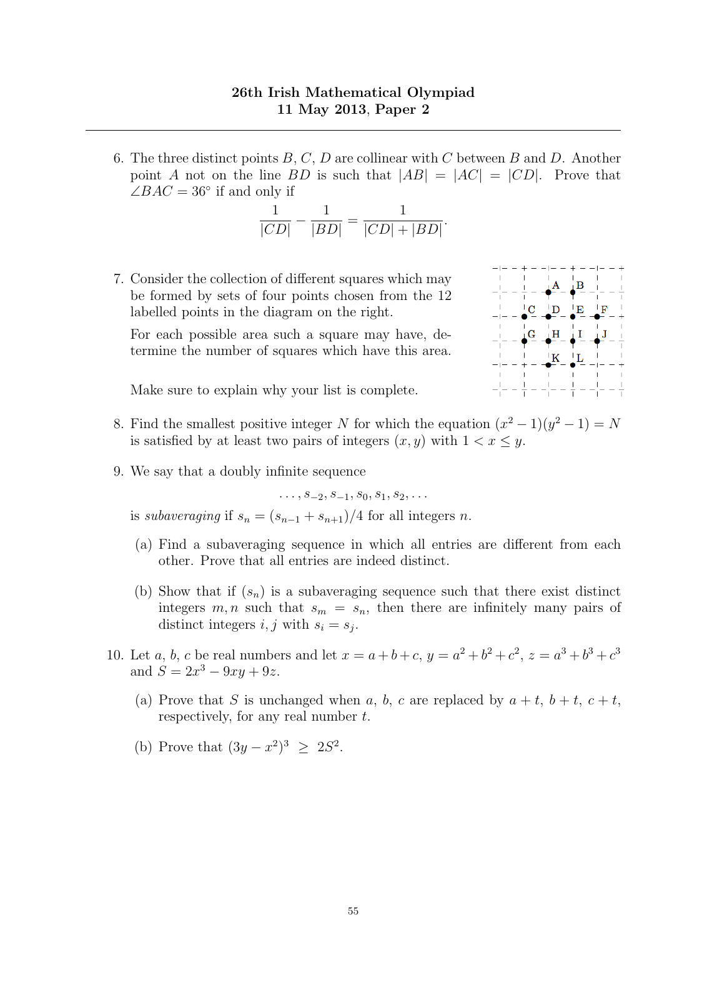

# IrMO 2013 · 11 May 2013

## Q1 | Simultaneous perfect powers | number-theory

Find the smallest positive integer $m$ such that $5m$ is an exact fifth power, $6m$ an exact sixth power, and $7m$ an exact seventh power.

## Q2 | Harmonic sum bound | inequalities

Prove
$$1-\frac1{2012}\left(\frac12+\frac13+\cdots+\frac1{2013}\right)\ge\frac{1}{\sqrt[2012]{2013}}.$$

## Q3 | Iterated altitude triangles | geometry

The altitudes of triangle $ABC$ form the sides of a second triangle $A_1B_1C_1$. Its altitudes form the sides of a third triangle $A_2B_2C_2$. Prove $A_2B_2C_2$ is similar to $ABC$.

## Q4 | Three colour table | combinatorics

Each square of a $6\times6$ table is coloured red, yellow or blue, subject to:

(a) No row or column contains more than two squares of the same colour.

(b) In any four squares obtained by intersecting two rows and two columns, no colour occurs exactly three times.

In how many different ways can the table be coloured?

## Q5 | Tangents and collinearity | geometry

$A,B,C$ lie on a circle with centre $O$. Tangents to the circumcircles of $OAB,OAC$ are drawn at $P,Q$, respectively, where $P,Q$ are diametrically opposite $O$. They intersect at $K$. Line $CA$ meets the circumcircle of $OAB$ at $A,X$. Prove $X$ lies on $KO$.

## Q6 | Golden angle criterion | geometry, algebra

Distinct points $B,C,D$ are collinear with $C$ between $B,D$. A point $A$ not on $BD$ satisfies $|AB|=|AC|=|CD|$. Prove $\angle BAC=36^\circ$ if and only if
$$\frac1{|CD|}-\frac1{|BD|}=\frac1{|CD|+|BD|}.$$

## Q7 | Counting squares in a diagram | combinatorics, geometry

Consider the different squares formed by sets of four points chosen from the $12$ labelled points in the source diagram. For each possible area, determine how many squares have that area. Explain why the list is complete.

## Q8 | Repeated product of squares minus one | number-theory

Find the smallest positive integer $N$ for which $(x^2-1)(y^2-1)=N$ is satisfied by at least two pairs of integers $(x,y)$ with $1<x\le y$.

## Q9 | Doubly infinite subaveraging sequences | sequences, algebra

A doubly infinite sequence $\ldots,s_{-2},s_{-1},s_0,s_1,s_2,\ldots$ is subaveraging if $s_n=(s_{n-1}+s_{n+1})/4$ for every integer $n$.

(a) Find such a sequence with all entries distinct and prove they are distinct.

(b) Show that if a subaveraging sequence has $s_m=s_n$ for distinct integers $m,n$, it has infinitely many pairs of distinct integers $i,j$ with $s_i=s_j$.

## Q10 | Translation invariant inequality | inequalities, algebra

Let $a,b,c$ be real, and put $x=a+b+c$, $y=a^2+b^2+c^2$, $z=a^3+b^3+c^3$, $S=2x^3-9xy+9z$.

(a) Prove $S$ is unchanged when $a,b,c$ are replaced by $a+t,b+t,c+t$ for any real $t$.

(b) Prove $(3y-x^2)^3\ge2S^2$.
