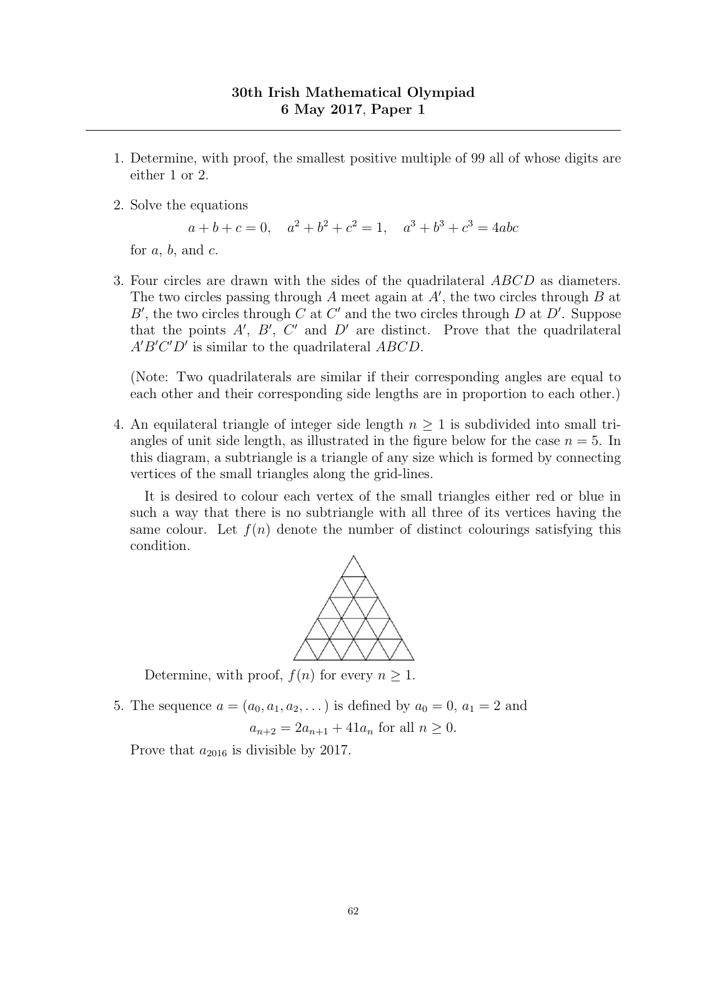

# IrMO 2017 · 6 May 2017

## Q1 | Smallest multiple with restricted digits | number-theory

Determine with proof the smallest positive multiple of $99$ all of whose digits are $1$ or $2$.

## Q2 | Symmetric system | algebra

Solve $a+b+c=0$, $a^2+b^2+c^2=1$, $a^3+b^3+c^3=4abc$ for $a,b,c$.

## Q3 | Similar quadrilaterals from circles | geometry

Four circles have the sides of quadrilateral $ABCD$ as diameters. The circles through $A$ meet again at $A'$, those through $B$ at $B'$, those through $C$ at $C'$, and those through $D$ at $D'$. Assuming $A',B',C',D'$ are distinct, prove $A'B'C'D'$ is similar to $ABCD$ (corresponding angles equal and corresponding sides proportional).

## Q4 | Two colour triangular grid | combinatorics

An equilateral triangle of integer side length $n\ge1$ is subdivided into unit-side triangles as shown for $n=5$. A subtriangle is any triangle formed by connecting grid vertices along grid lines. Colour each vertex red or blue with no subtriangle having three vertices of the same colour. Let $f(n)$ count the distinct colourings. Determine with proof $f(n)$ for every $n\ge1$.

## Q5 | Recurrence modulo a prime | sequences, number-theory

Let $a_0=0$, $a_1=2$, $a_{n+2}=2a_{n+1}+41a_n$ for $n\ge0$. Prove $2017$ divides $a_{2016}$.

## Q6 | Coprimality of powers | number-theory

Does there exist an even positive integer $n$ for which $5$ divides $n+1$ and $2^n+n$ and $2^n-1$ are coprime? Coprime means greatest common divisor equal to $1$.

## Q7 | Soccer scores | combinatorics

Five teams each play each other once. A winner gains $5$ points and a loser $0$. Both teams gain $1$ point for a $0$–$0$ draw and $2$ points for any other draw. The five final totals are consecutive integers. What is the minimum number of goals scored?

## Q8 | Sums of squared distances | geometry, algebra

Segment $B_0B_n$ is divided into $n$ equal parts by $B_1,\ldots,B_{n-1}$. A point $A$ satisfies $\angle B_0AB_n=90^\circ$. Prove
$$\sum_{k=0}^n|AB_k|^2=\sum_{k=0}^n|B_0B_k|^2.$$

## Q9 | High power inequality | inequalities

For all $a,b\ge0$, prove
$$1+a^{2017}+b^{2017}\ge a^{10}b^7+a^7b^{2000}+a^{2000}b^{10}.$$
When is equality attained?

## Q10 | Powerful sequences | sequences, algebra

For a positive integer $m$, a real sequence $(a_1,a_2,\ldots)$ is $m$-powerful if
$$\left(\sum_{k=1}^n a_k\right)^m=\sum_{k=1}^n a_k^m$$
for every positive integer $n$.

(a) Show a sequence is $30$-powerful if and only if at most one term is nonzero.

(b) Find a $2017$-powerful sequence none of whose terms is zero.
