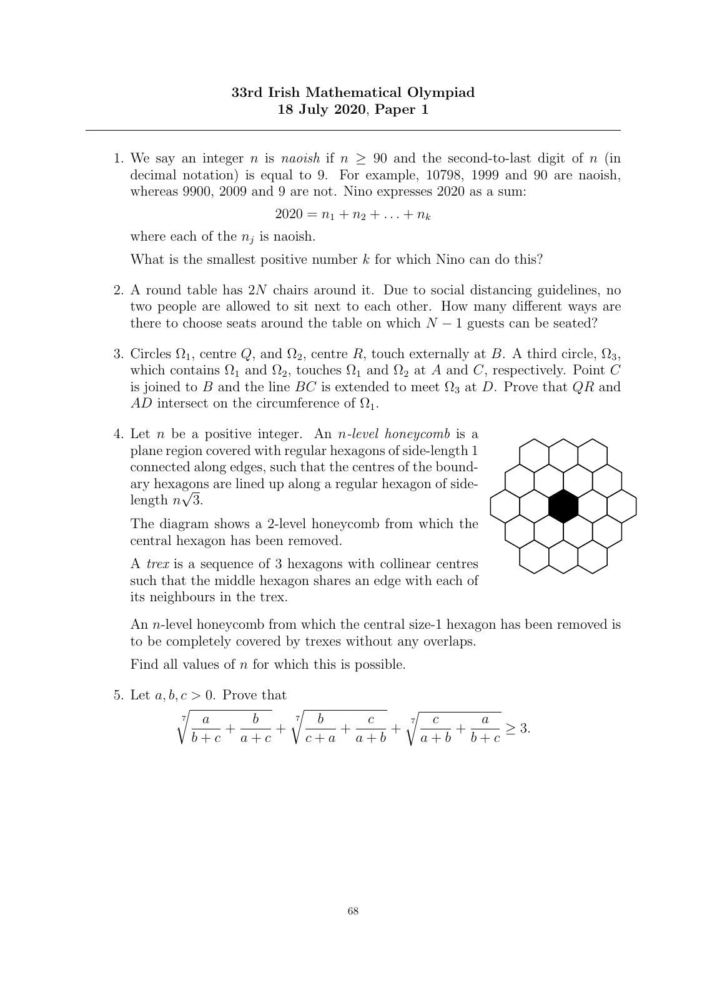

# IrMO 2020 · 18 July 2020

## Q1 | Naoish digit sums | number-theory

An integer $n$ is naoish if $n\ge90$ and its second-to-last decimal digit is $9$. Thus $10798,1999,90$ are naoish, but $9900,2009,9$ are not. Nino writes $2020=n_1+\cdots+n_k$ with each $n_j$ naoish. What is the smallest positive $k$ possible?

## Q2 | Social distancing round a table | combinatorics

A round table has $2N$ chairs. No two people may sit next to each other. How many ways are there to choose seats for $N-1$ guests?

## Q3 | Three touching circles | geometry

Circles $\Omega_1,\Omega_2$, with centres $Q,R$, touch externally at $B$. A third circle $\Omega_3$ contains both and touches them at $A,C$, respectively. Line $BC$ extended meets $\Omega_3$ at $D$. Prove $QR$ and $AD$ intersect on $\Omega_1$.

## Q4 | Honeycomb trex tilings | combinatorics

For positive $n$, an $n$-level honeycomb consists of unit-side regular hexagons joined along edges, whose boundary hexagon centres lie along a regular hexagon of side length $n\sqrt3$. The diagram shows a $2$-level honeycomb with its central hexagon removed. A trex is three hexagons with collinear centres, the middle sharing an edge with each neighbour. Find all $n$ for which an $n$-level honeycomb with its central unit hexagon removed can be covered by trexes without overlap.

## Q5 | Seventh root inequality | inequalities

For $a,b,c>0$, prove
$$\sqrt[7]{\frac a{b+c}+\frac b{a+c}}+\sqrt[7]{\frac b{c+a}+\frac c{a+b}}+\sqrt[7]{\frac c{a+b}+\frac a{b+c}}\ge3.$$

## Q6 | Pentagon recolouring invariant | combinatorics

Each vertex of a pentagon is red or blue. Once per hour all vertices are recoloured: a vertex becomes blue if its two neighbours were the same colour during the last hour, and red if they were different. Prove at least one vertex is blue after the first recolouring and remains blue forever.

## Q7 | Involutive integer function | algebra

A function $f:\mathbb N\to\mathbb N$, with $\mathbb N$ the strictly positive integers, satisfies $f(1)=1$, $f(f(n))=n$, $f(2n)=2f(n)+1$ for every $n$. Find $f(2020)$.

## Q8 | Last three digits of odd product | number-theory

Determine the last three decimal digits of $1\cdot3\cdot5\cdot7\cdots2019$.

## Q9 | Cyclic trapezium identity | geometry

Trapezium $ABCD$, with $AB\parallel DC$, is inscribed in a circle of radius $R$ and centre $O$. The nonparallel sides $DA,CB$ extended meet at $P$; the diagonals meet at $E$. Prove $|OE|\,|OP|=R^2$.

## Q10 | Hexagon with integer distances | geometry, number-theory

Show there exists a hexagon $ABCDEF$ in the plane such that the distance between every pair of vertices is an integer.
