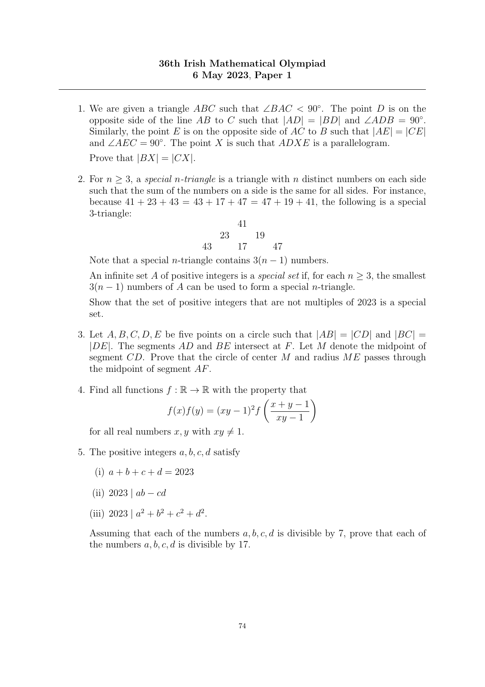

# IrMO 2023 · 6 May 2023

## Q1 | Right isosceles constructions | geometry

Triangle $ABC$ satisfies $\angle BAC<90^\circ$. Point $D$ is on the opposite side of $AB$ to $C$, with $|AD|=|BD|$ and $\angle ADB=90^\circ$. Point $E$ is on the opposite side of $AC$ to $B$, with $|AE|=|CE|$ and $\angle AEC=90^\circ$. If $ADXE$ is a parallelogram, prove $|BX|=|CX|$.

## Q2 | Special number triangles | combinatorics, number-theory

For $n\ge3$, a special $n$-triangle has $n$ distinct numbers on each side, with equal side sums. For example the triangle with corners $41,43,47$ and respective intervening numbers $23,17,19$ is special, since $41+23+43=43+17+47=47+19+41$. There are $3(n-1)$ numbers in a special $n$-triangle. An infinite positive integer set $A$ is special if, for every $n\ge3$, its smallest $3(n-1)$ numbers form a special $n$-triangle. Show the positive integers not divisible by $2023$ form a special set.

## Q3 | Equal chords and a midpoint circle | geometry

Five points $A,B,C,D,E$ lie on a circle with $|AB|=|CD|$, $|BC|=|DE|$. Segments $AD,BE$ meet at $F$ and $M$ is the midpoint of $CD$. Prove the circle with centre $M$ and radius $ME$ passes through the midpoint of $AF$.

## Q4 | Real functional equation with a quotient | algebra

Find all functions $f:\mathbb R\to\mathbb R$ such that
$$f(x)f(y)=(xy-1)^2f\left(\frac{x+y-1}{xy-1}\right)$$
for all real $x,y$ with $xy\ne1$.

## Q5 | Divisibility of four integers | number-theory

Positive integers $a,b,c,d$ satisfy $a+b+c+d=2023$, $2023\mid ab-cd$, $2023\mid a^2+b^2+c^2+d^2$. Assuming each is divisible by $7$, prove each is divisible by $17$.

## Q6 | Totally square digit sums | number-theory

A positive integer is totally square if its decimal digit sum is a square; for example $13$ is totally square since $1+3=2^2$, but $16$ is not. Show infinitely many positive integers are not the sum of two totally square integers.

## Q7 | Prime division game | number-theory, combinatorics

Aisling and Brendan alternate, starting with Aisling, from $x=2023$. A move replaces the positive integer $x$ by $x+1$ or by $x/p$ where $p$ is a prime factor of $x$. The first player to write $1$ wins. Determine which player has a winning strategy.

## Q8 | Cyclic fraction inequality | inequalities

For $a,b,c>0$ with $a+b+c=3$, prove
$$\frac{a+b}{c+2}+\frac{b+c}{a+2}+\frac{c+a}{b+2}\ge2,$$
and determine the equality cases.

## Q9 | Diameter and orthogonal projections | geometry

Triangle $ABC$ has circumcentre $O$ and circumcircle $\Gamma$. Let $AI$ be a diameter. Ray $AI$ meets the circumcircle of $BOC$ for the second time at $P$. Let $AD,IQ$ be perpendicular to $BC$ with $D,Q$ on $BC$, and let $M$ be the midpoint of $BC$. Prove:

(a) $|AD|\,|QI|=|CD|\,|CQ|=|BD|\,|BQ|$.

(b) $IM\parallel PD$.

## Q10 | Basketball scoreboard divisibility | combinatorics, number-theory

Caitlin and Donal play ten rounds of Basketball Shoot-Out. In every round they simultaneously throw a ball at each other's basket, scoring one point for a basket and zero otherwise. The scoreboard records each player's score in every round. Caitlin's cumulative score is at least Donal's after every round. Prove the number of possible scoreboards is divisible by $4$ but not $8$.
