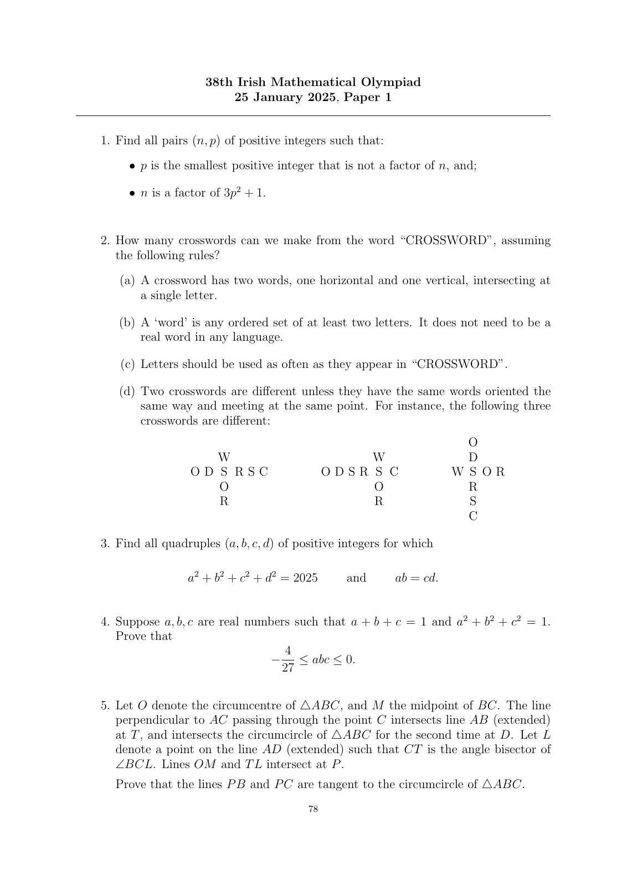

# IrMO 2025 · 25 January 2025

## Q1 | Smallest nonfactor | number-theory

Find all pairs $(n,p)$ of positive integers such that $p$ is the smallest positive integer not dividing $n$, and $n$ divides $3p^2+1$.

## Q2 | CROSSWORD arrangements | combinatorics

How many crosswords can be made from “CROSSWORD”, subject to:

(a) Two words, one horizontal and one vertical, intersect at one letter.

(b) A word is any ordered sequence of at least two letters, whether or not a real word.

(c) Letters are used as often as they appear in “CROSSWORD”.

(d) Two crosswords differ unless their words, orientations and intersection positions are identical. The source diagram illustrates three different crosswords.

## Q3 | Four squares and equal products | number-theory, algebra

Find all positive integer quadruples $(a,b,c,d)$ satisfying
$$a^2+b^2+c^2+d^2=2025,\qquad ab=cd.$$

## Q4 | Triple product bounds | inequalities, algebra

Real $a,b,c$ satisfy $a+b+c=1$ and $a^2+b^2+c^2=1$. Prove $-\frac4{27}\le abc\le0$.

## Q5 | Tangents from a constructed point | geometry

Triangle $ABC$ has circumcentre $O$ and $M$ the midpoint of $BC$. The perpendicular to $AC$ through $C$ meets line $AB$ extended at $T$ and the circumcircle again at $D$. Choose $L$ on line $AD$ extended so $CT$ bisects $\angle BCL$. Let $P=OM\cap TL$. Prove $PB,PC$ are tangent to the circumcircle of $ABC$.

## Q6 | Sudoku diagonal products | number-theory, combinatorics

A Sudoku grid is a $9\times9$ table where each row, each column and each of its nine $3\times3$ subgrids contains $1,2,\ldots,9$ exactly once. Let $M,N$ be the products of the nine numbers on its two diagonals. Prove it is possible that $2025^3$ divides $MN$ but $2025^4$ does not.

## Q7 | Odd digit anchors | number-theory

A positive integer is an anchor if every decimal digit is odd. Show there is an anchor $n$ such that no anchor $m>1$ has $mn$ also an anchor.

## Q8 | Reconstruct a set from extreme sums | algebra, combinatorics

Let $A$ contain five distinct integers and $S=\{x+y:x,y\in A,x\ne y\}$. The two smallest elements of $S$ are $25,31$ and the two largest are $57,71$. Determine every possible $A$.

## Q9 | Intersecting circles and angle bisector | geometry

Circles $\Gamma_1,\Gamma_2$ meet at distinct $A,B$. A line $\ell$ through $A$ meets them again at $C,D$, respectively, with $D$ inside $\Gamma_1$. The perpendicular to $\ell$ through $A$ meets them again at $E,F$. Lines $EC,FD$ extended meet at $X$. If $X$ lies on the perpendicular bisector of $EF$, prove $BX$ bisects $\angle CBD$.

## Q10 | Circular arrangement variation | combinatorics

For $n\ge3$, determine as a function of $n$ the number of circular arrangements $x_1,\ldots,x_n$ of $1,\ldots,n$ with
$$\sum_{i=1}^n|x_i-x_{i+2}|=2n-4,$$
where indices are modulo $n$. Rotations count as the same arrangement.
